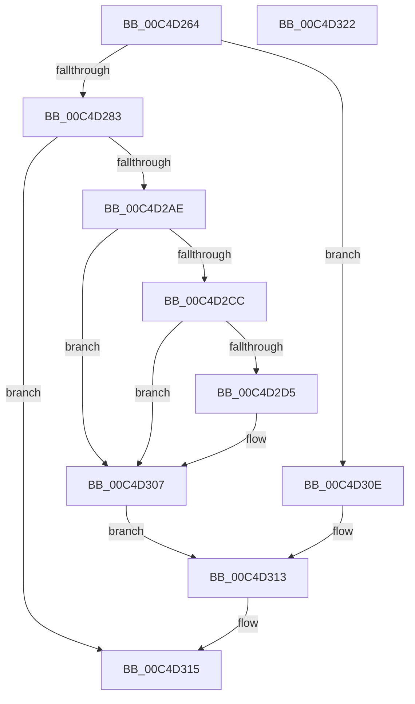

# WMIInitialize

- RVA: `0x00C4D264`–`0x00C4D323` (길이 `191` bytes)
- VA: `0x0000000140C4D264`
- 실행 섹션: `INIT`
- PDB 이름 있음: `예`; PDB Function 태그: `아니요`
- unwind 정보 RVA: `0x0006E5F8`
- 디코드: `47`개 명령, `191/191` bytes 표시
- 미해석 바이트: `0` (있으면 어셈블리에 `.byte`로 보존)

> 이 문서는 커널 이미지의 기계어와 PDB 기호를 분석해 생성했습니다. 4번과 5번은 함수 원형과 자료형을 바이너리 사용 방식에서 추정한 C 해석이며 원본 소스 복구 결과는 아닙니다.

## 1. Dependencies

- 직접 호출 지점: **6**; 고유 호출 대상: **6**
- 직접 호출자로 확인된 함수: **1**
- RIP 상대 이미지 참조: **9**

### Outgoing calls
- `0x00C4D283` → [WmipInitializeAllocs](WmipInitializeAllocs_function_00C4D3C4.md) (function, `0x00C4D3C4`)
- `0x00C4D294` → [RtlInitUnicodeString](../../text/42/RtlInitUnicodeString_function_0042A780.md) (function, `0x0042A780`)
- `0x00C4D2A5` → [IoCreateDriver](../../page/AC/IoCreateDriver_function_00AC9D70.md) (function, `0x00AC9D70`)
- `0x00C4D2BF` → [ExInitializeResourceLite2](../../text/41/ExInitializeResourceLite2_function_0041F710.md) (function, `0x0041F710`)
- `0x00C4D307` → [WmipRegisterFirmwareProviders](WmipRegisterFirmwareProviders_function_00C4D62C.md) (function, `0x00C4D62C`)
- `0x00C4D30E` → [WmipInitializeRegistration](WmipInitializeRegistration_function_00C4D32C.md) (function, `0x00C4D32C`)

### Direct callers
- [IoInitSystemPreDrivers](../C2/IoInitSystemPreDrivers_function_00C2AC3C.md) at `0x00C2B524`
- [IoInitSystemPreDrivers](../C2/IoInitSystemPreDrivers_function_00C2AC3C.md) at `0x00C2BE62`

### Static image references
- `0x00C4D288` → RVA `0x00C7D6D0` (` ?? ::PBOPGDP::`string'`; read)
- `0x00C4D299` → RVA `0x00C4D490` (`WmipDriverEntry`; read)
- `0x00C4D2B5` → RVA `0x00EFFB40` (`.data`; read)
- `0x00C4D2D9` → RVA `0x00FD80E8` (`PAGEDATA`; write)
- `0x00C4D2E3` → RVA `0x00FD8038` (`PAGEDATA`; write)
- `0x00C4D2EC` → RVA `0x00FD805D` (`PAGEDATA`; write)
- `0x00C4D2F5` → RVA `0x00FD805E` (`PAGEDATA`; write)
- `0x00C4D2FB` → RVA `0x00FD805C` (`PAGEDATA`; write)
- `0x00C4D301` → RVA `0x00FD805F` (`PAGEDATA`; write)

## 2. Other-region calls and transfers

- 다른 실행 섹션으로 향하는 call: **3**
  - `0x00C4D294` → [RtlInitUnicodeString](../../text/42/RtlInitUnicodeString_function_0042A780.md) (`INIT` → `.text`)
  - `0x00C4D2A5` → [IoCreateDriver](../../page/AC/IoCreateDriver_function_00AC9D70.md) (`INIT` → `PAGE`)
  - `0x00C4D2BF` → [ExInitializeResourceLite2](../../text/41/ExInitializeResourceLite2_function_0041F710.md) (`INIT` → `.text`)
- 별도 외부 분기/꼬리 이동을 확인하지 못했습니다.

## 3. Assembly (complete function range)

```asm
00C4D264  48 89 5C 24 08                  mov qword ptr [rsp + 8], rbx
00C4D269  57                              push rdi
00C4D26A  48 83 EC 30                     sub rsp, 0x30
00C4D26E  33 DB                           xor ebx, ebx
00C4D270  0F 57 C0                        xorps xmm0, xmm0
00C4D273  48 8B FA                        mov rdi, rdx
00C4D276  0F 11 44 24 20                  movups xmmword ptr [rsp + 0x20], xmm0
00C4D27B  85 C9                           test ecx, ecx
00C4D27D  0F 85 8B 00 00 00               jne 0x140c4d30e
00C4D283  E8 3C 01 00 00                  call 0x140c4d3c4
00C4D288  48 8D 15 41 04 03 00            lea rdx, [rip + 0x30441]
00C4D28F  48 8D 4C 24 20                  lea rcx, [rsp + 0x20]
00C4D294  E8 E7 D4 7D FF                  call 0x14042a780
00C4D299  48 8D 15 F0 01 00 00            lea rdx, [rip + 0x1f0]
00C4D2A0  48 8D 4C 24 20                  lea rcx, [rsp + 0x20]
00C4D2A5  E8 C6 CA E7 FF                  call 0x140ac9d70
00C4D2AA  85 C0                           test eax, eax
00C4D2AC  78 67                           js 0x140c4d315
00C4D2AE  48 8B BF F0 00 00 00            mov rdi, qword ptr [rdi + 0xf0]
00C4D2B5  48 8D 0D 84 28 2B 00            lea rcx, [rip + 0x2b2884]
00C4D2BC  83 CA FF                        or edx, 0xffffffff
00C4D2BF  E8 4C 24 7D FF                  call 0x14041f710
00C4D2C4  81 3F 30 11 00 00               cmp dword ptr [rdi], 0x1130
00C4D2CA  72 3B                           jb 0x140c4d307
00C4D2CC  48 8B 4F 38                     mov rcx, qword ptr [rdi + 0x38]
00C4D2D0  48 85 C9                        test rcx, rcx
00C4D2D3  74 32                           je 0x140c4d307
00C4D2D5  48 8B 41 10                     mov rax, qword ptr [rcx + 0x10]
00C4D2D9  48 89 05 08 AE 38 00            mov qword ptr [rip + 0x38ae08], rax
00C4D2E0  8B 41 0C                        mov eax, dword ptr [rcx + 0xc]
00C4D2E3  89 05 4F AD 38 00               mov dword ptr [rip + 0x38ad4f], eax
00C4D2E9  8A 41 07                        mov al, byte ptr [rcx + 7]
00C4D2EC  88 05 6B AD 38 00               mov byte ptr [rip + 0x38ad6b], al
00C4D2F2  8A 41 08                        mov al, byte ptr [rcx + 8]
00C4D2F5  88 05 63 AD 38 00               mov byte ptr [rip + 0x38ad63], al
00C4D2FB  88 1D 5B AD 38 00               mov byte ptr [rip + 0x38ad5b], bl
00C4D301  88 1D 58 AD 38 00               mov byte ptr [rip + 0x38ad58], bl
00C4D307  E8 20 03 00 00                  call 0x140c4d62c
00C4D30C  EB 05                           jmp 0x140c4d313
00C4D30E  E8 19 00 00 00                  call 0x140c4d32c
00C4D313  B3 01                           mov bl, 1
00C4D315  8A C3                           mov al, bl
00C4D317  48 8B 5C 24 40                  mov rbx, qword ptr [rsp + 0x40]
00C4D31C  48 83 C4 30                     add rsp, 0x30
00C4D320  5F                              pop rdi
00C4D321  C3                              ret
00C4D322  CC                              int3
```

## 4. C-style interpretation (structured pseudocode)

```c
__int64 __fastcall WMIInitialize(int a1, __int64 a2)
{
    __int64 result;
    __int64 v_rbx;
    __int64 v_rsp;
    unsigned __int64 v_stack_m18;
    unsigned __int64 v_stack_p8;

    v_stack_p8 = v_rbx;
    v_rsp = (v_rsp) - (48);
    v_rbx = 0;
    v_stack_m18 = v_xmm0;
    if (a1 != 0) goto loc_00C4D30E;
    result = WmipInitializeAllocs(a1, a2, a3, a4);
    result = RtlInitUnicodeString(v_stack_m18, v_rip + 197697, a3, a4);
    result = IoCreateDriver(v_stack_m18, v_rip + 496, a3, a4);
    if (sign_flag) goto loc_00C4D315;
    a2 = (unsigned int)((v_rip + 496) | (0xFFFFFFFFULL));
    result = ExInitializeResourceLite2(v_rip + 2828420, a2, a3, a4);
    if ((*(unsigned int *)(*(unsigned __int64 *)(a2 + 240))) < 0x1130ULL) goto loc_00C4D307;
    if (*(unsigned __int64 *)(*(unsigned __int64 *)(a2 + 240) + 56) != 0) {
        result = *(unsigned __int64 *)(*(unsigned __int64 *)(*(unsigned __int64 *)(a2 + 240) + 56) + 16);
        *(unsigned __int64 *)(v_rip + 3714568) = result;
        result = *(unsigned int *)(*(unsigned __int64 *)(*(unsigned __int64 *)(a2 + 240) + 56) + 12);
        *(unsigned int *)(v_rip + 3714383) = (unsigned int)(result);
        result = *(unsigned __int8 *)(*(unsigned __int64 *)(*(unsigned __int64 *)(a2 + 240) + 56) + 7);
        *(unsigned __int8 *)(v_rip + 3714411) = (unsigned __int8)(result);
        result = *(unsigned __int8 *)(*(unsigned __int64 *)(*(unsigned __int64 *)(a2 + 240) + 56) + 8);
        *(unsigned __int8 *)(v_rip + 3714403) = (unsigned __int8)(result);
        *(unsigned __int8 *)(v_rip + 3714395) = 0;
        *(unsigned __int8 *)(v_rip + 3714392) = 0;
    }
    result = WmipRegisterFirmwareProviders(*(unsigned __int64 *)(*(unsigned __int64 *)(a2 + 240) + 56), a2, a3, a4);
    goto loc_00C4D313;
loc_00C4D30E:
    result = WmipInitializeRegistration(*(unsigned __int64 *)(*(unsigned __int64 *)(a2 + 240) + 56), a2, a3, a4);
loc_00C4D313:
loc_00C4D315:
    v_rsp = (v_rsp) + (48);
    return 1;
}
```

## 5. (Beta) C Style

```c
int64_t WMIInitialize(int32_t Arg1, void *Arg2)
{
    uint8_t *arg2 = (uint8_t *)Arg2;

    int64_t result;
    int64_t local_rbx;
    int64_t local_rsp;
    uint64_t v_stack_m18;
    uint64_t v_stack_p8;

    v_stack_p8 = local_rbx;
    local_rsp = (local_rsp) - (48);
    local_rbx = 0;
    v_stack_m18 = v_xmm0;
    if (Arg1 != 0) goto loc_00C4D30E;
    result = WmipInitializeAllocs(Arg1, Arg2, a3, a4);
    result = RtlInitUnicodeString(v_stack_m18, v_rip + 197697, a3, a4);
    result = IoCreateDriver(v_stack_m18, v_rip + 496, a3, a4);
    if (sign_flag) goto loc_00C4D315;
    Arg2 = (uint32_t)((v_rip + 496) | (0xFFFFFFFFULL));
    result = ExInitializeResourceLite2(v_rip + 2828420, Arg2, a3, a4);
    if ((*(uint32_t *)(*(uint64_t *)(arg2 + 0xF0))) < 0x1130ULL) goto loc_00C4D307;
    if (*(uint64_t *)(*(uint64_t *)(arg2 + 0xF0) + 0x38) != 0) {
        result = *(uint64_t *)(*(uint64_t *)(*(uint64_t *)(arg2 + 0xF0) + 0x38) + 0x10);
        *(uint64_t *)(v_rip + 0x38AE08) = result;
        result = *(uint32_t *)(*(uint64_t *)(*(uint64_t *)(arg2 + 0xF0) + 0x38) + 0xC);
        *(uint32_t *)(v_rip + 0x38AD4F) = (uint32_t)(result);
        result = *(uint8_t *)(*(uint64_t *)(*(uint64_t *)(arg2 + 0xF0) + 0x38) + 0x7);
        *(uint8_t *)(v_rip + 0x38AD6B) = (uint8_t)(result);
        result = *(uint8_t *)(*(uint64_t *)(*(uint64_t *)(arg2 + 0xF0) + 0x38) + 0x8);
        *(uint8_t *)(v_rip + 0x38AD63) = (uint8_t)(result);
        *(uint8_t *)(v_rip + 0x38AD5B) = 0;
        *(uint8_t *)(v_rip + 0x38AD58) = 0;
    }
    result = WmipRegisterFirmwareProviders(*(uint64_t *)(*(uint64_t *)(arg2 + 0xF0) + 0x38), Arg2, a3, a4);
    goto loc_00C4D313;
loc_00C4D30E:
    result = WmipInitializeRegistration(*(uint64_t *)(*(uint64_t *)(arg2 + 0xF0) + 0x38), Arg2, a3, a4);
loc_00C4D313:
loc_00C4D315:
    local_rsp = (local_rsp) + (48);
    return 1;
}
```

### 관측된 메모리 오프셋

구조체 형식이 확인되지 않은 접근은 인자 기준의 오프셋으로만 기록했습니다.

| 기준 인자 | 오프셋 표현 | 폭 (bit) | 접근 |
|---|---:|---:|---|
| `Arg2` | `+ 0xF0` | `64` | `R` |

## 6. Execution-region graph

[열기: 2D/3D 그래프와 함수 탐색 컨트롤 패널](../../../control-panel.html?section=init&rva=0x00C4D264&view=graph)

- 2D 그래프는 위에서 아래로 흐르고, 3D 그래프는 빈 공간을 드래그해 회전합니다. Shift+드래그는 이동, 휠은 확대·축소, 함수 노드 선택은 대상 보고서 이동입니다.

### Static fallback


