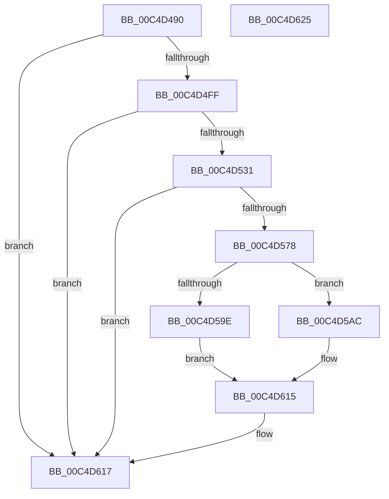

# WmipDriverEntry

- RVA: `0x00C4D490`–`0x00C4D626` (길이 `406` bytes)
- VA: `0x0000000140C4D490`
- 실행 섹션: `INIT`
- PDB 이름 있음: `예`; PDB Function 태그: `아니요`
- unwind 정보 RVA: `0x000D29B0`
- 디코드: `84`개 명령, `406/406` bytes 표시
- 미해석 바이트: `0` (있으면 어셈블리에 `.byte`로 보존)

> 이 문서는 커널 이미지의 기계어와 PDB 기호를 분석해 생성했습니다. 4번과 5번은 함수 원형과 자료형을 바이너리 사용 방식에서 추정한 C 해석이며 원본 소스 복구 결과는 아닙니다.

## 1. Dependencies

- 직접 호출 지점: **13**; 고유 호출 대상: **12**
- 직접 호출자로 확인된 함수: **0**
- RIP 상대 이미지 참조: **14**

### Outgoing calls
- `0x00C4D4C0` → [KiInitializeMutant](../../text/45/KiInitializeMutant_function_00456E9C.md) (function, `0x00456E9C`)
- `0x00C4D4C7` → [WmipInitializeRegistration](WmipInitializeRegistration_function_00C4D32C.md) (function, `0x00C4D32C`)
- `0x00C4D4F2` → [WmipInitializeDataStructs](WmipInitializeDataStructs_function_00C4D6BC.md) (function, `0x00C4D6BC`)
- `0x00C4D50B` → [RtlInitAnsiString](../../text/47/RtlInitAnsiString_function_00470F40.md) (function, `0x00470F40`)
- `0x00C4D51F` → [RtlAnsiStringToUnicodeString](../../page/90/RtlAnsiStringToUnicodeString_function_0090BEA0.md) (function, `0x0090BEA0`)
- `0x00C4D524` → [WmipInitializeSecurity](WmipInitializeSecurity_function_00C4D840.md) (function, `0x00C4D840`)
- `0x00C4D53D` → [RtlInitUnicodeString](../../text/42/RtlInitUnicodeString_function_0042A780.md) (function, `0x0042A780`)
- `0x00C4D56B` → [IoCreateDevice](../../page/9A/IoCreateDevice_function_009A4B00.md) (function, `0x009A4B00`)
- `0x00C4D584` → [RtlInitUnicodeString](../../text/42/RtlInitUnicodeString_function_0042A780.md) (function, `0x0042A780`)
- `0x00C4D593` → [IoCreateSymbolicLink](../../page/A3/IoCreateSymbolicLink_function_00A33760.md) (function, `0x00A33760`)
- `0x00C4D5A5` → [IoDeleteDevice](../../text/26/IoDeleteDevice_function_0026FE90.md) (function, `0x0026FE90`)
- `0x00C4D604` → [IoWMIRegistrationControl](../../page/9E/IoWMIRegistrationControl_function_009E2D60.md) (function, `0x009E2D60`)
- `0x00C4D610` → [IoRegisterShutdownNotification](../../page/71/IoRegisterShutdownNotification_function_0071DB50.md) (function, `0x0071DB50`)

### Direct callers
- 이 함수 시작 RVA로 연결되는 직접 call은 확인되지 않았습니다. 간접 호출은 완전히 역산할 수 없습니다.

### Static image references
- `0x00C4D4A5` → RVA `0x00EFFA60` (`.data`; read)
- `0x00C4D4CC` → RVA `0x00EFFAD8` (`.data`; read/write)
- `0x00C4D4D4` → RVA `0x009DF9D0` (`WmipEventNotification`; read)
- `0x00C4D4DB` → RVA `0x00EFFAC0` (`.data`; read/write)
- `0x00C4D4E3` → RVA `0x00EFFAA8` (`.data`; read/write)
- `0x00C4D4EB` → RVA `0x00EFFAD0` (`.data`; write)
- `0x00C4D4FF` → RVA `0x00C7D6F0` (` ?? ::PBOPGDP::`string'`; read)
- `0x00C4D518` → RVA `0x00EFFA40` (`.data`; read)
- `0x00C4D531` → RVA `0x00C7D770` (` ?? ::PBOPGDP::`string'`; read)
- `0x00C4D542` → RVA `0x00EFFA98` (`.data`; read)
- `0x00C4D578` → RVA `0x00C7D730` (` ?? ::PBOPGDP::`string'`; read)
- `0x00C4D5B3` → RVA `0x00AA5D50` (`WmipOpenCloseCleanup`; read)
- `0x00C4D5C3` → RVA `0x009DEBD0` (`WmipIoControl`; read)
- `0x00C4D5D1` → RVA `0x00A4EAE0` (`WmipSystemControl`; read)

## 2. Other-region calls and transfers

- 다른 실행 섹션으로 향하는 call: **10**
  - `0x00C4D4C0` → [KiInitializeMutant](../../text/45/KiInitializeMutant_function_00456E9C.md) (`INIT` → `.text`)
  - `0x00C4D50B` → [RtlInitAnsiString](../../text/47/RtlInitAnsiString_function_00470F40.md) (`INIT` → `.text`)
  - `0x00C4D51F` → [RtlAnsiStringToUnicodeString](../../page/90/RtlAnsiStringToUnicodeString_function_0090BEA0.md) (`INIT` → `PAGE`)
  - `0x00C4D53D` → [RtlInitUnicodeString](../../text/42/RtlInitUnicodeString_function_0042A780.md) (`INIT` → `.text`)
  - `0x00C4D56B` → [IoCreateDevice](../../page/9A/IoCreateDevice_function_009A4B00.md) (`INIT` → `PAGE`)
  - `0x00C4D584` → [RtlInitUnicodeString](../../text/42/RtlInitUnicodeString_function_0042A780.md) (`INIT` → `.text`)
  - `0x00C4D593` → [IoCreateSymbolicLink](../../page/A3/IoCreateSymbolicLink_function_00A33760.md) (`INIT` → `PAGE`)
  - `0x00C4D5A5` → [IoDeleteDevice](../../text/26/IoDeleteDevice_function_0026FE90.md) (`INIT` → `.text`)
  - `0x00C4D604` → [IoWMIRegistrationControl](../../page/9E/IoWMIRegistrationControl_function_009E2D60.md) (`INIT` → `PAGE`)
  - `0x00C4D610` → [IoRegisterShutdownNotification](../../page/71/IoRegisterShutdownNotification_function_0071DB50.md) (`INIT` → `PAGE`)
- 별도 외부 분기/꼬리 이동을 확인하지 못했습니다.

## 3. Assembly (complete function range)

```asm
00C4D490  48 8B C4                        mov rax, rsp
00C4D493  48 89 58 08                     mov qword ptr [rax + 8], rbx
00C4D497  57                              push rdi
00C4D498  48 83 EC 70                     sub rsp, 0x70
00C4D49C  0F 57 C0                        xorps xmm0, xmm0
00C4D49F  48 8B F9                        mov rdi, rcx
00C4D4A2  0F 57 C9                        xorps xmm1, xmm1
00C4D4A5  48 8D 0D B4 25 2B 00            lea rcx, [rip + 0x2b25b4]
00C4D4AC  45 33 C9                        xor r9d, r9d
00C4D4AF  41 B0 01                        mov r8b, 1
00C4D4B2  33 D2                           xor edx, edx
00C4D4B4  0F 11 40 C8                     movups xmmword ptr [rax - 0x38], xmm0
00C4D4B8  0F 11 48 E8                     movups xmmword ptr [rax - 0x18], xmm1
00C4D4BC  0F 11 40 D8                     movups xmmword ptr [rax - 0x28], xmm0
00C4D4C0  E8 D7 99 80 FF                  call 0x140456e9c
00C4D4C5  33 C9                           xor ecx, ecx
00C4D4C7  E8 60 FE FF FF                  call 0x140c4d32c
00C4D4CC  48 83 25 04 26 2B 00 00         and qword ptr [rip + 0x2b2604], 0
00C4D4D4  48 8D 05 F5 24 D9 FF            lea rax, [rip - 0x26db0b]
00C4D4DB  48 83 25 DD 25 2B 00 00         and qword ptr [rip + 0x2b25dd], 0
00C4D4E3  48 83 25 BD 25 2B 00 00         and qword ptr [rip + 0x2b25bd], 0
00C4D4EB  48 89 05 DE 25 2B 00            mov qword ptr [rip + 0x2b25de], rax
00C4D4F2  E8 C5 01 00 00                  call 0x140c4d6bc
00C4D4F7  85 C0                           test eax, eax
00C4D4F9  0F 88 18 01 00 00               js 0x140c4d617
00C4D4FF  48 8D 15 EA 01 03 00            lea rdx, [rip + 0x301ea]
00C4D506  48 8D 4C 24 50                  lea rcx, [rsp + 0x50]
00C4D50B  E8 30 3A 82 FF                  call 0x140470f40
00C4D510  41 B0 01                        mov r8b, 1
00C4D513  48 8D 54 24 50                  lea rdx, [rsp + 0x50]
00C4D518  48 8D 0D 21 25 2B 00            lea rcx, [rip + 0x2b2521]
00C4D51F  E8 7C E9 CB FF                  call 0x14090bea0
00C4D524  E8 17 03 00 00                  call 0x140c4d840
00C4D529  85 C0                           test eax, eax
00C4D52B  0F 88 E6 00 00 00               js 0x140c4d617
00C4D531  48 8D 15 38 02 03 00            lea rdx, [rip + 0x30238]
00C4D538  48 8D 4C 24 40                  lea rcx, [rsp + 0x40]
00C4D53D  E8 3E D2 7D FF                  call 0x14042a780
00C4D542  48 8D 05 4F 25 2B 00            lea rax, [rip + 0x2b254f]
00C4D549  41 B9 22 00 00 00               mov r9d, 0x22
00C4D54F  48 89 44 24 30                  mov qword ptr [rsp + 0x30], rax
00C4D554  4C 8D 44 24 40                  lea r8, [rsp + 0x40]
00C4D559  C6 44 24 28 00                  mov byte ptr [rsp + 0x28], 0
00C4D55E  33 D2                           xor edx, edx
00C4D560  48 8B CF                        mov rcx, rdi
00C4D563  C7 44 24 20 00 01 00 00         mov dword ptr [rsp + 0x20], 0x100
00C4D56B  E8 90 75 D5 FF                  call 0x1409a4b00
00C4D570  85 C0                           test eax, eax
00C4D572  0F 88 9F 00 00 00               js 0x140c4d617
00C4D578  48 8D 15 B1 01 03 00            lea rdx, [rip + 0x301b1]
00C4D57F  48 8D 4C 24 60                  lea rcx, [rsp + 0x60]
00C4D584  E8 F7 D1 7D FF                  call 0x14042a780
00C4D589  48 8D 54 24 40                  lea rdx, [rsp + 0x40]
00C4D58E  48 8D 4C 24 60                  lea rcx, [rsp + 0x60]
00C4D593  E8 C8 61 DE FF                  call 0x140a33760
00C4D598  8B D8                           mov ebx, eax
00C4D59A  85 C0                           test eax, eax
00C4D59C  79 0E                           jns 0x140c4d5ac
00C4D59E  48 8B 0D F3 24 2B 00            mov rcx, qword ptr [rip + 0x2b24f3]
00C4D5A5  E8 E6 28 62 FF                  call 0x14026fe90
00C4D5AA  EB 69                           jmp 0x140c4d615
00C4D5AC  48 8B 05 E5 24 2B 00            mov rax, qword ptr [rip + 0x2b24e5]
00C4D5B3  48 8D 0D 96 87 E5 FF            lea rcx, [rip - 0x1a786a]
00C4D5BA  BA 01 00 00 00                  mov edx, 1
00C4D5BF  C6 40 4C 02                     mov byte ptr [rax + 0x4c], 2
00C4D5C3  48 8D 05 06 16 D9 FF            lea rax, [rip - 0x26e9fa]
00C4D5CA  48 89 87 E0 00 00 00            mov qword ptr [rdi + 0xe0], rax
00C4D5D1  48 8D 05 08 15 E0 FF            lea rax, [rip - 0x1feaf8]
00C4D5D8  48 89 87 28 01 00 00            mov qword ptr [rdi + 0x128], rax
00C4D5DF  48 89 4F 70                     mov qword ptr [rdi + 0x70], rcx
00C4D5E3  48 89 8F 80 00 00 00            mov qword ptr [rdi + 0x80], rcx
00C4D5EA  48 89 8F 00 01 00 00            mov qword ptr [rdi + 0x100], rcx
00C4D5F1  48 8B 05 A0 24 2B 00            mov rax, qword ptr [rip + 0x2b24a0]
00C4D5F8  0F BA 70 30 07                  btr dword ptr [rax + 0x30], 7
00C4D5FD  48 8B 0D 94 24 2B 00            mov rcx, qword ptr [rip + 0x2b2494]
00C4D604  E8 57 57 D9 FF                  call 0x1409e2d60
00C4D609  48 8B 0D 88 24 2B 00            mov rcx, qword ptr [rip + 0x2b2488]
00C4D610  E8 3B 05 AD FF                  call 0x14071db50
00C4D615  8B C3                           mov eax, ebx
00C4D617  48 8B 9C 24 80 00 00 00         mov rbx, qword ptr [rsp + 0x80]
00C4D61F  48 83 C4 70                     add rsp, 0x70
00C4D623  5F                              pop rdi
00C4D624  C3                              ret
00C4D625  CC                              int3
```

## 4. C-style interpretation (structured pseudocode)

```c
__int64 __fastcall WmipDriverEntry(__int64 a1, int a2, __int64 a3, int a4)
{
    __int64 result;
    __int64 v_rsp;
    unsigned __int64 v_stack_m18;
    unsigned __int64 v_stack_m28;
    unsigned __int64 v_stack_m38;
    unsigned __int64 v_stack_m48;
    unsigned __int8 v_stack_m50;
    unsigned int v_stack_m58;
    unsigned __int64 v_stack_p8;

    *(unsigned __int64 *)(v_rsp + 8) = v_rbx;
    v_rsp = (v_rsp) - (112);
    a4 = 0;
    a2 = 0;
    *(unsigned __int64 *)(v_rsp - 56) = v_xmm0;
    *(unsigned __int64 *)(v_rsp - 24) = v_xmm1;
    *(unsigned __int64 *)(v_rsp - 40) = v_xmm0;
    result = KiInitializeMutant(v_rip + 2827700, a2, 1, a4);
    a1 = 0;
    result = WmipInitializeRegistration(a1, a2, 1, a4);
    *(unsigned __int64 *)(v_rip + 2827742) = v_rip - 2546443;
    result = WmipInitializeDataStructs(a1, a2, 1, a4);
    if (sign_flag) goto loc_00C4D617;
    result = RtlInitAnsiString(v_stack_m28, v_rip + 197098, 1, a4);
    result = RtlAnsiStringToUnicodeString(v_rip + 2827553, v_stack_m28, 1, a4);
    result = WmipInitializeSecurity(v_rip + 2827553, v_stack_m28, 1, a4);
    if (sign_flag) goto loc_00C4D617;
    result = RtlInitUnicodeString(v_stack_m38, v_rip + 197176, 1, a4);
    v_stack_m48 = v_rip + 2827599;
    v_stack_m50 = 0;
    a2 = 0;
    v_stack_m58 = 256;
    result = IoCreateDevice(0, a2, v_stack_m38, 34);
    if (sign_flag) goto loc_00C4D617;
    result = RtlInitUnicodeString(v_stack_m18, v_rip + 197041, v_stack_m38, 34);
    result = IoCreateSymbolicLink(v_stack_m18, v_stack_m38, v_stack_m38, 34);
    if (!sign_flag) goto loc_00C4D5AC;
    result = IoDeleteDevice(*(unsigned __int64 *)(v_rip + 2827507), v_stack_m38, v_stack_m38, 34);
    goto loc_00C4D615;
loc_00C4D5AC:
    *(unsigned __int8 *)(*(unsigned __int64 *)(v_rip + 2827493) + 76) = 2;
    *(unsigned __int64 *)(a1 + 224) = v_rip - 2550266;
    *(unsigned __int64 *)(a1 + 296) = v_rip - 2091768;
    *(unsigned __int64 *)(a1 + 112) = v_rip - 1734762;
    *(unsigned __int64 *)(a1 + 128) = v_rip - 1734762;
    *(unsigned __int64 *)(a1 + 256) = v_rip - 1734762;
    result = IoWMIRegistrationControl(*(unsigned __int64 *)(v_rip + 2827412), 1, v_stack_m38, 34);
    result = IoRegisterShutdownNotification(*(unsigned __int64 *)(v_rip + 2827400), 1, v_stack_m38, 34);
loc_00C4D615:
loc_00C4D617:
    v_rsp = (v_rsp) + (112);
    return (unsigned int)((unsigned int)((unsigned int)((unsigned int)(result))));
}
```

## 5. (Beta) C Style

```c
int64_t WmipDriverEntry(void *Arg1, int32_t Arg2, int64_t Arg3, int32_t Arg4)
{
    uint8_t *arg1 = (uint8_t *)Arg1;

    int64_t result;
    int64_t local_rsp;
    uint64_t v_stack_m18;
    uint64_t v_stack_m28;
    uint64_t v_stack_m38;
    uint64_t v_stack_m48;
    uint8_t v_stack_m50;
    uint32_t v_stack_m58;
    uint64_t v_stack_p8;

    *(uint64_t *)(local_rsp + 0x8) = local_rbx;
    local_rsp = (local_rsp) - (112);
    Arg4 = 0;
    Arg2 = 0;
    *(uint64_t *)(local_rsp - 0x38) = v_xmm0;
    *(uint64_t *)(local_rsp - 0x18) = v_xmm1;
    *(uint64_t *)(local_rsp - 0x28) = v_xmm0;
    result = KiInitializeMutant(v_rip + 2827700, Arg2, 1, Arg4);
    Arg1 = 0;
    result = WmipInitializeRegistration(Arg1, Arg2, 1, Arg4);
    *(uint64_t *)(v_rip + 0x2B25DE) = v_rip - 2546443;
    result = WmipInitializeDataStructs(Arg1, Arg2, 1, Arg4);
    if (sign_flag) goto loc_00C4D617;
    result = RtlInitAnsiString(v_stack_m28, v_rip + 197098, 1, Arg4);
    result = RtlAnsiStringToUnicodeString(v_rip + 2827553, v_stack_m28, 1, Arg4);
    result = WmipInitializeSecurity(v_rip + 2827553, v_stack_m28, 1, Arg4);
    if (sign_flag) goto loc_00C4D617;
    result = RtlInitUnicodeString(v_stack_m38, v_rip + 197176, 1, Arg4);
    v_stack_m48 = v_rip + 2827599;
    v_stack_m50 = 0;
    Arg2 = 0;
    v_stack_m58 = 256;
    result = IoCreateDevice(0, Arg2, v_stack_m38, 34);
    if (sign_flag) goto loc_00C4D617;
    result = RtlInitUnicodeString(v_stack_m18, v_rip + 197041, v_stack_m38, 34);
    result = IoCreateSymbolicLink(v_stack_m18, v_stack_m38, v_stack_m38, 34);
    if (!sign_flag) goto loc_00C4D5AC;
    result = IoDeleteDevice(*(uint64_t *)(v_rip + 0x2B24F3), v_stack_m38, v_stack_m38, 34);
    goto loc_00C4D615;
loc_00C4D5AC:
    *(uint8_t *)(*(uint64_t *)(v_rip + 0x2B24E5) + 0x4C) = 2;
    *(uint64_t *)(arg1 + 0xE0) = v_rip - 2550266;
    *(uint64_t *)(arg1 + 0x128) = v_rip - 2091768;
    *(uint64_t *)(arg1 + 0x70) = v_rip - 1734762;
    *(uint64_t *)(arg1 + 0x80) = v_rip - 1734762;
    *(uint64_t *)(arg1 + 0x100) = v_rip - 1734762;
    result = IoWMIRegistrationControl(*(uint64_t *)(v_rip + 0x2B2494), 1, v_stack_m38, 34);
    result = IoRegisterShutdownNotification(*(uint64_t *)(v_rip + 0x2B2488), 1, v_stack_m38, 34);
loc_00C4D615:
loc_00C4D617:
    local_rsp = (local_rsp) + (112);
    return (uint32_t)((uint32_t)((uint32_t)((uint32_t)(result))));
}
```

### 관측된 메모리 오프셋

구조체 형식이 확인되지 않은 접근은 인자 기준의 오프셋으로만 기록했습니다.

| 기준 인자 | 오프셋 표현 | 폭 (bit) | 접근 |
|---|---:|---:|---|
| `Arg1` | `+ 0x70` | `64` | `W` |
| `Arg1` | `+ 0x80` | `64` | `W` |
| `Arg1` | `+ 0xE0` | `64` | `W` |
| `Arg1` | `+ 0x100` | `64` | `W` |
| `Arg1` | `+ 0x128` | `64` | `W` |

## 6. Execution-region graph

[열기: 2D/3D 그래프와 함수 탐색 컨트롤 패널](../../../control-panel.html?section=init&rva=0x00C4D490&view=graph)

- 2D 그래프는 위에서 아래로 흐르고, 3D 그래프는 빈 공간을 드래그해 회전합니다. Shift+드래그는 이동, 휠은 확대·축소, 함수 노드 선택은 대상 보고서 이동입니다.

### Static fallback


