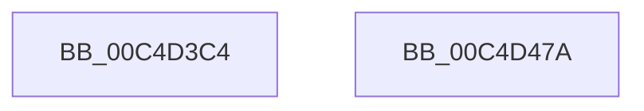

# WmipInitializeAllocs

- RVA: `0x00C4D3C4`–`0x00C4D47B` (길이 `183` bytes)
- VA: `0x0000000140C4D3C4`
- 실행 섹션: `INIT`
- PDB 이름 있음: `예`; PDB Function 태그: `아니요`
- unwind 정보 RVA: `0x000697A4`
- 디코드: `39`개 명령, `183/183` bytes 표시
- 미해석 바이트: `0` (있으면 어셈블리에 `.byte`로 보존)

> 이 문서는 커널 이미지의 기계어와 PDB 기호를 분석해 생성했습니다. 4번과 5번은 함수 원형과 자료형을 바이너리 사용 방식에서 추정한 C 해석이며 원본 소스 복구 결과는 아닙니다.

## 1. Dependencies

- 직접 호출 지점: **4**; 고유 호출 대상: **1**
- 직접 호출자로 확인된 함수: **1**
- RIP 상대 이미지 참조: **4**

### Outgoing calls
- `0x00C4D3F1` → [ExInitializePagedLookasideList](../../page/AA/ExInitializePagedLookasideList_function_00AACC30.md) (function, `0x00AACC30`)
- `0x00C4D41B` → [ExInitializePagedLookasideList](../../page/AA/ExInitializePagedLookasideList_function_00AACC30.md) (function, `0x00AACC30`)
- `0x00C4D445` → [ExInitializePagedLookasideList](../../page/AA/ExInitializePagedLookasideList_function_00AACC30.md) (function, `0x00AACC30`)
- `0x00C4D46F` → [ExInitializePagedLookasideList](../../page/AA/ExInitializePagedLookasideList_function_00AACC30.md) (function, `0x00AACC30`)

### Direct callers
- [WMIInitialize](WMIInitialize_function_00C4D264.md) at `0x00C4D283`

### Static image references
- `0x00C4D3CC` → RVA `0x00E28D80` (`.data`; read)
- `0x00C4D3FB` → RVA `0x00E28E80` (`.data`; read)
- `0x00C4D425` → RVA `0x00E28F00` (`.data`; read)
- `0x00C4D44F` → RVA `0x00E28E00` (`.data`; read)

## 2. Other-region calls and transfers

- 다른 실행 섹션으로 향하는 call: **4**
  - `0x00C4D3F1` → [ExInitializePagedLookasideList](../../page/AA/ExInitializePagedLookasideList_function_00AACC30.md) (`INIT` → `PAGE`)
  - `0x00C4D41B` → [ExInitializePagedLookasideList](../../page/AA/ExInitializePagedLookasideList_function_00AACC30.md) (`INIT` → `PAGE`)
  - `0x00C4D445` → [ExInitializePagedLookasideList](../../page/AA/ExInitializePagedLookasideList_function_00AACC30.md) (`INIT` → `PAGE`)
  - `0x00C4D46F` → [ExInitializePagedLookasideList](../../page/AA/ExInitializePagedLookasideList_function_00AACC30.md) (`INIT` → `PAGE`)
- 별도 외부 분기/꼬리 이동을 확인하지 못했습니다.

## 3. Assembly (complete function range)

```asm
00C4D3C4  40 53                           push rbx
00C4D3C6  48 83 EC 40                     sub rsp, 0x40
00C4D3CA  33 DB                           xor ebx, ebx
00C4D3CC  48 8D 0D AD B9 1D 00            lea rcx, [rip + 0x1db9ad]
00C4D3D3  66 89 5C 24 30                  mov word ptr [rsp + 0x30], bx
00C4D3D8  45 33 C9                        xor r9d, r9d
00C4D3DB  C7 44 24 28 57 6D 44 53         mov dword ptr [rsp + 0x28], 0x53446d57
00C4D3E3  45 33 C0                        xor r8d, r8d
00C4D3E6  33 D2                           xor edx, edx
00C4D3E8  48 C7 44 24 20 78 00 00 00      mov qword ptr [rsp + 0x20], 0x78
00C4D3F1  E8 3A F8 E5 FF                  call 0x140aacc30
00C4D3F6  66 89 5C 24 30                  mov word ptr [rsp + 0x30], bx
00C4D3FB  48 8D 0D 7E BA 1D 00            lea rcx, [rip + 0x1dba7e]
00C4D402  C7 44 24 28 57 6D 47 45         mov dword ptr [rsp + 0x28], 0x45476d57
00C4D40A  45 33 C9                        xor r9d, r9d
00C4D40D  45 33 C0                        xor r8d, r8d
00C4D410  48 C7 44 24 20 A0 00 00 00      mov qword ptr [rsp + 0x20], 0xa0
00C4D419  33 D2                           xor edx, edx
00C4D41B  E8 10 F8 E5 FF                  call 0x140aacc30
00C4D420  66 89 5C 24 30                  mov word ptr [rsp + 0x30], bx
00C4D425  48 8D 0D D4 BA 1D 00            lea rcx, [rip + 0x1dbad4]
00C4D42C  C7 44 24 28 57 6D 49 53         mov dword ptr [rsp + 0x28], 0x53496d57
00C4D434  45 33 C9                        xor r9d, r9d
00C4D437  45 33 C0                        xor r8d, r8d
00C4D43A  48 C7 44 24 20 60 00 00 00      mov qword ptr [rsp + 0x20], 0x60
00C4D443  33 D2                           xor edx, edx
00C4D445  E8 E6 F7 E5 FF                  call 0x140aacc30
00C4D44A  66 89 5C 24 30                  mov word ptr [rsp + 0x30], bx
00C4D44F  48 8D 0D AA B9 1D 00            lea rcx, [rip + 0x1db9aa]
00C4D456  C7 44 24 28 57 6D 4D 52         mov dword ptr [rsp + 0x28], 0x524d6d57
00C4D45E  45 33 C9                        xor r9d, r9d
00C4D461  45 33 C0                        xor r8d, r8d
00C4D464  48 C7 44 24 20 38 00 00 00      mov qword ptr [rsp + 0x20], 0x38
00C4D46D  33 D2                           xor edx, edx
00C4D46F  E8 BC F7 E5 FF                  call 0x140aacc30
00C4D474  48 83 C4 40                     add rsp, 0x40
00C4D478  5B                              pop rbx
00C4D479  C3                              ret
00C4D47A  CC                              int3
```

## 4. C-style interpretation (structured pseudocode)

```c
__int64 __fastcall WmipInitializeAllocs(__int64 a1, int a2, int a3, int a4)
{
    __int64 result;
    __int64 v_rbx;
    __int64 v_rsp;
    unsigned __int16 v_stack_m18;
    unsigned int v_stack_m20;
    unsigned __int64 v_stack_m28;

    v_rsp = (v_rsp) - (64);
    v_rbx = 0;
    v_stack_m18 = 0;
    a4 = 0;
    v_stack_m20 = 0x53446D57ULL;
    a3 = 0;
    a2 = 0;
    v_stack_m28 = 120;
    result = ExInitializePagedLookasideList(v_rip + 1948077, a2, a3, a4);
    v_stack_m18 = 0;
    v_stack_m20 = 0x45476D57ULL;
    a4 = 0;
    a3 = 0;
    v_stack_m28 = 160;
    a2 = 0;
    result = ExInitializePagedLookasideList(v_rip + 1948286, a2, a3, a4);
    v_stack_m18 = 0;
    v_stack_m20 = 0x53496D57ULL;
    a4 = 0;
    a3 = 0;
    v_stack_m28 = 96;
    a2 = 0;
    result = ExInitializePagedLookasideList(v_rip + 1948372, a2, a3, a4);
    v_stack_m18 = 0;
    v_stack_m20 = 0x524D6D57ULL;
    a4 = 0;
    a3 = 0;
    v_stack_m28 = 56;
    a2 = 0;
    result = ExInitializePagedLookasideList(v_rip + 1948074, a2, a3, a4);
    v_rsp = (v_rsp) + (64);
    return result;
}
```

## 5. (Beta) C Style

```c
int64_t WmipInitializeAllocs(int64_t Arg1, int32_t Arg2, int32_t Arg3, int32_t Arg4)
{
    int64_t result;
    int64_t local_rbx;
    int64_t local_rsp;
    uint16_t v_stack_m18;
    uint32_t v_stack_m20;
    uint64_t v_stack_m28;

    local_rsp = (local_rsp) - (64);
    local_rbx = 0;
    v_stack_m18 = 0;
    Arg4 = 0;
    v_stack_m20 = 0x53446D57ULL;
    Arg3 = 0;
    Arg2 = 0;
    v_stack_m28 = 120;
    result = ExInitializePagedLookasideList(v_rip + 1948077, Arg2, Arg3, Arg4);
    v_stack_m18 = 0;
    v_stack_m20 = 0x45476D57ULL;
    Arg4 = 0;
    Arg3 = 0;
    v_stack_m28 = 160;
    Arg2 = 0;
    result = ExInitializePagedLookasideList(v_rip + 1948286, Arg2, Arg3, Arg4);
    v_stack_m18 = 0;
    v_stack_m20 = 0x53496D57ULL;
    Arg4 = 0;
    Arg3 = 0;
    v_stack_m28 = 96;
    Arg2 = 0;
    result = ExInitializePagedLookasideList(v_rip + 1948372, Arg2, Arg3, Arg4);
    v_stack_m18 = 0;
    v_stack_m20 = 0x524D6D57ULL;
    Arg4 = 0;
    Arg3 = 0;
    v_stack_m28 = 56;
    Arg2 = 0;
    result = ExInitializePagedLookasideList(v_rip + 1948074, Arg2, Arg3, Arg4);
    local_rsp = (local_rsp) + (64);
    return result;
}
```

## 6. Execution-region graph

[열기: 2D/3D 그래프와 함수 탐색 컨트롤 패널](../../../control-panel.html?section=init&rva=0x00C4D3C4&view=graph)

- 2D 그래프는 위에서 아래로 흐르고, 3D 그래프는 빈 공간을 드래그해 회전합니다. Shift+드래그는 이동, 휠은 확대·축소, 함수 노드 선택은 대상 보고서 이동입니다.

### Static fallback


