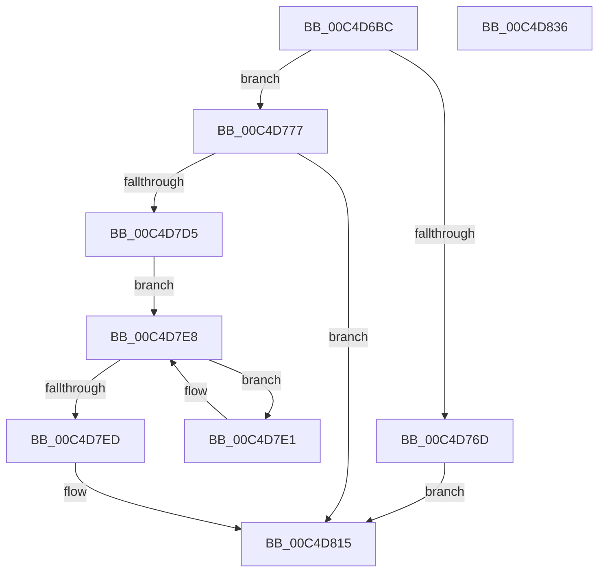

# WmipInitializeDataStructs

- RVA: `0x00C4D6BC`–`0x00C4D837` (길이 `379` bytes)
- VA: `0x0000000140C4D6BC`
- 실행 섹션: `INIT`
- PDB 이름 있음: `예`; PDB Function 태그: `아니요`
- unwind 정보 RVA: `0x000D32F4`
- 디코드: `80`개 명령, `379/379` bytes 표시
- 미해석 바이트: `0` (있으면 어셈블리에 `.byte`로 보존)

> 이 문서는 커널 이미지의 기계어와 PDB 기호를 분석해 생성했습니다. 4번과 5번은 함수 원형과 자료형을 바이너리 사용 방식에서 추정한 C 해석이며 원본 소스 복구 결과는 아닙니다.

## 1. Dependencies

- 직접 호출 지점: **5**; 고유 호출 대상: **5**
- 직접 호출자로 확인된 함수: **1**
- RIP 상대 이미지 참조: **16**

### Outgoing calls
- `0x00C4D760` → [WmipAllocRegEntry](../../text/4B/WmipAllocRegEntry_function_004B6D24.md) (function, `0x004B6D24`)
- `0x00C4D781` → [memset](../../text/6C/memset_function_006C6C40.md) (function, `0x006C6C40`)
- `0x00C4D7CC` → [WmipAddDataSource](../../page/9D/WmipAddDataSource_function_009DDC30.md) (function, `0x009DDC30`)
- `0x00C4D80B` → [WmipAddMofResource](../../page/7B/WmipAddMofResource_function_007B4188.md) (function, `0x007B4188`)
- `0x00C4D81C` → [_security_check_cookie](../../text/6A/_security_check_cookie_function_006AC640.md) (function, `0x006AC640`)

### Direct callers
- [WmipDriverEntry](WmipDriverEntry_function_00C4D490.md) at `0x00C4D4F2`

### Static image references
- `0x00C4D6D3` → RVA `0x00E0A740` (`.data`; read)
- `0x00C4D6E1` → RVA `0x00EFFAF0` (`.data`; read)
- `0x00C4D6EF` → RVA `0x00EFFB20` (`.data`; write)
- `0x00C4D6F8` → RVA `0x00EFFAF8` (`.data`; write)
- `0x00C4D704` → RVA `0x00EFFAF0` (`.data`; write)
- `0x00C4D70F` → RVA `0x00EFFB00` (`.data`; read)
- `0x00C4D71D` → RVA `0x00EFFB28` (`.data`; write)
- `0x00C4D724` → RVA `0x00EFFB08` (`.data`; write)
- `0x00C4D72B` → RVA `0x00EFFB00` (`.data`; write)
- `0x00C4D732` → RVA `0x00EFFB10` (`.data`; read)
- `0x00C4D739` → RVA `0x00EFFAE0` (`.data`; write)
- `0x00C4D740` → RVA `0x00EFFB18` (`.data`; write)
- `0x00C4D747` → RVA `0x00EFFB10` (`.data`; write)
- `0x00C4D7D5` → RVA `0x00EFFB28` (`.data`; read)
- `0x00C4D7F5` → RVA `0x00C7D7C0` (` ?? ::PBOPGDP::`string'`; read)
- `0x00C4D804` → RVA `0x00C7D7A0` (` ?? ::PBOPGDP::`string'`; read)

## 2. Other-region calls and transfers

- 다른 실행 섹션으로 향하는 call: **5**
  - `0x00C4D760` → [WmipAllocRegEntry](../../text/4B/WmipAllocRegEntry_function_004B6D24.md) (`INIT` → `.text`)
  - `0x00C4D781` → [memset](../../text/6C/memset_function_006C6C40.md) (`INIT` → `.text`)
  - `0x00C4D7CC` → [WmipAddDataSource](../../page/9D/WmipAddDataSource_function_009DDC30.md) (`INIT` → `PAGE`)
  - `0x00C4D80B` → [WmipAddMofResource](../../page/7B/WmipAddMofResource_function_007B4188.md) (`INIT` → `PAGE`)
  - `0x00C4D81C` → [_security_check_cookie](../../text/6A/_security_check_cookie_function_006AC640.md) (`INIT` → `.text`)
- 별도 외부 분기/꼬리 이동을 확인하지 못했습니다.

## 3. Assembly (complete function range)

```asm
00C4D6BC  48 89 5C 24 08                  mov qword ptr [rsp + 8], rbx
00C4D6C1  48 89 74 24 10                  mov qword ptr [rsp + 0x10], rsi
00C4D6C6  55                              push rbp
00C4D6C7  48 8D 6C 24 A9                  lea rbp, [rsp - 0x57]
00C4D6CC  48 81 EC C0 00 00 00            sub rsp, 0xc0
00C4D6D3  48 8B 05 66 D0 1B 00            mov rax, qword ptr [rip + 0x1bd066]
00C4D6DA  48 33 C4                        xor rax, rsp
00C4D6DD  48 89 45 47                     mov qword ptr [rbp + 0x47], rax
00C4D6E1  48 8D 05 08 24 2B 00            lea rax, [rip + 0x2b2408]
00C4D6E8  C7 45 CF BD F7 DF E3            mov dword ptr [rbp - 0x31], 0xe3dff7bd
00C4D6EF  48 89 05 2A 24 2B 00            mov qword ptr [rip + 0x2b242a], rax
00C4D6F6  33 F6                           xor esi, esi
00C4D6F8  48 89 05 F9 23 2B 00            mov qword ptr [rip + 0x2b23f9], rax
00C4D6FF  BA 00 00 00 50                  mov edx, 0x50000000
00C4D704  48 89 05 E5 23 2B 00            mov qword ptr [rip + 0x2b23e5], rax
00C4D70B  48 83 C9 FF                     or rcx, 0xffffffffffffffff
00C4D70F  48 8D 05 EA 23 2B 00            lea rax, [rip + 0x2b23ea]
00C4D716  C7 45 D3 15 39 D2 11            mov dword ptr [rbp - 0x2d], 0x11d23915
00C4D71D  48 89 05 04 24 2B 00            mov qword ptr [rip + 0x2b2404], rax
00C4D724  48 89 05 DD 23 2B 00            mov qword ptr [rip + 0x2b23dd], rax
00C4D72B  48 89 05 CE 23 2B 00            mov qword ptr [rip + 0x2b23ce], rax
00C4D732  48 8D 05 D7 23 2B 00            lea rax, [rip + 0x2b23d7]
00C4D739  48 89 05 A0 23 2B 00            mov qword ptr [rip + 0x2b23a0], rax
00C4D740  48 89 05 D1 23 2B 00            mov qword ptr [rip + 0x2b23d1], rax
00C4D747  48 89 05 C2 23 2B 00            mov qword ptr [rip + 0x2b23c2], rax
00C4D74E  C7 45 D7 91 03 00 C0            mov dword ptr [rbp - 0x29], 0xc0000391
00C4D755  C7 45 DB 4F B9 98 A2            mov dword ptr [rbp - 0x25], 0xa298b94f
00C4D75C  40 88 75 C7                     mov byte ptr [rbp - 0x39], sil
00C4D760  E8 BF 95 86 FF                  call 0x1404b6d24
00C4D765  48 8B D8                        mov rbx, rax
00C4D768  48 85 C0                        test rax, rax
00C4D76B  75 0A                           jne 0x140c4d777
00C4D76D  B8 9A 00 00 C0                  mov eax, 0xc000009a
00C4D772  E9 9E 00 00 00                  jmp 0x140c4d815
00C4D777  33 D2                           xor edx, edx
00C4D779  48 8D 4D E7                     lea rcx, [rbp - 0x19]
00C4D77D  44 8D 42 58                     lea r8d, [rdx + 0x58]
00C4D781  E8 BA 94 A7 FF                  call 0x1406c6c40
00C4D786  0F 10 45 CF                     movups xmm0, xmmword ptr [rbp - 0x31]
00C4D78A  45 33 C9                        xor r9d, r9d
00C4D78D  C7 45 E7 58 00 00 00            mov dword ptr [rbp - 0x19], 0x58
00C4D794  48 8D 55 E7                     lea rdx, [rbp - 0x19]
00C4D798  C7 45 F7 02 00 00 00            mov dword ptr [rbp - 9], 2
00C4D79F  48 8B CB                        mov rcx, rbx
00C4D7A2  C7 45 FF D0 35 BF C7            mov dword ptr [rbp - 1], 0xc7bf35d0
00C4D7A9  C7 45 03 DB AA D1 11            mov dword ptr [rbp + 3], 0x11d1aadb
00C4D7B0  45 8D 41 58                     lea r8d, [r9 + 0x58]
00C4D7B4  C7 45 07 BF 4A 00 A0            mov dword ptr [rbp + 7], 0xa0004abf
00C4D7BB  C7 45 0B C9 06 29 10            mov dword ptr [rbp + 0xb], 0x102906c9
00C4D7C2  F3 0F 7F 45 1F                  movdqu xmmword ptr [rbp + 0x1f], xmm0
00C4D7C7  48 89 74 24 20                  mov qword ptr [rsp + 0x20], rsi
00C4D7CC  E8 5F 04 D9 FF                  call 0x1409ddc30
00C4D7D1  85 C0                           test eax, eax
00C4D7D3  78 40                           js 0x140c4d815
00C4D7D5  48 8B 0D 4C 23 2B 00            mov rcx, qword ptr [rip + 0x2b234c]
00C4D7DC  48 8B 01                        mov rax, qword ptr [rcx]
00C4D7DF  EB 07                           jmp 0x140c4d7e8
00C4D7E1  83 48 10 01                     or dword ptr [rax + 0x10], 1
00C4D7E5  48 8B 00                        mov rax, qword ptr [rax]
00C4D7E8  48 3B C1                        cmp rax, rcx
00C4D7EB  75 F4                           jne 0x140c4d7e1
00C4D7ED  48 8B 4B 20                     mov rcx, qword ptr [rbx + 0x20]
00C4D7F1  48 8D 45 C7                     lea rax, [rbp - 0x39]
00C4D7F5  4C 8D 0D C4 FF 02 00            lea r9, [rip + 0x2ffc4]
00C4D7FC  48 89 44 24 20                  mov qword ptr [rsp + 0x20], rax
00C4D801  41 B0 01                        mov r8b, 1
00C4D804  48 8D 15 95 FF 02 00            lea rdx, [rip + 0x2ff95]
00C4D80B  E8 78 69 B6 FF                  call 0x1407b4188
00C4D810  85 C0                           test eax, eax
00C4D812  0F 49 C6                        cmovns eax, esi
00C4D815  48 8B 4D 47                     mov rcx, qword ptr [rbp + 0x47]
00C4D819  48 33 CC                        xor rcx, rsp
00C4D81C  E8 1F EE A5 FF                  call 0x1406ac640
00C4D821  4C 8D 9C 24 C0 00 00 00         lea r11, [rsp + 0xc0]
00C4D829  49 8B 5B 10                     mov rbx, qword ptr [r11 + 0x10]
00C4D82D  49 8B 73 18                     mov rsi, qword ptr [r11 + 0x18]
00C4D831  49 8B E3                        mov rsp, r11
00C4D834  5D                              pop rbp
00C4D835  C3                              ret
00C4D836  CC                              int3
```

## 4. C-style interpretation (structured pseudocode)

```c
__int64 __fastcall WmipInitializeDataStructs(__int64 a1, __int64 a2, __int64 a3, int a4)
{
    __int64 result;
    __int64 v_rsi;
    __int64 v_rsp;
    unsigned __int64 v_stack_m18;
    unsigned __int64 v_stack_m40;
    unsigned int v_stack_m54;
    unsigned int v_stack_m58;
    unsigned int v_stack_m5C;
    unsigned __int64 v_stack_m5F;
    unsigned int v_stack_m60;
    unsigned int v_stack_m68;
    unsigned __int64 v_stack_m78;
    unsigned __int64 v_stack_m8;
    unsigned int v_stack_m84;
    unsigned int v_stack_m88;
    unsigned int v_stack_m8C;
    unsigned int v_stack_m90;
    unsigned __int8 v_stack_m98;
    unsigned __int64 v_stack_mA8;
    unsigned __int64 v_stack_p10;
    unsigned __int64 v_stack_p8;

    v_stack_p8 = v_rbx;
    v_stack_p10 = v_rsi;
    v_rsp = (v_rsp) - (192);
    result = (*(unsigned __int64 *)(v_rip + 1822822)) ^ (v_rsp);
    v_stack_m18 = result;
    v_stack_m90 = 0xE3DFF7BDULL;
    *(unsigned __int64 *)(v_rip + 2827306) = v_rip + 2827272;
    v_rsi = 0;
    *(unsigned __int64 *)(v_rip + 2827257) = v_rip + 2827272;
    *(unsigned __int64 *)(v_rip + 2827237) = v_rip + 2827272;
    a1 = (a1) | (-1);
    v_stack_m8C = 0x11D23915ULL;
    *(unsigned __int64 *)(v_rip + 2827268) = v_rip + 2827242;
    *(unsigned __int64 *)(v_rip + 2827229) = v_rip + 2827242;
    *(unsigned __int64 *)(v_rip + 2827214) = v_rip + 2827242;
    *(unsigned __int64 *)(v_rip + 2827168) = v_rip + 2827223;
    *(unsigned __int64 *)(v_rip + 2827217) = v_rip + 2827223;
    *(unsigned __int64 *)(v_rip + 2827202) = v_rip + 2827223;
    v_stack_m88 = 0xC0000391ULL;
    v_stack_m84 = 0xA298B94FULL;
    v_stack_m98 = 0;
    result = WmipAllocRegEntry(a1, (unsigned int)(0x50000000ULL), a3, a4);
    if (result != 0) goto loc_00C4D777;
    goto loc_00C4D815;
loc_00C4D777:
    a2 = 0;
    result = memset(v_stack_m78, a2, a2 + 88, a4);
    a4 = 0;
    v_stack_m78 = 88;
    v_stack_m68 = 2;
    v_stack_m60 = 0xC7BF35D0ULL;
    v_stack_m5C = 0x11D1AADBULL;
    v_stack_m58 = 0xA0004ABFULL;
    v_stack_m54 = 0x102906C9ULL;
    v_stack_m40 = v_xmm0;
    v_stack_mA8 = 0;
    result = WmipAddDataSource(result, v_stack_m78, a4 + 88, a4);
    if (sign_flag) goto loc_00C4D815;
    goto loc_00C4D7E8;
loc_00C4D7E1:
loc_00C4D7E8:
    if ((*(unsigned __int64 *)(*(unsigned __int64 *)(*(unsigned __int64 *)(v_rip + 2827084)))) != (*(unsigned __int64 *)(v_rip + 2827084))) goto loc_00C4D7E1;
    v_stack_mA8 = v_stack_m98;
    result = WmipAddMofResource(*(unsigned __int64 *)(result + 32), v_rip + 196501, 1, v_rip + 196548);
    if (!sign_flag) { result = 0; }
loc_00C4D815:
    a1 = (v_stack_m18) ^ (v_rsp);
    result = _security_check_cookie(a1, v_rip + 196501, 1, v_rip + 196548);
    return result;
}
```

## 5. (Beta) C Style

```c
int64_t WmipInitializeDataStructs(int64_t Arg1, int64_t Arg2, int64_t Arg3, int32_t Arg4)
{
    int64_t result;
    int64_t local_rsi;
    int64_t local_rsp;
    uint64_t v_stack_m18;
    uint64_t v_stack_m40;
    uint32_t v_stack_m54;
    uint32_t v_stack_m58;
    uint32_t v_stack_m5C;
    uint64_t v_stack_m5F;
    uint32_t v_stack_m60;
    uint32_t v_stack_m68;
    uint64_t v_stack_m78;
    uint64_t v_stack_m8;
    uint32_t v_stack_m84;
    uint32_t v_stack_m88;
    uint32_t v_stack_m8C;
    uint32_t v_stack_m90;
    uint8_t v_stack_m98;
    uint64_t v_stack_mA8;
    uint64_t v_stack_p10;
    uint64_t v_stack_p8;

    v_stack_p8 = local_rbx;
    v_stack_p10 = local_rsi;
    local_rsp = (local_rsp) - (192);
    result = (*(uint64_t *)(v_rip + 0x1BD066)) ^ (local_rsp);
    v_stack_m18 = result;
    v_stack_m90 = 0xE3DFF7BDULL;
    *(uint64_t *)(v_rip + 0x2B242A) = v_rip + 2827272;
    local_rsi = 0;
    *(uint64_t *)(v_rip + 0x2B23F9) = v_rip + 2827272;
    *(uint64_t *)(v_rip + 0x2B23E5) = v_rip + 2827272;
    Arg1 = (Arg1) | (-1);
    v_stack_m8C = 0x11D23915ULL;
    *(uint64_t *)(v_rip + 0x2B2404) = v_rip + 2827242;
    *(uint64_t *)(v_rip + 0x2B23DD) = v_rip + 2827242;
    *(uint64_t *)(v_rip + 0x2B23CE) = v_rip + 2827242;
    *(uint64_t *)(v_rip + 0x2B23A0) = v_rip + 2827223;
    *(uint64_t *)(v_rip + 0x2B23D1) = v_rip + 2827223;
    *(uint64_t *)(v_rip + 0x2B23C2) = v_rip + 2827223;
    v_stack_m88 = 0xC0000391ULL;
    v_stack_m84 = 0xA298B94FULL;
    v_stack_m98 = 0;
    result = WmipAllocRegEntry(Arg1, (uint32_t)(0x50000000ULL), Arg3, Arg4);
    if (result != 0) goto loc_00C4D777;
    goto loc_00C4D815;
loc_00C4D777:
    Arg2 = 0;
    result = memset(v_stack_m78, Arg2, Arg2 + 88, Arg4);
    Arg4 = 0;
    v_stack_m78 = 88;
    v_stack_m68 = 2;
    v_stack_m60 = 0xC7BF35D0ULL;
    v_stack_m5C = 0x11D1AADBULL;
    v_stack_m58 = 0xA0004ABFULL;
    v_stack_m54 = 0x102906C9ULL;
    v_stack_m40 = v_xmm0;
    v_stack_mA8 = 0;
    result = WmipAddDataSource(result, v_stack_m78, Arg4 + 88, Arg4);
    if (sign_flag) goto loc_00C4D815;
    goto loc_00C4D7E8;
loc_00C4D7E1:
loc_00C4D7E8:
    if ((*(uint64_t *)(*(uint64_t *)(*(uint64_t *)(v_rip + 0x2B234C)))) != (*(uint64_t *)(v_rip + 0x2B234C))) goto loc_00C4D7E1;
    v_stack_mA8 = v_stack_m98;
    result = WmipAddMofResource(*(uint64_t *)(result + 0x20), v_rip + 196501, 1, v_rip + 196548);
    if (!sign_flag) { result = 0; }
loc_00C4D815:
    Arg1 = (v_stack_m18) ^ (local_rsp);
    result = _security_check_cookie(Arg1, v_rip + 196501, 1, v_rip + 196548);
    return result;
}
```

## 6. Execution-region graph

[열기: 2D/3D 그래프와 함수 탐색 컨트롤 패널](../../../control-panel.html?section=init&rva=0x00C4D6BC&view=graph)

- 2D 그래프는 위에서 아래로 흐르고, 3D 그래프는 빈 공간을 드래그해 회전합니다. Shift+드래그는 이동, 휠은 확대·축소, 함수 노드 선택은 대상 보고서 이동입니다.

### Static fallback


