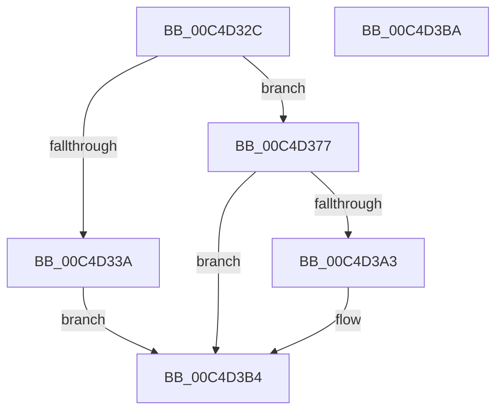

# WmipInitializeRegistration

- RVA: `0x00C4D32C`–`0x00C4D3BB` (길이 `143` bytes)
- VA: `0x0000000140C4D32C`
- 실행 섹션: `INIT`
- PDB 이름 있음: `예`; PDB Function 태그: `아니요`
- unwind 정보 RVA: `0x0007F554`
- 디코드: `33`개 명령, `143/143` bytes 표시
- 미해석 바이트: `0` (있으면 어셈블리에 `.byte`로 보존)

> 이 문서는 커널 이미지의 기계어와 PDB 기호를 분석해 생성했습니다. 4번과 5번은 함수 원형과 자료형을 바이너리 사용 방식에서 추정한 C 해석이며 원본 소스 복구 결과는 아닙니다.

## 1. Dependencies

- 직접 호출 지점: **2**; 고유 호출 대상: **2**
- 직접 호출자로 확인된 함수: **2**
- RIP 상대 이미지 참조: **9**

### Outgoing calls
- `0x00C4D362` → [ExInitializeNPagedLookasideListInternal](../../text/46/ExInitializeNPagedLookasideListInternal_function_00468720.md) (function, `0x00468720`)
- `0x00C4D3AF` → [ExQueueWorkItem](../../text/2F/ExQueueWorkItem_function_002F9520.md) (function, `0x002F9520`)

### Direct callers
- [WMIInitialize](WMIInitialize_function_00C4D264.md) at `0x00C4D30E`
- [WmipDriverEntry](WmipDriverEntry_function_00C4D490.md) at `0x00C4D4C7`

### Static image references
- `0x00C4D33D` → RVA `0x00E28D00` (`.data`; read)
- `0x00C4D367` → RVA `0x00EFFC28` (`.data`; write)
- `0x00C4D36E` → RVA `0x00EFFC20` (`.data`; write)
- `0x00C4D377` → RVA `0x009DD820` (`WmipRegistrationWorker`; read)
- `0x00C4D37E` → RVA `0x00EFFC18` (`.data`; write)
- `0x00C4D385` → RVA `0x00EFFC10` (`.data`; write)
- `0x00C4D38F` → RVA `0x00EFFC00` (`.data`; write)
- `0x00C4D396` → RVA `0x00E0EB0C` (`.data`; read/write)
- `0x00C4D3A8` → RVA `0x00EFFC00` (`.data`; read)

## 2. Other-region calls and transfers

- 다른 실행 섹션으로 향하는 call: **2**
  - `0x00C4D362` → [ExInitializeNPagedLookasideListInternal](../../text/46/ExInitializeNPagedLookasideListInternal_function_00468720.md) (`INIT` → `.text`)
  - `0x00C4D3AF` → [ExQueueWorkItem](../../text/2F/ExQueueWorkItem_function_002F9520.md) (`INIT` → `.text`)
- 별도 외부 분기/꼬리 이동을 확인하지 못했습니다.

## 3. Assembly (complete function range)

```asm
00C4D32C  48 8B C4                        mov rax, rsp
00C4D32F  53                              push rbx
00C4D330  48 83 EC 40                     sub rsp, 0x40
00C4D334  33 DB                           xor ebx, ebx
00C4D336  85 C9                           test ecx, ecx
00C4D338  75 3D                           jne 0x140c4d377
00C4D33A  89 58 F0                        mov dword ptr [rax - 0x10], ebx
00C4D33D  48 8D 0D BC B9 1D 00            lea rcx, [rip + 0x1db9bc]
00C4D344  66 89 58 E8                     mov word ptr [rax - 0x18], bx
00C4D348  41 B9 00 02 00 00               mov r9d, 0x200
00C4D34E  C7 40 E0 57 6D 69 52            mov dword ptr [rax - 0x20], 0x52696d57
00C4D355  45 33 C0                        xor r8d, r8d
00C4D358  33 D2                           xor edx, edx
00C4D35A  48 C7 40 D8 40 00 00 00         mov qword ptr [rax - 0x28], 0x40
00C4D362  E8 B9 B3 81 FF                  call 0x140468720
00C4D367  48 89 1D BA 28 2B 00            mov qword ptr [rip + 0x2b28ba], rbx
00C4D36E  48 89 1D AB 28 2B 00            mov qword ptr [rip + 0x2b28ab], rbx
00C4D375  EB 3D                           jmp 0x140c4d3b4
00C4D377  48 8D 05 A2 04 D9 FF            lea rax, [rip - 0x26fb5e]
00C4D37E  48 89 1D 93 28 2B 00            mov qword ptr [rip + 0x2b2893], rbx
00C4D385  48 89 05 84 28 2B 00            mov qword ptr [rip + 0x2b2884], rax
00C4D38C  83 C8 FF                        or eax, 0xffffffff
00C4D38F  48 89 1D 6A 28 2B 00            mov qword ptr [rip + 0x2b286a], rbx
00C4D396  F0 0F C1 05 6E 17 1C 00         lock xadd dword ptr [rip + 0x1c176e], eax
00C4D39E  83 F8 01                        cmp eax, 1
00C4D3A1  74 11                           je 0x140c4d3b4
00C4D3A3  BA 01 00 00 00                  mov edx, 1
00C4D3A8  48 8D 0D 51 28 2B 00            lea rcx, [rip + 0x2b2851]
00C4D3AF  E8 6C C1 6A FF                  call 0x1402f9520
00C4D3B4  48 83 C4 40                     add rsp, 0x40
00C4D3B8  5B                              pop rbx
00C4D3B9  C3                              ret
00C4D3BA  CC                              int3
```

## 4. C-style interpretation (structured pseudocode)

```c
__int64 __fastcall WmipInitializeRegistration(int a1, int a2, int a3)
{
    __int64 result;
    __int64 v_rbx;
    __int64 v_rsp;

    v_rsp = (v_rsp) - (64);
    v_rbx = 0;
    if (a1 != 0) goto loc_00C4D377;
    *(unsigned int *)(v_rsp - 16) = 0;
    *(unsigned __int16 *)(v_rsp - 24) = 0;
    *(unsigned int *)(v_rsp - 32) = 0x52696D57ULL;
    a3 = 0;
    a2 = 0;
    *(unsigned __int64 *)(v_rsp - 40) = 64;
    result = ExInitializeNPagedLookasideListInternal(v_rip + 1948092, a2, a3, 512);
    *(unsigned __int64 *)(v_rip + 2828474) = 0;
    *(unsigned __int64 *)(v_rip + 2828459) = 0;
    goto loc_00C4D3B4;
loc_00C4D377:
    *(unsigned __int64 *)(v_rip + 2828435) = 0;
    *(unsigned __int64 *)(v_rip + 2828420) = v_rip - 2554718;
    result = (unsigned int)((v_rip - 2554718) | (0xFFFFFFFFULL));
    *(unsigned __int64 *)(v_rip + 2828394) = 0;
    if (((unsigned int)(result)) != 1) {
        a2 = 1;
        a1 = v_rip + 2828369;
        result = ExQueueWorkItem(a1, a2, a3, 512);
    }
    v_rsp = (v_rsp) + (64);
    return result;
}
```

## 5. (Beta) C Style

```c
int64_t WmipInitializeRegistration(int32_t Arg1, int32_t Arg2, int32_t Arg3)
{
    int64_t result;
    int64_t local_rbx;
    int64_t local_rsp;

    local_rsp = (local_rsp) - (64);
    local_rbx = 0;
    if (Arg1 != 0) goto loc_00C4D377;
    *(uint32_t *)(local_rsp - 0x10) = 0;
    *(uint16_t *)(local_rsp - 0x18) = 0;
    *(uint32_t *)(local_rsp - 0x20) = 0x52696D57ULL;
    Arg3 = 0;
    Arg2 = 0;
    *(uint64_t *)(local_rsp - 0x28) = 64;
    result = ExInitializeNPagedLookasideListInternal(v_rip + 1948092, Arg2, Arg3, 512);
    *(uint64_t *)(v_rip + 0x2B28BA) = 0;
    *(uint64_t *)(v_rip + 0x2B28AB) = 0;
    goto loc_00C4D3B4;
loc_00C4D377:
    *(uint64_t *)(v_rip + 0x2B2893) = 0;
    *(uint64_t *)(v_rip + 0x2B2884) = v_rip - 2554718;
    result = (uint32_t)((v_rip - 2554718) | (0xFFFFFFFFULL));
    *(uint64_t *)(v_rip + 0x2B286A) = 0;
    if (((uint32_t)(result)) != 1) {
        Arg2 = 1;
        Arg1 = v_rip + 2828369;
        result = ExQueueWorkItem(Arg1, Arg2, Arg3, 512);
    }
    local_rsp = (local_rsp) + (64);
    return result;
}
```

## 6. Execution-region graph

[열기: 2D/3D 그래프와 함수 탐색 컨트롤 패널](../../../control-panel.html?section=init&rva=0x00C4D32C&view=graph)

- 2D 그래프는 위에서 아래로 흐르고, 3D 그래프는 빈 공간을 드래그해 회전합니다. Shift+드래그는 이동, 휠은 확대·축소, 함수 노드 선택은 대상 보고서 이동입니다.

### Static fallback


