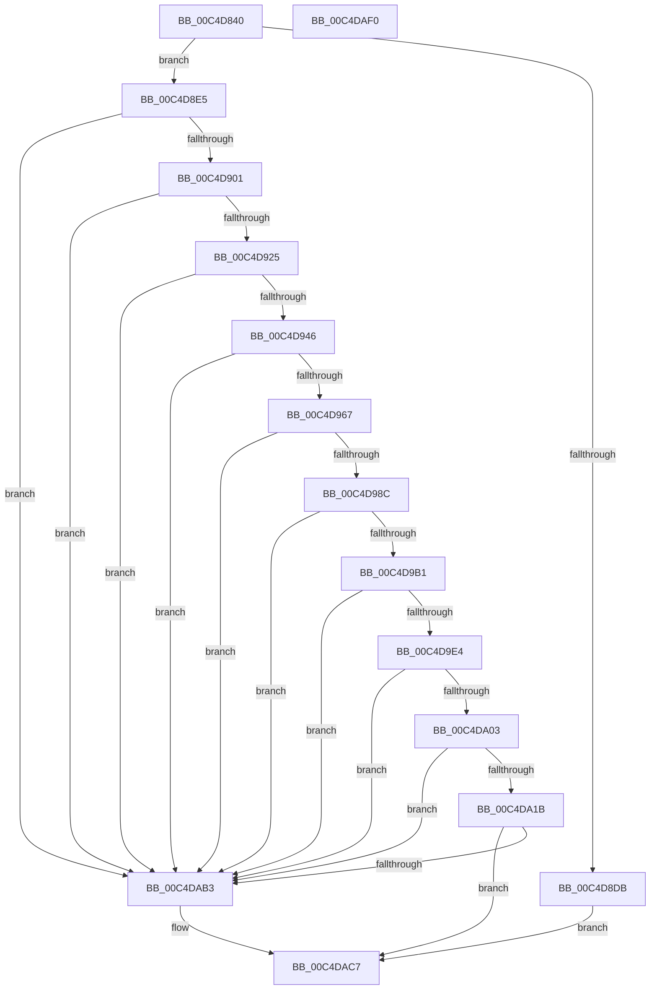

# WmipInitializeSecurity

- RVA: `0x00C4D840`–`0x00C4DAF1` (길이 `689` bytes)
- VA: `0x0000000140C4D840`
- 실행 섹션: `INIT`
- PDB 이름 있음: `예`; PDB Function 태그: `아니요`
- unwind 정보 RVA: `0x000BA728`
- 디코드: `167`개 명령, `689/689` bytes 표시
- 미해석 바이트: `0` (있으면 어셈블리에 `.byte`로 보존)

> 이 문서는 커널 이미지의 기계어와 PDB 기호를 분석해 생성했습니다. 4번과 5번은 함수 원형과 자료형을 바이너리 사용 방식에서 추정한 C 해석이며 원본 소스 복구 결과는 아닙니다.

## 1. Dependencies

- 직접 호출 지점: **17**; 고유 호출 대상: **13**
- 직접 호출자로 확인된 함수: **1**
- RIP 상대 이미지 참조: **14**

### Outgoing calls
- `0x00C4D8CE` → [ExAllocatePool2](../../poolcode/B8/ExAllocatePool2_function_00B820F0.md) (function, `0x00B820F0`)
- `0x00C4D8F2` → [RtlCreateAcl](../../page/91/RtlCreateAcl_function_00916F00.md) (function, `0x00916F00`)
- `0x00C4D916` → [RtlAddAccessAllowedAce](../../page/92/RtlAddAccessAllowedAce_function_009298C0.md) (function, `0x009298C0`)
- `0x00C4D937` → [RtlAddAccessAllowedAce](../../page/92/RtlAddAccessAllowedAce_function_009298C0.md) (function, `0x009298C0`)
- `0x00C4D958` → [RtlAddAccessAllowedAce](../../page/92/RtlAddAccessAllowedAce_function_009298C0.md) (function, `0x009298C0`)
- `0x00C4D97D` → [RtlAddAccessAllowedAce](../../page/92/RtlAddAccessAllowedAce_function_009298C0.md) (function, `0x009298C0`)
- `0x00C4D9A2` → [RtlAddAccessAllowedAce](../../page/92/RtlAddAccessAllowedAce_function_009298C0.md) (function, `0x009298C0`)
- `0x00C4D9C5` → [RtlCreateSecurityDescriptor](../../page/9F/RtlCreateSecurityDescriptor_function_009F1DF0.md) (function, `0x009F1DF0`)
- `0x00C4D9D5` → [RtlSetDaclSecurityDescriptor](../../page/9E/RtlSetDaclSecurityDescriptor_function_009EC210.md) (function, `0x009EC210`)
- `0x00C4D9F4` → [RtlSetOwnerSecurityDescriptor](../../page/91/RtlSetOwnerSecurityDescriptor_function_00916F90.md) (function, `0x00916F90`)
- `0x00C4DA0C` → [RtlSetGroupSecurityDescriptor](../../page/A2/RtlSetGroupSecurityDescriptor_function_00A2EB10.md) (function, `0x00A2EB10`)
- `0x00C4DA22` → [SeCaptureSubjectContext](../../page/86/SeCaptureSubjectContext_function_0086B820.md) (function, `0x0086B820`)
- `0x00C4DA35` → [memset](../../text/6C/memset_function_006C6C40.md) (function, `0x006C6C40`)
- `0x00C4DA91` → [RtlInitUnicodeString](../../text/42/RtlInitUnicodeString_function_0042A780.md) (function, `0x0042A780`)
- `0x00C4DAA8` → [ObCreateObjectType](../../page/70/ObCreateObjectType_function_00705230.md) (function, `0x00705230`)
- `0x00C4DAB8` → [ExFreePoolWithTag](../../poolcode/B8/ExFreePoolWithTag_function_00B82870.md) (function, `0x00B82870`)
- `0x00C4DACE` → [_security_check_cookie](../../text/6A/_security_check_cookie_function_006AC640.md) (function, `0x006AC640`)

### Direct callers
- [WmipDriverEntry](WmipDriverEntry_function_00C4D490.md) at `0x00C4D524`

### Static image references
- `0x00C4D85F` → RVA `0x00E0A740` (`.data`; read)
- `0x00C4D86D` → RVA `0x00FD9AA0` (`PAGEDATA`; read)
- `0x00C4D897` → RVA `0x00FD9BD8` (`PAGEDATA`; read)
- `0x00C4D8A4` → RVA `0x00FD9A68` (`PAGEDATA`; read)
- `0x00C4D8B1` → RVA `0x00E67D58` (`.data`; read)
- `0x00C4D9B1` → RVA `0x00FC8020` (`ALMOSTRO`; read)
- `0x00C4D9BB` → RVA `0x00FC6D68` (`ALMOSTRO`; write)
- `0x00C4DA1B` → RVA `0x00FDA588` (`PAGEDATA`; read)
- `0x00C4DA3D` → RVA `0x00C7D7E0` (` ?? ::PBOPGDP::`string'`; read)
- `0x00C4DA44` → RVA `0x00B4B540` (`WmipGenericMapping`; read)
- `0x00C4DA61` → RVA `0x009A71F0` (`WmipSecurityMethod`; read)
- `0x00C4DA73` → RVA `0x009E25E0` (`WmipDeleteMethod`; read)
- `0x00C4DA96` → RVA `0x00FC6D70` (`ALMOSTRO`; read)
- `0x00C4DABD` → RVA `0x00FC6D68` (`ALMOSTRO`; read/write)

## 2. Other-region calls and transfers

- 다른 실행 섹션으로 향하는 call: **17**
  - `0x00C4D8CE` → [ExAllocatePool2](../../poolcode/B8/ExAllocatePool2_function_00B820F0.md) (`INIT` → `POOLCODE`)
  - `0x00C4D8F2` → [RtlCreateAcl](../../page/91/RtlCreateAcl_function_00916F00.md) (`INIT` → `PAGE`)
  - `0x00C4D916` → [RtlAddAccessAllowedAce](../../page/92/RtlAddAccessAllowedAce_function_009298C0.md) (`INIT` → `PAGE`)
  - `0x00C4D937` → [RtlAddAccessAllowedAce](../../page/92/RtlAddAccessAllowedAce_function_009298C0.md) (`INIT` → `PAGE`)
  - `0x00C4D958` → [RtlAddAccessAllowedAce](../../page/92/RtlAddAccessAllowedAce_function_009298C0.md) (`INIT` → `PAGE`)
  - `0x00C4D97D` → [RtlAddAccessAllowedAce](../../page/92/RtlAddAccessAllowedAce_function_009298C0.md) (`INIT` → `PAGE`)
  - `0x00C4D9A2` → [RtlAddAccessAllowedAce](../../page/92/RtlAddAccessAllowedAce_function_009298C0.md) (`INIT` → `PAGE`)
  - `0x00C4D9C5` → [RtlCreateSecurityDescriptor](../../page/9F/RtlCreateSecurityDescriptor_function_009F1DF0.md) (`INIT` → `PAGE`)
  - `0x00C4D9D5` → [RtlSetDaclSecurityDescriptor](../../page/9E/RtlSetDaclSecurityDescriptor_function_009EC210.md) (`INIT` → `PAGE`)
  - `0x00C4D9F4` → [RtlSetOwnerSecurityDescriptor](../../page/91/RtlSetOwnerSecurityDescriptor_function_00916F90.md) (`INIT` → `PAGE`)
  - `0x00C4DA0C` → [RtlSetGroupSecurityDescriptor](../../page/A2/RtlSetGroupSecurityDescriptor_function_00A2EB10.md) (`INIT` → `PAGE`)
  - `0x00C4DA22` → [SeCaptureSubjectContext](../../page/86/SeCaptureSubjectContext_function_0086B820.md) (`INIT` → `PAGE`)
  - `0x00C4DA35` → [memset](../../text/6C/memset_function_006C6C40.md) (`INIT` → `.text`)
  - `0x00C4DA91` → [RtlInitUnicodeString](../../text/42/RtlInitUnicodeString_function_0042A780.md) (`INIT` → `.text`)
  - `0x00C4DAA8` → [ObCreateObjectType](../../page/70/ObCreateObjectType_function_00705230.md) (`INIT` → `PAGE`)
  - `0x00C4DAB8` → [ExFreePoolWithTag](../../poolcode/B8/ExFreePoolWithTag_function_00B82870.md) (`INIT` → `POOLCODE`)
  - `0x00C4DACE` → [_security_check_cookie](../../text/6A/_security_check_cookie_function_006AC640.md) (`INIT` → `.text`)
- 별도 외부 분기/꼬리 이동을 확인하지 못했습니다.

## 3. Assembly (complete function range)

```asm
00C4D840  48 8B C4                        mov rax, rsp
00C4D843  48 89 58 08                     mov qword ptr [rax + 8], rbx
00C4D847  48 89 70 10                     mov qword ptr [rax + 0x10], rsi
00C4D84B  48 89 78 18                     mov qword ptr [rax + 0x18], rdi
00C4D84F  4C 89 70 20                     mov qword ptr [rax + 0x20], r14
00C4D853  55                              push rbp
00C4D854  48 8D 68 A1                     lea rbp, [rax - 0x5f]
00C4D858  48 81 EC C0 00 00 00            sub rsp, 0xc0
00C4D85F  48 8B 05 DA CE 1B 00            mov rax, qword ptr [rip + 0x1bceda]
00C4D866  48 33 C4                        xor rax, rsp
00C4D869  48 89 45 47                     mov qword ptr [rbp + 0x47], rax
00C4D86D  48 8B 0D 2C C2 38 00            mov rcx, qword ptr [rip + 0x38c22c]
00C4D874  0F 57 C0                        xorps xmm0, xmm0
00C4D877  41 B8 57 6D 69 70               mov r8d, 0x70696d57
00C4D87D  0F 11 45 B7                     movups xmmword ptr [rbp - 0x49], xmm0
00C4D881  48 8B 81 88 01 00 00            mov rax, qword ptr [rcx + 0x188]
00C4D888  0F B6 50 01                     movzx edx, byte ptr [rax + 1]
00C4D88C  48 8B 81 80 01 00 00            mov rax, qword ptr [rcx + 0x180]
00C4D893  0F B6 48 01                     movzx ecx, byte ptr [rax + 1]
00C4D897  48 8B 05 3A C3 38 00            mov rax, qword ptr [rip + 0x38c33a]
00C4D89E  03 D1                           add edx, ecx
00C4D8A0  0F B6 48 01                     movzx ecx, byte ptr [rax + 1]
00C4D8A4  48 8B 05 BD C1 38 00            mov rax, qword ptr [rip + 0x38c1bd]
00C4D8AB  03 D1                           add edx, ecx
00C4D8AD  0F B6 48 01                     movzx ecx, byte ptr [rax + 1]
00C4D8B1  48 8B 05 A0 A4 21 00            mov rax, qword ptr [rip + 0x21a4a0]
00C4D8B8  03 D1                           add edx, ecx
00C4D8BA  0F B6 48 01                     movzx ecx, byte ptr [rax + 1]
00C4D8BE  03 D1                           add edx, ecx
00C4D8C0  B9 00 01 00 00                  mov ecx, 0x100
00C4D8C5  8D 1C 95 74 00 00 00            lea ebx, [rdx*4 + 0x74]
00C4D8CC  8B D3                           mov edx, ebx
00C4D8CE  E8 1D 48 F3 FF                  call 0x140b820f0
00C4D8D3  48 8B F8                        mov rdi, rax
00C4D8D6  48 85 C0                        test rax, rax
00C4D8D9  75 0A                           jne 0x140c4d8e5
00C4D8DB  B8 9A 00 00 C0                  mov eax, 0xc000009a
00C4D8E0  E9 E2 01 00 00                  jmp 0x140c4dac7
00C4D8E5  BE 02 00 00 00                  mov esi, 2
00C4D8EA  8B D3                           mov edx, ebx
00C4D8EC  44 8B C6                        mov r8d, esi
00C4D8EF  48 8B CF                        mov rcx, rdi
00C4D8F2  E8 09 96 CC FF                  call 0x140916f00
00C4D8F7  8B D8                           mov ebx, eax
00C4D8F9  85 C0                           test eax, eax
00C4D8FB  0F 88 B2 01 00 00               js 0x140c4dab3
00C4D901  4C 8B 0D 50 A4 21 00            mov r9, qword ptr [rip + 0x21a450]
00C4D908  41 BE FF FF 1F 00               mov r14d, 0x1fffff
00C4D90E  45 8B C6                        mov r8d, r14d
00C4D911  8B D6                           mov edx, esi
00C4D913  48 8B CF                        mov rcx, rdi
00C4D916  E8 A5 BF CD FF                  call 0x1409298c0
00C4D91B  8B D8                           mov ebx, eax
00C4D91D  85 C0                           test eax, eax
00C4D91F  0F 88 8E 01 00 00               js 0x140c4dab3
00C4D925  4C 8B 0D AC C2 38 00            mov r9, qword ptr [rip + 0x38c2ac]
00C4D92C  41 B8 00 08 00 00               mov r8d, 0x800
00C4D932  8B D6                           mov edx, esi
00C4D934  48 8B CF                        mov rcx, rdi
00C4D937  E8 84 BF CD FF                  call 0x1409298c0
00C4D93C  8B D8                           mov ebx, eax
00C4D93E  85 C0                           test eax, eax
00C4D940  0F 88 6D 01 00 00               js 0x140c4dab3
00C4D946  4C 8B 0D 1B C1 38 00            mov r9, qword ptr [rip + 0x38c11b]
00C4D94D  41 B8 FF FF 1F 01               mov r8d, 0x11fffff
00C4D953  8B D6                           mov edx, esi
00C4D955  48 8B CF                        mov rcx, rdi
00C4D958  E8 63 BF CD FF                  call 0x1409298c0
00C4D95D  8B D8                           mov ebx, eax
00C4D95F  85 C0                           test eax, eax
00C4D961  0F 88 4C 01 00 00               js 0x140c4dab3
00C4D967  4C 8B 0D 32 C1 38 00            mov r9, qword ptr [rip + 0x38c132]
00C4D96E  45 8B C6                        mov r8d, r14d
00C4D971  8B D6                           mov edx, esi
00C4D973  48 8B CF                        mov rcx, rdi
00C4D976  4D 8B 89 80 01 00 00            mov r9, qword ptr [r9 + 0x180]
00C4D97D  E8 3E BF CD FF                  call 0x1409298c0
00C4D982  8B D8                           mov ebx, eax
00C4D984  85 C0                           test eax, eax
00C4D986  0F 88 27 01 00 00               js 0x140c4dab3
00C4D98C  4C 8B 0D 0D C1 38 00            mov r9, qword ptr [rip + 0x38c10d]
00C4D993  45 8B C6                        mov r8d, r14d
00C4D996  8B D6                           mov edx, esi
00C4D998  48 8B CF                        mov rcx, rdi
00C4D99B  4D 8B 89 88 01 00 00            mov r9, qword ptr [r9 + 0x188]
00C4D9A2  E8 19 BF CD FF                  call 0x1409298c0
00C4D9A7  8B D8                           mov ebx, eax
00C4D9A9  85 C0                           test eax, eax
00C4D9AB  0F 88 02 01 00 00               js 0x140c4dab3
00C4D9B1  4C 8D 35 68 A6 37 00            lea r14, [rip + 0x37a668]
00C4D9B8  49 8B CE                        mov rcx, r14
00C4D9BB  4C 89 35 A6 93 37 00            mov qword ptr [rip + 0x3793a6], r14
00C4D9C2  8D 56 FF                        lea edx, [rsi - 1]
00C4D9C5  E8 26 44 DA FF                  call 0x1409f1df0
00C4D9CA  45 33 C9                        xor r9d, r9d
00C4D9CD  4C 8B C7                        mov r8, rdi
00C4D9D0  B2 01                           mov dl, 1
00C4D9D2  49 8B CE                        mov rcx, r14
00C4D9D5  E8 36 E8 D9 FF                  call 0x1409ec210
00C4D9DA  8B D8                           mov ebx, eax
00C4D9DC  85 C0                           test eax, eax
00C4D9DE  0F 88 CF 00 00 00               js 0x140c4dab3
00C4D9E4  48 8B 35 7D C0 38 00            mov rsi, qword ptr [rip + 0x38c07d]
00C4D9EB  45 33 C0                        xor r8d, r8d
00C4D9EE  48 8B D6                        mov rdx, rsi
00C4D9F1  49 8B CE                        mov rcx, r14
00C4D9F4  E8 97 95 CC FF                  call 0x140916f90
00C4D9F9  8B D8                           mov ebx, eax
00C4D9FB  85 C0                           test eax, eax
00C4D9FD  0F 88 B0 00 00 00               js 0x140c4dab3
00C4DA03  45 33 C0                        xor r8d, r8d
00C4DA06  48 8B D6                        mov rdx, rsi
00C4DA09  49 8B CE                        mov rcx, r14
00C4DA0C  E8 FF 10 DE FF                  call 0x140a2eb10
00C4DA11  8B D8                           mov ebx, eax
00C4DA13  85 C0                           test eax, eax
00C4DA15  0F 88 98 00 00 00               js 0x140c4dab3
00C4DA1B  48 8D 0D 66 CB 38 00            lea rcx, [rip + 0x38cb66]
00C4DA22  E8 F9 DD C1 FF                  call 0x14086b820
00C4DA27  BB 78 00 00 00                  mov ebx, 0x78
00C4DA2C  48 8D 4D C7                     lea rcx, [rbp - 0x39]
00C4DA30  44 8B C3                        mov r8d, ebx
00C4DA33  33 D2                           xor edx, edx
00C4DA35  E8 06 92 A7 FF                  call 0x1406c6c40
00C4DA3A  8A 45 C9                        mov al, byte ptr [rbp - 0x37]
00C4DA3D  48 8D 15 9C FD 02 00            lea rdx, [rip + 0x2fd9c]
00C4DA44  0F 10 05 F5 DA EF FF            movups xmm0, xmmword ptr [rip - 0x10250b]
00C4DA4B  24 EF                           and al, 0xef
00C4DA4D  66 89 5D C7                     mov word ptr [rbp - 0x39], bx
00C4DA51  0C 08                           or al, 8
00C4DA53  C7 45 CF 00 01 00 00            mov dword ptr [rbp - 0x31], 0x100
00C4DA5A  88 45 C9                        mov byte ptr [rbp - 0x37], al
00C4DA5D  48 8D 4D B7                     lea rcx, [rbp - 0x49]
00C4DA61  48 8D 05 88 97 D5 FF            lea rax, [rip - 0x2a6878]
00C4DA68  C7 45 E3 FF 1F 1F 00            mov dword ptr [rbp - 0x1d], 0x1f1fff
00C4DA6F  48 89 45 1F                     mov qword ptr [rbp + 0x1f], rax
00C4DA73  48 8D 05 66 4B D9 FF            lea rax, [rip - 0x26b49a]
00C4DA7A  48 89 45 0F                     mov qword ptr [rbp + 0xf], rax
00C4DA7E  F3 0F 7F 45 D3                  movdqu xmmword ptr [rbp - 0x2d], xmm0
00C4DA83  C7 45 EB 00 02 00 00            mov dword ptr [rbp - 0x15], 0x200
00C4DA8A  C7 45 F3 A8 00 00 00            mov dword ptr [rbp - 0xd], 0xa8
00C4DA91  E8 EA CC 7D FF                  call 0x14042a780
00C4DA96  4C 8D 0D D3 92 37 00            lea r9, [rip + 0x3792d3]
00C4DA9D  45 33 C0                        xor r8d, r8d
00C4DAA0  48 8D 55 C7                     lea rdx, [rbp - 0x39]
00C4DAA4  48 8D 4D B7                     lea rcx, [rbp - 0x49]
00C4DAA8  E8 83 77 AB FF                  call 0x140705230
00C4DAAD  8B D8                           mov ebx, eax
00C4DAAF  85 C0                           test eax, eax
00C4DAB1  79 14                           jns 0x140c4dac7
00C4DAB3  33 D2                           xor edx, edx
00C4DAB5  48 8B CF                        mov rcx, rdi
00C4DAB8  E8 B3 4D F3 FF                  call 0x140b82870
00C4DABD  48 83 25 A3 92 37 00 00         and qword ptr [rip + 0x3792a3], 0
00C4DAC5  8B C3                           mov eax, ebx
00C4DAC7  48 8B 4D 47                     mov rcx, qword ptr [rbp + 0x47]
00C4DACB  48 33 CC                        xor rcx, rsp
00C4DACE  E8 6D EB A5 FF                  call 0x1406ac640
00C4DAD3  4C 8D 9C 24 C0 00 00 00         lea r11, [rsp + 0xc0]
00C4DADB  49 8B 5B 10                     mov rbx, qword ptr [r11 + 0x10]
00C4DADF  49 8B 73 18                     mov rsi, qword ptr [r11 + 0x18]
00C4DAE3  49 8B 7B 20                     mov rdi, qword ptr [r11 + 0x20]
00C4DAE7  4D 8B 73 28                     mov r14, qword ptr [r11 + 0x28]
00C4DAEB  49 8B E3                        mov rsp, r11
00C4DAEE  5D                              pop rbp
00C4DAEF  C3                              ret
00C4DAF0  CC                              int3
```

## 4. C-style interpretation (structured pseudocode)

```c
__int64 __fastcall WmipInitializeSecurity(void)
{
    __int64 result;
    __int64 v_rsp;
    unsigned __int64 v_stack_m8;

    *(unsigned __int64 *)(v_rsp + 8) = v_rbx;
    *(unsigned __int64 *)(v_rsp + 16) = v_rsi;
    *(unsigned __int64 *)(v_rsp + 24) = v_rdi;
    *(unsigned __int64 *)(v_rsp + 32) = v_r14;
    v_rsp = (v_rsp) - (192);
    result = (*(unsigned __int64 *)(v_rip + 1822426)) ^ (v_rsp);
    *(unsigned __int64 *)(v_rsp - 95 + 71) = result;
    *(unsigned __int64 *)(v_rsp - 95 - 73) = v_xmm0;
    a2 = (unsigned int)((*(unsigned __int8 *)(*(unsigned __int64 *)(*(unsigned __int64 *)(v_rip + 3719724) + 392) + 1)) + ((unsigned int)(*(unsigned __int8 *)(*(unsigned __int64 *)(*(unsigned __int64 *)(v_rip + 3719724) + 384) + 1))));
    a2 = (unsigned int)((a2) + ((unsigned int)(*(unsigned __int8 *)(*(unsigned __int64 *)(v_rip + 3719994) + 1))));
    a2 = (unsigned int)((a2) + ((unsigned int)(*(unsigned __int8 *)(*(unsigned __int64 *)(v_rip + 3719613) + 1))));
    a2 = (unsigned int)((a2) + ((unsigned int)(*(unsigned __int8 *)(*(unsigned __int64 *)(v_rip + 2204832) + 1))));
    result = ExAllocatePool2(256, (unsigned int)((unsigned int)(a2 * 4 + 116)), (unsigned int)(0x70696D57ULL), a4);
    if (result != 0) goto loc_00C4D8E5;
    goto loc_00C4DAC7;
loc_00C4D8E5:
    result = RtlCreateAcl(result, (unsigned int)((unsigned int)(a2 * 4 + 116)), 2, a4);
    if (sign_flag) goto loc_00C4DAB3;
    result = RtlAddAccessAllowedAce(result, 2, (unsigned int)((unsigned int)((unsigned int)(0x1FFFFFULL))), *(unsigned __int64 *)(v_rip + 2204752));
    if (sign_flag) goto loc_00C4DAB3;
    result = RtlAddAccessAllowedAce(result, 2, (unsigned int)(0x800ULL), *(unsigned __int64 *)(v_rip + 3719852));
    if (sign_flag) goto loc_00C4DAB3;
    result = RtlAddAccessAllowedAce(result, 2, (unsigned int)(0x11FFFFFULL), *(unsigned __int64 *)(v_rip + 3719451));
    if (sign_flag) goto loc_00C4DAB3;
    result = RtlAddAccessAllowedAce(result, 2, (unsigned int)((unsigned int)((unsigned int)(0x1FFFFFULL))), *(unsigned __int64 *)(*(unsigned __int64 *)(v_rip + 3719474) + 384));
    if (sign_flag) goto loc_00C4DAB3;
    result = RtlAddAccessAllowedAce(result, 2, (unsigned int)((unsigned int)((unsigned int)(0x1FFFFFULL))), *(unsigned __int64 *)(*(unsigned __int64 *)(v_rip + 3719437) + 392));
    if (sign_flag) goto loc_00C4DAB3;
    *(unsigned __int64 *)(v_rip + 3642278) = v_rip + 3647080;
    result = RtlCreateSecurityDescriptor(v_rip + 3647080, 2 - 1, (unsigned int)((unsigned int)((unsigned int)(0x1FFFFFULL))), *(unsigned __int64 *)(*(unsigned __int64 *)(v_rip + 3719437) + 392));
    a4 = 0;
    result = RtlSetDaclSecurityDescriptor(v_rip + 3647080, 1, result, a4);
    if (sign_flag) goto loc_00C4DAB3;
    a3 = 0;
    result = RtlSetOwnerSecurityDescriptor(v_rip + 3647080, *(unsigned __int64 *)(v_rip + 3719293), a3, a4);
    if (sign_flag) goto loc_00C4DAB3;
    a3 = 0;
    result = RtlSetGroupSecurityDescriptor(v_rip + 3647080, *(unsigned __int64 *)(v_rip + 3719293), a3, a4);
    if (sign_flag) goto loc_00C4DAB3;
    result = SeCaptureSubjectContext(v_rip + 3722086, *(unsigned __int64 *)(v_rip + 3719293), a3, a4);
    a2 = 0;
    result = memset(v_rsp - 95 - 57, a2, 120, a4);
    result = (unsigned __int8)((*(unsigned __int8 *)(v_rsp - 95 - 55)) & (239));
    *(unsigned __int16 *)(v_rsp - 95 - 57) = 120;
    result = (unsigned __int8)((result) | (8));
    *(unsigned int *)(v_rsp - 95 - 49) = 256;
    *(unsigned __int8 *)(v_rsp - 95 - 55) = (unsigned __int8)(result);
    *(unsigned int *)(v_rsp - 95 - 29) = 0x1F1FFFULL;
    *(unsigned __int64 *)(v_rsp - 95 + 31) = v_rip - 2779256;
    *(unsigned __int64 *)(v_rsp - 95 + 15) = v_rip - 2536602;
    *(unsigned __int64 *)(v_rsp - 95 - 45) = v_xmm0;
    *(unsigned int *)(v_rsp - 95 - 21) = 512;
    *(unsigned int *)(v_rsp - 95 - 13) = 168;
    result = RtlInitUnicodeString(v_rsp - 95 - 73, v_rip + 195996, 120, a4);
    a3 = 0;
    result = ObCreateObjectType(v_rsp - 95 - 73, v_rsp - 95 - 57, a3, v_rip + 3642067);
    if (sign_flag) {
        a2 = 0;
        a1 = result;
        result = ExFreePoolWithTag(a1, a2, a3, v_rip + 3642067);
        result = (unsigned int)((unsigned int)((unsigned int)(result)));
    }
    a1 = (*(unsigned __int64 *)(v_rsp - 95 + 71)) ^ (v_rsp);
    result = _security_check_cookie(a1, a2, a3, v_rip + 3642067);
    return result;
}
```

## 5. (Beta) C Style

```c
void WmipInitializeSecurity(void)
{
    int64_t result;
    int64_t local_rsp;
    uint64_t v_stack_m8;

    *(uint64_t *)(local_rsp + 0x8) = local_rbx;
    *(uint64_t *)(local_rsp + 0x10) = local_rsi;
    *(uint64_t *)(local_rsp + 0x18) = local_rdi;
    *(uint64_t *)(local_rsp + 0x20) = local_r14;
    local_rsp = (local_rsp) - (192);
    result = (*(uint64_t *)(v_rip + 0x1BCEDA)) ^ (local_rsp);
    *(uint64_t *)(local_rsp - 0x5F + 0x47) = result;
    *(uint64_t *)(local_rsp - 0x5F - 0x49) = v_xmm0;
    a2 = (uint32_t)((*(uint8_t *)(*(uint64_t *)(*(uint64_t *)(v_rip + 0x38C22C) + 0x188) + 0x1)) + ((uint32_t)(*(uint8_t *)(*(uint64_t *)(*(uint64_t *)(v_rip + 0x38C22C) + 0x180) + 0x1))));
    a2 = (uint32_t)((a2) + ((uint32_t)(*(uint8_t *)(*(uint64_t *)(v_rip + 0x38C33A) + 0x1))));
    a2 = (uint32_t)((a2) + ((uint32_t)(*(uint8_t *)(*(uint64_t *)(v_rip + 0x38C1BD) + 0x1))));
    a2 = (uint32_t)((a2) + ((uint32_t)(*(uint8_t *)(*(uint64_t *)(v_rip + 0x21A4A0) + 0x1))));
    result = ExAllocatePool2(256, (uint32_t)((uint32_t)(a2 * 4 + 116)), (uint32_t)(0x70696D57ULL), a4);
    if (result != 0) goto loc_00C4D8E5;
    goto loc_00C4DAC7;
loc_00C4D8E5:
    result = RtlCreateAcl(result, (uint32_t)((uint32_t)(a2 * 4 + 116)), 2, a4);
    if (sign_flag) goto loc_00C4DAB3;
    result = RtlAddAccessAllowedAce(result, 2, (uint32_t)((uint32_t)((uint32_t)(0x1FFFFFULL))), *(uint64_t *)(v_rip + 0x21A450));
    if (sign_flag) goto loc_00C4DAB3;
    result = RtlAddAccessAllowedAce(result, 2, (uint32_t)(0x800ULL), *(uint64_t *)(v_rip + 0x38C2AC));
    if (sign_flag) goto loc_00C4DAB3;
    result = RtlAddAccessAllowedAce(result, 2, (uint32_t)(0x11FFFFFULL), *(uint64_t *)(v_rip + 0x38C11B));
    if (sign_flag) goto loc_00C4DAB3;
    result = RtlAddAccessAllowedAce(result, 2, (uint32_t)((uint32_t)((uint32_t)(0x1FFFFFULL))), *(uint64_t *)(*(uint64_t *)(v_rip + 0x38C132) + 0x180));
    if (sign_flag) goto loc_00C4DAB3;
    result = RtlAddAccessAllowedAce(result, 2, (uint32_t)((uint32_t)((uint32_t)(0x1FFFFFULL))), *(uint64_t *)(*(uint64_t *)(v_rip + 0x38C10D) + 0x188));
    if (sign_flag) goto loc_00C4DAB3;
    *(uint64_t *)(v_rip + 0x3793A6) = v_rip + 3647080;
    result = RtlCreateSecurityDescriptor(v_rip + 3647080, 2 - 1, (uint32_t)((uint32_t)((uint32_t)(0x1FFFFFULL))), *(uint64_t *)(*(uint64_t *)(v_rip + 0x38C10D) + 0x188));
    a4 = 0;
    result = RtlSetDaclSecurityDescriptor(v_rip + 3647080, 1, result, a4);
    if (sign_flag) goto loc_00C4DAB3;
    a3 = 0;
    result = RtlSetOwnerSecurityDescriptor(v_rip + 3647080, *(uint64_t *)(v_rip + 0x38C07D), a3, a4);
    if (sign_flag) goto loc_00C4DAB3;
    a3 = 0;
    result = RtlSetGroupSecurityDescriptor(v_rip + 3647080, *(uint64_t *)(v_rip + 0x38C07D), a3, a4);
    if (sign_flag) goto loc_00C4DAB3;
    result = SeCaptureSubjectContext(v_rip + 3722086, *(uint64_t *)(v_rip + 0x38C07D), a3, a4);
    a2 = 0;
    result = memset(local_rsp - 95 - 57, a2, 120, a4);
    result = (uint8_t)((*(uint8_t *)(local_rsp - 0x5F - 0x37)) & (239));
    *(uint16_t *)(local_rsp - 0x5F - 0x39) = 120;
    result = (uint8_t)((result) | (8));
    *(uint32_t *)(local_rsp - 0x5F - 0x31) = 256;
    *(uint8_t *)(local_rsp - 0x5F - 0x37) = (uint8_t)(result);
    *(uint32_t *)(local_rsp - 0x5F - 0x1D) = 0x1F1FFFULL;
    *(uint64_t *)(local_rsp - 0x5F + 0x1F) = v_rip - 2779256;
    *(uint64_t *)(local_rsp - 0x5F + 0xF) = v_rip - 2536602;
    *(uint64_t *)(local_rsp - 0x5F - 0x2D) = v_xmm0;
    *(uint32_t *)(local_rsp - 0x5F - 0x15) = 512;
    *(uint32_t *)(local_rsp - 0x5F - 0xD) = 168;
    result = RtlInitUnicodeString(local_rsp - 95 - 73, v_rip + 195996, 120, a4);
    a3 = 0;
    result = ObCreateObjectType(local_rsp - 95 - 73, local_rsp - 95 - 57, a3, v_rip + 3642067);
    if (sign_flag) {
        a2 = 0;
        a1 = result;
        result = ExFreePoolWithTag(a1, a2, a3, v_rip + 3642067);
        result = (uint32_t)((uint32_t)((uint32_t)(result)));
    }
    a1 = (*(uint64_t *)(local_rsp - 0x5F + 0x47)) ^ (local_rsp);
    result = _security_check_cookie(a1, a2, a3, v_rip + 3642067);
    return result;
}
```

## 6. Execution-region graph

[열기: 2D/3D 그래프와 함수 탐색 컨트롤 패널](../../../control-panel.html?section=init&rva=0x00C4D840&view=graph)

- 2D 그래프는 위에서 아래로 흐르고, 3D 그래프는 빈 공간을 드래그해 회전합니다. Shift+드래그는 이동, 휠은 확대·축소, 함수 노드 선택은 대상 보고서 이동입니다.

### Static fallback


