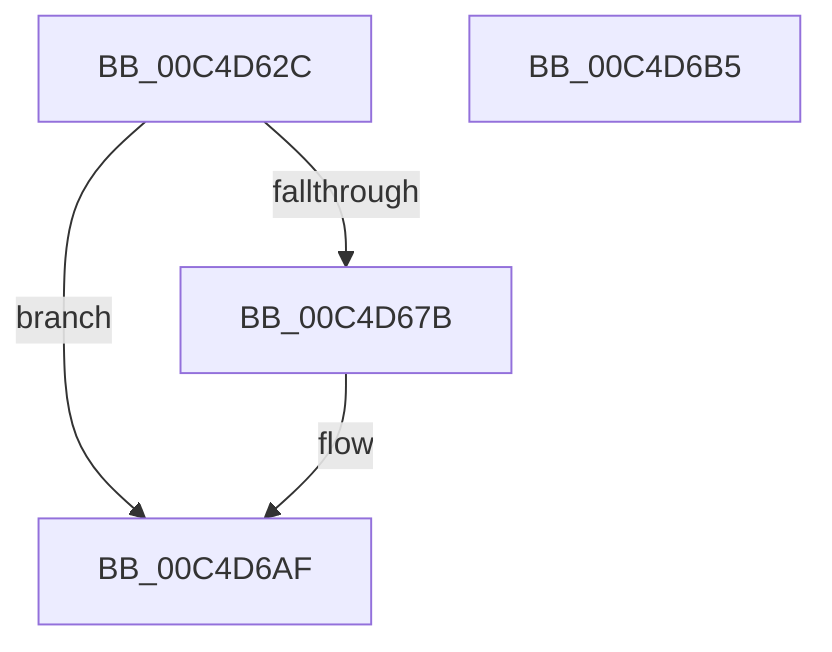

# WmipRegisterFirmwareProviders

- RVA: `0x00C4D62C`–`0x00C4D6B6` (길이 `138` bytes)
- VA: `0x0000000140C4D62C`
- 실행 섹션: `INIT`
- PDB 이름 있음: `예`; PDB Function 태그: `아니요`
- unwind 정보 RVA: `0x000C4850`
- 디코드: `32`개 명령, `138/138` bytes 표시
- 미해석 바이트: `0` (있으면 어셈블리에 `.byte`로 보존)

> 이 문서는 커널 이미지의 기계어와 PDB 기호를 분석해 생성했습니다. 4번과 5번은 함수 원형과 자료형을 바이너리 사용 방식에서 추정한 C 해석이며 원본 소스 복구 결과는 아닙니다.

## 1. Dependencies

- 직접 호출 지점: **2**; 고유 호출 대상: **1**
- 직접 호출자로 확인된 함수: **1**
- RIP 상대 이미지 참조: **4**

### Outgoing calls
- `0x00C4D66D` → [NtSetSystemInformation](../../page/AF/NtSetSystemInformation_function_00AF4A60.md) (function, `0x00AF4A60`)
- `0x00C4D6AA` → [NtSetSystemInformation](../../page/AF/NtSetSystemInformation_function_00AF4A60.md) (function, `0x00AF4A60`)

### Direct callers
- [WMIInitialize](WMIInitialize_function_00C4D264.md) at `0x00C4D307`

### Static image references
- `0x00C4D64F` → RVA `0x00496840` (`WmipRawSMBiosTableHandler`; read)
- `0x00C4D65E` → RVA `0x00F8C440` (`.data`; read)
- `0x00C4D672` → RVA `0x00EFF050` (`.data`; read)
- `0x00C4D688` → RVA `0x0064E510` (`WmipFirmwareTableHandler`; read)

## 2. Other-region calls and transfers

- 다른 실행 섹션으로 향하는 call: **2**
  - `0x00C4D66D` → [NtSetSystemInformation](../../page/AF/NtSetSystemInformation_function_00AF4A60.md) (`INIT` → `PAGE`)
  - `0x00C4D6AA` → [NtSetSystemInformation](../../page/AF/NtSetSystemInformation_function_00AF4A60.md) (`INIT` → `PAGE`)
- 별도 외부 분기/꼬리 이동을 확인하지 못했습니다.

## 3. Assembly (complete function range)

```asm
00C4D62C  40 55                           push rbp
00C4D62E  48 8B EC                        mov rbp, rsp
00C4D631  48 83 EC 40                     sub rsp, 0x40
00C4D635  33 C0                           xor eax, eax
00C4D637  C7 45 E0 42 4D 53 52            mov dword ptr [rbp - 0x20], 0x52534d42
00C4D63E  66 89 45 E5                     mov word ptr [rbp - 0x1b], ax
00C4D642  48 8D 55 E0                     lea rdx, [rbp - 0x20]
00C4D646  88 45 E7                        mov byte ptr [rbp - 0x19], al
00C4D649  41 B8 18 00 00 00               mov r8d, 0x18
00C4D64F  48 8D 05 EA 91 84 FF            lea rax, [rip - 0x7b6e16]
00C4D656  C6 45 E4 01                     mov byte ptr [rbp - 0x1c], 1
00C4D65A  48 89 45 E8                     mov qword ptr [rbp - 0x18], rax
00C4D65E  48 8B 05 DB ED 33 00            mov rax, qword ptr [rip + 0x33eddb]
00C4D665  41 8D 48 33                     lea ecx, [r8 + 0x33]
00C4D669  48 89 45 F0                     mov qword ptr [rbp - 0x10], rax
00C4D66D  E8 EE 73 EA FF                  call 0x140af4a60
00C4D672  83 3D D7 19 2B 00 01            cmp dword ptr [rip + 0x2b19d7], 1
00C4D679  75 34                           jne 0x140c4d6af
00C4D67B  41 B8 18 00 00 00               mov r8d, 0x18
00C4D681  C7 45 E0 4D 52 49 46            mov dword ptr [rbp - 0x20], 0x4649524d
00C4D688  48 8D 05 81 0E A0 FF            lea rax, [rip - 0x5ff17f]
00C4D68F  C6 45 E4 01                     mov byte ptr [rbp - 0x1c], 1
00C4D693  48 89 45 E8                     mov qword ptr [rbp - 0x18], rax
00C4D697  48 8D 55 E0                     lea rdx, [rbp - 0x20]
00C4D69B  48 8B 05 9E ED 33 00            mov rax, qword ptr [rip + 0x33ed9e]
00C4D6A2  41 8D 48 33                     lea ecx, [r8 + 0x33]
00C4D6A6  48 89 45 F0                     mov qword ptr [rbp - 0x10], rax
00C4D6AA  E8 B1 73 EA FF                  call 0x140af4a60
00C4D6AF  48 83 C4 40                     add rsp, 0x40
00C4D6B3  5D                              pop rbp
00C4D6B4  C3                              ret
00C4D6B5  CC                              int3
```

## 4. C-style interpretation (structured pseudocode)

```c
__int64 __fastcall WmipRegisterFirmwareProviders(void)
{
    __int64 result;
    __int64 v_rsp;
    unsigned __int64 v_stack_m18;
    unsigned __int64 v_stack_m20;
    unsigned __int8 v_stack_m21;
    unsigned __int16 v_stack_m23;
    unsigned __int8 v_stack_m24;
    unsigned int v_stack_m28;

    v_rsp = (v_rsp) - (64);
    result = 0;
    v_stack_m28 = 0x52534D42ULL;
    v_stack_m23 = 0;
    v_stack_m21 = 0;
    v_stack_m24 = 1;
    v_stack_m20 = v_rip - 8089110;
    v_stack_m18 = *(unsigned __int64 *)(v_rip + 3403227);
    result = NtSetSystemInformation(24 + 51, v_stack_m28, 24, a4);
    if ((*(unsigned int *)(v_rip + 2824663)) == 1) {
        a3 = 24;
        v_stack_m28 = 0x4649524DULL;
        result = v_rip - 6287743;
        v_stack_m24 = 1;
        v_stack_m20 = result;
        a2 = v_stack_m28;
        result = *(unsigned __int64 *)(v_rip + 3403166);
        a1 = a3 + 51;
        v_stack_m18 = result;
        result = NtSetSystemInformation(a1, a2, a3, a4);
    }
    v_rsp = (v_rsp) + (64);
    return result;
}
```

## 5. (Beta) C Style

```c
void WmipRegisterFirmwareProviders(void)
{
    int64_t result;
    int64_t local_rsp;
    uint64_t v_stack_m18;
    uint64_t v_stack_m20;
    uint8_t v_stack_m21;
    uint16_t v_stack_m23;
    uint8_t v_stack_m24;
    uint32_t v_stack_m28;

    local_rsp = (local_rsp) - (64);
    result = 0;
    v_stack_m28 = 0x52534D42ULL;
    v_stack_m23 = 0;
    v_stack_m21 = 0;
    v_stack_m24 = 1;
    v_stack_m20 = v_rip - 8089110;
    v_stack_m18 = *(uint64_t *)(v_rip + 0x33EDDB);
    result = NtSetSystemInformation(24 + 51, v_stack_m28, 24, a4);
    if ((*(uint32_t *)(v_rip + 0x2B19D7)) == 1) {
        a3 = 24;
        v_stack_m28 = 0x4649524DULL;
        result = v_rip - 6287743;
        v_stack_m24 = 1;
        v_stack_m20 = result;
        a2 = v_stack_m28;
        result = *(uint64_t *)(v_rip + 0x33ED9E);
        a1 = a3 + 51;
        v_stack_m18 = result;
        result = NtSetSystemInformation(a1, a2, a3, a4);
    }
    local_rsp = (local_rsp) + (64);
    return result;
}
```

## 6. Execution-region graph

[열기: 2D/3D 그래프와 함수 탐색 컨트롤 패널](../../../control-panel.html?section=init&rva=0x00C4D62C&view=graph)

- 2D 그래프는 위에서 아래로 흐르고, 3D 그래프는 빈 공간을 드래그해 회전합니다. Shift+드래그는 이동, 휠은 확대·축소, 함수 노드 선택은 대상 보고서 이동입니다.

### Static fallback


