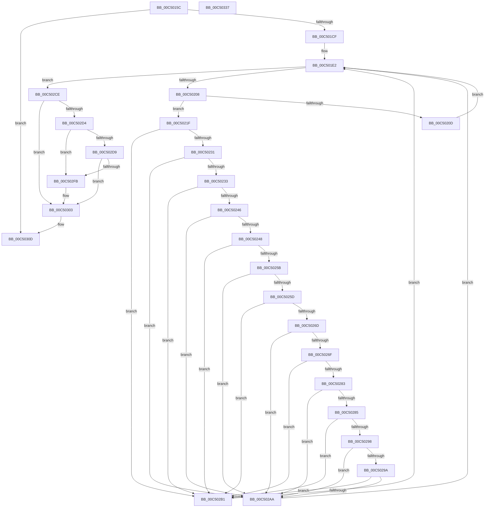

# BapdpProcessWmdResults

- RVA: `0x00C5015C`–`0x00C50338` (길이 `476` bytes)
- VA: `0x0000000140C5015C`
- 실행 섹션: `INIT`
- PDB 이름 있음: `예`; PDB Function 태그: `아니요`
- unwind 정보 RVA: `0x000D47C8`
- 디코드: `134`개 명령, `476/476` bytes 표시
- 미해석 바이트: `0` (있으면 어셈블리에 `.byte`로 보존)

> 이 문서는 커널 이미지의 기계어와 PDB 기호를 분석해 생성했습니다. 4번과 5번은 함수 원형과 자료형을 바이너리 사용 방식에서 추정한 C 해석이며 원본 소스 복구 결과는 아닙니다.

## 1. Dependencies

- 직접 호출 지점: **6**; 고유 호출 대상: **5**
- 직접 호출자로 확인된 함수: **1**
- RIP 상대 이미지 참조: **1**

### Outgoing calls
- `0x00C501BE` → [ExAllocatePool2](../../poolcode/B8/ExAllocatePool2_function_00B820F0.md) (function, `0x00B820F0`)
- `0x00C501FB` → [BapdpQueryData](BapdpQueryData_function_00C50340.md) (function, `0x00C50340`)
- `0x00C502F2` → [BapdpQueryData](BapdpQueryData_function_00C50340.md) (function, `0x00C50340`)
- `0x00C502FE` → [BapdpRegisterWmdResult](BapdpRegisterWmdResult_function_00C50C58.md) (function, `0x00C50C58`)
- `0x00C50308` → [ExFreePoolWithTag](../../poolcode/B8/ExFreePoolWithTag_function_00B82870.md) (function, `0x00B82870`)
- `0x00C50314` → [_security_check_cookie](../../text/6A/_security_check_cookie_function_006AC640.md) (function, `0x006AC640`)

### Direct callers
- [BootApplicationPersistentDataProcess](../BE/BootApplicationPersistentDataProcess_function_00BEEBD4.md) at `0x00BEEBF6`

### Static image references
- `0x00C5017B` → RVA `0x00E0A740` (`.data`; read)

## 2. Other-region calls and transfers

- 다른 실행 섹션으로 향하는 call: **3**
  - `0x00C501BE` → [ExAllocatePool2](../../poolcode/B8/ExAllocatePool2_function_00B820F0.md) (`INIT` → `POOLCODE`)
  - `0x00C50308` → [ExFreePoolWithTag](../../poolcode/B8/ExFreePoolWithTag_function_00B82870.md) (`INIT` → `POOLCODE`)
  - `0x00C50314` → [_security_check_cookie](../../text/6A/_security_check_cookie_function_006AC640.md) (`INIT` → `.text`)
- 별도 외부 분기/꼬리 이동을 확인하지 못했습니다.

## 3. Assembly (complete function range)

```asm
00C5015C  48 8B C4                        mov rax, rsp
00C5015F  48 89 58 08                     mov qword ptr [rax + 8], rbx
00C50163  48 89 70 10                     mov qword ptr [rax + 0x10], rsi
00C50167  48 89 78 18                     mov qword ptr [rax + 0x18], rdi
00C5016B  4C 89 60 20                     mov qword ptr [rax + 0x20], r12
00C5016F  55                              push rbp
00C50170  41 56                           push r14
00C50172  41 57                           push r15
00C50174  48 8B EC                        mov rbp, rsp
00C50177  48 83 EC 70                     sub rsp, 0x70
00C5017B  48 8B 05 BE A5 1B 00            mov rax, qword ptr [rip + 0x1ba5be]
00C50182  48 33 C4                        xor rax, rsp
00C50185  48 89 45 F0                     mov qword ptr [rbp - 0x10], rax
00C50189  0F 57 C0                        xorps xmm0, xmm0
00C5018C  C7 45 E0 5B 27 B8 54            mov dword ptr [rbp - 0x20], 0x54b8275b
00C50193  BE 00 00 01 00                  mov esi, 0x10000
00C50198  C7 45 E4 31 D4 3F 47            mov dword ptr [rbp - 0x1c], 0x473fd431
00C5019F  8B D6                           mov edx, esi
00C501A1  C7 45 E8 AC FB E5 36            mov dword ptr [rbp - 0x18], 0x36e5fbac
00C501A8  41 B8 42 61 50 64               mov r8d, 0x64506142
00C501AE  C7 45 EC A0 84 94 A3            mov dword ptr [rbp - 0x14], 0xa39484a0
00C501B5  B9 40 00 00 00                  mov ecx, 0x40
00C501BA  0F 11 45 D0                     movups xmmword ptr [rbp - 0x30], xmm0
00C501BE  E8 2D 1F F3 FF                  call 0x140b820f0
00C501C3  48 8B F8                        mov rdi, rax
00C501C6  48 85 C0                        test rax, rax
00C501C9  0F 84 3E 01 00 00               je 0x140c5030d
00C501CF  4C 8B 75 D8                     mov r14, qword ptr [rbp - 0x28]
00C501D3  33 DB                           xor ebx, ebx
00C501D5  45 33 FF                        xor r15d, r15d
00C501D8  89 75 C0                        mov dword ptr [rbp - 0x40], esi
00C501DB  48 8B 75 D0                     mov rsi, qword ptr [rbp - 0x30]
00C501DF  45 32 E4                        xor r12b, r12b
00C501E2  48 83 64 24 28 00               and qword ptr [rsp + 0x28], 0
00C501E8  48 8D 45 C0                     lea rax, [rbp - 0x40]
00C501EC  4C 8B CF                        mov r9, rdi
00C501EF  48 89 44 24 20                  mov qword ptr [rsp + 0x20], rax
00C501F4  44 8B C3                        mov r8d, ebx
00C501F7  48 8D 55 E0                     lea rdx, [rbp - 0x20]
00C501FB  E8 40 01 00 00                  call 0x140c50340
00C50200  85 C0                           test eax, eax
00C50202  0F 88 C6 00 00 00               js 0x140c502ce
00C50208  45 84 E4                        test r12b, r12b
00C5020B  75 12                           jne 0x140c5021f
00C5020D  4C 8B 77 24                     mov r14, qword ptr [rdi + 0x24]
00C50211  44 8B FB                        mov r15d, ebx
00C50214  48 8B 77 1C                     mov rsi, qword ptr [rdi + 0x1c]
00C50218  FF C3                           inc ebx
00C5021A  41 B4 01                        mov r12b, 1
00C5021D  EB C3                           jmp 0x140c501e2
00C5021F  0F 10 4F 1C                     movups xmm1, xmmword ptr [rdi + 0x1c]
00C50223  66 48 0F 7E C8                  movq rax, xmm1
00C50228  66 3B C6                        cmp ax, si
00C5022B  0F 8F 80 00 00 00               jg 0x140c502b1
00C50231  7C 77                           jl 0x140c502aa
00C50233  48 8B C8                        mov rcx, rax
00C50236  48 8B D6                        mov rdx, rsi
00C50239  48 C1 E9 10                     shr rcx, 0x10
00C5023D  48 C1 EA 10                     shr rdx, 0x10
00C50241  66 3B CA                        cmp cx, dx
00C50244  7F 6B                           jg 0x140c502b1
00C50246  7C 62                           jl 0x140c502aa
00C50248  48 8B C8                        mov rcx, rax
00C5024B  48 8B D6                        mov rdx, rsi
00C5024E  48 C1 E9 20                     shr rcx, 0x20
00C50252  48 C1 EA 20                     shr rdx, 0x20
00C50256  66 3B CA                        cmp cx, dx
00C50259  7F 56                           jg 0x140c502b1
00C5025B  7C 4D                           jl 0x140c502aa
00C5025D  48 8B CE                        mov rcx, rsi
00C50260  48 C1 E8 30                     shr rax, 0x30
00C50264  48 C1 E9 30                     shr rcx, 0x30
00C50268  66 3B C1                        cmp ax, cx
00C5026B  7F 44                           jg 0x140c502b1
00C5026D  7C 3B                           jl 0x140c502aa
00C5026F  66 0F 6F C1                     movdqa xmm0, xmm1
00C50273  66 0F 73 D8 08                  psrldq xmm0, 8
00C50278  66 48 0F 7E C0                  movq rax, xmm0
00C5027D  66 41 3B C6                     cmp ax, r14w
00C50281  7F 2E                           jg 0x140c502b1
00C50283  7C 25                           jl 0x140c502aa
00C50285  48 8B C8                        mov rcx, rax
00C50288  49 8B D6                        mov rdx, r14
00C5028B  48 C1 E9 10                     shr rcx, 0x10
00C5028F  48 C1 EA 10                     shr rdx, 0x10
00C50293  66 3B CA                        cmp cx, dx
00C50296  7F 19                           jg 0x140c502b1
00C50298  7C 10                           jl 0x140c502aa
00C5029A  49 8B CE                        mov rcx, r14
00C5029D  48 C1 E8 20                     shr rax, 0x20
00C502A1  48 C1 E9 20                     shr rcx, 0x20
00C502A5  66 3B C1                        cmp ax, cx
00C502A8  7F 07                           jg 0x140c502b1
00C502AA  FF C3                           inc ebx
00C502AC  E9 31 FF FF FF                  jmp 0x140c501e2
00C502B1  66 0F 6F C1                     movdqa xmm0, xmm1
00C502B5  44 8B FB                        mov r15d, ebx
00C502B8  66 0F 73 D8 08                  psrldq xmm0, 8
00C502BD  FF C3                           inc ebx
00C502BF  66 49 0F 7E C6                  movq r14, xmm0
00C502C4  66 48 0F 7E CE                  movq rsi, xmm1
00C502C9  E9 14 FF FF FF                  jmp 0x140c501e2
00C502CE  41 80 FC 01                     cmp r12b, 1
00C502D2  75 2F                           jne 0x140c50303
00C502D4  44 3B FB                        cmp r15d, ebx
00C502D7  74 22                           je 0x140c502fb
00C502D9  48 83 64 24 28 00               and qword ptr [rsp + 0x28], 0
00C502DF  48 8D 45 C0                     lea rax, [rbp - 0x40]
00C502E3  4C 8B CF                        mov r9, rdi
00C502E6  48 89 44 24 20                  mov qword ptr [rsp + 0x20], rax
00C502EB  45 8B C7                        mov r8d, r15d
00C502EE  48 8D 55 E0                     lea rdx, [rbp - 0x20]
00C502F2  E8 49 00 00 00                  call 0x140c50340
00C502F7  85 C0                           test eax, eax
00C502F9  78 08                           js 0x140c50303
00C502FB  48 8B CF                        mov rcx, rdi
00C502FE  E8 55 09 00 00                  call 0x140c50c58
00C50303  33 D2                           xor edx, edx
00C50305  48 8B CF                        mov rcx, rdi
00C50308  E8 63 25 F3 FF                  call 0x140b82870
00C5030D  48 8B 4D F0                     mov rcx, qword ptr [rbp - 0x10]
00C50311  48 33 CC                        xor rcx, rsp
00C50314  E8 27 C3 A5 FF                  call 0x1406ac640
00C50319  4C 8D 5C 24 70                  lea r11, [rsp + 0x70]
00C5031E  49 8B 5B 20                     mov rbx, qword ptr [r11 + 0x20]
00C50322  49 8B 73 28                     mov rsi, qword ptr [r11 + 0x28]
00C50326  49 8B 7B 30                     mov rdi, qword ptr [r11 + 0x30]
00C5032A  4D 8B 63 38                     mov r12, qword ptr [r11 + 0x38]
00C5032E  49 8B E3                        mov rsp, r11
00C50331  41 5F                           pop r15
00C50333  41 5E                           pop r14
00C50335  5D                              pop rbp
00C50336  C3                              ret
00C50337  CC                              int3
```

## 4. C-style interpretation (structured pseudocode)

```c
__int64 __fastcall BapdpProcessWmdResults(void)
{
    __int64 result;
    __int64 v_r12;
    __int64 v_r15;
    __int64 v_rbx;
    __int64 v_rsp;
    unsigned __int64 v_stack_m18;
    unsigned __int64 v_stack_m28;
    unsigned int v_stack_m2C;
    unsigned int v_stack_m30;
    unsigned int v_stack_m34;
    unsigned int v_stack_m38;
    unsigned __int64 v_stack_m40;
    unsigned __int64 v_stack_m48;
    unsigned int v_stack_m58;
    unsigned __int64 v_stack_m60;
    unsigned __int64 v_stack_m68;

    *(unsigned __int64 *)(v_rsp + 8) = v_rbx;
    *(unsigned __int64 *)(v_rsp + 16) = v_rsi;
    *(unsigned __int64 *)(v_rsp + 24) = v_rdi;
    *(unsigned __int64 *)(v_rsp + 32) = v_r12;
    v_rsp = (v_rsp) - (112);
    result = (*(unsigned __int64 *)(v_rip + 1811902)) ^ (v_rsp);
    v_stack_m28 = result;
    v_stack_m38 = 0x54B8275BULL;
    v_stack_m34 = 0x473FD431ULL;
    v_stack_m30 = 0x36E5FBACULL;
    v_stack_m2C = 0xA39484A0ULL;
    v_stack_m48 = v_xmm0;
    result = ExAllocatePool2(64, (unsigned int)((unsigned int)((unsigned int)(0x10000ULL))), (unsigned int)(0x64506142ULL), a4);
    if (result == 0) goto loc_00C5030D;
    v_rbx = 0;
    v_r15 = 0;
    v_stack_m58 = (unsigned int)((unsigned int)(0x10000ULL));
    v_r12 = 0;
loc_00C501E2:
    v_stack_m68 = v_stack_m58;
    result = BapdpQueryData(64, v_stack_m38, 0, result);
    if (sign_flag) goto loc_00C502CE;
    if (0 != 0) goto loc_00C5021F;
    v_rbx = (unsigned int)((v_rbx) + 1);
    goto loc_00C501E2;
loc_00C5021F:
    if (((unsigned __int16)(result)) > ((unsigned __int16)(*(unsigned __int64 *)(result + 28)))) goto loc_00C502B1;
    if (((unsigned __int16)(result)) < ((unsigned __int16)(*(unsigned __int64 *)(result + 28)))) goto loc_00C502AA;
    a1 = (result) >> (16);
    a2 = (*(unsigned __int64 *)(result + 28)) >> (16);
    if (((unsigned __int16)(a1)) > ((unsigned __int16)(a2))) goto loc_00C502B1;
    if (((unsigned __int16)(a1)) < ((unsigned __int16)(a2))) goto loc_00C502AA;
    a1 = (result) >> (32);
    a2 = (*(unsigned __int64 *)(result + 28)) >> (32);
    if (((unsigned __int16)(a1)) > ((unsigned __int16)(a2))) goto loc_00C502B1;
    if (((unsigned __int16)(a1)) < ((unsigned __int16)(a2))) goto loc_00C502AA;
    result = (result) >> (48);
    a1 = (*(unsigned __int64 *)(result + 28)) >> (48);
    if (((unsigned __int16)(result)) > ((unsigned __int16)(a1))) goto loc_00C502B1;
    if (((unsigned __int16)(result)) < ((unsigned __int16)(a1))) goto loc_00C502AA;
    if (((unsigned __int16)(result)) > ((unsigned __int16)(*(unsigned __int64 *)(result + 36)))) goto loc_00C502B1;
    if (((unsigned __int16)(result)) < ((unsigned __int16)(*(unsigned __int64 *)(result + 36)))) goto loc_00C502AA;
    a1 = (result) >> (16);
    a2 = (*(unsigned __int64 *)(result + 36)) >> (16);
    if (((unsigned __int16)(a1)) > ((unsigned __int16)(a2))) goto loc_00C502B1;
    if (((unsigned __int16)(a1)) < ((unsigned __int16)(a2))) goto loc_00C502AA;
    result = (result) >> (32);
    a1 = (*(unsigned __int64 *)(result + 36)) >> (32);
    if (((unsigned __int16)(result)) > ((unsigned __int16)(a1))) goto loc_00C502B1;
loc_00C502AA:
    v_rbx = (unsigned int)((v_rbx) + 1);
    goto loc_00C501E2;
loc_00C502B1:
    v_rbx = (unsigned int)((v_rbx) + 1);
    goto loc_00C501E2;
loc_00C502CE:
    if (1 != 1) goto loc_00C50303;
    if (((unsigned int)((unsigned int)((unsigned int)(v_rbx)))) == ((unsigned int)(v_rbx))) goto loc_00C502FB;
    v_stack_m68 = v_stack_m58;
    result = BapdpQueryData(a1, v_stack_m38, (unsigned int)((unsigned int)((unsigned int)((unsigned int)(v_rbx)))), result);
    if (!(sign_flag)) {
        a1 = result;
        result = BapdpRegisterWmdResult(a1, v_stack_m38, (unsigned int)((unsigned int)((unsigned int)((unsigned int)(v_rbx)))), result);
    }
    a2 = 0;
    result = ExFreePoolWithTag(result, a2, (unsigned int)((unsigned int)((unsigned int)((unsigned int)(v_rbx)))), result);
loc_00C5030D:
    a1 = (v_stack_m28) ^ (v_rsp);
    result = _security_check_cookie(a1, a2, (unsigned int)((unsigned int)((unsigned int)((unsigned int)(v_rbx)))), result);
    return result;
}
```

## 5. (Beta) C Style

```c
void BapdpProcessWmdResults(void)
{
    int64_t result;
    int64_t local_r12;
    int64_t local_r15;
    int64_t local_rbx;
    int64_t local_rsp;
    uint64_t v_stack_m18;
    uint64_t v_stack_m28;
    uint32_t v_stack_m2C;
    uint32_t v_stack_m30;
    uint32_t v_stack_m34;
    uint32_t v_stack_m38;
    uint64_t v_stack_m40;
    uint64_t v_stack_m48;
    uint32_t v_stack_m58;
    uint64_t v_stack_m60;
    uint64_t v_stack_m68;

    *(uint64_t *)(local_rsp + 0x8) = local_rbx;
    *(uint64_t *)(local_rsp + 0x10) = local_rsi;
    *(uint64_t *)(local_rsp + 0x18) = local_rdi;
    *(uint64_t *)(local_rsp + 0x20) = local_r12;
    local_rsp = (local_rsp) - (112);
    result = (*(uint64_t *)(v_rip + 0x1BA5BE)) ^ (local_rsp);
    v_stack_m28 = result;
    v_stack_m38 = 0x54B8275BULL;
    v_stack_m34 = 0x473FD431ULL;
    v_stack_m30 = 0x36E5FBACULL;
    v_stack_m2C = 0xA39484A0ULL;
    v_stack_m48 = v_xmm0;
    result = ExAllocatePool2(64, (uint32_t)((uint32_t)((uint32_t)(0x10000ULL))), (uint32_t)(0x64506142ULL), a4);
    if (result == 0) goto loc_00C5030D;
    local_rbx = 0;
    local_r15 = 0;
    v_stack_m58 = (uint32_t)((uint32_t)(0x10000ULL));
    local_r12 = 0;
loc_00C501E2:
    v_stack_m68 = v_stack_m58;
    result = BapdpQueryData(64, v_stack_m38, 0, result);
    if (sign_flag) goto loc_00C502CE;
    if (0 != 0) goto loc_00C5021F;
    local_rbx = (uint32_t)((local_rbx) + 1);
    goto loc_00C501E2;
loc_00C5021F:
    if (((uint16_t)(result)) > ((uint16_t)(*(uint64_t *)(result + 0x1C)))) goto loc_00C502B1;
    if (((uint16_t)(result)) < ((uint16_t)(*(uint64_t *)(result + 0x1C)))) goto loc_00C502AA;
    a1 = (result) >> (16);
    a2 = (*(uint64_t *)(result + 0x1C)) >> (16);
    if (((uint16_t)(a1)) > ((uint16_t)(a2))) goto loc_00C502B1;
    if (((uint16_t)(a1)) < ((uint16_t)(a2))) goto loc_00C502AA;
    a1 = (result) >> (32);
    a2 = (*(uint64_t *)(result + 0x1C)) >> (32);
    if (((uint16_t)(a1)) > ((uint16_t)(a2))) goto loc_00C502B1;
    if (((uint16_t)(a1)) < ((uint16_t)(a2))) goto loc_00C502AA;
    result = (result) >> (48);
    a1 = (*(uint64_t *)(result + 0x1C)) >> (48);
    if (((uint16_t)(result)) > ((uint16_t)(a1))) goto loc_00C502B1;
    if (((uint16_t)(result)) < ((uint16_t)(a1))) goto loc_00C502AA;
    if (((uint16_t)(result)) > ((uint16_t)(*(uint64_t *)(result + 0x24)))) goto loc_00C502B1;
    if (((uint16_t)(result)) < ((uint16_t)(*(uint64_t *)(result + 0x24)))) goto loc_00C502AA;
    a1 = (result) >> (16);
    a2 = (*(uint64_t *)(result + 0x24)) >> (16);
    if (((uint16_t)(a1)) > ((uint16_t)(a2))) goto loc_00C502B1;
    if (((uint16_t)(a1)) < ((uint16_t)(a2))) goto loc_00C502AA;
    result = (result) >> (32);
    a1 = (*(uint64_t *)(result + 0x24)) >> (32);
    if (((uint16_t)(result)) > ((uint16_t)(a1))) goto loc_00C502B1;
loc_00C502AA:
    local_rbx = (uint32_t)((local_rbx) + 1);
    goto loc_00C501E2;
loc_00C502B1:
    local_rbx = (uint32_t)((local_rbx) + 1);
    goto loc_00C501E2;
loc_00C502CE:
    if (1 != 1) goto loc_00C50303;
    if (((uint32_t)((uint32_t)((uint32_t)(local_rbx)))) == ((uint32_t)(local_rbx))) goto loc_00C502FB;
    v_stack_m68 = v_stack_m58;
    result = BapdpQueryData(a1, v_stack_m38, (uint32_t)((uint32_t)((uint32_t)((uint32_t)(local_rbx)))), result);
    if (!(sign_flag)) {
        a1 = result;
        result = BapdpRegisterWmdResult(a1, v_stack_m38, (uint32_t)((uint32_t)((uint32_t)((uint32_t)(local_rbx)))), result);
    }
    a2 = 0;
    result = ExFreePoolWithTag(result, a2, (uint32_t)((uint32_t)((uint32_t)((uint32_t)(local_rbx)))), result);
loc_00C5030D:
    a1 = (v_stack_m28) ^ (local_rsp);
    result = _security_check_cookie(a1, a2, (uint32_t)((uint32_t)((uint32_t)((uint32_t)(local_rbx)))), result);
    return result;
}
```

## 6. Execution-region graph

[열기: 2D/3D 그래프와 함수 탐색 컨트롤 패널](../../../control-panel.html?section=init&rva=0x00C5015C&view=graph)

- 2D 그래프는 위에서 아래로 흐르고, 3D 그래프는 빈 공간을 드래그해 회전합니다. Shift+드래그는 이동, 휠은 확대·축소, 함수 노드 선택은 대상 보고서 이동입니다.

### Static fallback


