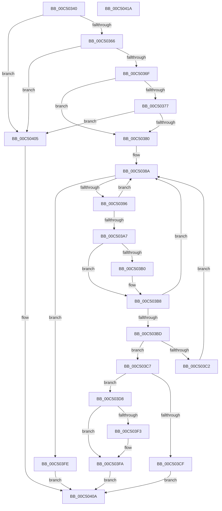

# BapdpQueryData

- RVA: `0x00C50340`–`0x00C5041B` (길이 `219` bytes)
- VA: `0x0000000140C50340`
- 실행 섹션: `INIT`
- PDB 이름 있음: `예`; PDB Function 태그: `아니요`
- unwind 정보 RVA: `0x00060BC4`
- 디코드: `66`개 명령, `219/219` bytes 표시
- 미해석 바이트: `0` (있으면 어셈블리에 `.byte`로 보존)

> 이 문서는 커널 이미지의 기계어와 PDB 기호를 분석해 생성했습니다. 4번과 5번은 함수 원형과 자료형을 바이너리 사용 방식에서 추정한 C 해석이며 원본 소스 복구 결과는 아닙니다.

## 1. Dependencies

- 직접 호출 지점: **1**; 고유 호출 대상: **1**
- 직접 호출자로 확인된 함수: **11**
- RIP 상대 이미지 참조: **1**

### Outgoing calls
- `0x00C503E4` → [memcpy](../../text/6C/memcpy_function_006C6840.md) (function, `0x006C6840`)

### Direct callers
- [BapdpProcessEtwEvents](../../text/65/BapdpProcessEtwEvents_function_00654C74.md) at `0x00654CEA`
- [BapdpProcessEtwEvents](../../text/65/BapdpProcessEtwEvents_function_00654C74.md) at `0x00654D4F`
- [BapdpProcessSpacesBootInformation](../../text/65/BapdpProcessSpacesBootInformation_function_00654DB0.md) at `0x00654E04`
- [BapdpProcessSpacesBootInformation](../../text/65/BapdpProcessSpacesBootInformation_function_00654DB0.md) at `0x00654E49`
- [BapdpProcessBitlockerStatus](../C4/BapdpProcessBitlockerStatus_function_00C4F7BC.md) at `0x00C4F810`
- [BapdpProcessBitlockerStatus](../C4/BapdpProcessBitlockerStatus_function_00C4F7BC.md) at `0x00C4F858`
- [BapdpProcessBootMetadata](../C4/BapdpProcessBootMetadata_function_00C4F89C.md) at `0x00C4F961`
- [BapdpProcessBootMetadata](../C4/BapdpProcessBootMetadata_function_00C4F89C.md) at `0x00C4F9A6`
- [BapdpProcessEDrvHintInfo](../C4/BapdpProcessEDrvHintInfo_function_00C4F9DC.md) at `0x00C4FA30`
- [BapdpProcessEDrvHintInfo](../C4/BapdpProcessEDrvHintInfo_function_00C4F9DC.md) at `0x00C4FA78`
- [BapdpProcessFwUpdateResults](../C4/BapdpProcessFwUpdateResults_function_00C4FABC.md) at `0x00C4FB10`
- [BapdpProcessFwUpdateResults](../C4/BapdpProcessFwUpdateResults_function_00C4FABC.md) at `0x00C4FB58`
- [BapdpProcessHSTIResults](../C4/BapdpProcessHSTIResults_function_00C4FB9C.md) at `0x00C4FBF0`
- [BapdpProcessHSTIResults](../C4/BapdpProcessHSTIResults_function_00C4FB9C.md) at `0x00C4FC38`
- [BapdpProcessResumeInformation](../C4/BapdpProcessResumeInformation_function_00C4FC80.md) at `0x00C4FCD4`
- [BapdpProcessResumeInformation](../C4/BapdpProcessResumeInformation_function_00C4FC80.md) at `0x00C4FD1C`
- [BapdpProcessVsmKeyBlobs](../C4/BapdpProcessVsmKeyBlobs_function_00C4FD60.md) at `0x00C4FE6C`
- [BapdpProcessVsmKeyBlobs](../C4/BapdpProcessVsmKeyBlobs_function_00C4FD60.md) at `0x00C4FF0C`
- [BapdpProcessWmdResults](BapdpProcessWmdResults_function_00C5015C.md) at `0x00C501FB`
- [BapdpProcessWmdResults](BapdpProcessWmdResults_function_00C5015C.md) at `0x00C502F2`
- [BapdpRegisterWbclData](BapdpRegisterWbclData_function_00C50B3C.md) at `0x00C50BC5`
- [BapdpRegisterWbclData](BapdpRegisterWbclData_function_00C50B3C.md) at `0x00C50C0D`

### Static image references
- `0x00C50380` → RVA `0x00E62410` (`.data`; read)

## 2. Other-region calls and transfers

- 다른 실행 섹션으로 향하는 call: **1**
  - `0x00C503E4` → [memcpy](../../text/6C/memcpy_function_006C6840.md) (`INIT` → `.text`)
- 별도 외부 분기/꼬리 이동을 확인하지 못했습니다.

## 3. Assembly (complete function range)

```asm
00C50340  48 89 5C 24 08                  mov qword ptr [rsp + 8], rbx
00C50345  48 89 74 24 10                  mov qword ptr [rsp + 0x10], rsi
00C5034A  57                              push rdi
00C5034B  48 83 EC 20                     sub rsp, 0x20
00C5034F  48 8B 4C 24 50                  mov rcx, qword ptr [rsp + 0x50]
00C50354  49 8B F9                        mov rdi, r9
00C50357  41 8B F0                        mov esi, r8d
00C5035A  4C 8B DA                        mov r11, rdx
00C5035D  48 85 C9                        test rcx, rcx
00C50360  0F 84 9F 00 00 00               je 0x140c50405
00C50366  48 85 D2                        test rdx, rdx
00C50369  0F 84 96 00 00 00               je 0x140c50405
00C5036F  44 8B 11                        mov r10d, dword ptr [rcx]
00C50372  45 85 D2                        test r10d, r10d
00C50375  74 09                           je 0x140c50380
00C50377  4D 85 C9                        test r9, r9
00C5037A  0F 84 85 00 00 00               je 0x140c50405
00C50380  4C 8B 05 89 20 21 00            mov r8, qword ptr [rip + 0x212089]
00C50387  45 33 C9                        xor r9d, r9d
00C5038A  48 8D 05 7F 20 21 00            lea rax, [rip + 0x21207f]
00C50391  4C 3B C0                        cmp r8, rax
00C50394  74 68                           je 0x140c503fe
00C50396  49 8B 58 10                     mov rbx, qword ptr [r8 + 0x10]
00C5039A  4D 8B 00                        mov r8, qword ptr [r8]
00C5039D  8B 43 20                        mov eax, dword ptr [rbx + 0x20]
00C503A0  FF C8                           dec eax
00C503A2  83 F8 01                        cmp eax, 1
00C503A5  77 E3                           ja 0x140c5038a
00C503A7  49 8B 13                        mov rdx, qword ptr [r11]
00C503AA  48 2B 53 10                     sub rdx, qword ptr [rbx + 0x10]
00C503AE  75 08                           jne 0x140c503b8
00C503B0  49 8B 53 08                     mov rdx, qword ptr [r11 + 8]
00C503B4  48 2B 53 18                     sub rdx, qword ptr [rbx + 0x18]
00C503B8  48 85 D2                        test rdx, rdx
00C503BB  75 CD                           jne 0x140c5038a
00C503BD  41 3B F1                        cmp esi, r9d
00C503C0  74 05                           je 0x140c503c7
00C503C2  41 FF C1                        inc r9d
00C503C5  EB C3                           jmp 0x140c5038a
00C503C7  8B 43 24                        mov eax, dword ptr [rbx + 0x24]
00C503CA  44 3B D0                        cmp r10d, eax
00C503CD  73 09                           jae 0x140c503d8
00C503CF  89 01                           mov dword ptr [rcx], eax
00C503D1  B8 23 00 00 C0                  mov eax, 0xc0000023
00C503D6  EB 32                           jmp 0x140c5040a
00C503D8  8B 53 28                        mov edx, dword ptr [rbx + 0x28]
00C503DB  4C 8B C0                        mov r8, rax
00C503DE  48 03 D3                        add rdx, rbx
00C503E1  48 8B CF                        mov rcx, rdi
00C503E4  E8 57 64 A7 FF                  call 0x1406c6840
00C503E9  48 8B 44 24 58                  mov rax, qword ptr [rsp + 0x58]
00C503EE  48 85 C0                        test rax, rax
00C503F1  74 07                           je 0x140c503fa
00C503F3  0F 10 03                        movups xmm0, xmmword ptr [rbx]
00C503F6  F3 0F 7F 00                     movdqu xmmword ptr [rax], xmm0
00C503FA  33 C0                           xor eax, eax
00C503FC  EB 0C                           jmp 0x140c5040a
00C503FE  B8 25 02 00 C0                  mov eax, 0xc0000225
00C50403  EB 05                           jmp 0x140c5040a
00C50405  B8 0D 00 00 C0                  mov eax, 0xc000000d
00C5040A  48 8B 5C 24 30                  mov rbx, qword ptr [rsp + 0x30]
00C5040F  48 8B 74 24 38                  mov rsi, qword ptr [rsp + 0x38]
00C50414  48 83 C4 20                     add rsp, 0x20
00C50418  5F                              pop rdi
00C50419  C3                              ret
00C5041A  CC                              int3
```

## 4. C-style interpretation (structured pseudocode)

```c
__int64 __fastcall BapdpQueryData(__int64 a1, __int64 a2, int a3, __int64 a4, __int64 a5, __int64 a6)
{
    __int64 result;
    __int64 v_rsp;
    unsigned __int64 v_stack_p10;
    unsigned __int64 v_stack_p8;

    v_stack_p8 = v_rbx;
    v_stack_p10 = v_rsi;
    v_rsp = (v_rsp) - (32);
    if (a5 == 0) goto loc_00C50405;
    if (a2 == 0) goto loc_00C50405;
    if ((unsigned int)((unsigned int)(*(unsigned int *)(a5))) == 0) goto loc_00C50380;
    if (a4 == 0) goto loc_00C50405;
loc_00C50380:
    a4 = 0;
loc_00C5038A:
    if ((*(unsigned __int64 *)(v_rip + 2171017)) == (v_rip + 2171007)) goto loc_00C503FE;
    result = (unsigned int)(((unsigned int)(*(unsigned int *)(*(unsigned __int64 *)(*(unsigned __int64 *)(v_rip + 2171017) + 16) + 32))) - 1);
    if (((unsigned int)(result)) > 1) goto loc_00C5038A;
    a2 = (*(unsigned __int64 *)(a2)) - (*(unsigned __int64 *)(*(unsigned __int64 *)(*(unsigned __int64 *)(v_rip + 2171017) + 16) + 16));
    if (!(condition_is_not_equal)) {
        a2 = *(unsigned __int64 *)(a2 + 8);
        a2 = (a2) - (*(unsigned __int64 *)(*(unsigned __int64 *)(*(unsigned __int64 *)(v_rip + 2171017) + 16) + 24));
    }
    if (a2 != 0) goto loc_00C5038A;
    if (((unsigned int)((unsigned int)(a3))) == 0) goto loc_00C503C7;
    a4 = (unsigned int)((a4) + 1);
    goto loc_00C5038A;
loc_00C503C7:
    if (((unsigned int)((unsigned int)(*(unsigned int *)(a5)))) >= ((unsigned int)((unsigned int)(*(unsigned int *)(*(unsigned __int64 *)(*(unsigned __int64 *)(v_rip + 2171017) + 16) + 36))))) goto loc_00C503D8;
    *(unsigned int *)(a5) = (unsigned int)((unsigned int)(*(unsigned int *)(*(unsigned __int64 *)(*(unsigned __int64 *)(v_rip + 2171017) + 16) + 36)));
    goto loc_00C5040A;
loc_00C503D8:
    a2 = ((unsigned int)(*(unsigned int *)(*(unsigned __int64 *)(*(unsigned __int64 *)(v_rip + 2171017) + 16) + 40))) + (*(unsigned __int64 *)(*(unsigned __int64 *)(v_rip + 2171017) + 16));
    result = memcpy(a4, a2, (unsigned int)(0xC0000023ULL), a4);
    if (a6 != 0) {
        *(unsigned __int64 *)(a6) = v_xmm0;
    }
    result = 0;
    goto loc_00C5040A;
loc_00C503FE:
    goto loc_00C5040A;
loc_00C50405:
loc_00C5040A:
    v_rsp = (v_rsp) + (32);
    return (unsigned int)(0xC000000DULL);
}
```

## 5. (Beta) C Style

```c
int64_t BapdpQueryData(int64_t Arg1, void *Arg2, int32_t Arg3, int64_t Arg4, int64_t Arg5, int64_t Arg6)
{
    uint8_t *arg2 = (uint8_t *)Arg2;

    int64_t result;
    int64_t local_rsp;
    uint64_t v_stack_p10;
    uint64_t v_stack_p8;

    v_stack_p8 = local_rbx;
    v_stack_p10 = local_rsi;
    local_rsp = (local_rsp) - (32);
    if (Arg5 == 0) goto loc_00C50405;
    if (Arg2 == NULL) goto loc_00C50405;
    if ((uint32_t)((uint32_t)(*(uint32_t *)(Arg5))) == 0) goto loc_00C50380;
    if (Arg4 == 0) goto loc_00C50405;
loc_00C50380:
    Arg4 = 0;
loc_00C5038A:
    if ((*(uint64_t *)(v_rip + 0x212089)) == (v_rip + 2171007)) goto loc_00C503FE;
    result = (uint32_t)(((uint32_t)(*(uint32_t *)(*(uint64_t *)(*(uint64_t *)(v_rip + 0x212089) + 0x10) + 0x20))) - 1);
    if (((uint32_t)(result)) > 1) goto loc_00C5038A;
    Arg2 = (*(uint64_t *)(arg2)) - (*(uint64_t *)(*(uint64_t *)(*(uint64_t *)(v_rip + 0x212089) + 0x10) + 0x10));
    if (!(condition_is_not_equal)) {
        Arg2 = *(uint64_t *)(arg2 + 0x8);
        Arg2 = (Arg2) - (*(uint64_t *)(*(uint64_t *)(*(uint64_t *)(v_rip + 0x212089) + 0x10) + 0x18));
    }
    if (Arg2 != NULL) goto loc_00C5038A;
    if (((uint32_t)((uint32_t)(Arg3))) == 0) goto loc_00C503C7;
    Arg4 = (uint32_t)((Arg4) + 1);
    goto loc_00C5038A;
loc_00C503C7:
    if (((uint32_t)((uint32_t)(*(uint32_t *)(Arg5)))) >= ((uint32_t)((uint32_t)(*(uint32_t *)(*(uint64_t *)(*(uint64_t *)(v_rip + 0x212089) + 0x10) + 0x24))))) goto loc_00C503D8;
    *(uint32_t *)(Arg5) = (uint32_t)((uint32_t)(*(uint32_t *)(*(uint64_t *)(*(uint64_t *)(v_rip + 0x212089) + 0x10) + 0x24)));
    goto loc_00C5040A;
loc_00C503D8:
    Arg2 = ((uint32_t)(*(uint32_t *)(*(uint64_t *)(*(uint64_t *)(v_rip + 0x212089) + 0x10) + 0x28))) + (*(uint64_t *)(*(uint64_t *)(v_rip + 0x212089) + 0x10));
    result = memcpy(Arg4, Arg2, (uint32_t)(0xC0000023ULL), Arg4);
    if (Arg6 != 0) {
        *(uint64_t *)(Arg6) = v_xmm0;
    }
    result = 0;
    goto loc_00C5040A;
loc_00C503FE:
    goto loc_00C5040A;
loc_00C50405:
loc_00C5040A:
    local_rsp = (local_rsp) + (32);
    return (uint32_t)(0xC000000DULL);
}
```

### 관측된 메모리 오프셋

구조체 형식이 확인되지 않은 접근은 인자 기준의 오프셋으로만 기록했습니다.

| 기준 인자 | 오프셋 표현 | 폭 (bit) | 접근 |
|---|---:|---:|---|
| `Arg2` | `+ 0x0` | `64` | `R` |
| `Arg2` | `+ 0x8` | `64` | `R` |

## 6. Execution-region graph

[열기: 2D/3D 그래프와 함수 탐색 컨트롤 패널](../../../control-panel.html?section=init&rva=0x00C50340&view=graph)

- 2D 그래프는 위에서 아래로 흐르고, 3D 그래프는 빈 공간을 드래그해 회전합니다. Shift+드래그는 이동, 휠은 확대·축소, 함수 노드 선택은 대상 보고서 이동입니다.

### Static fallback


