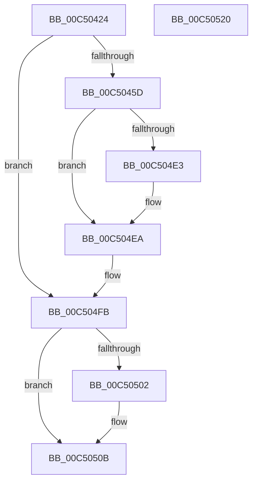

# BapdpRecordIumStatus

- RVA: `0x00C50424`–`0x00C50521` (길이 `253` bytes)
- VA: `0x0000000140C50424`
- 실행 섹션: `INIT`
- PDB 이름 있음: `예`; PDB Function 태그: `아니요`
- unwind 정보 RVA: `0x000B0904`
- 디코드: `55`개 명령, `253/253` bytes 표시
- 미해석 바이트: `0` (있으면 어셈블리에 `.byte`로 보존)

> 이 문서는 커널 이미지의 기계어와 PDB 기호를 분석해 생성했습니다. 4번과 5번은 함수 원형과 자료형을 바이너리 사용 방식에서 추정한 C 해석이며 원본 소스 복구 결과는 아닙니다.

## 1. Dependencies

- 직접 호출 지점: **4**; 고유 호출 대상: **4**
- 직접 호출자로 확인된 함수: **1**
- RIP 상대 이미지 참조: **5**

### Outgoing calls
- `0x00C50450` → [BapdRegisterEtwProvider](../../text/4A/BapdRegisterEtwProvider_function_004AECF8.md) (function, `0x004AECF8`)
- `0x00C504F6` → [EtwWriteEx](../../text/25/EtwWriteEx_function_0025F0D0.md) (function, `0x0025F0D0`)
- `0x00C50506` → [EtwUnregister](../../page/A7/EtwUnregister_function_00A723D0.md) (function, `0x00A723D0`)
- `0x00C50512` → [_security_check_cookie](../../text/6A/_security_check_cookie_function_006AC640.md) (function, `0x006AC640`)

### Direct callers
- [BootApplicationPersistentDataProcess](../BE/BootApplicationPersistentDataProcess_function_00BEEBD4.md) at `0x00BEEC4A`

### Static image references
- `0x00C50430` → RVA `0x00E0A740` (`.data`; read)
- `0x00C50449` → RVA `0x0001BF70` (`.rdata`; read)
- `0x00C5045D` → RVA `0x00FC6B20` (`ALMOSTRO`; read)
- `0x00C504B7` → RVA `0x00021FB0` (`.rdata`; read)
- `0x00C504E3` → RVA `0x00020FE8` (`.rdata`; read)

## 2. Other-region calls and transfers

- 다른 실행 섹션으로 향하는 call: **4**
  - `0x00C50450` → [BapdRegisterEtwProvider](../../text/4A/BapdRegisterEtwProvider_function_004AECF8.md) (`INIT` → `.text`)
  - `0x00C504F6` → [EtwWriteEx](../../text/25/EtwWriteEx_function_0025F0D0.md) (`INIT` → `.text`)
  - `0x00C50506` → [EtwUnregister](../../page/A7/EtwUnregister_function_00A723D0.md) (`INIT` → `PAGE`)
  - `0x00C50512` → [_security_check_cookie](../../text/6A/_security_check_cookie_function_006AC640.md) (`INIT` → `.text`)
- 별도 외부 분기/꼬리 이동을 확인하지 못했습니다.

## 3. Assembly (complete function range)

```asm
00C50424  40 55                           push rbp
00C50426  48 8B EC                        mov rbp, rsp
00C50429  48 81 EC 80 00 00 00            sub rsp, 0x80
00C50430  48 8B 05 09 A3 1B 00            mov rax, qword ptr [rip + 0x1ba309]
00C50437  48 33 C4                        xor rax, rsp
00C5043A  48 89 45 F8                     mov qword ptr [rbp - 8], rax
00C5043E  48 83 65 C0 00                  and qword ptr [rbp - 0x40], 0
00C50443  4C 8D 45 C0                     lea r8, [rbp - 0x40]
00C50447  B2 01                           mov dl, 1
00C50449  48 8D 0D 20 BB 3C FF            lea rcx, [rip - 0xc344e0]
00C50450  E8 A3 E8 85 FF                  call 0x1404aecf8
00C50455  85 C0                           test eax, eax
00C50457  0F 88 9E 00 00 00               js 0x140c504fb
00C5045D  48 8B 0D BC 66 37 00            mov rcx, qword ptr [rip + 0x3766bc]
00C50464  BA 04 00 00 00                  mov edx, 4
00C50469  45 33 C9                        xor r9d, r9d
00C5046C  45 33 C0                        xor r8d, r8d
00C5046F  48 8B 81 F0 00 00 00            mov rax, qword ptr [rcx + 0xf0]
00C50476  83 65 D4 00                     and dword ptr [rbp - 0x2c], 0
00C5047A  48 05 50 0B 00 00               add rax, 0xb50
00C50480  48 89 45 C8                     mov qword ptr [rbp - 0x38], rax
00C50484  89 55 D0                        mov dword ptr [rbp - 0x30], edx
00C50487  48 8B 81 F0 00 00 00            mov rax, qword ptr [rcx + 0xf0]
00C5048E  83 65 E4 00                     and dword ptr [rbp - 0x1c], 0
00C50492  48 05 48 0B 00 00               add rax, 0xb48
00C50498  48 89 45 D8                     mov qword ptr [rbp - 0x28], rax
00C5049C  89 55 E0                        mov dword ptr [rbp - 0x20], edx
00C5049F  48 8B 81 F0 00 00 00            mov rax, qword ptr [rcx + 0xf0]
00C504A6  83 65 F4 00                     and dword ptr [rbp - 0xc], 0
00C504AA  48 05 4C 0B 00 00               add rax, 0xb4c
00C504B0  48 89 45 E8                     mov qword ptr [rbp - 0x18], rax
00C504B4  89 55 F0                        mov dword ptr [rbp - 0x10], edx
00C504B7  48 8D 15 F2 1A 3D FF            lea rdx, [rip - 0xc2e50e]
00C504BE  48 8B 81 F0 00 00 00            mov rax, qword ptr [rcx + 0xf0]
00C504C5  48 8B 4D C0                     mov rcx, qword ptr [rbp - 0x40]
00C504C9  44 39 80 50 0B 00 00            cmp dword ptr [rax + 0xb50], r8d
00C504D0  48 8D 45 C8                     lea rax, [rbp - 0x38]
00C504D4  48 89 44 24 38                  mov qword ptr [rsp + 0x38], rax
00C504D9  C7 44 24 30 03 00 00 00         mov dword ptr [rsp + 0x30], 3
00C504E1  7D 07                           jge 0x140c504ea
00C504E3  48 8D 15 FE 0A 3D FF            lea rdx, [rip - 0xc2f502]
00C504EA  48 83 64 24 28 00               and qword ptr [rsp + 0x28], 0
00C504F0  48 83 64 24 20 00               and qword ptr [rsp + 0x20], 0
00C504F6  E8 D5 EB 60 FF                  call 0x14025f0d0
00C504FB  48 83 7D C0 00                  cmp qword ptr [rbp - 0x40], 0
00C50500  74 09                           je 0x140c5050b
00C50502  48 8B 4D C0                     mov rcx, qword ptr [rbp - 0x40]
00C50506  E8 C5 1E E2 FF                  call 0x140a723d0
00C5050B  48 8B 4D F8                     mov rcx, qword ptr [rbp - 8]
00C5050F  48 33 CC                        xor rcx, rsp
00C50512  E8 29 C1 A5 FF                  call 0x1406ac640
00C50517  48 81 C4 80 00 00 00            add rsp, 0x80
00C5051E  5D                              pop rbp
00C5051F  C3                              ret
00C50520  CC                              int3
```

## 4. C-style interpretation (structured pseudocode)

```c
__int64 __fastcall BapdpRecordIumStatus(__int64 a1, __int64 a2, __int64 a3, int a4)
{
    __int64 result;
    __int64 v_rsp;
    unsigned __int64 v_stack_m10;
    unsigned int v_stack_m14;
    unsigned int v_stack_m18;
    unsigned __int64 v_stack_m20;
    unsigned int v_stack_m24;
    unsigned int v_stack_m28;
    unsigned __int64 v_stack_m30;
    unsigned int v_stack_m34;
    unsigned int v_stack_m38;
    unsigned __int64 v_stack_m40;
    unsigned __int64 v_stack_m48;
    unsigned __int64 v_stack_m50;
    unsigned int v_stack_m58;
    unsigned __int64 v_stack_m60;
    unsigned __int64 v_stack_m68;

    v_rsp = (v_rsp) - (128);
    result = (*(unsigned __int64 *)(v_rip + 1811209)) ^ (v_rsp);
    v_stack_m10 = result;
    result = BapdRegisterEtwProvider(v_rip - 12797152, 1, v_stack_m48, a4);
    if (sign_flag) goto loc_00C504FB;
    a4 = 0;
    a3 = 0;
    result = (*(unsigned __int64 *)(*(unsigned __int64 *)(v_rip + 3630780) + 240)) + (0xB50ULL);
    v_stack_m40 = result;
    v_stack_m38 = 4;
    result = (*(unsigned __int64 *)(*(unsigned __int64 *)(v_rip + 3630780) + 240)) + (0xB48ULL);
    v_stack_m30 = result;
    v_stack_m28 = 4;
    result = (*(unsigned __int64 *)(*(unsigned __int64 *)(v_rip + 3630780) + 240)) + (0xB4CULL);
    v_stack_m20 = result;
    v_stack_m18 = 4;
    v_stack_m50 = v_stack_m40;
    v_stack_m58 = 3;
    if ((*(unsigned int *)(*(unsigned __int64 *)(*(unsigned __int64 *)(v_rip + 3630780) + 240) + 2896)) < 0) {
        a2 = v_rip - 12776706;
    }
    result = EtwWriteEx(v_stack_m48, a2, a3, a4);
loc_00C504FB:
    if (v_stack_m48 != 0) {
        a1 = v_stack_m48;
        result = EtwUnregister(a1, a2, a3, a4);
    }
    a1 = (v_stack_m10) ^ (v_rsp);
    result = _security_check_cookie(a1, a2, a3, a4);
    v_rsp = (v_rsp) + (128);
    return result;
}
```

## 5. (Beta) C Style

```c
int64_t BapdpRecordIumStatus(int64_t Arg1, int64_t Arg2, int64_t Arg3, int32_t Arg4)
{
    int64_t result;
    int64_t local_rsp;
    uint64_t v_stack_m10;
    uint32_t v_stack_m14;
    uint32_t v_stack_m18;
    uint64_t v_stack_m20;
    uint32_t v_stack_m24;
    uint32_t v_stack_m28;
    uint64_t v_stack_m30;
    uint32_t v_stack_m34;
    uint32_t v_stack_m38;
    uint64_t v_stack_m40;
    uint64_t v_stack_m48;
    uint64_t v_stack_m50;
    uint32_t v_stack_m58;
    uint64_t v_stack_m60;
    uint64_t v_stack_m68;

    local_rsp = (local_rsp) - (128);
    result = (*(uint64_t *)(v_rip + 0x1BA309)) ^ (local_rsp);
    v_stack_m10 = result;
    result = BapdRegisterEtwProvider(v_rip - 12797152, 1, v_stack_m48, Arg4);
    if (sign_flag) goto loc_00C504FB;
    Arg4 = 0;
    Arg3 = 0;
    result = (*(uint64_t *)(*(uint64_t *)(v_rip + 0x3766BC) + 0xF0)) + (0xB50ULL);
    v_stack_m40 = result;
    v_stack_m38 = 4;
    result = (*(uint64_t *)(*(uint64_t *)(v_rip + 0x3766BC) + 0xF0)) + (0xB48ULL);
    v_stack_m30 = result;
    v_stack_m28 = 4;
    result = (*(uint64_t *)(*(uint64_t *)(v_rip + 0x3766BC) + 0xF0)) + (0xB4CULL);
    v_stack_m20 = result;
    v_stack_m18 = 4;
    v_stack_m50 = v_stack_m40;
    v_stack_m58 = 3;
    if ((*(uint32_t *)(*(uint64_t *)(*(uint64_t *)(v_rip + 0x3766BC) + 0xF0) + 0xB50)) < 0) {
        Arg2 = v_rip - 12776706;
    }
    result = EtwWriteEx(v_stack_m48, Arg2, Arg3, Arg4);
loc_00C504FB:
    if (v_stack_m48 != 0) {
        Arg1 = v_stack_m48;
        result = EtwUnregister(Arg1, Arg2, Arg3, Arg4);
    }
    Arg1 = (v_stack_m10) ^ (local_rsp);
    result = _security_check_cookie(Arg1, Arg2, Arg3, Arg4);
    local_rsp = (local_rsp) + (128);
    return result;
}
```

## 6. Execution-region graph

[열기: 2D/3D 그래프와 함수 탐색 컨트롤 패널](../../../control-panel.html?section=init&rva=0x00C50424&view=graph)

- 2D 그래프는 위에서 아래로 흐르고, 3D 그래프는 빈 공간을 드래그해 회전합니다. Shift+드래그는 이동, 휠은 확대·축소, 함수 노드 선택은 대상 보고서 이동입니다.

### Static fallback


