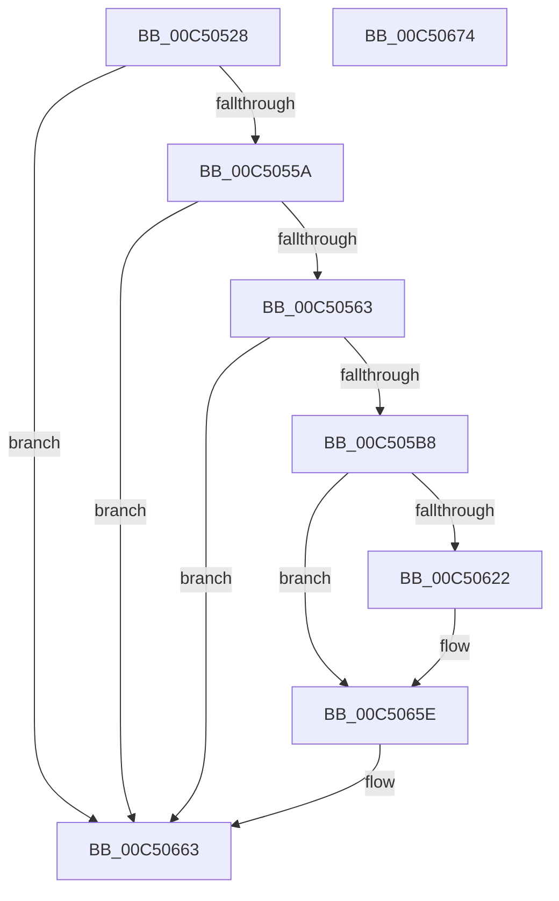

# BapdpRegisterBitlockerStatus

- RVA: `0x00C50528`–`0x00C50675` (길이 `333` bytes)
- VA: `0x0000000140C50528`
- 실행 섹션: `INIT`
- PDB 이름 있음: `예`; PDB Function 태그: `아니요`
- unwind 정보 RVA: `0x000D39AC`
- 디코드: `75`개 명령, `333/333` bytes 표시
- 미해석 바이트: `0` (있으면 어셈블리에 `.byte`로 보존)

> 이 문서는 커널 이미지의 기계어와 PDB 기호를 분석해 생성했습니다. 4번과 5번은 함수 원형과 자료형을 바이너리 사용 방식에서 추정한 C 해석이며 원본 소스 복구 결과는 아닙니다.

## 1. Dependencies

- 직접 호출 지점: **8**; 고유 호출 대상: **5**
- 직접 호출자로 확인된 함수: **1**
- RIP 상대 이미지 참조: **3**

### Outgoing calls
- `0x00C50576` → [RtlInitUnicodeString](../../text/42/RtlInitUnicodeString_function_0042A780.md) (function, `0x0042A780`)
- `0x00C505AB` → [ZwOpenKey](../../text/6A/ZwOpenKey_function_006AD310.md) (function, `0x006AD310`)
- `0x00C505C3` → [RtlInitUnicodeString](../../text/42/RtlInitUnicodeString_function_0042A780.md) (function, `0x0042A780`)
- `0x00C50615` → [ZwCreateKey](../../text/6A/ZwCreateKey_function_006AD470.md) (function, `0x006AD470`)
- `0x00C50622` → [ZwClose](../../text/6A/ZwClose_function_006AD2B0.md) (function, `0x006AD2B0`)
- `0x00C50632` → [RtlInitUnicodeString](../../text/42/RtlInitUnicodeString_function_0042A780.md) (function, `0x0042A780`)
- `0x00C50655` → [ZwSetValueKey](../../text/6A/ZwSetValueKey_function_006ADCD0.md) (function, `0x006ADCD0`)
- `0x00C5065E` → [ZwClose](../../text/6A/ZwClose_function_006AD2B0.md) (function, `0x006AD2B0`)

### Direct callers
- [BapdpProcessBitlockerStatus](../C4/BapdpProcessBitlockerStatus_function_00C4F7BC.md) at `0x00C4F867`

### Static image references
- `0x00C50567` → RVA `0x00C7DA20` (` ?? ::PBOPGDP::`string'`; read)
- `0x00C505B8` → RVA `0x00C7DBF0` (` ?? ::PBOPGDP::`string'`; read)
- `0x00C50627` → RVA `0x00C7DB20` (` ?? ::PBOPGDP::`string'`; read)

## 2. Other-region calls and transfers

- 다른 실행 섹션으로 향하는 call: **8**
  - `0x00C50576` → [RtlInitUnicodeString](../../text/42/RtlInitUnicodeString_function_0042A780.md) (`INIT` → `.text`)
  - `0x00C505AB` → [ZwOpenKey](../../text/6A/ZwOpenKey_function_006AD310.md) (`INIT` → `.text`)
  - `0x00C505C3` → [RtlInitUnicodeString](../../text/42/RtlInitUnicodeString_function_0042A780.md) (`INIT` → `.text`)
  - `0x00C50615` → [ZwCreateKey](../../text/6A/ZwCreateKey_function_006AD470.md) (`INIT` → `.text`)
  - `0x00C50622` → [ZwClose](../../text/6A/ZwClose_function_006AD2B0.md) (`INIT` → `.text`)
  - `0x00C50632` → [RtlInitUnicodeString](../../text/42/RtlInitUnicodeString_function_0042A780.md) (`INIT` → `.text`)
  - `0x00C50655` → [ZwSetValueKey](../../text/6A/ZwSetValueKey_function_006ADCD0.md) (`INIT` → `.text`)
  - `0x00C5065E` → [ZwClose](../../text/6A/ZwClose_function_006AD2B0.md) (`INIT` → `.text`)
- 별도 외부 분기/꼬리 이동을 확인하지 못했습니다.

## 3. Assembly (complete function range)

```asm
00C50528  48 89 5C 24 10                  mov qword ptr [rsp + 0x10], rbx
00C5052D  55                              push rbp
00C5052E  48 8B EC                        mov rbp, rsp
00C50531  48 81 EC 80 00 00 00            sub rsp, 0x80
00C50538  83 65 10 00                     and dword ptr [rbp + 0x10], 0
00C5053C  33 C0                           xor eax, eax
00C5053E  21 45 EC                        and dword ptr [rbp - 0x14], eax
00C50541  0F 57 C0                        xorps xmm0, xmm0
00C50544  89 45 D4                        mov dword ptr [rbp - 0x2c], eax
00C50547  48 8B D9                        mov rbx, rcx
00C5054A  21 45 D4                        and dword ptr [rbp - 0x2c], eax
00C5054D  0F 11 45 C0                     movups xmmword ptr [rbp - 0x40], xmm0
00C50551  48 85 C9                        test rcx, rcx
00C50554  0F 84 09 01 00 00               je 0x140c50663
00C5055A  83 FA 04                        cmp edx, 4
00C5055D  0F 85 00 01 00 00               jne 0x140c50663
00C50563  48 21 45 20                     and qword ptr [rbp + 0x20], rax
00C50567  48 8D 15 B2 D4 02 00            lea rdx, [rip + 0x2d4b2]
00C5056E  48 21 45 28                     and qword ptr [rbp + 0x28], rax
00C50572  48 8D 4D C0                     lea rcx, [rbp - 0x40]
00C50576  E8 05 A2 7D FF                  call 0x14042a780
00C5057B  48 83 65 D8 00                  and qword ptr [rbp - 0x28], 0
00C50580  48 8D 45 C0                     lea rax, [rbp - 0x40]
00C50584  0F 57 C0                        xorps xmm0, xmm0
00C50587  48 89 45 E0                     mov qword ptr [rbp - 0x20], rax
00C5058B  4C 8D 45 D0                     lea r8, [rbp - 0x30]
00C5058F  C7 45 D0 30 00 00 00            mov dword ptr [rbp - 0x30], 0x30
00C50596  BA 1F 00 02 00                  mov edx, 0x2001f
00C5059B  C7 45 E8 40 02 00 00            mov dword ptr [rbp - 0x18], 0x240
00C505A2  48 8D 4D 20                     lea rcx, [rbp + 0x20]
00C505A6  F3 0F 7F 45 F0                  movdqu xmmword ptr [rbp - 0x10], xmm0
00C505AB  E8 60 CD A5 FF                  call 0x1406ad310
00C505B0  85 C0                           test eax, eax
00C505B2  0F 88 AB 00 00 00               js 0x140c50663
00C505B8  48 8D 15 31 D6 02 00            lea rdx, [rip + 0x2d631]
00C505BF  48 8D 4D C0                     lea rcx, [rbp - 0x40]
00C505C3  E8 B8 A1 7D FF                  call 0x14042a780
00C505C8  48 8B 45 20                     mov rax, qword ptr [rbp + 0x20]
00C505CC  4C 8D 45 D0                     lea r8, [rbp - 0x30]
00C505D0  48 89 45 D8                     mov qword ptr [rbp - 0x28], rax
00C505D4  48 8D 4D 28                     lea rcx, [rbp + 0x28]
00C505D8  48 8D 45 C0                     lea rax, [rbp - 0x40]
00C505DC  C7 45 D0 30 00 00 00            mov dword ptr [rbp - 0x30], 0x30
00C505E3  48 89 45 E0                     mov qword ptr [rbp - 0x20], rax
00C505E7  0F 57 C0                        xorps xmm0, xmm0
00C505EA  48 8D 45 10                     lea rax, [rbp + 0x10]
00C505EE  C7 45 E8 40 02 00 00            mov dword ptr [rbp - 0x18], 0x240
00C505F5  48 89 44 24 30                  mov qword ptr [rsp + 0x30], rax
00C505FA  45 33 C9                        xor r9d, r9d
00C505FD  C7 44 24 28 01 00 00 00         mov dword ptr [rsp + 0x28], 1
00C50605  BA 1F 00 02 00                  mov edx, 0x2001f
00C5060A  48 83 64 24 20 00               and qword ptr [rsp + 0x20], 0
00C50610  F3 0F 7F 45 F0                  movdqu xmmword ptr [rbp - 0x10], xmm0
00C50615  E8 56 CE A5 FF                  call 0x1406ad470
00C5061A  48 8B 4D 20                     mov rcx, qword ptr [rbp + 0x20]
00C5061E  85 C0                           test eax, eax
00C50620  78 3C                           js 0x140c5065e
00C50622  E8 89 CC A5 FF                  call 0x1406ad2b0
00C50627  48 8D 15 F2 D4 02 00            lea rdx, [rip + 0x2d4f2]
00C5062E  48 8D 4D C0                     lea rcx, [rbp - 0x40]
00C50632  E8 49 A1 7D FF                  call 0x14042a780
00C50637  48 8B 4D 28                     mov rcx, qword ptr [rbp + 0x28]
00C5063B  48 8D 55 C0                     lea rdx, [rbp - 0x40]
00C5063F  41 B9 04 00 00 00               mov r9d, 4
00C50645  C7 44 24 28 04 00 00 00         mov dword ptr [rsp + 0x28], 4
00C5064D  45 33 C0                        xor r8d, r8d
00C50650  48 89 5C 24 20                  mov qword ptr [rsp + 0x20], rbx
00C50655  E8 76 D6 A5 FF                  call 0x1406adcd0
00C5065A  48 8B 4D 28                     mov rcx, qword ptr [rbp + 0x28]
00C5065E  E8 4D CC A5 FF                  call 0x1406ad2b0
00C50663  48 8B 9C 24 98 00 00 00         mov rbx, qword ptr [rsp + 0x98]
00C5066B  48 81 C4 80 00 00 00            add rsp, 0x80
00C50672  5D                              pop rbp
00C50673  C3                              ret
00C50674  CC                              int3
```

## 4. C-style interpretation (structured pseudocode)

```c
__int64 __fastcall BapdpRegisterBitlockerStatus(__int64 a1, int a2, __int64 a3, int a4)
{
    __int64 result;
    __int64 v_rsp;
    unsigned __int64 v_stack_m18;
    unsigned int v_stack_m1C;
    unsigned int v_stack_m20;
    unsigned __int64 v_stack_m28;
    unsigned __int64 v_stack_m30;
    unsigned int v_stack_m34;
    unsigned __int64 v_stack_m38;
    unsigned __int64 v_stack_m48;
    unsigned __int64 v_stack_m58;
    unsigned int v_stack_m60;
    unsigned __int64 v_stack_m68;
    unsigned __int64 v_stack_p10;
    unsigned __int64 v_stack_p18;
    unsigned __int64 v_stack_p20;
    unsigned int v_stack_p8;

    v_stack_p10 = v_rbx;
    v_rsp = (v_rsp) - (128);
    result = 0;
    v_stack_m34 = 0;
    v_stack_m48 = v_xmm0;
    if (a1 == 0) goto loc_00C50663;
    if (a2 != 4) goto loc_00C50663;
    result = RtlInitUnicodeString(v_stack_m48, v_rip + 185522, a3, a4);
    v_stack_m28 = v_stack_m48;
    v_stack_m38 = 48;
    v_stack_m20 = 576;
    v_stack_m18 = v_xmm0;
    result = ZwOpenKey(v_stack_p18, (unsigned int)(0x2001FULL), v_stack_m38, a4);
    if (sign_flag) goto loc_00C50663;
    result = RtlInitUnicodeString(v_stack_m48, v_rip + 185905, v_stack_m38, a4);
    v_stack_m30 = v_stack_p18;
    v_stack_m38 = 48;
    v_stack_m28 = v_stack_m48;
    v_stack_m20 = 576;
    v_stack_m58 = v_stack_p8;
    a4 = 0;
    v_stack_m60 = 1;
    v_stack_m18 = v_xmm0;
    result = ZwCreateKey(v_stack_p20, (unsigned int)(0x2001FULL), v_stack_m38, a4);
    if (!(sign_flag)) {
        result = ZwClose(v_stack_p18, (unsigned int)(0x2001FULL), v_stack_m38, a4);
        a2 = v_rip + 185586;
        a1 = v_stack_m48;
        result = RtlInitUnicodeString(a1, a2, v_stack_m38, a4);
        a1 = v_stack_p20;
        a2 = v_stack_m48;
        a4 = 4;
        v_stack_m60 = 4;
        a3 = 0;
        v_stack_m68 = a1;
        result = ZwSetValueKey(a1, a2, a3, a4);
        a1 = v_stack_p20;
    }
    result = ZwClose(a1, a2, a3, a4);
loc_00C50663:
    v_rsp = (v_rsp) + (128);
    return result;
}
```

## 5. (Beta) C Style

```c
int64_t BapdpRegisterBitlockerStatus(int64_t Arg1, int32_t Arg2, int64_t Arg3, int32_t Arg4)
{
    int64_t result;
    int64_t local_rsp;
    uint64_t v_stack_m18;
    uint32_t v_stack_m1C;
    uint32_t v_stack_m20;
    uint64_t v_stack_m28;
    uint64_t v_stack_m30;
    uint32_t v_stack_m34;
    uint64_t v_stack_m38;
    uint64_t v_stack_m48;
    uint64_t v_stack_m58;
    uint32_t v_stack_m60;
    uint64_t v_stack_m68;
    uint64_t v_stack_p10;
    uint64_t v_stack_p18;
    uint64_t v_stack_p20;
    uint32_t v_stack_p8;

    v_stack_p10 = local_rbx;
    local_rsp = (local_rsp) - (128);
    result = 0;
    v_stack_m34 = 0;
    v_stack_m48 = v_xmm0;
    if (Arg1 == 0) goto loc_00C50663;
    if (Arg2 != 4) goto loc_00C50663;
    result = RtlInitUnicodeString(v_stack_m48, v_rip + 185522, Arg3, Arg4);
    v_stack_m28 = v_stack_m48;
    v_stack_m38 = 48;
    v_stack_m20 = 576;
    v_stack_m18 = v_xmm0;
    result = ZwOpenKey(v_stack_p18, (uint32_t)(0x2001FULL), v_stack_m38, Arg4);
    if (sign_flag) goto loc_00C50663;
    result = RtlInitUnicodeString(v_stack_m48, v_rip + 185905, v_stack_m38, Arg4);
    v_stack_m30 = v_stack_p18;
    v_stack_m38 = 48;
    v_stack_m28 = v_stack_m48;
    v_stack_m20 = 576;
    v_stack_m58 = v_stack_p8;
    Arg4 = 0;
    v_stack_m60 = 1;
    v_stack_m18 = v_xmm0;
    result = ZwCreateKey(v_stack_p20, (uint32_t)(0x2001FULL), v_stack_m38, Arg4);
    if (!(sign_flag)) {
        result = ZwClose(v_stack_p18, (uint32_t)(0x2001FULL), v_stack_m38, Arg4);
        Arg2 = v_rip + 185586;
        Arg1 = v_stack_m48;
        result = RtlInitUnicodeString(Arg1, Arg2, v_stack_m38, Arg4);
        Arg1 = v_stack_p20;
        Arg2 = v_stack_m48;
        Arg4 = 4;
        v_stack_m60 = 4;
        Arg3 = 0;
        v_stack_m68 = Arg1;
        result = ZwSetValueKey(Arg1, Arg2, Arg3, Arg4);
        Arg1 = v_stack_p20;
    }
    result = ZwClose(Arg1, Arg2, Arg3, Arg4);
loc_00C50663:
    local_rsp = (local_rsp) + (128);
    return result;
}
```

## 6. Execution-region graph

[열기: 2D/3D 그래프와 함수 탐색 컨트롤 패널](../../../control-panel.html?section=init&rva=0x00C50528&view=graph)

- 2D 그래프는 위에서 아래로 흐르고, 3D 그래프는 빈 공간을 드래그해 회전합니다. Shift+드래그는 이동, 휠은 확대·축소, 함수 노드 선택은 대상 보고서 이동입니다.

### Static fallback


