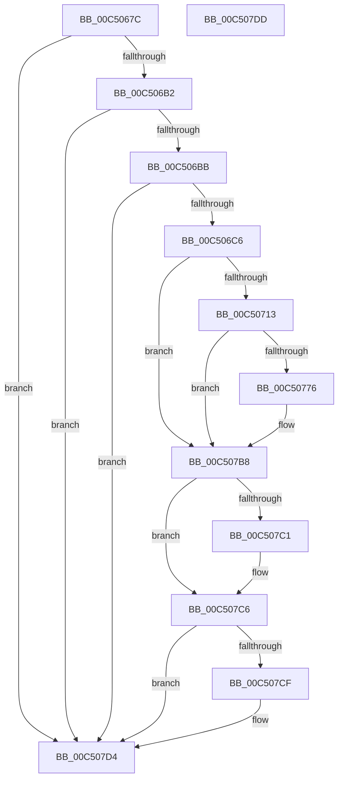

# BapdpRegisterEDrvHintInfo

- RVA: `0x00C5067C`–`0x00C507DE` (길이 `354` bytes)
- VA: `0x0000000140C5067C`
- 실행 섹션: `INIT`
- PDB 이름 있음: `예`; PDB Function 태그: `아니요`
- unwind 정보 RVA: `0x000C7C4C`
- 디코드: `82`개 명령, `354/354` bytes 표시
- 미해석 바이트: `0` (있으면 어셈블리에 `.byte`로 보존)

> 이 문서는 커널 이미지의 기계어와 PDB 기호를 분석해 생성했습니다. 4번과 5번은 함수 원형과 자료형을 바이너리 사용 방식에서 추정한 C 해석이며 원본 소스 복구 결과는 아닙니다.

## 1. Dependencies

- 직접 호출 지점: **9**; 고유 호출 대상: **5**
- 직접 호출자로 확인된 함수: **1**
- RIP 상대 이미지 참조: **3**

### Outgoing calls
- `0x00C506D1` → [RtlInitUnicodeString](../../text/42/RtlInitUnicodeString_function_0042A780.md) (function, `0x0042A780`)
- `0x00C50706` → [ZwOpenKey](../../text/6A/ZwOpenKey_function_006AD310.md) (function, `0x006AD310`)
- `0x00C5071E` → [RtlInitUnicodeString](../../text/42/RtlInitUnicodeString_function_0042A780.md) (function, `0x0042A780`)
- `0x00C5076D` → [ZwCreateKey](../../text/6A/ZwCreateKey_function_006AD470.md) (function, `0x006AD470`)
- `0x00C5077A` → [ZwClose](../../text/6A/ZwClose_function_006AD2B0.md) (function, `0x006AD2B0`)
- `0x00C5078F` → [RtlInitUnicodeString](../../text/42/RtlInitUnicodeString_function_0042A780.md) (function, `0x0042A780`)
- `0x00C507B3` → [ZwSetValueKey](../../text/6A/ZwSetValueKey_function_006ADCD0.md) (function, `0x006ADCD0`)
- `0x00C507C1` → [ZwClose](../../text/6A/ZwClose_function_006AD2B0.md) (function, `0x006AD2B0`)
- `0x00C507CF` → [ZwClose](../../text/6A/ZwClose_function_006AD2B0.md) (function, `0x006AD2B0`)

### Direct callers
- [BapdpProcessEDrvHintInfo](../C4/BapdpProcessEDrvHintInfo_function_00C4F9DC.md) at `0x00C4FA8A`

### Static image references
- `0x00C506C6` → RVA `0x00C7DA20` (` ?? ::PBOPGDP::`string'`; read)
- `0x00C50713` → RVA `0x00C7DAF0` (` ?? ::PBOPGDP::`string'`; read)
- `0x00C50784` → RVA `0x00C7DAC0` (` ?? ::PBOPGDP::`string'`; read)

## 2. Other-region calls and transfers

- 다른 실행 섹션으로 향하는 call: **9**
  - `0x00C506D1` → [RtlInitUnicodeString](../../text/42/RtlInitUnicodeString_function_0042A780.md) (`INIT` → `.text`)
  - `0x00C50706` → [ZwOpenKey](../../text/6A/ZwOpenKey_function_006AD310.md) (`INIT` → `.text`)
  - `0x00C5071E` → [RtlInitUnicodeString](../../text/42/RtlInitUnicodeString_function_0042A780.md) (`INIT` → `.text`)
  - `0x00C5076D` → [ZwCreateKey](../../text/6A/ZwCreateKey_function_006AD470.md) (`INIT` → `.text`)
  - `0x00C5077A` → [ZwClose](../../text/6A/ZwClose_function_006AD2B0.md) (`INIT` → `.text`)
  - `0x00C5078F` → [RtlInitUnicodeString](../../text/42/RtlInitUnicodeString_function_0042A780.md) (`INIT` → `.text`)
  - `0x00C507B3` → [ZwSetValueKey](../../text/6A/ZwSetValueKey_function_006ADCD0.md) (`INIT` → `.text`)
  - `0x00C507C1` → [ZwClose](../../text/6A/ZwClose_function_006AD2B0.md) (`INIT` → `.text`)
  - `0x00C507CF` → [ZwClose](../../text/6A/ZwClose_function_006AD2B0.md) (`INIT` → `.text`)
- 별도 외부 분기/꼬리 이동을 확인하지 못했습니다.

## 3. Assembly (complete function range)

```asm
00C5067C  40 55                           push rbp
00C5067E  48 8B EC                        mov rbp, rsp
00C50681  48 81 EC 80 00 00 00            sub rsp, 0x80
00C50688  33 C0                           xor eax, eax
00C5068A  C7 45 10 01 00 00 00            mov dword ptr [rbp + 0x10], 1
00C50691  21 45 EC                        and dword ptr [rbp - 0x14], eax
00C50694  0F 57 C0                        xorps xmm0, xmm0
00C50697  48 21 45 18                     and qword ptr [rbp + 0x18], rax
00C5069B  48 21 45 20                     and qword ptr [rbp + 0x20], rax
00C5069F  89 45 D4                        mov dword ptr [rbp - 0x2c], eax
00C506A2  21 45 D4                        and dword ptr [rbp - 0x2c], eax
00C506A5  0F 11 45 C0                     movups xmmword ptr [rbp - 0x40], xmm0
00C506A9  48 85 C9                        test rcx, rcx
00C506AC  0F 84 22 01 00 00               je 0x140c507d4
00C506B2  83 39 08                        cmp dword ptr [rcx], 8
00C506B5  0F 82 19 01 00 00               jb 0x140c507d4
00C506BB  8B 41 04                        mov eax, dword ptr [rcx + 4]
00C506BE  A8 01                           test al, 1
00C506C0  0F 84 0E 01 00 00               je 0x140c507d4
00C506C6  48 8D 15 53 D3 02 00            lea rdx, [rip + 0x2d353]
00C506CD  48 8D 4D C0                     lea rcx, [rbp - 0x40]
00C506D1  E8 AA A0 7D FF                  call 0x14042a780
00C506D6  48 83 65 D8 00                  and qword ptr [rbp - 0x28], 0
00C506DB  48 8D 45 C0                     lea rax, [rbp - 0x40]
00C506DF  0F 57 C0                        xorps xmm0, xmm0
00C506E2  48 89 45 E0                     mov qword ptr [rbp - 0x20], rax
00C506E6  4C 8D 45 D0                     lea r8, [rbp - 0x30]
00C506EA  C7 45 D0 30 00 00 00            mov dword ptr [rbp - 0x30], 0x30
00C506F1  BA 19 00 02 00                  mov edx, 0x20019
00C506F6  C7 45 E8 40 02 00 00            mov dword ptr [rbp - 0x18], 0x240
00C506FD  48 8D 4D 18                     lea rcx, [rbp + 0x18]
00C50701  F3 0F 7F 45 F0                  movdqu xmmword ptr [rbp - 0x10], xmm0
00C50706  E8 05 CC A5 FF                  call 0x1406ad310
00C5070B  85 C0                           test eax, eax
00C5070D  0F 88 A5 00 00 00               js 0x140c507b8
00C50713  48 8D 15 D6 D3 02 00            lea rdx, [rip + 0x2d3d6]
00C5071A  48 8D 4D C0                     lea rcx, [rbp - 0x40]
00C5071E  E8 5D A0 7D FF                  call 0x14042a780
00C50723  48 8B 45 18                     mov rax, qword ptr [rbp + 0x18]
00C50727  4C 8D 45 D0                     lea r8, [rbp - 0x30]
00C5072B  48 83 64 24 30 00               and qword ptr [rsp + 0x30], 0
00C50731  48 8D 4D 20                     lea rcx, [rbp + 0x20]
00C50735  48 89 45 D8                     mov qword ptr [rbp - 0x28], rax
00C50739  0F 57 C0                        xorps xmm0, xmm0
00C5073C  48 8D 45 C0                     lea rax, [rbp - 0x40]
00C50740  C7 44 24 28 01 00 00 00         mov dword ptr [rsp + 0x28], 1
00C50748  48 83 64 24 20 00               and qword ptr [rsp + 0x20], 0
00C5074E  45 33 C9                        xor r9d, r9d
00C50751  BA 1F 00 06 00                  mov edx, 0x6001f
00C50756  48 89 45 E0                     mov qword ptr [rbp - 0x20], rax
00C5075A  C7 45 D0 30 00 00 00            mov dword ptr [rbp - 0x30], 0x30
00C50761  C7 45 E8 40 02 00 00            mov dword ptr [rbp - 0x18], 0x240
00C50768  F3 0F 7F 45 F0                  movdqu xmmword ptr [rbp - 0x10], xmm0
00C5076D  E8 FE CC A5 FF                  call 0x1406ad470
00C50772  85 C0                           test eax, eax
00C50774  78 42                           js 0x140c507b8
00C50776  48 8B 4D 18                     mov rcx, qword ptr [rbp + 0x18]
00C5077A  E8 31 CB A5 FF                  call 0x1406ad2b0
00C5077F  48 83 65 18 00                  and qword ptr [rbp + 0x18], 0
00C50784  48 8D 15 35 D3 02 00            lea rdx, [rip + 0x2d335]
00C5078B  48 8D 4D C0                     lea rcx, [rbp - 0x40]
00C5078F  E8 EC 9F 7D FF                  call 0x14042a780
00C50794  48 8B 4D 20                     mov rcx, qword ptr [rbp + 0x20]
00C50798  48 8D 45 10                     lea rax, [rbp + 0x10]
00C5079C  41 B9 04 00 00 00               mov r9d, 4
00C507A2  48 8D 55 C0                     lea rdx, [rbp - 0x40]
00C507A6  44 89 4C 24 28                  mov dword ptr [rsp + 0x28], r9d
00C507AB  45 33 C0                        xor r8d, r8d
00C507AE  48 89 44 24 20                  mov qword ptr [rsp + 0x20], rax
00C507B3  E8 18 D5 A5 FF                  call 0x1406adcd0
00C507B8  48 8B 4D 18                     mov rcx, qword ptr [rbp + 0x18]
00C507BC  48 85 C9                        test rcx, rcx
00C507BF  74 05                           je 0x140c507c6
00C507C1  E8 EA CA A5 FF                  call 0x1406ad2b0
00C507C6  48 8B 4D 20                     mov rcx, qword ptr [rbp + 0x20]
00C507CA  48 85 C9                        test rcx, rcx
00C507CD  74 05                           je 0x140c507d4
00C507CF  E8 DC CA A5 FF                  call 0x1406ad2b0
00C507D4  48 81 C4 80 00 00 00            add rsp, 0x80
00C507DB  5D                              pop rbp
00C507DC  C3                              ret
00C507DD  CC                              int3
```

## 4. C-style interpretation (structured pseudocode)

```c
__int64 __fastcall BapdpRegisterEDrvHintInfo(__int64 a1, __int64 a2, __int64 a3, int a4)
{
    __int64 result;
    __int64 v_rsp;
    unsigned __int64 v_stack_m18;
    unsigned int v_stack_m1C;
    unsigned int v_stack_m20;
    unsigned __int64 v_stack_m28;
    unsigned __int64 v_stack_m30;
    unsigned int v_stack_m34;
    unsigned __int64 v_stack_m38;
    unsigned __int64 v_stack_m48;
    unsigned __int64 v_stack_m58;
    unsigned int v_stack_m60;
    unsigned __int64 v_stack_m68;
    unsigned __int64 v_stack_p10;
    unsigned __int64 v_stack_p18;
    unsigned int v_stack_p8;

    v_rsp = (v_rsp) - (128);
    result = 0;
    v_stack_p8 = 1;
    v_stack_m34 = 0;
    v_stack_m48 = v_xmm0;
    if (a1 == 0) goto loc_00C507D4;
    if ((*(unsigned int *)(a1)) < 8) goto loc_00C507D4;
    if ((((unsigned __int8)((unsigned int)(*(unsigned int *)(a1 + 4)))) & (1)) == 0) goto loc_00C507D4;
    result = RtlInitUnicodeString(v_stack_m48, v_rip + 185171, a3, a4);
    v_stack_m28 = v_stack_m48;
    v_stack_m38 = 48;
    v_stack_m20 = 576;
    v_stack_m18 = v_xmm0;
    result = ZwOpenKey(v_stack_p10, (unsigned int)(0x20019ULL), v_stack_m38, a4);
    if (sign_flag) goto loc_00C507B8;
    result = RtlInitUnicodeString(v_stack_m48, v_rip + 185302, v_stack_m38, a4);
    v_stack_m30 = v_stack_p10;
    v_stack_m60 = 1;
    a4 = 0;
    v_stack_m28 = v_stack_m48;
    v_stack_m38 = 48;
    v_stack_m20 = 576;
    v_stack_m18 = v_xmm0;
    result = ZwCreateKey(v_stack_p18, (unsigned int)(0x6001FULL), v_stack_m38, a4);
    if (!(sign_flag)) {
        a1 = v_stack_p10;
        result = ZwClose(a1, (unsigned int)(0x6001FULL), v_stack_m38, a4);
        a2 = v_rip + 185141;
        a1 = v_stack_m48;
        result = RtlInitUnicodeString(a1, a2, v_stack_m38, a4);
        a1 = v_stack_p18;
        result = v_stack_p8;
        a4 = 4;
        a2 = v_stack_m48;
        v_stack_m60 = a4;
        a3 = 0;
        v_stack_m68 = result;
        result = ZwSetValueKey(a1, a2, a3, a4);
    }
    if (v_stack_p10 != 0) {
        result = ZwClose(v_stack_p10, a2, a3, a4);
    }
    if (v_stack_p18 != 0) {
        result = ZwClose(v_stack_p18, a2, a3, a4);
    }
    v_rsp = (v_rsp) + (128);
    return result;
}
```

## 5. (Beta) C Style

```c
int64_t BapdpRegisterEDrvHintInfo(int64_t Arg1, int64_t Arg2, int64_t Arg3, int32_t Arg4)
{
    int64_t result;
    int64_t local_rsp;
    uint64_t v_stack_m18;
    uint32_t v_stack_m1C;
    uint32_t v_stack_m20;
    uint64_t v_stack_m28;
    uint64_t v_stack_m30;
    uint32_t v_stack_m34;
    uint64_t v_stack_m38;
    uint64_t v_stack_m48;
    uint64_t v_stack_m58;
    uint32_t v_stack_m60;
    uint64_t v_stack_m68;
    uint64_t v_stack_p10;
    uint64_t v_stack_p18;
    uint32_t v_stack_p8;

    local_rsp = (local_rsp) - (128);
    result = 0;
    v_stack_p8 = 1;
    v_stack_m34 = 0;
    v_stack_m48 = v_xmm0;
    if (Arg1 == 0) goto loc_00C507D4;
    if ((*(uint32_t *)(Arg1)) < 8) goto loc_00C507D4;
    if ((((uint8_t)((uint32_t)(*(uint32_t *)(Arg1 + 0x4)))) & (1)) == 0) goto loc_00C507D4;
    result = RtlInitUnicodeString(v_stack_m48, v_rip + 185171, Arg3, Arg4);
    v_stack_m28 = v_stack_m48;
    v_stack_m38 = 48;
    v_stack_m20 = 576;
    v_stack_m18 = v_xmm0;
    result = ZwOpenKey(v_stack_p10, (uint32_t)(0x20019ULL), v_stack_m38, Arg4);
    if (sign_flag) goto loc_00C507B8;
    result = RtlInitUnicodeString(v_stack_m48, v_rip + 185302, v_stack_m38, Arg4);
    v_stack_m30 = v_stack_p10;
    v_stack_m60 = 1;
    Arg4 = 0;
    v_stack_m28 = v_stack_m48;
    v_stack_m38 = 48;
    v_stack_m20 = 576;
    v_stack_m18 = v_xmm0;
    result = ZwCreateKey(v_stack_p18, (uint32_t)(0x6001FULL), v_stack_m38, Arg4);
    if (!(sign_flag)) {
        Arg1 = v_stack_p10;
        result = ZwClose(Arg1, (uint32_t)(0x6001FULL), v_stack_m38, Arg4);
        Arg2 = v_rip + 185141;
        Arg1 = v_stack_m48;
        result = RtlInitUnicodeString(Arg1, Arg2, v_stack_m38, Arg4);
        Arg1 = v_stack_p18;
        result = v_stack_p8;
        Arg4 = 4;
        Arg2 = v_stack_m48;
        v_stack_m60 = Arg4;
        Arg3 = 0;
        v_stack_m68 = result;
        result = ZwSetValueKey(Arg1, Arg2, Arg3, Arg4);
    }
    if (v_stack_p10 != 0) {
        result = ZwClose(v_stack_p10, Arg2, Arg3, Arg4);
    }
    if (v_stack_p18 != 0) {
        result = ZwClose(v_stack_p18, Arg2, Arg3, Arg4);
    }
    local_rsp = (local_rsp) + (128);
    return result;
}
```

## 6. Execution-region graph

[열기: 2D/3D 그래프와 함수 탐색 컨트롤 패널](../../../control-panel.html?section=init&rva=0x00C5067C&view=graph)

- 2D 그래프는 위에서 아래로 흐르고, 3D 그래프는 빈 공간을 드래그해 회전합니다. Shift+드래그는 이동, 휠은 확대·축소, 함수 노드 선택은 대상 보고서 이동입니다.

### Static fallback


