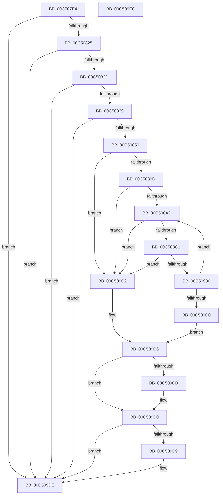

# BapdpRegisterFwUpdateResults

- RVA: `0x00C507E4`–`0x00C509ED` (길이 `521` bytes)
- VA: `0x0000000140C507E4`
- 실행 섹션: `INIT`
- PDB 이름 있음: `예`; PDB Function 태그: `아니요`
- unwind 정보 RVA: `0x000C7234`
- 디코드: `128`개 명령, `521/521` bytes 표시
- 미해석 바이트: `0` (있으면 어셈블리에 `.byte`로 보존)

> 이 문서는 커널 이미지의 기계어와 PDB 기호를 분석해 생성했습니다. 4번과 5번은 함수 원형과 자료형을 바이너리 사용 방식에서 추정한 C 해석이며 원본 소스 복구 결과는 아닙니다.

## 1. Dependencies

- 직접 호출 지점: **13**; 고유 호출 대상: **7**
- 직접 호출자로 확인된 함수: **1**
- RIP 상대 이미지 참조: **3**

### Outgoing calls
- `0x00C5085B` → [RtlInitUnicodeString](../../text/42/RtlInitUnicodeString_function_0042A780.md) (function, `0x0042A780`)
- `0x00C50890` → [ZwOpenKey](../../text/6A/ZwOpenKey_function_006AD310.md) (function, `0x006AD310`)
- `0x00C508B4` → [RtlStringFromGUID](../../page/91/RtlStringFromGUID_function_00914BA0.md) (function, `0x00914BA0`)
- `0x00C508C9` → [RtlInitUnicodeString](../../text/42/RtlInitUnicodeString_function_0042A780.md) (function, `0x0042A780`)
- `0x00C50918` → [ZwCreateKey](../../text/6A/ZwCreateKey_function_006AD470.md) (function, `0x006AD470`)
- `0x00C50923` → [RtlFreeAnsiString](../../page/9C/RtlFreeAnsiString_function_009C0800.md) (function, `0x009C0800`)
- `0x00C5093B` → [RtlInitUnicodeString](../../text/42/RtlInitUnicodeString_function_0042A780.md) (function, `0x0042A780`)
- `0x00C50962` → [ZwSetValueKey](../../text/6A/ZwSetValueKey_function_006ADCD0.md) (function, `0x006ADCD0`)
- `0x00C50972` → [RtlInitUnicodeString](../../text/42/RtlInitUnicodeString_function_0042A780.md) (function, `0x0042A780`)
- `0x00C50999` → [ZwSetValueKey](../../text/6A/ZwSetValueKey_function_006ADCD0.md) (function, `0x006ADCD0`)
- `0x00C509A2` → [ZwClose](../../text/6A/ZwClose_function_006AD2B0.md) (function, `0x006AD2B0`)
- `0x00C509CB` → [ZwClose](../../text/6A/ZwClose_function_006AD2B0.md) (function, `0x006AD2B0`)
- `0x00C509D9` → [ZwClose](../../text/6A/ZwClose_function_006AD2B0.md) (function, `0x006AD2B0`)

### Direct callers
- [BapdpProcessFwUpdateResults](../C4/BapdpProcessFwUpdateResults_function_00C4FABC.md) at `0x00C4FB67`

### Static image references
- `0x00C50850` → RVA `0x00C7DB60` (` ?? ::PBOPGDP::`string'`; read)
- `0x00C50930` → RVA `0x00C7A430` (` ?? ::PBOPGDP::`string'`; read)
- `0x00C50967` → RVA `0x00C7A4D0` (` ?? ::PBOPGDP::`string'`; read)

## 2. Other-region calls and transfers

- 다른 실행 섹션으로 향하는 call: **13**
  - `0x00C5085B` → [RtlInitUnicodeString](../../text/42/RtlInitUnicodeString_function_0042A780.md) (`INIT` → `.text`)
  - `0x00C50890` → [ZwOpenKey](../../text/6A/ZwOpenKey_function_006AD310.md) (`INIT` → `.text`)
  - `0x00C508B4` → [RtlStringFromGUID](../../page/91/RtlStringFromGUID_function_00914BA0.md) (`INIT` → `PAGE`)
  - `0x00C508C9` → [RtlInitUnicodeString](../../text/42/RtlInitUnicodeString_function_0042A780.md) (`INIT` → `.text`)
  - `0x00C50918` → [ZwCreateKey](../../text/6A/ZwCreateKey_function_006AD470.md) (`INIT` → `.text`)
  - `0x00C50923` → [RtlFreeAnsiString](../../page/9C/RtlFreeAnsiString_function_009C0800.md) (`INIT` → `PAGE`)
  - `0x00C5093B` → [RtlInitUnicodeString](../../text/42/RtlInitUnicodeString_function_0042A780.md) (`INIT` → `.text`)
  - `0x00C50962` → [ZwSetValueKey](../../text/6A/ZwSetValueKey_function_006ADCD0.md) (`INIT` → `.text`)
  - `0x00C50972` → [RtlInitUnicodeString](../../text/42/RtlInitUnicodeString_function_0042A780.md) (`INIT` → `.text`)
  - `0x00C50999` → [ZwSetValueKey](../../text/6A/ZwSetValueKey_function_006ADCD0.md) (`INIT` → `.text`)
  - `0x00C509A2` → [ZwClose](../../text/6A/ZwClose_function_006AD2B0.md) (`INIT` → `.text`)
  - `0x00C509CB` → [ZwClose](../../text/6A/ZwClose_function_006AD2B0.md) (`INIT` → `.text`)
  - `0x00C509D9` → [ZwClose](../../text/6A/ZwClose_function_006AD2B0.md) (`INIT` → `.text`)
- 별도 외부 분기/꼬리 이동을 확인하지 못했습니다.

## 3. Assembly (complete function range)

```asm
00C507E4  40 55                           push rbp
00C507E6  53                              push rbx
00C507E7  56                              push rsi
00C507E8  57                              push rdi
00C507E9  41 56                           push r14
00C507EB  48 8D 6C 24 C9                  lea rbp, [rsp - 0x37]
00C507F0  48 81 EC 90 00 00 00            sub rsp, 0x90
00C507F7  83 65 67 00                     and dword ptr [rbp + 0x67], 0
00C507FB  33 C0                           xor eax, eax
00C507FD  21 45 23                        and dword ptr [rbp + 0x23], eax
00C50800  0F 57 C0                        xorps xmm0, xmm0
00C50803  48 21 45 7F                     and qword ptr [rbp + 0x7f], rax
00C50807  48 8B F9                        mov rdi, rcx
00C5080A  48 21 45 77                     and qword ptr [rbp + 0x77], rax
00C5080E  89 45 0B                        mov dword ptr [rbp + 0xb], eax
00C50811  21 45 0B                        and dword ptr [rbp + 0xb], eax
00C50814  0F 11 45 F7                     movups xmmword ptr [rbp - 9], xmm0
00C50818  0F 11 45 E7                     movups xmmword ptr [rbp - 0x19], xmm0
00C5081C  48 85 C9                        test rcx, rcx
00C5081F  0F 84 B9 01 00 00               je 0x140c509de
00C50825  85 D2                           test edx, edx
00C50827  0F 84 B1 01 00 00               je 0x140c509de
00C5082D  48 8B 01                        mov rax, qword ptr [rcx]
00C50830  48 85 C0                        test rax, rax
00C50833  0F 84 A5 01 00 00               je 0x140c509de
00C50839  48 8D 04 40                     lea rax, [rax + rax*2]
00C5083D  48 8D 0C C5 08 00 00 00         lea rcx, [rax*8 + 8]
00C50845  8B C2                           mov eax, edx
00C50847  48 3B C1                        cmp rax, rcx
00C5084A  0F 82 8E 01 00 00               jb 0x140c509de
00C50850  48 8D 15 09 D3 02 00            lea rdx, [rip + 0x2d309]
00C50857  48 8D 4D E7                     lea rcx, [rbp - 0x19]
00C5085B  E8 20 9F 7D FF                  call 0x14042a780
00C50860  48 83 65 0F 00                  and qword ptr [rbp + 0xf], 0
00C50865  48 8D 45 E7                     lea rax, [rbp - 0x19]
00C50869  0F 57 C0                        xorps xmm0, xmm0
00C5086C  48 89 45 17                     mov qword ptr [rbp + 0x17], rax
00C50870  4C 8D 45 07                     lea r8, [rbp + 7]
00C50874  C7 45 07 30 00 00 00            mov dword ptr [rbp + 7], 0x30
00C5087B  BA 19 00 02 00                  mov edx, 0x20019
00C50880  C7 45 1F 40 02 00 00            mov dword ptr [rbp + 0x1f], 0x240
00C50887  48 8D 4D 7F                     lea rcx, [rbp + 0x7f]
00C5088B  F3 0F 7F 45 27                  movdqu xmmword ptr [rbp + 0x27], xmm0
00C50890  E8 7B CA A5 FF                  call 0x1406ad310
00C50895  85 C0                           test eax, eax
00C50897  0F 88 25 01 00 00               js 0x140c509c2
00C5089D  45 33 F6                        xor r14d, r14d
00C508A0  48 8D 77 08                     lea rsi, [rdi + 8]
00C508A4  4C 39 37                        cmp qword ptr [rdi], r14
00C508A7  0F 86 15 01 00 00               jbe 0x140c509c2
00C508AD  48 8D 55 F7                     lea rdx, [rbp - 9]
00C508B1  48 8B CE                        mov rcx, rsi
00C508B4  E8 E7 42 CC FF                  call 0x140914ba0
00C508B9  85 C0                           test eax, eax
00C508BB  0F 88 01 01 00 00               js 0x140c509c2
00C508C1  48 8B 55 FF                     mov rdx, qword ptr [rbp - 1]
00C508C5  48 8D 4D E7                     lea rcx, [rbp - 0x19]
00C508C9  E8 B2 9E 7D FF                  call 0x14042a780
00C508CE  48 8B 45 7F                     mov rax, qword ptr [rbp + 0x7f]
00C508D2  4C 8D 45 07                     lea r8, [rbp + 7]
00C508D6  48 89 45 0F                     mov qword ptr [rbp + 0xf], rax
00C508DA  48 8D 4D 77                     lea rcx, [rbp + 0x77]
00C508DE  48 8D 45 E7                     lea rax, [rbp - 0x19]
00C508E2  C7 45 07 30 00 00 00            mov dword ptr [rbp + 7], 0x30
00C508E9  48 89 45 17                     mov qword ptr [rbp + 0x17], rax
00C508ED  0F 57 C0                        xorps xmm0, xmm0
00C508F0  48 8D 45 67                     lea rax, [rbp + 0x67]
00C508F4  C7 45 1F 40 02 00 00            mov dword ptr [rbp + 0x1f], 0x240
00C508FB  48 89 44 24 30                  mov qword ptr [rsp + 0x30], rax
00C50900  45 33 C9                        xor r9d, r9d
00C50903  83 64 24 28 00                  and dword ptr [rsp + 0x28], 0
00C50908  BA 19 00 02 00                  mov edx, 0x20019
00C5090D  48 83 64 24 20 00               and qword ptr [rsp + 0x20], 0
00C50913  F3 0F 7F 45 27                  movdqu xmmword ptr [rbp + 0x27], xmm0
00C50918  E8 53 CB A5 FF                  call 0x1406ad470
00C5091D  48 8D 4D F7                     lea rcx, [rbp - 9]
00C50921  8B D8                           mov ebx, eax
00C50923  E8 D8 FE D6 FF                  call 0x1409c0800
00C50928  85 DB                           test ebx, ebx
00C5092A  0F 88 92 00 00 00               js 0x140c509c2
00C50930  48 8D 15 F9 9A 02 00            lea rdx, [rip + 0x29af9]
00C50937  48 8D 4D E7                     lea rcx, [rbp - 0x19]
00C5093B  E8 40 9E 7D FF                  call 0x14042a780
00C50940  48 8B 4D 77                     mov rcx, qword ptr [rbp + 0x77]
00C50944  48 8D 46 10                     lea rax, [rsi + 0x10]
00C50948  C7 44 24 28 04 00 00 00         mov dword ptr [rsp + 0x28], 4
00C50950  48 8D 55 E7                     lea rdx, [rbp - 0x19]
00C50954  41 B9 04 00 00 00               mov r9d, 4
00C5095A  48 89 44 24 20                  mov qword ptr [rsp + 0x20], rax
00C5095F  45 33 C0                        xor r8d, r8d
00C50962  E8 69 D3 A5 FF                  call 0x1406adcd0
00C50967  48 8D 15 62 9B 02 00            lea rdx, [rip + 0x29b62]
00C5096E  48 8D 4D E7                     lea rcx, [rbp - 0x19]
00C50972  E8 09 9E 7D FF                  call 0x14042a780
00C50977  48 8B 4D 77                     mov rcx, qword ptr [rbp + 0x77]
00C5097B  48 8D 46 14                     lea rax, [rsi + 0x14]
00C5097F  C7 44 24 28 04 00 00 00         mov dword ptr [rsp + 0x28], 4
00C50987  48 8D 55 E7                     lea rdx, [rbp - 0x19]
00C5098B  41 B9 04 00 00 00               mov r9d, 4
00C50991  48 89 44 24 20                  mov qword ptr [rsp + 0x20], rax
00C50996  45 33 C0                        xor r8d, r8d
00C50999  E8 32 D3 A5 FF                  call 0x1406adcd0
00C5099E  48 8B 4D 77                     mov rcx, qword ptr [rbp + 0x77]
00C509A2  E8 09 C9 A5 FF                  call 0x1406ad2b0
00C509A7  41 FF C6                        inc r14d
00C509AA  33 C9                           xor ecx, ecx
00C509AC  41 8B C6                        mov eax, r14d
00C509AF  48 83 C6 18                     add rsi, 0x18
00C509B3  48 89 4D 77                     mov qword ptr [rbp + 0x77], rcx
00C509B7  48 3B 07                        cmp rax, qword ptr [rdi]
00C509BA  0F 82 ED FE FF FF               jb 0x140c508ad
00C509C0  EB 04                           jmp 0x140c509c6
00C509C2  48 8B 4D 77                     mov rcx, qword ptr [rbp + 0x77]
00C509C6  48 85 C9                        test rcx, rcx
00C509C9  74 05                           je 0x140c509d0
00C509CB  E8 E0 C8 A5 FF                  call 0x1406ad2b0
00C509D0  48 8B 4D 7F                     mov rcx, qword ptr [rbp + 0x7f]
00C509D4  48 85 C9                        test rcx, rcx
00C509D7  74 05                           je 0x140c509de
00C509D9  E8 D2 C8 A5 FF                  call 0x1406ad2b0
00C509DE  48 81 C4 90 00 00 00            add rsp, 0x90
00C509E5  41 5E                           pop r14
00C509E7  5F                              pop rdi
00C509E8  5E                              pop rsi
00C509E9  5B                              pop rbx
00C509EA  5D                              pop rbp
00C509EB  C3                              ret
00C509EC  CC                              int3
```

## 4. C-style interpretation (structured pseudocode)

```c
__int64 __fastcall BapdpRegisterFwUpdateResults(__int64 a1, int a2, __int64 a3, int a4)
{
    __int64 result;
    __int64 v_r14;
    __int64 v_rsi;
    __int64 v_rsp;
    unsigned __int64 v_stack_m38;
    unsigned int v_stack_m3C;
    unsigned int v_stack_m40;
    unsigned __int64 v_stack_m48;
    unsigned __int64 v_stack_m50;
    unsigned int v_stack_m54;
    unsigned __int64 v_stack_m58;
    unsigned __int64 v_stack_m5F;
    unsigned __int64 v_stack_m60;
    unsigned __int64 v_stack_m68;
    unsigned __int64 v_stack_m78;
    unsigned __int64 v_stack_m88;
    unsigned int v_stack_m90;
    unsigned __int64 v_stack_m98;
    unsigned __int64 v_stack_p18;
    unsigned __int64 v_stack_p20;
    unsigned int v_stack_p8;

    v_rsp = (v_rsp) - (144);
    result = 0;
    v_stack_m54 = 0;
    v_stack_m68 = v_xmm0;
    v_stack_m78 = v_xmm0;
    if (a1 == 0) goto loc_00C509DE;
    if (a2 == 0) goto loc_00C509DE;
    if (*(unsigned __int64 *)(a1) == 0) goto loc_00C509DE;
    if (((unsigned int)(a2)) < (*(unsigned __int64 *)(a1) + *(unsigned __int64 *)(a1) * 2 * 8 + 8)) goto loc_00C509DE;
    result = RtlInitUnicodeString(v_stack_m78, v_rip + 185097, a3, a4);
    v_stack_m48 = v_stack_m78;
    v_stack_m58 = 48;
    v_stack_m40 = 576;
    v_stack_m38 = v_xmm0;
    result = ZwOpenKey(v_stack_p20, (unsigned int)(0x20019ULL), v_stack_m58, a4);
    if (sign_flag) goto loc_00C509C2;
    v_r14 = 0;
    if ((*(unsigned __int64 *)(a1)) <= 0) goto loc_00C509C2;
loc_00C508AD:
    result = RtlStringFromGUID(a1 + 8, v_stack_m68, v_stack_m58, a4);
    if (sign_flag) goto loc_00C509C2;
    result = RtlInitUnicodeString(v_stack_m78, v_stack_m60, v_stack_m58, a4);
    v_stack_m50 = v_stack_p20;
    v_stack_m58 = 48;
    v_stack_m48 = v_stack_m78;
    v_stack_m40 = 576;
    v_stack_m88 = v_stack_p8;
    a4 = 0;
    v_stack_m38 = v_xmm0;
    result = ZwCreateKey(v_stack_p18, (unsigned int)(0x20019ULL), v_stack_m58, a4);
    result = RtlFreeAnsiString(v_stack_m68, (unsigned int)(0x20019ULL), v_stack_m58, a4);
    if (sign_flag) goto loc_00C509C2;
    result = RtlInitUnicodeString(v_stack_m78, v_rip + 170745, v_stack_m58, a4);
    v_stack_m90 = 4;
    v_stack_m98 = a1 + 8 + 16;
    a3 = 0;
    result = ZwSetValueKey(v_stack_p18, v_stack_m78, a3, 4);
    result = RtlInitUnicodeString(v_stack_m78, v_rip + 170850, a3, 4);
    v_stack_m90 = 4;
    v_stack_m98 = a1 + 8 + 20;
    a3 = 0;
    result = ZwSetValueKey(v_stack_p18, v_stack_m78, a3, 4);
    result = ZwClose(v_stack_p18, v_stack_m78, a3, 4);
    v_r14 = (unsigned int)((v_r14) + 1);
    a1 = 0;
    v_rsi = (a1 + 8) + (24);
    v_stack_p18 = 0;
    if (((unsigned int)((unsigned int)(v_r14))) < (*(unsigned __int64 *)(a1))) goto loc_00C508AD;
    goto loc_00C509C6;
loc_00C509C2:
loc_00C509C6:
    result = (unsigned int)((unsigned int)(v_r14));
    if (v_stack_p18 != 0) {
        result = ZwClose(v_stack_p18, v_stack_m78, a3, 4);
    }
    if (v_stack_p20 != 0) {
        result = ZwClose(v_stack_p20, v_stack_m78, a3, 4);
    }
    v_rsp = (v_rsp) + (144);
    return result;
}
```

## 5. (Beta) C Style

```c
int64_t BapdpRegisterFwUpdateResults(void *Arg1, int32_t Arg2, int64_t Arg3, int32_t Arg4)
{
    uint8_t *arg1 = (uint8_t *)Arg1;

    int64_t result;
    int64_t local_r14;
    int64_t local_rsi;
    int64_t local_rsp;
    uint64_t v_stack_m38;
    uint32_t v_stack_m3C;
    uint32_t v_stack_m40;
    uint64_t v_stack_m48;
    uint64_t v_stack_m50;
    uint32_t v_stack_m54;
    uint64_t v_stack_m58;
    uint64_t v_stack_m5F;
    uint64_t v_stack_m60;
    uint64_t v_stack_m68;
    uint64_t v_stack_m78;
    uint64_t v_stack_m88;
    uint32_t v_stack_m90;
    uint64_t v_stack_m98;
    uint64_t v_stack_p18;
    uint64_t v_stack_p20;
    uint32_t v_stack_p8;

    local_rsp = (local_rsp) - (144);
    result = 0;
    v_stack_m54 = 0;
    v_stack_m68 = v_xmm0;
    v_stack_m78 = v_xmm0;
    if (Arg1 == NULL) goto loc_00C509DE;
    if (Arg2 == 0) goto loc_00C509DE;
    if (*(uint64_t *)(arg1) == 0) goto loc_00C509DE;
    if (((uint32_t)(Arg2)) < (*(uint64_t *)(arg1) + *(uint64_t *)(arg1) * 2 * 8 + 8)) goto loc_00C509DE;
    result = RtlInitUnicodeString(v_stack_m78, v_rip + 185097, Arg3, Arg4);
    v_stack_m48 = v_stack_m78;
    v_stack_m58 = 48;
    v_stack_m40 = 576;
    v_stack_m38 = v_xmm0;
    result = ZwOpenKey(v_stack_p20, (uint32_t)(0x20019ULL), v_stack_m58, Arg4);
    if (sign_flag) goto loc_00C509C2;
    local_r14 = 0;
    if ((*(uint64_t *)(arg1)) <= 0) goto loc_00C509C2;
loc_00C508AD:
    result = RtlStringFromGUID(Arg1 + 8, v_stack_m68, v_stack_m58, Arg4);
    if (sign_flag) goto loc_00C509C2;
    result = RtlInitUnicodeString(v_stack_m78, v_stack_m60, v_stack_m58, Arg4);
    v_stack_m50 = v_stack_p20;
    v_stack_m58 = 48;
    v_stack_m48 = v_stack_m78;
    v_stack_m40 = 576;
    v_stack_m88 = v_stack_p8;
    Arg4 = 0;
    v_stack_m38 = v_xmm0;
    result = ZwCreateKey(v_stack_p18, (uint32_t)(0x20019ULL), v_stack_m58, Arg4);
    result = RtlFreeAnsiString(v_stack_m68, (uint32_t)(0x20019ULL), v_stack_m58, Arg4);
    if (sign_flag) goto loc_00C509C2;
    result = RtlInitUnicodeString(v_stack_m78, v_rip + 170745, v_stack_m58, Arg4);
    v_stack_m90 = 4;
    v_stack_m98 = Arg1 + 8 + 16;
    Arg3 = 0;
    result = ZwSetValueKey(v_stack_p18, v_stack_m78, Arg3, 4);
    result = RtlInitUnicodeString(v_stack_m78, v_rip + 170850, Arg3, 4);
    v_stack_m90 = 4;
    v_stack_m98 = Arg1 + 8 + 20;
    Arg3 = 0;
    result = ZwSetValueKey(v_stack_p18, v_stack_m78, Arg3, 4);
    result = ZwClose(v_stack_p18, v_stack_m78, Arg3, 4);
    local_r14 = (uint32_t)((local_r14) + 1);
    Arg1 = 0;
    local_rsi = (Arg1 + 8) + (24);
    v_stack_p18 = 0;
    if (((uint32_t)((uint32_t)(local_r14))) < (*(uint64_t *)(arg1))) goto loc_00C508AD;
    goto loc_00C509C6;
loc_00C509C2:
loc_00C509C6:
    result = (uint32_t)((uint32_t)(local_r14));
    if (v_stack_p18 != 0) {
        result = ZwClose(v_stack_p18, v_stack_m78, Arg3, 4);
    }
    if (v_stack_p20 != 0) {
        result = ZwClose(v_stack_p20, v_stack_m78, Arg3, 4);
    }
    local_rsp = (local_rsp) + (144);
    return result;
}
```

### 관측된 메모리 오프셋

구조체 형식이 확인되지 않은 접근은 인자 기준의 오프셋으로만 기록했습니다.

| 기준 인자 | 오프셋 표현 | 폭 (bit) | 접근 |
|---|---:|---:|---|
| `Arg1` | `+ 0x0` | `64` | `R` |
| `Arg1` | `+ 0x8` | `64` | `R` |
| `Arg1` | `+ 0x10` | `64` | `R` |
| `Arg1` | `+ 0x14` | `64` | `R` |

## 6. Execution-region graph

[열기: 2D/3D 그래프와 함수 탐색 컨트롤 패널](../../../control-panel.html?section=init&rva=0x00C507E4&view=graph)

- 2D 그래프는 위에서 아래로 흐르고, 3D 그래프는 빈 공간을 드래그해 회전합니다. Shift+드래그는 이동, 휠은 확대·축소, 함수 노드 선택은 대상 보고서 이동입니다.

### Static fallback


