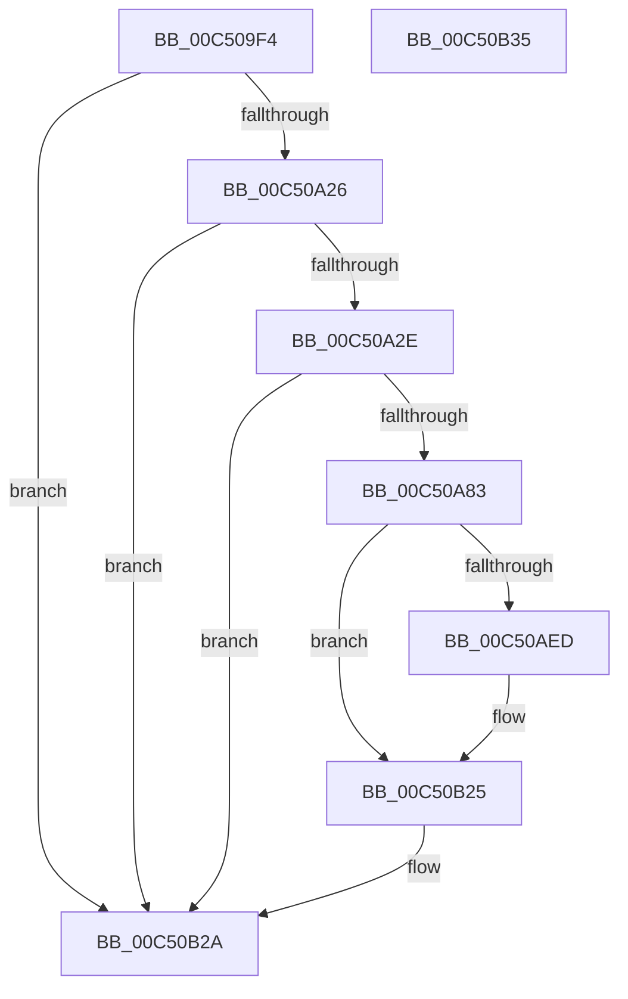

# BapdpRegisterResumeInformation

- RVA: `0x00C509F4`–`0x00C50B36` (길이 `322` bytes)
- VA: `0x0000000140C509F4`
- 실행 섹션: `INIT`
- PDB 이름 있음: `예`; PDB Function 태그: `아니요`
- unwind 정보 RVA: `0x000D1578`
- 디코드: `78`개 명령, `322/322` bytes 표시
- 미해석 바이트: `0` (있으면 어셈블리에 `.byte`로 보존)

> 이 문서는 커널 이미지의 기계어와 PDB 기호를 분석해 생성했습니다. 4번과 5번은 함수 원형과 자료형을 바이너리 사용 방식에서 추정한 C 해석이며 원본 소스 복구 결과는 아닙니다.

## 1. Dependencies

- 직접 호출 지점: **8**; 고유 호출 대상: **5**
- 직접 호출자로 확인된 함수: **1**
- RIP 상대 이미지 참조: **3**

### Outgoing calls
- `0x00C50A41` → [RtlInitUnicodeString](../../text/42/RtlInitUnicodeString_function_0042A780.md) (function, `0x0042A780`)
- `0x00C50A76` → [ZwOpenKey](../../text/6A/ZwOpenKey_function_006AD310.md) (function, `0x006AD310`)
- `0x00C50A8E` → [RtlInitUnicodeString](../../text/42/RtlInitUnicodeString_function_0042A780.md) (function, `0x0042A780`)
- `0x00C50AE0` → [ZwCreateKey](../../text/6A/ZwCreateKey_function_006AD470.md) (function, `0x006AD470`)
- `0x00C50AED` → [ZwClose](../../text/6A/ZwClose_function_006AD2B0.md) (function, `0x006AD2B0`)
- `0x00C50AFD` → [RtlInitUnicodeString](../../text/42/RtlInitUnicodeString_function_0042A780.md) (function, `0x0042A780`)
- `0x00C50B1C` → [ZwSetValueKey](../../text/6A/ZwSetValueKey_function_006ADCD0.md) (function, `0x006ADCD0`)
- `0x00C50B25` → [ZwClose](../../text/6A/ZwClose_function_006AD2B0.md) (function, `0x006AD2B0`)

### Direct callers
- [BapdpProcessResumeInformation](../C4/BapdpProcessResumeInformation_function_00C4FC80.md) at `0x00C4FD2B`

### Static image references
- `0x00C50A32` → RVA `0x00C7DA20` (` ?? ::PBOPGDP::`string'`; read)
- `0x00C50A83` → RVA `0x00C7DB40` (` ?? ::PBOPGDP::`string'`; read)
- `0x00C50AF2` → RVA `0x00C7DC10` (` ?? ::PBOPGDP::`string'`; read)

## 2. Other-region calls and transfers

- 다른 실행 섹션으로 향하는 call: **8**
  - `0x00C50A41` → [RtlInitUnicodeString](../../text/42/RtlInitUnicodeString_function_0042A780.md) (`INIT` → `.text`)
  - `0x00C50A76` → [ZwOpenKey](../../text/6A/ZwOpenKey_function_006AD310.md) (`INIT` → `.text`)
  - `0x00C50A8E` → [RtlInitUnicodeString](../../text/42/RtlInitUnicodeString_function_0042A780.md) (`INIT` → `.text`)
  - `0x00C50AE0` → [ZwCreateKey](../../text/6A/ZwCreateKey_function_006AD470.md) (`INIT` → `.text`)
  - `0x00C50AED` → [ZwClose](../../text/6A/ZwClose_function_006AD2B0.md) (`INIT` → `.text`)
  - `0x00C50AFD` → [RtlInitUnicodeString](../../text/42/RtlInitUnicodeString_function_0042A780.md) (`INIT` → `.text`)
  - `0x00C50B1C` → [ZwSetValueKey](../../text/6A/ZwSetValueKey_function_006ADCD0.md) (`INIT` → `.text`)
  - `0x00C50B25` → [ZwClose](../../text/6A/ZwClose_function_006AD2B0.md) (`INIT` → `.text`)
- 별도 외부 분기/꼬리 이동을 확인하지 못했습니다.

## 3. Assembly (complete function range)

```asm
00C509F4  40 55                           push rbp
00C509F6  53                              push rbx
00C509F7  57                              push rdi
00C509F8  48 8B EC                        mov rbp, rsp
00C509FB  48 81 EC 80 00 00 00            sub rsp, 0x80
00C50A02  83 65 20 00                     and dword ptr [rbp + 0x20], 0
00C50A06  33 C0                           xor eax, eax
00C50A08  21 45 EC                        and dword ptr [rbp - 0x14], eax
00C50A0B  0F 57 C0                        xorps xmm0, xmm0
00C50A0E  89 45 D4                        mov dword ptr [rbp - 0x2c], eax
00C50A11  8B DA                           mov ebx, edx
00C50A13  21 45 D4                        and dword ptr [rbp - 0x2c], eax
00C50A16  48 8B F9                        mov rdi, rcx
00C50A19  0F 11 45 C0                     movups xmmword ptr [rbp - 0x40], xmm0
00C50A1D  48 85 C9                        test rcx, rcx
00C50A20  0F 84 04 01 00 00               je 0x140c50b2a
00C50A26  85 D2                           test edx, edx
00C50A28  0F 84 FC 00 00 00               je 0x140c50b2a
00C50A2E  48 21 45 30                     and qword ptr [rbp + 0x30], rax
00C50A32  48 8D 15 E7 CF 02 00            lea rdx, [rip + 0x2cfe7]
00C50A39  48 21 45 38                     and qword ptr [rbp + 0x38], rax
00C50A3D  48 8D 4D C0                     lea rcx, [rbp - 0x40]
00C50A41  E8 3A 9D 7D FF                  call 0x14042a780
00C50A46  48 83 65 D8 00                  and qword ptr [rbp - 0x28], 0
00C50A4B  48 8D 45 C0                     lea rax, [rbp - 0x40]
00C50A4F  0F 57 C0                        xorps xmm0, xmm0
00C50A52  48 89 45 E0                     mov qword ptr [rbp - 0x20], rax
00C50A56  4C 8D 45 D0                     lea r8, [rbp - 0x30]
00C50A5A  C7 45 D0 30 00 00 00            mov dword ptr [rbp - 0x30], 0x30
00C50A61  BA 19 00 02 00                  mov edx, 0x20019
00C50A66  C7 45 E8 40 02 00 00            mov dword ptr [rbp - 0x18], 0x240
00C50A6D  48 8D 4D 30                     lea rcx, [rbp + 0x30]
00C50A71  F3 0F 7F 45 F0                  movdqu xmmword ptr [rbp - 0x10], xmm0
00C50A76  E8 95 C8 A5 FF                  call 0x1406ad310
00C50A7B  85 C0                           test eax, eax
00C50A7D  0F 88 A7 00 00 00               js 0x140c50b2a
00C50A83  48 8D 15 B6 D0 02 00            lea rdx, [rip + 0x2d0b6]
00C50A8A  48 8D 4D C0                     lea rcx, [rbp - 0x40]
00C50A8E  E8 ED 9C 7D FF                  call 0x14042a780
00C50A93  48 8B 45 30                     mov rax, qword ptr [rbp + 0x30]
00C50A97  4C 8D 45 D0                     lea r8, [rbp - 0x30]
00C50A9B  48 89 45 D8                     mov qword ptr [rbp - 0x28], rax
00C50A9F  48 8D 4D 38                     lea rcx, [rbp + 0x38]
00C50AA3  48 8D 45 C0                     lea rax, [rbp - 0x40]
00C50AA7  C7 45 D0 30 00 00 00            mov dword ptr [rbp - 0x30], 0x30
00C50AAE  48 89 45 E0                     mov qword ptr [rbp - 0x20], rax
00C50AB2  0F 57 C0                        xorps xmm0, xmm0
00C50AB5  48 8D 45 20                     lea rax, [rbp + 0x20]
00C50AB9  C7 45 E8 40 02 00 00            mov dword ptr [rbp - 0x18], 0x240
00C50AC0  48 89 44 24 30                  mov qword ptr [rsp + 0x30], rax
00C50AC5  45 33 C9                        xor r9d, r9d
00C50AC8  C7 44 24 28 01 00 00 00         mov dword ptr [rsp + 0x28], 1
00C50AD0  BA 19 00 02 00                  mov edx, 0x20019
00C50AD5  48 83 64 24 20 00               and qword ptr [rsp + 0x20], 0
00C50ADB  F3 0F 7F 45 F0                  movdqu xmmword ptr [rbp - 0x10], xmm0
00C50AE0  E8 8B C9 A5 FF                  call 0x1406ad470
00C50AE5  48 8B 4D 30                     mov rcx, qword ptr [rbp + 0x30]
00C50AE9  85 C0                           test eax, eax
00C50AEB  78 38                           js 0x140c50b25
00C50AED  E8 BE C7 A5 FF                  call 0x1406ad2b0
00C50AF2  48 8D 15 17 D1 02 00            lea rdx, [rip + 0x2d117]
00C50AF9  48 8D 4D C0                     lea rcx, [rbp - 0x40]
00C50AFD  E8 7E 9C 7D FF                  call 0x14042a780
00C50B02  48 8B 4D 38                     mov rcx, qword ptr [rbp + 0x38]
00C50B06  48 8D 55 C0                     lea rdx, [rbp - 0x40]
00C50B0A  41 B9 03 00 00 00               mov r9d, 3
00C50B10  89 5C 24 28                     mov dword ptr [rsp + 0x28], ebx
00C50B14  45 33 C0                        xor r8d, r8d
00C50B17  48 89 7C 24 20                  mov qword ptr [rsp + 0x20], rdi
00C50B1C  E8 AF D1 A5 FF                  call 0x1406adcd0
00C50B21  48 8B 4D 38                     mov rcx, qword ptr [rbp + 0x38]
00C50B25  E8 86 C7 A5 FF                  call 0x1406ad2b0
00C50B2A  48 81 C4 80 00 00 00            add rsp, 0x80
00C50B31  5F                              pop rdi
00C50B32  5B                              pop rbx
00C50B33  5D                              pop rbp
00C50B34  C3                              ret
00C50B35  CC                              int3
```

## 4. C-style interpretation (structured pseudocode)

```c
__int64 __fastcall BapdpRegisterResumeInformation(__int64 a1, int a2, __int64 a3, int a4)
{
    __int64 result;
    __int64 v_rsp;
    unsigned __int64 v_stack_m28;
    unsigned int v_stack_m2C;
    unsigned int v_stack_m30;
    unsigned __int64 v_stack_m38;
    unsigned __int64 v_stack_m40;
    unsigned int v_stack_m44;
    unsigned __int64 v_stack_m48;
    unsigned __int64 v_stack_m58;
    unsigned __int64 v_stack_m68;
    unsigned int v_stack_m70;
    unsigned __int64 v_stack_m78;
    unsigned __int64 v_stack_p18;
    unsigned __int64 v_stack_p20;
    unsigned int v_stack_p8;

    v_rsp = (v_rsp) - (128);
    result = 0;
    v_stack_m44 = 0;
    v_stack_m58 = v_xmm0;
    if (a1 == 0) goto loc_00C50B2A;
    if (a2 == 0) goto loc_00C50B2A;
    result = RtlInitUnicodeString(v_stack_m58, v_rip + 184295, a3, a4);
    v_stack_m38 = v_stack_m58;
    v_stack_m48 = 48;
    v_stack_m30 = 576;
    v_stack_m28 = v_xmm0;
    result = ZwOpenKey(v_stack_p18, (unsigned int)(0x20019ULL), v_stack_m48, a4);
    if (sign_flag) goto loc_00C50B2A;
    result = RtlInitUnicodeString(v_stack_m58, v_rip + 184502, v_stack_m48, a4);
    v_stack_m40 = v_stack_p18;
    v_stack_m48 = 48;
    v_stack_m38 = v_stack_m58;
    v_stack_m30 = 576;
    v_stack_m68 = v_stack_p8;
    a4 = 0;
    v_stack_m70 = 1;
    v_stack_m28 = v_xmm0;
    result = ZwCreateKey(v_stack_p20, (unsigned int)(0x20019ULL), v_stack_m48, a4);
    if (!(sign_flag)) {
        result = ZwClose(v_stack_p18, (unsigned int)(0x20019ULL), v_stack_m48, a4);
        a2 = v_rip + 184599;
        a1 = v_stack_m58;
        result = RtlInitUnicodeString(a1, a2, v_stack_m48, a4);
        a1 = v_stack_p20;
        a2 = v_stack_m58;
        a4 = 3;
        v_stack_m70 = (unsigned int)((unsigned int)(a2));
        a3 = 0;
        v_stack_m78 = a1;
        result = ZwSetValueKey(a1, a2, a3, a4);
        a1 = v_stack_p20;
    }
    result = ZwClose(a1, a2, a3, a4);
loc_00C50B2A:
    v_rsp = (v_rsp) + (128);
    return result;
}
```

## 5. (Beta) C Style

```c
int64_t BapdpRegisterResumeInformation(int64_t Arg1, int32_t Arg2, int64_t Arg3, int32_t Arg4)
{
    int64_t result;
    int64_t local_rsp;
    uint64_t v_stack_m28;
    uint32_t v_stack_m2C;
    uint32_t v_stack_m30;
    uint64_t v_stack_m38;
    uint64_t v_stack_m40;
    uint32_t v_stack_m44;
    uint64_t v_stack_m48;
    uint64_t v_stack_m58;
    uint64_t v_stack_m68;
    uint32_t v_stack_m70;
    uint64_t v_stack_m78;
    uint64_t v_stack_p18;
    uint64_t v_stack_p20;
    uint32_t v_stack_p8;

    local_rsp = (local_rsp) - (128);
    result = 0;
    v_stack_m44 = 0;
    v_stack_m58 = v_xmm0;
    if (Arg1 == 0) goto loc_00C50B2A;
    if (Arg2 == 0) goto loc_00C50B2A;
    result = RtlInitUnicodeString(v_stack_m58, v_rip + 184295, Arg3, Arg4);
    v_stack_m38 = v_stack_m58;
    v_stack_m48 = 48;
    v_stack_m30 = 576;
    v_stack_m28 = v_xmm0;
    result = ZwOpenKey(v_stack_p18, (uint32_t)(0x20019ULL), v_stack_m48, Arg4);
    if (sign_flag) goto loc_00C50B2A;
    result = RtlInitUnicodeString(v_stack_m58, v_rip + 184502, v_stack_m48, Arg4);
    v_stack_m40 = v_stack_p18;
    v_stack_m48 = 48;
    v_stack_m38 = v_stack_m58;
    v_stack_m30 = 576;
    v_stack_m68 = v_stack_p8;
    Arg4 = 0;
    v_stack_m70 = 1;
    v_stack_m28 = v_xmm0;
    result = ZwCreateKey(v_stack_p20, (uint32_t)(0x20019ULL), v_stack_m48, Arg4);
    if (!(sign_flag)) {
        result = ZwClose(v_stack_p18, (uint32_t)(0x20019ULL), v_stack_m48, Arg4);
        Arg2 = v_rip + 184599;
        Arg1 = v_stack_m58;
        result = RtlInitUnicodeString(Arg1, Arg2, v_stack_m48, Arg4);
        Arg1 = v_stack_p20;
        Arg2 = v_stack_m58;
        Arg4 = 3;
        v_stack_m70 = (uint32_t)((uint32_t)(Arg2));
        Arg3 = 0;
        v_stack_m78 = Arg1;
        result = ZwSetValueKey(Arg1, Arg2, Arg3, Arg4);
        Arg1 = v_stack_p20;
    }
    result = ZwClose(Arg1, Arg2, Arg3, Arg4);
loc_00C50B2A:
    local_rsp = (local_rsp) + (128);
    return result;
}
```

## 6. Execution-region graph

[열기: 2D/3D 그래프와 함수 탐색 컨트롤 패널](../../../control-panel.html?section=init&rva=0x00C509F4&view=graph)

- 2D 그래프는 위에서 아래로 흐르고, 3D 그래프는 빈 공간을 드래그해 회전합니다. Shift+드래그는 이동, 휠은 확대·축소, 함수 노드 선택은 대상 보고서 이동입니다.

### Static fallback


