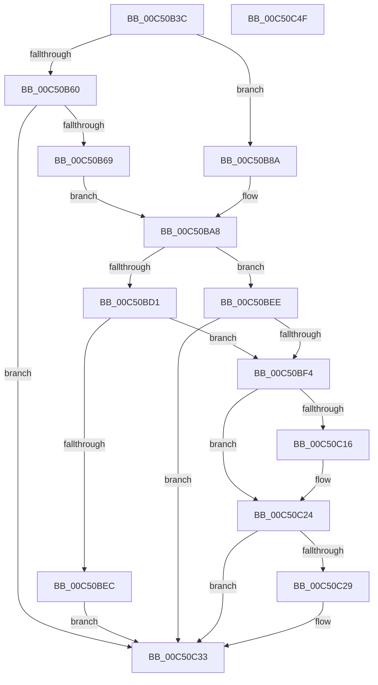

# BapdpRegisterWbclData

- RVA: `0x00C50B3C`–`0x00C50C50` (길이 `276` bytes)
- VA: `0x0000000140C50B3C`
- 실행 섹션: `INIT`
- PDB 이름 있음: `예`; PDB Function 태그: `아니요`
- unwind 정보 RVA: `0x000C48CC`
- 디코드: `71`개 명령, `276/276` bytes 표시
- 미해석 바이트: `0` (있으면 어셈블리에 `.byte`로 보존)

> 이 문서는 커널 이미지의 기계어와 PDB 기호를 분석해 생성했습니다. 4번과 5번은 함수 원형과 자료형을 바이너리 사용 방식에서 추정한 C 해석이며 원본 소스 복구 결과는 아닙니다.

## 1. Dependencies

- 직접 호출 지점: **6**; 고유 호출 대상: **5**
- 직접 호출자로 확인된 함수: **1**
- RIP 상대 이미지 참조: **1**

### Outgoing calls
- `0x00C50BC5` → [BapdpQueryData](BapdpQueryData_function_00C50340.md) (function, `0x00C50340`)
- `0x00C50BDF` → [ExAllocatePool2](../../poolcode/B8/ExAllocatePool2_function_00B820F0.md) (function, `0x00B820F0`)
- `0x00C50C0D` → [BapdpQueryData](BapdpQueryData_function_00C50340.md) (function, `0x00C50340`)
- `0x00C50C1F` → [BapdRegisterSiData](../../pagelk/B7/BapdRegisterSiData_function_00B7B5B8.md) (function, `0x00B7B5B8`)
- `0x00C50C2E` → [ExFreePoolWithTag](../../poolcode/B8/ExFreePoolWithTag_function_00B82870.md) (function, `0x00B82870`)
- `0x00C50C3A` → [_security_check_cookie](../../text/6A/_security_check_cookie_function_006AC640.md) (function, `0x006AC640`)

### Direct callers
- [BootApplicationPersistentDataProcess](../BE/BootApplicationPersistentDataProcess_function_00BEEBD4.md) at `0x00BEEC07`
- [BootApplicationPersistentDataProcess](../BE/BootApplicationPersistentDataProcess_function_00BEEBD4.md) at `0x00BEEC11`

### Static image references
- `0x00C50B4E` → RVA `0x00E0A740` (`.data`; read)

## 2. Other-region calls and transfers

- 다른 실행 섹션으로 향하는 call: **4**
  - `0x00C50BDF` → [ExAllocatePool2](../../poolcode/B8/ExAllocatePool2_function_00B820F0.md) (`INIT` → `POOLCODE`)
  - `0x00C50C1F` → [BapdRegisterSiData](../../pagelk/B7/BapdRegisterSiData_function_00B7B5B8.md) (`INIT` → `PAGELK`)
  - `0x00C50C2E` → [ExFreePoolWithTag](../../poolcode/B8/ExFreePoolWithTag_function_00B82870.md) (`INIT` → `POOLCODE`)
  - `0x00C50C3A` → [_security_check_cookie](../../text/6A/_security_check_cookie_function_006AC640.md) (`INIT` → `.text`)
- 별도 외부 분기/꼬리 이동을 확인하지 못했습니다.

## 3. Assembly (complete function range)

```asm
00C50B3C  48 89 5C 24 08                  mov qword ptr [rsp + 8], rbx
00C50B41  48 89 7C 24 10                  mov qword ptr [rsp + 0x10], rdi
00C50B46  55                              push rbp
00C50B47  48 8B EC                        mov rbp, rsp
00C50B4A  48 83 EC 50                     sub rsp, 0x50
00C50B4E  48 8B 05 EB 9B 1B 00            mov rax, qword ptr [rip + 0x1b9beb]
00C50B55  48 33 C4                        xor rax, rsp
00C50B58  48 89 45 F8                     mov qword ptr [rbp - 8], rax
00C50B5C  85 C9                           test ecx, ecx
00C50B5E  74 2A                           je 0x140c50b8a
00C50B60  83 F9 01                        cmp ecx, 1
00C50B63  0F 85 CA 00 00 00               jne 0x140c50c33
00C50B69  C7 45 E8 AE 8C 72 B8            mov dword ptr [rbp - 0x18], 0xb8728cae
00C50B70  8D 79 01                        lea edi, [rcx + 1]
00C50B73  C7 45 EC 5D 0A BE 45            mov dword ptr [rbp - 0x14], 0x45be0a5d
00C50B7A  C7 45 F0 95 D4 71 01            mov dword ptr [rbp - 0x10], 0x171d495
00C50B81  C7 45 F4 9A D1 2E 25            mov dword ptr [rbp - 0xc], 0x252ed19a
00C50B88  EB 1E                           jmp 0x140c50ba8
00C50B8A  C7 45 E8 DD D9 39 B6            mov dword ptr [rbp - 0x18], 0xb639d9dd
00C50B91  33 FF                           xor edi, edi
00C50B93  C7 45 EC 72 62 1C 47            mov dword ptr [rbp - 0x14], 0x471c6272
00C50B9A  C7 45 F0 B1 B2 59 34            mov dword ptr [rbp - 0x10], 0x3459b2b1
00C50BA1  C7 45 F4 10 48 E0 2F            mov dword ptr [rbp - 0xc], 0x2fe04810
00C50BA8  48 83 64 24 28 00               and qword ptr [rsp + 0x28], 0
00C50BAE  48 8D 45 E0                     lea rax, [rbp - 0x20]
00C50BB2  83 65 E0 00                     and dword ptr [rbp - 0x20], 0
00C50BB6  48 8D 55 E8                     lea rdx, [rbp - 0x18]
00C50BBA  45 33 C9                        xor r9d, r9d
00C50BBD  48 89 44 24 20                  mov qword ptr [rsp + 0x20], rax
00C50BC2  45 33 C0                        xor r8d, r8d
00C50BC5  E8 76 F7 FF FF                  call 0x140c50340
00C50BCA  3D 23 00 00 C0                  cmp eax, 0xc0000023
00C50BCF  75 1D                           jne 0x140c50bee
00C50BD1  8B 55 E0                        mov edx, dword ptr [rbp - 0x20]
00C50BD4  B9 40 00 00 00                  mov ecx, 0x40
00C50BD9  41 B8 42 61 50 64               mov r8d, 0x64506142
00C50BDF  E8 0C 15 F3 FF                  call 0x140b820f0
00C50BE4  48 8B D8                        mov rbx, rax
00C50BE7  48 85 C0                        test rax, rax
00C50BEA  75 08                           jne 0x140c50bf4
00C50BEC  EB 45                           jmp 0x140c50c33
00C50BEE  33 DB                           xor ebx, ebx
00C50BF0  85 C0                           test eax, eax
00C50BF2  78 3F                           js 0x140c50c33
00C50BF4  48 83 64 24 28 00               and qword ptr [rsp + 0x28], 0
00C50BFA  48 8D 45 E0                     lea rax, [rbp - 0x20]
00C50BFE  4C 8B CB                        mov r9, rbx
00C50C01  48 89 44 24 20                  mov qword ptr [rsp + 0x20], rax
00C50C06  45 33 C0                        xor r8d, r8d
00C50C09  48 8D 55 E8                     lea rdx, [rbp - 0x18]
00C50C0D  E8 2E F7 FF FF                  call 0x140c50340
00C50C12  85 C0                           test eax, eax
00C50C14  78 0E                           js 0x140c50c24
00C50C16  8B 55 E0                        mov edx, dword ptr [rbp - 0x20]
00C50C19  44 8B C7                        mov r8d, edi
00C50C1C  48 8B CB                        mov rcx, rbx
00C50C1F  E8 94 A9 F2 FF                  call 0x140b7b5b8
00C50C24  48 85 DB                        test rbx, rbx
00C50C27  74 0A                           je 0x140c50c33
00C50C29  33 D2                           xor edx, edx
00C50C2B  48 8B CB                        mov rcx, rbx
00C50C2E  E8 3D 1C F3 FF                  call 0x140b82870
00C50C33  48 8B 4D F8                     mov rcx, qword ptr [rbp - 8]
00C50C37  48 33 CC                        xor rcx, rsp
00C50C3A  E8 01 BA A5 FF                  call 0x1406ac640
00C50C3F  48 8B 5C 24 60                  mov rbx, qword ptr [rsp + 0x60]
00C50C44  48 8B 7C 24 68                  mov rdi, qword ptr [rsp + 0x68]
00C50C49  48 83 C4 50                     add rsp, 0x50
00C50C4D  5D                              pop rbp
00C50C4E  C3                              ret
00C50C4F  CC                              int3
```

## 4. C-style interpretation (structured pseudocode)

```c
__int64 __fastcall BapdpRegisterWbclData(__int64 a1, __int64 a2, int a3, int a4)
{
    __int64 result;
    __int64 v_rbx;
    __int64 v_rdi;
    __int64 v_rsp;
    unsigned __int64 v_stack_m10;
    unsigned int v_stack_m14;
    unsigned int v_stack_m18;
    unsigned int v_stack_m1C;
    unsigned int v_stack_m20;
    unsigned __int64 v_stack_m28;
    unsigned __int64 v_stack_m30;
    unsigned __int64 v_stack_m38;
    unsigned __int64 v_stack_p10;
    unsigned __int64 v_stack_p8;

    v_stack_p8 = v_rbx;
    v_stack_p10 = v_rdi;
    v_rsp = (v_rsp) - (80);
    result = (*(unsigned __int64 *)(v_rip + 1809387)) ^ (v_rsp);
    v_stack_m10 = result;
    if ((unsigned int)(a1) == 0) goto loc_00C50B8A;
    if (((unsigned int)(a1)) != 1) goto loc_00C50C33;
    v_stack_m20 = 0xB8728CAEULL;
    v_stack_m1C = 0x45BE0A5DULL;
    v_stack_m18 = 0x171D495ULL;
    v_stack_m14 = 0x252ED19AULL;
    goto loc_00C50BA8;
loc_00C50B8A:
    v_stack_m20 = 0xB639D9DDULL;
    v_rdi = 0;
    v_stack_m1C = 0x471C6272ULL;
    v_stack_m18 = 0x3459B2B1ULL;
    v_stack_m14 = 0x2FE04810ULL;
loc_00C50BA8:
    a4 = 0;
    v_stack_m38 = v_stack_m28;
    a3 = 0;
    result = BapdpQueryData(a1, v_stack_m20, a3, a4);
    if (((unsigned int)(result)) != 0xC0000023ULL) goto loc_00C50BEE;
    result = ExAllocatePool2(64, (unsigned int)(v_stack_m28), (unsigned int)(0x64506142ULL), a4);
    if (result != 0) goto loc_00C50BF4;
    goto loc_00C50C33;
loc_00C50BEE:
    v_rbx = 0;
    if (sign_flag) goto loc_00C50C33;
loc_00C50BF4:
    v_stack_m38 = v_stack_m28;
    a3 = 0;
    result = BapdpQueryData(64, v_stack_m20, a3, 0);
    if (!(sign_flag)) {
        a2 = v_stack_m28;
        a3 = 0;
        a1 = 0;
        result = BapdRegisterSiData(a1, a2, a3, 0);
    }
    if (0 != 0) {
        a2 = 0;
        a1 = 0;
        result = ExFreePoolWithTag(a1, a2, a3, 0);
    }
    a1 = (v_stack_m10) ^ (v_rsp);
    result = _security_check_cookie(a1, a2, a3, 0);
    v_rsp = (v_rsp) + (80);
    return result;
}
```

## 5. (Beta) C Style

```c
int64_t BapdpRegisterWbclData(int64_t Arg1, int64_t Arg2, int32_t Arg3, int32_t Arg4)
{
    int64_t result;
    int64_t local_rbx;
    int64_t local_rdi;
    int64_t local_rsp;
    uint64_t v_stack_m10;
    uint32_t v_stack_m14;
    uint32_t v_stack_m18;
    uint32_t v_stack_m1C;
    uint32_t v_stack_m20;
    uint64_t v_stack_m28;
    uint64_t v_stack_m30;
    uint64_t v_stack_m38;
    uint64_t v_stack_p10;
    uint64_t v_stack_p8;

    v_stack_p8 = local_rbx;
    v_stack_p10 = local_rdi;
    local_rsp = (local_rsp) - (80);
    result = (*(uint64_t *)(v_rip + 0x1B9BEB)) ^ (local_rsp);
    v_stack_m10 = result;
    if ((uint32_t)(Arg1) == 0) goto loc_00C50B8A;
    if (((uint32_t)(Arg1)) != 1) goto loc_00C50C33;
    v_stack_m20 = 0xB8728CAEULL;
    v_stack_m1C = 0x45BE0A5DULL;
    v_stack_m18 = 0x171D495ULL;
    v_stack_m14 = 0x252ED19AULL;
    goto loc_00C50BA8;
loc_00C50B8A:
    v_stack_m20 = 0xB639D9DDULL;
    local_rdi = 0;
    v_stack_m1C = 0x471C6272ULL;
    v_stack_m18 = 0x3459B2B1ULL;
    v_stack_m14 = 0x2FE04810ULL;
loc_00C50BA8:
    Arg4 = 0;
    v_stack_m38 = v_stack_m28;
    Arg3 = 0;
    result = BapdpQueryData(Arg1, v_stack_m20, Arg3, Arg4);
    if (((uint32_t)(result)) != 0xC0000023ULL) goto loc_00C50BEE;
    result = ExAllocatePool2(64, (uint32_t)(v_stack_m28), (uint32_t)(0x64506142ULL), Arg4);
    if (result != 0) goto loc_00C50BF4;
    goto loc_00C50C33;
loc_00C50BEE:
    local_rbx = 0;
    if (sign_flag) goto loc_00C50C33;
loc_00C50BF4:
    v_stack_m38 = v_stack_m28;
    Arg3 = 0;
    result = BapdpQueryData(64, v_stack_m20, Arg3, 0);
    if (!(sign_flag)) {
        Arg2 = v_stack_m28;
        Arg3 = 0;
        Arg1 = 0;
        result = BapdRegisterSiData(Arg1, Arg2, Arg3, 0);
    }
    if (0 != 0) {
        Arg2 = 0;
        Arg1 = 0;
        result = ExFreePoolWithTag(Arg1, Arg2, Arg3, 0);
    }
    Arg1 = (v_stack_m10) ^ (local_rsp);
    result = _security_check_cookie(Arg1, Arg2, Arg3, 0);
    local_rsp = (local_rsp) + (80);
    return result;
}
```

## 6. Execution-region graph

[열기: 2D/3D 그래프와 함수 탐색 컨트롤 패널](../../../control-panel.html?section=init&rva=0x00C50B3C&view=graph)

- 2D 그래프는 위에서 아래로 흐르고, 3D 그래프는 빈 공간을 드래그해 회전합니다. Shift+드래그는 이동, 휠은 확대·축소, 함수 노드 선택은 대상 보고서 이동입니다.

### Static fallback


