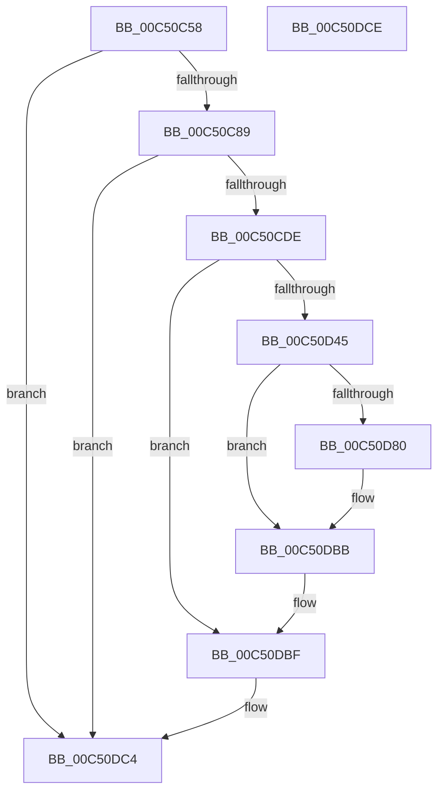

# BapdpRegisterWmdResult

- RVA: `0x00C50C58`–`0x00C50DCF` (길이 `375` bytes)
- VA: `0x0000000140C50C58`
- 실행 섹션: `INIT`
- PDB 이름 있음: `예`; PDB Function 태그: `아니요`
- unwind 정보 RVA: `0x000D47A0`
- 디코드: `88`개 명령, `375/375` bytes 표시
- 미해석 바이트: `0` (있으면 어셈블리에 `.byte`로 보존)

> 이 문서는 커널 이미지의 기계어와 PDB 기호를 분석해 생성했습니다. 4번과 5번은 함수 원형과 자료형을 바이너리 사용 방식에서 추정한 C 해석이며 원본 소스 복구 결과는 아닙니다.

## 1. Dependencies

- 직접 호출 지점: **10**; 고유 호출 대상: **5**
- 직접 호출자로 확인된 함수: **1**
- RIP 상대 이미지 참조: **4**

### Outgoing calls
- `0x00C50C9C` → [RtlInitUnicodeString](../../text/42/RtlInitUnicodeString_function_0042A780.md) (function, `0x0042A780`)
- `0x00C50CD1` → [ZwOpenKey](../../text/6A/ZwOpenKey_function_006AD310.md) (function, `0x006AD310`)
- `0x00C50CE9` → [RtlInitUnicodeString](../../text/42/RtlInitUnicodeString_function_0042A780.md) (function, `0x0042A780`)
- `0x00C50D38` → [ZwCreateKey](../../text/6A/ZwCreateKey_function_006AD470.md) (function, `0x006AD470`)
- `0x00C50D45` → [ZwClose](../../text/6A/ZwClose_function_006AD2B0.md) (function, `0x006AD2B0`)
- `0x00C50D55` → [RtlInitUnicodeString](../../text/42/RtlInitUnicodeString_function_0042A780.md) (function, `0x0042A780`)
- `0x00C50D77` → [ZwSetValueKey](../../text/6A/ZwSetValueKey_function_006ADCD0.md) (function, `0x006ADCD0`)
- `0x00C50D92` → [RtlInitUnicodeString](../../text/42/RtlInitUnicodeString_function_0042A780.md) (function, `0x0042A780`)
- `0x00C50DB6` → [ZwSetValueKey](../../text/6A/ZwSetValueKey_function_006ADCD0.md) (function, `0x006ADCD0`)
- `0x00C50DBF` → [ZwClose](../../text/6A/ZwClose_function_006AD2B0.md) (function, `0x006AD2B0`)

### Direct callers
- [BapdpProcessWmdResults](BapdpProcessWmdResults_function_00C5015C.md) at `0x00C502FE`

### Static image references
- `0x00C50C8D` → RVA `0x00C7DA20` (` ?? ::PBOPGDP::`string'`; read)
- `0x00C50CDE` → RVA `0x00C7DCB0` (` ?? ::PBOPGDP::`string'`; read)
- `0x00C50D4A` → RVA `0x00C7DC50` (` ?? ::PBOPGDP::`string'`; read)
- `0x00C50D80` → RVA `0x00C7DC30` (` ?? ::PBOPGDP::`string'`; read)

## 2. Other-region calls and transfers

- 다른 실행 섹션으로 향하는 call: **10**
  - `0x00C50C9C` → [RtlInitUnicodeString](../../text/42/RtlInitUnicodeString_function_0042A780.md) (`INIT` → `.text`)
  - `0x00C50CD1` → [ZwOpenKey](../../text/6A/ZwOpenKey_function_006AD310.md) (`INIT` → `.text`)
  - `0x00C50CE9` → [RtlInitUnicodeString](../../text/42/RtlInitUnicodeString_function_0042A780.md) (`INIT` → `.text`)
  - `0x00C50D38` → [ZwCreateKey](../../text/6A/ZwCreateKey_function_006AD470.md) (`INIT` → `.text`)
  - `0x00C50D45` → [ZwClose](../../text/6A/ZwClose_function_006AD2B0.md) (`INIT` → `.text`)
  - `0x00C50D55` → [RtlInitUnicodeString](../../text/42/RtlInitUnicodeString_function_0042A780.md) (`INIT` → `.text`)
  - `0x00C50D77` → [ZwSetValueKey](../../text/6A/ZwSetValueKey_function_006ADCD0.md) (`INIT` → `.text`)
  - `0x00C50D92` → [RtlInitUnicodeString](../../text/42/RtlInitUnicodeString_function_0042A780.md) (`INIT` → `.text`)
  - `0x00C50DB6` → [ZwSetValueKey](../../text/6A/ZwSetValueKey_function_006ADCD0.md) (`INIT` → `.text`)
  - `0x00C50DBF` → [ZwClose](../../text/6A/ZwClose_function_006AD2B0.md) (`INIT` → `.text`)
- 별도 외부 분기/꼬리 이동을 확인하지 못했습니다.

## 3. Assembly (complete function range)

```asm
00C50C58  40 55                           push rbp
00C50C5A  53                              push rbx
00C50C5B  48 8D 6C 24 B1                  lea rbp, [rsp - 0x4f]
00C50C60  48 81 EC 88 00 00 00            sub rsp, 0x88
00C50C67  83 65 67 00                     and dword ptr [rbp + 0x67], 0
00C50C6B  33 C0                           xor eax, eax
00C50C6D  21 45 33                        and dword ptr [rbp + 0x33], eax
00C50C70  0F 57 C0                        xorps xmm0, xmm0
00C50C73  89 45 1B                        mov dword ptr [rbp + 0x1b], eax
00C50C76  48 8B D9                        mov rbx, rcx
00C50C79  21 45 1B                        and dword ptr [rbp + 0x1b], eax
00C50C7C  0F 11 45 07                     movups xmmword ptr [rbp + 7], xmm0
00C50C80  48 85 C9                        test rcx, rcx
00C50C83  0F 84 3B 01 00 00               je 0x140c50dc4
00C50C89  48 21 45 7F                     and qword ptr [rbp + 0x7f], rax
00C50C8D  48 8D 15 8C CD 02 00            lea rdx, [rip + 0x2cd8c]
00C50C94  48 21 45 77                     and qword ptr [rbp + 0x77], rax
00C50C98  48 8D 4D 07                     lea rcx, [rbp + 7]
00C50C9C  E8 DF 9A 7D FF                  call 0x14042a780
00C50CA1  48 83 65 1F 00                  and qword ptr [rbp + 0x1f], 0
00C50CA6  48 8D 45 07                     lea rax, [rbp + 7]
00C50CAA  0F 57 C0                        xorps xmm0, xmm0
00C50CAD  48 89 45 27                     mov qword ptr [rbp + 0x27], rax
00C50CB1  4C 8D 45 17                     lea r8, [rbp + 0x17]
00C50CB5  C7 45 17 30 00 00 00            mov dword ptr [rbp + 0x17], 0x30
00C50CBC  BA 19 00 02 00                  mov edx, 0x20019
00C50CC1  C7 45 2F 40 02 00 00            mov dword ptr [rbp + 0x2f], 0x240
00C50CC8  48 8D 4D 7F                     lea rcx, [rbp + 0x7f]
00C50CCC  F3 0F 7F 45 37                  movdqu xmmword ptr [rbp + 0x37], xmm0
00C50CD1  E8 3A C6 A5 FF                  call 0x1406ad310
00C50CD6  85 C0                           test eax, eax
00C50CD8  0F 88 E6 00 00 00               js 0x140c50dc4
00C50CDE  48 8D 15 CB CF 02 00            lea rdx, [rip + 0x2cfcb]
00C50CE5  48 8D 4D 07                     lea rcx, [rbp + 7]
00C50CE9  E8 92 9A 7D FF                  call 0x14042a780
00C50CEE  48 8B 45 7F                     mov rax, qword ptr [rbp + 0x7f]
00C50CF2  4C 8D 45 17                     lea r8, [rbp + 0x17]
00C50CF6  48 89 45 1F                     mov qword ptr [rbp + 0x1f], rax
00C50CFA  48 8D 4D 77                     lea rcx, [rbp + 0x77]
00C50CFE  48 8D 45 07                     lea rax, [rbp + 7]
00C50D02  C7 45 17 30 00 00 00            mov dword ptr [rbp + 0x17], 0x30
00C50D09  48 89 45 27                     mov qword ptr [rbp + 0x27], rax
00C50D0D  0F 57 C0                        xorps xmm0, xmm0
00C50D10  48 8D 45 67                     lea rax, [rbp + 0x67]
00C50D14  C7 45 2F 40 02 00 00            mov dword ptr [rbp + 0x2f], 0x240
00C50D1B  48 89 44 24 30                  mov qword ptr [rsp + 0x30], rax
00C50D20  45 33 C9                        xor r9d, r9d
00C50D23  83 64 24 28 00                  and dword ptr [rsp + 0x28], 0
00C50D28  BA 19 00 02 00                  mov edx, 0x20019
00C50D2D  48 83 64 24 20 00               and qword ptr [rsp + 0x20], 0
00C50D33  F3 0F 7F 45 37                  movdqu xmmword ptr [rbp + 0x37], xmm0
00C50D38  E8 33 C7 A5 FF                  call 0x1406ad470
00C50D3D  48 8B 4D 7F                     mov rcx, qword ptr [rbp + 0x7f]
00C50D41  85 C0                           test eax, eax
00C50D43  78 7A                           js 0x140c50dbf
00C50D45  E8 66 C5 A5 FF                  call 0x1406ad2b0
00C50D4A  48 8D 15 FF CE 02 00            lea rdx, [rip + 0x2ceff]
00C50D51  48 8D 4D 07                     lea rcx, [rbp + 7]
00C50D55  E8 26 9A 7D FF                  call 0x14042a780
00C50D5A  8B 43 04                        mov eax, dword ptr [rbx + 4]
00C50D5D  48 8D 55 07                     lea rdx, [rbp + 7]
00C50D61  48 8B 4D 77                     mov rcx, qword ptr [rbp + 0x77]
00C50D65  41 B9 03 00 00 00               mov r9d, 3
00C50D6B  89 44 24 28                     mov dword ptr [rsp + 0x28], eax
00C50D6F  45 33 C0                        xor r8d, r8d
00C50D72  48 89 5C 24 20                  mov qword ptr [rsp + 0x20], rbx
00C50D77  E8 54 CF A5 FF                  call 0x1406adcd0
00C50D7C  85 C0                           test eax, eax
00C50D7E  78 3B                           js 0x140c50dbb
00C50D80  48 8D 15 A9 CE 02 00            lea rdx, [rip + 0x2cea9]
00C50D87  C7 45 6F 01 00 00 00            mov dword ptr [rbp + 0x6f], 1
00C50D8E  48 8D 4D 07                     lea rcx, [rbp + 7]
00C50D92  E8 E9 99 7D FF                  call 0x14042a780
00C50D97  48 8B 4D 77                     mov rcx, qword ptr [rbp + 0x77]
00C50D9B  48 8D 45 6F                     lea rax, [rbp + 0x6f]
00C50D9F  41 B9 04 00 00 00               mov r9d, 4
00C50DA5  48 8D 55 07                     lea rdx, [rbp + 7]
00C50DA9  44 89 4C 24 28                  mov dword ptr [rsp + 0x28], r9d
00C50DAE  45 33 C0                        xor r8d, r8d
00C50DB1  48 89 44 24 20                  mov qword ptr [rsp + 0x20], rax
00C50DB6  E8 15 CF A5 FF                  call 0x1406adcd0
00C50DBB  48 8B 4D 77                     mov rcx, qword ptr [rbp + 0x77]
00C50DBF  E8 EC C4 A5 FF                  call 0x1406ad2b0
00C50DC4  48 81 C4 88 00 00 00            add rsp, 0x88
00C50DCB  5B                              pop rbx
00C50DCC  5D                              pop rbp
00C50DCD  C3                              ret
00C50DCE  CC                              int3
```

## 4. C-style interpretation (structured pseudocode)

```c
__int64 __fastcall BapdpRegisterWmdResult(__int64 a1, __int64 a2, __int64 a3, int a4)
{
    __int64 result;
    __int64 v_rsp;
    unsigned __int64 v_stack_m28;
    unsigned int v_stack_m2C;
    unsigned int v_stack_m30;
    unsigned __int64 v_stack_m38;
    unsigned __int64 v_stack_m40;
    unsigned int v_stack_m44;
    unsigned __int64 v_stack_m48;
    unsigned __int64 v_stack_m58;
    unsigned __int64 v_stack_m5F;
    unsigned __int64 v_stack_m68;
    unsigned int v_stack_m70;
    unsigned __int64 v_stack_m78;
    unsigned int v_stack_p10;
    unsigned __int64 v_stack_p18;
    unsigned __int64 v_stack_p20;
    unsigned int v_stack_p8;

    v_rsp = (v_rsp) - (136);
    result = 0;
    v_stack_m44 = 0;
    v_stack_m58 = v_xmm0;
    if (a1 == 0) goto loc_00C50DC4;
    result = RtlInitUnicodeString(v_stack_m58, v_rip + 183692, a3, a4);
    v_stack_m38 = v_stack_m58;
    v_stack_m48 = 48;
    v_stack_m30 = 576;
    v_stack_m28 = v_xmm0;
    result = ZwOpenKey(v_stack_p20, (unsigned int)(0x20019ULL), v_stack_m48, a4);
    if (sign_flag) goto loc_00C50DC4;
    result = RtlInitUnicodeString(v_stack_m58, v_rip + 184267, v_stack_m48, a4);
    v_stack_m40 = v_stack_p20;
    v_stack_m48 = 48;
    v_stack_m38 = v_stack_m58;
    v_stack_m30 = 576;
    v_stack_m68 = v_stack_p8;
    a4 = 0;
    v_stack_m28 = v_xmm0;
    result = ZwCreateKey(v_stack_p18, (unsigned int)(0x20019ULL), v_stack_m48, a4);
    if (sign_flag) goto loc_00C50DBF;
    result = ZwClose(v_stack_p20, (unsigned int)(0x20019ULL), v_stack_m48, a4);
    result = RtlInitUnicodeString(v_stack_m58, v_rip + 184063, v_stack_m48, a4);
    v_stack_m70 = (unsigned int)((unsigned int)(*(unsigned int *)(a1 + 4)));
    a3 = 0;
    v_stack_m78 = a1;
    result = ZwSetValueKey(v_stack_p18, v_stack_m58, a3, 3);
    if (!(sign_flag)) {
        a2 = v_rip + 183977;
        v_stack_p10 = 1;
        a1 = v_stack_m58;
        result = RtlInitUnicodeString(a1, a2, a3, 3);
        a1 = v_stack_p18;
        result = v_stack_p10;
        a4 = 4;
        a2 = v_stack_m58;
        v_stack_m70 = a4;
        a3 = 0;
        v_stack_m78 = result;
        result = ZwSetValueKey(a1, a2, a3, a4);
    }
loc_00C50DBF:
    result = ZwClose(v_stack_p18, a2, a3, a4);
loc_00C50DC4:
    v_rsp = (v_rsp) + (136);
    return result;
}
```

## 5. (Beta) C Style

```c
int64_t BapdpRegisterWmdResult(void *Arg1, int64_t Arg2, int64_t Arg3, int32_t Arg4)
{
    uint8_t *arg1 = (uint8_t *)Arg1;

    int64_t result;
    int64_t local_rsp;
    uint64_t v_stack_m28;
    uint32_t v_stack_m2C;
    uint32_t v_stack_m30;
    uint64_t v_stack_m38;
    uint64_t v_stack_m40;
    uint32_t v_stack_m44;
    uint64_t v_stack_m48;
    uint64_t v_stack_m58;
    uint64_t v_stack_m5F;
    uint64_t v_stack_m68;
    uint32_t v_stack_m70;
    uint64_t v_stack_m78;
    uint32_t v_stack_p10;
    uint64_t v_stack_p18;
    uint64_t v_stack_p20;
    uint32_t v_stack_p8;

    local_rsp = (local_rsp) - (136);
    result = 0;
    v_stack_m44 = 0;
    v_stack_m58 = v_xmm0;
    if (Arg1 == NULL) goto loc_00C50DC4;
    result = RtlInitUnicodeString(v_stack_m58, v_rip + 183692, Arg3, Arg4);
    v_stack_m38 = v_stack_m58;
    v_stack_m48 = 48;
    v_stack_m30 = 576;
    v_stack_m28 = v_xmm0;
    result = ZwOpenKey(v_stack_p20, (uint32_t)(0x20019ULL), v_stack_m48, Arg4);
    if (sign_flag) goto loc_00C50DC4;
    result = RtlInitUnicodeString(v_stack_m58, v_rip + 184267, v_stack_m48, Arg4);
    v_stack_m40 = v_stack_p20;
    v_stack_m48 = 48;
    v_stack_m38 = v_stack_m58;
    v_stack_m30 = 576;
    v_stack_m68 = v_stack_p8;
    Arg4 = 0;
    v_stack_m28 = v_xmm0;
    result = ZwCreateKey(v_stack_p18, (uint32_t)(0x20019ULL), v_stack_m48, Arg4);
    if (sign_flag) goto loc_00C50DBF;
    result = ZwClose(v_stack_p20, (uint32_t)(0x20019ULL), v_stack_m48, Arg4);
    result = RtlInitUnicodeString(v_stack_m58, v_rip + 184063, v_stack_m48, Arg4);
    v_stack_m70 = (uint32_t)((uint32_t)(*(uint32_t *)(arg1 + 0x4)));
    Arg3 = 0;
    v_stack_m78 = Arg1;
    result = ZwSetValueKey(v_stack_p18, v_stack_m58, Arg3, 3);
    if (!(sign_flag)) {
        Arg2 = v_rip + 183977;
        v_stack_p10 = 1;
        Arg1 = v_stack_m58;
        result = RtlInitUnicodeString(Arg1, Arg2, Arg3, 3);
        Arg1 = v_stack_p18;
        result = v_stack_p10;
        Arg4 = 4;
        Arg2 = v_stack_m58;
        v_stack_m70 = Arg4;
        Arg3 = 0;
        v_stack_m78 = result;
        result = ZwSetValueKey(Arg1, Arg2, Arg3, Arg4);
    }
loc_00C50DBF:
    result = ZwClose(v_stack_p18, Arg2, Arg3, Arg4);
loc_00C50DC4:
    local_rsp = (local_rsp) + (136);
    return result;
}
```

### 관측된 메모리 오프셋

구조체 형식이 확인되지 않은 접근은 인자 기준의 오프셋으로만 기록했습니다.

| 기준 인자 | 오프셋 표현 | 폭 (bit) | 접근 |
|---|---:|---:|---|
| `Arg1` | `+ 0x4` | `32` | `R` |

## 6. Execution-region graph

[열기: 2D/3D 그래프와 함수 탐색 컨트롤 패널](../../../control-panel.html?section=init&rva=0x00C50C58&view=graph)

- 2D 그래프는 위에서 아래로 흐르고, 3D 그래프는 빈 공간을 드래그해 회전합니다. Shift+드래그는 이동, 휠은 확대·축소, 함수 노드 선택은 대상 보고서 이동입니다.

### Static fallback


