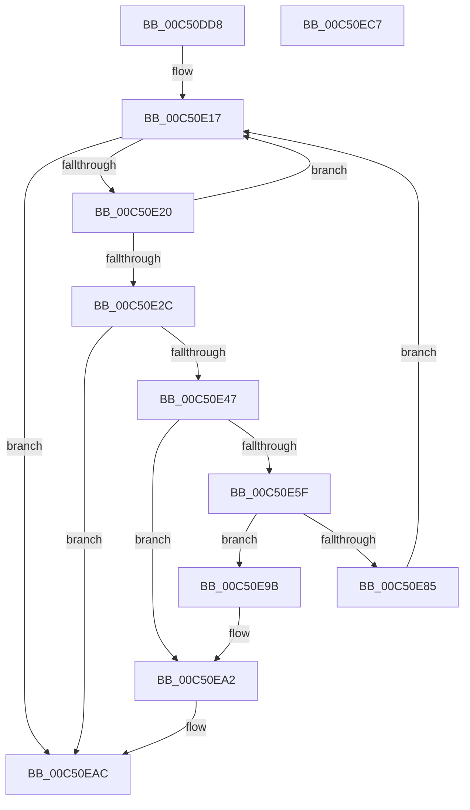

# BootApplicationPersistentDataInitialize

- RVA: `0x00C50DD8`–`0x00C50EC8` (길이 `240` bytes)
- VA: `0x0000000140C50DD8`
- 실행 섹션: `INIT`
- PDB 이름 있음: `예`; PDB Function 태그: `아니요`
- unwind 정보 RVA: `0x0005E6B4`
- 디코드: `60`개 명령, `240/240` bytes 표시
- 미해석 바이트: `0` (있으면 어셈블리에 `.byte`로 보존)

> 이 문서는 커널 이미지의 기계어와 PDB 기호를 분석해 생성했습니다. 4번과 5번은 함수 원형과 자료형을 바이너리 사용 방식에서 추정한 C 해석이며 원본 소스 복구 결과는 아닙니다.

## 1. Dependencies

- 직접 호출 지점: **4**; 고유 호출 대상: **3**
- 직접 호출자로 확인된 함수: **1**
- RIP 상대 이미지 참조: **4**

### Outgoing calls
- `0x00C50E3A` → [ExAllocatePool2](../../poolcode/B8/ExAllocatePool2_function_00B820F0.md) (function, `0x00B820F0`)
- `0x00C50E55` → [ExAllocatePool2](../../poolcode/B8/ExAllocatePool2_function_00B820F0.md) (function, `0x00B820F0`)
- `0x00C50E74` → [memcpy](../../text/6C/memcpy_function_006C6840.md) (function, `0x006C6840`)
- `0x00C50EA7` → [ExFreePoolWithTag](../../poolcode/B8/ExFreePoolWithTag_function_00B82870.md) (function, `0x00B82870`)

### Direct callers
- [InitBootProcessor](../C1/InitBootProcessor_function_00C1B1C8.md) at `0x00C1B9EC`

### Static image references
- `0x00C50DF1` → RVA `0x00E62410` (`.data`; read)
- `0x00C50DF8` → RVA `0x00E62418` (`.data`; write)
- `0x00C50DFF` → RVA `0x00E62410` (`.data`; write)
- `0x00C50E79` → RVA `0x00E62418` (`.data`; read)

## 2. Other-region calls and transfers

- 다른 실행 섹션으로 향하는 call: **4**
  - `0x00C50E3A` → [ExAllocatePool2](../../poolcode/B8/ExAllocatePool2_function_00B820F0.md) (`INIT` → `POOLCODE`)
  - `0x00C50E55` → [ExAllocatePool2](../../poolcode/B8/ExAllocatePool2_function_00B820F0.md) (`INIT` → `POOLCODE`)
  - `0x00C50E74` → [memcpy](../../text/6C/memcpy_function_006C6840.md) (`INIT` → `.text`)
  - `0x00C50EA7` → [ExFreePoolWithTag](../../poolcode/B8/ExFreePoolWithTag_function_00B82870.md) (`INIT` → `POOLCODE`)
- 별도 외부 분기/꼬리 이동을 확인하지 못했습니다.

## 3. Assembly (complete function range)

```asm
00C50DD8  48 8B C4                        mov rax, rsp
00C50DDB  48 89 58 08                     mov qword ptr [rax + 8], rbx
00C50DDF  48 89 68 10                     mov qword ptr [rax + 0x10], rbp
00C50DE3  48 89 70 18                     mov qword ptr [rax + 0x18], rsi
00C50DE7  48 89 78 20                     mov qword ptr [rax + 0x20], rdi
00C50DEB  41 56                           push r14
00C50DED  48 83 EC 20                     sub rsp, 0x20
00C50DF1  4C 8D 35 18 16 21 00            lea r14, [rip + 0x211618]
00C50DF8  4C 89 35 19 16 21 00            mov qword ptr [rip + 0x211619], r14
00C50DFF  4C 89 35 0A 16 21 00            mov qword ptr [rip + 0x21160a], r14
00C50E06  48 8B B1 F0 00 00 00            mov rsi, qword ptr [rcx + 0xf0]
00C50E0D  48 81 C6 E8 00 00 00            add rsi, 0xe8
00C50E14  48 8B 3E                        mov rdi, qword ptr [rsi]
00C50E17  48 3B FE                        cmp rdi, rsi
00C50E1A  0F 84 8C 00 00 00               je 0x140c50eac
00C50E20  48 8B EF                        mov rbp, rdi
00C50E23  48 8B 3F                        mov rdi, qword ptr [rdi]
00C50E26  83 7D 18 00                     cmp dword ptr [rbp + 0x18], 0
00C50E2A  74 EB                           je 0x140c50e17
00C50E2C  BA 1C 00 00 00                  mov edx, 0x1c
00C50E31  41 B8 42 61 50 64               mov r8d, 0x64506142
00C50E37  8D 4A 24                        lea ecx, [rdx + 0x24]
00C50E3A  E8 B1 12 F3 FF                  call 0x140b820f0
00C50E3F  48 8B D8                        mov rbx, rax
00C50E42  48 85 C0                        test rax, rax
00C50E45  74 65                           je 0x140c50eac
00C50E47  8B 55 18                        mov edx, dword ptr [rbp + 0x18]
00C50E4A  B9 40 00 00 00                  mov ecx, 0x40
00C50E4F  41 B8 42 61 50 64               mov r8d, 0x64506142
00C50E55  E8 96 12 F3 FF                  call 0x140b820f0
00C50E5A  48 85 C0                        test rax, rax
00C50E5D  74 43                           je 0x140c50ea2
00C50E5F  8B 4D 18                        mov ecx, dword ptr [rbp + 0x18]
00C50E62  89 4B 18                        mov dword ptr [rbx + 0x18], ecx
00C50E65  48 8B C8                        mov rcx, rax
00C50E68  48 89 43 10                     mov qword ptr [rbx + 0x10], rax
00C50E6C  44 8B 45 18                     mov r8d, dword ptr [rbp + 0x18]
00C50E70  48 8B 55 10                     mov rdx, qword ptr [rbp + 0x10]
00C50E74  E8 C7 59 A7 FF                  call 0x1406c6840
00C50E79  48 8B 05 98 15 21 00            mov rax, qword ptr [rip + 0x211598]
00C50E80  4C 39 30                        cmp qword ptr [rax], r14
00C50E83  75 16                           jne 0x140c50e9b
00C50E85  4C 89 33                        mov qword ptr [rbx], r14
00C50E88  48 89 43 08                     mov qword ptr [rbx + 8], rax
00C50E8C  48 89 18                        mov qword ptr [rax], rbx
00C50E8F  48 89 1D 82 15 21 00            mov qword ptr [rip + 0x211582], rbx
00C50E96  E9 7C FF FF FF                  jmp 0x140c50e17
00C50E9B  B9 03 00 00 00                  mov ecx, 3
00C50EA0  CD 29                           int 0x29
00C50EA2  33 D2                           xor edx, edx
00C50EA4  48 8B CB                        mov rcx, rbx
00C50EA7  E8 C4 19 F3 FF                  call 0x140b82870
00C50EAC  48 8B 5C 24 30                  mov rbx, qword ptr [rsp + 0x30]
00C50EB1  48 8B 6C 24 38                  mov rbp, qword ptr [rsp + 0x38]
00C50EB6  48 8B 74 24 40                  mov rsi, qword ptr [rsp + 0x40]
00C50EBB  48 8B 7C 24 48                  mov rdi, qword ptr [rsp + 0x48]
00C50EC0  48 83 C4 20                     add rsp, 0x20
00C50EC4  41 5E                           pop r14
00C50EC6  C3                              ret
00C50EC7  CC                              int3
```

## 4. C-style interpretation (structured pseudocode)

```c
__int64 __fastcall BootApplicationPersistentDataInitialize(__int64 a1)
{
    __int64 result;
    __int64 v_rsi;
    __int64 v_rsp;
    unsigned __int64 v_stack_p10;
    unsigned __int64 v_stack_p18;
    unsigned __int64 v_stack_p20;
    unsigned __int64 v_stack_p8;

    *(unsigned __int64 *)(v_rsp + 8) = v_rbx;
    *(unsigned __int64 *)(v_rsp + 16) = v_rbp;
    *(unsigned __int64 *)(v_rsp + 24) = v_rsi;
    *(unsigned __int64 *)(v_rsp + 32) = v_rdi;
    v_rsp = (v_rsp) - (32);
    *(unsigned __int64 *)(v_rip + 2168345) = v_rip + 2168344;
    *(unsigned __int64 *)(v_rip + 2168330) = v_rip + 2168344;
    v_rsi = (*(unsigned __int64 *)(a1 + 240)) + (232);
loc_00C50E17:
    if ((*(unsigned __int64 *)(v_rsi)) == v_rsi) goto loc_00C50EAC;
    if ((*(unsigned int *)(*(unsigned __int64 *)(v_rsi) + 24)) == 0) goto loc_00C50E17;
    result = ExAllocatePool2(28 + 36, 28, (unsigned int)(0x64506142ULL), a4);
    if (result == 0) goto loc_00C50EAC;
    result = ExAllocatePool2(64, (unsigned int)(*(unsigned int *)(*(unsigned __int64 *)(v_rsi) + 24)), (unsigned int)(0x64506142ULL), a4);
    if (result == 0) goto loc_00C50EA2;
    *(unsigned int *)(result + 24) = (unsigned int)((unsigned int)(*(unsigned int *)(*(unsigned __int64 *)(v_rsi) + 24)));
    *(unsigned __int64 *)(result + 16) = result;
    result = memcpy(result, *(unsigned __int64 *)(*(unsigned __int64 *)(v_rsi) + 16), (unsigned int)(*(unsigned int *)(*(unsigned __int64 *)(v_rsi) + 24)), a4);
    if ((*(unsigned __int64 *)(*(unsigned __int64 *)(v_rip + 2168216))) != (v_rip + 2168344)) goto loc_00C50E9B;
    *(unsigned __int64 *)(result) = v_rip + 2168344;
    *(unsigned __int64 *)(result + 8) = *(unsigned __int64 *)(v_rip + 2168216);
    *(unsigned __int64 *)(*(unsigned __int64 *)(v_rip + 2168216)) = result;
    *(unsigned __int64 *)(v_rip + 2168194) = result;
    goto loc_00C50E17;
loc_00C50E9B:
loc_00C50EA2:
    a2 = 0;
    result = ExFreePoolWithTag(result, a2, (unsigned int)(*(unsigned int *)(*(unsigned __int64 *)(v_rsi) + 24)), a4);
loc_00C50EAC:
    v_rsp = (v_rsp) + (32);
    return result;
}
```

## 5. (Beta) C Style

```c
int64_t BootApplicationPersistentDataInitialize(void *Arg1)
{
    uint8_t *arg1 = (uint8_t *)Arg1;

    int64_t result;
    int64_t local_rsi;
    int64_t local_rsp;
    uint64_t v_stack_p10;
    uint64_t v_stack_p18;
    uint64_t v_stack_p20;
    uint64_t v_stack_p8;

    *(uint64_t *)(local_rsp + 0x8) = local_rbx;
    *(uint64_t *)(local_rsp + 0x10) = local_rbp;
    *(uint64_t *)(local_rsp + 0x18) = local_rsi;
    *(uint64_t *)(local_rsp + 0x20) = local_rdi;
    local_rsp = (local_rsp) - (32);
    *(uint64_t *)(v_rip + 0x211619) = v_rip + 2168344;
    *(uint64_t *)(v_rip + 0x21160A) = v_rip + 2168344;
    local_rsi = (*(uint64_t *)(arg1 + 0xF0)) + (232);
loc_00C50E17:
    if ((*(uint64_t *)(local_rsi)) == local_rsi) goto loc_00C50EAC;
    if ((*(uint32_t *)(*(uint64_t *)(local_rsi) + 0x18)) == 0) goto loc_00C50E17;
    result = ExAllocatePool2(28 + 36, 28, (uint32_t)(0x64506142ULL), a4);
    if (result == 0) goto loc_00C50EAC;
    result = ExAllocatePool2(64, (uint32_t)(*(uint32_t *)(*(uint64_t *)(local_rsi) + 0x18)), (uint32_t)(0x64506142ULL), a4);
    if (result == 0) goto loc_00C50EA2;
    *(uint32_t *)(result + 0x18) = (uint32_t)((uint32_t)(*(uint32_t *)(*(uint64_t *)(local_rsi) + 0x18)));
    *(uint64_t *)(result + 0x10) = result;
    result = memcpy(result, *(uint64_t *)(*(uint64_t *)(local_rsi) + 0x10), (uint32_t)(*(uint32_t *)(*(uint64_t *)(local_rsi) + 0x18)), a4);
    if ((*(uint64_t *)(*(uint64_t *)(v_rip + 0x211598))) != (v_rip + 2168344)) goto loc_00C50E9B;
    *(uint64_t *)(result) = v_rip + 2168344;
    *(uint64_t *)(result + 0x8) = *(uint64_t *)(v_rip + 0x211598);
    *(uint64_t *)(*(uint64_t *)(v_rip + 0x211598)) = result;
    *(uint64_t *)(v_rip + 0x211582) = result;
    goto loc_00C50E17;
loc_00C50E9B:
loc_00C50EA2:
    a2 = 0;
    result = ExFreePoolWithTag(result, a2, (uint32_t)(*(uint32_t *)(*(uint64_t *)(local_rsi) + 0x18)), a4);
loc_00C50EAC:
    local_rsp = (local_rsp) + (32);
    return result;
}
```

### 관측된 메모리 오프셋

구조체 형식이 확인되지 않은 접근은 인자 기준의 오프셋으로만 기록했습니다.

| 기준 인자 | 오프셋 표현 | 폭 (bit) | 접근 |
|---|---:|---:|---|
| `Arg1` | `+ 0xF0` | `64` | `R` |

## 6. Execution-region graph

[열기: 2D/3D 그래프와 함수 탐색 컨트롤 패널](../../../control-panel.html?section=init&rva=0x00C50DD8&view=graph)

- 2D 그래프는 위에서 아래로 흐르고, 3D 그래프는 빈 공간을 드래그해 회전합니다. Shift+드래그는 이동, 휠은 확대·축소, 함수 노드 선택은 대상 보고서 이동입니다.

### Static fallback


