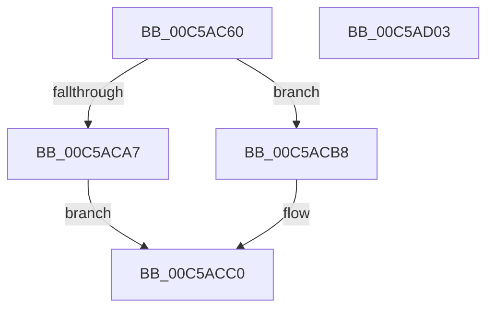

# CmFcInitSystem0

- RVA: `0x00C5AC60`–`0x00C5AD04` (길이 `164` bytes)
- VA: `0x0000000140C5AC60`
- 실행 섹션: `INIT`
- PDB 이름 있음: `예`; PDB Function 태그: `아니요`
- unwind 정보 RVA: `0x000BA0F0`
- 디코드: `41`개 명령, `164/164` bytes 표시
- 미해석 바이트: `0` (있으면 어셈블리에 `.byte`로 보존)

> 이 문서는 커널 이미지의 기계어와 PDB 기호를 분석해 생성했습니다. 4번과 5번은 함수 원형과 자료형을 바이너리 사용 방식에서 추정한 C 해석이며 원본 소스 복구 결과는 아닙니다.

## 1. Dependencies

- 직접 호출 지점: **4**; 고유 호출 대상: **4**
- 직접 호출자로 확인된 함수: **1**
- RIP 상대 이미지 참조: **0**

### Outgoing calls
- `0x00C5AC6D` → [CmFcManagerInitialize](CmFcManagerInitialize_function_00C5D93C.md) (function, `0x00C5D93C`)
- `0x00C5AC96` → [wil_details_PopulateInitialConfiguredFeatureStatesFromBuffers](wil_details_PopulateInitialConfiguredFeatureStatesFromBuffers_function_00C5ADC8.md) (function, `0x00C5ADC8`)
- `0x00C5AC9B` → [wil_details_EvaluateFeatureDependencies](../../page/70/wil_details_EvaluateFeatureDependencies_function_0070282C.md) (function, `0x0070282C`)
- `0x00C5ACF0` → [CmFcManagerStartBootPhase](CmFcManagerStartBootPhase_function_00C5DB98.md) (function, `0x00C5DB98`)

### Direct callers
- [CmInitBootFeatureConfigurations](CmInitBootFeatureConfigurations_function_00C559B4.md) at `0x00C559B8`

### Static image references
- 디코드된 RIP-relative 메모리 참조가 없습니다.

## 2. Other-region calls and transfers

- 다른 실행 섹션으로 향하는 call: **1**
  - `0x00C5AC9B` → [wil_details_EvaluateFeatureDependencies](../../page/70/wil_details_EvaluateFeatureDependencies_function_0070282C.md) (`INIT` → `PAGE`)
- 별도 외부 분기/꼬리 이동을 확인하지 못했습니다.

## 3. Assembly (complete function range)

```asm
00C5AC60  48 89 5C 24 08                  mov qword ptr [rsp + 8], rbx
00C5AC65  57                              push rdi
00C5AC66  48 83 EC 70                     sub rsp, 0x70
00C5AC6A  48 8B D9                        mov rbx, rcx
00C5AC6D  E8 CA 2C 00 00                  call 0x140c5d93c
00C5AC72  48 8B 83 F0 00 00 00            mov rax, qword ptr [rbx + 0xf0]
00C5AC79  48 8D 4C 24 60                  lea rcx, [rsp + 0x60]
00C5AC7E  48 8B B8 78 0F 00 00            mov rdi, qword ptr [rax + 0xf78]
00C5AC85  48 8D 98 10 0E 00 00            lea rbx, [rax + 0xe10]
00C5AC8C  48 89 5C 24 60                  mov qword ptr [rsp + 0x60], rbx
00C5AC91  48 89 7C 24 68                  mov qword ptr [rsp + 0x68], rdi
00C5AC96  E8 2D 01 00 00                  call 0x140c5adc8
00C5AC9B  E8 8C 7B AA FF                  call 0x14070282c
00C5ACA0  33 C0                           xor eax, eax
00C5ACA2  48 85 FF                        test rdi, rdi
00C5ACA5  74 11                           je 0x140c5acb8
00C5ACA7  4C 8B 47 28                     mov r8, qword ptr [rdi + 0x28]
00C5ACAB  48 8B 57 20                     mov rdx, qword ptr [rdi + 0x20]
00C5ACAF  8A 4F 18                        mov cl, byte ptr [rdi + 0x18]
00C5ACB2  48 8B 47 08                     mov rax, qword ptr [rdi + 8]
00C5ACB6  EB 08                           jmp 0x140c5acc0
00C5ACB8  4C 8B C0                        mov r8, rax
00C5ACBB  48 8B D0                        mov rdx, rax
00C5ACBE  8A C8                           mov cl, al
00C5ACC0  4C 8B 4B 10                     mov r9, qword ptr [rbx + 0x10]
00C5ACC4  4C 89 44 24 58                  mov qword ptr [rsp + 0x58], r8
00C5ACC9  4C 8B 43 08                     mov r8, qword ptr [rbx + 8]
00C5ACCD  48 89 54 24 50                  mov qword ptr [rsp + 0x50], rdx
00C5ACD2  48 8B 13                        mov rdx, qword ptr [rbx]
00C5ACD5  88 4C 24 48                     mov byte ptr [rsp + 0x48], cl
00C5ACD9  48 89 44 24 38                  mov qword ptr [rsp + 0x38], rax
00C5ACDE  48 8B 43 20                     mov rax, qword ptr [rbx + 0x20]
00C5ACE2  48 89 44 24 28                  mov qword ptr [rsp + 0x28], rax
00C5ACE7  48 8B 43 18                     mov rax, qword ptr [rbx + 0x18]
00C5ACEB  48 89 44 24 20                  mov qword ptr [rsp + 0x20], rax
00C5ACF0  E8 A3 2E 00 00                  call 0x140c5db98
00C5ACF5  48 8B 9C 24 80 00 00 00         mov rbx, qword ptr [rsp + 0x80]
00C5ACFD  48 83 C4 70                     add rsp, 0x70
00C5AD01  5F                              pop rdi
00C5AD02  C3                              ret
00C5AD03  CC                              int3
```

## 4. C-style interpretation (structured pseudocode)

```c
__int64 __fastcall CmFcInitSystem0(__int64 a1)
{
    __int64 result;
    __int64 v_rsp;
    unsigned __int64 v_stack_m10;
    unsigned __int64 v_stack_m18;
    unsigned __int64 v_stack_m20;
    unsigned __int64 v_stack_m28;
    unsigned __int8 v_stack_m30;
    unsigned __int64 v_stack_m40;
    unsigned __int64 v_stack_m50;
    unsigned __int64 v_stack_m58;
    unsigned __int64 v_stack_p8;

    v_stack_p8 = v_rbx;
    v_rsp = (v_rsp) - (112);
    result = CmFcManagerInitialize(a1, a2, a3, a4);
    v_stack_m18 = *(unsigned __int64 *)(a1 + 240) + 3600;
    v_stack_m10 = *(unsigned __int64 *)(*(unsigned __int64 *)(a1 + 240) + 3960);
    result = wil_details_PopulateInitialConfiguredFeatureStatesFromBuffers(v_stack_m18, a2, a3, a4);
    result = wil_details_EvaluateFeatureDependencies(v_stack_m18, a2, a3, a4);
    result = 0;
    if (*(unsigned __int64 *)(*(unsigned __int64 *)(a1 + 240) + 3960) == 0) goto loc_00C5ACB8;
    goto loc_00C5ACC0;
loc_00C5ACB8:
loc_00C5ACC0:
    v_stack_m20 = *(unsigned __int64 *)(*(unsigned __int64 *)(*(unsigned __int64 *)(a1 + 240) + 3960) + 8);
    v_stack_m28 = *(unsigned __int64 *)(*(unsigned __int64 *)(*(unsigned __int64 *)(a1 + 240) + 3960) + 8);
    v_stack_m30 = (unsigned __int8)((unsigned __int8)(*(unsigned __int64 *)(*(unsigned __int64 *)(*(unsigned __int64 *)(a1 + 240) + 3960) + 8)));
    v_stack_m40 = *(unsigned __int64 *)(*(unsigned __int64 *)(*(unsigned __int64 *)(a1 + 240) + 3960) + 8);
    v_stack_m50 = *(unsigned __int64 *)(*(unsigned __int64 *)(a1 + 240) + 3600 + 32);
    v_stack_m58 = *(unsigned __int64 *)(*(unsigned __int64 *)(a1 + 240) + 3600 + 24);
    result = CmFcManagerStartBootPhase((unsigned __int8)(*(unsigned __int64 *)(*(unsigned __int64 *)(*(unsigned __int64 *)(a1 + 240) + 3960) + 8)), *(unsigned __int64 *)(*(unsigned __int64 *)(a1 + 240) + 3600), *(unsigned __int64 *)(*(unsigned __int64 *)(a1 + 240) + 3600 + 8), *(unsigned __int64 *)(*(unsigned __int64 *)(a1 + 240) + 3600 + 16));
    v_rsp = (v_rsp) + (112);
    return result;
}
```

## 5. (Beta) C Style

```c
int64_t CmFcInitSystem0(void *Arg1)
{
    uint8_t *arg1 = (uint8_t *)Arg1;

    int64_t result;
    int64_t local_rsp;
    uint64_t v_stack_m10;
    uint64_t v_stack_m18;
    uint64_t v_stack_m20;
    uint64_t v_stack_m28;
    uint8_t v_stack_m30;
    uint64_t v_stack_m40;
    uint64_t v_stack_m50;
    uint64_t v_stack_m58;
    uint64_t v_stack_p8;

    v_stack_p8 = local_rbx;
    local_rsp = (local_rsp) - (112);
    result = CmFcManagerInitialize(Arg1, a2, a3, a4);
    v_stack_m18 = *(uint64_t *)(arg1 + 0xF0) + 3600;
    v_stack_m10 = *(uint64_t *)(*(uint64_t *)(arg1 + 0xF0) + 0xF78);
    result = wil_details_PopulateInitialConfiguredFeatureStatesFromBuffers(v_stack_m18, a2, a3, a4);
    result = wil_details_EvaluateFeatureDependencies(v_stack_m18, a2, a3, a4);
    result = 0;
    if (*(uint64_t *)(*(uint64_t *)(arg1 + 0xF0) + 0xF78) == 0) goto loc_00C5ACB8;
    goto loc_00C5ACC0;
loc_00C5ACB8:
loc_00C5ACC0:
    v_stack_m20 = *(uint64_t *)(*(uint64_t *)(*(uint64_t *)(arg1 + 0xF0) + 0xF78) + 0x8);
    v_stack_m28 = *(uint64_t *)(*(uint64_t *)(*(uint64_t *)(arg1 + 0xF0) + 0xF78) + 0x8);
    v_stack_m30 = (uint8_t)((uint8_t)(*(uint64_t *)(*(uint64_t *)(*(uint64_t *)(arg1 + 0xF0) + 0xF78) + 0x8)));
    v_stack_m40 = *(uint64_t *)(*(uint64_t *)(*(uint64_t *)(arg1 + 0xF0) + 0xF78) + 0x8);
    v_stack_m50 = *(uint64_t *)(*(uint64_t *)(arg1 + 0xF0) + 0xE10 + 0x20);
    v_stack_m58 = *(uint64_t *)(*(uint64_t *)(arg1 + 0xF0) + 0xE10 + 0x18);
    result = CmFcManagerStartBootPhase((uint8_t)(*(uint64_t *)(*(uint64_t *)(*(uint64_t *)(arg1 + 0xF0) + 0xF78) + 0x8)), *(uint64_t *)(*(uint64_t *)(arg1 + 0xF0) + 0xE10), *(uint64_t *)(*(uint64_t *)(arg1 + 0xF0) + 0xE10 + 0x8), *(uint64_t *)(*(uint64_t *)(arg1 + 0xF0) + 0xE10 + 0x10));
    local_rsp = (local_rsp) + (112);
    return result;
}
```

### 관측된 메모리 오프셋

구조체 형식이 확인되지 않은 접근은 인자 기준의 오프셋으로만 기록했습니다.

| 기준 인자 | 오프셋 표현 | 폭 (bit) | 접근 |
|---|---:|---:|---|
| `Arg1` | `+ 0xF0` | `64` | `R` |

## 6. Execution-region graph

[열기: 2D/3D 그래프와 함수 탐색 컨트롤 패널](../../../control-panel.html?section=init&rva=0x00C5AC60&view=graph)

- 2D 그래프는 위에서 아래로 흐르고, 3D 그래프는 빈 공간을 드래그해 회전합니다. Shift+드래그는 이동, 휠은 확대·축소, 함수 노드 선택은 대상 보고서 이동입니다.

### Static fallback


