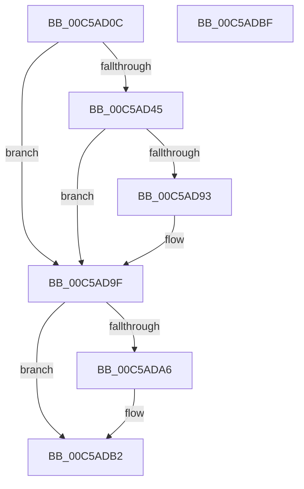

# CmFcInitSystem2

- RVA: `0x00C5AD0C`–`0x00C5ADC0` (길이 `180` bytes)
- VA: `0x0000000140C5AD0C`
- 실행 섹션: `INIT`
- PDB 이름 있음: `예`; PDB Function 태그: `아니요`
- unwind 정보 RVA: `0x000D6BCC`
- 디코드: `49`개 명령, `180/180` bytes 표시
- 미해석 바이트: `0` (있으면 어셈블리에 `.byte`로 보존)

> 이 문서는 커널 이미지의 기계어와 PDB 기호를 분석해 생성했습니다. 4번과 5번은 함수 원형과 자료형을 바이너리 사용 방식에서 추정한 C 해석이며 원본 소스 복구 결과는 아닙니다.

## 1. Dependencies

- 직접 호출 지점: **6**; 고유 호출 대상: **6**
- 직접 호출자로 확인된 함수: **1**
- RIP 상대 이미지 참조: **3**

### Outgoing calls
- `0x00C5AD3A` → [SeConvertStringSecurityDescriptorToSecurityDescriptor](../../text/48/SeConvertStringSecurityDescriptorToSecurityDescriptor_function_00480000.md) (function, `0x00480000`)
- `0x00C5AD4A` → [SeCaptureSubjectContext](../../page/86/SeCaptureSubjectContext_function_0086B820.md) (function, `0x0086B820`)
- `0x00C5AD7E` → [SeAssignSecurity](../../page/94/SeAssignSecurity_function_00949590.md) (function, `0x00949590`)
- `0x00C5AD8A` → [SeReleaseSubjectContext](../../page/86/SeReleaseSubjectContext_function_0086B710.md) (function, `0x0086B710`)
- `0x00C5AD93` → [CmFcManagerStartRuntimePhase](CmFcManagerStartRuntimePhase_function_00C5DC70.md) (function, `0x00C5DC70`)
- `0x00C5ADAD` → [ExFreePoolWithTag](../../poolcode/B8/ExFreePoolWithTag_function_00B82870.md) (function, `0x00B82870`)

### Direct callers
- [CmInitSystem1](CmInitSystem1_function_00C559CC.md) at `0x00C56366`

### Static image references
- `0x00C5AD21` → RVA `0x0003A700` (`.rdata`; read)
- `0x00C5AD54` → RVA `0x00E0EC80` (`.data`; read)
- `0x00C5AD63` → RVA `0x00EF7A48` (`.data`; read)

## 2. Other-region calls and transfers

- 다른 실행 섹션으로 향하는 call: **5**
  - `0x00C5AD3A` → [SeConvertStringSecurityDescriptorToSecurityDescriptor](../../text/48/SeConvertStringSecurityDescriptorToSecurityDescriptor_function_00480000.md) (`INIT` → `.text`)
  - `0x00C5AD4A` → [SeCaptureSubjectContext](../../page/86/SeCaptureSubjectContext_function_0086B820.md) (`INIT` → `PAGE`)
  - `0x00C5AD7E` → [SeAssignSecurity](../../page/94/SeAssignSecurity_function_00949590.md) (`INIT` → `PAGE`)
  - `0x00C5AD8A` → [SeReleaseSubjectContext](../../page/86/SeReleaseSubjectContext_function_0086B710.md) (`INIT` → `PAGE`)
  - `0x00C5ADAD` → [ExFreePoolWithTag](../../poolcode/B8/ExFreePoolWithTag_function_00B82870.md) (`INIT` → `POOLCODE`)
- 별도 외부 분기/꼬리 이동을 확인하지 못했습니다.

## 3. Assembly (complete function range)

```asm
00C5AD0C  48 8B C4                        mov rax, rsp
00C5AD0F  48 89 58 10                     mov qword ptr [rax + 0x10], rbx
00C5AD13  56                              push rsi
00C5AD14  48 83 EC 60                     sub rsp, 0x60
00C5AD18  0F 57 C0                        xorps xmm0, xmm0
00C5AD1B  4C 8D 40 08                     lea r8, [rax + 8]
00C5AD1F  33 F6                           xor esi, esi
00C5AD21  48 8D 0D D8 F9 3D FF            lea rcx, [rip - 0xc20628]
00C5AD28  45 33 C9                        xor r9d, r9d
00C5AD2B  48 89 70 08                     mov qword ptr [rax + 8], rsi
00C5AD2F  0F 11 40 D8                     movups xmmword ptr [rax - 0x28], xmm0
00C5AD33  8D 56 01                        lea edx, [rsi + 1]
00C5AD36  0F 11 40 E8                     movups xmmword ptr [rax - 0x18], xmm0
00C5AD3A  E8 C1 52 82 FF                  call 0x140480000
00C5AD3F  8B D8                           mov ebx, eax
00C5AD41  85 C0                           test eax, eax
00C5AD43  78 5A                           js 0x140c5ad9f
00C5AD45  48 8D 4C 24 40                  lea rcx, [rsp + 0x40]
00C5AD4A  E8 D1 0A C1 FF                  call 0x14086b820
00C5AD4F  48 8B 54 24 70                  mov rdx, qword ptr [rsp + 0x70]
00C5AD54  48 8D 05 25 3F 1B 00            lea rax, [rip + 0x1b3f25]
00C5AD5B  C7 44 24 30 01 00 00 00         mov dword ptr [rsp + 0x30], 1
00C5AD63  4C 8D 05 DE CC 29 00            lea r8, [rip + 0x29ccde]
00C5AD6A  48 89 44 24 28                  mov qword ptr [rsp + 0x28], rax
00C5AD6F  45 33 C9                        xor r9d, r9d
00C5AD72  48 8D 44 24 40                  lea rax, [rsp + 0x40]
00C5AD77  33 C9                           xor ecx, ecx
00C5AD79  48 89 44 24 20                  mov qword ptr [rsp + 0x20], rax
00C5AD7E  E8 0D E8 CE FF                  call 0x140949590
00C5AD83  48 8D 4C 24 40                  lea rcx, [rsp + 0x40]
00C5AD88  8B D8                           mov ebx, eax
00C5AD8A  E8 81 09 C1 FF                  call 0x14086b710
00C5AD8F  85 DB                           test ebx, ebx
00C5AD91  78 0C                           js 0x140c5ad9f
00C5AD93  E8 D8 2E 00 00                  call 0x140c5dc70
00C5AD98  85 C0                           test eax, eax
00C5AD9A  8B D8                           mov ebx, eax
00C5AD9C  0F 49 DE                        cmovns ebx, esi
00C5AD9F  48 39 74 24 70                  cmp qword ptr [rsp + 0x70], rsi
00C5ADA4  74 0C                           je 0x140c5adb2
00C5ADA6  48 8B 4C 24 70                  mov rcx, qword ptr [rsp + 0x70]
00C5ADAB  33 D2                           xor edx, edx
00C5ADAD  E8 BE 7A F2 FF                  call 0x140b82870
00C5ADB2  8B C3                           mov eax, ebx
00C5ADB4  48 8B 5C 24 78                  mov rbx, qword ptr [rsp + 0x78]
00C5ADB9  48 83 C4 60                     add rsp, 0x60
00C5ADBD  5E                              pop rsi
00C5ADBE  C3                              ret
00C5ADBF  CC                              int3
```

## 4. C-style interpretation (structured pseudocode)

```c
__int64 __fastcall CmFcInitSystem2(__int64 a1, __int64 a2, __int64 a3, int a4)
{
    __int64 result;
    __int64 v_rbx;
    __int64 v_rsi;
    __int64 v_rsp;
    unsigned __int64 v_stack_m28;
    unsigned int v_stack_m38;
    unsigned __int64 v_stack_m40;
    unsigned __int64 v_stack_m48;
    unsigned __int64 v_stack_p10;
    unsigned __int64 v_stack_p8;

    *(unsigned __int64 *)(v_rsp + 16) = v_rbx;
    v_rsp = (v_rsp) - (96);
    v_rsi = 0;
    a4 = 0;
    *(unsigned __int64 *)(v_rsp + 8) = 0;
    *(unsigned __int64 *)(v_rsp - 40) = v_xmm0;
    *(unsigned __int64 *)(v_rsp - 24) = v_xmm0;
    result = SeConvertStringSecurityDescriptorToSecurityDescriptor(v_rip - 12715560, v_rsi + 1, v_rsp + 8, a4);
    if (sign_flag) goto loc_00C5AD9F;
    result = SeCaptureSubjectContext(v_stack_m28, v_rsi + 1, v_rsp + 8, a4);
    v_stack_m38 = 1;
    v_stack_m40 = v_rip + 1785637;
    a4 = 0;
    a1 = 0;
    v_stack_m48 = v_stack_m28;
    result = SeAssignSecurity(a1, v_stack_p8, v_rip + 2739422, a4);
    result = SeReleaseSubjectContext(v_stack_m28, v_stack_p8, v_rip + 2739422, a4);
    v_rbx = (unsigned int)((unsigned int)(result));
    if (!(sign_flag)) {
        result = CmFcManagerStartRuntimePhase(v_stack_m28, v_stack_p8, v_rip + 2739422, a4);
        v_rbx = (unsigned int)(result);
        if (!sign_flag) { v_rbx = 0; }
    }
    if (v_stack_p8 != 0) {
        a1 = v_stack_p8;
        a2 = 0;
        result = ExFreePoolWithTag(a1, a2, v_rip + 2739422, a4);
    }
    v_rsp = (v_rsp) + (96);
    return (unsigned int)((unsigned int)(v_rbx));
}
```

## 5. (Beta) C Style

```c
int64_t CmFcInitSystem2(int64_t Arg1, int64_t Arg2, int64_t Arg3, int32_t Arg4)
{
    int64_t result;
    int64_t local_rbx;
    int64_t local_rsi;
    int64_t local_rsp;
    uint64_t v_stack_m28;
    uint32_t v_stack_m38;
    uint64_t v_stack_m40;
    uint64_t v_stack_m48;
    uint64_t v_stack_p10;
    uint64_t v_stack_p8;

    *(uint64_t *)(local_rsp + 0x10) = local_rbx;
    local_rsp = (local_rsp) - (96);
    local_rsi = 0;
    Arg4 = 0;
    *(uint64_t *)(local_rsp + 0x8) = 0;
    *(uint64_t *)(local_rsp - 0x28) = v_xmm0;
    *(uint64_t *)(local_rsp - 0x18) = v_xmm0;
    result = SeConvertStringSecurityDescriptorToSecurityDescriptor(v_rip - 12715560, local_rsi + 1, local_rsp + 8, Arg4);
    if (sign_flag) goto loc_00C5AD9F;
    result = SeCaptureSubjectContext(v_stack_m28, local_rsi + 1, local_rsp + 8, Arg4);
    v_stack_m38 = 1;
    v_stack_m40 = v_rip + 1785637;
    Arg4 = 0;
    Arg1 = 0;
    v_stack_m48 = v_stack_m28;
    result = SeAssignSecurity(Arg1, v_stack_p8, v_rip + 2739422, Arg4);
    result = SeReleaseSubjectContext(v_stack_m28, v_stack_p8, v_rip + 2739422, Arg4);
    local_rbx = (uint32_t)((uint32_t)(result));
    if (!(sign_flag)) {
        result = CmFcManagerStartRuntimePhase(v_stack_m28, v_stack_p8, v_rip + 2739422, Arg4);
        local_rbx = (uint32_t)(result);
        if (!sign_flag) { local_rbx = 0; }
    }
    if (v_stack_p8 != 0) {
        Arg1 = v_stack_p8;
        Arg2 = 0;
        result = ExFreePoolWithTag(Arg1, Arg2, v_rip + 2739422, Arg4);
    }
    local_rsp = (local_rsp) + (96);
    return (uint32_t)((uint32_t)(local_rbx));
}
```

## 6. Execution-region graph

[열기: 2D/3D 그래프와 함수 탐색 컨트롤 패널](../../../control-panel.html?section=init&rva=0x00C5AD0C&view=graph)

- 2D 그래프는 위에서 아래로 흐르고, 3D 그래프는 빈 공간을 드래그해 회전합니다. Shift+드래그는 이동, 휠은 확대·축소, 함수 노드 선택은 대상 보고서 이동입니다.

### Static fallback


