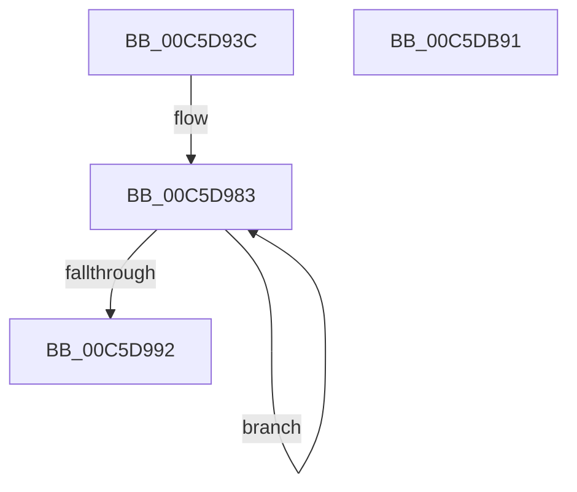

# CmFcManagerInitialize

- RVA: `0x00C5D93C`–`0x00C5DB92` (길이 `598` bytes)
- VA: `0x0000000140C5D93C`
- 실행 섹션: `INIT`
- PDB 이름 있음: `예`; PDB Function 태그: `아니요`
- unwind 정보 RVA: `0x000C8D8C`
- 디코드: `103`개 명령, `598/598` bytes 표시
- 미해석 바이트: `0` (있으면 어셈블리에 `.byte`로 보존)

> 이 문서는 커널 이미지의 기계어와 PDB 기호를 분석해 생성했습니다. 4번과 5번은 함수 원형과 자료형을 바이너리 사용 방식에서 추정한 C 해석이며 원본 소스 복구 결과는 아닙니다.

## 1. Dependencies

- 직접 호출 지점: **19**; 고유 호출 대상: **5**
- 직접 호출자로 확인된 함수: **1**
- RIP 상대 이미지 참조: **58**

### Outgoing calls
- `0x00C5D958` → [memset](../../text/6C/memset_function_006C6C40.md) (function, `0x006C6C40`)
- `0x00C5D964` → [CmSiRWLockInitialize](../../page/AD/CmSiRWLockInitialize_function_00AD69E0.md) (function, `0x00AD69E0`)
- `0x00C5D970` → [CmSiRWLockInitialize](../../page/AD/CmSiRWLockInitialize_function_00AD69E0.md) (function, `0x00AD69E0`)
- `0x00C5D983` → [CmFcpInitializeSectionState](../../page/AD/CmFcpInitializeSectionState_function_00AD93FC.md) (function, `0x00AD93FC`)
- `0x00C5D99F` → [memset](../../text/6C/memset_function_006C6C40.md) (function, `0x006C6C40`)
- `0x00C5D9AB` → [RtlInitializeSwapReference](../../page/79/RtlInitializeSwapReference_function_0079AEEC.md) (function, `0x0079AEEC`)
- `0x00C5D9BD` → [memset](../../text/6C/memset_function_006C6C40.md) (function, `0x006C6C40`)
- `0x00C5D9CF` → [memset](../../text/6C/memset_function_006C6C40.md) (function, `0x006C6C40`)
- `0x00C5D9DB` → [RtlInitializeSwapReference](../../page/79/RtlInitializeSwapReference_function_0079AEEC.md) (function, `0x0079AEEC`)
- `0x00C5D9E7` → [CmSiRWLockInitialize](../../page/AD/CmSiRWLockInitialize_function_00AD69E0.md) (function, `0x00AD69E0`)
- `0x00C5DA2F` → [CmpWorkItemInitialize](../../page/7E/CmpWorkItemInitialize_function_007E5AE0.md) (function, `0x007E5AE0`)
- `0x00C5DA42` → [CmpWorkItemInitialize](../../page/7E/CmpWorkItemInitialize_function_007E5AE0.md) (function, `0x007E5AE0`)
- `0x00C5DA4E` → [CmSiRWLockInitialize](../../page/AD/CmSiRWLockInitialize_function_00AD69E0.md) (function, `0x00AD69E0`)
- `0x00C5DA84` → [CmSiRWLockInitialize](../../page/AD/CmSiRWLockInitialize_function_00AD69E0.md) (function, `0x00AD69E0`)
- `0x00C5DAEA` → [RtlInitializeSwapReference](../../page/79/RtlInitializeSwapReference_function_0079AEEC.md) (function, `0x0079AEEC`)
- `0x00C5DB01` → [CmSiRWLockInitialize](../../page/AD/CmSiRWLockInitialize_function_00AD69E0.md) (function, `0x00AD69E0`)
- `0x00C5DB14` → [CmpWorkItemInitialize](../../page/7E/CmpWorkItemInitialize_function_007E5AE0.md) (function, `0x007E5AE0`)
- `0x00C5DB27` → [CmpWorkItemInitialize](../../page/7E/CmpWorkItemInitialize_function_007E5AE0.md) (function, `0x007E5AE0`)
- `0x00C5DB3A` → [CmpWorkItemInitialize](../../page/7E/CmpWorkItemInitialize_function_007E5AE0.md) (function, `0x007E5AE0`)

### Direct callers
- [CmFcInitSystem0](CmFcInitSystem0_function_00C5AC60.md) at `0x00C5AC6D`

### Static image references
- `0x00C5D946` → RVA `0x00EF72E0` (`.data`; read)
- `0x00C5D95D` → RVA `0x00EF72E8` (`.data`; read)
- `0x00C5D969` → RVA `0x00EF72F0` (`.data`; read)
- `0x00C5D97A` → RVA `0x00EF7308` (`.data`; read)
- `0x00C5D998` → RVA `0x00EF7368` (`.data`; read)
- `0x00C5D9B2` → RVA `0x00EF7380` (`.data`; read)
- `0x00C5D9C4` → RVA `0x00EF73E0` (`.data`; read)
- `0x00C5D9D4` → RVA `0x00EF7458` (`.data`; read)
- `0x00C5D9E0` → RVA `0x00EF7470` (`.data`; read)
- `0x00C5D9EF` → RVA `0x00EF7490` (`.data`; write)
- `0x00C5D9F9` → RVA `0x004B97A0` (`CmFcpManagerDrainUsageNotificationsDpc`; read)
- `0x00C5DA00` → RVA `0x00EF74C8` (`.data`; write)
- `0x00C5DA0A` → RVA `0x00EF74A8` (`.data`; write)
- `0x00C5DA11` → RVA `0x00A45110` (`CmFcpManagerDrainUsageNotificationsWorker`; read)
- `0x00C5DA18` → RVA `0x00EF74A0` (`.data`; write)
- `0x00C5DA21` → RVA `0x00EF74B0` (`.data`; write)
- `0x00C5DA28` → RVA `0x00EF74D0` (`.data`; read)
- `0x00C5DA34` → RVA `0x007F56D0` (`CmFcpManagerRetryUsageNotificationsWorker`; read)
- `0x00C5DA3B` → RVA `0x00EF7518` (`.data`; read)
- `0x00C5DA47` → RVA `0x00EF7558` (`.data`; read)
- `0x00C5DA53` → RVA `0x00EF7560` (`.data`; read)
- `0x00C5DA5A` → RVA `0x00EF7568` (`.data`; write)
- `0x00C5DA61` → RVA `0x00EF76A8` (`.data`; read)
- `0x00C5DA68` → RVA `0x00EF7560` (`.data`; write)
- `0x00C5DA6F` → RVA `0x00EF7880` (`.data`; read)
- `0x00C5DA76` → RVA `0x00EF7888` (`.data`; write)
- `0x00C5DA7D` → RVA `0x00EF7880` (`.data`; write)
- `0x00C5DA89` → RVA `0x0066B240` (`CmFcpManagerArmFeatureUsageProviderFlushTimerDpc`; read)
- `0x00C5DA90` → RVA `0x00EF78C0` (`.data`; write)
- `0x00C5DA9A` → RVA `0x00EF78D8` (`.data`; write)
- `0x00C5DAA1` → RVA `0x00EF7690` (`.data`; read)
- `0x00C5DAA8` → RVA `0x0066B350` (`CmFcpManagerPublishFeatureUsageDataIfNearCapacityDpc`; read)
- `0x00C5DAAF` → RVA `0x00EF78E0` (`.data`; write)
- `0x00C5DAB6` → RVA `0x00EF7918` (`.data`; write)
- `0x00C5DABD` → RVA `0x00EF78F8` (`.data`; write)
- `0x00C5DAC4` → RVA `0x00EF78D0` (`.data`; write)
- `0x00C5DACB` → RVA `0x00EF7900` (`.data`; write)
- `0x00C5DAD5` → RVA `0x00EF7920` (`.data`; write)
- `0x00C5DADC` → RVA `0x00EF7938` (`.data`; write)
- `0x00C5DAE3` → RVA `0x00EF7910` (`.data`; write)
- `0x00C5DAF2` → RVA `0x00EF78B8` (`.data`; read)
- `0x00C5DAF9` → RVA `0x00EF78A0` (`.data`; write)
- `0x00C5DB06` → RVA `0x007F5510` (`CmFcpManagerFlushFeatureUsageDataWorker`; read)
- `0x00C5DB0D` → RVA `0x00EF7950` (`.data`; read)
- `0x00C5DB19` → RVA `0x007F5530` (`CmFcpManagerPublishFeatureUsageDataBuffersWorker`; read)
- `0x00C5DB20` → RVA `0x00EF7990` (`.data`; read)
- `0x00C5DB2C` → RVA `0x007F56B0` (`CmFcpManagerPublishFeatureUsageDataIfNearCapacityWorker`; read)
- `0x00C5DB33` → RVA `0x00EF79D0` (`.data`; read)
- `0x00C5DB44` → RVA `0x00EF7A28` (`.data`; read)
- `0x00C5DB4B` → RVA `0x00EF7890` (`.data`; read)
- `0x00C5DB52` → RVA `0x00EF7A30` (`.data`; write)
- `0x00C5DB59` → RVA `0x00EF7A28` (`.data`; write)
- `0x00C5DB60` → RVA `0x00EF7898` (`.data`; write)
- `0x00C5DB67` → RVA `0x00EF7890` (`.data`; write)
- `0x00C5DB6E` → RVA `0x00EF78B0` (`.data`; write)
- `0x00C5DB75` → RVA `0x00EF7A20` (`.data`; write)
- `0x00C5DB7D` → RVA `0x00EF7A22` (`.data`; write)
- `0x00C5DB84` → RVA `0x00EF7A24` (`.data`; write)

## 2. Other-region calls and transfers

- 다른 실행 섹션으로 향하는 call: **19**
  - `0x00C5D958` → [memset](../../text/6C/memset_function_006C6C40.md) (`INIT` → `.text`)
  - `0x00C5D964` → [CmSiRWLockInitialize](../../page/AD/CmSiRWLockInitialize_function_00AD69E0.md) (`INIT` → `PAGE`)
  - `0x00C5D970` → [CmSiRWLockInitialize](../../page/AD/CmSiRWLockInitialize_function_00AD69E0.md) (`INIT` → `PAGE`)
  - `0x00C5D983` → [CmFcpInitializeSectionState](../../page/AD/CmFcpInitializeSectionState_function_00AD93FC.md) (`INIT` → `PAGE`)
  - `0x00C5D99F` → [memset](../../text/6C/memset_function_006C6C40.md) (`INIT` → `.text`)
  - `0x00C5D9AB` → [RtlInitializeSwapReference](../../page/79/RtlInitializeSwapReference_function_0079AEEC.md) (`INIT` → `PAGE`)
  - `0x00C5D9BD` → [memset](../../text/6C/memset_function_006C6C40.md) (`INIT` → `.text`)
  - `0x00C5D9CF` → [memset](../../text/6C/memset_function_006C6C40.md) (`INIT` → `.text`)
  - `0x00C5D9DB` → [RtlInitializeSwapReference](../../page/79/RtlInitializeSwapReference_function_0079AEEC.md) (`INIT` → `PAGE`)
  - `0x00C5D9E7` → [CmSiRWLockInitialize](../../page/AD/CmSiRWLockInitialize_function_00AD69E0.md) (`INIT` → `PAGE`)
  - `0x00C5DA2F` → [CmpWorkItemInitialize](../../page/7E/CmpWorkItemInitialize_function_007E5AE0.md) (`INIT` → `PAGE`)
  - `0x00C5DA42` → [CmpWorkItemInitialize](../../page/7E/CmpWorkItemInitialize_function_007E5AE0.md) (`INIT` → `PAGE`)
  - `0x00C5DA4E` → [CmSiRWLockInitialize](../../page/AD/CmSiRWLockInitialize_function_00AD69E0.md) (`INIT` → `PAGE`)
  - `0x00C5DA84` → [CmSiRWLockInitialize](../../page/AD/CmSiRWLockInitialize_function_00AD69E0.md) (`INIT` → `PAGE`)
  - `0x00C5DAEA` → [RtlInitializeSwapReference](../../page/79/RtlInitializeSwapReference_function_0079AEEC.md) (`INIT` → `PAGE`)
  - `0x00C5DB01` → [CmSiRWLockInitialize](../../page/AD/CmSiRWLockInitialize_function_00AD69E0.md) (`INIT` → `PAGE`)
  - `0x00C5DB14` → [CmpWorkItemInitialize](../../page/7E/CmpWorkItemInitialize_function_007E5AE0.md) (`INIT` → `PAGE`)
  - `0x00C5DB27` → [CmpWorkItemInitialize](../../page/7E/CmpWorkItemInitialize_function_007E5AE0.md) (`INIT` → `PAGE`)
  - `0x00C5DB3A` → [CmpWorkItemInitialize](../../page/7E/CmpWorkItemInitialize_function_007E5AE0.md) (`INIT` → `PAGE`)
- 별도 외부 분기/꼬리 이동을 확인하지 못했습니다.

## 3. Assembly (complete function range)

```asm
00C5D93C  48 89 74 24 08                  mov qword ptr [rsp + 8], rsi
00C5D941  57                              push rdi
00C5D942  48 83 EC 20                     sub rsp, 0x20
00C5D946  48 8D 3D 93 99 29 00            lea rdi, [rip + 0x299993]
00C5D94D  33 D2                           xor edx, edx
00C5D94F  48 8B CF                        mov rcx, rdi
00C5D952  41 B8 68 07 00 00               mov r8d, 0x768
00C5D958  E8 E3 92 A6 FF                  call 0x1406c6c40
00C5D95D  48 8D 0D 84 99 29 00            lea rcx, [rip + 0x299984]
00C5D964  E8 77 90 E7 FF                  call 0x140ad69e0
00C5D969  48 8D 0D 80 99 29 00            lea rcx, [rip + 0x299980]
00C5D970  E8 6B 90 E7 FF                  call 0x140ad69e0
00C5D975  BE 04 00 00 00                  mov esi, 4
00C5D97A  48 8D 0D 87 99 29 00            lea rcx, [rip + 0x299987]
00C5D981  8B D6                           mov edx, esi
00C5D983  E8 74 BA E7 FF                  call 0x140ad93fc
00C5D988  48 83 C1 18                     add rcx, 0x18
00C5D98C  48 83 EA 01                     sub rdx, 1
00C5D990  75 F1                           jne 0x140c5d983
00C5D992  41 B8 E8 00 00 00               mov r8d, 0xe8
00C5D998  48 8D 0D C9 99 29 00            lea rcx, [rip + 0x2999c9]
00C5D99F  E8 9C 92 A6 FF                  call 0x1406c6c40
00C5D9A4  48 8D 0D BD 99 29 00            lea rcx, [rip + 0x2999bd]
00C5D9AB  E8 3C D5 B3 FF                  call 0x14079aeec
00C5D9B0  33 D2                           xor edx, edx
00C5D9B2  48 8D 0D C7 99 29 00            lea rcx, [rip + 0x2999c7]
00C5D9B9  44 8D 42 60                     lea r8d, [rdx + 0x60]
00C5D9BD  E8 7E 92 A6 FF                  call 0x1406c6c40
00C5D9C2  33 D2                           xor edx, edx
00C5D9C4  48 8D 0D 15 9A 29 00            lea rcx, [rip + 0x299a15]
00C5D9CB  44 8D 42 60                     lea r8d, [rdx + 0x60]
00C5D9CF  E8 6C 92 A6 FF                  call 0x1406c6c40
00C5D9D4  48 8D 0D 7D 9A 29 00            lea rcx, [rip + 0x299a7d]
00C5D9DB  E8 0C D5 B3 FF                  call 0x14079aeec
00C5D9E0  48 8D 0D 89 9A 29 00            lea rcx, [rip + 0x299a89]
00C5D9E7  E8 F4 8F E7 FF                  call 0x140ad69e0
00C5D9EC  45 33 DB                        xor r11d, r11d
00C5D9EF  C7 05 97 9A 29 00 13 01 00 00   mov dword ptr [rip + 0x299a97], 0x113
00C5D9F9  48 8D 05 A0 BD 85 FF            lea rax, [rip - 0x7a4260]
00C5DA00  4C 89 1D C1 9A 29 00            mov qword ptr [rip + 0x299ac1], r11
00C5DA07  4C 8B CF                        mov r9, rdi
00C5DA0A  48 89 05 97 9A 29 00            mov qword ptr [rip + 0x299a97], rax
00C5DA11  4C 8D 05 F8 76 DE FF            lea r8, [rip - 0x218908]
00C5DA18  4C 89 1D 81 9A 29 00            mov qword ptr [rip + 0x299a81], r11
00C5DA1F  8B D6                           mov edx, esi
00C5DA21  48 89 3D 88 9A 29 00            mov qword ptr [rip + 0x299a88], rdi
00C5DA28  48 8D 0D A1 9A 29 00            lea rcx, [rip + 0x299aa1]
00C5DA2F  E8 AC 80 B8 FF                  call 0x1407e5ae0
00C5DA34  4C 8D 05 95 7C B9 FF            lea r8, [rip - 0x46836b]
00C5DA3B  48 8D 0D D6 9A 29 00            lea rcx, [rip + 0x299ad6]
00C5DA42  E8 99 80 B8 FF                  call 0x1407e5ae0
00C5DA47  48 8D 0D 0A 9B 29 00            lea rcx, [rip + 0x299b0a]
00C5DA4E  E8 8D 8F E7 FF                  call 0x140ad69e0
00C5DA53  48 8D 05 06 9B 29 00            lea rax, [rip + 0x299b06]
00C5DA5A  48 89 05 07 9B 29 00            mov qword ptr [rip + 0x299b07], rax
00C5DA61  48 8D 0D 40 9C 29 00            lea rcx, [rip + 0x299c40]
00C5DA68  48 89 05 F1 9A 29 00            mov qword ptr [rip + 0x299af1], rax
00C5DA6F  48 8D 05 0A 9E 29 00            lea rax, [rip + 0x299e0a]
00C5DA76  48 89 05 0B 9E 29 00            mov qword ptr [rip + 0x299e0b], rax
00C5DA7D  48 89 05 FC 9D 29 00            mov qword ptr [rip + 0x299dfc], rax
00C5DA84  E8 57 8F E7 FF                  call 0x140ad69e0
00C5DA89  48 8D 05 B0 D7 A0 FF            lea rax, [rip - 0x5f2850]
00C5DA90  C7 05 26 9E 29 00 13 01 00 00   mov dword ptr [rip + 0x299e26], 0x113
00C5DA9A  48 89 05 37 9E 29 00            mov qword ptr [rip + 0x299e37], rax
00C5DAA1  48 8D 0D E8 9B 29 00            lea rcx, [rip + 0x299be8]
00C5DAA8  48 8D 05 A1 D8 A0 FF            lea rax, [rip - 0x5f275f]
00C5DAAF  48 89 3D 2A 9E 29 00            mov qword ptr [rip + 0x299e2a], rdi
00C5DAB6  48 89 05 5B 9E 29 00            mov qword ptr [rip + 0x299e5b], rax
00C5DABD  4C 89 1D 34 9E 29 00            mov qword ptr [rip + 0x299e34], r11
00C5DAC4  4C 89 1D 05 9E 29 00            mov qword ptr [rip + 0x299e05], r11
00C5DACB  C7 05 2B 9E 29 00 13 01 00 00   mov dword ptr [rip + 0x299e2b], 0x113
00C5DAD5  48 89 3D 44 9E 29 00            mov qword ptr [rip + 0x299e44], rdi
00C5DADC  4C 89 1D 55 9E 29 00            mov qword ptr [rip + 0x299e55], r11
00C5DAE3  4C 89 1D 26 9E 29 00            mov qword ptr [rip + 0x299e26], r11
00C5DAEA  E8 FD D3 B3 FF                  call 0x14079aeec
00C5DAEF  0F 57 C0                        xorps xmm0, xmm0
00C5DAF2  48 8D 0D BF 9D 29 00            lea rcx, [rip + 0x299dbf]
00C5DAF9  F3 0F 7F 05 9F 9D 29 00         movdqu xmmword ptr [rip + 0x299d9f], xmm0
00C5DB01  E8 DA 8E E7 FF                  call 0x140ad69e0
00C5DB06  4C 8D 05 03 7A B9 FF            lea r8, [rip - 0x4685fd]
00C5DB0D  48 8D 0D 3C 9E 29 00            lea rcx, [rip + 0x299e3c]
00C5DB14  E8 C7 7F B8 FF                  call 0x1407e5ae0
00C5DB19  4C 8D 05 10 7A B9 FF            lea r8, [rip - 0x4685f0]
00C5DB20  48 8D 0D 69 9E 29 00            lea rcx, [rip + 0x299e69]
00C5DB27  E8 B4 7F B8 FF                  call 0x1407e5ae0
00C5DB2C  4C 8D 05 7D 7B B9 FF            lea r8, [rip - 0x468483]
00C5DB33  48 8D 0D 96 9E 29 00            lea rcx, [rip + 0x299e96]
00C5DB3A  E8 A1 7F B8 FF                  call 0x1407e5ae0
00C5DB3F  48 8B 74 24 30                  mov rsi, qword ptr [rsp + 0x30]
00C5DB44  48 8D 05 DD 9E 29 00            lea rax, [rip + 0x299edd]
00C5DB4B  48 8D 0D 3E 9D 29 00            lea rcx, [rip + 0x299d3e]
00C5DB52  48 89 05 D7 9E 29 00            mov qword ptr [rip + 0x299ed7], rax
00C5DB59  48 89 05 C8 9E 29 00            mov qword ptr [rip + 0x299ec8], rax
00C5DB60  48 89 0D 31 9D 29 00            mov qword ptr [rip + 0x299d31], rcx
00C5DB67  48 89 0D 22 9D 29 00            mov qword ptr [rip + 0x299d22], rcx
00C5DB6E  4C 89 1D 3B 9D 29 00            mov qword ptr [rip + 0x299d3b], r11
00C5DB75  66 44 89 1D A3 9E 29 00         mov word ptr [rip + 0x299ea3], r11w
00C5DB7D  C6 05 9E 9E 29 00 06            mov byte ptr [rip + 0x299e9e], 6
00C5DB84  44 89 1D 99 9E 29 00            mov dword ptr [rip + 0x299e99], r11d
00C5DB8B  48 83 C4 20                     add rsp, 0x20
00C5DB8F  5F                              pop rdi
00C5DB90  C3                              ret
00C5DB91  CC                              int3
```

## 4. C-style interpretation (structured pseudocode)

```c
__int64 __fastcall CmFcManagerInitialize(__int64 a1, int a2)
{
    __int64 result;
    __int64 v_r11;
    __int64 v_rsp;
    unsigned __int64 v_stack_p8;

    v_stack_p8 = v_rsi;
    v_rsp = (v_rsp) - (32);
    a2 = 0;
    result = memset(v_rip + 2726291, a2, (unsigned int)(0x768ULL), a4);
    result = CmSiRWLockInitialize(v_rip + 2726276, a2, (unsigned int)(0x768ULL), a4);
    result = CmSiRWLockInitialize(v_rip + 2726272, a2, (unsigned int)(0x768ULL), a4);
loc_00C5D983:
    result = CmFcpInitializeSectionState(v_rip + 2726279, 4, (unsigned int)(0x768ULL), a4);
    a1 = (v_rip + 2726279) + (24);
    a2 = (4) - (1);
    if (condition_is_not_equal) goto loc_00C5D983;
    result = memset(v_rip + 2726345, a2, 232, a4);
    result = RtlInitializeSwapReference(v_rip + 2726333, a2, 232, a4);
    a2 = 0;
    result = memset(v_rip + 2726343, a2, a2 + 96, a4);
    a2 = 0;
    result = memset(v_rip + 2726421, a2, a2 + 96, a4);
    result = RtlInitializeSwapReference(v_rip + 2726525, a2, a2 + 96, a4);
    result = CmSiRWLockInitialize(v_rip + 2726537, a2, a2 + 96, a4);
    v_r11 = 0;
    *(unsigned int *)(v_rip + 2726551) = 275;
    *(unsigned __int64 *)(v_rip + 2726593) = 0;
    *(unsigned __int64 *)(v_rip + 2726551) = v_rip - 8012384;
    *(unsigned __int64 *)(v_rip + 2726529) = 0;
    *(unsigned __int64 *)(v_rip + 2726536) = v_rip + 2726291;
    result = CmpWorkItemInitialize(v_rip + 2726561, 4, v_rip - 2197768, v_rip + 2726291);
    result = CmpWorkItemInitialize(v_rip + 2726614, 4, v_rip - 4621163, v_rip + 2726291);
    result = CmSiRWLockInitialize(v_rip + 2726666, 4, v_rip - 4621163, v_rip + 2726291);
    *(unsigned __int64 *)(v_rip + 2726663) = v_rip + 2726662;
    *(unsigned __int64 *)(v_rip + 2726641) = v_rip + 2726662;
    *(unsigned __int64 *)(v_rip + 2727435) = v_rip + 2727434;
    *(unsigned __int64 *)(v_rip + 2727420) = v_rip + 2727434;
    result = CmSiRWLockInitialize(v_rip + 2726976, 4, v_rip - 4621163, v_rip + 2726291);
    *(unsigned int *)(v_rip + 2727462) = 275;
    *(unsigned __int64 *)(v_rip + 2727479) = v_rip - 6236240;
    *(unsigned __int64 *)(v_rip + 2727466) = v_rip + 2726291;
    *(unsigned __int64 *)(v_rip + 2727515) = v_rip - 6235999;
    *(unsigned __int64 *)(v_rip + 2727476) = 0;
    *(unsigned __int64 *)(v_rip + 2727429) = 0;
    *(unsigned int *)(v_rip + 2727467) = 275;
    *(unsigned __int64 *)(v_rip + 2727492) = v_rip + 2726291;
    *(unsigned __int64 *)(v_rip + 2727509) = 0;
    *(unsigned __int64 *)(v_rip + 2727462) = 0;
    result = RtlInitializeSwapReference(v_rip + 2726888, 4, v_rip - 4621163, v_rip + 2726291);
    *(unsigned __int64 *)(v_rip + 2727327) = v_xmm0;
    result = CmSiRWLockInitialize(v_rip + 2727359, 4, v_rip - 4621163, v_rip + 2726291);
    result = CmpWorkItemInitialize(v_rip + 2727484, 4, v_rip - 4621821, v_rip + 2726291);
    result = CmpWorkItemInitialize(v_rip + 2727529, 4, v_rip - 4621808, v_rip + 2726291);
    result = CmpWorkItemInitialize(v_rip + 2727574, 4, v_rip - 4621443, v_rip + 2726291);
    *(unsigned __int64 *)(v_rip + 2727639) = v_rip + 2727645;
    *(unsigned __int64 *)(v_rip + 2727624) = v_rip + 2727645;
    *(unsigned __int64 *)(v_rip + 2727217) = v_rip + 2727230;
    *(unsigned __int64 *)(v_rip + 2727202) = v_rip + 2727230;
    *(unsigned __int64 *)(v_rip + 2727227) = 0;
    *(unsigned __int16 *)(v_rip + 2727587) = 0;
    *(unsigned __int8 *)(v_rip + 2727582) = 6;
    *(unsigned int *)(v_rip + 2727577) = 0;
    v_rsp = (v_rsp) + (32);
    return v_rip + 2727645;
}
```

## 5. (Beta) C Style

```c
int64_t CmFcManagerInitialize(int64_t Arg1, int32_t Arg2)
{
    int64_t result;
    int64_t local_r11;
    int64_t local_rsp;
    uint64_t v_stack_p8;

    v_stack_p8 = local_rsi;
    local_rsp = (local_rsp) - (32);
    Arg2 = 0;
    result = memset(v_rip + 2726291, Arg2, (uint32_t)(0x768ULL), a4);
    result = CmSiRWLockInitialize(v_rip + 2726276, Arg2, (uint32_t)(0x768ULL), a4);
    result = CmSiRWLockInitialize(v_rip + 2726272, Arg2, (uint32_t)(0x768ULL), a4);
loc_00C5D983:
    result = CmFcpInitializeSectionState(v_rip + 2726279, 4, (uint32_t)(0x768ULL), a4);
    Arg1 = (v_rip + 2726279) + (24);
    Arg2 = (4) - (1);
    if (condition_is_not_equal) goto loc_00C5D983;
    result = memset(v_rip + 2726345, Arg2, 232, a4);
    result = RtlInitializeSwapReference(v_rip + 2726333, Arg2, 232, a4);
    Arg2 = 0;
    result = memset(v_rip + 2726343, Arg2, Arg2 + 96, a4);
    Arg2 = 0;
    result = memset(v_rip + 2726421, Arg2, Arg2 + 96, a4);
    result = RtlInitializeSwapReference(v_rip + 2726525, Arg2, Arg2 + 96, a4);
    result = CmSiRWLockInitialize(v_rip + 2726537, Arg2, Arg2 + 96, a4);
    local_r11 = 0;
    *(uint32_t *)(v_rip + 0x299A97) = 275;
    *(uint64_t *)(v_rip + 0x299AC1) = 0;
    *(uint64_t *)(v_rip + 0x299A97) = v_rip - 8012384;
    *(uint64_t *)(v_rip + 0x299A81) = 0;
    *(uint64_t *)(v_rip + 0x299A88) = v_rip + 2726291;
    result = CmpWorkItemInitialize(v_rip + 2726561, 4, v_rip - 2197768, v_rip + 2726291);
    result = CmpWorkItemInitialize(v_rip + 2726614, 4, v_rip - 4621163, v_rip + 2726291);
    result = CmSiRWLockInitialize(v_rip + 2726666, 4, v_rip - 4621163, v_rip + 2726291);
    *(uint64_t *)(v_rip + 0x299B07) = v_rip + 2726662;
    *(uint64_t *)(v_rip + 0x299AF1) = v_rip + 2726662;
    *(uint64_t *)(v_rip + 0x299E0B) = v_rip + 2727434;
    *(uint64_t *)(v_rip + 0x299DFC) = v_rip + 2727434;
    result = CmSiRWLockInitialize(v_rip + 2726976, 4, v_rip - 4621163, v_rip + 2726291);
    *(uint32_t *)(v_rip + 0x299E26) = 275;
    *(uint64_t *)(v_rip + 0x299E37) = v_rip - 6236240;
    *(uint64_t *)(v_rip + 0x299E2A) = v_rip + 2726291;
    *(uint64_t *)(v_rip + 0x299E5B) = v_rip - 6235999;
    *(uint64_t *)(v_rip + 0x299E34) = 0;
    *(uint64_t *)(v_rip + 0x299E05) = 0;
    *(uint32_t *)(v_rip + 0x299E2B) = 275;
    *(uint64_t *)(v_rip + 0x299E44) = v_rip + 2726291;
    *(uint64_t *)(v_rip + 0x299E55) = 0;
    *(uint64_t *)(v_rip + 0x299E26) = 0;
    result = RtlInitializeSwapReference(v_rip + 2726888, 4, v_rip - 4621163, v_rip + 2726291);
    *(uint64_t *)(v_rip + 0x299D9F) = v_xmm0;
    result = CmSiRWLockInitialize(v_rip + 2727359, 4, v_rip - 4621163, v_rip + 2726291);
    result = CmpWorkItemInitialize(v_rip + 2727484, 4, v_rip - 4621821, v_rip + 2726291);
    result = CmpWorkItemInitialize(v_rip + 2727529, 4, v_rip - 4621808, v_rip + 2726291);
    result = CmpWorkItemInitialize(v_rip + 2727574, 4, v_rip - 4621443, v_rip + 2726291);
    *(uint64_t *)(v_rip + 0x299ED7) = v_rip + 2727645;
    *(uint64_t *)(v_rip + 0x299EC8) = v_rip + 2727645;
    *(uint64_t *)(v_rip + 0x299D31) = v_rip + 2727230;
    *(uint64_t *)(v_rip + 0x299D22) = v_rip + 2727230;
    *(uint64_t *)(v_rip + 0x299D3B) = 0;
    *(uint16_t *)(v_rip + 0x299EA3) = 0;
    *(uint8_t *)(v_rip + 0x299E9E) = 6;
    *(uint32_t *)(v_rip + 0x299E99) = 0;
    local_rsp = (local_rsp) + (32);
    return v_rip + 2727645;
}
```

## 6. Execution-region graph

[열기: 2D/3D 그래프와 함수 탐색 컨트롤 패널](../../../control-panel.html?section=init&rva=0x00C5D93C&view=graph)

- 2D 그래프는 위에서 아래로 흐르고, 3D 그래프는 빈 공간을 드래그해 회전합니다. Shift+드래그는 이동, 휠은 확대·축소, 함수 노드 선택은 대상 보고서 이동입니다.

### Static fallback


