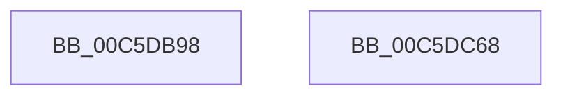

# CmFcManagerStartBootPhase

- RVA: `0x00C5DB98`–`0x00C5DC69` (길이 `209` bytes)
- VA: `0x0000000140C5DB98`
- 실행 섹션: `INIT`
- PDB 이름 있음: `예`; PDB Function 태그: `아니요`
- unwind 정보 RVA: `0x000BD124`
- 디코드: `47`개 명령, `209/209` bytes 표시
- 미해석 바이트: `0` (있으면 어셈블리에 `.byte`로 보존)

> 이 문서는 커널 이미지의 기계어와 PDB 기호를 분석해 생성했습니다. 4번과 5번은 함수 원형과 자료형을 바이너리 사용 방식에서 추정한 C 해석이며 원본 소스 복구 결과는 아닙니다.

## 1. Dependencies

- 직접 호출 지점: **4**; 고유 호출 대상: **4**
- 직접 호출자로 확인된 함수: **1**
- RIP 상대 이미지 참조: **7**

### Outgoing calls
- `0x00C5DBBF` → [CmFcpIncrementChangeStamp](../../page/70/CmFcpIncrementChangeStamp_function_00704338.md) (function, `0x00704338`)
- `0x00C5DC11` → [RtlpFcBufferManagerUpdateBuffers](../../page/A4/RtlpFcBufferManagerUpdateBuffers_function_00A44DB0.md) (function, `0x00A44DB0`)
- `0x00C5DC20` → [RtlpFcWriteHighLowHigh](../../text/4C/RtlpFcWriteHighLowHigh_function_004C84BC.md) (function, `0x004C84BC`)
- `0x00C5DC52` → [_security_check_cookie](../../text/6A/_security_check_cookie_function_006AC640.md) (function, `0x006AC640`)

### Direct callers
- [CmFcInitSystem0](CmFcInitSystem0_function_00C5AC60.md) at `0x00C5ACF0`

### Static image references
- `0x00C5DBAA` → RVA `0x00E0A740` (`.data`; read)
- `0x00C5DBB8` → RVA `0x00EF72F8` (`.data`; read)
- `0x00C5DBDF` → RVA `0x00EF7368` (`.data`; read)
- `0x00C5DC29` → RVA `0x00EF7480` (`.data`; write)
- `0x00C5DC34` → RVA `0x00EF7868` (`.data`; write)
- `0x00C5DC3E` → RVA `0x00EF7A38` (`.data`; write)
- `0x00C5DC44` → RVA `0x00EF747B` (`.data`; write)

## 2. Other-region calls and transfers

- 다른 실행 섹션으로 향하는 call: **4**
  - `0x00C5DBBF` → [CmFcpIncrementChangeStamp](../../page/70/CmFcpIncrementChangeStamp_function_00704338.md) (`INIT` → `PAGE`)
  - `0x00C5DC11` → [RtlpFcBufferManagerUpdateBuffers](../../page/A4/RtlpFcBufferManagerUpdateBuffers_function_00A44DB0.md) (`INIT` → `PAGE`)
  - `0x00C5DC20` → [RtlpFcWriteHighLowHigh](../../text/4C/RtlpFcWriteHighLowHigh_function_004C84BC.md) (`INIT` → `.text`)
  - `0x00C5DC52` → [_security_check_cookie](../../text/6A/_security_check_cookie_function_006AC640.md) (`INIT` → `.text`)
- 별도 외부 분기/꼬리 이동을 확인하지 못했습니다.

## 3. Assembly (complete function range)

```asm
00C5DB98  48 89 5C 24 08                  mov qword ptr [rsp + 8], rbx
00C5DB9D  55                              push rbp
00C5DB9E  48 8D 6C 24 E9                  lea rbp, [rsp - 0x17]
00C5DBA3  48 81 EC 90 00 00 00            sub rsp, 0x90
00C5DBAA  48 8B 05 8F CB 1A 00            mov rax, qword ptr [rip + 0x1acb8f]
00C5DBB1  48 33 C4                        xor rax, rsp
00C5DBB4  48 89 45 07                     mov qword ptr [rbp + 7], rax
00C5DBB8  48 8B 0D 39 97 29 00            mov rcx, qword ptr [rip + 0x299739]
00C5DBBF  E8 74 67 AA FF                  call 0x140704338
00C5DBC4  48 8B 4D 47                     mov rcx, qword ptr [rbp + 0x47]
00C5DBC8  48 8B D8                        mov rbx, rax
00C5DBCB  48 89 4D E7                     mov qword ptr [rbp - 0x19], rcx
00C5DBCF  48 8B 4D 77                     mov rcx, qword ptr [rbp + 0x77]
00C5DBD3  48 89 4D F7                     mov qword ptr [rbp - 9], rcx
00C5DBD7  48 8B 4D 7F                     mov rcx, qword ptr [rbp + 0x7f]
00C5DBDB  48 89 4D FF                     mov qword ptr [rbp - 1], rcx
00C5DBDF  48 8D 0D 82 97 29 00            lea rcx, [rip + 0x299782]
00C5DBE6  48 89 55 AF                     mov qword ptr [rbp - 0x51], rdx
00C5DBEA  4C 89 45 B7                     mov qword ptr [rbp - 0x49], r8
00C5DBEE  48 89 55 C7                     mov qword ptr [rbp - 0x39], rdx
00C5DBF2  48 8B D0                        mov rdx, rax
00C5DBF5  4C 89 45 CF                     mov qword ptr [rbp - 0x31], r8
00C5DBF9  4C 8D 45 A7                     lea r8, [rbp - 0x59]
00C5DBFD  48 89 45 A7                     mov qword ptr [rbp - 0x59], rax
00C5DC01  48 89 45 BF                     mov qword ptr [rbp - 0x41], rax
00C5DC05  48 89 45 D7                     mov qword ptr [rbp - 0x29], rax
00C5DC09  4C 89 4D DF                     mov qword ptr [rbp - 0x21], r9
00C5DC0D  48 89 45 EF                     mov qword ptr [rbp - 0x11], rax
00C5DC11  E8 9A 71 DE FF                  call 0x140a44db0
00C5DC16  48 8B D3                        mov rdx, rbx
00C5DC19  48 8D 0D D8 96 29 00            lea rcx, [rip + 0x2996d8]
00C5DC20  E8 97 A8 86 FF                  call 0x1404c84bc
00C5DC25  48 8B 45 4F                     mov rax, qword ptr [rbp + 0x4f]
00C5DC29  48 89 05 50 98 29 00            mov qword ptr [rip + 0x299850], rax
00C5DC30  48 8B 45 5F                     mov rax, qword ptr [rbp + 0x5f]
00C5DC34  48 89 05 2D 9C 29 00            mov qword ptr [rip + 0x299c2d], rax
00C5DC3B  8A 45 6F                        mov al, byte ptr [rbp + 0x6f]
00C5DC3E  88 05 F4 9D 29 00               mov byte ptr [rip + 0x299df4], al
00C5DC44  C6 05 30 98 29 00 00            mov byte ptr [rip + 0x299830], 0
00C5DC4B  48 8B 4D 07                     mov rcx, qword ptr [rbp + 7]
00C5DC4F  48 33 CC                        xor rcx, rsp
00C5DC52  E8 E9 E9 A4 FF                  call 0x1406ac640
00C5DC57  48 8B 9C 24 A0 00 00 00         mov rbx, qword ptr [rsp + 0xa0]
00C5DC5F  48 81 C4 90 00 00 00            add rsp, 0x90
00C5DC66  5D                              pop rbp
00C5DC67  C3                              ret
00C5DC68  CC                              int3
```

## 4. C-style interpretation (structured pseudocode)

```c
__int64 __fastcall CmFcManagerStartBootPhase(__int64 a1, __int64 a2, __int64 a3, __int64 a4, __int64 a5, __int64 a6, __int64 a7, __int64 a8, __int64 a9, unsigned __int8 a10, __int64 a11, __int64 a12)
{
    __int64 result;
    __int64 v_rsp;
    unsigned __int64 v_stack_m18;
    unsigned __int64 v_stack_m1F;
    unsigned __int64 v_stack_m20;
    unsigned __int64 v_stack_m28;
    unsigned __int64 v_stack_m30;
    unsigned __int64 v_stack_m38;
    unsigned __int64 v_stack_m40;
    unsigned __int64 v_stack_m48;
    unsigned __int64 v_stack_m50;
    unsigned __int64 v_stack_m58;
    unsigned __int64 v_stack_m60;
    unsigned __int64 v_stack_m68;
    unsigned __int64 v_stack_m70;
    unsigned __int64 v_stack_m78;
    unsigned __int64 v_stack_p8;

    v_stack_p8 = v_rbx;
    v_rsp = (v_rsp) - (144);
    result = (*(unsigned __int64 *)(v_rip + 1756047)) ^ (v_rsp);
    v_stack_m18 = result;
    result = CmFcpIncrementChangeStamp(*(unsigned __int64 *)(v_rip + 2725689), a2, a3, a4);
    v_stack_m38 = a5;
    v_stack_m28 = a11;
    v_stack_m20 = a12;
    v_stack_m70 = a2;
    v_stack_m68 = a3;
    v_stack_m58 = a2;
    v_stack_m50 = a3;
    v_stack_m78 = result;
    v_stack_m60 = result;
    v_stack_m48 = result;
    v_stack_m40 = a4;
    v_stack_m30 = result;
    result = RtlpFcBufferManagerUpdateBuffers(v_rip + 2725762, result, v_stack_m78, a4);
    result = RtlpFcWriteHighLowHigh(v_rip + 2725592, result, v_stack_m78, a4);
    *(unsigned __int64 *)(v_rip + 2725968) = a6;
    *(unsigned __int64 *)(v_rip + 2726957) = a8;
    *(unsigned __int8 *)(v_rip + 2727412) = a10;
    *(unsigned __int8 *)(v_rip + 2725936) = 0;
    a1 = (v_stack_m18) ^ (v_rsp);
    result = _security_check_cookie(a1, result, v_stack_m78, a4);
    v_rsp = (v_rsp) + (144);
    return result;
}
```

## 5. (Beta) C Style

```c
int64_t CmFcManagerStartBootPhase(int64_t Arg1, int64_t Arg2, int64_t Arg3, int64_t Arg4, int64_t Arg5, int64_t Arg6, uint64_t Arg7, int64_t Arg8, uint64_t Arg9, uint8_t Arg10, int64_t Arg11, int64_t Arg12)
{
    int64_t result;
    int64_t local_rsp;
    uint64_t v_stack_m18;
    uint64_t v_stack_m1F;
    uint64_t v_stack_m20;
    uint64_t v_stack_m28;
    uint64_t v_stack_m30;
    uint64_t v_stack_m38;
    uint64_t v_stack_m40;
    uint64_t v_stack_m48;
    uint64_t v_stack_m50;
    uint64_t v_stack_m58;
    uint64_t v_stack_m60;
    uint64_t v_stack_m68;
    uint64_t v_stack_m70;
    uint64_t v_stack_m78;
    uint64_t v_stack_p8;

    v_stack_p8 = local_rbx;
    local_rsp = (local_rsp) - (144);
    result = (*(uint64_t *)(v_rip + 0x1ACB8F)) ^ (local_rsp);
    v_stack_m18 = result;
    result = CmFcpIncrementChangeStamp(*(uint64_t *)(v_rip + 0x299739), Arg2, Arg3, Arg4);
    v_stack_m38 = Arg5;
    v_stack_m28 = Arg11;
    v_stack_m20 = Arg12;
    v_stack_m70 = Arg2;
    v_stack_m68 = Arg3;
    v_stack_m58 = Arg2;
    v_stack_m50 = Arg3;
    v_stack_m78 = result;
    v_stack_m60 = result;
    v_stack_m48 = result;
    v_stack_m40 = Arg4;
    v_stack_m30 = result;
    result = RtlpFcBufferManagerUpdateBuffers(v_rip + 2725762, result, v_stack_m78, Arg4);
    result = RtlpFcWriteHighLowHigh(v_rip + 2725592, result, v_stack_m78, Arg4);
    *(uint64_t *)(v_rip + 0x299850) = Arg6;
    *(uint64_t *)(v_rip + 0x299C2D) = Arg8;
    *(uint8_t *)(v_rip + 0x299DF4) = Arg10;
    *(uint8_t *)(v_rip + 0x299830) = 0;
    Arg1 = (v_stack_m18) ^ (local_rsp);
    result = _security_check_cookie(Arg1, result, v_stack_m78, Arg4);
    local_rsp = (local_rsp) + (144);
    return result;
}
```

## 6. Execution-region graph

[열기: 2D/3D 그래프와 함수 탐색 컨트롤 패널](../../../control-panel.html?section=init&rva=0x00C5DB98&view=graph)

- 2D 그래프는 위에서 아래로 흐르고, 3D 그래프는 빈 공간을 드래그해 회전합니다. Shift+드래그는 이동, 휠은 확대·축소, 함수 노드 선택은 대상 보고서 이동입니다.

### Static fallback


