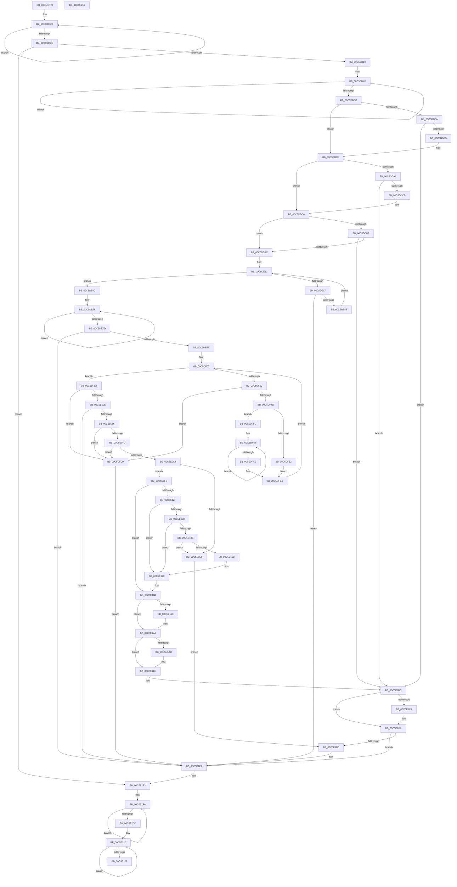

# CmFcManagerStartRuntimePhase

- RVA: `0x00C5DC70`–`0x00C5E252` (길이 `1,506` bytes)
- VA: `0x0000000140C5DC70`
- 실행 섹션: `INIT`
- PDB 이름 있음: `예`; PDB Function 태그: `아니요`
- unwind 정보 RVA: `0x00098698`
- 디코드: `351`개 명령, `1,506/1,506` bytes 표시
- 미해석 바이트: `0` (있으면 어셈블리에 `.byte`로 보존)

> 이 문서는 커널 이미지의 기계어와 PDB 기호를 분석해 생성했습니다. 4번과 5번은 함수 원형과 자료형을 바이너리 사용 방식에서 추정한 C 해석이며 원본 소스 복구 결과는 아닙니다.

## 1. Dependencies

- 직접 호출 지점: **47**; 고유 호출 대상: **32**
- 직접 호출자로 확인된 함수: **1**
- RIP 상대 이미지 참조: **28**

### Outgoing calls
- `0x00C5DCBD` → [CmFcpInitializeSectionState](../../page/AD/CmFcpInitializeSectionState_function_00AD93FC.md) (function, `0x00AD93FC`)
- `0x00C5DCDD` → [memset](../../text/6C/memset_function_006C6C40.md) (function, `0x006C6C40`)
- `0x00C5DD01` → [SeConvertStringSecurityDescriptorToSecurityDescriptor](../../text/48/SeConvertStringSecurityDescriptorToSecurityDescriptor_function_00480000.md) (function, `0x00480000`)
- `0x00C5DD28` → [CmSiRWLockAcquireExclusive](../../page/A1/CmSiRWLockAcquireExclusive_function_00A1679C.md) (function, `0x00A1679C`)
- `0x00C5DD3E` → [RtlpFcBufferManagerReferenceBuffers](../../text/4A/RtlpFcBufferManagerReferenceBuffers_function_004A73B8.md) (function, `0x004A73B8`)
- `0x00C5DD7E` → [CmFcpManagerCreateSectionFromBuffer](../../page/7F/CmFcpManagerCreateSectionFromBuffer_function_007F5438.md) (function, `0x007F5438`)
- `0x00C5DD95` → [CmFcpCopySectionState](../../page/A3/CmFcpCopySectionState_function_00A30484.md) (function, `0x00A30484`)
- `0x00C5DDBC` → [CmFcpManagerCreateSectionFromBuffer](../../page/7F/CmFcpManagerCreateSectionFromBuffer_function_007F5438.md) (function, `0x007F5438`)
- `0x00C5DDED` → [CmFcpManagerCreateSectionFromBuffer](../../page/7F/CmFcpManagerCreateSectionFromBuffer_function_007F5438.md) (function, `0x007F5438`)
- `0x00C5DE06` → [RtlpFcBufferManagerDereferenceBuffers](../../text/37/RtlpFcBufferManagerDereferenceBuffers_function_00378D84.md) (function, `0x00378D84`)
- `0x00C5DE19` → [RtlpFcSectionTypeToBufferType](../../page/79/RtlpFcSectionTypeToBufferType_function_0079AA64.md) (function, `0x0079AA64`)
- `0x00C5DE3A` → [CmFcpMapSection](../../page/AC/CmFcpMapSection_function_00AC1714.md) (function, `0x00AC1714`)
- `0x00C5DE54` → [CmSiRWLockAcquireExclusive](../../page/A1/CmSiRWLockAcquireExclusive_function_00A1679C.md) (function, `0x00A1679C`)
- `0x00C5DE6E` → [CmFcpSwapSectionState](../../page/6F/CmFcpSwapSectionState_function_006FE9B8.md) (function, `0x006FE9B8`)
- `0x00C5DE8E` → [RtlpFcBufferManagerUpdateBuffers](../../page/A4/RtlpFcBufferManagerUpdateBuffers_function_00A44DB0.md) (function, `0x00A44DB0`)
- `0x00C5DE9D` → [memset](../../text/6C/memset_function_006C6C40.md) (function, `0x006C6C40`)
- `0x00C5DEB5` → [RtlpFcWriteHighLowHigh](../../text/4C/RtlpFcWriteHighLowHigh_function_004C84BC.md) (function, `0x004C84BC`)
- `0x00C5DEC1` → [CmSiRWLockReleaseExclusive](../../page/A0/CmSiRWLockReleaseExclusive_function_00A0DAB0.md) (function, `0x00A0DAB0`)
- `0x00C5DEEF` → [ZwUpdateWnfStateData](../../text/6B/ZwUpdateWnfStateData_function_006B0D10.md) (function, `0x006B0D10`)
- `0x00C5DF10` → [RtlGetSwapReferenceIndex](../../page/AA/RtlGetSwapReferenceIndex_function_00AA28A4.md) (function, `0x00AA28A4`)
- `0x00C5DF3C` → [ExAllocatePool2](../../poolcode/B8/ExAllocatePool2_function_00B820F0.md) (function, `0x00B820F0`)
- `0x00C5DF55` → [RtlpFcInitializeDelayedUsageReportBuffer](../../page/79/RtlpFcInitializeDelayedUsageReportBuffer_function_0079A8A0.md) (function, `0x0079A8A0`)
- `0x00C5DFCD` → [RtlUpdateSwapReference](../../page/A4/RtlUpdateSwapReference_function_00A45260.md) (function, `0x00A45260`)
- `0x00C5DFFD` → [ExAllocateTimer](../../text/3A/ExAllocateTimer_function_003A30D0.md) (function, `0x003A30D0`)
- `0x00C5E00E` → [RtlIsStateSeparationEnabled](../../page/A3/RtlIsStateSeparationEnabled_function_00A3C560.md) (function, `0x00A3C560`)
- `0x00C5E02C` → [RtlInitUnicodeString](../../text/42/RtlInitUnicodeString_function_0042A780.md) (function, `0x0042A780`)
- `0x00C5E047` → [CmRegisterMachineHiveLoadedNotification](../../page/7E/CmRegisterMachineHiveLoadedNotification_function_007E1A90.md) (function, `0x007E1A90`)
- `0x00C5E063` → [ExAllocateTimer](../../text/3A/ExAllocateTimer_function_003A30D0.md) (function, `0x003A30D0`)
- `0x00C5E08A` → [ExAllocateTimer](../../text/3A/ExAllocateTimer_function_003A30D0.md) (function, `0x003A30D0`)
- `0x00C5E0AB` → [CmSiRWLockAcquireExclusive](../../page/A1/CmSiRWLockAcquireExclusive_function_00A1679C.md) (function, `0x00A1679C`)
- `0x00C5E0BA` → [RtlGetSwapReferenceIndex](../../page/AA/RtlGetSwapReferenceIndex_function_00AA28A4.md) (function, `0x00AA28A4`)
- `0x00C5E0D9` → [ExAllocatePool2](../../poolcode/B8/ExAllocatePool2_function_00B820F0.md) (function, `0x00B820F0`)
- `0x00C5E0F8` → [memset](../../text/6C/memset_function_006C6C40.md) (function, `0x006C6C40`)
- `0x00C5E115` → [RtlUpdateSwapReference](../../page/A4/RtlUpdateSwapReference_function_00A45260.md) (function, `0x00A45260`)
- `0x00C5E14E` → [ExAllocatePool2](../../poolcode/B8/ExAllocatePool2_function_00B820F0.md) (function, `0x00B820F0`)
- `0x00C5E167` → [memcpy](../../text/6C/memcpy_function_006C6840.md) (function, `0x006C6840`)
- `0x00C5E172` → [CmFcpManagerAddBufferIntoPublishListAndSetPublishState](../../page/7F/CmFcpManagerAddBufferIntoPublishListAndSetPublishState_function_007F53F0.md) (function, `0x007F53F0`)
- `0x00C5E17A` → [CmFcpManagerArmFeatureUsageProviderPublishTimer](../../text/66/CmFcpManagerArmFeatureUsageProviderPublishTimer_function_0066B280.md) (function, `0x0066B280`)
- `0x00C5E19E` → [CmFcpManagerPublishFeatureUsageData](../../page/AB/CmFcpManagerPublishFeatureUsageData_function_00ABC468.md) (function, `0x00ABC468`)
- `0x00C5E1B0` → [CmFcpManagerArmFeatureUsageProviderFlushTimer](../../text/4F/CmFcpManagerArmFeatureUsageProviderFlushTimer_function_004FC838.md) (function, `0x004FC838`)
- `0x00C5E1CB` → [RtlpFcBufferManagerDereferenceBuffers](../../text/37/RtlpFcBufferManagerDereferenceBuffers_function_00378D84.md) (function, `0x00378D84`)
- `0x00C5E1DC` → [CmSiRWLockReleaseExclusive](../../page/A0/CmSiRWLockReleaseExclusive_function_00A0DAB0.md) (function, `0x00A0DAB0`)
- `0x00C5E1E8` → [CmSiRWLockReleaseExclusive](../../page/A0/CmSiRWLockReleaseExclusive_function_00A0DAB0.md) (function, `0x00A0DAB0`)
- `0x00C5E1ED` → [KeLeaveCriticalRegion](../../text/25/KeLeaveCriticalRegion_function_0025D8B0.md) (function, `0x0025D8B0`)
- `0x00C5E1FD` → [CmFcpUnmapSection](../../page/A4/CmFcpUnmapSection_function_00A44B8C.md) (function, `0x00A44B8C`)
- `0x00C5E213` → [CmFcpCleanupSectionState](../../page/A3/CmFcpCleanupSectionState_function_00A304B4.md) (function, `0x00A304B4`)
- `0x00C5E22B` → [_security_check_cookie](../../text/6A/_security_check_cookie_function_006AC640.md) (function, `0x006AC640`)

### Direct callers
- [CmFcInitSystem2](CmFcInitSystem2_function_00C5AD0C.md) at `0x00C5AD93`

### Static image references
- `0x00C5DC93` → RVA `0x00E0A740` (`.data`; read)
- `0x00C5DCE2` → RVA `0x00EF72E0` (`.data`; read)
- `0x00C5DCE9` → RVA `0x00EF747A` (`.data`; write)
- `0x00C5DCFA` → RVA `0x0003AA00` (`.rdata`; read)
- `0x00C5DD19` → RVA `0x00EF72F0` (`.data`; read)
- `0x00C5DD37` → RVA `0x00EF7368` (`.data`; read)
- `0x00C5DE4D` → RVA `0x00EF72E8` (`.data`; read)
- `0x00C5DEA2` → RVA `0x00FC5008` (`ALMOSTRO`; read)
- `0x00C5DECB` → RVA `0x0001A520` (`.rdata`; read)
- `0x00C5DEE2` → RVA `0x0001A530` (`.rdata`; read)
- `0x00C5DF09` → RVA `0x00EF7458` (`.data`; read)
- `0x00C5DFF3` → RVA `0x0066B3C0` (`CmFcpManagerRetryUsageNotificationsTimerRoutine`; read)
- `0x00C5E002` → RVA `0x00EF7510` (`.data`; write)
- `0x00C5E015` → RVA `0x00C7E5F0` (` ?? ::PBOPGDP::`string'`; read)
- `0x00C5E01C` → RVA `0x00C7E5B0` (` ?? ::PBOPGDP::`string'`; read)
- `0x00C5E031` → RVA `0x00EF7450` (`.data`; read)
- `0x00C5E040` → RVA `0x007F5790` (`CmFcpManagerSoftwareHiveReady`; read)
- `0x00C5E059` → RVA `0x004DCA90` (`CmFcpManagerFlushUsageTimerRoutine`; read)
- `0x00C5E068` → RVA `0x00EF7940` (`.data`; write)
- `0x00C5E06F` → RVA `0x00EF7940` (`.data`; read)
- `0x00C5E080` → RVA `0x0066B3A0` (`CmFcpManagerPublishUsageTimerRoutine`; read)
- `0x00C5E08F` → RVA `0x00EF7948` (`.data`; write)
- `0x00C5E096` → RVA `0x00EF7948` (`.data`; read)
- `0x00C5E0A4` → RVA `0x00EF78B8` (`.data`; read)
- `0x00C5E0B0` → RVA `0x00EF7690` (`.data`; read)
- `0x00C5E12F` → RVA `0x00EF7A38` (`.data`; read)
- `0x00C5E18D` → RVA `0x00EF7A40` (`.data`; read/write)
- `0x00C5E1A3` → RVA `0x00EF7A10` (`.data`; read)

## 2. Other-region calls and transfers

- 다른 실행 섹션으로 향하는 call: **47**
  - `0x00C5DCBD` → [CmFcpInitializeSectionState](../../page/AD/CmFcpInitializeSectionState_function_00AD93FC.md) (`INIT` → `PAGE`)
  - `0x00C5DCDD` → [memset](../../text/6C/memset_function_006C6C40.md) (`INIT` → `.text`)
  - `0x00C5DD01` → [SeConvertStringSecurityDescriptorToSecurityDescriptor](../../text/48/SeConvertStringSecurityDescriptorToSecurityDescriptor_function_00480000.md) (`INIT` → `.text`)
  - `0x00C5DD28` → [CmSiRWLockAcquireExclusive](../../page/A1/CmSiRWLockAcquireExclusive_function_00A1679C.md) (`INIT` → `PAGE`)
  - `0x00C5DD3E` → [RtlpFcBufferManagerReferenceBuffers](../../text/4A/RtlpFcBufferManagerReferenceBuffers_function_004A73B8.md) (`INIT` → `.text`)
  - `0x00C5DD7E` → [CmFcpManagerCreateSectionFromBuffer](../../page/7F/CmFcpManagerCreateSectionFromBuffer_function_007F5438.md) (`INIT` → `PAGE`)
  - `0x00C5DD95` → [CmFcpCopySectionState](../../page/A3/CmFcpCopySectionState_function_00A30484.md) (`INIT` → `PAGE`)
  - `0x00C5DDBC` → [CmFcpManagerCreateSectionFromBuffer](../../page/7F/CmFcpManagerCreateSectionFromBuffer_function_007F5438.md) (`INIT` → `PAGE`)
  - `0x00C5DDED` → [CmFcpManagerCreateSectionFromBuffer](../../page/7F/CmFcpManagerCreateSectionFromBuffer_function_007F5438.md) (`INIT` → `PAGE`)
  - `0x00C5DE06` → [RtlpFcBufferManagerDereferenceBuffers](../../text/37/RtlpFcBufferManagerDereferenceBuffers_function_00378D84.md) (`INIT` → `.text`)
  - `0x00C5DE19` → [RtlpFcSectionTypeToBufferType](../../page/79/RtlpFcSectionTypeToBufferType_function_0079AA64.md) (`INIT` → `PAGE`)
  - `0x00C5DE3A` → [CmFcpMapSection](../../page/AC/CmFcpMapSection_function_00AC1714.md) (`INIT` → `PAGE`)
  - `0x00C5DE54` → [CmSiRWLockAcquireExclusive](../../page/A1/CmSiRWLockAcquireExclusive_function_00A1679C.md) (`INIT` → `PAGE`)
  - `0x00C5DE6E` → [CmFcpSwapSectionState](../../page/6F/CmFcpSwapSectionState_function_006FE9B8.md) (`INIT` → `PAGE`)
  - `0x00C5DE8E` → [RtlpFcBufferManagerUpdateBuffers](../../page/A4/RtlpFcBufferManagerUpdateBuffers_function_00A44DB0.md) (`INIT` → `PAGE`)
  - `0x00C5DE9D` → [memset](../../text/6C/memset_function_006C6C40.md) (`INIT` → `.text`)
  - `0x00C5DEB5` → [RtlpFcWriteHighLowHigh](../../text/4C/RtlpFcWriteHighLowHigh_function_004C84BC.md) (`INIT` → `.text`)
  - `0x00C5DEC1` → [CmSiRWLockReleaseExclusive](../../page/A0/CmSiRWLockReleaseExclusive_function_00A0DAB0.md) (`INIT` → `PAGE`)
  - `0x00C5DEEF` → [ZwUpdateWnfStateData](../../text/6B/ZwUpdateWnfStateData_function_006B0D10.md) (`INIT` → `.text`)
  - `0x00C5DF10` → [RtlGetSwapReferenceIndex](../../page/AA/RtlGetSwapReferenceIndex_function_00AA28A4.md) (`INIT` → `PAGE`)
  - `0x00C5DF3C` → [ExAllocatePool2](../../poolcode/B8/ExAllocatePool2_function_00B820F0.md) (`INIT` → `POOLCODE`)
  - `0x00C5DF55` → [RtlpFcInitializeDelayedUsageReportBuffer](../../page/79/RtlpFcInitializeDelayedUsageReportBuffer_function_0079A8A0.md) (`INIT` → `PAGE`)
  - `0x00C5DFCD` → [RtlUpdateSwapReference](../../page/A4/RtlUpdateSwapReference_function_00A45260.md) (`INIT` → `PAGE`)
  - `0x00C5DFFD` → [ExAllocateTimer](../../text/3A/ExAllocateTimer_function_003A30D0.md) (`INIT` → `.text`)
  - `0x00C5E00E` → [RtlIsStateSeparationEnabled](../../page/A3/RtlIsStateSeparationEnabled_function_00A3C560.md) (`INIT` → `PAGE`)
  - `0x00C5E02C` → [RtlInitUnicodeString](../../text/42/RtlInitUnicodeString_function_0042A780.md) (`INIT` → `.text`)
  - `0x00C5E047` → [CmRegisterMachineHiveLoadedNotification](../../page/7E/CmRegisterMachineHiveLoadedNotification_function_007E1A90.md) (`INIT` → `PAGE`)
  - `0x00C5E063` → [ExAllocateTimer](../../text/3A/ExAllocateTimer_function_003A30D0.md) (`INIT` → `.text`)
  - `0x00C5E08A` → [ExAllocateTimer](../../text/3A/ExAllocateTimer_function_003A30D0.md) (`INIT` → `.text`)
  - `0x00C5E0AB` → [CmSiRWLockAcquireExclusive](../../page/A1/CmSiRWLockAcquireExclusive_function_00A1679C.md) (`INIT` → `PAGE`)
  - `0x00C5E0BA` → [RtlGetSwapReferenceIndex](../../page/AA/RtlGetSwapReferenceIndex_function_00AA28A4.md) (`INIT` → `PAGE`)
  - `0x00C5E0D9` → [ExAllocatePool2](../../poolcode/B8/ExAllocatePool2_function_00B820F0.md) (`INIT` → `POOLCODE`)
  - `0x00C5E0F8` → [memset](../../text/6C/memset_function_006C6C40.md) (`INIT` → `.text`)
  - `0x00C5E115` → [RtlUpdateSwapReference](../../page/A4/RtlUpdateSwapReference_function_00A45260.md) (`INIT` → `PAGE`)
  - `0x00C5E14E` → [ExAllocatePool2](../../poolcode/B8/ExAllocatePool2_function_00B820F0.md) (`INIT` → `POOLCODE`)
  - `0x00C5E167` → [memcpy](../../text/6C/memcpy_function_006C6840.md) (`INIT` → `.text`)
  - `0x00C5E172` → [CmFcpManagerAddBufferIntoPublishListAndSetPublishState](../../page/7F/CmFcpManagerAddBufferIntoPublishListAndSetPublishState_function_007F53F0.md) (`INIT` → `PAGE`)
  - `0x00C5E17A` → [CmFcpManagerArmFeatureUsageProviderPublishTimer](../../text/66/CmFcpManagerArmFeatureUsageProviderPublishTimer_function_0066B280.md) (`INIT` → `.text`)
  - `0x00C5E19E` → [CmFcpManagerPublishFeatureUsageData](../../page/AB/CmFcpManagerPublishFeatureUsageData_function_00ABC468.md) (`INIT` → `PAGE`)
  - `0x00C5E1B0` → [CmFcpManagerArmFeatureUsageProviderFlushTimer](../../text/4F/CmFcpManagerArmFeatureUsageProviderFlushTimer_function_004FC838.md) (`INIT` → `.text`)
  - `0x00C5E1CB` → [RtlpFcBufferManagerDereferenceBuffers](../../text/37/RtlpFcBufferManagerDereferenceBuffers_function_00378D84.md) (`INIT` → `.text`)
  - `0x00C5E1DC` → [CmSiRWLockReleaseExclusive](../../page/A0/CmSiRWLockReleaseExclusive_function_00A0DAB0.md) (`INIT` → `PAGE`)
  - `0x00C5E1E8` → [CmSiRWLockReleaseExclusive](../../page/A0/CmSiRWLockReleaseExclusive_function_00A0DAB0.md) (`INIT` → `PAGE`)
  - `0x00C5E1ED` → [KeLeaveCriticalRegion](../../text/25/KeLeaveCriticalRegion_function_0025D8B0.md) (`INIT` → `.text`)
  - `0x00C5E1FD` → [CmFcpUnmapSection](../../page/A4/CmFcpUnmapSection_function_00A44B8C.md) (`INIT` → `PAGE`)
  - `0x00C5E213` → [CmFcpCleanupSectionState](../../page/A3/CmFcpCleanupSectionState_function_00A304B4.md) (`INIT` → `PAGE`)
  - `0x00C5E22B` → [_security_check_cookie](../../text/6A/_security_check_cookie_function_006AC640.md) (`INIT` → `.text`)
- 별도 외부 분기/꼬리 이동을 확인하지 못했습니다.

## 3. Assembly (complete function range)

```asm
00C5DC70  48 8B C4                        mov rax, rsp
00C5DC73  48 89 58 08                     mov qword ptr [rax + 8], rbx
00C5DC77  48 89 70 10                     mov qword ptr [rax + 0x10], rsi
00C5DC7B  48 89 78 18                     mov qword ptr [rax + 0x18], rdi
00C5DC7F  4C 89 60 20                     mov qword ptr [rax + 0x20], r12
00C5DC83  55                              push rbp
00C5DC84  41 56                           push r14
00C5DC86  41 57                           push r15
00C5DC88  48 8D 68 B8                     lea rbp, [rax - 0x48]
00C5DC8C  48 81 EC 30 01 00 00            sub rsp, 0x130
00C5DC93  48 8B 05 A6 CA 1A 00            mov rax, qword ptr [rip + 0x1acaa6]
00C5DC9A  48 33 C4                        xor rax, rsp
00C5DC9D  48 89 45 20                     mov qword ptr [rbp + 0x20], rax
00C5DCA1  48 83 64 24 40 00               and qword ptr [rsp + 0x40], 0
00C5DCA7  48 8D 4D C0                     lea rcx, [rbp - 0x40]
00C5DCAB  0F 57 C0                        xorps xmm0, xmm0
00C5DCAE  BE 04 00 00 00                  mov esi, 4
00C5DCB3  0F 11 44 24 50                  movups xmmword ptr [rsp + 0x50], xmm0
00C5DCB8  45 32 FF                        xor r15b, r15b
00C5DCBB  8B D6                           mov edx, esi
00C5DCBD  E8 3A B7 E7 FF                  call 0x140ad93fc
00C5DCC2  48 83 C1 18                     add rcx, 0x18
00C5DCC6  48 83 EA 01                     sub rdx, 1
00C5DCCA  75 F1                           jne 0x140c5dcbd
00C5DCCC  48 21 54 24 48                  and qword ptr [rsp + 0x48], rdx
00C5DCD1  44 8D 72 60                     lea r14d, [rdx + 0x60]
00C5DCD5  45 8B C6                        mov r8d, r14d
00C5DCD8  48 8D 4C 24 60                  lea rcx, [rsp + 0x60]
00C5DCDD  E8 5E 8F A6 FF                  call 0x1406c6c40
00C5DCE2  4C 8D 25 F7 95 29 00            lea r12, [rip + 0x2995f7]
00C5DCE9  C6 05 8A 97 29 00 01            mov byte ptr [rip + 0x29978a], 1
00C5DCF0  4D 8B C4                        mov r8, r12
00C5DCF3  41 8D 56 A1                     lea edx, [r14 - 0x5f]
00C5DCF7  45 33 C9                        xor r9d, r9d
00C5DCFA  48 8D 0D FF CC 3D FF            lea rcx, [rip - 0xc23301]
00C5DD01  E8 FA 22 82 FF                  call 0x140480000
00C5DD06  8B D8                           mov ebx, eax
00C5DD08  85 C0                           test eax, eax
00C5DD0A  0F 88 E2 04 00 00               js 0x140c5e1f2
00C5DD10  65 48 8B 04 25 88 01 00 00      mov rax, qword ptr gs:[0x188]
00C5DD19  48 8D 0D D0 95 29 00            lea rcx, [rip + 0x2995d0]
00C5DD20  66 FF 88 E4 01 00 00            dec word ptr [rax + 0x1e4]
00C5DD27  90                              nop
00C5DD28  E8 6F 8A DB FF                  call 0x140a1679c
00C5DD2D  4C 8D 44 24 48                  lea r8, [rsp + 0x48]
00C5DD32  48 8D 54 24 40                  lea rdx, [rsp + 0x40]
00C5DD37  48 8D 0D 2A 96 29 00            lea rcx, [rip + 0x29962a]
00C5DD3E  E8 75 96 84 FF                  call 0x1404a73b8
00C5DD43  4C 8B 44 24 40                  mov r8, qword ptr [rsp + 0x40]
00C5DD48  48 8D 45 C0                     lea rax, [rbp - 0x40]
00C5DD4C  48 8B CE                        mov rcx, rsi
00C5DD4F  4C 89 00                        mov qword ptr [rax], r8
00C5DD52  48 8D 40 18                     lea rax, [rax + 0x18]
00C5DD56  48 83 E9 01                     sub rcx, 1
00C5DD5A  75 F3                           jne 0x140c5dd4f
00C5DD5C  48 8B 7C 24 48                  mov rdi, qword ptr [rsp + 0x48]
00C5DD61  48 8B 4F 08                     mov rcx, qword ptr [rdi + 8]
00C5DD65  48 85 C9                        test rcx, rcx
00C5DD68  74 35                           je 0x140c5dd9f
00C5DD6A  4C 8B 0D 6F 95 29 00            mov r9, qword ptr [rip + 0x29956f]
00C5DD71  48 8D 45 C0                     lea rax, [rbp - 0x40]
00C5DD75  48 8B 57 10                     mov rdx, qword ptr [rdi + 0x10]
00C5DD79  48 89 44 24 20                  mov qword ptr [rsp + 0x20], rax
00C5DD7E  E8 B5 76 B9 FF                  call 0x1407f5438
00C5DD83  8B D8                           mov ebx, eax
00C5DD85  85 C0                           test eax, eax
00C5DD87  0F 88 2F 04 00 00               js 0x140c5e1bc
00C5DD8D  48 8D 55 C0                     lea rdx, [rbp - 0x40]
00C5DD91  48 8D 4D D8                     lea rcx, [rbp - 0x28]
00C5DD95  E8 EA 26 DD FF                  call 0x140a30484
00C5DD9A  4C 8B 44 24 40                  mov r8, qword ptr [rsp + 0x40]
00C5DD9F  48 8B 4F 38                     mov rcx, qword ptr [rdi + 0x38]
00C5DDA3  48 85 C9                        test rcx, rcx
00C5DDA6  74 28                           je 0x140c5ddd0
00C5DDA8  4C 8B 0D 31 95 29 00            mov r9, qword ptr [rip + 0x299531]
00C5DDAF  48 8D 45 F0                     lea rax, [rbp - 0x10]
00C5DDB3  48 8B 57 40                     mov rdx, qword ptr [rdi + 0x40]
00C5DDB7  48 89 44 24 20                  mov qword ptr [rsp + 0x20], rax
00C5DDBC  E8 77 76 B9 FF                  call 0x1407f5438
00C5DDC1  8B D8                           mov ebx, eax
00C5DDC3  85 C0                           test eax, eax
00C5DDC5  0F 88 F1 03 00 00               js 0x140c5e1bc
00C5DDCB  4C 8B 44 24 40                  mov r8, qword ptr [rsp + 0x40]
00C5DDD0  48 8B 4F 50                     mov rcx, qword ptr [rdi + 0x50]
00C5DDD4  48 85 C9                        test rcx, rcx
00C5DDD7  74 23                           je 0x140c5ddfc
00C5DDD9  4C 8B 0D 00 95 29 00            mov r9, qword ptr [rip + 0x299500]
00C5DDE0  48 8D 45 08                     lea rax, [rbp + 8]
00C5DDE4  48 8B 57 58                     mov rdx, qword ptr [rdi + 0x58]
00C5DDE8  48 89 44 24 20                  mov qword ptr [rsp + 0x20], rax
00C5DDED  E8 46 76 B9 FF                  call 0x1407f5438
00C5DDF2  8B D8                           mov ebx, eax
00C5DDF4  85 C0                           test eax, eax
00C5DDF6  0F 88 C0 03 00 00               js 0x140c5e1bc
00C5DDFC  48 8B D7                        mov rdx, rdi
00C5DDFF  48 8D 0D 62 95 29 00            lea rcx, [rip + 0x299562]
00C5DE06  E8 79 AF 71 FF                  call 0x140378d84
00C5DE0B  48 83 64 24 48 00               and qword ptr [rsp + 0x48], 0
00C5DE11  33 FF                           xor edi, edi
00C5DE13  3B FE                           cmp edi, esi
00C5DE15  73 36                           jae 0x140c5de4d
00C5DE17  8B CF                           mov ecx, edi
00C5DE19  E8 46 CC B3 FF                  call 0x14079aa64
00C5DE1E  44 8B C0                        mov r8d, eax
00C5DE21  48 8D 54 24 60                  lea rdx, [rsp + 0x60]
00C5DE26  48 8D 0C 7F                     lea rcx, [rdi + rdi*2]
00C5DE2A  4B 8D 04 40                     lea rax, [r8 + r8*2]
00C5DE2E  48 8D 14 C2                     lea rdx, [rdx + rax*8]
00C5DE32  48 8D 45 C0                     lea rax, [rbp - 0x40]
00C5DE36  48 8D 0C C8                     lea rcx, [rax + rcx*8]
00C5DE3A  E8 D5 38 E6 FF                  call 0x140ac1714
00C5DE3F  8B D8                           mov ebx, eax
00C5DE41  85 C0                           test eax, eax
00C5DE43  0F 88 98 03 00 00               js 0x140c5e1e1
00C5DE49  FF C7                           inc edi
00C5DE4B  EB C6                           jmp 0x140c5de13
00C5DE4D  48 8D 0D 94 94 29 00            lea rcx, [rip + 0x299494]
00C5DE54  E8 43 89 DB FF                  call 0x140a1679c
00C5DE59  45 33 D2                        xor r10d, r10d
00C5DE5C  4C 8B DE                        mov r11, rsi
00C5DE5F  48 8D 55 C0                     lea rdx, [rbp - 0x40]
00C5DE63  49 8D 4C 24 28                  lea rcx, [r12 + 0x28]
00C5DE68  49 03 D2                        add rdx, r10
00C5DE6B  49 03 CA                        add rcx, r10
00C5DE6E  E8 45 0B AA FF                  call 0x1406fe9b8
00C5DE73  49 83 C2 18                     add r10, 0x18
00C5DE77  49 83 EB 01                     sub r11, 1
00C5DE7B  75 E2                           jne 0x140c5de5f
00C5DE7D  48 8B 54 24 40                  mov rdx, qword ptr [rsp + 0x40]
00C5DE82  4C 8D 44 24 60                  lea r8, [rsp + 0x60]
00C5DE87  48 8D 0D DA 94 29 00            lea rcx, [rip + 0x2994da]
00C5DE8E  E8 1D 6F DE FF                  call 0x140a44db0
00C5DE93  4D 8B C6                        mov r8, r14
00C5DE96  48 8D 4C 24 60                  lea rcx, [rsp + 0x60]
00C5DE9B  33 D2                           xor edx, edx
00C5DE9D  E8 9E 8D A6 FF                  call 0x1406c6c40
00C5DEA2  48 8B 0D 5F 71 36 00            mov rcx, qword ptr [rip + 0x36715f]
00C5DEA9  48 8B 54 24 40                  mov rdx, qword ptr [rsp + 0x40]
00C5DEAE  48 81 C1 20 07 00 00            add rcx, 0x720
00C5DEB5  E8 02 A6 86 FF                  call 0x1404c84bc
00C5DEBA  48 8D 0D 27 94 29 00            lea rcx, [rip + 0x299427]
00C5DEC1  E8 EA FB DA FF                  call 0x140a0dab0
00C5DEC6  83 64 24 30 00                  and dword ptr [rsp + 0x30], 0
00C5DECB  4C 8D 0D 4E C6 3B FF            lea r9, [rip - 0xc439b2]
00C5DED2  83 64 24 28 00                  and dword ptr [rsp + 0x28], 0
00C5DED7  48 8D 54 24 40                  lea rdx, [rsp + 0x40]
00C5DEDC  48 83 64 24 20 00               and qword ptr [rsp + 0x20], 0
00C5DEE2  48 8D 0D 47 C6 3B FF            lea rcx, [rip - 0xc439b9]
00C5DEE9  41 B8 08 00 00 00               mov r8d, 8
00C5DEEF  E8 1C 2E A5 FF                  call 0x1406b0d10
00C5DEF4  8B D8                           mov ebx, eax
00C5DEF6  85 C0                           test eax, eax
00C5DEF8  0F 88 E3 02 00 00               js 0x140c5e1e1
00C5DEFE  33 FF                           xor edi, edi
00C5DF00  83 FF 02                        cmp edi, 2
00C5DF03  0F 83 DA 00 00 00               jae 0x140c5dfe3
00C5DF09  48 8D 0D 48 95 29 00            lea rcx, [rip + 0x299548]
00C5DF10  E8 8F 49 E4 FF                  call 0x140aa28a4
00C5DF15  48 8D 1D C4 93 29 00            lea rbx, [rip + 0x2993c4]
00C5DF1C  BA 10 03 00 00                  mov edx, 0x310
00C5DF21  B9 40 00 00 00                  mov ecx, 0x40
00C5DF26  41 B8 43 6D 46 63               mov r8d, 0x63466d43
00C5DF2C  44 8D 78 FF                     lea r15d, [rax - 1]
00C5DF30  41 83 E7 01                     and r15d, 1
00C5DF34  4A 8B 9C FB A0 01 00 00         mov rbx, qword ptr [rbx + r15*8 + 0x1a0]
00C5DF3C  E8 AF 41 F2 FF                  call 0x140b820f0
00C5DF41  4C 8B F0                        mov r14, rax
00C5DF44  48 85 C0                        test rax, rax
00C5DF47  0F 84 8C 00 00 00               je 0x140c5dfd9
00C5DF4D  48 85 DB                        test rbx, rbx
00C5DF50  75 0A                           jne 0x140c5df5c
00C5DF52  48 8B C8                        mov rcx, rax
00C5DF55  E8 46 C9 B3 FF                  call 0x14079a8a0
00C5DF5A  EB 58                           jmp 0x140c5dfb4
00C5DF5C  B9 06 00 00 00                  mov ecx, 6
00C5DF61  8D 51 7A                        lea edx, [rcx + 0x7a]
00C5DF64  0F 10 03                        movups xmm0, xmmword ptr [rbx]
00C5DF67  0F 11 00                        movups xmmword ptr [rax], xmm0
00C5DF6A  0F 10 4B 10                     movups xmm1, xmmword ptr [rbx + 0x10]
00C5DF6E  0F 11 48 10                     movups xmmword ptr [rax + 0x10], xmm1
00C5DF72  0F 10 43 20                     movups xmm0, xmmword ptr [rbx + 0x20]
00C5DF76  0F 11 40 20                     movups xmmword ptr [rax + 0x20], xmm0
00C5DF7A  0F 10 4B 30                     movups xmm1, xmmword ptr [rbx + 0x30]
00C5DF7E  0F 11 48 30                     movups xmmword ptr [rax + 0x30], xmm1
00C5DF82  0F 10 43 40                     movups xmm0, xmmword ptr [rbx + 0x40]
00C5DF86  0F 11 40 40                     movups xmmword ptr [rax + 0x40], xmm0
00C5DF8A  0F 10 4B 50                     movups xmm1, xmmword ptr [rbx + 0x50]
00C5DF8E  0F 11 48 50                     movups xmmword ptr [rax + 0x50], xmm1
00C5DF92  0F 10 43 60                     movups xmm0, xmmword ptr [rbx + 0x60]
00C5DF96  0F 11 40 60                     movups xmmword ptr [rax + 0x60], xmm0
00C5DF9A  48 03 C2                        add rax, rdx
00C5DF9D  0F 10 4B 70                     movups xmm1, xmmword ptr [rbx + 0x70]
00C5DFA1  48 03 DA                        add rbx, rdx
00C5DFA4  0F 11 48 F0                     movups xmmword ptr [rax - 0x10], xmm1
00C5DFA8  48 83 E9 01                     sub rcx, 1
00C5DFAC  75 B6                           jne 0x140c5df64
00C5DFAE  0F 10 03                        movups xmm0, xmmword ptr [rbx]
00C5DFB1  0F 11 00                        movups xmmword ptr [rax], xmm0
00C5DFB4  48 8D 05 25 93 29 00            lea rax, [rip + 0x299325]
00C5DFBB  41 8B D7                        mov edx, r15d
00C5DFBE  48 8D 0D 93 94 29 00            lea rcx, [rip + 0x299493]
00C5DFC5  4E 89 B4 F8 A0 01 00 00         mov qword ptr [rax + r15*8 + 0x1a0], r14
00C5DFCD  E8 8E 72 DE FF                  call 0x140a45260
00C5DFD2  FF C7                           inc edi
00C5DFD4  E9 27 FF FF FF                  jmp 0x140c5df00
00C5DFD9  BB 9A 00 00 C0                  mov ebx, 0xc000009a
00C5DFDE  E9 FE 01 00 00                  jmp 0x140c5e1e1
00C5DFE3  41 BE 08 00 00 00               mov r14d, 8
00C5DFE9  4C 8D 25 F0 92 29 00            lea r12, [rip + 0x2992f0]
00C5DFF0  45 8B C6                        mov r8d, r14d
00C5DFF3  48 8D 0D C6 D3 A0 FF            lea rcx, [rip - 0x5f2c3a]
00C5DFFA  49 8B D4                        mov rdx, r12
00C5DFFD  E8 CE 50 74 FF                  call 0x1403a30d0
00C5E002  48 89 05 07 95 29 00            mov qword ptr [rip + 0x299507], rax
00C5E009  48 85 C0                        test rax, rax
00C5E00C  74 CB                           je 0x140c5dfd9
00C5E00E  E8 4D E5 DD FF                  call 0x140a3c560
00C5E013  84 C0                           test al, al
00C5E015  48 8D 0D D4 05 02 00            lea rcx, [rip + 0x205d4]
00C5E01C  48 8D 15 8D 05 02 00            lea rdx, [rip + 0x2058d]
00C5E023  48 0F 44 D1                     cmove rdx, rcx
00C5E027  48 8D 4C 24 50                  lea rcx, [rsp + 0x50]
00C5E02C  E8 4F C7 7C FF                  call 0x14042a780
00C5E031  4C 8D 0D 18 94 29 00            lea r9, [rip + 0x299418]
00C5E038  49 8B D4                        mov rdx, r12
00C5E03B  4C 8D 44 24 50                  lea r8, [rsp + 0x50]
00C5E040  48 8D 0D 49 77 B9 FF            lea rcx, [rip - 0x4688b7]
00C5E047  E8 44 3A B8 FF                  call 0x1407e1a90
00C5E04C  8B D8                           mov ebx, eax
00C5E04E  85 C0                           test eax, eax
00C5E050  0F 88 8B 01 00 00               js 0x140c5e1e1
00C5E056  45 8B C6                        mov r8d, r14d
00C5E059  48 8D 0D 30 EA 87 FF            lea rcx, [rip - 0x7815d0]
00C5E060  49 8B D4                        mov rdx, r12
00C5E063  E8 68 50 74 FF                  call 0x1403a30d0
00C5E068  48 89 05 D1 98 29 00            mov qword ptr [rip + 0x2998d1], rax
00C5E06F  48 83 3D C9 98 29 00 00         cmp qword ptr [rip + 0x2998c9], 0
00C5E077  0F 84 5C FF FF FF               je 0x140c5dfd9
00C5E07D  45 8B C6                        mov r8d, r14d
00C5E080  48 8D 0D 19 D3 A0 FF            lea rcx, [rip - 0x5f2ce7]
00C5E087  49 8B D4                        mov rdx, r12
00C5E08A  E8 41 50 74 FF                  call 0x1403a30d0
00C5E08F  48 89 05 B2 98 29 00            mov qword ptr [rip + 0x2998b2], rax
00C5E096  48 83 3D AA 98 29 00 00         cmp qword ptr [rip + 0x2998aa], 0
00C5E09E  0F 84 35 FF FF FF               je 0x140c5dfd9
00C5E0A4  48 8D 0D 0D 98 29 00            lea rcx, [rip + 0x29980d]
00C5E0AB  E8 EC 86 DB FF                  call 0x140a1679c
00C5E0B0  48 8D 0D D9 95 29 00            lea rcx, [rip + 0x2995d9]
00C5E0B7  41 B7 01                        mov r15b, 1
00C5E0BA  E8 E5 47 E4 FF                  call 0x140aa28a4
00C5E0BF  41 BE 00 10 00 00               mov r14d, 0x1000
00C5E0C5  41 B8 43 6D 46 63               mov r8d, 0x63466d43
00C5E0CB  41 8B D6                        mov edx, r14d
00C5E0CE  B9 40 00 00 00                  mov ecx, 0x40
00C5E0D3  8D 58 FF                        lea ebx, [rax - 1]
00C5E0D6  83 E3 01                        and ebx, 1
00C5E0D9  E8 12 40 F2 FF                  call 0x140b820f0
00C5E0DE  48 8B F8                        mov rdi, rax
00C5E0E1  48 85 C0                        test rax, rax
00C5E0E4  75 0A                           jne 0x140c5e0f0
00C5E0E6  BB 9A 00 00 C0                  mov ebx, 0xc000009a
00C5E0EB  E9 E5 00 00 00                  jmp 0x140c5e1d5
00C5E0F0  4D 8B C6                        mov r8, r14
00C5E0F3  33 D2                           xor edx, edx
00C5E0F5  48 8B CF                        mov rcx, rdi
00C5E0F8  E8 43 8B A6 FF                  call 0x1406c6c40
00C5E0FD  C7 47 1C FC 01 00 00            mov dword ptr [rdi + 0x1c], 0x1fc
00C5E104  48 8D 0D 85 95 29 00            lea rcx, [rip + 0x299585]
00C5E10B  8B D3                           mov edx, ebx
00C5E10D  49 89 BC DC 88 05 00 00         mov qword ptr [r12 + rbx*8 + 0x588], rdi
00C5E115  E8 46 71 DE FF                  call 0x140a45260
00C5E11A  44 8D 73 FF                     lea r14d, [rbx - 1]
00C5E11E  41 83 E6 01                     and r14d, 1
00C5E122  4B 8B BC F4 88 05 00 00         mov rdi, qword ptr [r12 + r14*8 + 0x588]
00C5E12A  48 85 FF                        test rdi, rdi
00C5E12D  74 59                           je 0x140c5e188
00C5E12F  80 3D 02 99 29 00 00            cmp byte ptr [rip + 0x299902], 0
00C5E136  74 47                           je 0x140c5e17f
00C5E138  83 7F 10 00                     cmp dword ptr [rdi + 0x10], 0
00C5E13C  76 41                           jbe 0x140c5e17f
00C5E13E  BA 00 10 00 00                  mov edx, 0x1000
00C5E143  B9 40 00 00 00                  mov ecx, 0x40
00C5E148  41 B8 43 6D 46 63               mov r8d, 0x63466d43
00C5E14E  E8 9D 3F F2 FF                  call 0x140b820f0
00C5E153  48 8B D8                        mov rbx, rax
00C5E156  48 85 C0                        test rax, rax
00C5E159  74 8B                           je 0x140c5e0e6
00C5E15B  41 B8 00 10 00 00               mov r8d, 0x1000
00C5E161  48 8B D7                        mov rdx, rdi
00C5E164  48 8B C8                        mov rcx, rax
00C5E167  E8 D4 86 A6 FF                  call 0x1406c6840
00C5E16C  48 8B D3                        mov rdx, rbx
00C5E16F  49 8B CC                        mov rcx, r12
00C5E172  E8 79 72 B9 FF                  call 0x1407f53f0
00C5E177  49 8B CC                        mov rcx, r12
00C5E17A  E8 01 D1 A0 FF                  call 0x14066b280
00C5E17F  4B 83 A4 F4 88 05 00 00 00      and qword ptr [r12 + r14*8 + 0x588], 0
00C5E188  B8 01 00 00 00                  mov eax, 1
00C5E18D  87 05 AD 98 29 00               xchg dword ptr [rip + 0x2998ad], eax
00C5E193  83 F8 02                        cmp eax, 2
00C5E196  75 0B                           jne 0x140c5e1a3
00C5E198  41 8A D7                        mov dl, r15b
00C5E19B  49 8B CC                        mov rcx, r12
00C5E19E  E8 C5 E2 E5 FF                  call 0x140abc468
00C5E1A3  8B 05 67 98 29 00               mov eax, dword ptr [rip + 0x299867]
00C5E1A9  A8 02                           test al, 2
00C5E1AB  74 08                           je 0x140c5e1b5
00C5E1AD  49 8B CC                        mov rcx, r12
00C5E1B0  E8 83 E6 89 FF                  call 0x1404fc838
00C5E1B5  48 8B 7C 24 48                  mov rdi, qword ptr [rsp + 0x48]
00C5E1BA  33 DB                           xor ebx, ebx
00C5E1BC  48 85 FF                        test rdi, rdi
00C5E1BF  74 0F                           je 0x140c5e1d0
00C5E1C1  48 8B D7                        mov rdx, rdi
00C5E1C4  48 8D 0D 9D 91 29 00            lea rcx, [rip + 0x29919d]
00C5E1CB  E8 B4 AB 71 FF                  call 0x140378d84
00C5E1D0  45 84 FF                        test r15b, r15b
00C5E1D3  74 0C                           je 0x140c5e1e1
00C5E1D5  48 8D 0D DC 96 29 00            lea rcx, [rip + 0x2996dc]
00C5E1DC  E8 CF F8 DA FF                  call 0x140a0dab0
00C5E1E1  48 8D 0D 08 91 29 00            lea rcx, [rip + 0x299108]
00C5E1E8  E8 C3 F8 DA FF                  call 0x140a0dab0
00C5E1ED  E8 BE F6 5F FF                  call 0x14025d8b0
00C5E1F2  48 8D 7C 24 60                  lea rdi, [rsp + 0x60]
00C5E1F7  4C 8B F6                        mov r14, rsi
00C5E1FA  48 8B CF                        mov rcx, rdi
00C5E1FD  E8 8A 69 DE FF                  call 0x140a44b8c
00C5E202  48 83 C7 18                     add rdi, 0x18
00C5E206  49 83 EE 01                     sub r14, 1
00C5E20A  75 EE                           jne 0x140c5e1fa
00C5E20C  48 8D 7D C0                     lea rdi, [rbp - 0x40]
00C5E210  48 8B CF                        mov rcx, rdi
00C5E213  E8 9C 22 DD FF                  call 0x140a304b4
00C5E218  48 83 C7 18                     add rdi, 0x18
00C5E21C  48 83 EE 01                     sub rsi, 1
00C5E220  75 EE                           jne 0x140c5e210
00C5E222  8B C3                           mov eax, ebx
00C5E224  48 8B 4D 20                     mov rcx, qword ptr [rbp + 0x20]
00C5E228  48 33 CC                        xor rcx, rsp
00C5E22B  E8 10 E4 A4 FF                  call 0x1406ac640
00C5E230  4C 8D 9C 24 30 01 00 00         lea r11, [rsp + 0x130]
00C5E238  49 8B 5B 20                     mov rbx, qword ptr [r11 + 0x20]
00C5E23C  49 8B 73 28                     mov rsi, qword ptr [r11 + 0x28]
00C5E240  49 8B 7B 30                     mov rdi, qword ptr [r11 + 0x30]
00C5E244  4D 8B 63 38                     mov r12, qword ptr [r11 + 0x38]
00C5E248  49 8B E3                        mov rsp, r11
00C5E24B  41 5F                           pop r15
00C5E24D  41 5E                           pop r14
00C5E24F  5D                              pop rbp
00C5E250  C3                              ret
00C5E251  CC                              int3
```

## 4. C-style interpretation (structured pseudocode)

```c
__int64 __fastcall CmFcManagerStartRuntimePhase(__int64 a1, __int64 a2, __int64 a3, int a4)
{
    __int64 result;
    __int64 v_r10;
    __int64 v_r11;
    __int64 v_r14;
    __int64 v_r15;
    __int64 v_rbx;
    __int64 v_rdi;
    __int64 v_rsi;
    __int64 v_rsp;
    unsigned __int64 v_stack_m100;
    unsigned __int64 v_stack_m108;
    unsigned int v_stack_m118;
    unsigned int v_stack_m120;
    unsigned __int64 v_stack_m128;
    unsigned __int64 v_stack_m18;
    unsigned __int64 v_stack_mE8;
    unsigned __int64 v_stack_mF8;

    *(unsigned __int64 *)(v_rsp + 8) = v_rbx;
    *(unsigned __int64 *)(v_rsp + 16) = v_rsi;
    *(unsigned __int64 *)(v_rsp + 24) = v_rdi;
    *(unsigned __int64 *)(v_rsp + 32) = v_r12;
    v_rsp = (v_rsp) - (304);
    result = (*(unsigned __int64 *)(v_rip + 1755814)) ^ (v_rsp);
    *(unsigned __int64 *)(v_rsp - 72 + 32) = result;
    v_stack_mF8 = v_xmm0;
    v_r15 = 0;
loc_00C5DCBD:
    result = CmFcpInitializeSectionState(v_rsp - 72 - 64, 4, a3, a4);
    a1 = (v_rsp - 72 - 64) + (24);
    a2 = (4) - (1);
    if (condition_is_not_equal) goto loc_00C5DCBD;
    result = memset(v_stack_mE8, a2, (unsigned int)((unsigned int)(a2 + 96)), a4);
    *(unsigned __int8 *)(v_rip + 2725770) = 1;
    a4 = 0;
    result = SeConvertStringSecurityDescriptorToSecurityDescriptor(v_rip - 12727041, a2 + 96 - 95, v_rip + 2725367, a4);
    if (sign_flag) goto loc_00C5E1F2;
    result = CmSiRWLockAcquireExclusive(v_rip + 2725328, a2 + 96 - 95, v_rip + 2725367, a4);
    result = RtlpFcBufferManagerReferenceBuffers(v_rip + 2725418, v_stack_m108, v_stack_m100, a4);
loc_00C5DD4F:
    *(unsigned __int64 *)(v_rsp - 72 - 64) = v_stack_m108;
    a1 = (4) - (1);
    if (condition_is_not_equal) goto loc_00C5DD4F;
    if (*(unsigned __int64 *)(v_stack_m100 + 8) == 0) goto loc_00C5DD9F;
    v_stack_m128 = v_rsp - 72 - 64;
    result = CmFcpManagerCreateSectionFromBuffer(*(unsigned __int64 *)(v_stack_m100 + 8), *(unsigned __int64 *)(v_stack_m100 + 16), v_stack_m108, *(unsigned __int64 *)(v_rip + 2725231));
    if (sign_flag) goto loc_00C5E1BC;
    result = CmFcpCopySectionState(v_rsp - 72 - 40, v_rsp - 72 - 64, v_stack_m108, *(unsigned __int64 *)(v_rip + 2725231));
loc_00C5DD9F:
    if (*(unsigned __int64 *)(v_stack_m100 + 56) == 0) goto loc_00C5DDD0;
    v_stack_m128 = v_rsp - 72 - 16;
    result = CmFcpManagerCreateSectionFromBuffer(*(unsigned __int64 *)(v_stack_m100 + 56), *(unsigned __int64 *)(v_stack_m100 + 64), v_stack_m108, *(unsigned __int64 *)(v_rip + 2725169));
    if (sign_flag) goto loc_00C5E1BC;
loc_00C5DDD0:
    if (*(unsigned __int64 *)(v_stack_m100 + 80) == 0) goto loc_00C5DDFC;
    v_stack_m128 = v_rsp - 72 + 8;
    result = CmFcpManagerCreateSectionFromBuffer(*(unsigned __int64 *)(v_stack_m100 + 80), *(unsigned __int64 *)(v_stack_m100 + 88), v_stack_m108, *(unsigned __int64 *)(v_rip + 2725120));
    if (sign_flag) goto loc_00C5E1BC;
loc_00C5DDFC:
    result = RtlpFcBufferManagerDereferenceBuffers(v_rip + 2725218, v_stack_m100, v_stack_m108, *(unsigned __int64 *)(v_rip + 2725120));
    v_rdi = 0;
loc_00C5DE13:
    if (0 >= 4) goto loc_00C5DE4D;
    result = RtlpFcSectionTypeToBufferType(0, v_stack_m100, v_stack_m108, *(unsigned __int64 *)(v_rip + 2725120));
    result = CmFcpMapSection(v_rsp - 72 - 64 + v_rdi + v_rdi * 2 * 8, v_stack_mE8 + (unsigned int)((unsigned int)(result)) + (unsigned int)((unsigned int)(result)) * 2 * 8, (unsigned int)((unsigned int)(result)), *(unsigned __int64 *)(v_rip + 2725120));
    if (sign_flag) goto loc_00C5E1E1;
    v_rdi = (unsigned int)((v_rdi) + 1);
    goto loc_00C5DE13;
loc_00C5DE4D:
    result = CmSiRWLockAcquireExclusive(v_rip + 2725012, v_stack_mE8 + (unsigned int)((unsigned int)(result)) + (unsigned int)((unsigned int)(result)) * 2 * 8, (unsigned int)((unsigned int)(result)), *(unsigned __int64 *)(v_rip + 2725120));
    v_r10 = 0;
loc_00C5DE5F:
    a2 = (v_rsp - 72 - 64) + (0);
    a1 = (v_rip + 2725367 + 40) + (0);
    result = CmFcpSwapSectionState(a1, a2, (unsigned int)((unsigned int)(result)), *(unsigned __int64 *)(v_rip + 2725120));
    v_r10 = (v_r10) + (24);
    v_r11 = (4) - (1);
    if (condition_is_not_equal) goto loc_00C5DE5F;
    result = RtlpFcBufferManagerUpdateBuffers(v_rip + 2725082, v_stack_m108, v_stack_mE8, *(unsigned __int64 *)(v_rip + 2725120));
    a2 = 0;
    result = memset(v_stack_mE8, a2, a2 + 96, *(unsigned __int64 *)(v_rip + 2725120));
    a1 = (*(unsigned __int64 *)(v_rip + 3567967)) + (0x720ULL);
    result = RtlpFcWriteHighLowHigh(a1, v_stack_m108, a2 + 96, *(unsigned __int64 *)(v_rip + 2725120));
    result = CmSiRWLockReleaseExclusive(v_rip + 2724903, v_stack_m108, a2 + 96, *(unsigned __int64 *)(v_rip + 2725120));
    result = ZwUpdateWnfStateData(v_rip - 12859833, v_stack_m108, 8, v_rip - 12859826);
    if (sign_flag) goto loc_00C5E1E1;
    v_rdi = 0;
loc_00C5DF00:
    if (0 >= 2) goto loc_00C5DFE3;
    result = RtlGetSwapReferenceIndex(v_rip + 2725192, v_stack_m108, 8, v_rip - 12859826);
    v_r15 = (unsigned int)((result - 1) & (1));
    result = ExAllocatePool2(64, 784, (unsigned int)(0x63466D43ULL), v_rip - 12859826);
    if (result == 0) goto loc_00C5DFD9;
    if (*(unsigned __int64 *)(v_rip + 2724804 + v_r15 * 8 + 416) != 0) goto loc_00C5DF5C;
    result = RtlpFcInitializeDelayedUsageReportBuffer(result, 784, (unsigned int)(0x63466D43ULL), v_rip - 12859826);
    goto loc_00C5DFB4;
loc_00C5DF5C:
loc_00C5DF64:
    *(unsigned __int64 *)(result) = v_xmm0;
    *(unsigned __int64 *)(result + 16) = v_xmm1;
    *(unsigned __int64 *)(result + 32) = v_xmm0;
    *(unsigned __int64 *)(result + 48) = v_xmm1;
    *(unsigned __int64 *)(result + 64) = v_xmm0;
    *(unsigned __int64 *)(result + 80) = v_xmm1;
    *(unsigned __int64 *)(result + 96) = v_xmm0;
    result = (result) + (6 + 122);
    v_rbx = (*(unsigned __int64 *)(v_rip + 2724804 + v_r15 * 8 + 416)) + (6 + 122);
    *(unsigned __int64 *)(result - 16) = v_xmm1;
    a1 = (6) - (1);
    if (condition_is_not_equal) goto loc_00C5DF64;
    *(unsigned __int64 *)(result) = v_xmm0;
loc_00C5DFB4:
    *(unsigned __int64 *)(v_rip + 2724645 + v_r15 * 8 + 416) = result;
    result = RtlUpdateSwapReference(v_rip + 2725011, (unsigned int)((unsigned int)(v_r15)), (unsigned int)(0x63466D43ULL), v_rip - 12859826);
    v_rdi = (unsigned int)((v_rdi) + 1);
    goto loc_00C5DF00;
loc_00C5DFD9:
    goto loc_00C5E1E1;
loc_00C5DFE3:
    result = ExAllocateTimer(v_rip - 6237242, v_rip + 2724592, 8, v_rip - 12859826);
    *(unsigned __int64 *)(v_rip + 2725127) = result;
    if (result == 0) goto loc_00C5DFD9;
    result = RtlIsStateSeparationEnabled(v_rip - 6237242, v_rip + 2724592, 8, v_rip - 12859826);
    a2 = v_rip + 132493;
    if ((unsigned __int8)(result) == 0) { a2 = v_rip + 132564; }
    result = RtlInitUnicodeString(v_stack_mF8, a2, 8, v_rip - 12859826);
    result = CmRegisterMachineHiveLoadedNotification(v_rip - 4622519, v_rip + 2724592, v_stack_mF8, v_rip + 2724888);
    if (sign_flag) goto loc_00C5E1E1;
    result = ExAllocateTimer(v_rip - 7869904, v_rip + 2724592, 8, v_rip + 2724888);
    *(unsigned __int64 *)(v_rip + 2726097) = result;
    if ((*(unsigned __int64 *)(v_rip + 2726089)) == 0) goto loc_00C5DFD9;
    result = ExAllocateTimer(v_rip - 6237415, v_rip + 2724592, 8, v_rip + 2724888);
    *(unsigned __int64 *)(v_rip + 2726066) = result;
    if ((*(unsigned __int64 *)(v_rip + 2726058)) == 0) goto loc_00C5DFD9;
    result = CmSiRWLockAcquireExclusive(v_rip + 2725901, v_rip + 2724592, 8, v_rip + 2724888);
    result = RtlGetSwapReferenceIndex(v_rip + 2725337, v_rip + 2724592, 8, v_rip + 2724888);
    v_rbx = (unsigned int)((result - 1) & (1));
    result = ExAllocatePool2(64, (unsigned int)((unsigned int)((unsigned int)(0x1000ULL))), (unsigned int)(0x63466D43ULL), v_rip + 2724888);
    if (result != 0) goto loc_00C5E0F0;
loc_00C5E0E6:
    goto loc_00C5E1D5;
loc_00C5E0F0:
    a2 = 0;
    result = memset(result, a2, (unsigned int)(0x1000ULL), v_rip + 2724888);
    *(unsigned int *)(result + 28) = 508;
    *(unsigned __int64 *)(v_rip + 2724592 + (unsigned int)(0xC000009AULL) * 8 + 1416) = result;
    result = RtlUpdateSwapReference(v_rip + 2725253, (unsigned int)((unsigned int)((unsigned int)(0xC000009AULL))), (unsigned int)(0x1000ULL), v_rip + 2724888);
    v_r14 = (unsigned int)(((unsigned int)(0xC000009AULL) - 1) & (1));
    if (*(unsigned __int64 *)(v_rip + 2724592 + v_r14 * 8 + 1416) == 0) goto loc_00C5E188;
    if ((*(unsigned __int8 *)(v_rip + 2726146)) == 0) goto loc_00C5E17F;
    if ((*(unsigned int *)(*(unsigned __int64 *)(v_rip + 2724592 + v_r14 * 8 + 1416) + 16)) <= 0) goto loc_00C5E17F;
    result = ExAllocatePool2(64, (unsigned int)(0x1000ULL), (unsigned int)(0x63466D43ULL), v_rip + 2724888);
    if (result == 0) goto loc_00C5E0E6;
    result = memcpy(result, *(unsigned __int64 *)(v_rip + 2724592 + v_r14 * 8 + 1416), (unsigned int)(0x1000ULL), v_rip + 2724888);
    result = CmFcpManagerAddBufferIntoPublishListAndSetPublishState(v_rip + 2724592, result, (unsigned int)(0x1000ULL), v_rip + 2724888);
    result = CmFcpManagerArmFeatureUsageProviderPublishTimer(v_rip + 2724592, result, (unsigned int)(0x1000ULL), v_rip + 2724888);
loc_00C5E17F:
loc_00C5E188:
    result = 1;
    if (1 == 2) {
        a2 = 1;
        a1 = v_rip + 2724592;
        result = CmFcpManagerPublishFeatureUsageData(a1, a2, (unsigned int)(0x1000ULL), v_rip + 2724888);
    }
    result = (unsigned int)(*(unsigned int *)(v_rip + 2725991));
    if ((((unsigned __int8)((unsigned int)(*(unsigned int *)(v_rip + 2725991)))) & (2)) != 0) {
        a1 = v_rip + 2724592;
        result = CmFcpManagerArmFeatureUsageProviderFlushTimer(a1, a2, (unsigned int)(0x1000ULL), v_rip + 2724888);
    }
    v_rbx = 0;
loc_00C5E1BC:
    if (v_stack_m100 != 0) {
        a2 = v_stack_m100;
        a1 = v_rip + 2724253;
        result = RtlpFcBufferManagerDereferenceBuffers(a1, a2, (unsigned int)(0x1000ULL), v_rip + 2724888);
    }
    if (1 != 0) {
        a1 = v_rip + 2725596;
        result = CmSiRWLockReleaseExclusive(a1, a2, (unsigned int)(0x1000ULL), v_rip + 2724888);
    }
    result = CmSiRWLockReleaseExclusive(v_rip + 2724104, a2, (unsigned int)(0x1000ULL), v_rip + 2724888);
    result = KeLeaveCriticalRegion(v_rip + 2724104, a2, (unsigned int)(0x1000ULL), v_rip + 2724888);
loc_00C5E1F2:
loc_00C5E1FA:
    result = CmFcpUnmapSection(v_stack_mE8, a2, (unsigned int)(0x1000ULL), v_rip + 2724888);
    v_rdi = (v_stack_mE8) + (24);
    v_r14 = (4) - (1);
    if (condition_is_not_equal) goto loc_00C5E1FA;
loc_00C5E210:
    result = CmFcpCleanupSectionState(v_rsp - 72 - 64, a2, (unsigned int)(0x1000ULL), v_rip + 2724888);
    v_rdi = (v_rsp - 72 - 64) + (24);
    v_rsi = (4) - (1);
    if (condition_is_not_equal) goto loc_00C5E210;
    a1 = (*(unsigned __int64 *)(v_rsp - 72 + 32)) ^ (v_rsp);
    result = _security_check_cookie(a1, a2, (unsigned int)(0x1000ULL), v_rip + 2724888);
    return result;
}
```

## 5. (Beta) C Style

```c
int64_t CmFcManagerStartRuntimePhase(int64_t Arg1, int64_t Arg2, int64_t Arg3, int32_t Arg4)
{
    int64_t result;
    int64_t local_r10;
    int64_t local_r11;
    int64_t local_r14;
    int64_t local_r15;
    int64_t local_rbx;
    int64_t local_rdi;
    int64_t local_rsi;
    int64_t local_rsp;
    uint64_t v_stack_m100;
    uint64_t v_stack_m108;
    uint32_t v_stack_m118;
    uint32_t v_stack_m120;
    uint64_t v_stack_m128;
    uint64_t v_stack_m18;
    uint64_t v_stack_mE8;
    uint64_t v_stack_mF8;

    *(uint64_t *)(local_rsp + 0x8) = local_rbx;
    *(uint64_t *)(local_rsp + 0x10) = local_rsi;
    *(uint64_t *)(local_rsp + 0x18) = local_rdi;
    *(uint64_t *)(local_rsp + 0x20) = local_r12;
    local_rsp = (local_rsp) - (304);
    result = (*(uint64_t *)(v_rip + 0x1ACAA6)) ^ (local_rsp);
    *(uint64_t *)(local_rsp - 0x48 + 0x20) = result;
    v_stack_mF8 = v_xmm0;
    local_r15 = 0;
loc_00C5DCBD:
    result = CmFcpInitializeSectionState(local_rsp - 72 - 64, 4, Arg3, Arg4);
    Arg1 = (local_rsp - 72 - 64) + (24);
    Arg2 = (4) - (1);
    if (condition_is_not_equal) goto loc_00C5DCBD;
    result = memset(v_stack_mE8, Arg2, (uint32_t)((uint32_t)(Arg2 + 96)), Arg4);
    *(uint8_t *)(v_rip + 0x29978A) = 1;
    Arg4 = 0;
    result = SeConvertStringSecurityDescriptorToSecurityDescriptor(v_rip - 12727041, Arg2 + 96 - 95, v_rip + 2725367, Arg4);
    if (sign_flag) goto loc_00C5E1F2;
    result = CmSiRWLockAcquireExclusive(v_rip + 2725328, Arg2 + 96 - 95, v_rip + 2725367, Arg4);
    result = RtlpFcBufferManagerReferenceBuffers(v_rip + 2725418, v_stack_m108, v_stack_m100, Arg4);
loc_00C5DD4F:
    *(uint64_t *)(local_rsp - 0x48 - 0x40) = v_stack_m108;
    Arg1 = (4) - (1);
    if (condition_is_not_equal) goto loc_00C5DD4F;
    if (*(uint64_t *)(v_stack_m100 + 0x8) == 0) goto loc_00C5DD9F;
    v_stack_m128 = local_rsp - 72 - 64;
    result = CmFcpManagerCreateSectionFromBuffer(*(uint64_t *)(v_stack_m100 + 0x8), *(uint64_t *)(v_stack_m100 + 0x10), v_stack_m108, *(uint64_t *)(v_rip + 0x29956F));
    if (sign_flag) goto loc_00C5E1BC;
    result = CmFcpCopySectionState(local_rsp - 72 - 40, local_rsp - 72 - 64, v_stack_m108, *(uint64_t *)(v_rip + 0x29956F));
loc_00C5DD9F:
    if (*(uint64_t *)(v_stack_m100 + 0x38) == 0) goto loc_00C5DDD0;
    v_stack_m128 = local_rsp - 72 - 16;
    result = CmFcpManagerCreateSectionFromBuffer(*(uint64_t *)(v_stack_m100 + 0x38), *(uint64_t *)(v_stack_m100 + 0x40), v_stack_m108, *(uint64_t *)(v_rip + 0x299531));
    if (sign_flag) goto loc_00C5E1BC;
loc_00C5DDD0:
    if (*(uint64_t *)(v_stack_m100 + 0x50) == 0) goto loc_00C5DDFC;
    v_stack_m128 = local_rsp - 72 + 8;
    result = CmFcpManagerCreateSectionFromBuffer(*(uint64_t *)(v_stack_m100 + 0x50), *(uint64_t *)(v_stack_m100 + 0x58), v_stack_m108, *(uint64_t *)(v_rip + 0x299500));
    if (sign_flag) goto loc_00C5E1BC;
loc_00C5DDFC:
    result = RtlpFcBufferManagerDereferenceBuffers(v_rip + 2725218, v_stack_m100, v_stack_m108, *(uint64_t *)(v_rip + 0x299500));
    local_rdi = 0;
loc_00C5DE13:
    if (0 >= 4) goto loc_00C5DE4D;
    result = RtlpFcSectionTypeToBufferType(0, v_stack_m100, v_stack_m108, *(uint64_t *)(v_rip + 0x299500));
    result = CmFcpMapSection(local_rsp - 72 - 64 + local_rdi + local_rdi * 2 * 8, v_stack_mE8 + (uint32_t)((uint32_t)(result)) + (uint32_t)((uint32_t)(result)) * 2 * 8, (uint32_t)((uint32_t)(result)), *(uint64_t *)(v_rip + 0x299500));
    if (sign_flag) goto loc_00C5E1E1;
    local_rdi = (uint32_t)((local_rdi) + 1);
    goto loc_00C5DE13;
loc_00C5DE4D:
    result = CmSiRWLockAcquireExclusive(v_rip + 2725012, v_stack_mE8 + (uint32_t)((uint32_t)(result)) + (uint32_t)((uint32_t)(result)) * 2 * 8, (uint32_t)((uint32_t)(result)), *(uint64_t *)(v_rip + 0x299500));
    local_r10 = 0;
loc_00C5DE5F:
    Arg2 = (local_rsp - 72 - 64) + (0);
    Arg1 = (v_rip + 2725367 + 40) + (0);
    result = CmFcpSwapSectionState(Arg1, Arg2, (uint32_t)((uint32_t)(result)), *(uint64_t *)(v_rip + 0x299500));
    local_r10 = (local_r10) + (24);
    local_r11 = (4) - (1);
    if (condition_is_not_equal) goto loc_00C5DE5F;
    result = RtlpFcBufferManagerUpdateBuffers(v_rip + 2725082, v_stack_m108, v_stack_mE8, *(uint64_t *)(v_rip + 0x299500));
    Arg2 = 0;
    result = memset(v_stack_mE8, Arg2, Arg2 + 96, *(uint64_t *)(v_rip + 0x299500));
    Arg1 = (*(uint64_t *)(v_rip + 0x36715F)) + (0x720ULL);
    result = RtlpFcWriteHighLowHigh(Arg1, v_stack_m108, Arg2 + 96, *(uint64_t *)(v_rip + 0x299500));
    result = CmSiRWLockReleaseExclusive(v_rip + 2724903, v_stack_m108, Arg2 + 96, *(uint64_t *)(v_rip + 0x299500));
    result = ZwUpdateWnfStateData(v_rip - 12859833, v_stack_m108, 8, v_rip - 12859826);
    if (sign_flag) goto loc_00C5E1E1;
    local_rdi = 0;
loc_00C5DF00:
    if (0 >= 2) goto loc_00C5DFE3;
    result = RtlGetSwapReferenceIndex(v_rip + 2725192, v_stack_m108, 8, v_rip - 12859826);
    local_r15 = (uint32_t)((result - 1) & (1));
    result = ExAllocatePool2(64, 784, (uint32_t)(0x63466D43ULL), v_rip - 12859826);
    if (result == 0) goto loc_00C5DFD9;
    if (*(uint64_t *)(v_rip + 0x2993C4 + local_r15 * 8 + 0x1A0) != 0) goto loc_00C5DF5C;
    result = RtlpFcInitializeDelayedUsageReportBuffer(result, 784, (uint32_t)(0x63466D43ULL), v_rip - 12859826);
    goto loc_00C5DFB4;
loc_00C5DF5C:
loc_00C5DF64:
    *(uint64_t *)(result) = v_xmm0;
    *(uint64_t *)(result + 0x10) = v_xmm1;
    *(uint64_t *)(result + 0x20) = v_xmm0;
    *(uint64_t *)(result + 0x30) = v_xmm1;
    *(uint64_t *)(result + 0x40) = v_xmm0;
    *(uint64_t *)(result + 0x50) = v_xmm1;
    *(uint64_t *)(result + 0x60) = v_xmm0;
    result = (result) + (6 + 122);
    local_rbx = (*(uint64_t *)(v_rip + 0x2993C4 + local_r15 * 8 + 0x1A0)) + (6 + 122);
    *(uint64_t *)(result - 0x10) = v_xmm1;
    Arg1 = (6) - (1);
    if (condition_is_not_equal) goto loc_00C5DF64;
    *(uint64_t *)(result) = v_xmm0;
loc_00C5DFB4:
    *(uint64_t *)(v_rip + 0x299325 + local_r15 * 8 + 0x1A0) = result;
    result = RtlUpdateSwapReference(v_rip + 2725011, (uint32_t)((uint32_t)(local_r15)), (uint32_t)(0x63466D43ULL), v_rip - 12859826);
    local_rdi = (uint32_t)((local_rdi) + 1);
    goto loc_00C5DF00;
loc_00C5DFD9:
    goto loc_00C5E1E1;
loc_00C5DFE3:
    result = ExAllocateTimer(v_rip - 6237242, v_rip + 2724592, 8, v_rip - 12859826);
    *(uint64_t *)(v_rip + 0x299507) = result;
    if (result == 0) goto loc_00C5DFD9;
    result = RtlIsStateSeparationEnabled(v_rip - 6237242, v_rip + 2724592, 8, v_rip - 12859826);
    Arg2 = v_rip + 132493;
    if ((uint8_t)(result) == 0) { Arg2 = v_rip + 132564; }
    result = RtlInitUnicodeString(v_stack_mF8, Arg2, 8, v_rip - 12859826);
    result = CmRegisterMachineHiveLoadedNotification(v_rip - 4622519, v_rip + 2724592, v_stack_mF8, v_rip + 2724888);
    if (sign_flag) goto loc_00C5E1E1;
    result = ExAllocateTimer(v_rip - 7869904, v_rip + 2724592, 8, v_rip + 2724888);
    *(uint64_t *)(v_rip + 0x2998D1) = result;
    if ((*(uint64_t *)(v_rip + 0x2998C9)) == 0) goto loc_00C5DFD9;
    result = ExAllocateTimer(v_rip - 6237415, v_rip + 2724592, 8, v_rip + 2724888);
    *(uint64_t *)(v_rip + 0x2998B2) = result;
    if ((*(uint64_t *)(v_rip + 0x2998AA)) == 0) goto loc_00C5DFD9;
    result = CmSiRWLockAcquireExclusive(v_rip + 2725901, v_rip + 2724592, 8, v_rip + 2724888);
    result = RtlGetSwapReferenceIndex(v_rip + 2725337, v_rip + 2724592, 8, v_rip + 2724888);
    local_rbx = (uint32_t)((result - 1) & (1));
    result = ExAllocatePool2(64, (uint32_t)((uint32_t)((uint32_t)(0x1000ULL))), (uint32_t)(0x63466D43ULL), v_rip + 2724888);
    if (result != 0) goto loc_00C5E0F0;
loc_00C5E0E6:
    goto loc_00C5E1D5;
loc_00C5E0F0:
    Arg2 = 0;
    result = memset(result, Arg2, (uint32_t)(0x1000ULL), v_rip + 2724888);
    *(uint32_t *)(result + 0x1C) = 508;
    *(uint64_t *)(v_rip + 0x2992F0 + (uint32_t)(0xC000009AULL) * 8 + 0x588) = result;
    result = RtlUpdateSwapReference(v_rip + 2725253, (uint32_t)((uint32_t)((uint32_t)(0xC000009AULL))), (uint32_t)(0x1000ULL), v_rip + 2724888);
    local_r14 = (uint32_t)(((uint32_t)(0xC000009AULL) - 1) & (1));
    if (*(uint64_t *)(v_rip + 0x2992F0 + local_r14 * 8 + 0x588) == 0) goto loc_00C5E188;
    if ((*(uint8_t *)(v_rip + 0x299902)) == 0) goto loc_00C5E17F;
    if ((*(uint32_t *)(*(uint64_t *)(v_rip + 0x2992F0 + local_r14 * 8 + 0x588) + 0x10)) <= 0) goto loc_00C5E17F;
    result = ExAllocatePool2(64, (uint32_t)(0x1000ULL), (uint32_t)(0x63466D43ULL), v_rip + 2724888);
    if (result == 0) goto loc_00C5E0E6;
    result = memcpy(result, *(uint64_t *)(v_rip + 0x2992F0 + local_r14 * 8 + 0x588), (uint32_t)(0x1000ULL), v_rip + 2724888);
    result = CmFcpManagerAddBufferIntoPublishListAndSetPublishState(v_rip + 2724592, result, (uint32_t)(0x1000ULL), v_rip + 2724888);
    result = CmFcpManagerArmFeatureUsageProviderPublishTimer(v_rip + 2724592, result, (uint32_t)(0x1000ULL), v_rip + 2724888);
loc_00C5E17F:
loc_00C5E188:
    result = 1;
    if (1 == 2) {
        Arg2 = 1;
        Arg1 = v_rip + 2724592;
        result = CmFcpManagerPublishFeatureUsageData(Arg1, Arg2, (uint32_t)(0x1000ULL), v_rip + 2724888);
    }
    result = (uint32_t)(*(uint32_t *)(v_rip + 0x299867));
    if ((((uint8_t)((uint32_t)(*(uint32_t *)(v_rip + 0x299867)))) & (2)) != 0) {
        Arg1 = v_rip + 2724592;
        result = CmFcpManagerArmFeatureUsageProviderFlushTimer(Arg1, Arg2, (uint32_t)(0x1000ULL), v_rip + 2724888);
    }
    local_rbx = 0;
loc_00C5E1BC:
    if (v_stack_m100 != 0) {
        Arg2 = v_stack_m100;
        Arg1 = v_rip + 2724253;
        result = RtlpFcBufferManagerDereferenceBuffers(Arg1, Arg2, (uint32_t)(0x1000ULL), v_rip + 2724888);
    }
    if (1 != 0) {
        Arg1 = v_rip + 2725596;
        result = CmSiRWLockReleaseExclusive(Arg1, Arg2, (uint32_t)(0x1000ULL), v_rip + 2724888);
    }
    result = CmSiRWLockReleaseExclusive(v_rip + 2724104, Arg2, (uint32_t)(0x1000ULL), v_rip + 2724888);
    result = KeLeaveCriticalRegion(v_rip + 2724104, Arg2, (uint32_t)(0x1000ULL), v_rip + 2724888);
loc_00C5E1F2:
loc_00C5E1FA:
    result = CmFcpUnmapSection(v_stack_mE8, Arg2, (uint32_t)(0x1000ULL), v_rip + 2724888);
    local_rdi = (v_stack_mE8) + (24);
    local_r14 = (4) - (1);
    if (condition_is_not_equal) goto loc_00C5E1FA;
loc_00C5E210:
    result = CmFcpCleanupSectionState(local_rsp - 72 - 64, Arg2, (uint32_t)(0x1000ULL), v_rip + 2724888);
    local_rdi = (local_rsp - 72 - 64) + (24);
    local_rsi = (4) - (1);
    if (condition_is_not_equal) goto loc_00C5E210;
    Arg1 = (*(uint64_t *)(local_rsp - 0x48 + 0x20)) ^ (local_rsp);
    result = _security_check_cookie(Arg1, Arg2, (uint32_t)(0x1000ULL), v_rip + 2724888);
    return result;
}
```

## 6. Execution-region graph

[열기: 2D/3D 그래프와 함수 탐색 컨트롤 패널](../../../control-panel.html?section=init&rva=0x00C5DC70&view=graph)

- 2D 그래프는 위에서 아래로 흐르고, 3D 그래프는 빈 공간을 드래그해 회전합니다. Shift+드래그는 이동, 휠은 확대·축소, 함수 노드 선택은 대상 보고서 이동입니다.

### Static fallback


