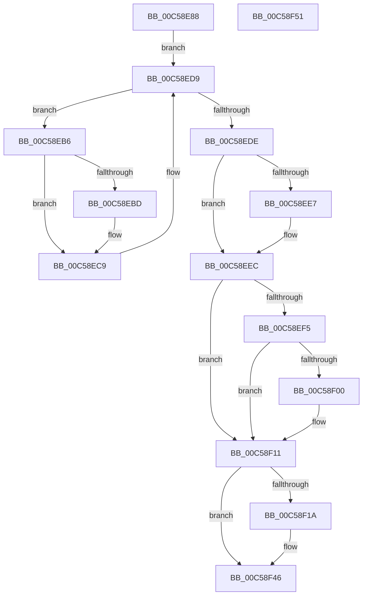

# CmInitSystem0

- RVA: `0x00C58E88`–`0x00C58F52` (길이 `202` bytes)
- VA: `0x0000000140C58E88`
- 실행 섹션: `INIT`
- PDB 이름 있음: `예`; PDB Function 태그: `아니요`
- unwind 정보 RVA: `0x0005CAAC`
- 디코드: `51`개 명령, `202/202` bytes 표시
- 미해석 바이트: `0` (있으면 어셈블리에 `.byte`로 보존)

> 이 문서는 커널 이미지의 기계어와 PDB 기호를 분석해 생성했습니다. 4번과 5번은 함수 원형과 자료형을 바이너리 사용 방식에서 추정한 C 해석이며 원본 소스 복구 결과는 아닙니다.

## 1. Dependencies

- 직접 호출 지점: **9**; 고유 호출 대상: **8**
- 직접 호출자로 확인된 함수: **1**
- RIP 상대 이미지 참조: **6**

### Outgoing calls
- `0x00C58E9F` → [CmpGetSystemControlValues](CmpGetSystemControlValues_function_00C5959C.md) (function, `0x00C5959C`)
- `0x00C58EC4` → [CmpGetSystemControlValues](CmpGetSystemControlValues_function_00C5959C.md) (function, `0x00C5959C`)
- `0x00C58EDE` → [wil_details_ShouldRegisterFeatureStagingChangeNotification](../../page/7E/wil_details_ShouldRegisterFeatureStagingChangeNotification_function_007E60F4.md) (function, `0x007E60F4`)
- `0x00C58EE7` → [wil_details_RegisterFeatureStagingChangeNotification](../../page/7E/wil_details_RegisterFeatureStagingChangeNotification_function_007E604C.md) (function, `0x007E604C`)
- `0x00C58EEC` → [wil_details_RegisterFeatureUsageProvider](../../page/7E/wil_details_RegisterFeatureUsageProvider_function_007E6080.md) (function, `0x007E6080`)
- `0x00C58F0C` → [RtlArmFeatureUsageProviderFlushNotification](../../text/4F/RtlArmFeatureUsageProviderFlushNotification_function_004F5F30.md) (function, `0x004F5F30`)
- `0x00C58F11` → [Feature_CmFcCallback__private_IsEnabledDeviceUsageNoInline](../../text/66/Feature_CmFcCallback__private_IsEnabledDeviceUsageNoInline_function_0066AA58.md) (function, `0x0066AA58`)
- `0x00C58F1A` → [CmFcDebugUpdateSystemInfo](../../text/66/CmFcDebugUpdateSystemInfo_function_0066B76C.md) (function, `0x0066B76C`)
- `0x00C58F41` → [KeRegisterBugCheckReasonCallback](../../text/47/KeRegisterBugCheckReasonCallback_function_004720A0.md) (function, `0x004720A0`)

### Direct callers
- [InitBootProcessor](../C1/InitBootProcessor_function_00C1B1C8.md) at `0x00C1B488`

### Static image references
- `0x00C58EF5` → RVA `0x00E0F458` (`.data`; read)
- `0x00C58F00` → RVA `0x00E0F3B0` (`.data`; read)
- `0x00C58F1F` → RVA `0x00E0ECC4` (`.data`; read)
- `0x00C58F26` → RVA `0x00E6250C` (`.data`; write)
- `0x00C58F33` → RVA `0x0066BAA0` (`CmFcpSecondaryMultiPartDumpDataCallback`; read)
- `0x00C58F3A` → RVA `0x00E624E0` (`.data`; read)

## 2. Other-region calls and transfers

- 다른 실행 섹션으로 향하는 call: **7**
  - `0x00C58EDE` → [wil_details_ShouldRegisterFeatureStagingChangeNotification](../../page/7E/wil_details_ShouldRegisterFeatureStagingChangeNotification_function_007E60F4.md) (`INIT` → `PAGE`)
  - `0x00C58EE7` → [wil_details_RegisterFeatureStagingChangeNotification](../../page/7E/wil_details_RegisterFeatureStagingChangeNotification_function_007E604C.md) (`INIT` → `PAGE`)
  - `0x00C58EEC` → [wil_details_RegisterFeatureUsageProvider](../../page/7E/wil_details_RegisterFeatureUsageProvider_function_007E6080.md) (`INIT` → `PAGE`)
  - `0x00C58F0C` → [RtlArmFeatureUsageProviderFlushNotification](../../text/4F/RtlArmFeatureUsageProviderFlushNotification_function_004F5F30.md) (`INIT` → `.text`)
  - `0x00C58F11` → [Feature_CmFcCallback__private_IsEnabledDeviceUsageNoInline](../../text/66/Feature_CmFcCallback__private_IsEnabledDeviceUsageNoInline_function_0066AA58.md) (`INIT` → `.text`)
  - `0x00C58F1A` → [CmFcDebugUpdateSystemInfo](../../text/66/CmFcDebugUpdateSystemInfo_function_0066B76C.md) (`INIT` → `.text`)
  - `0x00C58F41` → [KeRegisterBugCheckReasonCallback](../../text/47/KeRegisterBugCheckReasonCallback_function_004720A0.md) (`INIT` → `.text`)
- 별도 외부 분기/꼬리 이동을 확인하지 못했습니다.

## 3. Assembly (complete function range)

```asm
00C58E88  48 89 5C 24 08                  mov qword ptr [rsp + 8], rbx
00C58E8D  57                              push rdi
00C58E8E  48 83 EC 20                     sub rsp, 0x20
00C58E92  48 8B F9                        mov rdi, rcx
00C58E95  45 33 C0                        xor r8d, r8d
00C58E98  48 8B 89 A8 00 00 00            mov rcx, qword ptr [rcx + 0xa8]
00C58E9F  E8 F8 06 00 00                  call 0x140c5959c
00C58EA4  48 8B 87 F0 00 00 00            mov rax, qword ptr [rdi + 0xf0]
00C58EAB  48 05 38 01 00 00               add rax, 0x138
00C58EB1  48 8B 18                        mov rbx, qword ptr [rax]
00C58EB4  EB 23                           jmp 0x140c58ed9
00C58EB6  8B 43 18                        mov eax, dword ptr [rbx + 0x18]
00C58EB9  A8 40                           test al, 0x40
00C58EBB  74 0C                           je 0x140c58ec9
00C58EBD  48 8B 4B 20                     mov rcx, qword ptr [rbx + 0x20]
00C58EC1  41 B0 01                        mov r8b, 1
00C58EC4  E8 D3 06 00 00                  call 0x140c5959c
00C58EC9  48 8B 87 F0 00 00 00            mov rax, qword ptr [rdi + 0xf0]
00C58ED0  48 8B 1B                        mov rbx, qword ptr [rbx]
00C58ED3  48 05 38 01 00 00               add rax, 0x138
00C58ED9  48 3B D8                        cmp rbx, rax
00C58EDC  75 D8                           jne 0x140c58eb6
00C58EDE  E8 11 D2 B8 FF                  call 0x1407e60f4
00C58EE3  85 C0                           test eax, eax
00C58EE5  74 05                           je 0x140c58eec
00C58EE7  E8 60 D1 B8 FF                  call 0x1407e604c
00C58EEC  E8 8F D1 B8 FF                  call 0x1407e6080
00C58EF1  85 C0                           test eax, eax
00C58EF3  75 1C                           jne 0x140c58f11
00C58EF5  8B 05 5D 65 1B 00               mov eax, dword ptr [rip + 0x1b655d]
00C58EFB  90                              nop
00C58EFC  85 C0                           test eax, eax
00C58EFE  74 11                           je 0x140c58f11
00C58F00  48 8B 0D A9 64 1B 00            mov rcx, qword ptr [rip + 0x1b64a9]
00C58F07  BA 01 00 00 00                  mov edx, 1
00C58F0C  E8 1F D0 89 FF                  call 0x1404f5f30
00C58F11  E8 42 1B A1 FF                  call 0x14066aa58
00C58F16  85 C0                           test eax, eax
00C58F18  74 2C                           je 0x140c58f46
00C58F1A  E8 4D 28 A1 FF                  call 0x14066b76c
00C58F1F  4C 8D 0D 9E 5D 1B 00            lea r9, [rip + 0x1b5d9e]
00C58F26  C6 05 DF 95 20 00 00            mov byte ptr [rip + 0x2095df], 0
00C58F2D  41 B8 05 00 00 00               mov r8d, 5
00C58F33  48 8D 15 66 2B A1 FF            lea rdx, [rip - 0x5ed49a]
00C58F3A  48 8D 0D 9F 95 20 00            lea rcx, [rip + 0x20959f]
00C58F41  E8 5A 91 81 FF                  call 0x1404720a0
00C58F46  48 8B 5C 24 30                  mov rbx, qword ptr [rsp + 0x30]
00C58F4B  48 83 C4 20                     add rsp, 0x20
00C58F4F  5F                              pop rdi
00C58F50  C3                              ret
00C58F51  CC                              int3
```

## 4. C-style interpretation (structured pseudocode)

```c
__int64 __fastcall CmInitSystem0(__int64 a1, __int64 a2, int a3)
{
    __int64 result;
    __int64 v_rsp;
    unsigned __int64 v_stack_p8;

    v_stack_p8 = v_rbx;
    v_rsp = (v_rsp) - (32);
    a3 = 0;
    result = CmpGetSystemControlValues(*(unsigned __int64 *)(a1 + 168), a2, a3, a4);
    result = (*(unsigned __int64 *)(a1 + 240)) + (312);
    goto loc_00C58ED9;
loc_00C58EB6:
    result = (unsigned int)(*(unsigned int *)(*(unsigned __int64 *)(result) + 24));
    if ((((unsigned __int8)((unsigned int)(*(unsigned int *)(*(unsigned __int64 *)(result) + 24)))) & (64)) != 0) {
        a1 = *(unsigned __int64 *)(*(unsigned __int64 *)(result) + 32);
        a3 = 1;
        result = CmpGetSystemControlValues(a1, a2, a3, a4);
    }
    result = (*(unsigned __int64 *)(a1 + 240)) + (312);
loc_00C58ED9:
    if ((*(unsigned __int64 *)(*(unsigned __int64 *)(result))) != result) goto loc_00C58EB6;
    result = wil_details_ShouldRegisterFeatureStagingChangeNotification(a1, a2, a3, a4);
    if ((unsigned int)(result) != 0) {
        result = wil_details_RegisterFeatureStagingChangeNotification(a1, a2, a3, a4);
    }
    result = wil_details_RegisterFeatureUsageProvider(a1, a2, a3, a4);
    if ((unsigned int)(result) != 0) goto loc_00C58F11;
    result = (unsigned int)(*(unsigned int *)(v_rip + 1795421));
    if ((unsigned int)((unsigned int)(*(unsigned int *)(v_rip + 1795421))) != 0) {
        a1 = *(unsigned __int64 *)(v_rip + 1795241);
        a2 = 1;
        result = RtlArmFeatureUsageProviderFlushNotification(a1, a2, a3, a4);
    }
    result = Feature_CmFcCallback__private_IsEnabledDeviceUsageNoInline(a1, a2, a3, a4);
    if ((unsigned int)(result) != 0) {
        result = CmFcDebugUpdateSystemInfo(a1, a2, a3, a4);
        a4 = v_rip + 1793438;
        *(unsigned __int8 *)(v_rip + 2135519) = 0;
        a3 = 5;
        a2 = v_rip - 6214810;
        a1 = v_rip + 2135455;
        result = KeRegisterBugCheckReasonCallback(a1, a2, a3, a4);
    }
    v_rsp = (v_rsp) + (32);
    return result;
}
```

## 5. (Beta) C Style

```c
int64_t CmInitSystem0(void *Arg1, int64_t Arg2, int32_t Arg3)
{
    uint8_t *arg1 = (uint8_t *)Arg1;

    int64_t result;
    int64_t local_rsp;
    uint64_t v_stack_p8;

    v_stack_p8 = local_rbx;
    local_rsp = (local_rsp) - (32);
    Arg3 = 0;
    result = CmpGetSystemControlValues(*(uint64_t *)(arg1 + 0xA8), Arg2, Arg3, a4);
    result = (*(uint64_t *)(arg1 + 0xF0)) + (312);
    goto loc_00C58ED9;
loc_00C58EB6:
    result = (uint32_t)(*(uint32_t *)(*(uint64_t *)(result) + 0x18));
    if ((((uint8_t)((uint32_t)(*(uint32_t *)(*(uint64_t *)(result) + 0x18)))) & (64)) != 0) {
        Arg1 = *(uint64_t *)(*(uint64_t *)(result) + 0x20);
        Arg3 = 1;
        result = CmpGetSystemControlValues(Arg1, Arg2, Arg3, a4);
    }
    result = (*(uint64_t *)(arg1 + 0xF0)) + (312);
loc_00C58ED9:
    if ((*(uint64_t *)(*(uint64_t *)(result))) != result) goto loc_00C58EB6;
    result = wil_details_ShouldRegisterFeatureStagingChangeNotification(Arg1, Arg2, Arg3, a4);
    if ((uint32_t)(result) != 0) {
        result = wil_details_RegisterFeatureStagingChangeNotification(Arg1, Arg2, Arg3, a4);
    }
    result = wil_details_RegisterFeatureUsageProvider(Arg1, Arg2, Arg3, a4);
    if ((uint32_t)(result) != 0) goto loc_00C58F11;
    result = (uint32_t)(*(uint32_t *)(v_rip + 0x1B655D));
    if ((uint32_t)((uint32_t)(*(uint32_t *)(v_rip + 0x1B655D))) != 0) {
        Arg1 = *(uint64_t *)(v_rip + 0x1B64A9);
        Arg2 = 1;
        result = RtlArmFeatureUsageProviderFlushNotification(Arg1, Arg2, Arg3, a4);
    }
    result = Feature_CmFcCallback__private_IsEnabledDeviceUsageNoInline(Arg1, Arg2, Arg3, a4);
    if ((uint32_t)(result) != 0) {
        result = CmFcDebugUpdateSystemInfo(Arg1, Arg2, Arg3, a4);
        a4 = v_rip + 1793438;
        *(uint8_t *)(v_rip + 0x2095DF) = 0;
        Arg3 = 5;
        Arg2 = v_rip - 6214810;
        Arg1 = v_rip + 2135455;
        result = KeRegisterBugCheckReasonCallback(Arg1, Arg2, Arg3, a4);
    }
    local_rsp = (local_rsp) + (32);
    return result;
}
```

### 관측된 메모리 오프셋

구조체 형식이 확인되지 않은 접근은 인자 기준의 오프셋으로만 기록했습니다.

| 기준 인자 | 오프셋 표현 | 폭 (bit) | 접근 |
|---|---:|---:|---|
| `Arg1` | `+ 0xA8` | `64` | `R` |
| `Arg1` | `+ 0xF0` | `64` | `R` |

## 6. Execution-region graph

[열기: 2D/3D 그래프와 함수 탐색 컨트롤 패널](../../../control-panel.html?section=init&rva=0x00C58E88&view=graph)

- 2D 그래프는 위에서 아래로 흐르고, 3D 그래프는 빈 공간을 드래그해 회전합니다. Shift+드래그는 이동, 휠은 확대·축소, 함수 노드 선택은 대상 보고서 이동입니다.

### Static fallback


