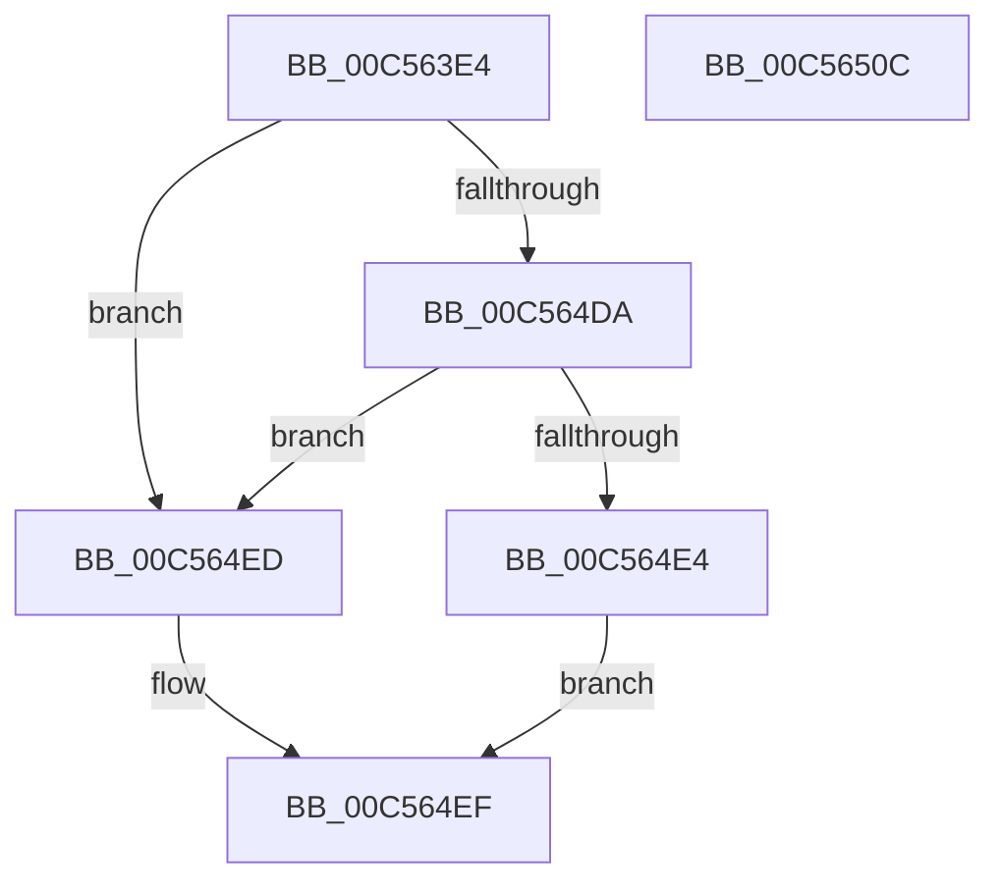

# CmIsLastKnownGoodBoot

- RVA: `0x00C563E4`–`0x00C5650D` (길이 `297` bytes)
- VA: `0x0000000140C563E4`
- 실행 섹션: `INIT`
- PDB 이름 있음: `예`; PDB Function 태그: `아니요`
- unwind 정보 RVA: `0x000D654C`
- 디코드: `73`개 명령, `297/297` bytes 표시
- 미해석 바이트: `0` (있으면 어셈블리에 `.byte`로 보존)

> 이 문서는 커널 이미지의 기계어와 PDB 기호를 분석해 생성했습니다. 4번과 5번은 함수 원형과 자료형을 바이너리 사용 방식에서 추정한 C 해석이며 원본 소스 복구 결과는 아닙니다.

## 1. Dependencies

- 직접 호출 지점: **2**; 고유 호출 대상: **2**
- 직접 호출자로 확인된 함수: **1**
- RIP 상대 이미지 참조: **5**

### Outgoing calls
- `0x00C564D1` → [RtlQueryRegistryValuesEx](../../page/8C/RtlQueryRegistryValuesEx_function_008C8FF0.md) (function, `0x008C8FF0`)
- `0x00C564F6` → [_security_check_cookie](../../text/6A/_security_check_cookie_function_006AC640.md) (function, `0x006AC640`)

### Direct callers
- [PpLastGoodDoBootProcessing](../C3/PpLastGoodDoBootProcessing_function_00C33BC4.md) at `0x00C33C23`

### Static image references
- `0x00C563F6` → RVA `0x00E0A740` (`.data`; read)
- `0x00C56406` → RVA `0x00C78D90` (` ?? ::PBOPGDP::`string'`; read)
- `0x00C56447` → RVA `0x00C7E1A0` (` ?? ::PBOPGDP::`string'`; read)
- `0x00C56464` → RVA `0x00C7E150` (` ?? ::PBOPGDP::`string'`; read)
- `0x00C56483` → RVA `0x00C7E160` (` ?? ::PBOPGDP::`string'`; read)

## 2. Other-region calls and transfers

- 다른 실행 섹션으로 향하는 call: **2**
  - `0x00C564D1` → [RtlQueryRegistryValuesEx](../../page/8C/RtlQueryRegistryValuesEx_function_008C8FF0.md) (`INIT` → `PAGE`)
  - `0x00C564F6` → [_security_check_cookie](../../text/6A/_security_check_cookie_function_006AC640.md) (`INIT` → `.text`)
- 별도 외부 분기/꼬리 이동을 확인하지 못했습니다.

## 3. Assembly (complete function range)

```asm
00C563E4  48 89 5C 24 08                  mov qword ptr [rsp + 8], rbx
00C563E9  55                              push rbp
00C563EA  48 8D 6C 24 D0                  lea rbp, [rsp - 0x30]
00C563EF  48 81 EC 30 01 00 00            sub rsp, 0x130
00C563F6  48 8B 05 43 43 1B 00            mov rax, qword ptr [rip + 0x1b4343]
00C563FD  48 33 C4                        xor rax, rsp
00C56400  48 89 45 20                     mov qword ptr [rbp + 0x20], rax
00C56404  33 DB                           xor ebx, ebx
00C56406  48 8D 05 83 29 02 00            lea rax, [rip + 0x22983]
00C5640D  48 89 44 24 50                  mov qword ptr [rsp + 0x50], rax
00C56412  4C 8D 44 24 40                  lea r8, [rsp + 0x40]
00C56417  B9 04 00 00 04                  mov ecx, 0x4000004
00C5641C  89 5C 24 38                     mov dword ptr [rsp + 0x38], ebx
00C56420  BA 20 01 00 00                  mov edx, 0x120
00C56425  89 4C 24 60                     mov dword ptr [rsp + 0x60], ecx
00C56429  48 8D 44 24 30                  lea rax, [rsp + 0x30]
00C5642E  89 54 24 48                     mov dword ptr [rsp + 0x48], edx
00C56432  48 89 44 24 58                  mov qword ptr [rsp + 0x58], rax
00C56437  45 33 C9                        xor r9d, r9d
00C5643A  48 8D 44 24 30                  lea rax, [rsp + 0x30]
00C5643F  89 55 80                        mov dword ptr [rbp - 0x80], edx
00C56442  48 89 44 24 68                  mov qword ptr [rsp + 0x68], rax
00C56447  48 8D 05 52 7D 02 00            lea rax, [rip + 0x27d52]
00C5644E  48 89 45 88                     mov qword ptr [rbp - 0x78], rax
00C56452  48 8D 44 24 34                  lea rax, [rsp + 0x34]
00C56457  48 89 45 90                     mov qword ptr [rbp - 0x70], rax
00C5645B  48 8D 44 24 34                  lea rax, [rsp + 0x34]
00C56460  48 89 45 A0                     mov qword ptr [rbp - 0x60], rax
00C56464  48 8D 05 E5 7C 02 00            lea rax, [rip + 0x27ce5]
00C5646B  48 89 45 C0                     mov qword ptr [rbp - 0x40], rax
00C5646F  48 8D 44 24 38                  lea rax, [rsp + 0x38]
00C56474  48 89 45 C8                     mov qword ptr [rbp - 0x38], rax
00C56478  48 8D 44 24 38                  lea rax, [rsp + 0x38]
00C5647D  89 4D 98                        mov dword ptr [rbp - 0x68], ecx
00C56480  89 55 B8                        mov dword ptr [rbp - 0x48], edx
00C56483  48 8D 15 D6 7C 02 00            lea rdx, [rip + 0x27cd6]
00C5648A  89 4D D0                        mov dword ptr [rbp - 0x30], ecx
00C5648D  33 C9                           xor ecx, ecx
00C5648F  48 89 45 D8                     mov qword ptr [rbp - 0x28], rax
00C56493  89 5C 24 30                     mov dword ptr [rsp + 0x30], ebx
00C56497  89 5C 24 34                     mov dword ptr [rsp + 0x34], ebx
00C5649B  48 89 5C 24 40                  mov qword ptr [rsp + 0x40], rbx
00C564A0  89 5C 24 70                     mov dword ptr [rsp + 0x70], ebx
00C564A4  48 89 5C 24 78                  mov qword ptr [rsp + 0x78], rbx
00C564A9  89 5D A8                        mov dword ptr [rbp - 0x58], ebx
00C564AC  48 89 5D B0                     mov qword ptr [rbp - 0x50], rbx
00C564B0  89 5D E0                        mov dword ptr [rbp - 0x20], ebx
00C564B3  48 89 5D E8                     mov qword ptr [rbp - 0x18], rbx
00C564B7  89 5D F0                        mov dword ptr [rbp - 0x10], ebx
00C564BA  48 89 5D F8                     mov qword ptr [rbp - 8], rbx
00C564BE  48 89 5D 00                     mov qword ptr [rbp], rbx
00C564C2  89 5D 08                        mov dword ptr [rbp + 8], ebx
00C564C5  48 89 5D 10                     mov qword ptr [rbp + 0x10], rbx
00C564C9  89 5D 18                        mov dword ptr [rbp + 0x18], ebx
00C564CC  48 89 5C 24 20                  mov qword ptr [rsp + 0x20], rbx
00C564D1  E8 1A 2B C7 FF                  call 0x1408c8ff0
00C564D6  85 C0                           test eax, eax
00C564D8  78 13                           js 0x140c564ed
00C564DA  8B 44 24 30                     mov eax, dword ptr [rsp + 0x30]
00C564DE  39 44 24 34                     cmp dword ptr [rsp + 0x34], eax
00C564E2  75 09                           jne 0x140c564ed
00C564E4  3B 44 24 38                     cmp eax, dword ptr [rsp + 0x38]
00C564E8  0F 95 C0                        setne al
00C564EB  EB 02                           jmp 0x140c564ef
00C564ED  32 C0                           xor al, al
00C564EF  48 8B 4D 20                     mov rcx, qword ptr [rbp + 0x20]
00C564F3  48 33 CC                        xor rcx, rsp
00C564F6  E8 45 61 A5 FF                  call 0x1406ac640
00C564FB  48 8B 9C 24 40 01 00 00         mov rbx, qword ptr [rsp + 0x140]
00C56503  48 81 C4 30 01 00 00            add rsp, 0x130
00C5650A  5D                              pop rbp
00C5650B  C3                              ret
00C5650C  CC                              int3
```

## 4. C-style interpretation (structured pseudocode)

```c
__int64 __fastcall CmIsLastKnownGoodBoot(__int64 a1, __int64 a2, __int64 a3, int a4)
{
    __int64 result;
    __int64 v_rbx;
    __int64 v_rsp;
    unsigned int v_stack_m100;
    unsigned __int64 v_stack_m104;
    unsigned __int64 v_stack_m108;
    unsigned __int64 v_stack_m118;
    unsigned __int64 v_stack_m18;
    unsigned int v_stack_m20;
    unsigned __int64 v_stack_m28;
    unsigned int v_stack_m30;
    unsigned __int64 v_stack_m38;
    unsigned __int64 v_stack_m40;
    unsigned int v_stack_m48;
    unsigned __int64 v_stack_m50;
    unsigned int v_stack_m58;
    unsigned __int64 v_stack_m60;
    unsigned int v_stack_m68;
    unsigned __int64 v_stack_m70;
    unsigned __int64 v_stack_m78;
    unsigned int v_stack_m80;
    unsigned __int64 v_stack_m88;
    unsigned int v_stack_m90;
    unsigned __int64 v_stack_m98;
    unsigned int v_stack_mA0;
    unsigned __int64 v_stack_mA8;
    unsigned __int64 v_stack_mB0;
    unsigned int v_stack_mB8;
    unsigned __int64 v_stack_mC0;
    unsigned int v_stack_mC8;
    unsigned __int64 v_stack_mD0;
    unsigned int v_stack_mD8;
    unsigned __int64 v_stack_mE0;
    unsigned __int64 v_stack_mE8;
    unsigned int v_stack_mF0;
    unsigned __int64 v_stack_mF8;
    unsigned __int64 v_stack_p8;

    v_stack_p8 = v_rbx;
    v_rsp = (v_rsp) - (304);
    result = (*(unsigned __int64 *)(v_rip + 1786691)) ^ (v_rsp);
    v_stack_m18 = result;
    v_rbx = 0;
    v_stack_mE8 = v_rip + 141699;
    v_stack_m100 = 0;
    v_stack_mD8 = (unsigned int)((unsigned int)(0x4000004ULL));
    v_stack_mF0 = 288;
    v_stack_mE0 = v_stack_m108;
    a4 = 0;
    v_stack_mB8 = 288;
    v_stack_mD0 = v_stack_m108;
    v_stack_mB0 = v_rip + 163154;
    v_stack_mA8 = v_stack_m104;
    v_stack_m98 = v_stack_m104;
    v_stack_m78 = v_rip + 163045;
    v_stack_m70 = v_stack_m100;
    v_stack_mA0 = (unsigned int)((unsigned int)(0x4000004ULL));
    v_stack_m80 = 288;
    v_stack_m68 = (unsigned int)((unsigned int)(0x4000004ULL));
    a1 = 0;
    v_stack_m60 = v_stack_m100;
    v_stack_m108 = 0;
    v_stack_m104 = 0;
    v_stack_mF8 = 0;
    v_stack_mC8 = 0;
    v_stack_mC0 = 0;
    v_stack_m90 = 0;
    v_stack_m88 = 0;
    v_stack_m58 = 0;
    v_stack_m50 = 0;
    v_stack_m48 = 0;
    v_stack_m40 = 0;
    v_stack_m38 = 0;
    v_stack_m30 = 0;
    v_stack_m28 = 0;
    v_stack_m20 = 0;
    v_stack_m118 = 0;
    result = RtlQueryRegistryValuesEx(a1, v_rip + 163030, v_stack_mF8, a4);
    if (sign_flag) goto loc_00C564ED;
    if (v_stack_m104 != ((unsigned int)((unsigned int)(v_stack_m108)))) goto loc_00C564ED;
    result = (((unsigned int)((unsigned int)(v_stack_m108))) != v_stack_m100) ? 1 : 0;
    goto loc_00C564EF;
loc_00C564ED:
    result = 0;
loc_00C564EF:
    a1 = (v_stack_m18) ^ (v_rsp);
    result = _security_check_cookie(a1, v_rip + 163030, v_stack_mF8, a4);
    v_rsp = (v_rsp) + (304);
    return result;
}
```

## 5. (Beta) C Style

```c
int64_t CmIsLastKnownGoodBoot(int64_t Arg1, int64_t Arg2, int64_t Arg3, int32_t Arg4)
{
    int64_t result;
    int64_t local_rbx;
    int64_t local_rsp;
    uint32_t v_stack_m100;
    uint64_t v_stack_m104;
    uint64_t v_stack_m108;
    uint64_t v_stack_m118;
    uint64_t v_stack_m18;
    uint32_t v_stack_m20;
    uint64_t v_stack_m28;
    uint32_t v_stack_m30;
    uint64_t v_stack_m38;
    uint64_t v_stack_m40;
    uint32_t v_stack_m48;
    uint64_t v_stack_m50;
    uint32_t v_stack_m58;
    uint64_t v_stack_m60;
    uint32_t v_stack_m68;
    uint64_t v_stack_m70;
    uint64_t v_stack_m78;
    uint32_t v_stack_m80;
    uint64_t v_stack_m88;
    uint32_t v_stack_m90;
    uint64_t v_stack_m98;
    uint32_t v_stack_mA0;
    uint64_t v_stack_mA8;
    uint64_t v_stack_mB0;
    uint32_t v_stack_mB8;
    uint64_t v_stack_mC0;
    uint32_t v_stack_mC8;
    uint64_t v_stack_mD0;
    uint32_t v_stack_mD8;
    uint64_t v_stack_mE0;
    uint64_t v_stack_mE8;
    uint32_t v_stack_mF0;
    uint64_t v_stack_mF8;
    uint64_t v_stack_p8;

    v_stack_p8 = local_rbx;
    local_rsp = (local_rsp) - (304);
    result = (*(uint64_t *)(v_rip + 0x1B4343)) ^ (local_rsp);
    v_stack_m18 = result;
    local_rbx = 0;
    v_stack_mE8 = v_rip + 141699;
    v_stack_m100 = 0;
    v_stack_mD8 = (uint32_t)((uint32_t)(0x4000004ULL));
    v_stack_mF0 = 288;
    v_stack_mE0 = v_stack_m108;
    Arg4 = 0;
    v_stack_mB8 = 288;
    v_stack_mD0 = v_stack_m108;
    v_stack_mB0 = v_rip + 163154;
    v_stack_mA8 = v_stack_m104;
    v_stack_m98 = v_stack_m104;
    v_stack_m78 = v_rip + 163045;
    v_stack_m70 = v_stack_m100;
    v_stack_mA0 = (uint32_t)((uint32_t)(0x4000004ULL));
    v_stack_m80 = 288;
    v_stack_m68 = (uint32_t)((uint32_t)(0x4000004ULL));
    Arg1 = 0;
    v_stack_m60 = v_stack_m100;
    v_stack_m108 = 0;
    v_stack_m104 = 0;
    v_stack_mF8 = 0;
    v_stack_mC8 = 0;
    v_stack_mC0 = 0;
    v_stack_m90 = 0;
    v_stack_m88 = 0;
    v_stack_m58 = 0;
    v_stack_m50 = 0;
    v_stack_m48 = 0;
    v_stack_m40 = 0;
    v_stack_m38 = 0;
    v_stack_m30 = 0;
    v_stack_m28 = 0;
    v_stack_m20 = 0;
    v_stack_m118 = 0;
    result = RtlQueryRegistryValuesEx(Arg1, v_rip + 163030, v_stack_mF8, Arg4);
    if (sign_flag) goto loc_00C564ED;
    if (v_stack_m104 != ((uint32_t)((uint32_t)(v_stack_m108)))) goto loc_00C564ED;
    result = (((uint32_t)((uint32_t)(v_stack_m108))) != v_stack_m100) ? 1 : 0;
    goto loc_00C564EF;
loc_00C564ED:
    result = 0;
loc_00C564EF:
    Arg1 = (v_stack_m18) ^ (local_rsp);
    result = _security_check_cookie(Arg1, v_rip + 163030, v_stack_mF8, Arg4);
    local_rsp = (local_rsp) + (304);
    return result;
}
```

## 6. Execution-region graph

[열기: 2D/3D 그래프와 함수 탐색 컨트롤 패널](../../../control-panel.html?section=init&rva=0x00C563E4&view=graph)

- 2D 그래프는 위에서 아래로 흐르고, 3D 그래프는 빈 공간을 드래그해 회전합니다. Shift+드래그는 이동, 휠은 확대·축소, 함수 노드 선택은 대상 보고서 이동입니다.

### Static fallback


