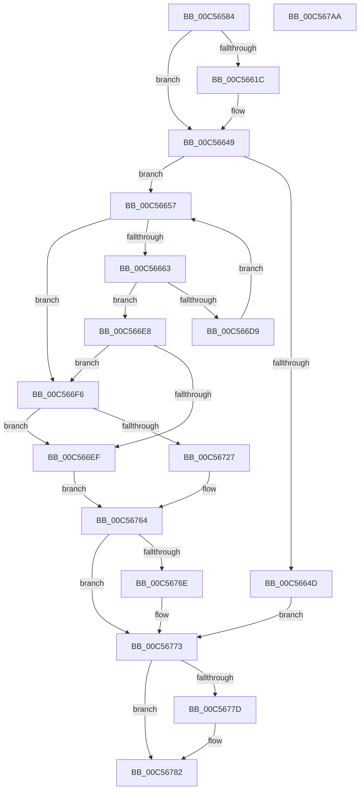

# CmpAddAliasEntry

- RVA: `0x00C56584`–`0x00C567AB` (길이 `551` bytes)
- VA: `0x0000000140C56584`
- 실행 섹션: `INIT`
- PDB 이름 있음: `예`; PDB Function 태그: `아니요`
- unwind 정보 RVA: `0x000D6404`
- 디코드: `129`개 명령, `551/551` bytes 표시
- 미해석 바이트: `0` (있으면 어셈블리에 `.byte`로 보존)

> 이 문서는 커널 이미지의 기계어와 PDB 기호를 분석해 생성했습니다. 4번과 5번은 함수 원형과 자료형을 바이너리 사용 방식에서 추정한 C 해석이며 원본 소스 복구 결과는 아닙니다.

## 1. Dependencies

- 직접 호출 지점: **11**; 고유 호출 대상: **7**
- 직접 호출자로 확인된 함수: **1**
- RIP 상대 이미지 참조: **4**

### Outgoing calls
- `0x00C5660E` → [ZwOpenKey](../../text/6A/ZwOpenKey_function_006AD310.md) (function, `0x006AD310`)
- `0x00C56642` → [ZwCreateKey](../../text/6A/ZwCreateKey_function_006AD470.md) (function, `0x006AD470`)
- `0x00C5668F` → [RtlUnicodeStringPrintf](../../text/48/RtlUnicodeStringPrintf_function_0048B984.md) (function, `0x0048B984`)
- `0x00C566CE` → [ZwOpenKey](../../text/6A/ZwOpenKey_function_006AD310.md) (function, `0x006AD310`)
- `0x00C566DE` → [ZwClose](../../text/6A/ZwClose_function_006AD2B0.md) (function, `0x006AD2B0`)
- `0x00C5671C` → [ZwCreateKey](../../text/6A/ZwCreateKey_function_006AD470.md) (function, `0x006AD470`)
- `0x00C5672F` → [CmpAddDockingInfo](CmpAddDockingInfo_function_00C567B4.md) (function, `0x00C567B4`)
- `0x00C5675D` → [ZwSetValueKey](../../text/6A/ZwSetValueKey_function_006ADCD0.md) (function, `0x006ADCD0`)
- `0x00C5676E` → [ZwClose](../../text/6A/ZwClose_function_006AD2B0.md) (function, `0x006AD2B0`)
- `0x00C5677D` → [ZwClose](../../text/6A/ZwClose_function_006AD2B0.md) (function, `0x006AD2B0`)
- `0x00C5678E` → [_security_check_cookie](../../text/6A/_security_check_cookie_function_006AC640.md) (function, `0x006AC640`)

### Direct callers
- [CmpCreateHardwareProfiles](CmpCreateHardwareProfiles_function_00C56EF4.md) at `0x00C5741D`

### Static image references
- `0x00C5659F` → RVA `0x00E0A740` (`.data`; read)
- `0x00C565D0` → RVA `0x00C823A0` (`CmpStrAliasString`; read)
- `0x00C56666` → RVA `0x00C7E380` (` ?? ::PBOPGDP::`string'`; read)
- `0x00C5674E` → RVA `0x00C823F0` (`CmpStrProfileNumberString`; read)

## 2. Other-region calls and transfers

- 다른 실행 섹션으로 향하는 call: **10**
  - `0x00C5660E` → [ZwOpenKey](../../text/6A/ZwOpenKey_function_006AD310.md) (`INIT` → `.text`)
  - `0x00C56642` → [ZwCreateKey](../../text/6A/ZwCreateKey_function_006AD470.md) (`INIT` → `.text`)
  - `0x00C5668F` → [RtlUnicodeStringPrintf](../../text/48/RtlUnicodeStringPrintf_function_0048B984.md) (`INIT` → `.text`)
  - `0x00C566CE` → [ZwOpenKey](../../text/6A/ZwOpenKey_function_006AD310.md) (`INIT` → `.text`)
  - `0x00C566DE` → [ZwClose](../../text/6A/ZwClose_function_006AD2B0.md) (`INIT` → `.text`)
  - `0x00C5671C` → [ZwCreateKey](../../text/6A/ZwCreateKey_function_006AD470.md) (`INIT` → `.text`)
  - `0x00C5675D` → [ZwSetValueKey](../../text/6A/ZwSetValueKey_function_006ADCD0.md) (`INIT` → `.text`)
  - `0x00C5676E` → [ZwClose](../../text/6A/ZwClose_function_006AD2B0.md) (`INIT` → `.text`)
  - `0x00C5677D` → [ZwClose](../../text/6A/ZwClose_function_006AD2B0.md) (`INIT` → `.text`)
  - `0x00C5678E` → [_security_check_cookie](../../text/6A/_security_check_cookie_function_006AC640.md) (`INIT` → `.text`)
- 별도 외부 분기/꼬리 이동을 확인하지 못했습니다.

## 3. Assembly (complete function range)

```asm
00C56584  48 89 5C 24 20                  mov qword ptr [rsp + 0x20], rbx
00C56589  55                              push rbp
00C5658A  56                              push rsi
00C5658B  57                              push rdi
00C5658C  41 56                           push r14
00C5658E  41 57                           push r15
00C56590  48 8D AC 24 50 FF FF FF         lea rbp, [rsp - 0xb0]
00C56598  48 81 EC B0 01 00 00            sub rsp, 0x1b0
00C5659F  48 8B 05 9A 41 1B 00            mov rax, qword ptr [rip + 0x1b419a]
00C565A6  48 33 C4                        xor rax, rsp
00C565A9  48 89 85 A0 00 00 00            mov qword ptr [rbp + 0xa0], rax
00C565B0  45 33 FF                        xor r15d, r15d
00C565B3  48 89 4C 24 70                  mov qword ptr [rsp + 0x70], rcx
00C565B8  0F 57 C0                        xorps xmm0, xmm0
00C565BB  4C 89 7C 24 50                  mov qword ptr [rsp + 0x50], r15
00C565C0  45 8B F0                        mov r14d, r8d
00C565C3  4C 89 7C 24 40                  mov qword ptr [rsp + 0x40], r15
00C565C8  48 8B F2                        mov rsi, rdx
00C565CB  44 89 7C 24 4C                  mov dword ptr [rsp + 0x4c], r15d
00C565D0  48 8D 05 C9 BD 02 00            lea rax, [rip + 0x2bdc9]
00C565D7  44 89 7C 24 48                  mov dword ptr [rsp + 0x48], r15d
00C565DC  4C 8D 44 24 68                  lea r8, [rsp + 0x68]
00C565E1  48 89 44 24 78                  mov qword ptr [rsp + 0x78], rax
00C565E6  BA 1F 00 02 00                  mov edx, 0x2001f
00C565EB  48 C7 44 24 68 30 00 00 00      mov qword ptr [rsp + 0x68], 0x30
00C565F4  48 8D 4C 24 50                  lea rcx, [rsp + 0x50]
00C565F9  48 C7 45 80 40 02 00 00         mov qword ptr [rbp - 0x80], 0x240
00C56601  0F 11 44 24 58                  movups xmmword ptr [rsp + 0x58], xmm0
00C56606  41 8B FF                        mov edi, r15d
00C56609  F3 0F 7F 45 88                  movdqu xmmword ptr [rbp - 0x78], xmm0
00C5660E  E8 FD 6C A5 FF                  call 0x1406ad310
00C56613  8B D8                           mov ebx, eax
00C56615  3D 34 00 00 C0                  cmp eax, 0xc0000034
00C5661A  75 2D                           jne 0x140c56649
00C5661C  48 8D 44 24 48                  lea rax, [rsp + 0x48]
00C56621  45 33 C9                        xor r9d, r9d
00C56624  48 89 44 24 30                  mov qword ptr [rsp + 0x30], rax
00C56629  4C 8D 44 24 68                  lea r8, [rsp + 0x68]
00C5662E  44 89 7C 24 28                  mov dword ptr [rsp + 0x28], r15d
00C56633  48 8D 4C 24 50                  lea rcx, [rsp + 0x50]
00C56638  BA 1F 00 02 00                  mov edx, 0x2001f
00C5663D  4C 89 7C 24 20                  mov qword ptr [rsp + 0x20], r15
00C56642  E8 29 6E A5 FF                  call 0x1406ad470
00C56647  8B D8                           mov ebx, eax
00C56649  85 DB                           test ebx, ebx
00C5664B  79 0A                           jns 0x140c56657
00C5664D  4C 89 7C 24 50                  mov qword ptr [rsp + 0x50], r15
00C56652  E9 1C 01 00 00                  jmp 0x140c56773
00C56657  81 FF C8 00 00 00               cmp edi, 0xc8
00C5665D  0F 83 93 00 00 00               jae 0x140c566f6
00C56663  0F 57 C0                        xorps xmm0, xmm0
00C56666  48 8D 15 13 7D 02 00            lea rdx, [rip + 0x27d13]
00C5666D  0F 11 44 24 58                  movups xmmword ptr [rsp + 0x58], xmm0
00C56672  B8 00 01 00 00                  mov eax, 0x100
00C56677  48 8D 4C 24 58                  lea rcx, [rsp + 0x58]
00C5667C  66 89 44 24 5A                  mov word ptr [rsp + 0x5a], ax
00C56681  FF C7                           inc edi
00C56683  48 8D 45 A0                     lea rax, [rbp - 0x60]
00C56687  44 8B C7                        mov r8d, edi
00C5668A  48 89 44 24 60                  mov qword ptr [rsp + 0x60], rax
00C5668F  E8 F0 52 83 FF                  call 0x14048b984
00C56694  48 8B 44 24 50                  mov rax, qword ptr [rsp + 0x50]
00C56699  4C 8D 44 24 68                  lea r8, [rsp + 0x68]
00C5669E  48 89 44 24 70                  mov qword ptr [rsp + 0x70], rax
00C566A3  48 8D 4C 24 40                  lea rcx, [rsp + 0x40]
00C566A8  48 8D 44 24 58                  lea rax, [rsp + 0x58]
00C566AD  C7 44 24 68 30 00 00 00         mov dword ptr [rsp + 0x68], 0x30
00C566B5  0F 57 C0                        xorps xmm0, xmm0
00C566B8  48 89 44 24 78                  mov qword ptr [rsp + 0x78], rax
00C566BD  BA 1F 00 02 00                  mov edx, 0x2001f
00C566C2  C7 45 80 40 02 00 00            mov dword ptr [rbp - 0x80], 0x240
00C566C9  F3 0F 7F 45 88                  movdqu xmmword ptr [rbp - 0x78], xmm0
00C566CE  E8 3D 6C A5 FF                  call 0x1406ad310
00C566D3  8B D8                           mov ebx, eax
00C566D5  85 C0                           test eax, eax
00C566D7  78 0F                           js 0x140c566e8
00C566D9  48 8B 4C 24 40                  mov rcx, qword ptr [rsp + 0x40]
00C566DE  E8 CD 6B A5 FF                  call 0x1406ad2b0
00C566E3  E9 6F FF FF FF                  jmp 0x140c56657
00C566E8  3D 34 00 00 C0                  cmp eax, 0xc0000034
00C566ED  74 07                           je 0x140c566f6
00C566EF  4C 89 7C 24 40                  mov qword ptr [rsp + 0x40], r15
00C566F4  EB 6E                           jmp 0x140c56764
00C566F6  48 8D 44 24 48                  lea rax, [rsp + 0x48]
00C566FB  45 33 C9                        xor r9d, r9d
00C566FE  48 89 44 24 30                  mov qword ptr [rsp + 0x30], rax
00C56703  4C 8D 44 24 68                  lea r8, [rsp + 0x68]
00C56708  44 89 7C 24 28                  mov dword ptr [rsp + 0x28], r15d
00C5670D  48 8D 4C 24 40                  lea rcx, [rsp + 0x40]
00C56712  BA 1F 00 02 00                  mov edx, 0x2001f
00C56717  4C 89 7C 24 20                  mov qword ptr [rsp + 0x20], r15
00C5671C  E8 4F 6D A5 FF                  call 0x1406ad470
00C56721  8B D8                           mov ebx, eax
00C56723  85 C0                           test eax, eax
00C56725  78 C8                           js 0x140c566ef
00C56727  48 8B 4C 24 40                  mov rcx, qword ptr [rsp + 0x40]
00C5672C  48 8B D6                        mov rdx, rsi
00C5672F  E8 80 00 00 00                  call 0x140c567b4
00C56734  48 8B 4C 24 40                  mov rcx, qword ptr [rsp + 0x40]
00C56739  48 8D 44 24 4C                  lea rax, [rsp + 0x4c]
00C5673E  41 B9 04 00 00 00               mov r9d, 4
00C56744  44 89 74 24 4C                  mov dword ptr [rsp + 0x4c], r14d
00C56749  44 89 4C 24 28                  mov dword ptr [rsp + 0x28], r9d
00C5674E  48 8D 15 9B BC 02 00            lea rdx, [rip + 0x2bc9b]
00C56755  45 33 C0                        xor r8d, r8d
00C56758  48 89 44 24 20                  mov qword ptr [rsp + 0x20], rax
00C5675D  E8 6E 75 A5 FF                  call 0x1406adcd0
00C56762  8B D8                           mov ebx, eax
00C56764  48 8B 4C 24 50                  mov rcx, qword ptr [rsp + 0x50]
00C56769  48 85 C9                        test rcx, rcx
00C5676C  74 05                           je 0x140c56773
00C5676E  E8 3D 6B A5 FF                  call 0x1406ad2b0
00C56773  48 8B 4C 24 40                  mov rcx, qword ptr [rsp + 0x40]
00C56778  48 85 C9                        test rcx, rcx
00C5677B  74 05                           je 0x140c56782
00C5677D  E8 2E 6B A5 FF                  call 0x1406ad2b0
00C56782  8B C3                           mov eax, ebx
00C56784  48 8B 8D A0 00 00 00            mov rcx, qword ptr [rbp + 0xa0]
00C5678B  48 33 CC                        xor rcx, rsp
00C5678E  E8 AD 5E A5 FF                  call 0x1406ac640
00C56793  48 8B 9C 24 F8 01 00 00         mov rbx, qword ptr [rsp + 0x1f8]
00C5679B  48 81 C4 B0 01 00 00            add rsp, 0x1b0
00C567A2  41 5F                           pop r15
00C567A4  41 5E                           pop r14
00C567A6  5F                              pop rdi
00C567A7  5E                              pop rsi
00C567A8  5D                              pop rbp
00C567A9  C3                              ret
00C567AA  CC                              int3
```

## 4. C-style interpretation (structured pseudocode)

```c
__int64 __fastcall CmpAddAliasEntry(__int64 a1, __int64 a2, int a3, int a4)
{
    __int64 result;
    __int64 v_r15;
    __int64 v_rbx;
    __int64 v_rdi;
    __int64 v_rsp;
    unsigned __int64 v_stack_m138;
    unsigned __int64 v_stack_m150;
    unsigned __int64 v_stack_m158;
    unsigned __int64 v_stack_m160;
    unsigned __int64 v_stack_m168;
    unsigned __int64 v_stack_m170;
    unsigned __int64 v_stack_m178;
    unsigned __int16 v_stack_m17E;
    unsigned __int64 v_stack_m180;
    unsigned __int64 v_stack_m188;
    unsigned int v_stack_m18C;
    unsigned int v_stack_m190;
    unsigned __int64 v_stack_m198;
    unsigned __int64 v_stack_m1A8;
    unsigned int v_stack_m1B0;
    unsigned __int64 v_stack_m1B8;
    unsigned __int64 v_stack_m38;
    unsigned __int64 v_stack_mD8;
    unsigned __int64 v_stack_p20;

    v_stack_p20 = v_rbx;
    v_rsp = (v_rsp) - (432);
    result = (*(unsigned __int64 *)(v_rip + 1786266)) ^ (v_rsp);
    v_stack_m38 = result;
    v_r15 = 0;
    v_stack_m168 = a1;
    v_stack_m188 = 0;
    v_stack_m198 = 0;
    v_stack_m18C = 0;
    v_stack_m190 = 0;
    v_stack_m160 = v_rip + 179657;
    v_stack_m170 = 48;
    v_stack_m158 = 576;
    v_stack_m180 = v_xmm0;
    v_stack_m150 = v_xmm0;
    result = ZwOpenKey(v_stack_m188, (unsigned int)(0x2001FULL), v_stack_m170, a4);
    v_rbx = (unsigned int)((unsigned int)(result));
    if (((unsigned int)(result)) == 0xC0000034ULL) {
        result = v_stack_m190;
        a4 = 0;
        v_stack_m1A8 = result;
        a3 = v_stack_m170;
        v_stack_m1B0 = 0;
        a1 = v_stack_m188;
        a2 = 0x2001FULL;
        v_stack_m1B8 = 0;
        result = ZwCreateKey(a1, a2, a3, a4);
        v_rbx = (unsigned int)(result);
    }
    if (!sign_flag) goto loc_00C56657;
    v_stack_m188 = 0;
    goto loc_00C56773;
loc_00C56657:
    if (0 >= 200) goto loc_00C566F6;
    v_stack_m180 = v_xmm0;
    v_stack_m17E = 256;
    v_rdi = (unsigned int)((0) + 1);
    v_stack_m178 = v_stack_m138;
    result = RtlUnicodeStringPrintf(v_stack_m180, v_rip + 163091, (unsigned int)((unsigned int)(v_rdi)), a4);
    v_stack_m168 = v_stack_m188;
    v_stack_m170 = 48;
    v_stack_m160 = v_stack_m180;
    v_stack_m158 = 576;
    v_stack_m150 = v_xmm0;
    result = ZwOpenKey(v_stack_m198, (unsigned int)(0x2001FULL), v_stack_m170, a4);
    if (sign_flag) goto loc_00C566E8;
    result = ZwClose(v_stack_m198, (unsigned int)(0x2001FULL), v_stack_m170, a4);
    goto loc_00C56657;
loc_00C566E8:
    if (((unsigned int)(result)) == 0xC0000034ULL) goto loc_00C566F6;
loc_00C566EF:
    v_stack_m198 = 0;
    goto loc_00C56764;
loc_00C566F6:
    a4 = 0;
    v_stack_m1A8 = v_stack_m190;
    v_stack_m1B0 = 0;
    v_stack_m1B8 = 0;
    result = ZwCreateKey(v_stack_m198, (unsigned int)(0x2001FULL), v_stack_m170, a4);
    if (sign_flag) goto loc_00C566EF;
    result = CmpAddDockingInfo(v_stack_m198, a2, v_stack_m170, a4);
    v_stack_m18C = (unsigned int)((unsigned int)(a3));
    v_stack_m1B0 = 4;
    a3 = 0;
    v_stack_m1B8 = v_stack_m18C;
    result = ZwSetValueKey(v_stack_m198, v_rip + 179355, a3, 4);
loc_00C56764:
    if (v_stack_m188 != 0) {
        result = ZwClose(v_stack_m188, v_rip + 179355, a3, 4);
    }
    if (v_stack_m198 != 0) {
        result = ZwClose(v_stack_m198, v_rip + 179355, a3, 4);
    }
    a1 = (v_stack_m38) ^ (v_rsp);
    result = _security_check_cookie(a1, v_rip + 179355, a3, 4);
    v_rsp = (v_rsp) + (432);
    return result;
}
```

## 5. (Beta) C Style

```c
int64_t CmpAddAliasEntry(int64_t Arg1, int64_t Arg2, int32_t Arg3, int32_t Arg4)
{
    int64_t result;
    int64_t local_r15;
    int64_t local_rbx;
    int64_t local_rdi;
    int64_t local_rsp;
    uint64_t v_stack_m138;
    uint64_t v_stack_m150;
    uint64_t v_stack_m158;
    uint64_t v_stack_m160;
    uint64_t v_stack_m168;
    uint64_t v_stack_m170;
    uint64_t v_stack_m178;
    uint16_t v_stack_m17E;
    uint64_t v_stack_m180;
    uint64_t v_stack_m188;
    uint32_t v_stack_m18C;
    uint32_t v_stack_m190;
    uint64_t v_stack_m198;
    uint64_t v_stack_m1A8;
    uint32_t v_stack_m1B0;
    uint64_t v_stack_m1B8;
    uint64_t v_stack_m38;
    uint64_t v_stack_mD8;
    uint64_t v_stack_p20;

    v_stack_p20 = local_rbx;
    local_rsp = (local_rsp) - (432);
    result = (*(uint64_t *)(v_rip + 0x1B419A)) ^ (local_rsp);
    v_stack_m38 = result;
    local_r15 = 0;
    v_stack_m168 = Arg1;
    v_stack_m188 = 0;
    v_stack_m198 = 0;
    v_stack_m18C = 0;
    v_stack_m190 = 0;
    v_stack_m160 = v_rip + 179657;
    v_stack_m170 = 48;
    v_stack_m158 = 576;
    v_stack_m180 = v_xmm0;
    v_stack_m150 = v_xmm0;
    result = ZwOpenKey(v_stack_m188, (uint32_t)(0x2001FULL), v_stack_m170, Arg4);
    local_rbx = (uint32_t)((uint32_t)(result));
    if (((uint32_t)(result)) == 0xC0000034ULL) {
        result = v_stack_m190;
        Arg4 = 0;
        v_stack_m1A8 = result;
        Arg3 = v_stack_m170;
        v_stack_m1B0 = 0;
        Arg1 = v_stack_m188;
        Arg2 = 0x2001FULL;
        v_stack_m1B8 = 0;
        result = ZwCreateKey(Arg1, Arg2, Arg3, Arg4);
        local_rbx = (uint32_t)(result);
    }
    if (!sign_flag) goto loc_00C56657;
    v_stack_m188 = 0;
    goto loc_00C56773;
loc_00C56657:
    if (0 >= 200) goto loc_00C566F6;
    v_stack_m180 = v_xmm0;
    v_stack_m17E = 256;
    local_rdi = (uint32_t)((0) + 1);
    v_stack_m178 = v_stack_m138;
    result = RtlUnicodeStringPrintf(v_stack_m180, v_rip + 163091, (uint32_t)((uint32_t)(local_rdi)), Arg4);
    v_stack_m168 = v_stack_m188;
    v_stack_m170 = 48;
    v_stack_m160 = v_stack_m180;
    v_stack_m158 = 576;
    v_stack_m150 = v_xmm0;
    result = ZwOpenKey(v_stack_m198, (uint32_t)(0x2001FULL), v_stack_m170, Arg4);
    if (sign_flag) goto loc_00C566E8;
    result = ZwClose(v_stack_m198, (uint32_t)(0x2001FULL), v_stack_m170, Arg4);
    goto loc_00C56657;
loc_00C566E8:
    if (((uint32_t)(result)) == 0xC0000034ULL) goto loc_00C566F6;
loc_00C566EF:
    v_stack_m198 = 0;
    goto loc_00C56764;
loc_00C566F6:
    Arg4 = 0;
    v_stack_m1A8 = v_stack_m190;
    v_stack_m1B0 = 0;
    v_stack_m1B8 = 0;
    result = ZwCreateKey(v_stack_m198, (uint32_t)(0x2001FULL), v_stack_m170, Arg4);
    if (sign_flag) goto loc_00C566EF;
    result = CmpAddDockingInfo(v_stack_m198, Arg2, v_stack_m170, Arg4);
    v_stack_m18C = (uint32_t)((uint32_t)(Arg3));
    v_stack_m1B0 = 4;
    Arg3 = 0;
    v_stack_m1B8 = v_stack_m18C;
    result = ZwSetValueKey(v_stack_m198, v_rip + 179355, Arg3, 4);
loc_00C56764:
    if (v_stack_m188 != 0) {
        result = ZwClose(v_stack_m188, v_rip + 179355, Arg3, 4);
    }
    if (v_stack_m198 != 0) {
        result = ZwClose(v_stack_m198, v_rip + 179355, Arg3, 4);
    }
    Arg1 = (v_stack_m38) ^ (local_rsp);
    result = _security_check_cookie(Arg1, v_rip + 179355, Arg3, 4);
    local_rsp = (local_rsp) + (432);
    return result;
}
```

## 6. Execution-region graph

[열기: 2D/3D 그래프와 함수 탐색 컨트롤 패널](../../../control-panel.html?section=init&rva=0x00C56584&view=graph)

- 2D 그래프는 위에서 아래로 흐르고, 3D 그래프는 빈 공간을 드래그해 회전합니다. Shift+드래그는 이동, 휠은 확대·축소, 함수 노드 선택은 대상 보고서 이동입니다.

### Static fallback


