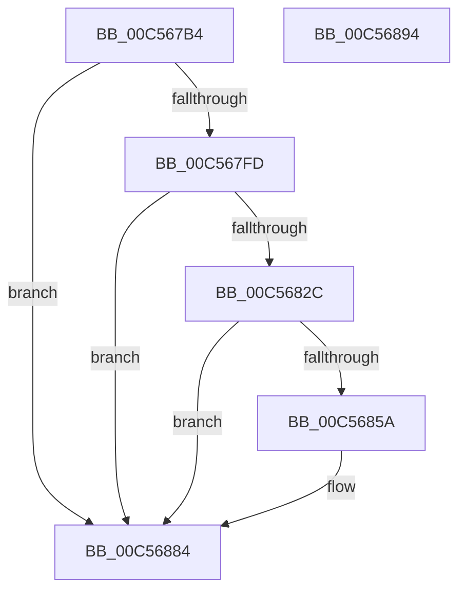

# CmpAddDockingInfo

- RVA: `0x00C567B4`–`0x00C56895` (길이 `225` bytes)
- VA: `0x0000000140C567B4`
- 실행 섹션: `INIT`
- PDB 이름 있음: `예`; PDB Function 태그: `아니요`
- unwind 정보 RVA: `0x000CE124`
- 디코드: `59`개 명령, `225/225` bytes 표시
- 미해석 바이트: `0` (있으면 어셈블리에 `.byte`로 보존)

> 이 문서는 커널 이미지의 기계어와 PDB 기호를 분석해 생성했습니다. 4번과 5번은 함수 원형과 자료형을 바이너리 사용 방식에서 추정한 C 해석이며 원본 소스 복구 결과는 아닙니다.

## 1. Dependencies

- 직접 호출 지점: **4**; 고유 호출 대상: **1**
- 직접 호출자로 확인된 함수: **2**
- RIP 상대 이미지 참조: **4**

### Outgoing calls
- `0x00C567F0` → [NtSetValueKey](../../page/84/NtSetValueKey_function_00844EA0.md) (function, `0x00844EA0`)
- `0x00C56823` → [NtSetValueKey](../../page/84/NtSetValueKey_function_00844EA0.md) (function, `0x00844EA0`)
- `0x00C56851` → [NtSetValueKey](../../page/84/NtSetValueKey_function_00844EA0.md) (function, `0x00844EA0`)
- `0x00C5687F` → [NtSetValueKey](../../page/84/NtSetValueKey_function_00844EA0.md) (function, `0x00844EA0`)

### Direct callers
- [CmpAddAliasEntry](CmpAddAliasEntry_function_00C56584.md) at `0x00C5672F`
- [CmpCreateHardwareProfiles](CmpCreateHardwareProfiles_function_00C56EF4.md) at `0x00C57484`

### Static image references
- `0x00C567E6` → RVA `0x00C823E0` (`CmpStrDockingStateString`; read)
- `0x00C56801` → RVA `0x00C823B0` (`CmpStrCapabilitiesString`; read)
- `0x00C5682F` → RVA `0x00C823D0` (`CmpStrDockIdString`; read)
- `0x00C5685D` → RVA `0x00C82400` (`CmpStrSerialNumberString`; read)

## 2. Other-region calls and transfers

- 다른 실행 섹션으로 향하는 call: **4**
  - `0x00C567F0` → [NtSetValueKey](../../page/84/NtSetValueKey_function_00844EA0.md) (`INIT` → `PAGE`)
  - `0x00C56823` → [NtSetValueKey](../../page/84/NtSetValueKey_function_00844EA0.md) (`INIT` → `PAGE`)
  - `0x00C56851` → [NtSetValueKey](../../page/84/NtSetValueKey_function_00844EA0.md) (`INIT` → `PAGE`)
  - `0x00C5687F` → [NtSetValueKey](../../page/84/NtSetValueKey_function_00844EA0.md) (`INIT` → `PAGE`)
- 별도 외부 분기/꼬리 이동을 확인하지 못했습니다.

## 3. Assembly (complete function range)

```asm
00C567B4  4C 8B DC                        mov r11, rsp
00C567B7  49 89 5B 08                     mov qword ptr [r11 + 8], rbx
00C567BB  49 89 73 18                     mov qword ptr [r11 + 0x18], rsi
00C567BF  57                              push rdi
00C567C0  48 83 EC 30                     sub rsp, 0x30
00C567C4  0F B7 42 04                     movzx eax, word ptr [rdx + 4]
00C567C8  BE 04 00 00 00                  mov esi, 4
00C567CD  89 44 24 48                     mov dword ptr [rsp + 0x48], eax
00C567D1  48 8B DA                        mov rbx, rdx
00C567D4  49 8D 43 10                     lea rax, [r11 + 0x10]
00C567D8  89 74 24 28                     mov dword ptr [rsp + 0x28], esi
00C567DC  44 8B CE                        mov r9d, esi
00C567DF  49 89 43 E8                     mov qword ptr [r11 - 0x18], rax
00C567E3  45 33 C0                        xor r8d, r8d
00C567E6  48 8D 15 F3 BB 02 00            lea rdx, [rip + 0x2bbf3]
00C567ED  48 8B F9                        mov rdi, rcx
00C567F0  E8 AB E6 BE FF                  call 0x140844ea0
00C567F5  85 C0                           test eax, eax
00C567F7  0F 88 87 00 00 00               js 0x140c56884
00C567FD  0F B7 43 06                     movzx eax, word ptr [rbx + 6]
00C56801  48 8D 15 A8 BB 02 00            lea rdx, [rip + 0x2bba8]
00C56808  89 44 24 48                     mov dword ptr [rsp + 0x48], eax
00C5680C  44 8B CE                        mov r9d, esi
00C5680F  48 8D 44 24 48                  lea rax, [rsp + 0x48]
00C56814  89 74 24 28                     mov dword ptr [rsp + 0x28], esi
00C56818  45 33 C0                        xor r8d, r8d
00C5681B  48 89 44 24 20                  mov qword ptr [rsp + 0x20], rax
00C56820  48 8B CF                        mov rcx, rdi
00C56823  E8 78 E6 BE FF                  call 0x140844ea0
00C56828  85 C0                           test eax, eax
00C5682A  78 58                           js 0x140c56884
00C5682C  8B 43 08                        mov eax, dword ptr [rbx + 8]
00C5682F  48 8D 15 9A BB 02 00            lea rdx, [rip + 0x2bb9a]
00C56836  89 44 24 48                     mov dword ptr [rsp + 0x48], eax
00C5683A  44 8B CE                        mov r9d, esi
00C5683D  48 8D 44 24 48                  lea rax, [rsp + 0x48]
00C56842  89 74 24 28                     mov dword ptr [rsp + 0x28], esi
00C56846  45 33 C0                        xor r8d, r8d
00C56849  48 89 44 24 20                  mov qword ptr [rsp + 0x20], rax
00C5684E  48 8B CF                        mov rcx, rdi
00C56851  E8 4A E6 BE FF                  call 0x140844ea0
00C56856  85 C0                           test eax, eax
00C56858  78 2A                           js 0x140c56884
00C5685A  8B 43 0C                        mov eax, dword ptr [rbx + 0xc]
00C5685D  48 8D 15 9C BB 02 00            lea rdx, [rip + 0x2bb9c]
00C56864  89 44 24 48                     mov dword ptr [rsp + 0x48], eax
00C56868  44 8B CE                        mov r9d, esi
00C5686B  48 8D 44 24 48                  lea rax, [rsp + 0x48]
00C56870  89 74 24 28                     mov dword ptr [rsp + 0x28], esi
00C56874  45 33 C0                        xor r8d, r8d
00C56877  48 89 44 24 20                  mov qword ptr [rsp + 0x20], rax
00C5687C  48 8B CF                        mov rcx, rdi
00C5687F  E8 1C E6 BE FF                  call 0x140844ea0
00C56884  48 8B 5C 24 40                  mov rbx, qword ptr [rsp + 0x40]
00C56889  48 8B 74 24 50                  mov rsi, qword ptr [rsp + 0x50]
00C5688E  48 83 C4 30                     add rsp, 0x30
00C56892  5F                              pop rdi
00C56893  C3                              ret
00C56894  CC                              int3
```

## 4. C-style interpretation (structured pseudocode)

```c
__int64 __fastcall CmpAddDockingInfo(__int64 a1, __int64 a2, int a3)
{
    __int64 result;
    __int64 v_rsp;
    unsigned int v_stack_m10;
    unsigned __int64 v_stack_m18;
    unsigned int v_stack_p10;
    unsigned __int64 v_stack_p18;
    unsigned __int64 v_stack_p8;

    *(unsigned __int64 *)(v_rsp + 8) = v_rbx;
    *(unsigned __int64 *)(v_rsp + 24) = v_rsi;
    v_rsp = (v_rsp) - (48);
    v_stack_p10 = (unsigned int)(*(unsigned __int16 *)(a2 + 4));
    v_stack_m10 = 4;
    *(unsigned __int64 *)(v_rsp - 24) = v_rsp + 16;
    a3 = 0;
    result = NtSetValueKey(a1, v_rip + 179187, a3, 4);
    if (sign_flag) goto loc_00C56884;
    v_stack_p10 = (unsigned int)(*(unsigned __int16 *)(a2 + 6));
    v_stack_m10 = 4;
    a3 = 0;
    v_stack_m18 = v_stack_p10;
    result = NtSetValueKey(a1, v_rip + 179112, a3, 4);
    if (sign_flag) goto loc_00C56884;
    v_stack_p10 = (unsigned int)((unsigned int)(*(unsigned int *)(a2 + 8)));
    v_stack_m10 = 4;
    a3 = 0;
    v_stack_m18 = v_stack_p10;
    result = NtSetValueKey(a1, v_rip + 179098, a3, 4);
    if (!(sign_flag)) {
        result = *(unsigned int *)(a2 + 12);
        a2 = v_rip + 179100;
        v_stack_p10 = (unsigned int)(result);
        a4 = 4;
        result = v_stack_p10;
        v_stack_m10 = 4;
        a3 = 0;
        v_stack_m18 = result;
        a1 = a1;
        result = NtSetValueKey(a1, a2, a3, a4);
    }
    v_rsp = (v_rsp) + (48);
    return result;
}
```

## 5. (Beta) C Style

```c
int64_t CmpAddDockingInfo(int64_t Arg1, void *Arg2, int32_t Arg3)
{
    uint8_t *arg2 = (uint8_t *)Arg2;

    int64_t result;
    int64_t local_rsp;
    uint32_t v_stack_m10;
    uint64_t v_stack_m18;
    uint32_t v_stack_p10;
    uint64_t v_stack_p18;
    uint64_t v_stack_p8;

    *(uint64_t *)(local_rsp + 0x8) = local_rbx;
    *(uint64_t *)(local_rsp + 0x18) = local_rsi;
    local_rsp = (local_rsp) - (48);
    v_stack_p10 = (uint32_t)(*(uint16_t *)(arg2 + 0x4));
    v_stack_m10 = 4;
    *(uint64_t *)(local_rsp - 0x18) = local_rsp + 16;
    Arg3 = 0;
    result = NtSetValueKey(Arg1, v_rip + 179187, Arg3, 4);
    if (sign_flag) goto loc_00C56884;
    v_stack_p10 = (uint32_t)(*(uint16_t *)(arg2 + 0x6));
    v_stack_m10 = 4;
    Arg3 = 0;
    v_stack_m18 = v_stack_p10;
    result = NtSetValueKey(Arg1, v_rip + 179112, Arg3, 4);
    if (sign_flag) goto loc_00C56884;
    v_stack_p10 = (uint32_t)((uint32_t)(*(uint32_t *)(arg2 + 0x8)));
    v_stack_m10 = 4;
    Arg3 = 0;
    v_stack_m18 = v_stack_p10;
    result = NtSetValueKey(Arg1, v_rip + 179098, Arg3, 4);
    if (!(sign_flag)) {
        result = *(uint32_t *)(arg2 + 0xC);
        Arg2 = v_rip + 179100;
        v_stack_p10 = (uint32_t)(result);
        a4 = 4;
        result = v_stack_p10;
        v_stack_m10 = 4;
        Arg3 = 0;
        v_stack_m18 = result;
        Arg1 = Arg1;
        result = NtSetValueKey(Arg1, Arg2, Arg3, a4);
    }
    local_rsp = (local_rsp) + (48);
    return result;
}
```

### 관측된 메모리 오프셋

구조체 형식이 확인되지 않은 접근은 인자 기준의 오프셋으로만 기록했습니다.

| 기준 인자 | 오프셋 표현 | 폭 (bit) | 접근 |
|---|---:|---:|---|
| `Arg2` | `+ 0x4` | `16` | `R` |
| `Arg2` | `+ 0x6` | `16` | `R` |
| `Arg2` | `+ 0x8` | `32` | `R` |
| `Arg2` | `+ 0xC` | `32` | `R` |

## 6. Execution-region graph

[열기: 2D/3D 그래프와 함수 탐색 컨트롤 패널](../../../control-panel.html?section=init&rva=0x00C567B4&view=graph)

- 2D 그래프는 위에서 아래로 흐르고, 3D 그래프는 빈 공간을 드래그해 회전합니다. Shift+드래그는 이동, 휠은 확대·축소, 함수 노드 선택은 대상 보고서 이동입니다.

### Static fallback


