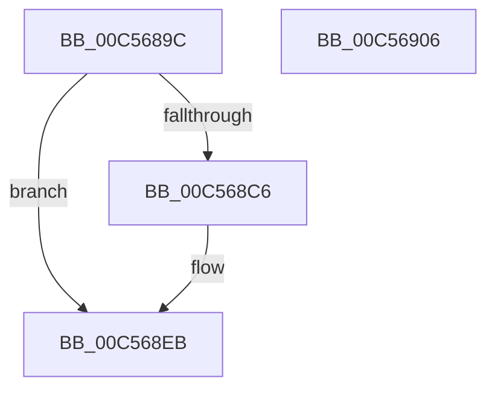

# CmpBuildRegMultiSz

- RVA: `0x00C5689C`–`0x00C56907` (길이 `107` bytes)
- VA: `0x0000000140C5689C`
- 실행 섹션: `INIT`
- PDB 이름 있음: `예`; PDB Function 태그: `아니요`
- unwind 정보 RVA: `0x0005E6B4`
- 디코드: `33`개 명령, `107/107` bytes 표시
- 미해석 바이트: `0` (있으면 어셈블리에 `.byte`로 보존)

> 이 문서는 커널 이미지의 기계어와 PDB 기호를 분석해 생성했습니다. 4번과 5번은 함수 원형과 자료형을 바이너리 사용 방식에서 추정한 C 해석이며 원본 소스 복구 결과는 아닙니다.

## 1. Dependencies

- 직접 호출 지점: **1**; 고유 호출 대상: **1**
- 직접 호출자로 확인된 함수: **1**
- RIP 상대 이미지 참조: **0**

### Outgoing calls
- `0x00C568D7` → [memcpy](../../text/6C/memcpy_function_006C6840.md) (function, `0x006C6840`)

### Direct callers
- [CmpInitializeSystemBiosInformation](CmpInitializeSystemBiosInformation_function_00C58620.md) at `0x00C586AE`
- [CmpInitializeSystemBiosInformation](CmpInitializeSystemBiosInformation_function_00C58620.md) at `0x00C586C6`
- [CmpInitializeSystemBiosInformation](CmpInitializeSystemBiosInformation_function_00C58620.md) at `0x00C586DE`

### Static image references
- 디코드된 RIP-relative 메모리 참조가 없습니다.

## 2. Other-region calls and transfers

- 다른 실행 섹션으로 향하는 call: **1**
  - `0x00C568D7` → [memcpy](../../text/6C/memcpy_function_006C6840.md) (`INIT` → `.text`)
- 별도 외부 분기/꼬리 이동을 확인하지 못했습니다.

## 3. Assembly (complete function range)

```asm
00C5689C  48 8B C4                        mov rax, rsp
00C5689F  48 89 58 08                     mov qword ptr [rax + 8], rbx
00C568A3  48 89 68 10                     mov qword ptr [rax + 0x10], rbp
00C568A7  48 89 70 18                     mov qword ptr [rax + 0x18], rsi
00C568AB  48 89 78 20                     mov qword ptr [rax + 0x20], rdi
00C568AF  41 56                           push r14
00C568B1  48 83 EC 20                     sub rsp, 0x20
00C568B5  8B 54 24 50                     mov edx, dword ptr [rsp + 0x50]
00C568B9  45 33 F6                        xor r14d, r14d
00C568BC  49 8B F0                        mov rsi, r8
00C568BF  48 8B E9                        mov rbp, rcx
00C568C2  85 D2                           test edx, edx
00C568C4  74 25                           je 0x140c568eb
00C568C6  41 8B 38                        mov edi, dword ptr [r8]
00C568C9  8B DA                           mov ebx, edx
00C568CB  48 03 F9                        add rdi, rcx
00C568CE  44 8B C2                        mov r8d, edx
00C568D1  48 8B CF                        mov rcx, rdi
00C568D4  49 8B D1                        mov rdx, r9
00C568D7  E8 64 FF A6 FF                  call 0x1406c6840
00C568DC  48 8D 04 1F                     lea rax, [rdi + rbx]
00C568E0  66 44 89 30                     mov word ptr [rax], r14w
00C568E4  2B C5                           sub eax, ebp
00C568E6  83 C0 02                        add eax, 2
00C568E9  89 06                           mov dword ptr [rsi], eax
00C568EB  48 8B 5C 24 30                  mov rbx, qword ptr [rsp + 0x30]
00C568F0  48 8B 6C 24 38                  mov rbp, qword ptr [rsp + 0x38]
00C568F5  48 8B 74 24 40                  mov rsi, qword ptr [rsp + 0x40]
00C568FA  48 8B 7C 24 48                  mov rdi, qword ptr [rsp + 0x48]
00C568FF  48 83 C4 20                     add rsp, 0x20
00C56903  41 5E                           pop r14
00C56905  C3                              ret
00C56906  CC                              int3
```

## 4. C-style interpretation (structured pseudocode)

```c
__int64 __fastcall CmpBuildRegMultiSz(__int64 a1, __int64 a2, __int64 a3, __int64 a4, unsigned int a5)
{
    __int64 result;
    __int64 v_r14;
    __int64 v_rbx;
    __int64 v_rdi;
    __int64 v_rsp;
    unsigned __int64 v_stack_p10;
    unsigned __int64 v_stack_p18;
    unsigned __int64 v_stack_p20;
    unsigned __int64 v_stack_p8;

    *(unsigned __int64 *)(v_rsp + 8) = v_rbx;
    *(unsigned __int64 *)(v_rsp + 16) = v_rbp;
    *(unsigned __int64 *)(v_rsp + 24) = v_rsi;
    *(unsigned __int64 *)(v_rsp + 32) = v_rdi;
    v_rsp = (v_rsp) - (32);
    v_r14 = 0;
    result = v_rsp;
    if ((unsigned int)((unsigned int)(a5)) != 0) {
        v_rdi = *(unsigned int *)(a3);
        v_rbx = (unsigned int)((unsigned int)(a5));
        v_rdi = (v_rdi) + (a1);
        a3 = (unsigned int)((unsigned int)(a5));
        a1 = v_rdi;
        a2 = a4;
        result = memcpy(a1, a2, a3, a4);
        result = v_rdi + v_rbx * 1;
        *(unsigned __int16 *)(result) = 0;
        result = (unsigned int)((result) - ((unsigned int)(a1)));
        result = (unsigned int)((result) + (2));
        *(unsigned int *)(a3) = (unsigned int)(result);
    }
    v_rsp = (v_rsp) + (32);
    return result;
}
```

## 5. (Beta) C Style

```c
int64_t CmpBuildRegMultiSz(int64_t Arg1, int64_t Arg2, void *Arg3, int64_t Arg4, uint32_t Arg5)
{
    uint8_t *arg3 = (uint8_t *)Arg3;

    int64_t result;
    int64_t local_r14;
    int64_t local_rbx;
    int64_t local_rdi;
    int64_t local_rsp;
    uint64_t v_stack_p10;
    uint64_t v_stack_p18;
    uint64_t v_stack_p20;
    uint64_t v_stack_p8;

    *(uint64_t *)(local_rsp + 0x8) = local_rbx;
    *(uint64_t *)(local_rsp + 0x10) = local_rbp;
    *(uint64_t *)(local_rsp + 0x18) = local_rsi;
    *(uint64_t *)(local_rsp + 0x20) = local_rdi;
    local_rsp = (local_rsp) - (32);
    local_r14 = 0;
    result = local_rsp;
    if ((uint32_t)((uint32_t)(Arg5)) != 0) {
        local_rdi = *(uint32_t *)(arg3);
        local_rbx = (uint32_t)((uint32_t)(Arg5));
        local_rdi = (local_rdi) + (Arg1);
        Arg3 = (uint32_t)((uint32_t)(Arg5));
        Arg1 = local_rdi;
        Arg2 = Arg4;
        result = memcpy(Arg1, Arg2, Arg3, Arg4);
        result = local_rdi + local_rbx * 1;
        *(uint16_t *)(result) = 0;
        result = (uint32_t)((result) - ((uint32_t)(Arg1)));
        result = (uint32_t)((result) + (2));
        *(uint32_t *)(arg3) = (uint32_t)(result);
    }
    local_rsp = (local_rsp) + (32);
    return result;
}
```

### 관측된 메모리 오프셋

구조체 형식이 확인되지 않은 접근은 인자 기준의 오프셋으로만 기록했습니다.

| 기준 인자 | 오프셋 표현 | 폭 (bit) | 접근 |
|---|---:|---:|---|
| `Arg3` | `+ 0x0` | `32` | `R` |
| `Arg3` | `+ 0x0` | `32` | `W` |

## 6. Execution-region graph

[열기: 2D/3D 그래프와 함수 탐색 컨트롤 패널](../../../control-panel.html?section=init&rva=0x00C5689C&view=graph)

- 2D 그래프는 위에서 아래로 흐르고, 3D 그래프는 빈 공간을 드래그해 회전합니다. Shift+드래그는 이동, 휠은 확대·축소, 함수 노드 선택은 대상 보고서 이동입니다.

### Static fallback


