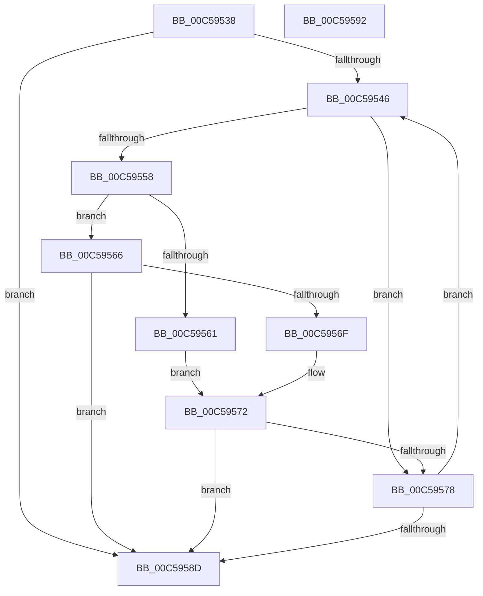

# CmpConvertLangId

- RVA: `0x00C59538`–`0x00C59593` (길이 `91` bytes)
- VA: `0x0000000140C59538`
- 실행 섹션: `INIT`
- PDB 이름 있음: `예`; PDB Function 태그: `아니요`
- unwind 정보 RVA: `0x000DB714`
- 디코드: `30`개 명령, `91/91` bytes 표시
- 미해석 바이트: `0` (있으면 어셈블리에 `.byte`로 보존)

> 이 문서는 커널 이미지의 기계어와 PDB 기호를 분석해 생성했습니다. 4번과 5번은 함수 원형과 자료형을 바이너리 사용 방식에서 추정한 C 해석이며 원본 소스 복구 결과는 아닙니다.

## 1. Dependencies

- 직접 호출 지점: **0**; 고유 호출 대상: **0**
- 직접 호출자로 확인된 함수: **1**
- RIP 상대 이미지 참조: **0**

### Outgoing calls
- 직접 디코드된 call 명령이 없습니다.

### Direct callers
- [CmpGetSystemControlValues](CmpGetSystemControlValues_function_00C5959C.md) at `0x00C599AA`
- [CmpGetSystemControlValues](CmpGetSystemControlValues_function_00C5959C.md) at `0x00C599E1`

### Static image references
- 디코드된 RIP-relative 메모리 참조가 없습니다.

## 2. Other-region calls and transfers

- 다른 실행 섹션으로 향하는 call: **0**
- 별도 외부 분기/꼬리 이동을 확인하지 못했습니다.

## 3. Assembly (complete function range)

```asm
00C59538  45 33 C0                        xor r8d, r8d
00C5953B  4C 8B D1                        mov r10, rcx
00C5953E  D1 EA                           shr edx, 1
00C59540  45 0F B7 C8                     movzx r9d, r8w
00C59544  74 47                           je 0x140c5958d
00C59546  41 0F B7 C1                     movzx eax, r9w
00C5954A  41 0F B7 0C 42                  movzx ecx, word ptr [r10 + rax*2]
00C5954F  8D 41 D0                        lea eax, [rcx - 0x30]
00C59552  66 83 F8 09                     cmp ax, 9
00C59556  76 20                           jbe 0x140c59578
00C59558  8D 41 BF                        lea eax, [rcx - 0x41]
00C5955B  66 83 F8 05                     cmp ax, 5
00C5955F  77 05                           ja 0x140c59566
00C59561  8D 41 C9                        lea eax, [rcx - 0x37]
00C59564  EB 0C                           jmp 0x140c59572
00C59566  8D 41 9F                        lea eax, [rcx - 0x61]
00C59569  66 83 F8 05                     cmp ax, 5
00C5956D  77 1E                           ja 0x140c5958d
00C5956F  8D 41 A9                        lea eax, [rcx - 0x57]
00C59572  66 83 F8 10                     cmp ax, 0x10
00C59576  73 15                           jae 0x140c5958d
00C59578  66 41 C1 E0 04                  shl r8w, 4
00C5957D  66 41 FF C1                     inc r9w
00C59581  66 44 0B C0                     or r8w, ax
00C59585  41 0F B7 C9                     movzx ecx, r9w
00C59589  3B CA                           cmp ecx, edx
00C5958B  72 B9                           jb 0x140c59546
00C5958D  41 0F B7 C0                     movzx eax, r8w
00C59591  C3                              ret
00C59592  CC                              int3
```

## 4. C-style interpretation (structured pseudocode)

```c
__int64 __fastcall CmpConvertLangId(__int64 a1, int a2, int a3)
{
    a3 = 0;
    a2 = (unsigned int)((a2) >> (1));
    if (condition_is_equal) goto loc_00C5958D;
loc_00C59546:
    if (((unsigned __int16)(*(unsigned __int16 *)(a1 + 0 * 2) - 48)) <= 9) goto loc_00C59578;
    if (((unsigned __int16)(*(unsigned __int16 *)(a1 + 0 * 2) - 65)) > 5) goto loc_00C59566;
    goto loc_00C59572;
loc_00C59566:
    if (((unsigned __int16)(*(unsigned __int16 *)(a1 + 0 * 2) - 97)) > 5) goto loc_00C5958D;
loc_00C59572:
    if (((unsigned __int16)(*(unsigned __int16 *)(a1 + 0 * 2) - 87)) >= 16) goto loc_00C5958D;
loc_00C59578:
    a3 = (unsigned __int16)((a3) << (4));
    a4 = (unsigned __int16)((0) + 1);
    a3 = (unsigned __int16)((a3) | ((unsigned __int16)(*(unsigned __int16 *)(a1 + 0 * 2) - 87)));
    if (((unsigned int)((unsigned __int16)(a4))) < a2) goto loc_00C59546;
loc_00C5958D:
    return (unsigned __int16)(a3);
}
```

## 5. (Beta) C Style

```c
int64_t CmpConvertLangId(void *Arg1, int32_t Arg2, int32_t Arg3)
{
    uint8_t *arg1 = (uint8_t *)Arg1;

    Arg3 = 0;
    Arg2 = (uint32_t)((Arg2) >> (1));
    if (condition_is_equal) goto loc_00C5958D;
loc_00C59546:
    if (((uint16_t)(*(uint16_t *)(arg1 + 0x0 * 2) - 48)) <= 9) goto loc_00C59578;
    if (((uint16_t)(*(uint16_t *)(arg1 + 0x0 * 2) - 65)) > 5) goto loc_00C59566;
    goto loc_00C59572;
loc_00C59566:
    if (((uint16_t)(*(uint16_t *)(arg1 + 0x0 * 2) - 97)) > 5) goto loc_00C5958D;
loc_00C59572:
    if (((uint16_t)(*(uint16_t *)(arg1 + 0x0 * 2) - 87)) >= 16) goto loc_00C5958D;
loc_00C59578:
    Arg3 = (uint16_t)((Arg3) << (4));
    a4 = (uint16_t)((0) + 1);
    Arg3 = (uint16_t)((Arg3) | ((uint16_t)(*(uint16_t *)(arg1 + 0x0 * 2) - 87)));
    if (((uint32_t)((uint16_t)(a4))) < Arg2) goto loc_00C59546;
loc_00C5958D:
    return (uint16_t)(Arg3);
}
```

### 관측된 메모리 오프셋

구조체 형식이 확인되지 않은 접근은 인자 기준의 오프셋으로만 기록했습니다.

| 기준 인자 | 오프셋 표현 | 폭 (bit) | 접근 |
|---|---:|---:|---|
| `Arg1` | `+ 0x0 + rax*2` | `16` | `R` |

## 6. Execution-region graph

[열기: 2D/3D 그래프와 함수 탐색 컨트롤 패널](../../../control-panel.html?section=init&rva=0x00C59538&view=graph)

- 2D 그래프는 위에서 아래로 흐르고, 3D 그래프는 빈 공간을 드래그해 회전합니다. Shift+드래그는 이동, 휠은 확대·축소, 함수 노드 선택은 대상 보고서 이동입니다.

### Static fallback


