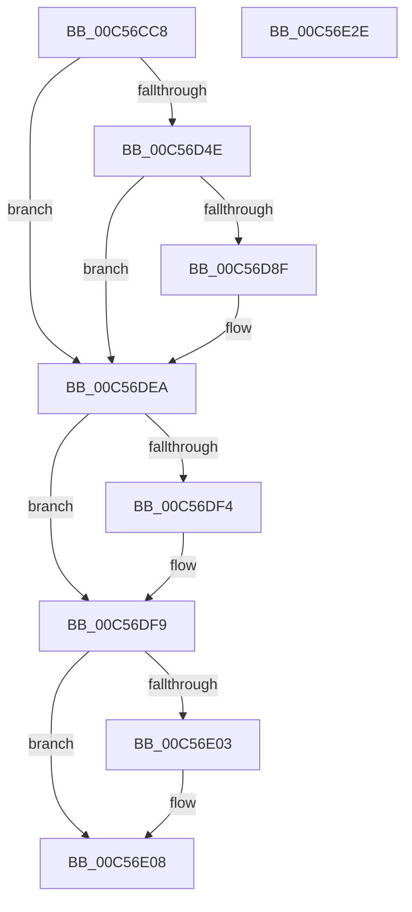

# CmpCreateControlSetOverride

- RVA: `0x00C56CC8`–`0x00C56E2F` (길이 `359` bytes)
- VA: `0x0000000140C56CC8`
- 실행 섹션: `INIT`
- PDB 이름 있음: `예`; PDB Function 태그: `아니요`
- unwind 정보 RVA: `0x000D63C0`
- 디코드: `82`개 명령, `359/359` bytes 표시
- 미해석 바이트: `0` (있으면 어셈블리에 `.byte`로 보존)

> 이 문서는 커널 이미지의 기계어와 PDB 기호를 분석해 생성했습니다. 4번과 5번은 함수 원형과 자료형을 바이너리 사용 방식에서 추정한 C 해석이며 원본 소스 복구 결과는 아닙니다.

## 1. Dependencies

- 직접 호출 지점: **6**; 고유 호출 대상: **5**
- 직접 호출자로 확인된 함수: **1**
- RIP 상대 이미지 참조: **3**

### Outgoing calls
- `0x00C56D3F` → [RtlUnicodeStringPrintf](../../text/48/RtlUnicodeStringPrintf_function_0048B984.md) (function, `0x0048B984`)
- `0x00C56D84` → [ZwOpenKey](../../text/6A/ZwOpenKey_function_006AD310.md) (function, `0x006AD310`)
- `0x00C56DDE` → [ZwCreateKey](../../text/6A/ZwCreateKey_function_006AD470.md) (function, `0x006AD470`)
- `0x00C56DF4` → [ZwClose](../../text/6A/ZwClose_function_006AD2B0.md) (function, `0x006AD2B0`)
- `0x00C56E03` → [ZwClose](../../text/6A/ZwClose_function_006AD2B0.md) (function, `0x006AD2B0`)
- `0x00C56E14` → [_security_check_cookie](../../text/6A/_security_check_cookie_function_006AC640.md) (function, `0x006AC640`)

### Direct callers
- [CmpCreateExtendedControlSets](CmpCreateExtendedControlSets_function_00C56E38.md) at `0x00C56ED2`

### Static image references
- `0x00C56CE2` → RVA `0x00E0A740` (`.data`; read)
- `0x00C56CF7` → RVA `0x00C7E300` (` ?? ::PBOPGDP::`string'`; read)
- `0x00C56DA3` → RVA `0x00C82230` (`CmpControlSetOverride`; read)

## 2. Other-region calls and transfers

- 다른 실행 섹션으로 향하는 call: **6**
  - `0x00C56D3F` → [RtlUnicodeStringPrintf](../../text/48/RtlUnicodeStringPrintf_function_0048B984.md) (`INIT` → `.text`)
  - `0x00C56D84` → [ZwOpenKey](../../text/6A/ZwOpenKey_function_006AD310.md) (`INIT` → `.text`)
  - `0x00C56DDE` → [ZwCreateKey](../../text/6A/ZwCreateKey_function_006AD470.md) (`INIT` → `.text`)
  - `0x00C56DF4` → [ZwClose](../../text/6A/ZwClose_function_006AD2B0.md) (`INIT` → `.text`)
  - `0x00C56E03` → [ZwClose](../../text/6A/ZwClose_function_006AD2B0.md) (`INIT` → `.text`)
  - `0x00C56E14` → [_security_check_cookie](../../text/6A/_security_check_cookie_function_006AC640.md) (`INIT` → `.text`)
- 별도 외부 분기/꼬리 이동을 확인하지 못했습니다.

## 3. Assembly (complete function range)

```asm
00C56CC8  48 89 5C 24 10                  mov qword ptr [rsp + 0x10], rbx
00C56CCD  48 89 7C 24 18                  mov qword ptr [rsp + 0x18], rdi
00C56CD2  55                              push rbp
00C56CD3  48 8D AC 24 60 FF FF FF         lea rbp, [rsp - 0xa0]
00C56CDB  48 81 EC A0 01 00 00            sub rsp, 0x1a0
00C56CE2  48 8B 05 57 3A 1B 00            mov rax, qword ptr [rip + 0x1b3a57]
00C56CE9  48 33 C4                        xor rax, rsp
00C56CEC  48 89 85 90 00 00 00            mov qword ptr [rbp + 0x90], rax
00C56CF3  4C 8B 49 30                     mov r9, qword ptr [rcx + 0x30]
00C56CF7  48 8D 15 02 76 02 00            lea rdx, [rip + 0x27602]
00C56CFE  4C 8B 41 38                     mov r8, qword ptr [rcx + 0x38]
00C56D02  33 C0                           xor eax, eax
00C56D04  0F 57 C0                        xorps xmm0, xmm0
00C56D07  48 89 44 24 70                  mov qword ptr [rsp + 0x70], rax
00C56D0C  89 44 24 78                     mov dword ptr [rsp + 0x78], eax
00C56D10  48 8D 4D 80                     lea rcx, [rbp - 0x80]
00C56D14  0F 11 45 80                     movups xmmword ptr [rbp - 0x80], xmm0
00C56D18  B8 00 01 00 00                  mov eax, 0x100
00C56D1D  33 FF                           xor edi, edi
00C56D1F  66 89 45 82                     mov word ptr [rbp - 0x7e], ax
00C56D23  48 8D 45 90                     lea rax, [rbp - 0x70]
00C56D27  48 89 45 88                     mov qword ptr [rbp - 0x78], rax
00C56D2B  0F 11 44 24 50                  movups xmmword ptr [rsp + 0x50], xmm0
00C56D30  48 89 7C 24 40                  mov qword ptr [rsp + 0x40], rdi
00C56D35  0F 11 44 24 60                  movups xmmword ptr [rsp + 0x60], xmm0
00C56D3A  48 89 7C 24 48                  mov qword ptr [rsp + 0x48], rdi
00C56D3F  E8 40 4C 83 FF                  call 0x14048b984
00C56D44  8B D8                           mov ebx, eax
00C56D46  85 C0                           test eax, eax
00C56D48  0F 88 9C 00 00 00               js 0x140c56dea
00C56D4E  48 8D 45 80                     lea rax, [rbp - 0x80]
00C56D52  C7 44 24 50 30 00 00 00         mov dword ptr [rsp + 0x50], 0x30
00C56D5A  0F 57 C0                        xorps xmm0, xmm0
00C56D5D  48 89 44 24 60                  mov qword ptr [rsp + 0x60], rax
00C56D62  4C 8D 44 24 50                  lea r8, [rsp + 0x50]
00C56D67  48 89 7C 24 58                  mov qword ptr [rsp + 0x58], rdi
00C56D6C  BA 06 00 02 00                  mov edx, 0x20006
00C56D71  C7 44 24 68 40 02 00 00         mov dword ptr [rsp + 0x68], 0x240
00C56D79  48 8D 4C 24 40                  lea rcx, [rsp + 0x40]
00C56D7E  F3 0F 7F 44 24 70               movdqu xmmword ptr [rsp + 0x70], xmm0
00C56D84  E8 87 65 A5 FF                  call 0x1406ad310
00C56D89  8B D8                           mov ebx, eax
00C56D8B  85 C0                           test eax, eax
00C56D8D  78 5B                           js 0x140c56dea
00C56D8F  48 8B 44 24 40                  mov rax, qword ptr [rsp + 0x40]
00C56D94  4C 8D 44 24 50                  lea r8, [rsp + 0x50]
00C56D99  48 89 44 24 58                  mov qword ptr [rsp + 0x58], rax
00C56D9E  48 8D 4C 24 48                  lea rcx, [rsp + 0x48]
00C56DA3  48 8D 05 86 B4 02 00            lea rax, [rip + 0x2b486]
00C56DAA  48 89 7C 24 30                  mov qword ptr [rsp + 0x30], rdi
00C56DAF  0F 57 C0                        xorps xmm0, xmm0
00C56DB2  89 7C 24 28                     mov dword ptr [rsp + 0x28], edi
00C56DB6  45 33 C9                        xor r9d, r9d
00C56DB9  48 89 44 24 60                  mov qword ptr [rsp + 0x60], rax
00C56DBE  BA 06 00 02 00                  mov edx, 0x20006
00C56DC3  C7 44 24 50 30 00 00 00         mov dword ptr [rsp + 0x50], 0x30
00C56DCB  C7 44 24 68 40 02 00 00         mov dword ptr [rsp + 0x68], 0x240
00C56DD3  F3 0F 7F 44 24 70               movdqu xmmword ptr [rsp + 0x70], xmm0
00C56DD9  48 89 7C 24 20                  mov qword ptr [rsp + 0x20], rdi
00C56DDE  E8 8D 66 A5 FF                  call 0x1406ad470
00C56DE3  85 C0                           test eax, eax
00C56DE5  8B D8                           mov ebx, eax
00C56DE7  0F 49 DF                        cmovns ebx, edi
00C56DEA  48 8B 4C 24 48                  mov rcx, qword ptr [rsp + 0x48]
00C56DEF  48 85 C9                        test rcx, rcx
00C56DF2  74 05                           je 0x140c56df9
00C56DF4  E8 B7 64 A5 FF                  call 0x1406ad2b0
00C56DF9  48 8B 4C 24 40                  mov rcx, qword ptr [rsp + 0x40]
00C56DFE  48 85 C9                        test rcx, rcx
00C56E01  74 05                           je 0x140c56e08
00C56E03  E8 A8 64 A5 FF                  call 0x1406ad2b0
00C56E08  8B C3                           mov eax, ebx
00C56E0A  48 8B 8D 90 00 00 00            mov rcx, qword ptr [rbp + 0x90]
00C56E11  48 33 CC                        xor rcx, rsp
00C56E14  E8 27 58 A5 FF                  call 0x1406ac640
00C56E19  4C 8D 9C 24 A0 01 00 00         lea r11, [rsp + 0x1a0]
00C56E21  49 8B 5B 18                     mov rbx, qword ptr [r11 + 0x18]
00C56E25  49 8B 7B 20                     mov rdi, qword ptr [r11 + 0x20]
00C56E29  49 8B E3                        mov rsp, r11
00C56E2C  5D                              pop rbp
00C56E2D  C3                              ret
00C56E2E  CC                              int3
```

## 4. C-style interpretation (structured pseudocode)

```c
__int64 __fastcall CmpCreateControlSetOverride(__int64 a1)
{
    __int64 result;
    __int64 v_rbx;
    __int64 v_rdi;
    __int64 v_rsp;
    unsigned __int64 v_stack_m118;
    unsigned __int64 v_stack_m120;
    unsigned __int16 v_stack_m126;
    unsigned __int64 v_stack_m128;
    unsigned int v_stack_m130;
    unsigned __int64 v_stack_m138;
    unsigned int v_stack_m140;
    unsigned __int64 v_stack_m148;
    unsigned __int64 v_stack_m150;
    unsigned __int64 v_stack_m158;
    unsigned __int64 v_stack_m160;
    unsigned __int64 v_stack_m168;
    unsigned __int64 v_stack_m178;
    unsigned __int64 v_stack_m18;
    unsigned int v_stack_m180;
    unsigned __int64 v_stack_m188;
    unsigned __int64 v_stack_m8;
    unsigned __int64 v_stack_mA8;
    unsigned __int64 v_stack_p10;
    unsigned __int64 v_stack_p18;

    v_stack_p10 = v_rbx;
    v_stack_p18 = v_rdi;
    v_rsp = (v_rsp) - (416);
    result = (*(unsigned __int64 *)(v_rip + 1784407)) ^ (v_rsp);
    v_stack_m18 = result;
    result = 0;
    v_stack_m138 = 0;
    v_stack_m130 = 0;
    v_stack_m128 = v_xmm0;
    v_rdi = 0;
    v_stack_m126 = 256;
    v_stack_m120 = v_stack_m118;
    v_stack_m158 = v_xmm0;
    v_stack_m168 = 0;
    v_stack_m148 = v_xmm0;
    v_stack_m160 = 0;
    result = RtlUnicodeStringPrintf(v_stack_m128, v_rip + 161282, *(unsigned __int64 *)(a1 + 56), *(unsigned __int64 *)(a1 + 48));
    if (sign_flag) goto loc_00C56DEA;
    v_stack_m158 = 48;
    v_stack_m148 = v_stack_m128;
    v_stack_m150 = 0;
    v_stack_m140 = 576;
    v_stack_m138 = v_xmm0;
    result = ZwOpenKey(v_stack_m168, (unsigned int)(0x20006ULL), v_stack_m158, *(unsigned __int64 *)(a1 + 48));
    v_rbx = (unsigned int)((unsigned int)(result));
    if (!(sign_flag)) {
        result = v_stack_m168;
        a3 = v_stack_m158;
        v_stack_m150 = result;
        a1 = v_stack_m160;
        result = v_rip + 177286;
        v_stack_m178 = 0;
        v_stack_m180 = 0;
        a4 = 0;
        v_stack_m148 = result;
        a2 = 0x20006ULL;
        v_stack_m158 = 48;
        v_stack_m140 = 576;
        v_stack_m138 = v_xmm0;
        v_stack_m188 = 0;
        result = ZwCreateKey(a1, a2, a3, a4);
        v_rbx = (unsigned int)(result);
        if (!sign_flag) { v_rbx = 0; }
    }
    if (v_stack_m160 != 0) {
        result = ZwClose(v_stack_m160, a2, a3, a4);
    }
    if (v_stack_m168 != 0) {
        result = ZwClose(v_stack_m168, a2, a3, a4);
    }
    a1 = (v_stack_m18) ^ (v_rsp);
    result = _security_check_cookie(a1, a2, a3, a4);
    return result;
}
```

## 5. (Beta) C Style

```c
int64_t CmpCreateControlSetOverride(void *Arg1)
{
    uint8_t *arg1 = (uint8_t *)Arg1;

    int64_t result;
    int64_t local_rbx;
    int64_t local_rdi;
    int64_t local_rsp;
    uint64_t v_stack_m118;
    uint64_t v_stack_m120;
    uint16_t v_stack_m126;
    uint64_t v_stack_m128;
    uint32_t v_stack_m130;
    uint64_t v_stack_m138;
    uint32_t v_stack_m140;
    uint64_t v_stack_m148;
    uint64_t v_stack_m150;
    uint64_t v_stack_m158;
    uint64_t v_stack_m160;
    uint64_t v_stack_m168;
    uint64_t v_stack_m178;
    uint64_t v_stack_m18;
    uint32_t v_stack_m180;
    uint64_t v_stack_m188;
    uint64_t v_stack_m8;
    uint64_t v_stack_mA8;
    uint64_t v_stack_p10;
    uint64_t v_stack_p18;

    v_stack_p10 = local_rbx;
    v_stack_p18 = local_rdi;
    local_rsp = (local_rsp) - (416);
    result = (*(uint64_t *)(v_rip + 0x1B3A57)) ^ (local_rsp);
    v_stack_m18 = result;
    result = 0;
    v_stack_m138 = 0;
    v_stack_m130 = 0;
    v_stack_m128 = v_xmm0;
    local_rdi = 0;
    v_stack_m126 = 256;
    v_stack_m120 = v_stack_m118;
    v_stack_m158 = v_xmm0;
    v_stack_m168 = 0;
    v_stack_m148 = v_xmm0;
    v_stack_m160 = 0;
    result = RtlUnicodeStringPrintf(v_stack_m128, v_rip + 161282, *(uint64_t *)(arg1 + 0x38), *(uint64_t *)(arg1 + 0x30));
    if (sign_flag) goto loc_00C56DEA;
    v_stack_m158 = 48;
    v_stack_m148 = v_stack_m128;
    v_stack_m150 = 0;
    v_stack_m140 = 576;
    v_stack_m138 = v_xmm0;
    result = ZwOpenKey(v_stack_m168, (uint32_t)(0x20006ULL), v_stack_m158, *(uint64_t *)(arg1 + 0x30));
    local_rbx = (uint32_t)((uint32_t)(result));
    if (!(sign_flag)) {
        result = v_stack_m168;
        a3 = v_stack_m158;
        v_stack_m150 = result;
        Arg1 = v_stack_m160;
        result = v_rip + 177286;
        v_stack_m178 = 0;
        v_stack_m180 = 0;
        a4 = 0;
        v_stack_m148 = result;
        a2 = 0x20006ULL;
        v_stack_m158 = 48;
        v_stack_m140 = 576;
        v_stack_m138 = v_xmm0;
        v_stack_m188 = 0;
        result = ZwCreateKey(Arg1, a2, a3, a4);
        local_rbx = (uint32_t)(result);
        if (!sign_flag) { local_rbx = 0; }
    }
    if (v_stack_m160 != 0) {
        result = ZwClose(v_stack_m160, a2, a3, a4);
    }
    if (v_stack_m168 != 0) {
        result = ZwClose(v_stack_m168, a2, a3, a4);
    }
    Arg1 = (v_stack_m18) ^ (local_rsp);
    result = _security_check_cookie(Arg1, a2, a3, a4);
    return result;
}
```

### 관측된 메모리 오프셋

구조체 형식이 확인되지 않은 접근은 인자 기준의 오프셋으로만 기록했습니다.

| 기준 인자 | 오프셋 표현 | 폭 (bit) | 접근 |
|---|---:|---:|---|
| `Arg1` | `+ 0x30` | `64` | `R` |
| `Arg1` | `+ 0x38` | `64` | `R` |

## 6. Execution-region graph

[열기: 2D/3D 그래프와 함수 탐색 컨트롤 패널](../../../control-panel.html?section=init&rva=0x00C56CC8&view=graph)

- 2D 그래프는 위에서 아래로 흐르고, 3D 그래프는 빈 공간을 드래그해 회전합니다. Shift+드래그는 이동, 휠은 확대·축소, 함수 노드 선택은 대상 보고서 이동입니다.

### Static fallback


