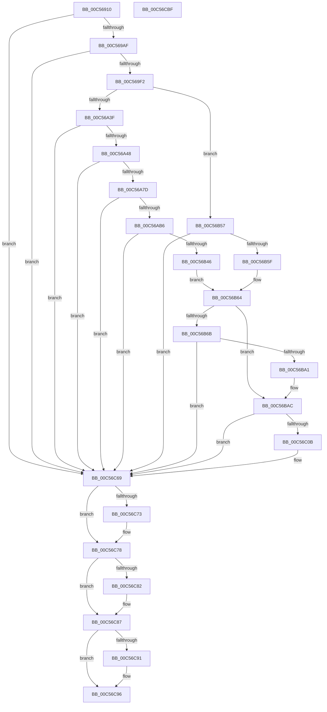

# CmpCreateControlSet

- RVA: `0x00C56910`–`0x00C56CC0` (길이 `944` bytes)
- VA: `0x0000000140C56910`
- 실행 섹션: `INIT`
- PDB 이름 있음: `예`; PDB Function 태그: `아니요`
- unwind 정보 RVA: `0x000D63E0`
- 디코드: `210`개 명령, `944/944` bytes 표시
- 미해석 바이트: `0` (있으면 어셈블리에 `.byte`로 보존)

> 이 문서는 커널 이미지의 기계어와 PDB 기호를 분석해 생성했습니다. 4번과 5번은 함수 원형과 자료형을 바이너리 사용 방식에서 추정한 C 해석이며 원본 소스 복구 결과는 아닙니다.

## 1. Dependencies

- 직접 호출 지점: **16**; 고유 호출 대상: **7**
- 직접 호출자로 확인된 함수: **2**
- RIP 상대 이미지 참조: **8**

### Outgoing calls
- `0x00C569A0` → [RtlUnicodeStringPrintf](../../text/48/RtlUnicodeStringPrintf_function_0048B984.md) (function, `0x0048B984`)
- `0x00C569E3` → [ZwOpenKey](../../text/6A/ZwOpenKey_function_006AD310.md) (function, `0x006AD310`)
- `0x00C56A2D` → [ZwOpenKey](../../text/6A/ZwOpenKey_function_006AD310.md) (function, `0x006AD310`)
- `0x00C56A6E` → [ZwCreateKey](../../text/6A/ZwCreateKey_function_006AD470.md) (function, `0x006AD470`)
- `0x00C56AA7` → [ZwSetValueKey](../../text/6A/ZwSetValueKey_function_006ADCD0.md) (function, `0x006ADCD0`)
- `0x00C56AE2` → [RtlUnicodeStringPrintf](../../text/48/RtlUnicodeStringPrintf_function_0048B984.md) (function, `0x0048B984`)
- `0x00C56B37` → [ZwCreateKey](../../text/6A/ZwCreateKey_function_006AD470.md) (function, `0x006AD470`)
- `0x00C56B4B` → [ZwClose](../../text/6A/ZwClose_function_006AD2B0.md) (function, `0x006AD2B0`)
- `0x00C56B92` → [ZwQueryValueKey](../../text/6A/ZwQueryValueKey_function_006AD3B0.md) (function, `0x006AD3B0`)
- `0x00C56C00` → [ZwCreateKey](../../text/6A/ZwCreateKey_function_006AD470.md) (function, `0x006AD470`)
- `0x00C56C35` → [RtlUnicodeStringPrintf](../../text/48/RtlUnicodeStringPrintf_function_0048B984.md) (function, `0x0048B984`)
- `0x00C56C62` → [ZwSetValueKey](../../text/6A/ZwSetValueKey_function_006ADCD0.md) (function, `0x006ADCD0`)
- `0x00C56C73` → [ZwClose](../../text/6A/ZwClose_function_006AD2B0.md) (function, `0x006AD2B0`)
- `0x00C56C82` → [ZwClose](../../text/6A/ZwClose_function_006AD2B0.md) (function, `0x006AD2B0`)
- `0x00C56C91` → [ZwClose](../../text/6A/ZwClose_function_006AD2B0.md) (function, `0x006AD2B0`)
- `0x00C56CA2` → [_security_check_cookie](../../text/6A/_security_check_cookie_function_006AC640.md) (function, `0x006AC640`)

### Direct callers
- [CmInitSystem1](CmInitSystem1_function_00C559CC.md) at `0x00C5609C`
- [CmpCreateExtendedControlSets](CmpCreateExtendedControlSets_function_00C56E38.md) at `0x00C56E57`
- [CmpCreateExtendedControlSets](CmpCreateExtendedControlSets_function_00C56E38.md) at `0x00C56E9C`

### Static image references
- `0x00C5692D` → RVA `0x00E0A740` (`.data`; read)
- `0x00C56963` → RVA `0x00C7E330` (` ?? ::PBOPGDP::`string'`; read)
- `0x00C56A06` → RVA `0x00B4B4E0` (`CmpSelectString`; read)
- `0x00C56A98` → RVA `0x00B4AFC8` (`CmpCurrentString`; read)
- `0x00C56AC2` → RVA `0x00C7E360` (` ?? ::PBOPGDP::`string'`; read)
- `0x00C56BC0` → RVA `0x00C824B0` (`CmpCurrentControlSetString`; read)
- `0x00C56C17` → RVA `0x00C7E2B0` (` ?? ::PBOPGDP::`string'`; read)
- `0x00C56C3F` → RVA `0x00FD9C00` (`PAGEDATA`; read)

## 2. Other-region calls and transfers

- 다른 실행 섹션으로 향하는 call: **16**
  - `0x00C569A0` → [RtlUnicodeStringPrintf](../../text/48/RtlUnicodeStringPrintf_function_0048B984.md) (`INIT` → `.text`)
  - `0x00C569E3` → [ZwOpenKey](../../text/6A/ZwOpenKey_function_006AD310.md) (`INIT` → `.text`)
  - `0x00C56A2D` → [ZwOpenKey](../../text/6A/ZwOpenKey_function_006AD310.md) (`INIT` → `.text`)
  - `0x00C56A6E` → [ZwCreateKey](../../text/6A/ZwCreateKey_function_006AD470.md) (`INIT` → `.text`)
  - `0x00C56AA7` → [ZwSetValueKey](../../text/6A/ZwSetValueKey_function_006ADCD0.md) (`INIT` → `.text`)
  - `0x00C56AE2` → [RtlUnicodeStringPrintf](../../text/48/RtlUnicodeStringPrintf_function_0048B984.md) (`INIT` → `.text`)
  - `0x00C56B37` → [ZwCreateKey](../../text/6A/ZwCreateKey_function_006AD470.md) (`INIT` → `.text`)
  - `0x00C56B4B` → [ZwClose](../../text/6A/ZwClose_function_006AD2B0.md) (`INIT` → `.text`)
  - `0x00C56B92` → [ZwQueryValueKey](../../text/6A/ZwQueryValueKey_function_006AD3B0.md) (`INIT` → `.text`)
  - `0x00C56C00` → [ZwCreateKey](../../text/6A/ZwCreateKey_function_006AD470.md) (`INIT` → `.text`)
  - `0x00C56C35` → [RtlUnicodeStringPrintf](../../text/48/RtlUnicodeStringPrintf_function_0048B984.md) (`INIT` → `.text`)
  - `0x00C56C62` → [ZwSetValueKey](../../text/6A/ZwSetValueKey_function_006ADCD0.md) (`INIT` → `.text`)
  - `0x00C56C73` → [ZwClose](../../text/6A/ZwClose_function_006AD2B0.md) (`INIT` → `.text`)
  - `0x00C56C82` → [ZwClose](../../text/6A/ZwClose_function_006AD2B0.md) (`INIT` → `.text`)
  - `0x00C56C91` → [ZwClose](../../text/6A/ZwClose_function_006AD2B0.md) (`INIT` → `.text`)
  - `0x00C56CA2` → [_security_check_cookie](../../text/6A/_security_check_cookie_function_006AC640.md) (`INIT` → `.text`)
- 별도 외부 분기/꼬리 이동을 확인하지 못했습니다.

## 3. Assembly (complete function range)

```asm
00C56910  48 89 5C 24 10                  mov qword ptr [rsp + 0x10], rbx
00C56915  48 89 74 24 18                  mov qword ptr [rsp + 0x18], rsi
00C5691A  55                              push rbp
00C5691B  57                              push rdi
00C5691C  41 56                           push r14
00C5691E  48 8D AC 24 C0 FE FF FF         lea rbp, [rsp - 0x140]
00C56926  48 81 EC 40 02 00 00            sub rsp, 0x240
00C5692D  48 8B 05 0C 3E 1B 00            mov rax, qword ptr [rip + 0x1b3e0c]
00C56934  48 33 C4                        xor rax, rsp
00C56937  48 89 85 30 01 00 00            mov qword ptr [rbp + 0x130], rax
00C5693E  45 33 F6                        xor r14d, r14d
00C56941  33 C0                           xor eax, eax
00C56943  0F 57 C0                        xorps xmm0, xmm0
00C56946  48 89 45 90                     mov qword ptr [rbp - 0x70], rax
00C5694A  89 45 98                        mov dword ptr [rbp - 0x68], eax
00C5694D  40 8A FA                        mov dil, dl
00C56950  0F 11 44 24 48                  movups xmmword ptr [rsp + 0x48], xmm0
00C56955  B8 00 01 00 00                  mov eax, 0x100
00C5695A  44 89 75 A0                     mov dword ptr [rbp - 0x60], r14d
00C5695E  66 89 44 24 4A                  mov word ptr [rsp + 0x4a], ax
00C56963  48 8D 15 C6 79 02 00            lea rdx, [rip + 0x279c6]
00C5696A  48 8D 45 30                     lea rax, [rbp + 0x30]
00C5696E  44 89 74 24 44                  mov dword ptr [rsp + 0x44], r14d
00C56973  48 8B F1                        mov rsi, rcx
00C56976  48 89 44 24 50                  mov qword ptr [rsp + 0x50], rax
00C5697B  4C 8B C1                        mov r8, rcx
00C5697E  4C 89 74 24 68                  mov qword ptr [rsp + 0x68], r14
00C56983  48 8D 4C 24 48                  lea rcx, [rsp + 0x48]
00C56988  4C 89 74 24 60                  mov qword ptr [rsp + 0x60], r14
00C5698D  0F 11 44 24 70                  movups xmmword ptr [rsp + 0x70], xmm0
00C56992  4C 89 74 24 58                  mov qword ptr [rsp + 0x58], r14
00C56997  0F 11 45 80                     movups xmmword ptr [rbp - 0x80], xmm0
00C5699B  44 89 74 24 40                  mov dword ptr [rsp + 0x40], r14d
00C569A0  E8 DF 4F 83 FF                  call 0x14048b984
00C569A5  8B D8                           mov ebx, eax
00C569A7  85 C0                           test eax, eax
00C569A9  0F 88 BA 02 00 00               js 0x140c56c69
00C569AF  48 8D 44 24 48                  lea rax, [rsp + 0x48]
00C569B4  C7 44 24 70 30 00 00 00         mov dword ptr [rsp + 0x70], 0x30
00C569BC  0F 57 C0                        xorps xmm0, xmm0
00C569BF  48 89 45 80                     mov qword ptr [rbp - 0x80], rax
00C569C3  4C 8D 44 24 70                  lea r8, [rsp + 0x70]
00C569C8  4C 89 74 24 78                  mov qword ptr [rsp + 0x78], r14
00C569CD  BA 19 00 02 00                  mov edx, 0x20019
00C569D2  C7 45 88 40 02 00 00            mov dword ptr [rbp - 0x78], 0x240
00C569D9  48 8D 4C 24 68                  lea rcx, [rsp + 0x68]
00C569DE  F3 0F 7F 45 90                  movdqu xmmword ptr [rbp - 0x70], xmm0
00C569E3  E8 28 69 A5 FF                  call 0x1406ad310
00C569E8  8B D8                           mov ebx, eax
00C569EA  85 C0                           test eax, eax
00C569EC  0F 88 77 02 00 00               js 0x140c56c69
00C569F2  48 8B 44 24 68                  mov rax, qword ptr [rsp + 0x68]
00C569F7  4C 8D 44 24 70                  lea r8, [rsp + 0x70]
00C569FC  48 89 44 24 78                  mov qword ptr [rsp + 0x78], rax
00C56A01  48 8D 4C 24 60                  lea rcx, [rsp + 0x60]
00C56A06  48 8D 05 D3 4A EF FF            lea rax, [rip - 0x10b52d]
00C56A0D  C7 44 24 70 30 00 00 00         mov dword ptr [rsp + 0x70], 0x30
00C56A15  0F 57 C0                        xorps xmm0, xmm0
00C56A18  48 89 45 80                     mov qword ptr [rbp - 0x80], rax
00C56A1C  BA 19 00 02 00                  mov edx, 0x20019
00C56A21  C7 45 88 40 02 00 00            mov dword ptr [rbp - 0x78], 0x240
00C56A28  F3 0F 7F 45 90                  movdqu xmmword ptr [rbp - 0x70], xmm0
00C56A2D  E8 DE 68 A5 FF                  call 0x1406ad310
00C56A32  8B D8                           mov ebx, eax
00C56A34  3D 34 00 00 C0                  cmp eax, 0xc0000034
00C56A39  0F 85 18 01 00 00               jne 0x140c56b57
00C56A3F  40 84 FF                        test dil, dil
00C56A42  0F 84 21 02 00 00               je 0x140c56c69
00C56A48  48 8D 44 24 44                  lea rax, [rsp + 0x44]
00C56A4D  45 33 C9                        xor r9d, r9d
00C56A50  48 89 44 24 30                  mov qword ptr [rsp + 0x30], rax
00C56A55  4C 8D 44 24 70                  lea r8, [rsp + 0x70]
00C56A5A  44 89 74 24 28                  mov dword ptr [rsp + 0x28], r14d
00C56A5F  48 8D 4C 24 60                  lea rcx, [rsp + 0x60]
00C56A64  BA 19 00 02 00                  mov edx, 0x20019
00C56A69  4C 89 74 24 20                  mov qword ptr [rsp + 0x20], r14
00C56A6E  E8 FD 69 A5 FF                  call 0x1406ad470
00C56A73  8B D8                           mov ebx, eax
00C56A75  85 C0                           test eax, eax
00C56A77  0F 88 EC 01 00 00               js 0x140c56c69
00C56A7D  48 8B 4C 24 60                  mov rcx, qword ptr [rsp + 0x60]
00C56A82  45 8D 4E 04                     lea r9d, [r14 + 4]
00C56A86  48 8D 44 24 40                  lea rax, [rsp + 0x40]
00C56A8B  44 89 4C 24 28                  mov dword ptr [rsp + 0x28], r9d
00C56A90  45 33 C0                        xor r8d, r8d
00C56A93  48 89 44 24 20                  mov qword ptr [rsp + 0x20], rax
00C56A98  48 8D 15 29 45 EF FF            lea rdx, [rip - 0x10bad7]
00C56A9F  C7 44 24 40 01 00 00 00         mov dword ptr [rsp + 0x40], 1
00C56AA7  E8 24 72 A5 FF                  call 0x1406adcd0
00C56AAC  8B D8                           mov ebx, eax
00C56AAE  85 C0                           test eax, eax
00C56AB0  0F 88 B3 01 00 00               js 0x140c56c69
00C56AB6  44 8B 44 24 40                  mov r8d, dword ptr [rsp + 0x40]
00C56ABB  48 8D 45 30                     lea rax, [rbp + 0x30]
00C56ABF  0F 57 C0                        xorps xmm0, xmm0
00C56AC2  48 8D 15 97 78 02 00            lea rdx, [rip + 0x27897]
00C56AC9  0F 11 44 24 48                  movups xmmword ptr [rsp + 0x48], xmm0
00C56ACE  BF 00 01 00 00                  mov edi, 0x100
00C56AD3  48 89 44 24 50                  mov qword ptr [rsp + 0x50], rax
00C56AD8  48 8D 4C 24 48                  lea rcx, [rsp + 0x48]
00C56ADD  66 89 7C 24 4A                  mov word ptr [rsp + 0x4a], di
00C56AE2  E8 9D 4E 83 FF                  call 0x14048b984
00C56AE7  48 8B 44 24 68                  mov rax, qword ptr [rsp + 0x68]
00C56AEC  4C 8D 44 24 70                  lea r8, [rsp + 0x70]
00C56AF1  48 89 44 24 78                  mov qword ptr [rsp + 0x78], rax
00C56AF6  48 8D 4C 24 58                  lea rcx, [rsp + 0x58]
00C56AFB  48 8D 44 24 48                  lea rax, [rsp + 0x48]
00C56B00  C7 44 24 70 30 00 00 00         mov dword ptr [rsp + 0x70], 0x30
00C56B08  48 89 45 80                     mov qword ptr [rbp - 0x80], rax
00C56B0C  0F 57 C0                        xorps xmm0, xmm0
00C56B0F  48 8D 44 24 44                  lea rax, [rsp + 0x44]
00C56B14  C7 45 88 40 02 00 00            mov dword ptr [rbp - 0x78], 0x240
00C56B1B  48 89 44 24 30                  mov qword ptr [rsp + 0x30], rax
00C56B20  45 33 C9                        xor r9d, r9d
00C56B23  44 89 74 24 28                  mov dword ptr [rsp + 0x28], r14d
00C56B28  BA 19 00 02 00                  mov edx, 0x20019
00C56B2D  4C 89 74 24 20                  mov qword ptr [rsp + 0x20], r14
00C56B32  F3 0F 7F 45 90                  movdqu xmmword ptr [rbp - 0x70], xmm0
00C56B37  E8 34 69 A5 FF                  call 0x1406ad470
00C56B3C  8B D8                           mov ebx, eax
00C56B3E  85 C0                           test eax, eax
00C56B40  0F 88 23 01 00 00               js 0x140c56c69
00C56B46  48 8B 4C 24 58                  mov rcx, qword ptr [rsp + 0x58]
00C56B4B  E8 60 67 A5 FF                  call 0x1406ad2b0
00C56B50  4C 89 74 24 58                  mov qword ptr [rsp + 0x58], r14
00C56B55  EB 0D                           jmp 0x140c56b64
00C56B57  85 C0                           test eax, eax
00C56B59  0F 88 0A 01 00 00               js 0x140c56c69
00C56B5F  BF 00 01 00 00                  mov edi, 0x100
00C56B64  44 39 74 24 40                  cmp dword ptr [rsp + 0x40], r14d
00C56B69  75 41                           jne 0x140c56bac
00C56B6B  48 8B 4C 24 60                  mov rcx, qword ptr [rsp + 0x60]
00C56B70  48 8D 45 A0                     lea rax, [rbp - 0x60]
00C56B74  48 89 44 24 28                  mov qword ptr [rsp + 0x28], rax
00C56B79  4C 8D 4D B0                     lea r9, [rbp - 0x50]
00C56B7D  41 B8 01 00 00 00               mov r8d, 1
00C56B83  C7 44 24 20 80 00 00 00         mov dword ptr [rsp + 0x20], 0x80
00C56B8B  48 8D 15 36 44 EF FF            lea rdx, [rip - 0x10bbca]
00C56B92  E8 19 68 A5 FF                  call 0x1406ad3b0
00C56B97  8B D8                           mov ebx, eax
00C56B99  85 C0                           test eax, eax
00C56B9B  0F 88 C8 00 00 00               js 0x140c56c69
00C56BA1  8B 45 B8                        mov eax, dword ptr [rbp - 0x48]
00C56BA4  8B 4C 05 B0                     mov ecx, dword ptr [rbp + rax - 0x50]
00C56BA8  89 4C 24 40                     mov dword ptr [rsp + 0x40], ecx
00C56BAC  48 8B 44 24 68                  mov rax, qword ptr [rsp + 0x68]
00C56BB1  4C 8D 44 24 70                  lea r8, [rsp + 0x70]
00C56BB6  48 89 44 24 78                  mov qword ptr [rsp + 0x78], rax
00C56BBB  48 8D 4C 24 58                  lea rcx, [rsp + 0x58]
00C56BC0  48 8D 05 E9 B8 02 00            lea rax, [rip + 0x2b8e9]
00C56BC7  C7 44 24 70 30 00 00 00         mov dword ptr [rsp + 0x70], 0x30
00C56BCF  45 33 C9                        xor r9d, r9d
00C56BD2  48 89 45 80                     mov qword ptr [rbp - 0x80], rax
00C56BD6  48 8D 44 24 44                  lea rax, [rsp + 0x44]
00C56BDB  C7 45 88 40 02 00 00            mov dword ptr [rbp - 0x78], 0x240
00C56BE2  48 89 44 24 30                  mov qword ptr [rsp + 0x30], rax
00C56BE7  0F 57 C0                        xorps xmm0, xmm0
00C56BEA  C7 44 24 28 03 00 00 00         mov dword ptr [rsp + 0x28], 3
00C56BF2  41 8D 51 20                     lea edx, [r9 + 0x20]
00C56BF6  4C 89 74 24 20                  mov qword ptr [rsp + 0x20], r14
00C56BFB  F3 0F 7F 45 90                  movdqu xmmword ptr [rbp - 0x70], xmm0
00C56C00  E8 6B 68 A5 FF                  call 0x1406ad470
00C56C05  8B D8                           mov ebx, eax
00C56C07  85 C0                           test eax, eax
00C56C09  78 5E                           js 0x140c56c69
00C56C0B  44 8B 4C 24 40                  mov r9d, dword ptr [rsp + 0x40]
00C56C10  48 8D 45 30                     lea rax, [rbp + 0x30]
00C56C14  0F 57 C0                        xorps xmm0, xmm0
00C56C17  48 8D 15 92 76 02 00            lea rdx, [rip + 0x27692]
00C56C1E  0F 11 44 24 48                  movups xmmword ptr [rsp + 0x48], xmm0
00C56C23  4C 8B C6                        mov r8, rsi
00C56C26  66 89 7C 24 4A                  mov word ptr [rsp + 0x4a], di
00C56C2B  48 8D 4C 24 48                  lea rcx, [rsp + 0x48]
00C56C30  48 89 44 24 50                  mov qword ptr [rsp + 0x50], rax
00C56C35  E8 4A 4D 83 FF                  call 0x14048b984
00C56C3A  0F B7 44 24 48                  movzx eax, word ptr [rsp + 0x48]
00C56C3F  48 8D 15 BA 2F 38 00            lea rdx, [rip + 0x382fba]
00C56C46  48 8B 4C 24 58                  mov rcx, qword ptr [rsp + 0x58]
00C56C4B  41 B9 06 00 00 00               mov r9d, 6
00C56C51  89 44 24 28                     mov dword ptr [rsp + 0x28], eax
00C56C55  45 33 C0                        xor r8d, r8d
00C56C58  48 8B 44 24 50                  mov rax, qword ptr [rsp + 0x50]
00C56C5D  48 89 44 24 20                  mov qword ptr [rsp + 0x20], rax
00C56C62  E8 69 70 A5 FF                  call 0x1406adcd0
00C56C67  8B D8                           mov ebx, eax
00C56C69  48 8B 4C 24 58                  mov rcx, qword ptr [rsp + 0x58]
00C56C6E  48 85 C9                        test rcx, rcx
00C56C71  74 05                           je 0x140c56c78
00C56C73  E8 38 66 A5 FF                  call 0x1406ad2b0
00C56C78  48 8B 4C 24 60                  mov rcx, qword ptr [rsp + 0x60]
00C56C7D  48 85 C9                        test rcx, rcx
00C56C80  74 05                           je 0x140c56c87
00C56C82  E8 29 66 A5 FF                  call 0x1406ad2b0
00C56C87  48 8B 4C 24 68                  mov rcx, qword ptr [rsp + 0x68]
00C56C8C  48 85 C9                        test rcx, rcx
00C56C8F  74 05                           je 0x140c56c96
00C56C91  E8 1A 66 A5 FF                  call 0x1406ad2b0
00C56C96  8B C3                           mov eax, ebx
00C56C98  48 8B 8D 30 01 00 00            mov rcx, qword ptr [rbp + 0x130]
00C56C9F  48 33 CC                        xor rcx, rsp
00C56CA2  E8 99 59 A5 FF                  call 0x1406ac640
00C56CA7  4C 8D 9C 24 40 02 00 00         lea r11, [rsp + 0x240]
00C56CAF  49 8B 5B 28                     mov rbx, qword ptr [r11 + 0x28]
00C56CB3  49 8B 73 30                     mov rsi, qword ptr [r11 + 0x30]
00C56CB7  49 8B E3                        mov rsp, r11
00C56CBA  41 5E                           pop r14
00C56CBC  5F                              pop rdi
00C56CBD  5D                              pop rbp
00C56CBE  C3                              ret
00C56CBF  CC                              int3
```

## 4. C-style interpretation (structured pseudocode)

```c
__int64 __fastcall CmpCreateControlSet(__int64 a1, unsigned __int8 a2, __int64 a3, int a4)
{
    __int64 result;
    __int64 v_r14;
    __int64 v_rbx;
    __int64 v_rsp;
    unsigned __int64 v_stack_m128;
    unsigned __int64 v_stack_m158;
    unsigned __int64 v_stack_m18;
    unsigned int v_stack_m1A0;
    unsigned __int64 v_stack_m1A8;
    unsigned int v_stack_m1B8;
    unsigned int v_stack_m1C0;
    unsigned __int64 v_stack_m1C8;
    unsigned int v_stack_m1D0;
    unsigned __int64 v_stack_m1D8;
    unsigned __int64 v_stack_m1E0;
    unsigned __int64 v_stack_m1E8;
    unsigned __int64 v_stack_m1F0;
    unsigned __int64 v_stack_m1F8;
    unsigned __int64 v_stack_m200;
    unsigned __int64 v_stack_m208;
    unsigned __int16 v_stack_m20E;
    unsigned __int64 v_stack_m210;
    unsigned int v_stack_m214;
    unsigned int v_stack_m218;
    unsigned __int64 v_stack_m228;
    unsigned int v_stack_m230;
    unsigned __int64 v_stack_m238;
    unsigned __int64 v_stack_m28;
    unsigned __int64 v_stack_p10;
    unsigned __int64 v_stack_p18;

    v_stack_p10 = v_rbx;
    v_stack_p18 = v_rsi;
    v_rsp = (v_rsp) - (576);
    result = (*(unsigned __int64 *)(v_rip + 1785356)) ^ (v_rsp);
    v_stack_m28 = result;
    v_r14 = 0;
    result = 0;
    v_stack_m1C8 = 0;
    v_stack_m1C0 = 0;
    v_stack_m210 = v_xmm0;
    v_stack_m1B8 = 0;
    v_stack_m20E = 256;
    v_stack_m214 = 0;
    v_stack_m208 = v_stack_m128;
    v_stack_m1F0 = 0;
    v_stack_m1F8 = 0;
    v_stack_m1E8 = v_xmm0;
    v_stack_m200 = 0;
    v_stack_m1D8 = v_xmm0;
    v_stack_m218 = 0;
    result = RtlUnicodeStringPrintf(v_stack_m210, v_rip + 162246, a1, a4);
    if (sign_flag) goto loc_00C56C69;
    v_stack_m1E8 = 48;
    v_stack_m1D8 = v_stack_m210;
    v_stack_m1E0 = 0;
    v_stack_m1D0 = 576;
    v_stack_m1C8 = v_xmm0;
    result = ZwOpenKey(v_stack_m1F0, (unsigned int)(0x20019ULL), v_stack_m1E8, a4);
    if (sign_flag) goto loc_00C56C69;
    v_stack_m1E0 = v_stack_m1F0;
    v_stack_m1E8 = 48;
    v_stack_m1D8 = v_rip - 1094957;
    v_stack_m1D0 = 576;
    v_stack_m1C8 = v_xmm0;
    result = ZwOpenKey(v_stack_m1F8, (unsigned int)(0x20019ULL), v_stack_m1E8, a4);
    if (((unsigned int)(result)) != 0xC0000034ULL) goto loc_00C56B57;
    if (a2 == 0) goto loc_00C56C69;
    a4 = 0;
    v_stack_m228 = v_stack_m214;
    v_stack_m230 = 0;
    v_stack_m238 = 0;
    result = ZwCreateKey(v_stack_m1F8, (unsigned int)(0x20019ULL), v_stack_m1E8, a4);
    if (sign_flag) goto loc_00C56C69;
    v_stack_m230 = (unsigned int)(v_r14 + 4);
    a3 = 0;
    v_stack_m238 = v_stack_m218;
    v_stack_m218 = 1;
    result = ZwSetValueKey(v_stack_m1F8, v_rip - 1096407, a3, v_r14 + 4);
    if (sign_flag) goto loc_00C56C69;
    v_stack_m210 = v_xmm0;
    v_stack_m208 = v_stack_m128;
    v_stack_m20E = 256;
    result = RtlUnicodeStringPrintf(v_stack_m210, v_rip + 161943, (unsigned int)(v_stack_m218), v_r14 + 4);
    v_stack_m1E0 = v_stack_m1F0;
    v_stack_m1E8 = 48;
    v_stack_m1D8 = v_stack_m210;
    v_stack_m1D0 = 576;
    v_stack_m228 = v_stack_m214;
    a4 = 0;
    v_stack_m230 = 0;
    v_stack_m238 = 0;
    v_stack_m1C8 = v_xmm0;
    result = ZwCreateKey(v_stack_m200, (unsigned int)(0x20019ULL), v_stack_m1E8, a4);
    if (sign_flag) goto loc_00C56C69;
    result = ZwClose(v_stack_m200, (unsigned int)(0x20019ULL), v_stack_m1E8, a4);
    v_stack_m200 = 0;
    goto loc_00C56B64;
loc_00C56B57:
    if (sign_flag) goto loc_00C56C69;
loc_00C56B64:
    if (v_stack_m218 != 0) goto loc_00C56BAC;
    v_stack_m230 = v_stack_m1B8;
    v_stack_m238 = 128;
    result = ZwQueryValueKey(v_stack_m1F8, v_rip - 1096650, 1, v_stack_m1A8);
    if (sign_flag) goto loc_00C56C69;
    v_stack_m218 = (unsigned int)((unsigned int)(*(unsigned int *)(v_stack_m158 + (unsigned int)(v_stack_m1A0) * 1 - 80)));
loc_00C56BAC:
    v_stack_m1E0 = v_stack_m1F0;
    v_stack_m1E8 = 48;
    a4 = 0;
    v_stack_m1D8 = v_rip + 178409;
    v_stack_m1D0 = 576;
    v_stack_m228 = v_stack_m214;
    v_stack_m230 = 3;
    v_stack_m238 = 0;
    v_stack_m1C8 = v_xmm0;
    result = ZwCreateKey(v_stack_m200, a4 + 32, v_stack_m1E8, a4);
    v_rbx = (unsigned int)((unsigned int)(result));
    if (!(sign_flag)) {
        a4 = v_stack_m218;
        result = v_stack_m128;
        a2 = v_rip + 161426;
        v_stack_m210 = v_xmm0;
        a3 = a1;
        v_stack_m20E = 256;
        a1 = v_stack_m210;
        v_stack_m208 = result;
        result = RtlUnicodeStringPrintf(a1, a2, a3, a4);
        result = v_stack_m210;
        a2 = v_rip + 3682234;
        a1 = v_stack_m200;
        a4 = 6;
        v_stack_m230 = (unsigned int)(result);
        a3 = 0;
        result = v_stack_m208;
        v_stack_m238 = result;
        result = ZwSetValueKey(a1, a2, a3, a4);
        v_rbx = (unsigned int)(result);
    }
    if (v_stack_m200 != 0) {
        result = ZwClose(v_stack_m200, a2, a3, a4);
    }
    if (v_stack_m1F8 != 0) {
        result = ZwClose(v_stack_m1F8, a2, a3, a4);
    }
    if (v_stack_m1F0 != 0) {
        result = ZwClose(v_stack_m1F0, a2, a3, a4);
    }
    a1 = (v_stack_m28) ^ (v_rsp);
    result = _security_check_cookie(a1, a2, a3, a4);
    return result;
}
```

## 5. (Beta) C Style

```c
int64_t CmpCreateControlSet(int64_t Arg1, uint8_t Arg2, int64_t Arg3, int32_t Arg4)
{
    int64_t result;
    int64_t local_r14;
    int64_t local_rbx;
    int64_t local_rsp;
    uint64_t v_stack_m128;
    uint64_t v_stack_m158;
    uint64_t v_stack_m18;
    uint32_t v_stack_m1A0;
    uint64_t v_stack_m1A8;
    uint32_t v_stack_m1B8;
    uint32_t v_stack_m1C0;
    uint64_t v_stack_m1C8;
    uint32_t v_stack_m1D0;
    uint64_t v_stack_m1D8;
    uint64_t v_stack_m1E0;
    uint64_t v_stack_m1E8;
    uint64_t v_stack_m1F0;
    uint64_t v_stack_m1F8;
    uint64_t v_stack_m200;
    uint64_t v_stack_m208;
    uint16_t v_stack_m20E;
    uint64_t v_stack_m210;
    uint32_t v_stack_m214;
    uint32_t v_stack_m218;
    uint64_t v_stack_m228;
    uint32_t v_stack_m230;
    uint64_t v_stack_m238;
    uint64_t v_stack_m28;
    uint64_t v_stack_p10;
    uint64_t v_stack_p18;

    v_stack_p10 = local_rbx;
    v_stack_p18 = local_rsi;
    local_rsp = (local_rsp) - (576);
    result = (*(uint64_t *)(v_rip + 0x1B3E0C)) ^ (local_rsp);
    v_stack_m28 = result;
    local_r14 = 0;
    result = 0;
    v_stack_m1C8 = 0;
    v_stack_m1C0 = 0;
    v_stack_m210 = v_xmm0;
    v_stack_m1B8 = 0;
    v_stack_m20E = 256;
    v_stack_m214 = 0;
    v_stack_m208 = v_stack_m128;
    v_stack_m1F0 = 0;
    v_stack_m1F8 = 0;
    v_stack_m1E8 = v_xmm0;
    v_stack_m200 = 0;
    v_stack_m1D8 = v_xmm0;
    v_stack_m218 = 0;
    result = RtlUnicodeStringPrintf(v_stack_m210, v_rip + 162246, Arg1, Arg4);
    if (sign_flag) goto loc_00C56C69;
    v_stack_m1E8 = 48;
    v_stack_m1D8 = v_stack_m210;
    v_stack_m1E0 = 0;
    v_stack_m1D0 = 576;
    v_stack_m1C8 = v_xmm0;
    result = ZwOpenKey(v_stack_m1F0, (uint32_t)(0x20019ULL), v_stack_m1E8, Arg4);
    if (sign_flag) goto loc_00C56C69;
    v_stack_m1E0 = v_stack_m1F0;
    v_stack_m1E8 = 48;
    v_stack_m1D8 = v_rip - 1094957;
    v_stack_m1D0 = 576;
    v_stack_m1C8 = v_xmm0;
    result = ZwOpenKey(v_stack_m1F8, (uint32_t)(0x20019ULL), v_stack_m1E8, Arg4);
    if (((uint32_t)(result)) != 0xC0000034ULL) goto loc_00C56B57;
    if (Arg2 == 0) goto loc_00C56C69;
    Arg4 = 0;
    v_stack_m228 = v_stack_m214;
    v_stack_m230 = 0;
    v_stack_m238 = 0;
    result = ZwCreateKey(v_stack_m1F8, (uint32_t)(0x20019ULL), v_stack_m1E8, Arg4);
    if (sign_flag) goto loc_00C56C69;
    v_stack_m230 = (uint32_t)(local_r14 + 4);
    Arg3 = 0;
    v_stack_m238 = v_stack_m218;
    v_stack_m218 = 1;
    result = ZwSetValueKey(v_stack_m1F8, v_rip - 1096407, Arg3, local_r14 + 4);
    if (sign_flag) goto loc_00C56C69;
    v_stack_m210 = v_xmm0;
    v_stack_m208 = v_stack_m128;
    v_stack_m20E = 256;
    result = RtlUnicodeStringPrintf(v_stack_m210, v_rip + 161943, (uint32_t)(v_stack_m218), local_r14 + 4);
    v_stack_m1E0 = v_stack_m1F0;
    v_stack_m1E8 = 48;
    v_stack_m1D8 = v_stack_m210;
    v_stack_m1D0 = 576;
    v_stack_m228 = v_stack_m214;
    Arg4 = 0;
    v_stack_m230 = 0;
    v_stack_m238 = 0;
    v_stack_m1C8 = v_xmm0;
    result = ZwCreateKey(v_stack_m200, (uint32_t)(0x20019ULL), v_stack_m1E8, Arg4);
    if (sign_flag) goto loc_00C56C69;
    result = ZwClose(v_stack_m200, (uint32_t)(0x20019ULL), v_stack_m1E8, Arg4);
    v_stack_m200 = 0;
    goto loc_00C56B64;
loc_00C56B57:
    if (sign_flag) goto loc_00C56C69;
loc_00C56B64:
    if (v_stack_m218 != 0) goto loc_00C56BAC;
    v_stack_m230 = v_stack_m1B8;
    v_stack_m238 = 128;
    result = ZwQueryValueKey(v_stack_m1F8, v_rip - 1096650, 1, v_stack_m1A8);
    if (sign_flag) goto loc_00C56C69;
    v_stack_m218 = (uint32_t)((uint32_t)(*(uint32_t *)(v_stack_m158 + (uint32_t)(v_stack_m1A0) * 1 - 0x50)));
loc_00C56BAC:
    v_stack_m1E0 = v_stack_m1F0;
    v_stack_m1E8 = 48;
    Arg4 = 0;
    v_stack_m1D8 = v_rip + 178409;
    v_stack_m1D0 = 576;
    v_stack_m228 = v_stack_m214;
    v_stack_m230 = 3;
    v_stack_m238 = 0;
    v_stack_m1C8 = v_xmm0;
    result = ZwCreateKey(v_stack_m200, Arg4 + 32, v_stack_m1E8, Arg4);
    local_rbx = (uint32_t)((uint32_t)(result));
    if (!(sign_flag)) {
        Arg4 = v_stack_m218;
        result = v_stack_m128;
        Arg2 = v_rip + 161426;
        v_stack_m210 = v_xmm0;
        Arg3 = Arg1;
        v_stack_m20E = 256;
        Arg1 = v_stack_m210;
        v_stack_m208 = result;
        result = RtlUnicodeStringPrintf(Arg1, Arg2, Arg3, Arg4);
        result = v_stack_m210;
        Arg2 = v_rip + 3682234;
        Arg1 = v_stack_m200;
        Arg4 = 6;
        v_stack_m230 = (uint32_t)(result);
        Arg3 = 0;
        result = v_stack_m208;
        v_stack_m238 = result;
        result = ZwSetValueKey(Arg1, Arg2, Arg3, Arg4);
        local_rbx = (uint32_t)(result);
    }
    if (v_stack_m200 != 0) {
        result = ZwClose(v_stack_m200, Arg2, Arg3, Arg4);
    }
    if (v_stack_m1F8 != 0) {
        result = ZwClose(v_stack_m1F8, Arg2, Arg3, Arg4);
    }
    if (v_stack_m1F0 != 0) {
        result = ZwClose(v_stack_m1F0, Arg2, Arg3, Arg4);
    }
    Arg1 = (v_stack_m28) ^ (local_rsp);
    result = _security_check_cookie(Arg1, Arg2, Arg3, Arg4);
    return result;
}
```

## 6. Execution-region graph

[열기: 2D/3D 그래프와 함수 탐색 컨트롤 패널](../../../control-panel.html?section=init&rva=0x00C56910&view=graph)

- 2D 그래프는 위에서 아래로 흐르고, 3D 그래프는 빈 공간을 드래그해 회전합니다. Shift+드래그는 이동, 휠은 확대·축소, 함수 노드 선택은 대상 보고서 이동입니다.

### Static fallback


