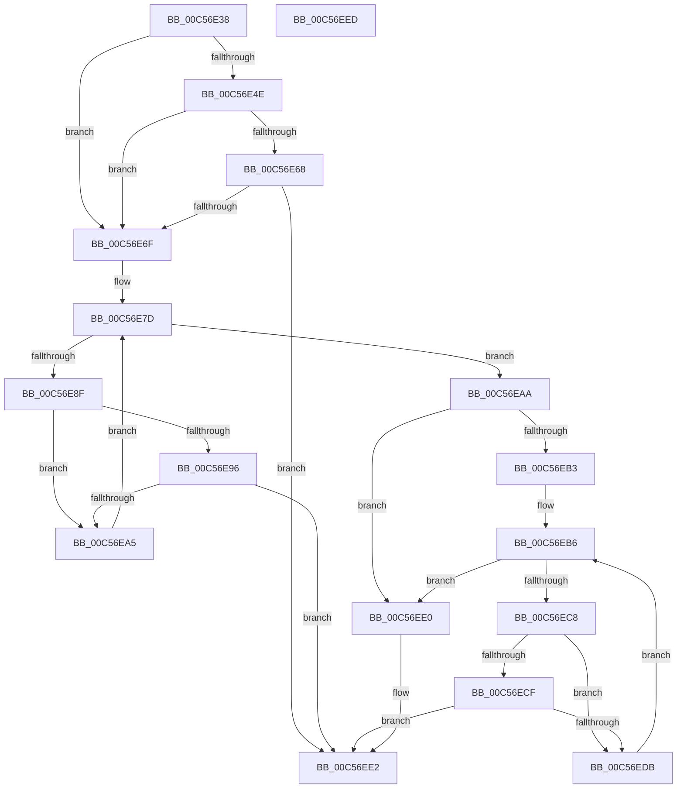

# CmpCreateExtendedControlSets

- RVA: `0x00C56E38`–`0x00C56EEE` (길이 `182` bytes)
- VA: `0x0000000140C56E38`
- 실행 섹션: `INIT`
- PDB 이름 있음: `예`; PDB Function 태그: `아니요`
- unwind 정보 RVA: `0x0005CAAC`
- 디코드: `53`개 명령, `182/182` bytes 표시
- 미해석 바이트: `0` (있으면 어셈블리에 `.byte`로 보존)

> 이 문서는 커널 이미지의 기계어와 PDB 기호를 분석해 생성했습니다. 4번과 5번은 함수 원형과 자료형을 바이너리 사용 방식에서 추정한 C 해석이며 원본 소스 복구 결과는 아닙니다.

## 1. Dependencies

- 직접 호출 지점: **3**; 고유 호출 대상: **2**
- 직접 호출자로 확인된 함수: **1**
- RIP 상대 이미지 참조: **2**

### Outgoing calls
- `0x00C56E57` → [CmpCreateControlSet](CmpCreateControlSet_function_00C56910.md) (function, `0x00C56910`)
- `0x00C56E9C` → [CmpCreateControlSet](CmpCreateControlSet_function_00C56910.md) (function, `0x00C56910`)
- `0x00C56ED2` → [CmpCreateControlSetOverride](CmpCreateControlSetOverride_function_00C56CC8.md) (function, `0x00C56CC8`)

### Direct callers
- [CmInitSystem1](CmInitSystem1_function_00C559CC.md) at `0x00C56287`

### Static image references
- `0x00C56E42` → RVA `0x00EEFB6C` (`.data`; read)
- `0x00C56E50` → RVA `0x00C7E2A0` (` ?? ::PBOPGDP::`string'`; read)

## 2. Other-region calls and transfers

- 다른 실행 섹션으로 향하는 call: **0**
- 별도 외부 분기/꼬리 이동을 확인하지 못했습니다.

## 3. Assembly (complete function range)

```asm
00C56E38  48 89 5C 24 08                  mov qword ptr [rsp + 8], rbx
00C56E3D  57                              push rdi
00C56E3E  48 83 EC 20                     sub rsp, 0x20
00C56E42  83 3D 23 8D 29 00 00            cmp dword ptr [rip + 0x298d23], 0
00C56E49  48 8B F9                        mov rdi, rcx
00C56E4C  74 21                           je 0x140c56e6f
00C56E4E  B2 01                           mov dl, 1
00C56E50  48 8D 0D 49 74 02 00            lea rcx, [rip + 0x27449]
00C56E57  E8 B4 FA FF FF                  call 0x140c56910
00C56E5C  B9 00 00 00 80                  mov ecx, 0x80000000
00C56E61  8D 14 08                        lea edx, [rax + rcx]
00C56E64  85 D1                           test ecx, edx
00C56E66  75 07                           jne 0x140c56e6f
00C56E68  3D 34 00 00 C0                  cmp eax, 0xc0000034
00C56E6D  75 73                           jne 0x140c56ee2
00C56E6F  48 8B 87 F0 00 00 00            mov rax, qword ptr [rdi + 0xf0]
00C56E76  48 8B 98 38 01 00 00            mov rbx, qword ptr [rax + 0x138]
00C56E7D  48 8B 87 F0 00 00 00            mov rax, qword ptr [rdi + 0xf0]
00C56E84  48 05 38 01 00 00               add rax, 0x138
00C56E8A  48 3B D8                        cmp rbx, rax
00C56E8D  74 1B                           je 0x140c56eaa
00C56E8F  8B 43 18                        mov eax, dword ptr [rbx + 0x18]
00C56E92  84 C0                           test al, al
00C56E94  79 0F                           jns 0x140c56ea5
00C56E96  48 8B 4B 30                     mov rcx, qword ptr [rbx + 0x30]
00C56E9A  B2 01                           mov dl, 1
00C56E9C  E8 6F FA FF FF                  call 0x140c56910
00C56EA1  85 C0                           test eax, eax
00C56EA3  78 3D                           js 0x140c56ee2
00C56EA5  48 8B 1B                        mov rbx, qword ptr [rbx]
00C56EA8  EB D3                           jmp 0x140c56e7d
00C56EAA  83 3D BB 8C 29 00 00            cmp dword ptr [rip + 0x298cbb], 0
00C56EB1  74 2D                           je 0x140c56ee0
00C56EB3  48 8B 18                        mov rbx, qword ptr [rax]
00C56EB6  48 8B 87 F0 00 00 00            mov rax, qword ptr [rdi + 0xf0]
00C56EBD  48 05 38 01 00 00               add rax, 0x138
00C56EC3  48 3B D8                        cmp rbx, rax
00C56EC6  74 18                           je 0x140c56ee0
00C56EC8  8B 43 18                        mov eax, dword ptr [rbx + 0x18]
00C56ECB  A8 40                           test al, 0x40
00C56ECD  74 0C                           je 0x140c56edb
00C56ECF  48 8B CB                        mov rcx, rbx
00C56ED2  E8 F1 FD FF FF                  call 0x140c56cc8
00C56ED7  85 C0                           test eax, eax
00C56ED9  78 07                           js 0x140c56ee2
00C56EDB  48 8B 1B                        mov rbx, qword ptr [rbx]
00C56EDE  EB D6                           jmp 0x140c56eb6
00C56EE0  33 C0                           xor eax, eax
00C56EE2  48 8B 5C 24 30                  mov rbx, qword ptr [rsp + 0x30]
00C56EE7  48 83 C4 20                     add rsp, 0x20
00C56EEB  5F                              pop rdi
00C56EEC  C3                              ret
00C56EED  CC                              int3
```

## 4. C-style interpretation (structured pseudocode)

```c
__int64 __fastcall CmpCreateExtendedControlSets(__int64 a1)
{
    __int64 result;
    __int64 v_rsp;
    unsigned __int64 v_stack_p8;

    v_stack_p8 = v_rbx;
    v_rsp = (v_rsp) - (32);
    if ((*(unsigned int *)(v_rip + 2723107)) == 0) goto loc_00C56E6F;
    result = CmpCreateControlSet(v_rip + 160841, 1, a3, a4);
    if ((((unsigned int)((unsigned int)(0x80000000ULL))) & ((unsigned int)(result + (unsigned int)(0x80000000ULL) * 1))) != 0) goto loc_00C56E6F;
    if (((unsigned int)(result)) != 0xC0000034ULL) goto loc_00C56EE2;
loc_00C56E6F:
loc_00C56E7D:
    result = (*(unsigned __int64 *)(a1 + 240)) + (312);
    if ((*(unsigned __int64 *)(*(unsigned __int64 *)(a1 + 240) + 312)) == result) goto loc_00C56EAA;
    if (!sign_flag) goto loc_00C56EA5;
    result = CmpCreateControlSet(*(unsigned __int64 *)(*(unsigned __int64 *)(*(unsigned __int64 *)(a1 + 240) + 312) + 48), 1, a3, a4);
    if (sign_flag) goto loc_00C56EE2;
loc_00C56EA5:
    goto loc_00C56E7D;
loc_00C56EAA:
    if ((*(unsigned int *)(v_rip + 2723003)) == 0) goto loc_00C56EE0;
loc_00C56EB6:
    result = (*(unsigned __int64 *)(a1 + 240)) + (312);
    if ((*(unsigned __int64 *)(result)) == result) goto loc_00C56EE0;
    if ((((unsigned __int8)((unsigned int)(*(unsigned int *)(*(unsigned __int64 *)(result) + 24)))) & (64)) == 0) goto loc_00C56EDB;
    result = CmpCreateControlSetOverride(*(unsigned __int64 *)(result), 1, a3, a4);
    if (sign_flag) goto loc_00C56EE2;
loc_00C56EDB:
    goto loc_00C56EB6;
loc_00C56EE0:
    result = 0;
loc_00C56EE2:
    v_rsp = (v_rsp) + (32);
    return result;
}
```

## 5. (Beta) C Style

```c
int64_t CmpCreateExtendedControlSets(void *Arg1)
{
    uint8_t *arg1 = (uint8_t *)Arg1;

    int64_t result;
    int64_t local_rsp;
    uint64_t v_stack_p8;

    v_stack_p8 = local_rbx;
    local_rsp = (local_rsp) - (32);
    if ((*(uint32_t *)(v_rip + 0x298D23)) == 0) goto loc_00C56E6F;
    result = CmpCreateControlSet(v_rip + 160841, 1, a3, a4);
    if ((((uint32_t)((uint32_t)(0x80000000ULL))) & ((uint32_t)(result + (uint32_t)(0x80000000ULL) * 1))) != 0) goto loc_00C56E6F;
    if (((uint32_t)(result)) != 0xC0000034ULL) goto loc_00C56EE2;
loc_00C56E6F:
loc_00C56E7D:
    result = (*(uint64_t *)(arg1 + 0xF0)) + (312);
    if ((*(uint64_t *)(*(uint64_t *)(arg1 + 0xF0) + 0x138)) == result) goto loc_00C56EAA;
    if (!sign_flag) goto loc_00C56EA5;
    result = CmpCreateControlSet(*(uint64_t *)(*(uint64_t *)(*(uint64_t *)(arg1 + 0xF0) + 0x138) + 0x30), 1, a3, a4);
    if (sign_flag) goto loc_00C56EE2;
loc_00C56EA5:
    goto loc_00C56E7D;
loc_00C56EAA:
    if ((*(uint32_t *)(v_rip + 0x298CBB)) == 0) goto loc_00C56EE0;
loc_00C56EB6:
    result = (*(uint64_t *)(arg1 + 0xF0)) + (312);
    if ((*(uint64_t *)(result)) == result) goto loc_00C56EE0;
    if ((((uint8_t)((uint32_t)(*(uint32_t *)(*(uint64_t *)(result) + 0x18)))) & (64)) == 0) goto loc_00C56EDB;
    result = CmpCreateControlSetOverride(*(uint64_t *)(result), 1, a3, a4);
    if (sign_flag) goto loc_00C56EE2;
loc_00C56EDB:
    goto loc_00C56EB6;
loc_00C56EE0:
    result = 0;
loc_00C56EE2:
    local_rsp = (local_rsp) + (32);
    return result;
}
```

### 관측된 메모리 오프셋

구조체 형식이 확인되지 않은 접근은 인자 기준의 오프셋으로만 기록했습니다.

| 기준 인자 | 오프셋 표현 | 폭 (bit) | 접근 |
|---|---:|---:|---|
| `Arg1` | `+ 0xF0` | `64` | `R` |

## 6. Execution-region graph

[열기: 2D/3D 그래프와 함수 탐색 컨트롤 패널](../../../control-panel.html?section=init&rva=0x00C56E38&view=graph)

- 2D 그래프는 위에서 아래로 흐르고, 3D 그래프는 빈 공간을 드래그해 회전합니다. Shift+드래그는 이동, 휠은 확대·축소, 함수 노드 선택은 대상 보고서 이동입니다.

### Static fallback


