# CmpCreateHardwareProfiles

- RVA: `0x00C56EF4`–`0x00C5777A` (길이 `2,182` bytes)
- VA: `0x0000000140C56EF4`
- 실행 섹션: `INIT`
- PDB 이름 있음: `예`; PDB Function 태그: `아니요`
- unwind 정보 RVA: `0x00096678`
- 디코드: `494`개 명령, `2,182/2,182` bytes 표시
- 미해석 바이트: `0` (있으면 어셈블리에 `.byte`로 보존)

> 이 문서는 커널 이미지의 기계어와 PDB 기호를 분석해 생성했습니다. 4번과 5번은 함수 원형과 자료형을 바이너리 사용 방식에서 추정한 C 해석이며 원본 소스 복구 결과는 아닙니다.

## 1. Dependencies

- 직접 호출 지점: **43**; 고유 호출 대상: **14**
- 직접 호출자로 확인된 함수: **1**
- RIP 상대 이미지 참조: **14**

### Outgoing calls
- `0x00C56F86` → [CmpOpenDevicesControlSet](../../page/7D/CmpOpenDevicesControlSet_function_007DC5B0.md) (function, `0x007DC5B0`)
- `0x00C56FD4` → [ZwOpenKey](../../text/6A/ZwOpenKey_function_006AD310.md) (function, `0x006AD310`)
- `0x00C5703F` → [ZwCreateKey](../../text/6A/ZwCreateKey_function_006AD470.md) (function, `0x006AD470`)
- `0x00C57052` → [ZwClose](../../text/6A/ZwClose_function_006AD2B0.md) (function, `0x006AD2B0`)
- `0x00C570A3` → [ZwCreateKey](../../text/6A/ZwCreateKey_function_006AD470.md) (function, `0x006AD470`)
- `0x00C570FE` → [ZwCreateKey](../../text/6A/ZwCreateKey_function_006AD470.md) (function, `0x006AD470`)
- `0x00C5712F` → [RtlUnicodeStringPrintf](../../text/48/RtlUnicodeStringPrintf_function_0048B984.md) (function, `0x0048B984`)
- `0x00C5717E` → [ZwCreateKey](../../text/6A/ZwCreateKey_function_006AD470.md) (function, `0x006AD470`)
- `0x00C57189` → [ZwClose](../../text/6A/ZwClose_function_006AD2B0.md) (function, `0x006AD2B0`)
- `0x00C5719E` → [ZwClose](../../text/6A/ZwClose_function_006AD2B0.md) (function, `0x006AD2B0`)
- `0x00C571CB` → [ZwSetValueKey](../../text/6A/ZwSetValueKey_function_006ADCD0.md) (function, `0x006ADCD0`)
- `0x00C57207` → [ZwQueryValueKey](../../text/6A/ZwQueryValueKey_function_006AD3B0.md) (function, `0x006AD3B0`)
- `0x00C5725C` → [ZwOpenKey](../../text/6A/ZwOpenKey_function_006AD310.md) (function, `0x006AD310`)
- `0x00C5729A` → [ZwCreateKey](../../text/6A/ZwCreateKey_function_006AD470.md) (function, `0x006AD470`)
- `0x00C572D5` → [RtlUnicodeStringPrintf](../../text/48/RtlUnicodeStringPrintf_function_0048B984.md) (function, `0x0048B984`)
- `0x00C57312` → [ZwOpenKey](../../text/6A/ZwOpenKey_function_006AD310.md) (function, `0x006AD310`)
- `0x00C57352` → [ZwCreateKey](../../text/6A/ZwCreateKey_function_006AD470.md) (function, `0x006AD470`)
- `0x00C573C7` → [CmpCloneHwProfile](../../page/7E/CmpCloneHwProfile_function_007E303C.md) (function, `0x007E303C`)
- `0x00C57401` → [ZwSetValueKey](../../text/6A/ZwSetValueKey_function_006ADCD0.md) (function, `0x006ADCD0`)
- `0x00C5741D` → [CmpAddAliasEntry](CmpAddAliasEntry_function_00C56584.md) (function, `0x00C56584`)
- `0x00C57472` → [ZwCreateKey](../../text/6A/ZwCreateKey_function_006AD470.md) (function, `0x006AD470`)
- `0x00C57484` → [CmpAddDockingInfo](CmpAddDockingInfo_function_00C567B4.md) (function, `0x00C567B4`)
- `0x00C5748E` → [ZwClose](../../text/6A/ZwClose_function_006AD2B0.md) (function, `0x006AD2B0`)
- `0x00C574D1` → [ZwOpenKey](../../text/6A/ZwOpenKey_function_006AD310.md) (function, `0x006AD310`)
- `0x00C574F0` → [CmDeleteKeyRecursive](../../page/7E/CmDeleteKeyRecursive_function_007E23F8.md) (function, `0x007E23F8`)
- `0x00C574FA` → [ZwClose](../../text/6A/ZwClose_function_006AD2B0.md) (function, `0x006AD2B0`)
- `0x00C5752C` → [ZwCreateKey](../../text/6A/ZwCreateKey_function_006AD470.md) (function, `0x006AD470`)
- `0x00C57566` → [RtlUnicodeStringPrintf](../../text/48/RtlUnicodeStringPrintf_function_0048B984.md) (function, `0x0048B984`)
- `0x00C57593` → [ZwSetValueKey](../../text/6A/ZwSetValueKey_function_006ADCD0.md) (function, `0x006ADCD0`)
- `0x00C575AB` → [RtlEqualUnicodeString](../../page/93/RtlEqualUnicodeString_function_00932A20.md) (function, `0x00932A20`)
- `0x00C575BD` → [ZwClose](../../text/6A/ZwClose_function_006AD2B0.md) (function, `0x006AD2B0`)
- `0x00C575FC` → [RtlUnicodeStringPrintf](../../text/48/RtlUnicodeStringPrintf_function_0048B984.md) (function, `0x0048B984`)
- `0x00C57649` → [ZwCreateKey](../../text/6A/ZwCreateKey_function_006AD470.md) (function, `0x006AD470`)
- `0x00C57686` → [RtlUnicodeStringPrintf](../../text/48/RtlUnicodeStringPrintf_function_0048B984.md) (function, `0x0048B984`)
- `0x00C576B3` → [ZwSetValueKey](../../text/6A/ZwSetValueKey_function_006ADCD0.md) (function, `0x006ADCD0`)
- `0x00C576ED` → [CmSetAcpiHwProfile](../../page/7E/CmSetAcpiHwProfile_function_007E2584.md) (function, `0x007E2584`)
- `0x00C576FC` → [ZwClose](../../text/6A/ZwClose_function_006AD2B0.md) (function, `0x006AD2B0`)
- `0x00C57709` → [ZwClose](../../text/6A/ZwClose_function_006AD2B0.md) (function, `0x006AD2B0`)
- `0x00C57717` → [ZwClose](../../text/6A/ZwClose_function_006AD2B0.md) (function, `0x006AD2B0`)
- `0x00C57725` → [ZwClose](../../text/6A/ZwClose_function_006AD2B0.md) (function, `0x006AD2B0`)
- `0x00C57733` → [ZwClose](../../text/6A/ZwClose_function_006AD2B0.md) (function, `0x006AD2B0`)
- `0x00C57742` → [ZwClose](../../text/6A/ZwClose_function_006AD2B0.md) (function, `0x006AD2B0`)
- `0x00C57753` → [_security_check_cookie](../../text/6A/_security_check_cookie_function_006AC640.md) (function, `0x006AC640`)

### Direct callers
- [CmInitSystem1](CmInitSystem1_function_00C559CC.md) at `0x00C562AE`

### Static image references
- `0x00C56F1A` → RVA `0x00E0A740` (`.data`; read)
- `0x00C56F99` → RVA `0x00B4AFA8` (`CmpControlIdConfigDbString`; read)
- `0x00C56FEA` → RVA `0x00EEFB6C` (`.data`; read)
- `0x00C56FF7` → RVA `0x00C82188` (`CmpControlString`; read)
- `0x00C570C4` → RVA `0x00B4AFB8` (`CmpHardwareProfilesString`; read)
- `0x00C57112` → RVA `0x00C7E380` (` ?? ::PBOPGDP::`string'`; read)
- `0x00C571C0` → RVA `0x00B4AFD8` (`CmpCurrentConfigString`; read)
- `0x00C5743A` → RVA `0x00C823C0` (`CmpStrCurrentDockInfoString`; read)
- `0x00C574A0` → RVA `0x00B4AF20` (`CmpHardwareProfilesCurrentString`; read)
- `0x00C57550` → RVA `0x00C7E1C0` (` ?? ::PBOPGDP::`string'`; read)
- `0x00C57570` → RVA `0x00FD9C00` (`PAGEDATA`; read)
- `0x00C5759E` → RVA `0x00B4AF30` (`CmpSystemHiveNameString`; read)
- `0x00C575EB` → RVA `0x00C7E240` (` ?? ::PBOPGDP::`string'`; read)
- `0x00C576D1` → RVA `0x00C57CE0` (`CmpHwprofileDefaultSelect`; read)

## 2. Other-region calls and transfers

- 다른 실행 섹션으로 향하는 call: **41**
  - `0x00C56F86` → [CmpOpenDevicesControlSet](../../page/7D/CmpOpenDevicesControlSet_function_007DC5B0.md) (`INIT` → `PAGE`)
  - `0x00C56FD4` → [ZwOpenKey](../../text/6A/ZwOpenKey_function_006AD310.md) (`INIT` → `.text`)
  - `0x00C5703F` → [ZwCreateKey](../../text/6A/ZwCreateKey_function_006AD470.md) (`INIT` → `.text`)
  - `0x00C57052` → [ZwClose](../../text/6A/ZwClose_function_006AD2B0.md) (`INIT` → `.text`)
  - `0x00C570A3` → [ZwCreateKey](../../text/6A/ZwCreateKey_function_006AD470.md) (`INIT` → `.text`)
  - `0x00C570FE` → [ZwCreateKey](../../text/6A/ZwCreateKey_function_006AD470.md) (`INIT` → `.text`)
  - `0x00C5712F` → [RtlUnicodeStringPrintf](../../text/48/RtlUnicodeStringPrintf_function_0048B984.md) (`INIT` → `.text`)
  - `0x00C5717E` → [ZwCreateKey](../../text/6A/ZwCreateKey_function_006AD470.md) (`INIT` → `.text`)
  - `0x00C57189` → [ZwClose](../../text/6A/ZwClose_function_006AD2B0.md) (`INIT` → `.text`)
  - `0x00C5719E` → [ZwClose](../../text/6A/ZwClose_function_006AD2B0.md) (`INIT` → `.text`)
  - `0x00C571CB` → [ZwSetValueKey](../../text/6A/ZwSetValueKey_function_006ADCD0.md) (`INIT` → `.text`)
  - `0x00C57207` → [ZwQueryValueKey](../../text/6A/ZwQueryValueKey_function_006AD3B0.md) (`INIT` → `.text`)
  - `0x00C5725C` → [ZwOpenKey](../../text/6A/ZwOpenKey_function_006AD310.md) (`INIT` → `.text`)
  - `0x00C5729A` → [ZwCreateKey](../../text/6A/ZwCreateKey_function_006AD470.md) (`INIT` → `.text`)
  - `0x00C572D5` → [RtlUnicodeStringPrintf](../../text/48/RtlUnicodeStringPrintf_function_0048B984.md) (`INIT` → `.text`)
  - `0x00C57312` → [ZwOpenKey](../../text/6A/ZwOpenKey_function_006AD310.md) (`INIT` → `.text`)
  - `0x00C57352` → [ZwCreateKey](../../text/6A/ZwCreateKey_function_006AD470.md) (`INIT` → `.text`)
  - `0x00C573C7` → [CmpCloneHwProfile](../../page/7E/CmpCloneHwProfile_function_007E303C.md) (`INIT` → `PAGE`)
  - `0x00C57401` → [ZwSetValueKey](../../text/6A/ZwSetValueKey_function_006ADCD0.md) (`INIT` → `.text`)
  - `0x00C57472` → [ZwCreateKey](../../text/6A/ZwCreateKey_function_006AD470.md) (`INIT` → `.text`)
  - `0x00C5748E` → [ZwClose](../../text/6A/ZwClose_function_006AD2B0.md) (`INIT` → `.text`)
  - `0x00C574D1` → [ZwOpenKey](../../text/6A/ZwOpenKey_function_006AD310.md) (`INIT` → `.text`)
  - `0x00C574F0` → [CmDeleteKeyRecursive](../../page/7E/CmDeleteKeyRecursive_function_007E23F8.md) (`INIT` → `PAGE`)
  - `0x00C574FA` → [ZwClose](../../text/6A/ZwClose_function_006AD2B0.md) (`INIT` → `.text`)
  - `0x00C5752C` → [ZwCreateKey](../../text/6A/ZwCreateKey_function_006AD470.md) (`INIT` → `.text`)
  - `0x00C57566` → [RtlUnicodeStringPrintf](../../text/48/RtlUnicodeStringPrintf_function_0048B984.md) (`INIT` → `.text`)
  - `0x00C57593` → [ZwSetValueKey](../../text/6A/ZwSetValueKey_function_006ADCD0.md) (`INIT` → `.text`)
  - `0x00C575AB` → [RtlEqualUnicodeString](../../page/93/RtlEqualUnicodeString_function_00932A20.md) (`INIT` → `PAGE`)
  - `0x00C575BD` → [ZwClose](../../text/6A/ZwClose_function_006AD2B0.md) (`INIT` → `.text`)
  - `0x00C575FC` → [RtlUnicodeStringPrintf](../../text/48/RtlUnicodeStringPrintf_function_0048B984.md) (`INIT` → `.text`)
  - `0x00C57649` → [ZwCreateKey](../../text/6A/ZwCreateKey_function_006AD470.md) (`INIT` → `.text`)
  - `0x00C57686` → [RtlUnicodeStringPrintf](../../text/48/RtlUnicodeStringPrintf_function_0048B984.md) (`INIT` → `.text`)
  - `0x00C576B3` → [ZwSetValueKey](../../text/6A/ZwSetValueKey_function_006ADCD0.md) (`INIT` → `.text`)
  - `0x00C576ED` → [CmSetAcpiHwProfile](../../page/7E/CmSetAcpiHwProfile_function_007E2584.md) (`INIT` → `PAGE`)
  - `0x00C576FC` → [ZwClose](../../text/6A/ZwClose_function_006AD2B0.md) (`INIT` → `.text`)
  - `0x00C57709` → [ZwClose](../../text/6A/ZwClose_function_006AD2B0.md) (`INIT` → `.text`)
  - `0x00C57717` → [ZwClose](../../text/6A/ZwClose_function_006AD2B0.md) (`INIT` → `.text`)
  - `0x00C57725` → [ZwClose](../../text/6A/ZwClose_function_006AD2B0.md) (`INIT` → `.text`)
  - `0x00C57733` → [ZwClose](../../text/6A/ZwClose_function_006AD2B0.md) (`INIT` → `.text`)
  - `0x00C57742` → [ZwClose](../../text/6A/ZwClose_function_006AD2B0.md) (`INIT` → `.text`)
  - `0x00C57753` → [_security_check_cookie](../../text/6A/_security_check_cookie_function_006AC640.md) (`INIT` → `.text`)
- 별도 외부 분기/꼬리 이동을 확인하지 못했습니다.

## 3. Assembly (complete function range)

```asm
00C56EF4  48 8B C4                        mov rax, rsp
00C56EF7  48 89 58 10                     mov qword ptr [rax + 0x10], rbx
00C56EFB  48 89 70 18                     mov qword ptr [rax + 0x18], rsi
00C56EFF  48 89 78 20                     mov qword ptr [rax + 0x20], rdi
00C56F03  55                              push rbp
00C56F04  41 54                           push r12
00C56F06  41 55                           push r13
00C56F08  41 56                           push r14
00C56F0A  41 57                           push r15
00C56F0C  48 8D A8 68 FD FF FF            lea rbp, [rax - 0x298]
00C56F13  48 81 EC 70 03 00 00            sub rsp, 0x370
00C56F1A  48 8B 05 1F 38 1B 00            mov rax, qword ptr [rip + 0x1b381f]
00C56F21  48 33 C4                        xor rax, rsp
00C56F24  48 89 85 60 02 00 00            mov qword ptr [rbp + 0x260], rax
00C56F2B  45 33 FF                        xor r15d, r15d
00C56F2E  4C 8D 45 C8                     lea r8, [rbp - 0x38]
00C56F32  0F 57 C0                        xorps xmm0, xmm0
00C56F35  4C 89 7D A8                     mov qword ptr [rbp - 0x58], r15
00C56F39  33 C0                           xor eax, eax
00C56F3B  44 89 7D B8                     mov dword ptr [rbp - 0x48], r15d
00C56F3F  0F 57 C9                        xorps xmm1, xmm1
00C56F42  48 89 45 88                     mov qword ptr [rbp - 0x78], rax
00C56F46  48 8D 55 D8                     lea rdx, [rbp - 0x28]
00C56F4A  89 45 90                        mov dword ptr [rbp - 0x70], eax
00C56F4D  0F 11 44 24 68                  movups xmmword ptr [rsp + 0x68], xmm0
00C56F52  44 89 7C 24 40                  mov dword ptr [rsp + 0x40], r15d
00C56F57  48 8B F9                        mov rdi, rcx
00C56F5A  0F 11 44 24 78                  movups xmmword ptr [rsp + 0x78], xmm0
00C56F5F  4C 89 7D D8                     mov qword ptr [rbp - 0x28], r15
00C56F63  0F 11 45 C8                     movups xmmword ptr [rbp - 0x38], xmm0
00C56F67  4C 89 7D 98                     mov qword ptr [rbp - 0x68], r15
00C56F6B  0F 11 4C 24 58                  movups xmmword ptr [rsp + 0x58], xmm1
00C56F70  4C 89 7D A0                     mov qword ptr [rbp - 0x60], r15
00C56F74  4C 89 7D B0                     mov qword ptr [rbp - 0x50], r15
00C56F78  4C 89 7C 24 50                  mov qword ptr [rsp + 0x50], r15
00C56F7D  44 89 7C 24 44                  mov dword ptr [rsp + 0x44], r15d
00C56F82  45 0F B6 F7                     movzx r14d, r15b
00C56F86  E8 25 56 B8 FF                  call 0x1407dc5b0
00C56F8B  48 8B 75 D8                     mov rsi, qword ptr [rbp - 0x28]
00C56F8F  8B D8                           mov ebx, eax
00C56F91  85 C0                           test eax, eax
00C56F93  0F 88 68 07 00 00               js 0x140c57701
00C56F99  48 8D 05 08 40 EF FF            lea rax, [rip - 0x10bff8]
00C56FA0  48 89 74 24 70                  mov qword ptr [rsp + 0x70], rsi
00C56FA5  0F 57 C0                        xorps xmm0, xmm0
00C56FA8  C7 45 80 40 02 00 00            mov dword ptr [rbp - 0x80], 0x240
00C56FAF  41 BC 19 00 02 00               mov r12d, 0x20019
00C56FB5  48 89 44 24 78                  mov qword ptr [rsp + 0x78], rax
00C56FBA  45 8D 6F 30                     lea r13d, [r15 + 0x30]
00C56FBE  41 8B D4                        mov edx, r12d
00C56FC1  4C 8D 44 24 68                  lea r8, [rsp + 0x68]
00C56FC6  44 89 6C 24 68                  mov dword ptr [rsp + 0x68], r13d
00C56FCB  48 8D 4D 98                     lea rcx, [rbp - 0x68]
00C56FCF  F3 0F 7F 45 88                  movdqu xmmword ptr [rbp - 0x78], xmm0
00C56FD4  E8 37 63 A5 FF                  call 0x1406ad310
00C56FD9  41 8D 4F 01                     lea ecx, [r15 + 1]
00C56FDD  8B D8                           mov ebx, eax
00C56FDF  3D 34 00 00 C0                  cmp eax, 0xc0000034
00C56FE4  0F 85 F2 01 00 00               jne 0x140c571dc
00C56FEA  44 39 3D 7B 8B 29 00            cmp dword ptr [rip + 0x298b7b], r15d
00C56FF1  0F 84 0A 07 00 00               je 0x140c57701
00C56FF7  48 8D 05 8A B1 02 00            lea rax, [rip + 0x2b18a]
00C56FFE  44 89 6C 24 68                  mov dword ptr [rsp + 0x68], r13d
00C57003  48 89 44 24 78                  mov qword ptr [rsp + 0x78], rax
00C57008  4C 8D 44 24 68                  lea r8, [rsp + 0x68]
00C5700D  48 8D 44 24 40                  lea rax, [rsp + 0x40]
00C57012  48 89 74 24 70                  mov qword ptr [rsp + 0x70], rsi
00C57017  48 89 44 24 30                  mov qword ptr [rsp + 0x30], rax
00C5701C  48 8D 4D A8                     lea rcx, [rbp - 0x58]
00C57020  0F 57 C0                        xorps xmm0, xmm0
00C57023  44 89 7C 24 28                  mov dword ptr [rsp + 0x28], r15d
00C57028  45 33 C9                        xor r9d, r9d
00C5702B  4C 89 7C 24 20                  mov qword ptr [rsp + 0x20], r15
00C57030  41 8B D4                        mov edx, r12d
00C57033  C7 45 80 40 02 00 00            mov dword ptr [rbp - 0x80], 0x240
00C5703A  F3 0F 7F 45 88                  movdqu xmmword ptr [rbp - 0x78], xmm0
00C5703F  E8 2C 64 A5 FF                  call 0x1406ad470
00C57044  8B D8                           mov ebx, eax
00C57046  85 C0                           test eax, eax
00C57048  0F 88 B3 06 00 00               js 0x140c57701
00C5704E  48 8B 4D A8                     mov rcx, qword ptr [rbp - 0x58]
00C57052  E8 59 62 A5 FF                  call 0x1406ad2b0
00C57057  48 8D 05 4A 3F EF FF            lea rax, [rip - 0x10c0b6]
00C5705E  4C 89 7D A8                     mov qword ptr [rbp - 0x58], r15
00C57062  48 89 44 24 78                  mov qword ptr [rsp + 0x78], rax
00C57067  4C 8D 44 24 68                  lea r8, [rsp + 0x68]
00C5706C  48 8D 44 24 40                  lea rax, [rsp + 0x40]
00C57071  44 89 6C 24 68                  mov dword ptr [rsp + 0x68], r13d
00C57076  48 89 44 24 30                  mov qword ptr [rsp + 0x30], rax
00C5707B  48 8D 4D 98                     lea rcx, [rbp - 0x68]
00C5707F  0F 57 C0                        xorps xmm0, xmm0
00C57082  44 89 7C 24 28                  mov dword ptr [rsp + 0x28], r15d
00C57087  45 33 C9                        xor r9d, r9d
00C5708A  4C 89 7C 24 20                  mov qword ptr [rsp + 0x20], r15
00C5708F  41 8B D4                        mov edx, r12d
00C57092  48 89 74 24 70                  mov qword ptr [rsp + 0x70], rsi
00C57097  C7 45 80 40 02 00 00            mov dword ptr [rbp - 0x80], 0x240
00C5709E  F3 0F 7F 45 88                  movdqu xmmword ptr [rbp - 0x78], xmm0
00C570A3  E8 C8 63 A5 FF                  call 0x1406ad470
00C570A8  8B D8                           mov ebx, eax
00C570AA  85 C0                           test eax, eax
00C570AC  0F 88 4F 06 00 00               js 0x140c57701
00C570B2  48 8B 45 98                     mov rax, qword ptr [rbp - 0x68]
00C570B6  4C 8D 44 24 68                  lea r8, [rsp + 0x68]
00C570BB  48 89 44 24 70                  mov qword ptr [rsp + 0x70], rax
00C570C0  48 8D 4D A8                     lea rcx, [rbp - 0x58]
00C570C4  48 8D 05 ED 3E EF FF            lea rax, [rip - 0x10c113]
00C570CB  44 89 6C 24 68                  mov dword ptr [rsp + 0x68], r13d
00C570D0  48 89 44 24 78                  mov qword ptr [rsp + 0x78], rax
00C570D5  0F 57 C0                        xorps xmm0, xmm0
00C570D8  48 8D 44 24 40                  lea rax, [rsp + 0x40]
00C570DD  C7 45 80 40 02 00 00            mov dword ptr [rbp - 0x80], 0x240
00C570E4  48 89 44 24 30                  mov qword ptr [rsp + 0x30], rax
00C570E9  45 33 C9                        xor r9d, r9d
00C570EC  44 89 7C 24 28                  mov dword ptr [rsp + 0x28], r15d
00C570F1  41 8B D4                        mov edx, r12d
00C570F4  4C 89 7C 24 20                  mov qword ptr [rsp + 0x20], r15
00C570F9  F3 0F 7F 45 88                  movdqu xmmword ptr [rbp - 0x78], xmm0
00C570FE  E8 6D 63 A5 FF                  call 0x1406ad470
00C57103  8B D8                           mov ebx, eax
00C57105  85 C0                           test eax, eax
00C57107  0F 88 F4 05 00 00               js 0x140c57701
00C5710D  B8 00 01 00 00                  mov eax, 0x100
00C57112  48 8D 15 67 72 02 00            lea rdx, [rip + 0x27267]
00C57119  66 89 44 24 5A                  mov word ptr [rsp + 0x5a], ax
00C5711E  48 8D 4C 24 58                  lea rcx, [rsp + 0x58]
00C57123  48 8D 45 60                     lea rax, [rbp + 0x60]
00C57127  45 33 C0                        xor r8d, r8d
00C5712A  48 89 44 24 60                  mov qword ptr [rsp + 0x60], rax
00C5712F  E8 50 48 83 FF                  call 0x14048b984
00C57134  48 8B 45 A8                     mov rax, qword ptr [rbp - 0x58]
00C57138  4C 8D 44 24 68                  lea r8, [rsp + 0x68]
00C5713D  48 89 44 24 70                  mov qword ptr [rsp + 0x70], rax
00C57142  48 8D 4D A0                     lea rcx, [rbp - 0x60]
00C57146  48 8D 44 24 58                  lea rax, [rsp + 0x58]
00C5714B  44 89 6C 24 68                  mov dword ptr [rsp + 0x68], r13d
00C57150  48 89 44 24 78                  mov qword ptr [rsp + 0x78], rax
00C57155  0F 57 C0                        xorps xmm0, xmm0
00C57158  48 8D 44 24 40                  lea rax, [rsp + 0x40]
00C5715D  C7 45 80 40 02 00 00            mov dword ptr [rbp - 0x80], 0x240
00C57164  48 89 44 24 30                  mov qword ptr [rsp + 0x30], rax
00C57169  45 33 C9                        xor r9d, r9d
00C5716C  44 89 7C 24 28                  mov dword ptr [rsp + 0x28], r15d
00C57171  41 8B D4                        mov edx, r12d
00C57174  4C 89 7C 24 20                  mov qword ptr [rsp + 0x20], r15
00C57179  F3 0F 7F 45 88                  movdqu xmmword ptr [rbp - 0x78], xmm0
00C5717E  E8 ED 62 A5 FF                  call 0x1406ad470
00C57183  48 8B 4D A8                     mov rcx, qword ptr [rbp - 0x58]
00C57187  8B D8                           mov ebx, eax
00C57189  E8 22 61 A5 FF                  call 0x1406ad2b0
00C5718E  4C 89 7D A8                     mov qword ptr [rbp - 0x58], r15
00C57192  85 DB                           test ebx, ebx
00C57194  0F 88 67 05 00 00               js 0x140c57701
00C5719A  48 8B 4D A0                     mov rcx, qword ptr [rbp - 0x60]
00C5719E  E8 0D 61 A5 FF                  call 0x1406ad2b0
00C571A3  48 8B 4D 98                     mov rcx, qword ptr [rbp - 0x68]
00C571A7  48 8D 44 24 44                  lea rax, [rsp + 0x44]
00C571AC  C7 44 24 28 04 00 00 00         mov dword ptr [rsp + 0x28], 4
00C571B4  45 8D 4F 04                     lea r9d, [r15 + 4]
00C571B8  45 33 C0                        xor r8d, r8d
00C571BB  48 89 44 24 20                  mov qword ptr [rsp + 0x20], rax
00C571C0  48 8D 15 11 3E EF FF            lea rdx, [rip - 0x10c1ef]
00C571C7  4C 89 7D A0                     mov qword ptr [rbp - 0x60], r15
00C571CB  E8 00 6B A5 FF                  call 0x1406adcd0
00C571D0  8B D8                           mov ebx, eax
00C571D2  85 C0                           test eax, eax
00C571D4  0F 88 27 05 00 00               js 0x140c57701
00C571DA  EB 4F                           jmp 0x140c5722b
00C571DC  85 C0                           test eax, eax
00C571DE  0F 88 1D 05 00 00               js 0x140c57701
00C571E4  48 8D 45 B8                     lea rax, [rbp - 0x48]
00C571E8  44 8B C1                        mov r8d, ecx
00C571EB  48 8B 4D 98                     mov rcx, qword ptr [rbp - 0x68]
00C571EF  4C 8D 4D E0                     lea r9, [rbp - 0x20]
00C571F3  48 89 44 24 28                  mov qword ptr [rsp + 0x28], rax
00C571F8  48 8D 15 D9 3D EF FF            lea rdx, [rip - 0x10c227]
00C571FF  C7 44 24 20 80 00 00 00         mov dword ptr [rsp + 0x20], 0x80
00C57207  E8 A4 61 A5 FF                  call 0x1406ad3b0
00C5720C  8B D8                           mov ebx, eax
00C5720E  85 C0                           test eax, eax
00C57210  0F 88 EB 04 00 00               js 0x140c57701
00C57216  83 7D E4 04                     cmp dword ptr [rbp - 0x1c], 4
00C5721A  0F 85 E1 04 00 00               jne 0x140c57701
00C57220  8B 45 E8                        mov eax, dword ptr [rbp - 0x18]
00C57223  8B 4C 05 E0                     mov ecx, dword ptr [rbp + rax - 0x20]
00C57227  89 4C 24 44                     mov dword ptr [rsp + 0x44], ecx
00C5722B  48 8D 05 86 3D EF FF            lea rax, [rip - 0x10c27a]
00C57232  44 89 6C 24 68                  mov dword ptr [rsp + 0x68], r13d
00C57237  0F 57 C0                        xorps xmm0, xmm0
00C5723A  48 89 44 24 78                  mov qword ptr [rsp + 0x78], rax
00C5723F  4C 8D 44 24 68                  lea r8, [rsp + 0x68]
00C57244  48 89 74 24 70                  mov qword ptr [rsp + 0x70], rsi
00C57249  41 8B D4                        mov edx, r12d
00C5724C  C7 45 80 40 02 00 00            mov dword ptr [rbp - 0x80], 0x240
00C57253  48 8D 4D B0                     lea rcx, [rbp - 0x50]
00C57257  F3 0F 7F 45 88                  movdqu xmmword ptr [rbp - 0x78], xmm0
00C5725C  E8 AF 60 A5 FF                  call 0x1406ad310
00C57261  8B D8                           mov ebx, eax
00C57263  3D 34 00 00 C0                  cmp eax, 0xc0000034
00C57268  75 37                           jne 0x140c572a1
00C5726A  44 39 3D FB 88 29 00            cmp dword ptr [rip + 0x2988fb], r15d
00C57271  0F 84 8A 04 00 00               je 0x140c57701
00C57277  48 8D 44 24 40                  lea rax, [rsp + 0x40]
00C5727C  45 33 C9                        xor r9d, r9d
00C5727F  48 89 44 24 30                  mov qword ptr [rsp + 0x30], rax
00C57284  4C 8D 44 24 68                  lea r8, [rsp + 0x68]
00C57289  44 89 7C 24 28                  mov dword ptr [rsp + 0x28], r15d
00C5728E  48 8D 4D B0                     lea rcx, [rbp - 0x50]
00C57292  41 8B D4                        mov edx, r12d
00C57295  4C 89 7C 24 20                  mov qword ptr [rsp + 0x20], r15
00C5729A  E8 D1 61 A5 FF                  call 0x1406ad470
00C5729F  8B D8                           mov ebx, eax
00C572A1  85 DB                           test ebx, ebx
00C572A3  0F 88 58 04 00 00               js 0x140c57701
00C572A9  44 8B 44 24 44                  mov r8d, dword ptr [rsp + 0x44]
00C572AE  48 8D 15 CB 70 02 00            lea rdx, [rip + 0x270cb]
00C572B5  0F 57 C0                        xorps xmm0, xmm0
00C572B8  48 8D 4C 24 58                  lea rcx, [rsp + 0x58]
00C572BD  0F 11 44 24 58                  movups xmmword ptr [rsp + 0x58], xmm0
00C572C2  B8 00 01 00 00                  mov eax, 0x100
00C572C7  66 89 44 24 5A                  mov word ptr [rsp + 0x5a], ax
00C572CC  48 8D 45 60                     lea rax, [rbp + 0x60]
00C572D0  48 89 44 24 60                  mov qword ptr [rsp + 0x60], rax
00C572D5  E8 AA 46 83 FF                  call 0x14048b984
00C572DA  48 8B 45 B0                     mov rax, qword ptr [rbp - 0x50]
00C572DE  4C 8D 44 24 68                  lea r8, [rsp + 0x68]
00C572E3  48 89 44 24 70                  mov qword ptr [rsp + 0x70], rax
00C572E8  48 8D 4D A0                     lea rcx, [rbp - 0x60]
00C572EC  48 8D 44 24 58                  lea rax, [rsp + 0x58]
00C572F1  44 89 6C 24 68                  mov dword ptr [rsp + 0x68], r13d
00C572F6  0F 57 C0                        xorps xmm0, xmm0
00C572F9  48 89 44 24 78                  mov qword ptr [rsp + 0x78], rax
00C572FE  41 BC 40 02 00 00               mov r12d, 0x240
00C57304  BA 1F 00 02 00                  mov edx, 0x2001f
00C57309  44 89 65 80                     mov dword ptr [rbp - 0x80], r12d
00C5730D  F3 0F 7F 45 88                  movdqu xmmword ptr [rbp - 0x78], xmm0
00C57312  E8 F9 5F A5 FF                  call 0x1406ad310
00C57317  8B D8                           mov ebx, eax
00C57319  3D 34 00 00 C0                  cmp eax, 0xc0000034
00C5731E  75 39                           jne 0x140c57359
00C57320  44 39 3D 45 88 29 00            cmp dword ptr [rip + 0x298845], r15d
00C57327  0F 84 D4 03 00 00               je 0x140c57701
00C5732D  48 8D 44 24 40                  lea rax, [rsp + 0x40]
00C57332  45 33 C9                        xor r9d, r9d
00C57335  48 89 44 24 30                  mov qword ptr [rsp + 0x30], rax
00C5733A  4C 8D 44 24 68                  lea r8, [rsp + 0x68]
00C5733F  44 89 7C 24 28                  mov dword ptr [rsp + 0x28], r15d
00C57344  48 8D 4D A0                     lea rcx, [rbp - 0x60]
00C57348  BA 1F 00 02 00                  mov edx, 0x2001f
00C5734D  4C 89 7C 24 20                  mov qword ptr [rsp + 0x20], r15
00C57352  E8 19 61 A5 FF                  call 0x1406ad470
00C57357  8B D8                           mov ebx, eax
00C57359  85 DB                           test ebx, ebx
00C5735B  0F 88 A0 03 00 00               js 0x140c57701
00C57361  48 8B BF F0 00 00 00            mov rdi, qword ptr [rdi + 0xf0]
00C57368  B8 03 00 00 00                  mov eax, 3
00C5736D  0F B7 57 08                     movzx edx, word ptr [rdi + 8]
00C57371  8D 58 FE                        lea ebx, [rax - 2]
00C57374  66 3B D0                        cmp dx, ax
00C57377  75 06                           jne 0x140c5737f
00C57379  66 89 5F 08                     mov word ptr [rdi + 8], bx
00C5737D  8B D3                           mov edx, ebx
00C5737F  0F B7 4F 04                     movzx ecx, word ptr [rdi + 4]
00C57383  83 E9 01                        sub ecx, 1
00C57386  0F 84 84 00 00 00               je 0x140c57410
00C5738C  83 E9 01                        sub ecx, 1
00C5738F  0F 84 92 00 00 00               je 0x140c57427
00C57395  83 F9 01                        cmp ecx, 1
00C57398  0F 85 02 01 00 00               jne 0x140c574a0
00C5739E  44 8B 4C 24 44                  mov r9d, dword ptr [rsp + 0x44]
00C573A3  48 8D 44 24 44                  lea rax, [rsp + 0x44]
00C573A8  4C 8B 45 A0                     mov r8, qword ptr [rbp - 0x60]
00C573AC  48 8B 4D 98                     mov rcx, qword ptr [rbp - 0x68]
00C573B0  48 89 44 24 30                  mov qword ptr [rsp + 0x30], rax
00C573B5  48 8D 45 A0                     lea rax, [rbp - 0x60]
00C573B9  48 89 44 24 28                  mov qword ptr [rsp + 0x28], rax
00C573BE  66 89 54 24 20                  mov word ptr [rsp + 0x20], dx
00C573C3  48 8B 55 B0                     mov rdx, qword ptr [rbp - 0x50]
00C573C7  E8 70 BC B8 FF                  call 0x1407e303c
00C573CC  8B D8                           mov ebx, eax
00C573CE  85 C0                           test eax, eax
00C573D0  79 09                           jns 0x140c573db
00C573D2  4C 89 7D A0                     mov qword ptr [rbp - 0x60], r15
00C573D6  E9 26 03 00 00                  jmp 0x140c57701
00C573DB  48 8B 4D 98                     mov rcx, qword ptr [rbp - 0x68]
00C573DF  48 8D 44 24 44                  lea rax, [rsp + 0x44]
00C573E4  C7 44 24 28 04 00 00 00         mov dword ptr [rsp + 0x28], 4
00C573EC  48 8D 15 E5 3B EF FF            lea rdx, [rip - 0x10c41b]
00C573F3  41 B9 04 00 00 00               mov r9d, 4
00C573F9  48 89 44 24 20                  mov qword ptr [rsp + 0x20], rax
00C573FE  45 33 C0                        xor r8d, r8d
00C57401  E8 CA 68 A5 FF                  call 0x1406adcd0
00C57406  8B D8                           mov ebx, eax
00C57408  85 C0                           test eax, eax
00C5740A  0F 88 F1 02 00 00               js 0x140c57701
00C57410  44 8B 44 24 44                  mov r8d, dword ptr [rsp + 0x44]
00C57415  48 8D 57 04                     lea rdx, [rdi + 4]
00C57419  48 8B 4D 98                     mov rcx, qword ptr [rbp - 0x68]
00C5741D  E8 62 F1 FF FF                  call 0x140c56584
00C57422  BB 01 00 00 00                  mov ebx, 1
00C57427  48 8B 45 98                     mov rax, qword ptr [rbp - 0x68]
00C5742B  4C 8D 44 24 68                  lea r8, [rsp + 0x68]
00C57430  48 89 44 24 70                  mov qword ptr [rsp + 0x70], rax
00C57435  48 8D 4C 24 50                  lea rcx, [rsp + 0x50]
00C5743A  48 8D 05 7F AF 02 00            lea rax, [rip + 0x2af7f]
00C57441  44 89 6C 24 68                  mov dword ptr [rsp + 0x68], r13d
00C57446  48 89 44 24 78                  mov qword ptr [rsp + 0x78], rax
00C5744B  0F 57 C0                        xorps xmm0, xmm0
00C5744E  48 8D 44 24 40                  lea rax, [rsp + 0x40]
00C57453  44 89 65 80                     mov dword ptr [rbp - 0x80], r12d
00C57457  48 89 44 24 30                  mov qword ptr [rsp + 0x30], rax
00C5745C  45 33 C9                        xor r9d, r9d
00C5745F  89 5C 24 28                     mov dword ptr [rsp + 0x28], ebx
00C57463  BA 1F 00 02 00                  mov edx, 0x2001f
00C57468  4C 89 7C 24 20                  mov qword ptr [rsp + 0x20], r15
00C5746D  F3 0F 7F 45 88                  movdqu xmmword ptr [rbp - 0x78], xmm0
00C57472  E8 F9 5F A5 FF                  call 0x1406ad470
00C57477  85 C0                           test eax, eax
00C57479  78 1D                           js 0x140c57498
00C5747B  48 8B 4C 24 50                  mov rcx, qword ptr [rsp + 0x50]
00C57480  48 8D 57 04                     lea rdx, [rdi + 4]
00C57484  E8 2B F3 FF FF                  call 0x140c567b4
00C57489  48 8B 4C 24 50                  mov rcx, qword ptr [rsp + 0x50]
00C5748E  E8 1D 5E A5 FF                  call 0x1406ad2b0
00C57493  4C 89 7C 24 50                  mov qword ptr [rsp + 0x50], r15
00C57498  66 3B 5F 08                     cmp bx, word ptr [rdi + 8]
00C5749C  44 0F 44 F3                     cmove r14d, ebx
00C574A0  48 8D 05 79 3A EF FF            lea rax, [rip - 0x10c587]
00C574A7  44 89 6C 24 68                  mov dword ptr [rsp + 0x68], r13d
00C574AC  0F 57 C0                        xorps xmm0, xmm0
00C574AF  48 89 44 24 78                  mov qword ptr [rsp + 0x78], rax
00C574B4  4C 8D 44 24 68                  lea r8, [rsp + 0x68]
00C574B9  48 89 74 24 70                  mov qword ptr [rsp + 0x70], rsi
00C574BE  BA 3F 00 0F 00                  mov edx, 0xf003f
00C574C3  44 89 65 80                     mov dword ptr [rbp - 0x80], r12d
00C574C7  48 8D 4C 24 50                  lea rcx, [rsp + 0x50]
00C574CC  F3 0F 7F 45 88                  movdqu xmmword ptr [rbp - 0x78], xmm0
00C574D1  E8 3A 5E A5 FF                  call 0x1406ad310
00C574D6  BF 00 01 00 00                  mov edi, 0x100
00C574DB  85 C0                           test eax, eax
00C574DD  78 25                           js 0x140c57504
00C574DF  48 8B 4C 24 50                  mov rcx, qword ptr [rsp + 0x50]
00C574E4  4C 8D 85 60 01 00 00            lea r8, [rbp + 0x160]
00C574EB  44 8B CF                        mov r9d, edi
00C574EE  33 D2                           xor edx, edx
00C574F0  E8 03 AF B8 FF                  call 0x1407e23f8
00C574F5  48 8B 4C 24 50                  mov rcx, qword ptr [rsp + 0x50]
00C574FA  E8 B1 5D A5 FF                  call 0x1406ad2b0
00C574FF  4C 89 7C 24 50                  mov qword ptr [rsp + 0x50], r15
00C57504  45 33 C9                        xor r9d, r9d
00C57507  48 8D 44 24 40                  lea rax, [rsp + 0x40]
00C5750C  48 89 44 24 30                  mov qword ptr [rsp + 0x30], rax
00C57511  4C 8D 44 24 68                  lea r8, [rsp + 0x68]
00C57516  C7 44 24 28 03 00 00 00         mov dword ptr [rsp + 0x28], 3
00C5751E  48 8D 4C 24 50                  lea rcx, [rsp + 0x50]
00C57523  4C 89 7C 24 20                  mov qword ptr [rsp + 0x20], r15
00C57528  41 8D 51 20                     lea edx, [r9 + 0x20]
00C5752C  E8 3F 5F A5 FF                  call 0x1406ad470
00C57531  8B D8                           mov ebx, eax
00C57533  85 C0                           test eax, eax
00C57535  0F 88 7F 01 00 00               js 0x140c576ba
00C5753B  44 8B 4C 24 44                  mov r9d, dword ptr [rsp + 0x44]
00C57540  48 8D 45 60                     lea rax, [rbp + 0x60]
00C57544  0F 57 C0                        xorps xmm0, xmm0
00C57547  4C 8D 45 C8                     lea r8, [rbp - 0x38]
00C5754B  0F 11 44 24 58                  movups xmmword ptr [rsp + 0x58], xmm0
00C57550  48 8D 15 69 6C 02 00            lea rdx, [rip + 0x26c69]
00C57557  66 89 7C 24 5A                  mov word ptr [rsp + 0x5a], di
00C5755C  48 8D 4C 24 58                  lea rcx, [rsp + 0x58]
00C57561  48 89 44 24 60                  mov qword ptr [rsp + 0x60], rax
00C57566  E8 19 44 83 FF                  call 0x14048b984
00C5756B  0F B7 44 24 58                  movzx eax, word ptr [rsp + 0x58]
00C57570  48 8D 15 89 26 38 00            lea rdx, [rip + 0x382689]
00C57577  48 8B 4C 24 50                  mov rcx, qword ptr [rsp + 0x50]
00C5757C  41 B9 06 00 00 00               mov r9d, 6
00C57582  89 44 24 28                     mov dword ptr [rsp + 0x28], eax
00C57586  45 33 C0                        xor r8d, r8d
00C57589  48 8B 44 24 60                  mov rax, qword ptr [rsp + 0x60]
00C5758E  48 89 44 24 20                  mov qword ptr [rsp + 0x20], rax
00C57593  E8 38 67 A5 FF                  call 0x1406adcd0
00C57598  41 B8 01 00 00 00               mov r8d, 1
00C5759E  48 8D 15 8B 39 EF FF            lea rdx, [rip - 0x10c675]
00C575A5  48 8D 4D C8                     lea rcx, [rbp - 0x38]
00C575A9  8B D8                           mov ebx, eax
00C575AB  E8 70 B4 CD FF                  call 0x140932a20
00C575B0  84 C0                           test al, al
00C575B2  0F 85 02 01 00 00               jne 0x140c576ba
00C575B8  48 8B 4C 24 50                  mov rcx, qword ptr [rsp + 0x50]
00C575BD  E8 EE 5C A5 FF                  call 0x1406ad2b0
00C575C2  0F 57 C0                        xorps xmm0, xmm0
00C575C5  4C 89 7C 24 50                  mov qword ptr [rsp + 0x50], r15
00C575CA  0F 11 44 24 58                  movups xmmword ptr [rsp + 0x58], xmm0
00C575CF  B8 00 01 00 00                  mov eax, 0x100
00C575D4  4C 8D 0D 45 39 EF FF            lea r9, [rip - 0x10c6bb]
00C575DB  66 89 44 24 5A                  mov word ptr [rsp + 0x5a], ax
00C575E0  4C 8D 05 49 39 EF FF            lea r8, [rip - 0x10c6b7]
00C575E7  48 8D 45 60                     lea rax, [rbp + 0x60]
00C575EB  48 8D 15 4E 6C 02 00            lea rdx, [rip + 0x26c4e]
00C575F2  48 89 44 24 60                  mov qword ptr [rsp + 0x60], rax
00C575F7  48 8D 4C 24 58                  lea rcx, [rsp + 0x58]
00C575FC  E8 83 43 83 FF                  call 0x14048b984
00C57601  48 8D 44 24 58                  lea rax, [rsp + 0x58]
00C57606  44 89 6C 24 68                  mov dword ptr [rsp + 0x68], r13d
00C5760B  45 33 C9                        xor r9d, r9d
00C5760E  48 89 44 24 78                  mov qword ptr [rsp + 0x78], rax
00C57613  48 8D 44 24 40                  lea rax, [rsp + 0x40]
00C57618  4C 89 7C 24 70                  mov qword ptr [rsp + 0x70], r15
00C5761D  48 89 44 24 30                  mov qword ptr [rsp + 0x30], rax
00C57622  4C 8D 44 24 68                  lea r8, [rsp + 0x68]
00C57627  0F 57 C0                        xorps xmm0, xmm0
00C5762A  C7 44 24 28 03 00 00 00         mov dword ptr [rsp + 0x28], 3
00C57632  41 8D 51 20                     lea edx, [r9 + 0x20]
00C57636  4C 89 7C 24 20                  mov qword ptr [rsp + 0x20], r15
00C5763B  48 8D 4C 24 50                  lea rcx, [rsp + 0x50]
00C57640  44 89 65 80                     mov dword ptr [rbp - 0x80], r12d
00C57644  F3 0F 7F 45 88                  movdqu xmmword ptr [rbp - 0x78], xmm0
00C57649  E8 22 5E A5 FF                  call 0x1406ad470
00C5764E  8B D8                           mov ebx, eax
00C57650  85 C0                           test eax, eax
00C57652  78 66                           js 0x140c576ba
00C57654  0F 57 C0                        xorps xmm0, xmm0
00C57657  4C 8D 0D C2 38 EF FF            lea r9, [rip - 0x10c73e]
00C5765E  0F 11 44 24 58                  movups xmmword ptr [rsp + 0x58], xmm0
00C57663  B8 00 01 00 00                  mov eax, 0x100
00C57668  4C 8D 45 C8                     lea r8, [rbp - 0x38]
00C5766C  66 89 44 24 5A                  mov word ptr [rsp + 0x5a], ax
00C57671  48 8D 15 C8 6B 02 00            lea rdx, [rip + 0x26bc8]
00C57678  48 8D 45 60                     lea rax, [rbp + 0x60]
00C5767C  48 8D 4C 24 58                  lea rcx, [rsp + 0x58]
00C57681  48 89 44 24 60                  mov qword ptr [rsp + 0x60], rax
00C57686  E8 F9 42 83 FF                  call 0x14048b984
00C5768B  0F B7 44 24 58                  movzx eax, word ptr [rsp + 0x58]
00C57690  48 8D 15 69 25 38 00            lea rdx, [rip + 0x382569]
00C57697  48 8B 4C 24 50                  mov rcx, qword ptr [rsp + 0x50]
00C5769C  41 B9 06 00 00 00               mov r9d, 6
00C576A2  89 44 24 28                     mov dword ptr [rsp + 0x28], eax
00C576A6  45 33 C0                        xor r8d, r8d
00C576A9  48 8B 44 24 60                  mov rax, qword ptr [rsp + 0x60]
00C576AE  48 89 44 24 20                  mov qword ptr [rsp + 0x20], rax
00C576B3  E8 18 66 A5 FF                  call 0x1406adcd0
00C576B8  8B D8                           mov ebx, eax
00C576BA  45 84 F6                        test r14b, r14b
00C576BD  74 42                           je 0x140c57701
00C576BF  48 8D 44 24 48                  lea rax, [rsp + 0x48]
00C576C4  4C 89 7D C0                     mov qword ptr [rbp - 0x40], r15
00C576C8  4C 8D 4D C0                     lea r9, [rbp - 0x40]
00C576CC  48 89 44 24 20                  mov qword ptr [rsp + 0x20], rax
00C576D1  48 8D 15 08 06 00 00            lea rdx, [rip + 0x608]
00C576D8  44 88 7C 24 48                  mov byte ptr [rsp + 0x48], r15b
00C576DD  48 8D 4D D8                     lea rcx, [rbp - 0x28]
00C576E1  C7 45 D8 01 00 02 00            mov dword ptr [rbp - 0x28], 0x20001
00C576E8  66 44 89 7D DC                  mov word ptr [rbp - 0x24], r15w
00C576ED  E8 92 AE B8 FF                  call 0x1407e2584
00C576F2  8B D8                           mov ebx, eax
00C576F4  85 C0                           test eax, eax
00C576F6  78 09                           js 0x140c57701
00C576F8  48 8B 4D C0                     mov rcx, qword ptr [rbp - 0x40]
00C576FC  E8 AF 5B A5 FF                  call 0x1406ad2b0
00C57701  48 85 F6                        test rsi, rsi
00C57704  74 08                           je 0x140c5770e
00C57706  48 8B CE                        mov rcx, rsi
00C57709  E8 A2 5B A5 FF                  call 0x1406ad2b0
00C5770E  48 8B 4D 98                     mov rcx, qword ptr [rbp - 0x68]
00C57712  48 85 C9                        test rcx, rcx
00C57715  74 05                           je 0x140c5771c
00C57717  E8 94 5B A5 FF                  call 0x1406ad2b0
00C5771C  48 8B 4D A0                     mov rcx, qword ptr [rbp - 0x60]
00C57720  48 85 C9                        test rcx, rcx
00C57723  74 05                           je 0x140c5772a
00C57725  E8 86 5B A5 FF                  call 0x1406ad2b0
00C5772A  48 8B 4D B0                     mov rcx, qword ptr [rbp - 0x50]
00C5772E  48 85 C9                        test rcx, rcx
00C57731  74 05                           je 0x140c57738
00C57733  E8 78 5B A5 FF                  call 0x1406ad2b0
00C57738  48 8B 4C 24 50                  mov rcx, qword ptr [rsp + 0x50]
00C5773D  48 85 C9                        test rcx, rcx
00C57740  74 05                           je 0x140c57747
00C57742  E8 69 5B A5 FF                  call 0x1406ad2b0
00C57747  8B C3                           mov eax, ebx
00C57749  48 8B 8D 60 02 00 00            mov rcx, qword ptr [rbp + 0x260]
00C57750  48 33 CC                        xor rcx, rsp
00C57753  E8 E8 4E A5 FF                  call 0x1406ac640
00C57758  4C 8D 9C 24 70 03 00 00         lea r11, [rsp + 0x370]
00C57760  49 8B 5B 38                     mov rbx, qword ptr [r11 + 0x38]
00C57764  49 8B 73 40                     mov rsi, qword ptr [r11 + 0x40]
00C57768  49 8B 7B 48                     mov rdi, qword ptr [r11 + 0x48]
00C5776C  49 8B E3                        mov rsp, r11
00C5776F  41 5F                           pop r15
00C57771  41 5E                           pop r14
00C57773  41 5D                           pop r13
00C57775  41 5C                           pop r12
00C57777  5D                              pop rbp
00C57778  C3                              ret
00C57779  CC                              int3
```

## 4. C-style interpretation (structured pseudocode)

```c
__int64 __fastcall CmpCreateHardwareProfiles(__int64 a1, __int64 a2, __int64 a3, int a4)
{
    __int64 result;
    __int64 v_r14;
    __int64 v_r15;
    __int64 v_rbx;
    __int64 v_rsp;
    unsigned __int64 v_stack_m28;
    unsigned __int64 v_stack_m320;
    unsigned __int64 v_stack_m328;
    unsigned __int64 v_stack_m330;
    unsigned __int64 v_stack_m338;
    unsigned __int16 v_stack_m33E;
    unsigned __int64 v_stack_m340;
    unsigned __int64 v_stack_m348;
    unsigned __int64 v_stack_m350;
    unsigned int v_stack_m354;
    unsigned int v_stack_m358;
    unsigned __int64 v_stack_m368;
    unsigned int v_stack_m370;
    unsigned __int64 v_stack_m378;

    *(unsigned __int64 *)(v_rsp + 16) = v_rbx;
    *(unsigned __int64 *)(v_rsp + 24) = v_rsi;
    *(unsigned __int64 *)(v_rsp + 32) = v_rdi;
    v_rsp = (v_rsp) - (880);
    result = (*(unsigned __int64 *)(v_rip + 1783839)) ^ (v_rsp);
    *(unsigned __int64 *)(v_rsp - 664 + 608) = result;
    v_r15 = 0;
    *(unsigned __int64 *)(v_rsp - 664 - 88) = 0;
    result = 0;
    *(unsigned int *)(v_rsp - 664 - 72) = 0;
    *(unsigned __int64 *)(v_rsp - 664 - 120) = 0;
    *(unsigned int *)(v_rsp - 664 - 112) = 0;
    v_stack_m330 = v_xmm0;
    v_stack_m358 = 0;
    v_stack_m320 = v_xmm0;
    *(unsigned __int64 *)(v_rsp - 664 - 40) = 0;
    *(unsigned __int64 *)(v_rsp - 664 - 56) = v_xmm0;
    *(unsigned __int64 *)(v_rsp - 664 - 104) = 0;
    v_stack_m340 = v_xmm1;
    *(unsigned __int64 *)(v_rsp - 664 - 96) = 0;
    *(unsigned __int64 *)(v_rsp - 664 - 80) = 0;
    v_stack_m348 = 0;
    v_stack_m354 = 0;
    result = CmpOpenDevicesControlSet(a1, v_rsp - 664 - 40, v_rsp - 664 - 56, a4);
    if (sign_flag) goto loc_00C57701;
    v_stack_m328 = *(unsigned __int64 *)(v_rsp - 664 - 40);
    *(unsigned int *)(v_rsp - 664 - 128) = 576;
    v_stack_m320 = v_rip - 1097720;
    v_stack_m330 = (unsigned int)(v_r15 + 48);
    *(unsigned __int64 *)(v_rsp - 664 - 120) = v_xmm0;
    result = ZwOpenKey(v_rsp - 664 - 104, (unsigned int)((unsigned int)((unsigned int)(0x20019ULL))), v_stack_m330, a4);
    if (((unsigned int)(result)) != 0xC0000034ULL) goto loc_00C571DC;
    if ((*(unsigned int *)(v_rip + 2722683)) == 0) goto loc_00C57701;
    v_stack_m330 = (unsigned int)(v_r15 + 48);
    v_stack_m320 = v_rip + 176522;
    v_stack_m328 = *(unsigned __int64 *)(v_rsp - 664 - 40);
    v_stack_m368 = v_stack_m358;
    v_stack_m370 = 0;
    a4 = 0;
    v_stack_m378 = 0;
    *(unsigned int *)(v_rsp - 664 - 128) = 576;
    *(unsigned __int64 *)(v_rsp - 664 - 120) = v_xmm0;
    result = ZwCreateKey(v_rsp - 664 - 88, (unsigned int)((unsigned int)((unsigned int)(0x20019ULL))), v_stack_m330, a4);
    if (sign_flag) goto loc_00C57701;
    result = ZwClose(*(unsigned __int64 *)(v_rsp - 664 - 88), (unsigned int)((unsigned int)((unsigned int)(0x20019ULL))), v_stack_m330, a4);
    *(unsigned __int64 *)(v_rsp - 664 - 88) = 0;
    v_stack_m320 = v_rip - 1097910;
    v_stack_m330 = (unsigned int)(v_r15 + 48);
    v_stack_m368 = v_stack_m358;
    v_stack_m370 = 0;
    a4 = 0;
    v_stack_m378 = 0;
    v_stack_m328 = *(unsigned __int64 *)(v_rsp - 664 - 40);
    *(unsigned int *)(v_rsp - 664 - 128) = 576;
    *(unsigned __int64 *)(v_rsp - 664 - 120) = v_xmm0;
    result = ZwCreateKey(v_rsp - 664 - 104, (unsigned int)((unsigned int)((unsigned int)(0x20019ULL))), v_stack_m330, a4);
    if (sign_flag) goto loc_00C57701;
    v_stack_m328 = *(unsigned __int64 *)(v_rsp - 664 - 104);
    v_stack_m330 = (unsigned int)(v_r15 + 48);
    v_stack_m320 = v_rip - 1098003;
    *(unsigned int *)(v_rsp - 664 - 128) = 576;
    v_stack_m368 = v_stack_m358;
    a4 = 0;
    v_stack_m370 = 0;
    v_stack_m378 = 0;
    *(unsigned __int64 *)(v_rsp - 664 - 120) = v_xmm0;
    result = ZwCreateKey(v_rsp - 664 - 88, (unsigned int)((unsigned int)((unsigned int)(0x20019ULL))), v_stack_m330, a4);
    if (sign_flag) goto loc_00C57701;
    v_stack_m33E = 256;
    a3 = 0;
    v_stack_m338 = v_rsp - 664 + 96;
    result = RtlUnicodeStringPrintf(v_stack_m340, v_rip + 160359, a3, a4);
    v_stack_m328 = *(unsigned __int64 *)(v_rsp - 664 - 88);
    v_stack_m330 = (unsigned int)(v_r15 + 48);
    v_stack_m320 = v_stack_m340;
    *(unsigned int *)(v_rsp - 664 - 128) = 576;
    v_stack_m368 = v_stack_m358;
    a4 = 0;
    v_stack_m370 = 0;
    v_stack_m378 = 0;
    *(unsigned __int64 *)(v_rsp - 664 - 120) = v_xmm0;
    result = ZwCreateKey(v_rsp - 664 - 96, (unsigned int)((unsigned int)((unsigned int)(0x20019ULL))), v_stack_m330, a4);
    result = ZwClose(*(unsigned __int64 *)(v_rsp - 664 - 88), (unsigned int)((unsigned int)((unsigned int)(0x20019ULL))), v_stack_m330, a4);
    *(unsigned __int64 *)(v_rsp - 664 - 88) = 0;
    if (sign_flag) goto loc_00C57701;
    result = ZwClose(*(unsigned __int64 *)(v_rsp - 664 - 96), (unsigned int)((unsigned int)((unsigned int)(0x20019ULL))), v_stack_m330, a4);
    v_stack_m370 = 4;
    a3 = 0;
    v_stack_m378 = v_stack_m354;
    *(unsigned __int64 *)(v_rsp - 664 - 96) = 0;
    result = ZwSetValueKey(*(unsigned __int64 *)(v_rsp - 664 - 104), v_rip - 1098223, a3, v_r15 + 4);
    if (sign_flag) goto loc_00C57701;
    goto loc_00C5722B;
loc_00C571DC:
    if (sign_flag) goto loc_00C57701;
    v_stack_m370 = v_rsp - 664 - 72;
    v_stack_m378 = 128;
    result = ZwQueryValueKey(*(unsigned __int64 *)(v_rsp - 664 - 104), v_rip - 1098279, (unsigned int)((unsigned int)(*(unsigned __int64 *)(v_rsp - 664 - 104))), v_rsp - 664 - 32);
    if (sign_flag) goto loc_00C57701;
    if ((*(unsigned int *)(v_rsp - 664 - 28)) != 4) goto loc_00C57701;
    v_stack_m354 = (unsigned int)((unsigned int)(*(unsigned int *)(v_rsp - 664 + (unsigned int)(*(unsigned int *)(v_rsp - 664 - 24)) * 1 - 32)));
loc_00C5722B:
    v_stack_m330 = (unsigned int)(v_r15 + 48);
    v_stack_m320 = v_rip - 1098362;
    v_stack_m328 = *(unsigned __int64 *)(v_rsp - 664 - 40);
    *(unsigned int *)(v_rsp - 664 - 128) = 576;
    *(unsigned __int64 *)(v_rsp - 664 - 120) = v_xmm0;
    result = ZwOpenKey(v_rsp - 664 - 80, (unsigned int)((unsigned int)((unsigned int)(0x20019ULL))), v_stack_m330, v_rsp - 664 - 32);
    if (((unsigned int)(result)) != 0xC0000034ULL) goto loc_00C572A1;
    if ((*(unsigned int *)(v_rip + 2722043)) == 0) goto loc_00C57701;
    a4 = 0;
    v_stack_m368 = v_stack_m358;
    v_stack_m370 = 0;
    v_stack_m378 = 0;
    result = ZwCreateKey(v_rsp - 664 - 80, (unsigned int)((unsigned int)((unsigned int)(0x20019ULL))), v_stack_m330, a4);
loc_00C572A1:
    if (sign_flag) goto loc_00C57701;
    v_stack_m340 = v_xmm0;
    v_stack_m33E = 256;
    v_stack_m338 = v_rsp - 664 + 96;
    result = RtlUnicodeStringPrintf(v_stack_m340, v_rip + 159947, (unsigned int)(v_stack_m354), a4);
    v_stack_m328 = *(unsigned __int64 *)(v_rsp - 664 - 80);
    v_stack_m330 = (unsigned int)(v_r15 + 48);
    v_stack_m320 = v_stack_m340;
    *(unsigned int *)(v_rsp - 664 - 128) = 576;
    *(unsigned __int64 *)(v_rsp - 664 - 120) = v_xmm0;
    result = ZwOpenKey(v_rsp - 664 - 96, (unsigned int)(0x2001FULL), v_stack_m330, a4);
    if (((unsigned int)(result)) != 0xC0000034ULL) goto loc_00C57359;
    if ((*(unsigned int *)(v_rip + 2721861)) == 0) goto loc_00C57701;
    a4 = 0;
    v_stack_m368 = v_stack_m358;
    v_stack_m370 = 0;
    v_stack_m378 = 0;
    result = ZwCreateKey(v_rsp - 664 - 96, (unsigned int)(0x2001FULL), v_stack_m330, a4);
loc_00C57359:
    if (sign_flag) goto loc_00C57701;
    if (((unsigned __int16)(*(unsigned __int16 *)(*(unsigned __int64 *)(a1 + 240) + 8))) == 3) {
        *(unsigned __int16 *)(*(unsigned __int64 *)(a1 + 240) + 8) = (unsigned __int16)(3 - 2);
        a2 = (unsigned int)(3 - 2);
    }
    a1 = (unsigned int)((*(unsigned __int16 *)(*(unsigned __int64 *)(a1 + 240) + 4)) - (1));
    if (condition_is_equal) goto loc_00C57410;
    a1 = (unsigned int)((a1) - (1));
    if (condition_is_equal) goto loc_00C57427;
    if (((unsigned int)(a1)) != 1) goto loc_00C574A0;
    v_stack_m368 = v_stack_m354;
    v_stack_m370 = v_rsp - 664 - 96;
    v_stack_m378 = (unsigned __int16)(a2);
    result = CmpCloneHwProfile(*(unsigned __int64 *)(v_rsp - 664 - 104), *(unsigned __int64 *)(v_rsp - 664 - 80), *(unsigned __int64 *)(v_rsp - 664 - 96), (unsigned int)(v_stack_m354));
    if (!sign_flag) goto loc_00C573DB;
    *(unsigned __int64 *)(v_rsp - 664 - 96) = 0;
    goto loc_00C57701;
loc_00C573DB:
    v_stack_m370 = 4;
    v_stack_m378 = v_stack_m354;
    a3 = 0;
    result = ZwSetValueKey(*(unsigned __int64 *)(v_rsp - 664 - 104), v_rip - 1098779, a3, 4);
    if (sign_flag) goto loc_00C57701;
loc_00C57410:
    result = CmpAddAliasEntry(*(unsigned __int64 *)(v_rsp - 664 - 104), *(unsigned __int64 *)(a1 + 240) + 4, (unsigned int)(v_stack_m354), 4);
loc_00C57427:
    v_stack_m328 = *(unsigned __int64 *)(v_rsp - 664 - 104);
    v_stack_m330 = (unsigned int)(v_r15 + 48);
    v_stack_m320 = v_rip + 175999;
    *(unsigned int *)(v_rsp - 664 - 128) = 576;
    v_stack_m368 = v_stack_m358;
    a4 = 0;
    v_stack_m370 = 1;
    v_stack_m378 = 0;
    *(unsigned __int64 *)(v_rsp - 664 - 120) = v_xmm0;
    result = ZwCreateKey(v_stack_m348, (unsigned int)(0x2001FULL), v_stack_m330, a4);
    if (!(sign_flag)) {
        a1 = v_stack_m348;
        a2 = *(unsigned __int64 *)(a1 + 240) + 4;
        result = CmpAddDockingInfo(a1, a2, v_stack_m330, a4);
        a1 = v_stack_m348;
        result = ZwClose(a1, a2, v_stack_m330, a4);
        v_stack_m348 = 0;
    }
    v_r14 = 0;
    if (1 == (*(unsigned __int16 *)(*(unsigned __int64 *)(a1 + 240) + 8))) { v_r14 = 1; }
loc_00C574A0:
    v_stack_m330 = (unsigned int)(v_r15 + 48);
    v_stack_m320 = v_rip - 1099143;
    v_stack_m328 = *(unsigned __int64 *)(v_rsp - 664 - 40);
    *(unsigned int *)(v_rsp - 664 - 128) = 576;
    *(unsigned __int64 *)(v_rsp - 664 - 120) = v_xmm0;
    result = ZwOpenKey(v_stack_m348, (unsigned int)(0xF003FULL), v_stack_m330, a4);
    if (!(sign_flag)) {
        a1 = v_stack_m348;
        a3 = v_rsp - 664 + 352;
        a4 = 256;
        a2 = 0;
        result = CmDeleteKeyRecursive(a1, a2, a3, a4);
        a1 = v_stack_m348;
        result = ZwClose(a1, a2, a3, a4);
        v_stack_m348 = 0;
    }
    a4 = 0;
    v_stack_m368 = v_stack_m358;
    v_stack_m370 = 3;
    v_stack_m378 = 0;
    result = ZwCreateKey(v_stack_m348, a4 + 32, v_stack_m330, a4);
    if (sign_flag) goto loc_00C576BA;
    v_stack_m340 = v_xmm0;
    v_stack_m33E = 256;
    v_stack_m338 = v_rsp - 664 + 96;
    result = RtlUnicodeStringPrintf(v_stack_m340, v_rip + 158825, v_rsp - 664 - 56, (unsigned int)(v_stack_m354));
    v_stack_m370 = (unsigned int)(v_stack_m340);
    a3 = 0;
    v_stack_m378 = v_stack_m338;
    result = ZwSetValueKey(v_stack_m348, v_rip + 3679881, a3, 6);
    result = RtlEqualUnicodeString(v_rsp - 664 - 56, v_rip - 1099381, 1, 6);
    if ((unsigned __int8)(result) != 0) goto loc_00C576BA;
    result = ZwClose(v_stack_m348, v_rip - 1099381, 1, 6);
    v_stack_m348 = 0;
    v_stack_m340 = v_xmm0;
    v_stack_m33E = 256;
    v_stack_m338 = v_rsp - 664 + 96;
    result = RtlUnicodeStringPrintf(v_stack_m340, v_rip + 158798, v_rip - 1099447, v_rip - 1099451);
    v_stack_m330 = (unsigned int)(v_r15 + 48);
    a4 = 0;
    v_stack_m320 = v_stack_m340;
    v_stack_m328 = 0;
    v_stack_m368 = v_stack_m358;
    v_stack_m370 = 3;
    v_stack_m378 = 0;
    *(unsigned int *)(v_rsp - 664 - 128) = 576;
    *(unsigned __int64 *)(v_rsp - 664 - 120) = v_xmm0;
    result = ZwCreateKey(v_stack_m348, a4 + 32, v_stack_m330, a4);
    v_rbx = (unsigned int)((unsigned int)(result));
    if (!(sign_flag)) {
        a4 = v_rip - 1099582;
        v_stack_m340 = v_xmm0;
        result = 256;
        a3 = v_rsp - 664 - 56;
        v_stack_m33E = (unsigned __int16)(result);
        a2 = v_rip + 158664;
        result = v_rsp - 664 + 96;
        a1 = v_stack_m340;
        v_stack_m338 = result;
        result = RtlUnicodeStringPrintf(a1, a2, a3, a4);
        result = v_stack_m340;
        a2 = v_rip + 3679593;
        a1 = v_stack_m348;
        a4 = 6;
        v_stack_m370 = (unsigned int)(result);
        a3 = 0;
        result = v_stack_m338;
        v_stack_m378 = result;
        result = ZwSetValueKey(a1, a2, a3, a4);
        v_rbx = (unsigned int)(result);
    }
    if ((unsigned __int8)(v_r14) == 0) goto loc_00C57701;
    *(unsigned __int64 *)(v_rsp - 664 - 64) = 0;
    v_stack_m378 = v_stack_m350;
    v_stack_m350 = 0;
    *(unsigned int *)(v_rsp - 664 - 40) = 0x20001ULL;
    *(unsigned __int16 *)(v_rsp - 664 - 36) = 0;
    result = CmSetAcpiHwProfile(v_rsp - 664 - 40, v_rip + 1544, a3, v_rsp - 664 - 64);
    if (!(sign_flag)) {
        a1 = *(unsigned __int64 *)(v_rsp - 664 - 64);
        result = ZwClose(a1, v_rip + 1544, a3, v_rsp - 664 - 64);
    }
    if (*(unsigned __int64 *)(v_rsp - 664 - 40) != 0) {
        a1 = *(unsigned __int64 *)(v_rsp - 664 - 40);
        result = ZwClose(a1, v_rip + 1544, a3, v_rsp - 664 - 64);
    }
    if (*(unsigned __int64 *)(v_rsp - 664 - 104) != 0) {
        result = ZwClose(*(unsigned __int64 *)(v_rsp - 664 - 104), v_rip + 1544, a3, v_rsp - 664 - 64);
    }
    if (*(unsigned __int64 *)(v_rsp - 664 - 96) != 0) {
        result = ZwClose(*(unsigned __int64 *)(v_rsp - 664 - 96), v_rip + 1544, a3, v_rsp - 664 - 64);
    }
    if (*(unsigned __int64 *)(v_rsp - 664 - 80) != 0) {
        result = ZwClose(*(unsigned __int64 *)(v_rsp - 664 - 80), v_rip + 1544, a3, v_rsp - 664 - 64);
    }
    if (v_stack_m348 != 0) {
        result = ZwClose(v_stack_m348, v_rip + 1544, a3, v_rsp - 664 - 64);
    }
    a1 = (*(unsigned __int64 *)(v_rsp - 664 + 608)) ^ (v_rsp);
    result = _security_check_cookie(a1, v_rip + 1544, a3, v_rsp - 664 - 64);
    return result;
}
```

## 5. (Beta) C Style

```c
int64_t CmpCreateHardwareProfiles(void *Arg1, int64_t Arg2, int64_t Arg3, int32_t Arg4)
{
    uint8_t *arg1 = (uint8_t *)Arg1;

    int64_t result;
    int64_t local_r14;
    int64_t local_r15;
    int64_t local_rbx;
    int64_t local_rsp;
    uint64_t v_stack_m28;
    uint64_t v_stack_m320;
    uint64_t v_stack_m328;
    uint64_t v_stack_m330;
    uint64_t v_stack_m338;
    uint16_t v_stack_m33E;
    uint64_t v_stack_m340;
    uint64_t v_stack_m348;
    uint64_t v_stack_m350;
    uint32_t v_stack_m354;
    uint32_t v_stack_m358;
    uint64_t v_stack_m368;
    uint32_t v_stack_m370;
    uint64_t v_stack_m378;

    *(uint64_t *)(local_rsp + 0x10) = local_rbx;
    *(uint64_t *)(local_rsp + 0x18) = local_rsi;
    *(uint64_t *)(local_rsp + 0x20) = local_rdi;
    local_rsp = (local_rsp) - (880);
    result = (*(uint64_t *)(v_rip + 0x1B381F)) ^ (local_rsp);
    *(uint64_t *)(local_rsp - 0x298 + 0x260) = result;
    local_r15 = 0;
    *(uint64_t *)(local_rsp - 0x298 - 0x58) = 0;
    result = 0;
    *(uint32_t *)(local_rsp - 0x298 - 0x48) = 0;
    *(uint64_t *)(local_rsp - 0x298 - 0x78) = 0;
    *(uint32_t *)(local_rsp - 0x298 - 0x70) = 0;
    v_stack_m330 = v_xmm0;
    v_stack_m358 = 0;
    v_stack_m320 = v_xmm0;
    *(uint64_t *)(local_rsp - 0x298 - 0x28) = 0;
    *(uint64_t *)(local_rsp - 0x298 - 0x38) = v_xmm0;
    *(uint64_t *)(local_rsp - 0x298 - 0x68) = 0;
    v_stack_m340 = v_xmm1;
    *(uint64_t *)(local_rsp - 0x298 - 0x60) = 0;
    *(uint64_t *)(local_rsp - 0x298 - 0x50) = 0;
    v_stack_m348 = 0;
    v_stack_m354 = 0;
    result = CmpOpenDevicesControlSet(Arg1, local_rsp - 664 - 40, local_rsp - 664 - 56, Arg4);
    if (sign_flag) goto loc_00C57701;
    v_stack_m328 = *(uint64_t *)(local_rsp - 0x298 - 0x28);
    *(uint32_t *)(local_rsp - 0x298 - 0x80) = 576;
    v_stack_m320 = v_rip - 1097720;
    v_stack_m330 = (uint32_t)(local_r15 + 48);
    *(uint64_t *)(local_rsp - 0x298 - 0x78) = v_xmm0;
    result = ZwOpenKey(local_rsp - 664 - 104, (uint32_t)((uint32_t)((uint32_t)(0x20019ULL))), v_stack_m330, Arg4);
    if (((uint32_t)(result)) != 0xC0000034ULL) goto loc_00C571DC;
    if ((*(uint32_t *)(v_rip + 0x298B7B)) == 0) goto loc_00C57701;
    v_stack_m330 = (uint32_t)(local_r15 + 48);
    v_stack_m320 = v_rip + 176522;
    v_stack_m328 = *(uint64_t *)(local_rsp - 0x298 - 0x28);
    v_stack_m368 = v_stack_m358;
    v_stack_m370 = 0;
    Arg4 = 0;
    v_stack_m378 = 0;
    *(uint32_t *)(local_rsp - 0x298 - 0x80) = 576;
    *(uint64_t *)(local_rsp - 0x298 - 0x78) = v_xmm0;
    result = ZwCreateKey(local_rsp - 664 - 88, (uint32_t)((uint32_t)((uint32_t)(0x20019ULL))), v_stack_m330, Arg4);
    if (sign_flag) goto loc_00C57701;
    result = ZwClose(*(uint64_t *)(local_rsp - 0x298 - 0x58), (uint32_t)((uint32_t)((uint32_t)(0x20019ULL))), v_stack_m330, Arg4);
    *(uint64_t *)(local_rsp - 0x298 - 0x58) = 0;
    v_stack_m320 = v_rip - 1097910;
    v_stack_m330 = (uint32_t)(local_r15 + 48);
    v_stack_m368 = v_stack_m358;
    v_stack_m370 = 0;
    Arg4 = 0;
    v_stack_m378 = 0;
    v_stack_m328 = *(uint64_t *)(local_rsp - 0x298 - 0x28);
    *(uint32_t *)(local_rsp - 0x298 - 0x80) = 576;
    *(uint64_t *)(local_rsp - 0x298 - 0x78) = v_xmm0;
    result = ZwCreateKey(local_rsp - 664 - 104, (uint32_t)((uint32_t)((uint32_t)(0x20019ULL))), v_stack_m330, Arg4);
    if (sign_flag) goto loc_00C57701;
    v_stack_m328 = *(uint64_t *)(local_rsp - 0x298 - 0x68);
    v_stack_m330 = (uint32_t)(local_r15 + 48);
    v_stack_m320 = v_rip - 1098003;
    *(uint32_t *)(local_rsp - 0x298 - 0x80) = 576;
    v_stack_m368 = v_stack_m358;
    Arg4 = 0;
    v_stack_m370 = 0;
    v_stack_m378 = 0;
    *(uint64_t *)(local_rsp - 0x298 - 0x78) = v_xmm0;
    result = ZwCreateKey(local_rsp - 664 - 88, (uint32_t)((uint32_t)((uint32_t)(0x20019ULL))), v_stack_m330, Arg4);
    if (sign_flag) goto loc_00C57701;
    v_stack_m33E = 256;
    Arg3 = 0;
    v_stack_m338 = local_rsp - 664 + 96;
    result = RtlUnicodeStringPrintf(v_stack_m340, v_rip + 160359, Arg3, Arg4);
    v_stack_m328 = *(uint64_t *)(local_rsp - 0x298 - 0x58);
    v_stack_m330 = (uint32_t)(local_r15 + 48);
    v_stack_m320 = v_stack_m340;
    *(uint32_t *)(local_rsp - 0x298 - 0x80) = 576;
    v_stack_m368 = v_stack_m358;
    Arg4 = 0;
    v_stack_m370 = 0;
    v_stack_m378 = 0;
    *(uint64_t *)(local_rsp - 0x298 - 0x78) = v_xmm0;
    result = ZwCreateKey(local_rsp - 664 - 96, (uint32_t)((uint32_t)((uint32_t)(0x20019ULL))), v_stack_m330, Arg4);
    result = ZwClose(*(uint64_t *)(local_rsp - 0x298 - 0x58), (uint32_t)((uint32_t)((uint32_t)(0x20019ULL))), v_stack_m330, Arg4);
    *(uint64_t *)(local_rsp - 0x298 - 0x58) = 0;
    if (sign_flag) goto loc_00C57701;
    result = ZwClose(*(uint64_t *)(local_rsp - 0x298 - 0x60), (uint32_t)((uint32_t)((uint32_t)(0x20019ULL))), v_stack_m330, Arg4);
    v_stack_m370 = 4;
    Arg3 = 0;
    v_stack_m378 = v_stack_m354;
    *(uint64_t *)(local_rsp - 0x298 - 0x60) = 0;
    result = ZwSetValueKey(*(uint64_t *)(local_rsp - 0x298 - 0x68), v_rip - 1098223, Arg3, local_r15 + 4);
    if (sign_flag) goto loc_00C57701;
    goto loc_00C5722B;
loc_00C571DC:
    if (sign_flag) goto loc_00C57701;
    v_stack_m370 = local_rsp - 664 - 72;
    v_stack_m378 = 128;
    result = ZwQueryValueKey(*(uint64_t *)(local_rsp - 0x298 - 0x68), v_rip - 1098279, (uint32_t)((uint32_t)(*(uint64_t *)(local_rsp - 0x298 - 0x68))), local_rsp - 664 - 32);
    if (sign_flag) goto loc_00C57701;
    if ((*(uint32_t *)(local_rsp - 0x298 - 0x1C)) != 4) goto loc_00C57701;
    v_stack_m354 = (uint32_t)((uint32_t)(*(uint32_t *)(local_rsp - 0x298 + (uint32_t)(*(uint32_t *)(local_rsp - 0x298 - 0x18)) * 1 - 0x20)));
loc_00C5722B:
    v_stack_m330 = (uint32_t)(local_r15 + 48);
    v_stack_m320 = v_rip - 1098362;
    v_stack_m328 = *(uint64_t *)(local_rsp - 0x298 - 0x28);
    *(uint32_t *)(local_rsp - 0x298 - 0x80) = 576;
    *(uint64_t *)(local_rsp - 0x298 - 0x78) = v_xmm0;
    result = ZwOpenKey(local_rsp - 664 - 80, (uint32_t)((uint32_t)((uint32_t)(0x20019ULL))), v_stack_m330, local_rsp - 664 - 32);
    if (((uint32_t)(result)) != 0xC0000034ULL) goto loc_00C572A1;
    if ((*(uint32_t *)(v_rip + 0x2988FB)) == 0) goto loc_00C57701;
    Arg4 = 0;
    v_stack_m368 = v_stack_m358;
    v_stack_m370 = 0;
    v_stack_m378 = 0;
    result = ZwCreateKey(local_rsp - 664 - 80, (uint32_t)((uint32_t)((uint32_t)(0x20019ULL))), v_stack_m330, Arg4);
loc_00C572A1:
    if (sign_flag) goto loc_00C57701;
    v_stack_m340 = v_xmm0;
    v_stack_m33E = 256;
    v_stack_m338 = local_rsp - 664 + 96;
    result = RtlUnicodeStringPrintf(v_stack_m340, v_rip + 159947, (uint32_t)(v_stack_m354), Arg4);
    v_stack_m328 = *(uint64_t *)(local_rsp - 0x298 - 0x50);
    v_stack_m330 = (uint32_t)(local_r15 + 48);
    v_stack_m320 = v_stack_m340;
    *(uint32_t *)(local_rsp - 0x298 - 0x80) = 576;
    *(uint64_t *)(local_rsp - 0x298 - 0x78) = v_xmm0;
    result = ZwOpenKey(local_rsp - 664 - 96, (uint32_t)(0x2001FULL), v_stack_m330, Arg4);
    if (((uint32_t)(result)) != 0xC0000034ULL) goto loc_00C57359;
    if ((*(uint32_t *)(v_rip + 0x298845)) == 0) goto loc_00C57701;
    Arg4 = 0;
    v_stack_m368 = v_stack_m358;
    v_stack_m370 = 0;
    v_stack_m378 = 0;
    result = ZwCreateKey(local_rsp - 664 - 96, (uint32_t)(0x2001FULL), v_stack_m330, Arg4);
loc_00C57359:
    if (sign_flag) goto loc_00C57701;
    if (((uint16_t)(*(uint16_t *)(*(uint64_t *)(arg1 + 0xF0) + 0x8))) == 3) {
        *(uint16_t *)(*(uint64_t *)(arg1 + 0xF0) + 0x8) = (uint16_t)(3 - 2);
        Arg2 = (uint32_t)(3 - 2);
    }
    Arg1 = (uint32_t)((*(uint16_t *)(*(uint64_t *)(arg1 + 0xF0) + 0x4)) - (1));
    if (condition_is_equal) goto loc_00C57410;
    Arg1 = (uint32_t)((Arg1) - (1));
    if (condition_is_equal) goto loc_00C57427;
    if (((uint32_t)(Arg1)) != 1) goto loc_00C574A0;
    v_stack_m368 = v_stack_m354;
    v_stack_m370 = local_rsp - 664 - 96;
    v_stack_m378 = (uint16_t)(Arg2);
    result = CmpCloneHwProfile(*(uint64_t *)(local_rsp - 0x298 - 0x68), *(uint64_t *)(local_rsp - 0x298 - 0x50), *(uint64_t *)(local_rsp - 0x298 - 0x60), (uint32_t)(v_stack_m354));
    if (!sign_flag) goto loc_00C573DB;
    *(uint64_t *)(local_rsp - 0x298 - 0x60) = 0;
    goto loc_00C57701;
loc_00C573DB:
    v_stack_m370 = 4;
    v_stack_m378 = v_stack_m354;
    Arg3 = 0;
    result = ZwSetValueKey(*(uint64_t *)(local_rsp - 0x298 - 0x68), v_rip - 1098779, Arg3, 4);
    if (sign_flag) goto loc_00C57701;
loc_00C57410:
    result = CmpAddAliasEntry(*(uint64_t *)(local_rsp - 0x298 - 0x68), *(uint64_t *)(arg1 + 0xF0) + 4, (uint32_t)(v_stack_m354), 4);
loc_00C57427:
    v_stack_m328 = *(uint64_t *)(local_rsp - 0x298 - 0x68);
    v_stack_m330 = (uint32_t)(local_r15 + 48);
    v_stack_m320 = v_rip + 175999;
    *(uint32_t *)(local_rsp - 0x298 - 0x80) = 576;
    v_stack_m368 = v_stack_m358;
    Arg4 = 0;
    v_stack_m370 = 1;
    v_stack_m378 = 0;
    *(uint64_t *)(local_rsp - 0x298 - 0x78) = v_xmm0;
    result = ZwCreateKey(v_stack_m348, (uint32_t)(0x2001FULL), v_stack_m330, Arg4);
    if (!(sign_flag)) {
        Arg1 = v_stack_m348;
        Arg2 = *(uint64_t *)(arg1 + 0xF0) + 4;
        result = CmpAddDockingInfo(Arg1, Arg2, v_stack_m330, Arg4);
        Arg1 = v_stack_m348;
        result = ZwClose(Arg1, Arg2, v_stack_m330, Arg4);
        v_stack_m348 = 0;
    }
    local_r14 = 0;
    if (1 == (*(uint16_t *)(*(uint64_t *)(arg1 + 0xF0) + 0x8))) { local_r14 = 1; }
loc_00C574A0:
    v_stack_m330 = (uint32_t)(local_r15 + 48);
    v_stack_m320 = v_rip - 1099143;
    v_stack_m328 = *(uint64_t *)(local_rsp - 0x298 - 0x28);
    *(uint32_t *)(local_rsp - 0x298 - 0x80) = 576;
    *(uint64_t *)(local_rsp - 0x298 - 0x78) = v_xmm0;
    result = ZwOpenKey(v_stack_m348, (uint32_t)(0xF003FULL), v_stack_m330, Arg4);
    if (!(sign_flag)) {
        Arg1 = v_stack_m348;
        Arg3 = local_rsp - 664 + 352;
        Arg4 = 256;
        Arg2 = 0;
        result = CmDeleteKeyRecursive(Arg1, Arg2, Arg3, Arg4);
        Arg1 = v_stack_m348;
        result = ZwClose(Arg1, Arg2, Arg3, Arg4);
        v_stack_m348 = 0;
    }
    Arg4 = 0;
    v_stack_m368 = v_stack_m358;
    v_stack_m370 = 3;
    v_stack_m378 = 0;
    result = ZwCreateKey(v_stack_m348, Arg4 + 32, v_stack_m330, Arg4);
    if (sign_flag) goto loc_00C576BA;
    v_stack_m340 = v_xmm0;
    v_stack_m33E = 256;
    v_stack_m338 = local_rsp - 664 + 96;
    result = RtlUnicodeStringPrintf(v_stack_m340, v_rip + 158825, local_rsp - 664 - 56, (uint32_t)(v_stack_m354));
    v_stack_m370 = (uint32_t)(v_stack_m340);
    Arg3 = 0;
    v_stack_m378 = v_stack_m338;
    result = ZwSetValueKey(v_stack_m348, v_rip + 3679881, Arg3, 6);
    result = RtlEqualUnicodeString(local_rsp - 664 - 56, v_rip - 1099381, 1, 6);
    if ((uint8_t)(result) != 0) goto loc_00C576BA;
    result = ZwClose(v_stack_m348, v_rip - 1099381, 1, 6);
    v_stack_m348 = 0;
    v_stack_m340 = v_xmm0;
    v_stack_m33E = 256;
    v_stack_m338 = local_rsp - 664 + 96;
    result = RtlUnicodeStringPrintf(v_stack_m340, v_rip + 158798, v_rip - 1099447, v_rip - 1099451);
    v_stack_m330 = (uint32_t)(local_r15 + 48);
    Arg4 = 0;
    v_stack_m320 = v_stack_m340;
    v_stack_m328 = 0;
    v_stack_m368 = v_stack_m358;
    v_stack_m370 = 3;
    v_stack_m378 = 0;
    *(uint32_t *)(local_rsp - 0x298 - 0x80) = 576;
    *(uint64_t *)(local_rsp - 0x298 - 0x78) = v_xmm0;
    result = ZwCreateKey(v_stack_m348, Arg4 + 32, v_stack_m330, Arg4);
    local_rbx = (uint32_t)((uint32_t)(result));
    if (!(sign_flag)) {
        Arg4 = v_rip - 1099582;
        v_stack_m340 = v_xmm0;
        result = 256;
        Arg3 = local_rsp - 664 - 56;
        v_stack_m33E = (uint16_t)(result);
        Arg2 = v_rip + 158664;
        result = local_rsp - 664 + 96;
        Arg1 = v_stack_m340;
        v_stack_m338 = result;
        result = RtlUnicodeStringPrintf(Arg1, Arg2, Arg3, Arg4);
        result = v_stack_m340;
        Arg2 = v_rip + 3679593;
        Arg1 = v_stack_m348;
        Arg4 = 6;
        v_stack_m370 = (uint32_t)(result);
        Arg3 = 0;
        result = v_stack_m338;
        v_stack_m378 = result;
        result = ZwSetValueKey(Arg1, Arg2, Arg3, Arg4);
        local_rbx = (uint32_t)(result);
    }
    if ((uint8_t)(local_r14) == 0) goto loc_00C57701;
    *(uint64_t *)(local_rsp - 0x298 - 0x40) = 0;
    v_stack_m378 = v_stack_m350;
    v_stack_m350 = 0;
    *(uint32_t *)(local_rsp - 0x298 - 0x28) = 0x20001ULL;
    *(uint16_t *)(local_rsp - 0x298 - 0x24) = 0;
    result = CmSetAcpiHwProfile(local_rsp - 664 - 40, v_rip + 1544, Arg3, local_rsp - 664 - 64);
    if (!(sign_flag)) {
        Arg1 = *(uint64_t *)(local_rsp - 0x298 - 0x40);
        result = ZwClose(Arg1, v_rip + 1544, Arg3, local_rsp - 664 - 64);
    }
    if (*(uint64_t *)(local_rsp - 0x298 - 0x28) != 0) {
        Arg1 = *(uint64_t *)(local_rsp - 0x298 - 0x28);
        result = ZwClose(Arg1, v_rip + 1544, Arg3, local_rsp - 664 - 64);
    }
    if (*(uint64_t *)(local_rsp - 0x298 - 0x68) != 0) {
        result = ZwClose(*(uint64_t *)(local_rsp - 0x298 - 0x68), v_rip + 1544, Arg3, local_rsp - 664 - 64);
    }
    if (*(uint64_t *)(local_rsp - 0x298 - 0x60) != 0) {
        result = ZwClose(*(uint64_t *)(local_rsp - 0x298 - 0x60), v_rip + 1544, Arg3, local_rsp - 664 - 64);
    }
    if (*(uint64_t *)(local_rsp - 0x298 - 0x50) != 0) {
        result = ZwClose(*(uint64_t *)(local_rsp - 0x298 - 0x50), v_rip + 1544, Arg3, local_rsp - 664 - 64);
    }
    if (v_stack_m348 != 0) {
        result = ZwClose(v_stack_m348, v_rip + 1544, Arg3, local_rsp - 664 - 64);
    }
    Arg1 = (*(uint64_t *)(local_rsp - 0x298 + 0x260)) ^ (local_rsp);
    result = _security_check_cookie(Arg1, v_rip + 1544, Arg3, local_rsp - 664 - 64);
    return result;
}
```

### 관측된 메모리 오프셋

구조체 형식이 확인되지 않은 접근은 인자 기준의 오프셋으로만 기록했습니다.

| 기준 인자 | 오프셋 표현 | 폭 (bit) | 접근 |
|---|---:|---:|---|
| `Arg1` | `+ 0xF0` | `64` | `R` |

## 6. Execution-region graph

[열기: 2D/3D 그래프와 함수 탐색 컨트롤 패널](../../../control-panel.html?section=init&rva=0x00C56EF4&view=graph)

- 2D 그래프는 위에서 아래로 흐르고, 3D 그래프는 빈 공간을 드래그해 회전합니다. Shift+드래그는 이동, 휠은 확대·축소, 함수 노드 선택은 대상 보고서 이동입니다.

### Static fallback

```mermaid
flowchart TD
  bb_00C56EF4[BB_00C56EF4]
  bb_00C56F99[BB_00C56F99]
  bb_00C56FEA[BB_00C56FEA]
  bb_00C56FF7[BB_00C56FF7]
  bb_00C5704E[BB_00C5704E]
  bb_00C570B2[BB_00C570B2]
  bb_00C5710D[BB_00C5710D]
  bb_00C5719A[BB_00C5719A]
  bb_00C571DA[BB_00C571DA]
  bb_00C571DC[BB_00C571DC]
  bb_00C571E4[BB_00C571E4]
  bb_00C57216[BB_00C57216]
  bb_00C57220[BB_00C57220]
  bb_00C5722B[BB_00C5722B]
  bb_00C5726A[BB_00C5726A]
  bb_00C57277[BB_00C57277]
  bb_00C572A1[BB_00C572A1]
  bb_00C572A9[BB_00C572A9]
  bb_00C57320[BB_00C57320]
  bb_00C5732D[BB_00C5732D]
  bb_00C57359[BB_00C57359]
  bb_00C57361[BB_00C57361]
  bb_00C57379[BB_00C57379]
  bb_00C5737F[BB_00C5737F]
  bb_00C5738C[BB_00C5738C]
  bb_00C57395[BB_00C57395]
  bb_00C5739E[BB_00C5739E]
  bb_00C573D2[BB_00C573D2]
  bb_00C573DB[BB_00C573DB]
  bb_00C57410[BB_00C57410]
  bb_00C57427[BB_00C57427]
  bb_00C5747B[BB_00C5747B]
  bb_00C57498[BB_00C57498]
  bb_00C574A0[BB_00C574A0]
  bb_00C574DF[BB_00C574DF]
  bb_00C57504[BB_00C57504]
  bb_00C5753B[BB_00C5753B]
  bb_00C575B8[BB_00C575B8]
  bb_00C57654[BB_00C57654]
  bb_00C576BA[BB_00C576BA]
  bb_00C576BF[BB_00C576BF]
  bb_00C576F8[BB_00C576F8]
  bb_00C57701[BB_00C57701]
  bb_00C57706[BB_00C57706]
  bb_00C5770E[BB_00C5770E]
  bb_00C57717[BB_00C57717]
  bb_00C5771C[BB_00C5771C]
  bb_00C57725[BB_00C57725]
  bb_00C5772A[BB_00C5772A]
  bb_00C57733[BB_00C57733]
  bb_00C57738[BB_00C57738]
  bb_00C57742[BB_00C57742]
  bb_00C57747[BB_00C57747]
  bb_00C57779[BB_00C57779]
  bb_00C56EF4 -->|branch| bb_00C57701
  bb_00C56EF4 -->|fallthrough| bb_00C56F99
  bb_00C56F99 -->|branch| bb_00C571DC
  bb_00C56F99 -->|fallthrough| bb_00C56FEA
  bb_00C56FEA -->|branch| bb_00C57701
  bb_00C56FEA -->|fallthrough| bb_00C56FF7
  bb_00C56FF7 -->|branch| bb_00C57701
  bb_00C56FF7 -->|fallthrough| bb_00C5704E
  bb_00C5704E -->|branch| bb_00C57701
  bb_00C5704E -->|fallthrough| bb_00C570B2
  bb_00C570B2 -->|branch| bb_00C57701
  bb_00C570B2 -->|fallthrough| bb_00C5710D
  bb_00C5710D -->|branch| bb_00C57701
  bb_00C5710D -->|fallthrough| bb_00C5719A
  bb_00C5719A -->|branch| bb_00C57701
  bb_00C5719A -->|fallthrough| bb_00C571DA
  bb_00C571DA -->|branch| bb_00C5722B
  bb_00C571DC -->|branch| bb_00C57701
  bb_00C571DC -->|fallthrough| bb_00C571E4
  bb_00C571E4 -->|branch| bb_00C57701
  bb_00C571E4 -->|fallthrough| bb_00C57216
  bb_00C57216 -->|branch| bb_00C57701
  bb_00C57216 -->|fallthrough| bb_00C57220
  bb_00C57220 -->|flow| bb_00C5722B
  bb_00C5722B -->|branch| bb_00C572A1
  bb_00C5722B -->|fallthrough| bb_00C5726A
  bb_00C5726A -->|branch| bb_00C57701
  bb_00C5726A -->|fallthrough| bb_00C57277
  bb_00C57277 -->|flow| bb_00C572A1
  bb_00C572A1 -->|branch| bb_00C57701
  bb_00C572A1 -->|fallthrough| bb_00C572A9
  bb_00C572A9 -->|branch| bb_00C57359
  bb_00C572A9 -->|fallthrough| bb_00C57320
  bb_00C57320 -->|branch| bb_00C57701
  bb_00C57320 -->|fallthrough| bb_00C5732D
  bb_00C5732D -->|flow| bb_00C57359
  bb_00C57359 -->|branch| bb_00C57701
  bb_00C57359 -->|fallthrough| bb_00C57361
  bb_00C57361 -->|branch| bb_00C5737F
  bb_00C57361 -->|fallthrough| bb_00C57379
  bb_00C57379 -->|flow| bb_00C5737F
  bb_00C5737F -->|branch| bb_00C57410
  bb_00C5737F -->|fallthrough| bb_00C5738C
  bb_00C5738C -->|branch| bb_00C57427
  bb_00C5738C -->|fallthrough| bb_00C57395
  bb_00C57395 -->|branch| bb_00C574A0
  bb_00C57395 -->|fallthrough| bb_00C5739E
  bb_00C5739E -->|branch| bb_00C573DB
  bb_00C5739E -->|fallthrough| bb_00C573D2
  bb_00C573D2 -->|branch| bb_00C57701
  bb_00C573DB -->|branch| bb_00C57701
  bb_00C573DB -->|fallthrough| bb_00C57410
  bb_00C57410 -->|flow| bb_00C57427
  bb_00C57427 -->|branch| bb_00C57498
  bb_00C57427 -->|fallthrough| bb_00C5747B
  bb_00C5747B -->|flow| bb_00C57498
  bb_00C57498 -->|flow| bb_00C574A0
  bb_00C574A0 -->|branch| bb_00C57504
  bb_00C574A0 -->|fallthrough| bb_00C574DF
  bb_00C574DF -->|flow| bb_00C57504
  bb_00C57504 -->|branch| bb_00C576BA
  bb_00C57504 -->|fallthrough| bb_00C5753B
  bb_00C5753B -->|branch| bb_00C576BA
  bb_00C5753B -->|fallthrough| bb_00C575B8
  bb_00C575B8 -->|branch| bb_00C576BA
  bb_00C575B8 -->|fallthrough| bb_00C57654
  bb_00C57654 -->|flow| bb_00C576BA
  bb_00C576BA -->|branch| bb_00C57701
  bb_00C576BA -->|fallthrough| bb_00C576BF
  bb_00C576BF -->|branch| bb_00C57701
  bb_00C576BF -->|fallthrough| bb_00C576F8
  bb_00C576F8 -->|flow| bb_00C57701
  bb_00C57701 -->|branch| bb_00C5770E
  bb_00C57701 -->|fallthrough| bb_00C57706
  bb_00C57706 -->|flow| bb_00C5770E
  bb_00C5770E -->|branch| bb_00C5771C
  bb_00C5770E -->|fallthrough| bb_00C57717
  bb_00C57717 -->|flow| bb_00C5771C
  bb_00C5771C -->|branch| bb_00C5772A
  bb_00C5771C -->|fallthrough| bb_00C57725
  bb_00C57725 -->|flow| bb_00C5772A
  bb_00C5772A -->|branch| bb_00C57738
  bb_00C5772A -->|fallthrough| bb_00C57733
  bb_00C57733 -->|flow| bb_00C57738
  bb_00C57738 -->|branch| bb_00C57747
  bb_00C57738 -->|fallthrough| bb_00C57742
  bb_00C57742 -->|flow| bb_00C57747
```


