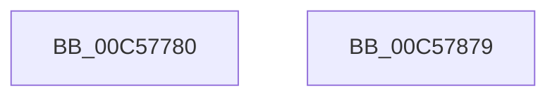

# CmpCreateObjectTypes

- RVA: `0x00C57780`–`0x00C5787A` (길이 `250` bytes)
- VA: `0x0000000140C57780`
- 실행 섹션: `INIT`
- PDB 이름 있음: `예`; PDB Function 태그: `아니요`
- unwind 정보 RVA: `0x000C87FC`
- 디코드: `53`개 명령, `250/250` bytes 표시
- 미해석 바이트: `0` (있으면 어셈블리에 `.byte`로 보존)

> 이 문서는 커널 이미지의 기계어와 PDB 기호를 분석해 생성했습니다. 4번과 5번은 함수 원형과 자료형을 바이너리 사용 방식에서 추정한 C 해석이며 원본 소스 복구 결과는 아닙니다.

## 1. Dependencies

- 직접 호출 지점: **3**; 고유 호출 대상: **3**
- 직접 호출자로 확인된 함수: **1**
- RIP 상대 이미지 참조: **8**

### Outgoing calls
- `0x00C577AE` → [memset](../../text/6C/memset_function_006C6C40.md) (function, `0x006C6C40`)
- `0x00C57857` → [ObCreateObjectType](../../page/70/ObCreateObjectType_function_00705230.md) (function, `0x00705230`)
- `0x00C57863` → [_security_check_cookie](../../text/6A/_security_check_cookie_function_006AC640.md) (function, `0x006AC640`)

### Direct callers
- [CmInitSystem1](CmInitSystem1_function_00C559CC.md) at `0x00C55CA0`

### Static image references
- `0x00C57792` → RVA `0x00E0A740` (`.data`; read)
- `0x00C577B8` → RVA `0x00FC6AC0` (`ALMOSTRO`; read)
- `0x00C577CC` → RVA `0x00C82450` (`CmpKeyTypeNameString`; read)
- `0x00C577FD` → RVA `0x00863AD0` (`CmpCloseKeyObject`; read)
- `0x00C57808` → RVA `0x00865590` (`CmpDeleteKeyObject`; read)
- `0x00C57813` → RVA `0x0089DDC0` (`CmpParseKey`; read)
- `0x00C5781E` → RVA `0x00870CC0` (`CmpSecurityMethod`; read)
- `0x00C57829` → RVA `0x008A8960` (`CmpQueryKeyName`; read)

## 2. Other-region calls and transfers

- 다른 실행 섹션으로 향하는 call: **3**
  - `0x00C577AE` → [memset](../../text/6C/memset_function_006C6C40.md) (`INIT` → `.text`)
  - `0x00C57857` → [ObCreateObjectType](../../page/70/ObCreateObjectType_function_00705230.md) (`INIT` → `PAGE`)
  - `0x00C57863` → [_security_check_cookie](../../text/6A/_security_check_cookie_function_006AC640.md) (`INIT` → `.text`)
- 별도 외부 분기/꼬리 이동을 확인하지 못했습니다.

## 3. Assembly (complete function range)

```asm
00C57780  48 89 5C 24 08                  mov qword ptr [rsp + 8], rbx
00C57785  55                              push rbp
00C57786  48 8D 6C 24 A9                  lea rbp, [rsp - 0x57]
00C5778B  48 81 EC B0 00 00 00            sub rsp, 0xb0
00C57792  48 8B 05 A7 2F 1B 00            mov rax, qword ptr [rip + 0x1b2fa7]
00C57799  48 33 C4                        xor rax, rsp
00C5779C  48 89 45 47                     mov qword ptr [rbp + 0x47], rax
00C577A0  BB 78 00 00 00                  mov ebx, 0x78
00C577A5  48 8D 4D C7                     lea rcx, [rbp - 0x39]
00C577A9  44 8B C3                        mov r8d, ebx
00C577AC  33 D2                           xor edx, edx
00C577AE  E8 8D F4 A6 FF                  call 0x1406c6c40
00C577B3  48 83 65 F7 00                  and qword ptr [rbp - 9], 0
00C577B8  4C 8D 0D 01 F3 36 00            lea r9, [rip + 0x36f301]
00C577BF  48 83 65 FF 00                  and qword ptr [rbp - 1], 0
00C577C4  48 8D 55 C7                     lea rdx, [rbp - 0x39]
00C577C8  80 4D CA 01                     or byte ptr [rbp - 0x36], 1
00C577CC  48 8D 0D 7D AC 02 00            lea rcx, [rip + 0x2ac7d]
00C577D3  B8 3F 00 0F 00                  mov eax, 0xf003f
00C577D8  66 89 5D C7                     mov word ptr [rbp - 0x39], bx
00C577DC  89 45 DF                        mov dword ptr [rbp - 0x21], eax
00C577DF  45 33 C0                        xor r8d, r8d
00C577E2  89 45 E3                        mov dword ptr [rbp - 0x1d], eax
00C577E5  8A 45 C9                        mov al, byte ptr [rbp - 0x37]
00C577E8  24 EF                           and al, 0xef
00C577EA  C7 45 CF 30 00 00 00            mov dword ptr [rbp - 0x31], 0x30
00C577F1  0C 0D                           or al, 0xd
00C577F3  C7 45 D3 19 00 02 00            mov dword ptr [rbp - 0x2d], 0x20019
00C577FA  88 45 C9                        mov byte ptr [rbp - 0x37], al
00C577FD  48 8D 05 CC C2 C0 FF            lea rax, [rip - 0x3f3d34]
00C57804  48 89 45 07                     mov qword ptr [rbp + 7], rax
00C57808  48 8D 05 81 DD C0 FF            lea rax, [rip - 0x3f227f]
00C5780F  48 89 45 0F                     mov qword ptr [rbp + 0xf], rax
00C57813  48 8D 05 A6 65 C4 FF            lea rax, [rip - 0x3b9a5a]
00C5781A  48 89 45 17                     mov qword ptr [rbp + 0x17], rax
00C5781E  48 8D 05 9B 94 C1 FF            lea rax, [rip - 0x3e6b65]
00C57825  48 89 45 1F                     mov qword ptr [rbp + 0x1f], rax
00C57829  48 8D 05 30 11 C5 FF            lea rax, [rip - 0x3aeed0]
00C57830  48 89 45 27                     mov qword ptr [rbp + 0x27], rax
00C57834  C7 45 D7 06 00 02 00            mov dword ptr [rbp - 0x29], 0x20006
00C5783B  C7 45 DB 39 00 02 00            mov dword ptr [rbp - 0x25], 0x20039
00C57842  C7 45 EF 70 00 00 00            mov dword ptr [rbp - 0x11], 0x70
00C57849  C7 45 EB 01 00 00 00            mov dword ptr [rbp - 0x15], 1
00C57850  C7 45 CB 00 01 00 00            mov dword ptr [rbp - 0x35], 0x100
00C57857  E8 D4 D9 AA FF                  call 0x140705230
00C5785C  48 8B 4D 47                     mov rcx, qword ptr [rbp + 0x47]
00C57860  48 33 CC                        xor rcx, rsp
00C57863  E8 D8 4D A5 FF                  call 0x1406ac640
00C57868  48 8B 9C 24 C0 00 00 00         mov rbx, qword ptr [rsp + 0xc0]
00C57870  48 81 C4 B0 00 00 00            add rsp, 0xb0
00C57877  5D                              pop rbp
00C57878  C3                              ret
00C57879  CC                              int3
```

## 4. C-style interpretation (structured pseudocode)

```c
__int64 __fastcall CmpCreateObjectTypes(__int64 a1, int a2)
{
    __int64 result;
    __int64 v_rsp;
    unsigned __int64 v_stack_m18;
    unsigned __int64 v_stack_m38;
    unsigned __int64 v_stack_m40;
    unsigned __int64 v_stack_m48;
    unsigned __int64 v_stack_m50;
    unsigned __int64 v_stack_m58;
    unsigned __int64 v_stack_m5F;
    unsigned __int64 v_stack_m60;
    unsigned __int64 v_stack_m68;
    unsigned int v_stack_m70;
    unsigned int v_stack_m74;
    unsigned int v_stack_m7C;
    unsigned int v_stack_m80;
    unsigned int v_stack_m84;
    unsigned int v_stack_m88;
    unsigned int v_stack_m8C;
    unsigned int v_stack_m90;
    unsigned int v_stack_m94;
    unsigned __int8 v_stack_m95;
    unsigned __int8 v_stack_m96;
    unsigned __int64 v_stack_m98;
    unsigned __int64 v_stack_p8;

    v_stack_p8 = v_rbx;
    v_rsp = (v_rsp) - (176);
    result = (*(unsigned __int64 *)(v_rip + 1781671)) ^ (v_rsp);
    v_stack_m18 = result;
    a2 = 0;
    result = memset(v_stack_m98, a2, 120, a4);
    v_stack_m98 = 120;
    v_stack_m80 = (unsigned int)((unsigned int)(0xF003FULL));
    a3 = 0;
    v_stack_m7C = (unsigned int)((unsigned int)(0xF003FULL));
    result = (unsigned __int8)((v_stack_m96) & (239));
    v_stack_m90 = 48;
    result = (unsigned __int8)((result) | (13));
    v_stack_m8C = 0x20019ULL;
    v_stack_m96 = (unsigned __int8)(result);
    v_stack_m58 = v_rip - 4144436;
    v_stack_m50 = v_rip - 4137599;
    v_stack_m48 = v_rip - 3906138;
    v_stack_m40 = v_rip - 4090725;
    v_stack_m38 = v_rip - 3862224;
    v_stack_m88 = 0x20006ULL;
    v_stack_m84 = 0x20039ULL;
    v_stack_m70 = 112;
    v_stack_m74 = 1;
    v_stack_m94 = 256;
    result = ObCreateObjectType(v_rip + 175229, v_stack_m98, a3, v_rip + 3601153);
    a1 = (v_stack_m18) ^ (v_rsp);
    result = _security_check_cookie(a1, v_stack_m98, a3, v_rip + 3601153);
    v_rsp = (v_rsp) + (176);
    return result;
}
```

## 5. (Beta) C Style

```c
int64_t CmpCreateObjectTypes(int64_t Arg1, int32_t Arg2)
{
    int64_t result;
    int64_t local_rsp;
    uint64_t v_stack_m18;
    uint64_t v_stack_m38;
    uint64_t v_stack_m40;
    uint64_t v_stack_m48;
    uint64_t v_stack_m50;
    uint64_t v_stack_m58;
    uint64_t v_stack_m5F;
    uint64_t v_stack_m60;
    uint64_t v_stack_m68;
    uint32_t v_stack_m70;
    uint32_t v_stack_m74;
    uint32_t v_stack_m7C;
    uint32_t v_stack_m80;
    uint32_t v_stack_m84;
    uint32_t v_stack_m88;
    uint32_t v_stack_m8C;
    uint32_t v_stack_m90;
    uint32_t v_stack_m94;
    uint8_t v_stack_m95;
    uint8_t v_stack_m96;
    uint64_t v_stack_m98;
    uint64_t v_stack_p8;

    v_stack_p8 = local_rbx;
    local_rsp = (local_rsp) - (176);
    result = (*(uint64_t *)(v_rip + 0x1B2FA7)) ^ (local_rsp);
    v_stack_m18 = result;
    Arg2 = 0;
    result = memset(v_stack_m98, Arg2, 120, a4);
    v_stack_m98 = 120;
    v_stack_m80 = (uint32_t)((uint32_t)(0xF003FULL));
    a3 = 0;
    v_stack_m7C = (uint32_t)((uint32_t)(0xF003FULL));
    result = (uint8_t)((v_stack_m96) & (239));
    v_stack_m90 = 48;
    result = (uint8_t)((result) | (13));
    v_stack_m8C = 0x20019ULL;
    v_stack_m96 = (uint8_t)(result);
    v_stack_m58 = v_rip - 4144436;
    v_stack_m50 = v_rip - 4137599;
    v_stack_m48 = v_rip - 3906138;
    v_stack_m40 = v_rip - 4090725;
    v_stack_m38 = v_rip - 3862224;
    v_stack_m88 = 0x20006ULL;
    v_stack_m84 = 0x20039ULL;
    v_stack_m70 = 112;
    v_stack_m74 = 1;
    v_stack_m94 = 256;
    result = ObCreateObjectType(v_rip + 175229, v_stack_m98, a3, v_rip + 3601153);
    Arg1 = (v_stack_m18) ^ (local_rsp);
    result = _security_check_cookie(Arg1, v_stack_m98, a3, v_rip + 3601153);
    local_rsp = (local_rsp) + (176);
    return result;
}
```

## 6. Execution-region graph

[열기: 2D/3D 그래프와 함수 탐색 컨트롤 패널](../../../control-panel.html?section=init&rva=0x00C57780&view=graph)

- 2D 그래프는 위에서 아래로 흐르고, 3D 그래프는 빈 공간을 드래그해 회전합니다. Shift+드래그는 이동, 휠은 확대·축소, 함수 노드 선택은 대상 보고서 이동입니다.

### Static fallback


