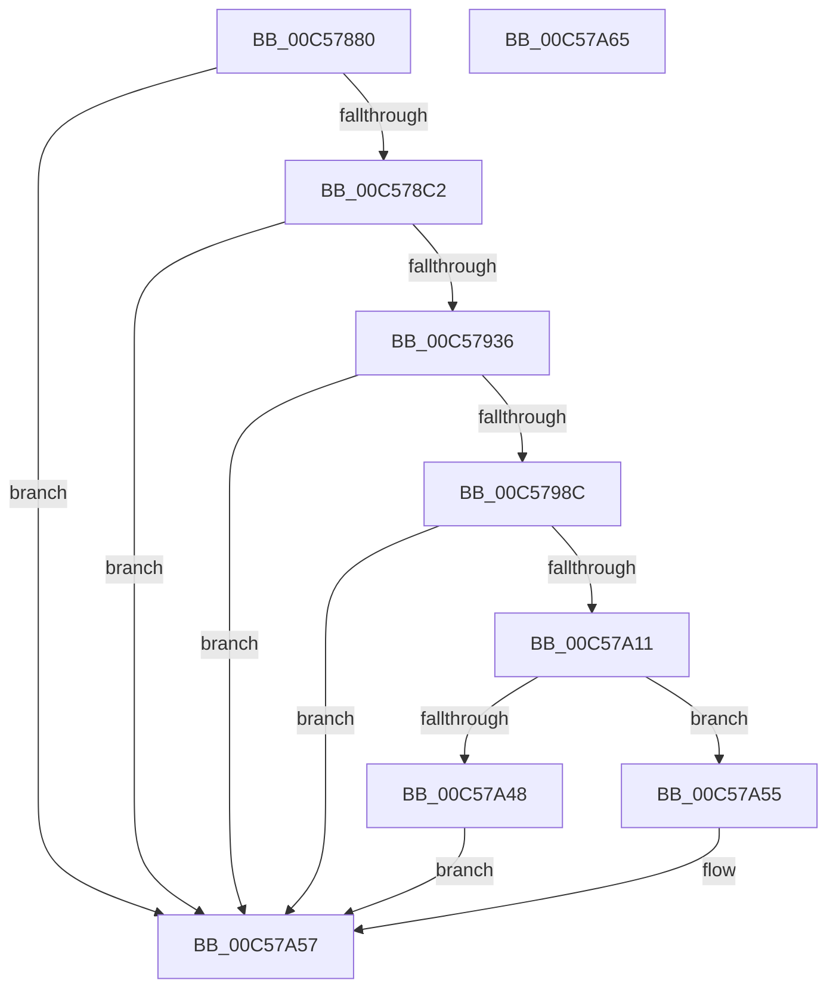

# CmpCreateRegistryRoot

- RVA: `0x00C57880`–`0x00C57A66` (길이 `486` bytes)
- VA: `0x0000000140C57880`
- 실행 섹션: `INIT`
- PDB 이름 있음: `예`; PDB Function 태그: `아니요`
- unwind 정보 RVA: `0x000D64F8`
- 디코드: `126`개 명령, `486/486` bytes 표시
- 미해석 바이트: `0` (있으면 어셈블리에 `.byte`로 보존)

> 이 문서는 커널 이미지의 기계어와 PDB 기호를 분석해 생성했습니다. 4번과 5번은 함수 원형과 자료형을 바이너리 사용 방식에서 추정한 C 해석이며 원본 소스 복구 결과는 아닙니다.

## 1. Dependencies

- 직접 호출 지점: **13**; 고유 호출 대상: **13**
- 직접 호출자로 확인된 함수: **1**
- RIP 상대 이미지 참조: **5**

### Outgoing calls
- `0x00C578B3` → [CmpCreateRootNode](CmpCreateRootNode_function_00C57A6C.md) (function, `0x00C57A6C`)
- `0x00C578C2` → [CmpHiveRootSecurityDescriptor](../../page/7E/CmpHiveRootSecurityDescriptor_function_007ED104.md) (function, `0x007ED104`)
- `0x00C5791D` → [ObCreateObject](../../page/87/ObCreateObject_function_00872CB0.md) (function, `0x00872CB0`)
- `0x00C57929` → [ExFreePoolWithTag](../../poolcode/B8/ExFreePoolWithTag_function_00B82870.md) (function, `0x00B82870`)
- `0x00C57941` → [RtlInitUnicodeString](../../text/42/RtlInitUnicodeString_function_0042A780.md) (function, `0x0042A780`)
- `0x00C5794A` → [CmpHashUnicodeComponent](../../page/84/CmpHashUnicodeComponent_function_0084AC24.md) (function, `0x0084AC24`)
- `0x00C5797D` → [CmpCreateKeyControlBlock](../../page/85/CmpCreateKeyControlBlock_function_00851DB0.md) (function, `0x00851DB0`)
- `0x00C579D4` → [CmpTryToLockKcbExclusive](../../page/9E/CmpTryToLockKcbExclusive_function_009E7B30.md) (function, `0x009E7B30`)
- `0x00C579DF` → [EnlistKeyBodyWithKCB](../../page/9A/EnlistKeyBodyWithKCB_function_009A83E0.md) (function, `0x009A83E0`)
- `0x00C579E8` → [CmpUnlockKcb](../../pagecmrc/BC/CmpUnlockKcb_function_00BC92C0.md) (function, `0x00BC92C0`)
- `0x00C57A06` → [ObInsertObject](../../page/8B/ObInsertObject_function_008B9100.md) (function, `0x008B9100`)
- `0x00C57A32` → [ObReferenceObjectByHandle](../../page/86/ObReferenceObjectByHandle_function_00868DB0.md) (function, `0x00868DB0`)
- `0x00C57A4E` → [ObCloseHandle](../../page/8A/ObCloseHandle_function_008A1870.md) (function, `0x008A1870`)

### Direct callers
- [CmInitSystem1](CmInitSystem1_function_00C559CC.md) at `0x00C55DBC`

### Static image references
- `0x00C578C7` → RVA `0x00FC6AC0` (`ALMOSTRO`; read)
- `0x00C578DC` → RVA `0x00FD9F98` (`PAGEDATA`; read)
- `0x00C57936` → RVA `0x00C7E100` (` ?? ::PBOPGDP::`string'`; read)
- `0x00C5795E` → RVA `0x00FD9A90` (`PAGEDATA`; read)
- `0x00C57A3D` → RVA `0x00FD9B68` (`PAGEDATA`; write)

## 2. Other-region calls and transfers

- 다른 실행 섹션으로 향하는 call: **12**
  - `0x00C578C2` → [CmpHiveRootSecurityDescriptor](../../page/7E/CmpHiveRootSecurityDescriptor_function_007ED104.md) (`INIT` → `PAGE`)
  - `0x00C5791D` → [ObCreateObject](../../page/87/ObCreateObject_function_00872CB0.md) (`INIT` → `PAGE`)
  - `0x00C57929` → [ExFreePoolWithTag](../../poolcode/B8/ExFreePoolWithTag_function_00B82870.md) (`INIT` → `POOLCODE`)
  - `0x00C57941` → [RtlInitUnicodeString](../../text/42/RtlInitUnicodeString_function_0042A780.md) (`INIT` → `.text`)
  - `0x00C5794A` → [CmpHashUnicodeComponent](../../page/84/CmpHashUnicodeComponent_function_0084AC24.md) (`INIT` → `PAGE`)
  - `0x00C5797D` → [CmpCreateKeyControlBlock](../../page/85/CmpCreateKeyControlBlock_function_00851DB0.md) (`INIT` → `PAGE`)
  - `0x00C579D4` → [CmpTryToLockKcbExclusive](../../page/9E/CmpTryToLockKcbExclusive_function_009E7B30.md) (`INIT` → `PAGE`)
  - `0x00C579DF` → [EnlistKeyBodyWithKCB](../../page/9A/EnlistKeyBodyWithKCB_function_009A83E0.md) (`INIT` → `PAGE`)
  - `0x00C579E8` → [CmpUnlockKcb](../../pagecmrc/BC/CmpUnlockKcb_function_00BC92C0.md) (`INIT` → `PAGECMRC`)
  - `0x00C57A06` → [ObInsertObject](../../page/8B/ObInsertObject_function_008B9100.md) (`INIT` → `PAGE`)
  - `0x00C57A32` → [ObReferenceObjectByHandle](../../page/86/ObReferenceObjectByHandle_function_00868DB0.md) (`INIT` → `PAGE`)
  - `0x00C57A4E` → [ObCloseHandle](../../page/8A/ObCloseHandle_function_008A1870.md) (`INIT` → `PAGE`)
- 별도 외부 분기/꼬리 이동을 확인하지 못했습니다.

## 3. Assembly (complete function range)

```asm
00C57880  40 55                           push rbp
00C57882  53                              push rbx
00C57883  56                              push rsi
00C57884  57                              push rdi
00C57885  48 8D 6C 24 C1                  lea rbp, [rsp - 0x3f]
00C5788A  48 81 EC 98 00 00 00            sub rsp, 0x98
00C57891  33 F6                           xor esi, esi
00C57893  4C 8D 45 67                     lea r8, [rbp + 0x67]
00C57897  0F 57 C0                        xorps xmm0, xmm0
00C5789A  48 89 75 77                     mov qword ptr [rbp + 0x77], rsi
00C5789E  89 75 0B                        mov dword ptr [rbp + 0xb], esi
00C578A1  89 75 23                        mov dword ptr [rbp + 0x23], esi
00C578A4  48 89 75 6F                     mov qword ptr [rbp + 0x6f], rsi
00C578A8  89 75 67                        mov dword ptr [rbp + 0x67], esi
00C578AB  48 89 75 7F                     mov qword ptr [rbp + 0x7f], rsi
00C578AF  0F 11 45 F7                     movups xmmword ptr [rbp - 9], xmm0
00C578B3  E8 B4 01 00 00                  call 0x140c57a6c
00C578B8  8B F8                           mov edi, eax
00C578BA  85 C0                           test eax, eax
00C578BC  0F 88 95 01 00 00               js 0x140c57a57
00C578C2  E8 3D 58 B9 FF                  call 0x1407ed104
00C578C7  48 8B 15 F2 F1 36 00            mov rdx, qword ptr [rip + 0x36f1f2]
00C578CE  4C 8D 45 07                     lea r8, [rbp + 7]
00C578D2  48 8B D8                        mov rbx, rax
00C578D5  C7 45 07 30 00 00 00            mov dword ptr [rbp + 7], 0x30
00C578DC  48 8D 05 B5 26 38 00            lea rax, [rip + 0x3826b5]
00C578E3  48 89 75 0F                     mov qword ptr [rbp + 0xf], rsi
00C578E7  48 89 45 17                     mov qword ptr [rbp + 0x17], rax
00C578EB  45 33 C9                        xor r9d, r9d
00C578EE  48 8D 45 77                     lea rax, [rbp + 0x77]
00C578F2  C7 45 1F 40 02 00 00            mov dword ptr [rbp + 0x1f], 0x240
00C578F9  48 89 44 24 40                  mov qword ptr [rsp + 0x40], rax
00C578FE  33 C9                           xor ecx, ecx
00C57900  89 74 24 38                     mov dword ptr [rsp + 0x38], esi
00C57904  89 74 24 30                     mov dword ptr [rsp + 0x30], esi
00C57908  C7 44 24 28 70 00 00 00         mov dword ptr [rsp + 0x28], 0x70
00C57910  48 89 74 24 20                  mov qword ptr [rsp + 0x20], rsi
00C57915  48 89 5D 27                     mov qword ptr [rbp + 0x27], rbx
00C57919  48 89 75 2F                     mov qword ptr [rbp + 0x2f], rsi
00C5791D  E8 8E B3 C1 FF                  call 0x140872cb0
00C57922  33 D2                           xor edx, edx
00C57924  48 8B CB                        mov rcx, rbx
00C57927  8B F8                           mov edi, eax
00C57929  E8 42 AF F2 FF                  call 0x140b82870
00C5792E  85 FF                           test edi, edi
00C57930  0F 88 21 01 00 00               js 0x140c57a57
00C57936  48 8D 15 C3 67 02 00            lea rdx, [rip + 0x267c3]
00C5793D  48 8D 4D F7                     lea rcx, [rbp - 9]
00C57941  E8 3A 2E 7D FF                  call 0x14042a780
00C57946  48 8D 4D F7                     lea rcx, [rbp - 9]
00C5794A  E8 D5 32 BF FF                  call 0x14084ac24
00C5794F  8B 55 67                        mov edx, dword ptr [rbp + 0x67]
00C57952  48 8D 4D 6F                     lea rcx, [rbp + 0x6f]
00C57956  48 89 4C 24 40                  mov qword ptr [rsp + 0x40], rcx
00C5795B  45 33 C9                        xor r9d, r9d
00C5795E  48 8B 0D 2B 21 38 00            mov rcx, qword ptr [rip + 0x38212b]
00C57965  45 33 C0                        xor r8d, r8d
00C57968  89 74 24 38                     mov dword ptr [rsp + 0x38], esi
00C5796C  89 44 24 30                     mov dword ptr [rsp + 0x30], eax
00C57970  48 8D 45 F7                     lea rax, [rbp - 9]
00C57974  48 89 44 24 28                  mov qword ptr [rsp + 0x28], rax
00C57979  89 74 24 20                     mov dword ptr [rsp + 0x20], esi
00C5797D  E8 2E A4 BF FF                  call 0x140851db0
00C57982  8B F8                           mov edi, eax
00C57984  85 C0                           test eax, eax
00C57986  0F 88 CB 00 00 00               js 0x140c57a57
00C5798C  48 8B 4D 77                     mov rcx, qword ptr [rbp + 0x77]
00C57990  48 8B 45 6F                     mov rax, qword ptr [rbp + 0x6f]
00C57994  C7 01 32 30 79 6B               mov dword ptr [rcx], 0x6b793032
00C5799A  48 89 41 08                     mov qword ptr [rcx + 8], rax
00C5799E  48 89 71 10                     mov qword ptr [rcx + 0x10], rsi
00C579A2  65 48 8B 04 25 88 01 00 00      mov rax, qword ptr gs:[0x188]
00C579AB  48 8B 5D 77                     mov rbx, qword ptr [rbp + 0x77]
00C579AF  48 8B 88 08 05 00 00            mov rcx, qword ptr [rax + 0x508]
00C579B6  48 89 4B 18                     mov qword ptr [rbx + 0x18], rcx
00C579BA  48 8D 43 48                     lea rax, [rbx + 0x48]
00C579BE  48 8B 4D 6F                     mov rcx, qword ptr [rbp + 0x6f]
00C579C2  89 73 30                        mov dword ptr [rbx + 0x30], esi
00C579C5  48 89 40 08                     mov qword ptr [rax + 8], rax
00C579C9  48 89 00                        mov qword ptr [rax], rax
00C579CC  48 89 73 38                     mov qword ptr [rbx + 0x38], rsi
00C579D0  48 89 73 40                     mov qword ptr [rbx + 0x40], rsi
00C579D4  E8 57 01 D9 FF                  call 0x1409e7b30
00C579D9  8D 56 02                        lea edx, [rsi + 2]
00C579DC  48 8B CB                        mov rcx, rbx
00C579DF  E8 FC 09 D5 FF                  call 0x1409a83e0
00C579E4  48 8B 4D 6F                     mov rcx, qword ptr [rbp + 0x6f]
00C579E8  E8 D3 18 F7 FF                  call 0x140bc92c0
00C579ED  48 8D 45 7F                     lea rax, [rbp + 0x7f]
00C579F1  45 33 C9                        xor r9d, r9d
00C579F4  48 89 44 24 28                  mov qword ptr [rsp + 0x28], rax
00C579F9  45 33 C0                        xor r8d, r8d
00C579FC  33 D2                           xor edx, edx
00C579FE  48 89 74 24 20                  mov qword ptr [rsp + 0x20], rsi
00C57A03  48 8B CB                        mov rcx, rbx
00C57A06  E8 F5 16 C6 FF                  call 0x1408b9100
00C57A0B  8B F8                           mov edi, eax
00C57A0D  85 C0                           test eax, eax
00C57A0F  78 46                           js 0x140c57a57
00C57A11  48 8B 4D 7F                     mov rcx, qword ptr [rbp + 0x7f]
00C57A15  48 8D 45 67                     lea rax, [rbp + 0x67]
00C57A19  48 89 74 24 28                  mov qword ptr [rsp + 0x28], rsi
00C57A1E  45 33 C9                        xor r9d, r9d
00C57A21  45 33 C0                        xor r8d, r8d
00C57A24  48 89 44 24 20                  mov qword ptr [rsp + 0x20], rax
00C57A29  BA 19 00 02 00                  mov edx, 0x20019
00C57A2E  48 89 75 67                     mov qword ptr [rbp + 0x67], rsi
00C57A32  E8 79 13 C1 FF                  call 0x140868db0
00C57A37  8B F8                           mov edi, eax
00C57A39  48 8B 45 67                     mov rax, qword ptr [rbp + 0x67]
00C57A3D  48 89 05 24 21 38 00            mov qword ptr [rip + 0x382124], rax
00C57A44  85 FF                           test edi, edi
00C57A46  79 0D                           jns 0x140c57a55
00C57A48  48 8B 4D 7F                     mov rcx, qword ptr [rbp + 0x7f]
00C57A4C  33 D2                           xor edx, edx
00C57A4E  E8 1D 9E C4 FF                  call 0x1408a1870
00C57A53  EB 02                           jmp 0x140c57a57
00C57A55  8B FE                           mov edi, esi
00C57A57  8B C7                           mov eax, edi
00C57A59  48 81 C4 98 00 00 00            add rsp, 0x98
00C57A60  5F                              pop rdi
00C57A61  5E                              pop rsi
00C57A62  5B                              pop rbx
00C57A63  5D                              pop rbp
00C57A64  C3                              ret
00C57A65  CC                              int3
```

## 4. C-style interpretation (structured pseudocode)

```c
__int64 __fastcall CmpCreateRegistryRoot(int a1, __int64 a2, __int64 a3, int a4)
{
    __int64 result;
    __int64 v_rsi;
    __int64 v_rsp;
    unsigned __int64 v_stack_m30;
    unsigned __int64 v_stack_m38;
    unsigned int v_stack_m3C;
    unsigned int v_stack_m40;
    unsigned __int64 v_stack_m48;
    unsigned __int64 v_stack_m50;
    unsigned int v_stack_m54;
    unsigned __int64 v_stack_m58;
    unsigned __int64 v_stack_m5F;
    unsigned __int64 v_stack_m68;
    unsigned __int64 v_stack_m78;
    unsigned int v_stack_m80;
    unsigned int v_stack_m88;
    unsigned int v_stack_m90;
    unsigned __int64 v_stack_m98;
    unsigned __int64 v_stack_p10;
    unsigned __int64 v_stack_p18;
    unsigned __int64 v_stack_p20;
    unsigned __int64 v_stack_p8;

    v_rsp = (v_rsp) - (152);
    v_rsi = 0;
    v_stack_p18 = 0;
    v_stack_m54 = 0;
    v_stack_m3C = 0;
    v_stack_p10 = 0;
    v_stack_p8 = 0;
    v_stack_p20 = 0;
    v_stack_m68 = v_xmm0;
    result = CmpCreateRootNode(a1, a2, v_stack_p8, a4);
    if (sign_flag) goto loc_00C57A57;
    result = CmpHiveRootSecurityDescriptor(a1, a2, v_stack_p8, a4);
    v_stack_m58 = 48;
    v_stack_m50 = 0;
    v_stack_m48 = v_rip + 3679925;
    a4 = 0;
    v_stack_m40 = 576;
    v_stack_m78 = v_stack_p18;
    a1 = 0;
    v_stack_m80 = 0;
    v_stack_m88 = 0;
    v_stack_m90 = 112;
    v_stack_m98 = 0;
    v_stack_m38 = result;
    v_stack_m30 = 0;
    result = ObCreateObject(a1, *(unsigned __int64 *)(v_rip + 3600882), v_stack_m58, a4);
    a2 = 0;
    result = ExFreePoolWithTag(result, a2, v_stack_m58, a4);
    if (sign_flag) goto loc_00C57A57;
    result = RtlInitUnicodeString(v_stack_m68, v_rip + 157635, v_stack_m58, a4);
    result = CmpHashUnicodeComponent(v_stack_m68, v_rip + 157635, v_stack_m58, a4);
    v_stack_m78 = v_stack_p10;
    a4 = 0;
    a3 = 0;
    v_stack_m80 = 0;
    v_stack_m88 = (unsigned int)(result);
    v_stack_m90 = v_stack_m68;
    v_stack_m98 = 0;
    result = CmpCreateKeyControlBlock(*(unsigned __int64 *)(v_rip + 3678507), (unsigned int)(v_stack_p8), a3, a4);
    if (sign_flag) goto loc_00C57A57;
    *(unsigned int *)(v_stack_p18) = 0x6B793032ULL;
    *(unsigned __int64 *)(v_stack_p18 + 8) = v_stack_p10;
    *(unsigned __int64 *)(v_stack_p18 + 16) = 0;
    *(unsigned __int64 *)(v_stack_p18 + 24) = *(unsigned __int64 *)(*(unsigned __int64 *)(gs_base + (0 + 392)) + 1288);
    *(unsigned int *)(v_stack_p18 + 48) = 0;
    *(unsigned __int64 *)(v_stack_p18 + 72 + 8) = v_stack_p18 + 72;
    *(unsigned __int64 *)(v_stack_p18 + 72) = v_stack_p18 + 72;
    *(unsigned __int64 *)(v_stack_p18 + 56) = 0;
    *(unsigned __int64 *)(v_stack_p18 + 64) = 0;
    result = CmpTryToLockKcbExclusive(v_stack_p10, (unsigned int)(v_stack_p8), a3, a4);
    result = EnlistKeyBodyWithKCB(v_stack_p18, v_rsi + 2, a3, a4);
    result = CmpUnlockKcb(v_stack_p10, v_rsi + 2, a3, a4);
    a4 = 0;
    v_stack_m90 = v_stack_p20;
    a3 = 0;
    a2 = 0;
    v_stack_m98 = 0;
    result = ObInsertObject(v_stack_p18, a2, a3, a4);
    if (sign_flag) goto loc_00C57A57;
    v_stack_m90 = 0;
    a4 = 0;
    a3 = 0;
    v_stack_m98 = v_stack_p8;
    v_stack_p8 = 0;
    result = ObReferenceObjectByHandle(v_stack_p20, (unsigned int)(0x20019ULL), a3, a4);
    *(unsigned __int64 *)(v_rip + 3678500) = v_stack_p8;
    if (!sign_flag) goto loc_00C57A55;
    a2 = 0;
    result = ObCloseHandle(v_stack_p20, a2, a3, a4);
    goto loc_00C57A57;
loc_00C57A55:
loc_00C57A57:
    v_rsp = (v_rsp) + (152);
    return 0;
}
```

## 5. (Beta) C Style

```c
int64_t CmpCreateRegistryRoot(int32_t Arg1, int64_t Arg2, int64_t Arg3, int32_t Arg4)
{
    int64_t result;
    int64_t local_rsi;
    int64_t local_rsp;
    uint64_t v_stack_m30;
    uint64_t v_stack_m38;
    uint32_t v_stack_m3C;
    uint32_t v_stack_m40;
    uint64_t v_stack_m48;
    uint64_t v_stack_m50;
    uint32_t v_stack_m54;
    uint64_t v_stack_m58;
    uint64_t v_stack_m5F;
    uint64_t v_stack_m68;
    uint64_t v_stack_m78;
    uint32_t v_stack_m80;
    uint32_t v_stack_m88;
    uint32_t v_stack_m90;
    uint64_t v_stack_m98;
    uint64_t v_stack_p10;
    uint64_t v_stack_p18;
    uint64_t v_stack_p20;
    uint64_t v_stack_p8;

    local_rsp = (local_rsp) - (152);
    local_rsi = 0;
    v_stack_p18 = 0;
    v_stack_m54 = 0;
    v_stack_m3C = 0;
    v_stack_p10 = 0;
    v_stack_p8 = 0;
    v_stack_p20 = 0;
    v_stack_m68 = v_xmm0;
    result = CmpCreateRootNode(Arg1, Arg2, v_stack_p8, Arg4);
    if (sign_flag) goto loc_00C57A57;
    result = CmpHiveRootSecurityDescriptor(Arg1, Arg2, v_stack_p8, Arg4);
    v_stack_m58 = 48;
    v_stack_m50 = 0;
    v_stack_m48 = v_rip + 3679925;
    Arg4 = 0;
    v_stack_m40 = 576;
    v_stack_m78 = v_stack_p18;
    Arg1 = 0;
    v_stack_m80 = 0;
    v_stack_m88 = 0;
    v_stack_m90 = 112;
    v_stack_m98 = 0;
    v_stack_m38 = result;
    v_stack_m30 = 0;
    result = ObCreateObject(Arg1, *(uint64_t *)(v_rip + 0x36F1F2), v_stack_m58, Arg4);
    Arg2 = 0;
    result = ExFreePoolWithTag(result, Arg2, v_stack_m58, Arg4);
    if (sign_flag) goto loc_00C57A57;
    result = RtlInitUnicodeString(v_stack_m68, v_rip + 157635, v_stack_m58, Arg4);
    result = CmpHashUnicodeComponent(v_stack_m68, v_rip + 157635, v_stack_m58, Arg4);
    v_stack_m78 = v_stack_p10;
    Arg4 = 0;
    Arg3 = 0;
    v_stack_m80 = 0;
    v_stack_m88 = (uint32_t)(result);
    v_stack_m90 = v_stack_m68;
    v_stack_m98 = 0;
    result = CmpCreateKeyControlBlock(*(uint64_t *)(v_rip + 0x38212B), (uint32_t)(v_stack_p8), Arg3, Arg4);
    if (sign_flag) goto loc_00C57A57;
    *(uint32_t *)(v_stack_p18) = 0x6B793032ULL;
    *(uint64_t *)(v_stack_p18 + 0x8) = v_stack_p10;
    *(uint64_t *)(v_stack_p18 + 0x10) = 0;
    *(uint64_t *)(v_stack_p18 + 0x18) = *(uint64_t *)(*(uint64_t *)(gs_base + (0 + 0x188)) + 0x508);
    *(uint32_t *)(v_stack_p18 + 0x30) = 0;
    *(uint64_t *)(v_stack_p18 + 0x48 + 0x8) = v_stack_p18 + 72;
    *(uint64_t *)(v_stack_p18 + 0x48) = v_stack_p18 + 72;
    *(uint64_t *)(v_stack_p18 + 0x38) = 0;
    *(uint64_t *)(v_stack_p18 + 0x40) = 0;
    result = CmpTryToLockKcbExclusive(v_stack_p10, (uint32_t)(v_stack_p8), Arg3, Arg4);
    result = EnlistKeyBodyWithKCB(v_stack_p18, local_rsi + 2, Arg3, Arg4);
    result = CmpUnlockKcb(v_stack_p10, local_rsi + 2, Arg3, Arg4);
    Arg4 = 0;
    v_stack_m90 = v_stack_p20;
    Arg3 = 0;
    Arg2 = 0;
    v_stack_m98 = 0;
    result = ObInsertObject(v_stack_p18, Arg2, Arg3, Arg4);
    if (sign_flag) goto loc_00C57A57;
    v_stack_m90 = 0;
    Arg4 = 0;
    Arg3 = 0;
    v_stack_m98 = v_stack_p8;
    v_stack_p8 = 0;
    result = ObReferenceObjectByHandle(v_stack_p20, (uint32_t)(0x20019ULL), Arg3, Arg4);
    *(uint64_t *)(v_rip + 0x382124) = v_stack_p8;
    if (!sign_flag) goto loc_00C57A55;
    Arg2 = 0;
    result = ObCloseHandle(v_stack_p20, Arg2, Arg3, Arg4);
    goto loc_00C57A57;
loc_00C57A55:
loc_00C57A57:
    local_rsp = (local_rsp) + (152);
    return 0;
}
```

## 6. Execution-region graph

[열기: 2D/3D 그래프와 함수 탐색 컨트롤 패널](../../../control-panel.html?section=init&rva=0x00C57880&view=graph)

- 2D 그래프는 위에서 아래로 흐르고, 3D 그래프는 빈 공간을 드래그해 회전합니다. Shift+드래그는 이동, 휠은 확대·축소, 함수 노드 선택은 대상 보고서 이동입니다.

### Static fallback


