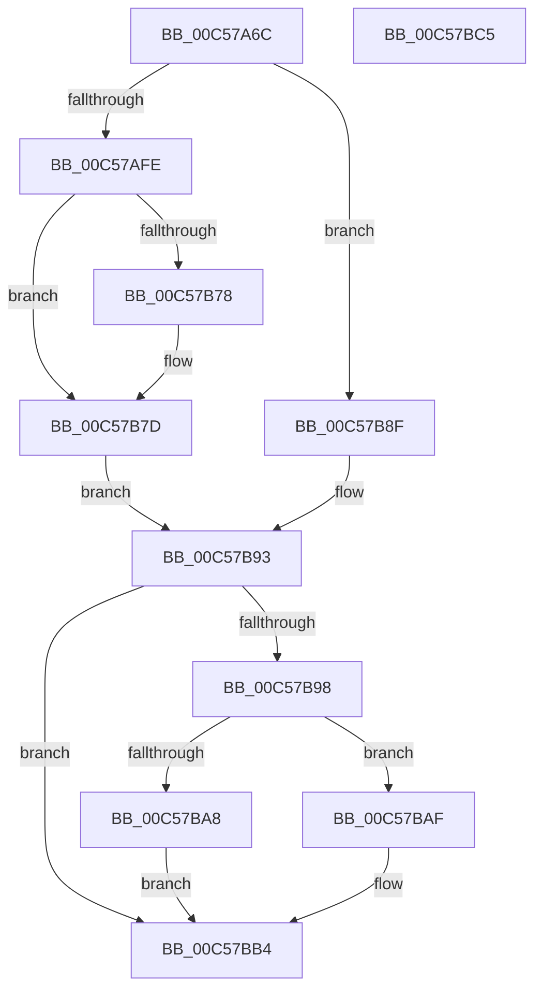

# CmpCreateRootNode

- RVA: `0x00C57A6C`–`0x00C57BC6` (길이 `346` bytes)
- VA: `0x0000000140C57A6C`
- 실행 섹션: `INIT`
- PDB 이름 있음: `예`; PDB Function 태그: `아니요`
- unwind 정보 RVA: `0x000D64E0`
- 디코드: `95`개 명령, `346/346` bytes 표시
- 미해석 바이트: `0` (있으면 어셈블리에 `.byte`로 보존)

> 이 문서는 커널 이미지의 기계어와 PDB 기호를 분석해 생성했습니다. 4번과 5번은 함수 원형과 자료형을 바이너리 사용 방식에서 추정한 C 해석이며 원본 소스 복구 결과는 아닙니다.

## 1. Dependencies

- 직접 호출 지점: **7**; 고유 호출 대상: **7**
- 직접 호출자로 확인된 함수: **1**
- RIP 상대 이미지 참조: **2**

### Outgoing calls
- `0x00C57AAF` → [HvpGetCellContextInitialize](../../page/85/HvpGetCellContextInitialize_function_00855F10.md) (function, `0x00855F10`)
- `0x00C57ABF` → [RtlInitUnicodeString](../../text/42/RtlInitUnicodeString_function_0042A780.md) (function, `0x0042A780`)
- `0x00C57AC8` → [CmpNameSize](../../page/85/CmpNameSize_function_0085ABC4.md) (function, `0x0085ABC4`)
- `0x00C57AEF` → [HvAllocateCell](../../page/85/HvAllocateCell_function_00859C94.md) (function, `0x00859C94`)
- `0x00C57B69` → [CmpCopyName](../../page/85/CmpCopyName_function_0085AF98.md) (function, `0x0085AF98`)
- `0x00C57BA8` → [HvpReleaseCellFlat](../../page/85/HvpReleaseCellFlat_function_0085CC20.md) (function, `0x0085CC20`)
- `0x00C57BAF` → [HvpReleaseCellPaged](../../page/85/HvpReleaseCellPaged_function_00855F40.md) (function, `0x00855F40`)

### Direct callers
- [CmpCreateRegistryRoot](CmpCreateRegistryRoot_function_00C57880.md) at `0x00C578B3`

### Static image references
- `0x00C57A87` → RVA `0x00FD9A90` (`PAGEDATA`; read)
- `0x00C57AB8` → RVA `0x00C7E100` (` ?? ::PBOPGDP::`string'`; read)

## 2. Other-region calls and transfers

- 다른 실행 섹션으로 향하는 call: **7**
  - `0x00C57AAF` → [HvpGetCellContextInitialize](../../page/85/HvpGetCellContextInitialize_function_00855F10.md) (`INIT` → `PAGE`)
  - `0x00C57ABF` → [RtlInitUnicodeString](../../text/42/RtlInitUnicodeString_function_0042A780.md) (`INIT` → `.text`)
  - `0x00C57AC8` → [CmpNameSize](../../page/85/CmpNameSize_function_0085ABC4.md) (`INIT` → `PAGE`)
  - `0x00C57AEF` → [HvAllocateCell](../../page/85/HvAllocateCell_function_00859C94.md) (`INIT` → `PAGE`)
  - `0x00C57B69` → [CmpCopyName](../../page/85/CmpCopyName_function_0085AF98.md) (`INIT` → `PAGE`)
  - `0x00C57BA8` → [HvpReleaseCellFlat](../../page/85/HvpReleaseCellFlat_function_0085CC20.md) (`INIT` → `PAGE`)
  - `0x00C57BAF` → [HvpReleaseCellPaged](../../page/85/HvpReleaseCellPaged_function_00855F40.md) (`INIT` → `PAGE`)
- 별도 외부 분기/꼬리 이동을 확인하지 못했습니다.

## 3. Assembly (complete function range)

```asm
00C57A6C  48 89 54 24 10                  mov qword ptr [rsp + 0x10], rdx
00C57A71  48 89 4C 24 08                  mov qword ptr [rsp + 8], rcx
00C57A76  55                              push rbp
00C57A77  53                              push rbx
00C57A78  56                              push rsi
00C57A79  57                              push rdi
00C57A7A  41 54                           push r12
00C57A7C  41 56                           push r14
00C57A7E  41 57                           push r15
00C57A80  48 8B EC                        mov rbp, rsp
00C57A83  48 83 EC 40                     sub rsp, 0x40
00C57A87  48 8B 3D 02 20 38 00            mov rdi, qword ptr [rip + 0x382002]
00C57A8E  48 8D 4D 58                     lea rcx, [rbp + 0x58]
00C57A92  45 33 FF                        xor r15d, r15d
00C57A95  0F 57 C0                        xorps xmm0, xmm0
00C57A98  41 83 CC FF                     or r12d, 0xffffffff
00C57A9C  4C 89 7D 58                     mov qword ptr [rbp + 0x58], r15
00C57AA0  0F 11 45 F0                     movups xmmword ptr [rbp - 0x10], xmm0
00C57AA4  44 89 65 48                     mov dword ptr [rbp + 0x48], r12d
00C57AA8  4D 8B F0                        mov r14, r8
00C57AAB  4C 89 7D 40                     mov qword ptr [rbp + 0x40], r15
00C57AAF  E8 5C E4 BF FF                  call 0x140855f10
00C57AB4  48 8D 4D F0                     lea rcx, [rbp - 0x10]
00C57AB8  48 8D 15 41 66 02 00            lea rdx, [rip + 0x26641]
00C57ABF  E8 BC 2C 7D FF                  call 0x14042a780
00C57AC4  48 8D 4D F0                     lea rcx, [rbp - 0x10]
00C57AC8  E8 F7 30 C0 FF                  call 0x14085abc4
00C57ACD  0F B7 D0                        movzx edx, ax
00C57AD0  4C 8D 4D 48                     lea r9, [rbp + 0x48]
00C57AD4  48 8D 45 58                     lea rax, [rbp + 0x58]
00C57AD8  83 C2 4C                        add edx, 0x4c
00C57ADB  48 89 44 24 28                  mov qword ptr [rsp + 0x28], rax
00C57AE0  45 33 C0                        xor r8d, r8d
00C57AE3  48 8D 45 40                     lea rax, [rbp + 0x40]
00C57AE7  48 8B CF                        mov rcx, rdi
00C57AEA  48 89 44 24 20                  mov qword ptr [rsp + 0x20], rax
00C57AEF  E8 A0 21 C0 FF                  call 0x140859c94
00C57AF4  8B F0                           mov esi, eax
00C57AF6  85 C0                           test eax, eax
00C57AF8  0F 88 91 00 00 00               js 0x140c57b8f
00C57AFE  48 8B 45 40                     mov rax, qword ptr [rbp + 0x40]
00C57B02  48 8D 55 F0                     lea rdx, [rbp - 0x10]
00C57B06  C7 00 6E 6B 0C 00               mov dword ptr [rax], 0xc6b6e
00C57B0C  48 B8 14 00 00 00 80 F7 FF FF   movabs rax, 0xfffff78000000014
00C57B16  48 8B 00                        mov rax, qword ptr [rax]
00C57B19  48 8B 5D 40                     mov rbx, qword ptr [rbp + 0x40]
00C57B1D  48 89 43 04                     mov qword ptr [rbx + 4], rax
00C57B21  48 8D 4B 4C                     lea rcx, [rbx + 0x4c]
00C57B25  44 89 63 10                     mov dword ptr [rbx + 0x10], r12d
00C57B29  4C 89 7B 14                     mov qword ptr [rbx + 0x14], r15
00C57B2D  44 89 63 1C                     mov dword ptr [rbx + 0x1c], r12d
00C57B31  44 89 63 20                     mov dword ptr [rbx + 0x20], r12d
00C57B35  44 89 7B 24                     mov dword ptr [rbx + 0x24], r15d
00C57B39  44 89 63 28                     mov dword ptr [rbx + 0x28], r12d
00C57B3D  44 89 63 2C                     mov dword ptr [rbx + 0x2c], r12d
00C57B41  44 89 63 30                     mov dword ptr [rbx + 0x30], r12d
00C57B45  66 44 89 7B 4A                  mov word ptr [rbx + 0x4a], r15w
00C57B4A  4C 89 7B 3C                     mov qword ptr [rbx + 0x3c], r15
00C57B4E  66 44 89 7B 34                  mov word ptr [rbx + 0x34], r15w
00C57B53  81 63 34 FF FF F0 FF            and dword ptr [rbx + 0x34], 0xfff0ffff
00C57B5A  81 63 34 FF FF 0F FF            and dword ptr [rbx + 0x34], 0xff0fffff
00C57B61  44 88 7B 37                     mov byte ptr [rbx + 0x37], r15b
00C57B65  44 89 7B 38                     mov dword ptr [rbx + 0x38], r15d
00C57B69  E8 2A 34 C0 FF                  call 0x14085af98
00C57B6E  66 89 43 48                     mov word ptr [rbx + 0x48], ax
00C57B72  66 3B 45 F0                     cmp ax, word ptr [rbp - 0x10]
00C57B76  73 05                           jae 0x140c57b7d
00C57B78  66 83 4B 02 20                  or word ptr [rbx + 2], 0x20
00C57B7D  8B 4D 48                        mov ecx, dword ptr [rbp + 0x48]
00C57B80  41 8B F7                        mov esi, r15d
00C57B83  48 8B 47 40                     mov rax, qword ptr [rdi + 0x40]
00C57B87  41 89 0E                        mov dword ptr [r14], ecx
00C57B8A  89 48 24                        mov dword ptr [rax + 0x24], ecx
00C57B8D  EB 04                           jmp 0x140c57b93
00C57B8F  48 8B 5D 40                     mov rbx, qword ptr [rbp + 0x40]
00C57B93  48 85 DB                        test rbx, rbx
00C57B96  74 1C                           je 0x140c57bb4
00C57B98  F6 87 8C 00 00 00 01            test byte ptr [rdi + 0x8c], 1
00C57B9F  48 8D 55 58                     lea rdx, [rbp + 0x58]
00C57BA3  48 8B CF                        mov rcx, rdi
00C57BA6  74 07                           je 0x140c57baf
00C57BA8  E8 73 50 C0 FF                  call 0x14085cc20
00C57BAD  EB 05                           jmp 0x140c57bb4
00C57BAF  E8 8C E3 BF FF                  call 0x140855f40
00C57BB4  8B C6                           mov eax, esi
00C57BB6  48 83 C4 40                     add rsp, 0x40
00C57BBA  41 5F                           pop r15
00C57BBC  41 5E                           pop r14
00C57BBE  41 5C                           pop r12
00C57BC0  5F                              pop rdi
00C57BC1  5E                              pop rsi
00C57BC2  5B                              pop rbx
00C57BC3  5D                              pop rbp
00C57BC4  C3                              ret
00C57BC5  CC                              int3
```

## 4. C-style interpretation (structured pseudocode)

```c
__int64 __fastcall CmpCreateRootNode(__int64 a1, __int64 a2, __int64 a3)
{
    __int64 result;
    __int64 v_r12;
    __int64 v_r15;
    __int64 v_rsp;
    unsigned __int64 v_stack_m48;
    unsigned __int64 v_stack_m50;
    unsigned __int64 v_stack_m58;
    unsigned __int64 v_stack_p10;
    unsigned __int64 v_stack_p20;
    unsigned __int64 v_stack_p8;

    v_stack_p10 = a2;
    v_stack_p8 = a1;
    v_rsp = (v_rsp) - (64);
    v_r15 = 0;
    v_r12 = (unsigned int)((v_r12) | (0xFFFFFFFFULL));
    v_stack_p20 = 0;
    v_stack_m48 = v_xmm0;
    v_stack_p10 = (unsigned int)(v_r12);
    v_stack_p8 = 0;
    result = HvpGetCellContextInitialize(v_stack_p20, a2, a3, a4);
    result = RtlInitUnicodeString(v_stack_m48, v_rip + 157249, a3, a4);
    result = CmpNameSize(v_stack_m48, v_rip + 157249, a3, a4);
    a2 = (unsigned int)(((unsigned __int16)(result)) + (76));
    v_stack_m50 = v_stack_p20;
    a3 = 0;
    v_stack_m58 = v_stack_p8;
    result = HvAllocateCell(*(unsigned __int64 *)(v_rip + 3678210), a2, a3, v_stack_p10);
    if (sign_flag) goto loc_00C57B8F;
    *(unsigned int *)(v_stack_p8) = 0xC6B6EULL;
    *(unsigned __int64 *)(v_stack_p8 + 4) = *(unsigned __int64 *)(v_stack_p8);
    *(unsigned int *)(v_stack_p8 + 16) = (unsigned int)(v_r12);
    *(unsigned __int64 *)(v_stack_p8 + 20) = 0;
    *(unsigned int *)(v_stack_p8 + 28) = (unsigned int)(v_r12);
    *(unsigned int *)(v_stack_p8 + 32) = (unsigned int)(v_r12);
    *(unsigned int *)(v_stack_p8 + 36) = 0;
    *(unsigned int *)(v_stack_p8 + 40) = (unsigned int)(v_r12);
    *(unsigned int *)(v_stack_p8 + 44) = (unsigned int)(v_r12);
    *(unsigned int *)(v_stack_p8 + 48) = (unsigned int)(v_r12);
    *(unsigned __int16 *)(v_stack_p8 + 74) = 0;
    *(unsigned __int64 *)(v_stack_p8 + 60) = 0;
    *(unsigned __int16 *)(v_stack_p8 + 52) = 0;
    *(unsigned __int8 *)(v_stack_p8 + 55) = 0;
    *(unsigned int *)(v_stack_p8 + 56) = 0;
    result = CmpCopyName(v_stack_p8 + 76, v_stack_m48, a3, v_stack_p10);
    *(unsigned __int16 *)(v_stack_p8 + 72) = (unsigned __int16)(result);
    if (((unsigned __int16)(result)) < v_stack_m48) {
    }
    *(unsigned int *)(a3) = (unsigned int)((unsigned int)(v_stack_p10));
    *(unsigned int *)(*(unsigned __int64 *)(*(unsigned __int64 *)(v_rip + 3678210) + 64) + 36) = (unsigned int)((unsigned int)(v_stack_p10));
    goto loc_00C57B93;
loc_00C57B8F:
loc_00C57B93:
    if (v_stack_p8 == 0) goto loc_00C57BB4;
    if (((*(unsigned __int8 *)(*(unsigned __int64 *)(v_rip + 3678210) + 140)) & (1)) == 0) goto loc_00C57BAF;
    result = HvpReleaseCellFlat(*(unsigned __int64 *)(v_rip + 3678210), v_stack_p20, a3, v_stack_p10);
    goto loc_00C57BB4;
loc_00C57BAF:
    result = HvpReleaseCellPaged(*(unsigned __int64 *)(v_rip + 3678210), v_stack_p20, a3, v_stack_p10);
loc_00C57BB4:
    v_rsp = (v_rsp) + (64);
    return 0;
}
```

## 5. (Beta) C Style

```c
int64_t CmpCreateRootNode(int64_t Arg1, int64_t Arg2, void *Arg3)
{
    uint8_t *arg3 = (uint8_t *)Arg3;

    int64_t result;
    int64_t local_r12;
    int64_t local_r15;
    int64_t local_rsp;
    uint64_t v_stack_m48;
    uint64_t v_stack_m50;
    uint64_t v_stack_m58;
    uint64_t v_stack_p10;
    uint64_t v_stack_p20;
    uint64_t v_stack_p8;

    v_stack_p10 = Arg2;
    v_stack_p8 = Arg1;
    local_rsp = (local_rsp) - (64);
    local_r15 = 0;
    local_r12 = (uint32_t)((local_r12) | (0xFFFFFFFFULL));
    v_stack_p20 = 0;
    v_stack_m48 = v_xmm0;
    v_stack_p10 = (uint32_t)(local_r12);
    v_stack_p8 = 0;
    result = HvpGetCellContextInitialize(v_stack_p20, Arg2, Arg3, a4);
    result = RtlInitUnicodeString(v_stack_m48, v_rip + 157249, Arg3, a4);
    result = CmpNameSize(v_stack_m48, v_rip + 157249, Arg3, a4);
    Arg2 = (uint32_t)(((uint16_t)(result)) + (76));
    v_stack_m50 = v_stack_p20;
    Arg3 = 0;
    v_stack_m58 = v_stack_p8;
    result = HvAllocateCell(*(uint64_t *)(v_rip + 0x382002), Arg2, Arg3, v_stack_p10);
    if (sign_flag) goto loc_00C57B8F;
    *(uint32_t *)(v_stack_p8) = 0xC6B6EULL;
    *(uint64_t *)(v_stack_p8 + 0x4) = *(uint64_t *)(v_stack_p8);
    *(uint32_t *)(v_stack_p8 + 0x10) = (uint32_t)(local_r12);
    *(uint64_t *)(v_stack_p8 + 0x14) = 0;
    *(uint32_t *)(v_stack_p8 + 0x1C) = (uint32_t)(local_r12);
    *(uint32_t *)(v_stack_p8 + 0x20) = (uint32_t)(local_r12);
    *(uint32_t *)(v_stack_p8 + 0x24) = 0;
    *(uint32_t *)(v_stack_p8 + 0x28) = (uint32_t)(local_r12);
    *(uint32_t *)(v_stack_p8 + 0x2C) = (uint32_t)(local_r12);
    *(uint32_t *)(v_stack_p8 + 0x30) = (uint32_t)(local_r12);
    *(uint16_t *)(v_stack_p8 + 0x4A) = 0;
    *(uint64_t *)(v_stack_p8 + 0x3C) = 0;
    *(uint16_t *)(v_stack_p8 + 0x34) = 0;
    *(uint8_t *)(v_stack_p8 + 0x37) = 0;
    *(uint32_t *)(v_stack_p8 + 0x38) = 0;
    result = CmpCopyName(v_stack_p8 + 76, v_stack_m48, Arg3, v_stack_p10);
    *(uint16_t *)(v_stack_p8 + 0x48) = (uint16_t)(result);
    if (((uint16_t)(result)) < v_stack_m48) {
    }
    *(uint32_t *)(arg3) = (uint32_t)((uint32_t)(v_stack_p10));
    *(uint32_t *)(*(uint64_t *)(*(uint64_t *)(v_rip + 0x382002) + 0x40) + 0x24) = (uint32_t)((uint32_t)(v_stack_p10));
    goto loc_00C57B93;
loc_00C57B8F:
loc_00C57B93:
    if (v_stack_p8 == 0) goto loc_00C57BB4;
    if (((*(uint8_t *)(*(uint64_t *)(v_rip + 0x382002) + 0x8C)) & (1)) == 0) goto loc_00C57BAF;
    result = HvpReleaseCellFlat(*(uint64_t *)(v_rip + 0x382002), v_stack_p20, Arg3, v_stack_p10);
    goto loc_00C57BB4;
loc_00C57BAF:
    result = HvpReleaseCellPaged(*(uint64_t *)(v_rip + 0x382002), v_stack_p20, Arg3, v_stack_p10);
loc_00C57BB4:
    local_rsp = (local_rsp) + (64);
    return 0;
}
```

### 관측된 메모리 오프셋

구조체 형식이 확인되지 않은 접근은 인자 기준의 오프셋으로만 기록했습니다.

| 기준 인자 | 오프셋 표현 | 폭 (bit) | 접근 |
|---|---:|---:|---|
| `Arg3` | `+ 0x0` | `32` | `W` |

## 6. Execution-region graph

[열기: 2D/3D 그래프와 함수 탐색 컨트롤 패널](../../../control-panel.html?section=init&rva=0x00C57A6C&view=graph)

- 2D 그래프는 위에서 아래로 흐르고, 3D 그래프는 빈 공간을 드래그해 회전합니다. Shift+드래그는 이동, 휠은 확대·축소, 함수 노드 선택은 대상 보고서 이동입니다.

### Static fallback


