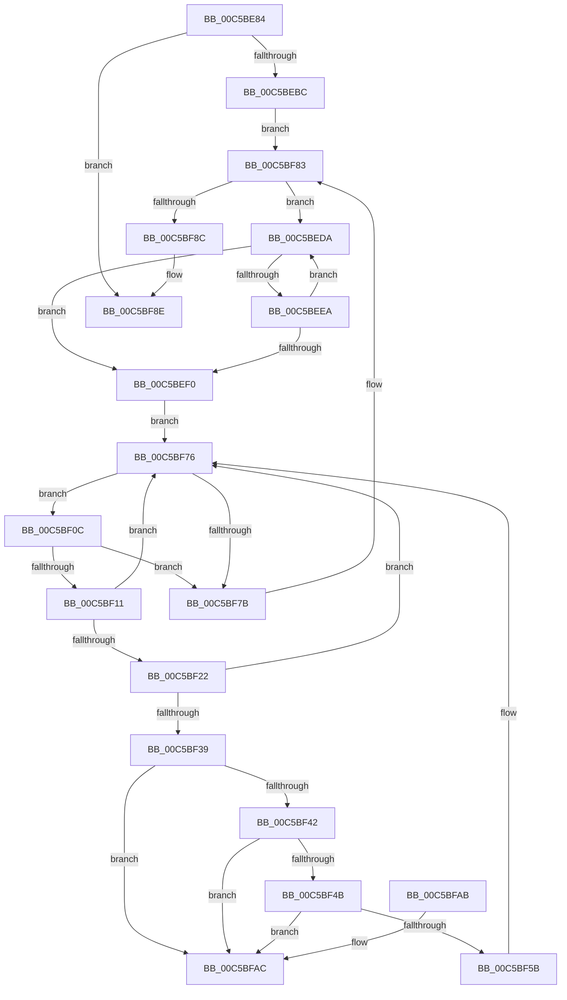

# CmpDoSort

- RVA: `0x00C5BE84`–`0x00C5BFB3` (길이 `303` bytes)
- VA: `0x0000000140C5BE84`
- 실행 섹션: `INIT`
- PDB 이름 있음: `예`; PDB Function 태그: `아니요`
- unwind 정보 RVA: `0x000D720C`
- 디코드: `93`개 명령, `303/303` bytes 표시
- 미해석 바이트: `0` (있으면 어셈블리에 `.byte`로 보존)

> 이 문서는 커널 이미지의 기계어와 PDB 기호를 분석해 생성했습니다. 4번과 5번은 함수 원형과 자료형을 바이너리 사용 방식에서 추정한 C 해석이며 원본 소스 복구 결과는 아닙니다.

## 1. Dependencies

- 직접 호출 지점: **2**; 고유 호출 대상: **2**
- 직접 호출자로 확인된 함수: **1**
- RIP 상대 이미지 참조: **0**

### Outgoing calls
- `0x00C5BEAD` → [CmpSortByTag](CmpSortByTag_function_00C5D334.md) (function, `0x00C5D334`)
- `0x00C5BF2E` → [RtlEqualUnicodeString](../../page/93/RtlEqualUnicodeString_function_00932A20.md) (function, `0x00932A20`)

### Direct callers
- [CmpSortDriverList](CmpSortDriverList_function_00C5D3D0.md) at `0x00C5D5DB`

### Static image references
- 디코드된 RIP-relative 메모리 참조가 없습니다.

## 2. Other-region calls and transfers

- 다른 실행 섹션으로 향하는 call: **1**
  - `0x00C5BF2E` → [RtlEqualUnicodeString](../../page/93/RtlEqualUnicodeString_function_00932A20.md) (`INIT` → `PAGE`)
- 별도 외부 분기/꼬리 이동을 확인하지 못했습니다.

## 3. Assembly (complete function range)

```asm
00C5BE84  48 8B C4                        mov rax, rsp
00C5BE87  48 89 58 08                     mov qword ptr [rax + 8], rbx
00C5BE8B  48 89 68 10                     mov qword ptr [rax + 0x10], rbp
00C5BE8F  48 89 70 20                     mov qword ptr [rax + 0x20], rsi
00C5BE93  57                              push rdi
00C5BE94  41 54                           push r12
00C5BE96  41 55                           push r13
00C5BE98  41 56                           push r14
00C5BE9A  41 57                           push r15
00C5BE9C  48 83 EC 30                     sub rsp, 0x30
00C5BEA0  0F 57 C0                        xorps xmm0, xmm0
00C5BEA3  4C 8B EA                        mov r13, rdx
00C5BEA6  0F 11 40 C8                     movups xmmword ptr [rax - 0x38], xmm0
00C5BEAA  48 8B F1                        mov rsi, rcx
00C5BEAD  E8 82 14 00 00                  call 0x140c5d334
00C5BEB2  33 D2                           xor edx, edx
00C5BEB4  84 C0                           test al, al
00C5BEB6  0F 84 D2 00 00 00               je 0x140c5bf8e
00C5BEBC  41 0F B7 5D 00                  movzx ebx, word ptr [r13]
00C5BEC1  4C 8B FA                        mov r15, rdx
00C5BEC4  49 8B 4D 08                     mov rcx, qword ptr [r13 + 8]
00C5BEC8  48 8B EE                        mov rbp, rsi
00C5BECB  48 D1 EB                        shr rbx, 1
00C5BECE  48 FF CB                        dec rbx
00C5BED1  48 8D 1C 59                     lea rbx, [rcx + rbx*2]
00C5BED5  E9 A9 00 00 00                  jmp 0x140c5bf83
00C5BEDA  66 39 13                        cmp word ptr [rbx], dx
00C5BEDD  4C 0F 44 FB                     cmove r15, rbx
00C5BEE1  48 83 C3 FE                     add rbx, -2
00C5BEE5  48 3B D9                        cmp rbx, rcx
00C5BEE8  74 06                           je 0x140c5bef0
00C5BEEA  66 39 53 FE                     cmp word ptr [rbx - 2], dx
00C5BEEE  75 EA                           jne 0x140c5beda
00C5BEF0  48 8B 7E 08                     mov rdi, qword ptr [rsi + 8]
00C5BEF4  41 0F B7 C7                     movzx eax, r15w
00C5BEF8  66 2B C3                        sub ax, bx
00C5BEFB  48 89 5C 24 28                  mov qword ptr [rsp + 0x28], rbx
00C5BF00  66 89 44 24 20                  mov word ptr [rsp + 0x20], ax
00C5BF05  66 89 44 24 22                  mov word ptr [rsp + 0x22], ax
00C5BF0A  EB 6A                           jmp 0x140c5bf76
00C5BF0C  48 3B FE                        cmp rdi, rsi
00C5BF0F  74 6A                           je 0x140c5bf7b
00C5BF11  4C 8B F7                        mov r14, rdi
00C5BF14  4C 8D 67 08                     lea r12, [rdi + 8]
00C5BF18  49 8B 3C 24                     mov rdi, qword ptr [r12]
00C5BF1C  49 39 56 70                     cmp qword ptr [r14 + 0x70], rdx
00C5BF20  74 54                           je 0x140c5bf76
00C5BF22  49 8D 56 68                     lea rdx, [r14 + 0x68]
00C5BF26  41 B0 01                        mov r8b, 1
00C5BF29  48 8D 4C 24 20                  lea rcx, [rsp + 0x20]
00C5BF2E  E8 ED 6A CD FF                  call 0x140932a20
00C5BF33  33 D2                           xor edx, edx
00C5BF35  84 C0                           test al, al
00C5BF37  74 3D                           je 0x140c5bf76
00C5BF39  49 8B 0E                        mov rcx, qword ptr [r14]
00C5BF3C  4C 39 71 08                     cmp qword ptr [rcx + 8], r14
00C5BF40  75 6A                           jne 0x140c5bfac
00C5BF42  49 8B 04 24                     mov rax, qword ptr [r12]
00C5BF46  4C 39 30                        cmp qword ptr [rax], r14
00C5BF49  75 61                           jne 0x140c5bfac
00C5BF4B  48 89 08                        mov qword ptr [rax], rcx
00C5BF4E  48 89 41 08                     mov qword ptr [rcx + 8], rax
00C5BF52  48 8B 06                        mov rax, qword ptr [rsi]
00C5BF55  48 39 70 08                     cmp qword ptr [rax + 8], rsi
00C5BF59  75 51                           jne 0x140c5bfac
00C5BF5B  49 89 06                        mov qword ptr [r14], rax
00C5BF5E  48 3B EE                        cmp rbp, rsi
00C5BF61  49 89 34 24                     mov qword ptr [r12], rsi
00C5BF65  4C 89 70 08                     mov qword ptr [rax + 8], r14
00C5BF69  49 8B C6                        mov rax, r14
00C5BF6C  48 0F 45 C5                     cmovne rax, rbp
00C5BF70  4C 89 36                        mov qword ptr [rsi], r14
00C5BF73  48 8B E8                        mov rbp, rax
00C5BF76  48 3B FD                        cmp rdi, rbp
00C5BF79  75 91                           jne 0x140c5bf0c
00C5BF7B  49 8B 4D 08                     mov rcx, qword ptr [r13 + 8]
00C5BF7F  48 83 EB 02                     sub rbx, 2
00C5BF83  48 3B D9                        cmp rbx, rcx
00C5BF86  0F 87 4E FF FF FF               ja 0x140c5beda
00C5BF8C  B0 01                           mov al, 1
00C5BF8E  48 8B 5C 24 60                  mov rbx, qword ptr [rsp + 0x60]
00C5BF93  48 8B 6C 24 68                  mov rbp, qword ptr [rsp + 0x68]
00C5BF98  48 8B 74 24 78                  mov rsi, qword ptr [rsp + 0x78]
00C5BF9D  48 83 C4 30                     add rsp, 0x30
00C5BFA1  41 5F                           pop r15
00C5BFA3  41 5E                           pop r14
00C5BFA5  41 5D                           pop r13
00C5BFA7  41 5C                           pop r12
00C5BFA9  5F                              pop rdi
00C5BFAA  C3                              ret
00C5BFAB  CC                              int3
00C5BFAC  B9 03 00 00 00                  mov ecx, 3
00C5BFB1  CD 29                           int 0x29
```

## 4. C-style interpretation (structured pseudocode)

```c
__int64 __fastcall CmpDoSort(__int64 a1, __int64 a2)
{
    __int64 result;
    __int64 v_r15;
    __int64 v_rbx;
    __int64 v_rsp;
    unsigned __int64 v_stack_m30;
    unsigned __int16 v_stack_m36;
    unsigned __int16 v_stack_m38;
    unsigned __int64 v_stack_p10;
    unsigned __int64 v_stack_p20;
    unsigned __int64 v_stack_p8;

    *(unsigned __int64 *)(v_rsp + 8) = v_rbx;
    *(unsigned __int64 *)(v_rsp + 16) = v_rbp;
    *(unsigned __int64 *)(v_rsp + 32) = v_rsi;
    v_rsp = (v_rsp) - (48);
    *(unsigned __int64 *)(v_rsp - 56) = v_xmm0;
    result = CmpSortByTag(a1, a2, a3, a4);
    a2 = 0;
    if ((unsigned __int8)(result) == 0) goto loc_00C5BF8E;
    v_rbx = (*(unsigned __int16 *)(a2)) >> (1);
    v_rbx = (v_rbx) - 1;
    goto loc_00C5BF83;
loc_00C5BEDA:
    v_r15 = 0;
    if ((*(unsigned __int16 *)(*(unsigned __int64 *)(a2 + 8) + v_rbx * 2)) == 0) { v_r15 = *(unsigned __int64 *)(a2 + 8) + v_rbx * 2; }
    v_rbx = (*(unsigned __int64 *)(a2 + 8) + v_rbx * 2) + (-2);
    if (v_rbx == (*(unsigned __int64 *)(a2 + 8))) goto loc_00C5BEF0;
    if ((*(unsigned __int16 *)(v_rbx - 2)) != 0) goto loc_00C5BEDA;
loc_00C5BEF0:
    result = (unsigned __int16)(((unsigned __int16)(v_r15)) - ((unsigned __int16)(v_rbx)));
    v_stack_m30 = v_rbx;
    v_stack_m38 = (unsigned __int16)(result);
    v_stack_m36 = (unsigned __int16)(result);
    goto loc_00C5BF76;
loc_00C5BF0C:
    if ((*(unsigned __int64 *)(a1 + 8)) == a1) goto loc_00C5BF7B;
    if ((*(unsigned __int64 *)(*(unsigned __int64 *)(a1 + 8) + 112)) == 0) goto loc_00C5BF76;
    result = RtlEqualUnicodeString(v_stack_m38, *(unsigned __int64 *)(a1 + 8) + 104, 1, a4);
    a2 = 0;
    if ((unsigned __int8)(result) == 0) goto loc_00C5BF76;
    if ((*(unsigned __int64 *)(*(unsigned __int64 *)(*(unsigned __int64 *)(a1 + 8)) + 8)) != (*(unsigned __int64 *)(a1 + 8))) goto loc_00C5BFAC;
    if ((*(unsigned __int64 *)(*(unsigned __int64 *)(*(unsigned __int64 *)(a1 + 8) + 8))) != (*(unsigned __int64 *)(a1 + 8))) goto loc_00C5BFAC;
    *(unsigned __int64 *)(*(unsigned __int64 *)(*(unsigned __int64 *)(a1 + 8) + 8)) = *(unsigned __int64 *)(*(unsigned __int64 *)(a1 + 8));
    *(unsigned __int64 *)(*(unsigned __int64 *)(*(unsigned __int64 *)(a1 + 8)) + 8) = *(unsigned __int64 *)(*(unsigned __int64 *)(a1 + 8) + 8);
    if ((*(unsigned __int64 *)(*(unsigned __int64 *)(a1) + 8)) != a1) goto loc_00C5BFAC;
    *(unsigned __int64 *)(*(unsigned __int64 *)(a1 + 8)) = *(unsigned __int64 *)(a1);
    *(unsigned __int64 *)(*(unsigned __int64 *)(a1 + 8) + 8) = a1;
    *(unsigned __int64 *)(*(unsigned __int64 *)(a1) + 8) = *(unsigned __int64 *)(a1 + 8);
    result = *(unsigned __int64 *)(a1 + 8);
    if (a1 != a1) { result = a1; }
    *(unsigned __int64 *)(a1) = *(unsigned __int64 *)(a1 + 8);
loc_00C5BF76:
    if ((*(unsigned __int64 *)(*(unsigned __int64 *)(a1 + 8) + 8)) != result) goto loc_00C5BF0C;
loc_00C5BF7B:
    v_rbx = (v_rbx) - (2);
loc_00C5BF83:
    if (v_rbx > (*(unsigned __int64 *)(a2 + 8))) goto loc_00C5BEDA;
loc_00C5BF8E:
    v_rsp = (v_rsp) + (48);
    return 1;
loc_00C5BFAC:
    return 1;
}
```

## 5. (Beta) C Style

```c
int64_t CmpDoSort(void *Arg1, void *Arg2)
{
    uint8_t *arg1 = (uint8_t *)Arg1;
    uint8_t *arg2 = (uint8_t *)Arg2;

    int64_t result;
    int64_t local_r15;
    int64_t local_rbx;
    int64_t local_rsp;
    uint64_t v_stack_m30;
    uint16_t v_stack_m36;
    uint16_t v_stack_m38;
    uint64_t v_stack_p10;
    uint64_t v_stack_p20;
    uint64_t v_stack_p8;

    *(uint64_t *)(local_rsp + 0x8) = local_rbx;
    *(uint64_t *)(local_rsp + 0x10) = local_rbp;
    *(uint64_t *)(local_rsp + 0x20) = local_rsi;
    local_rsp = (local_rsp) - (48);
    *(uint64_t *)(local_rsp - 0x38) = v_xmm0;
    result = CmpSortByTag(Arg1, Arg2, a3, a4);
    Arg2 = 0;
    if ((uint8_t)(result) == 0) goto loc_00C5BF8E;
    local_rbx = (*(uint16_t *)(arg2)) >> (1);
    local_rbx = (local_rbx) - 1;
    goto loc_00C5BF83;
loc_00C5BEDA:
    local_r15 = 0;
    if ((*(uint16_t *)(*(uint64_t *)(arg2 + 0x8) + local_rbx * 2)) == 0) { local_r15 = *(uint64_t *)(arg2 + 0x8) + local_rbx * 2; }
    local_rbx = (*(uint64_t *)(arg2 + 0x8) + local_rbx * 2) + (-2);
    if (local_rbx == (*(uint64_t *)(arg2 + 0x8))) goto loc_00C5BEF0;
    if ((*(uint16_t *)(local_rbx - 0x2)) != 0) goto loc_00C5BEDA;
loc_00C5BEF0:
    result = (uint16_t)(((uint16_t)(local_r15)) - ((uint16_t)(local_rbx)));
    v_stack_m30 = local_rbx;
    v_stack_m38 = (uint16_t)(result);
    v_stack_m36 = (uint16_t)(result);
    goto loc_00C5BF76;
loc_00C5BF0C:
    if ((*(uint64_t *)(arg1 + 0x8)) == Arg1) goto loc_00C5BF7B;
    if ((*(uint64_t *)(*(uint64_t *)(arg1 + 0x8) + 0x70)) == 0) goto loc_00C5BF76;
    result = RtlEqualUnicodeString(v_stack_m38, *(uint64_t *)(arg1 + 0x8) + 104, 1, a4);
    Arg2 = 0;
    if ((uint8_t)(result) == 0) goto loc_00C5BF76;
    if ((*(uint64_t *)(*(uint64_t *)(*(uint64_t *)(arg1 + 0x8)) + 0x8)) != (*(uint64_t *)(arg1 + 0x8))) goto loc_00C5BFAC;
    if ((*(uint64_t *)(*(uint64_t *)(*(uint64_t *)(arg1 + 0x8) + 0x8))) != (*(uint64_t *)(arg1 + 0x8))) goto loc_00C5BFAC;
    *(uint64_t *)(*(uint64_t *)(*(uint64_t *)(arg1 + 0x8) + 0x8)) = *(uint64_t *)(*(uint64_t *)(arg1 + 0x8));
    *(uint64_t *)(*(uint64_t *)(*(uint64_t *)(arg1 + 0x8)) + 0x8) = *(uint64_t *)(*(uint64_t *)(arg1 + 0x8) + 0x8);
    if ((*(uint64_t *)(*(uint64_t *)(arg1) + 0x8)) != Arg1) goto loc_00C5BFAC;
    *(uint64_t *)(*(uint64_t *)(arg1 + 0x8)) = *(uint64_t *)(arg1);
    *(void **)(*(uint64_t *)(arg1 + 0x8) + 0x8) = Arg1;
    *(uint64_t *)(*(uint64_t *)(arg1) + 0x8) = *(uint64_t *)(arg1 + 0x8);
    result = *(uint64_t *)(arg1 + 0x8);
    if (Arg1 != Arg1) { result = Arg1; }
    *(uint64_t *)(arg1) = *(uint64_t *)(arg1 + 0x8);
loc_00C5BF76:
    if ((*(uint64_t *)(*(uint64_t *)(arg1 + 0x8) + 0x8)) != result) goto loc_00C5BF0C;
loc_00C5BF7B:
    local_rbx = (local_rbx) - (2);
loc_00C5BF83:
    if (local_rbx > (*(uint64_t *)(arg2 + 0x8))) goto loc_00C5BEDA;
loc_00C5BF8E:
    local_rsp = (local_rsp) + (48);
    return 1;
loc_00C5BFAC:
    return 1;
}
```

### 관측된 메모리 오프셋

구조체 형식이 확인되지 않은 접근은 인자 기준의 오프셋으로만 기록했습니다.

| 기준 인자 | 오프셋 표현 | 폭 (bit) | 접근 |
|---|---:|---:|---|
| `Arg1` | `+ 0x0` | `64` | `R` |
| `Arg1` | `+ 0x0` | `64` | `W` |
| `Arg1` | `+ 0x8` | `64` | `R` |
| `Arg2` | `+ 0x0` | `16` | `R` |
| `Arg2` | `+ 0x8` | `64` | `R` |

## 6. Execution-region graph

[열기: 2D/3D 그래프와 함수 탐색 컨트롤 패널](../../../control-panel.html?section=init&rva=0x00C5BE84&view=graph)

- 2D 그래프는 위에서 아래로 흐르고, 3D 그래프는 빈 공간을 드래그해 회전합니다. Shift+드래그는 이동, 휠은 확대·축소, 함수 노드 선택은 대상 보고서 이동입니다.

### Static fallback


