# CmpFindDrivers

- RVA: `0x00C5BFBC`–`0x00C5C2A7` (길이 `747` bytes)
- VA: `0x0000000140C5BFBC`
- 실행 섹션: `INIT`
- PDB 이름 있음: `예`; PDB Function 태그: `아니요`
- unwind 정보 RVA: `0x000D7294`
- 디코드: `203`개 명령, `747/747` bytes 표시
- 미해석 바이트: `0` (있으면 어셈블리에 `.byte`로 보존)

> 이 문서는 커널 이미지의 기계어와 PDB 기호를 분석해 생성했습니다. 4번과 5번은 함수 원형과 자료형을 바이너리 사용 방식에서 추정한 C 해석이며 원본 소스 복구 결과는 아닙니다.

## 1. Dependencies

- 직접 호출 지점: **19**; 고유 호출 대상: **9**
- 직접 호출자로 확인된 함수: **1**
- RIP 상대 이미지 참조: **1**

### Outgoing calls
- `0x00C5C030` → [CmpLoadServicesNode](CmpLoadServicesNode_function_00C5D274.md) (function, `0x00C5D274`)
- `0x00C5C065` → [CmpLoadManufacturingProfileServicesNode](CmpLoadManufacturingProfileServicesNode_function_00C5D1B4.md) (function, `0x00C5D1B4`)
- `0x00C5C09E` → [CmpFindRedirectedDriverServiceStateNode](CmpFindRedirectedDriverServiceStateNode_function_00C5C480.md) (function, `0x00C5C480`)
- `0x00C5C0C6` → [CmpFindGroupOrderList](CmpFindGroupOrderList_function_00C5C2B0.md) (function, `0x00C5C2B0`)
- `0x00C5C0EB` → [CmpFindSubKeyByNumber](../../page/85/CmpFindSubKeyByNumber_function_0085C930.md) (function, `0x0085C930`)
- `0x00C5C10C` → [CmpIsLoadType](CmpIsLoadType_function_00C5CBF8.md) (function, `0x00C5CBF8`)
- `0x00C5C137` → [CmpAddDriverToList](CmpAddDriverToList_function_00C5B758.md) (function, `0x00C5B758`)
- `0x00C5C16E` → [CmpLoadServicesNode](CmpLoadServicesNode_function_00C5D274.md) (function, `0x00C5D274`)
- `0x00C5C18D` → [CmpFindSubKeyByNumber](../../page/85/CmpFindSubKeyByNumber_function_0085C930.md) (function, `0x0085C930`)
- `0x00C5C1B0` → [CmpIsLoadType](CmpIsLoadType_function_00C5CBF8.md) (function, `0x00C5CBF8`)
- `0x00C5C1DD` → [CmpAddDriverToList](CmpAddDriverToList_function_00C5B758.md) (function, `0x00C5B758`)
- `0x00C5C1F5` → [HvpReleaseCellFlat](../../page/85/HvpReleaseCellFlat_function_0085CC20.md) (function, `0x0085CC20`)
- `0x00C5C1FC` → [HvpReleaseCellPaged](../../page/85/HvpReleaseCellPaged_function_00855F40.md) (function, `0x00855F40`)
- `0x00C5C22B` → [HvpReleaseCellFlat](../../page/85/HvpReleaseCellFlat_function_0085CC20.md) (function, `0x0085CC20`)
- `0x00C5C232` → [HvpReleaseCellPaged](../../page/85/HvpReleaseCellPaged_function_00855F40.md) (function, `0x00855F40`)
- `0x00C5C257` → [HvpReleaseCellFlat](../../page/85/HvpReleaseCellFlat_function_0085CC20.md) (function, `0x0085CC20`)
- `0x00C5C25E` → [HvpReleaseCellPaged](../../page/85/HvpReleaseCellPaged_function_00855F40.md) (function, `0x00855F40`)
- `0x00C5C273` → [HvpReleaseCellFlat](../../page/85/HvpReleaseCellFlat_function_0085CC20.md) (function, `0x0085CC20`)
- `0x00C5C27A` → [HvpReleaseCellPaged](../../page/85/HvpReleaseCellPaged_function_00855F40.md) (function, `0x00855F40`)

### Direct callers
- [CmGetSystemDriverList](../C7/CmGetSystemDriverList_function_00C7380C.md) at `0x00C73B91`

### Static image references
- `0x00C5C11A` → RVA `0x00C82198` (`CmpSystemHiveName`; read)

## 2. Other-region calls and transfers

- 다른 실행 섹션으로 향하는 call: **10**
  - `0x00C5C0EB` → [CmpFindSubKeyByNumber](../../page/85/CmpFindSubKeyByNumber_function_0085C930.md) (`INIT` → `PAGE`)
  - `0x00C5C18D` → [CmpFindSubKeyByNumber](../../page/85/CmpFindSubKeyByNumber_function_0085C930.md) (`INIT` → `PAGE`)
  - `0x00C5C1F5` → [HvpReleaseCellFlat](../../page/85/HvpReleaseCellFlat_function_0085CC20.md) (`INIT` → `PAGE`)
  - `0x00C5C1FC` → [HvpReleaseCellPaged](../../page/85/HvpReleaseCellPaged_function_00855F40.md) (`INIT` → `PAGE`)
  - `0x00C5C22B` → [HvpReleaseCellFlat](../../page/85/HvpReleaseCellFlat_function_0085CC20.md) (`INIT` → `PAGE`)
  - `0x00C5C232` → [HvpReleaseCellPaged](../../page/85/HvpReleaseCellPaged_function_00855F40.md) (`INIT` → `PAGE`)
  - `0x00C5C257` → [HvpReleaseCellFlat](../../page/85/HvpReleaseCellFlat_function_0085CC20.md) (`INIT` → `PAGE`)
  - `0x00C5C25E` → [HvpReleaseCellPaged](../../page/85/HvpReleaseCellPaged_function_00855F40.md) (`INIT` → `PAGE`)
  - `0x00C5C273` → [HvpReleaseCellFlat](../../page/85/HvpReleaseCellFlat_function_0085CC20.md) (`INIT` → `PAGE`)
  - `0x00C5C27A` → [HvpReleaseCellPaged](../../page/85/HvpReleaseCellPaged_function_00855F40.md) (`INIT` → `PAGE`)
- 별도 외부 분기/꼬리 이동을 확인하지 못했습니다.

## 3. Assembly (complete function range)

```asm
00C5BFBC  48 89 5C 24 08                  mov qword ptr [rsp + 8], rbx
00C5BFC1  48 89 74 24 10                  mov qword ptr [rsp + 0x10], rsi
00C5BFC6  48 89 7C 24 18                  mov qword ptr [rsp + 0x18], rdi
00C5BFCB  55                              push rbp
00C5BFCC  41 54                           push r12
00C5BFCE  41 55                           push r13
00C5BFD0  41 56                           push r14
00C5BFD2  41 57                           push r15
00C5BFD4  48 8B EC                        mov rbp, rsp
00C5BFD7  48 81 EC 80 00 00 00            sub rsp, 0x80
00C5BFDE  45 33 ED                        xor r13d, r13d
00C5BFE1  48 8B D9                        mov rbx, rcx
00C5BFE4  83 C9 FF                        or ecx, 0xffffffff
00C5BFE7  44 89 6D 58                     mov dword ptr [rbp + 0x58], r13d
00C5BFEB  89 4D 60                        mov dword ptr [rbp + 0x60], ecx
00C5BFEE  45 8B F1                        mov r14d, r9d
00C5BFF1  89 4D 78                        mov dword ptr [rbp + 0x78], ecx
00C5BFF4  4C 8D 4D D0                     lea r9, [rbp - 0x30]
00C5BFF8  89 8D 88 00 00 00               mov dword ptr [rbp + 0x88], ecx
00C5BFFE  4D 8B E0                        mov r12, r8
00C5C001  89 4D D0                        mov dword ptr [rbp - 0x30], ecx
00C5C004  4C 8D 45 F0                     lea r8, [rbp - 0x10]
00C5C008  48 8B CB                        mov rcx, rbx
00C5C00B  4C 89 6D F8                     mov qword ptr [rbp - 8], r13
00C5C00F  8B FA                           mov edi, edx
00C5C011  44 89 6D 64                     mov dword ptr [rbp + 0x64], r13d
00C5C015  44 89 6D 7C                     mov dword ptr [rbp + 0x7c], r13d
00C5C019  4C 89 6D E0                     mov qword ptr [rbp - 0x20], r13
00C5C01D  4C 89 6D E8                     mov qword ptr [rbp - 0x18], r13
00C5C021  44 89 AD 8C 00 00 00            mov dword ptr [rbp + 0x8c], r13d
00C5C028  4C 89 6D F0                     mov qword ptr [rbp - 0x10], r13
00C5C02C  44 89 6D D4                     mov dword ptr [rbp - 0x2c], r13d
00C5C030  E8 3F 12 00 00                  call 0x140c5d274
00C5C035  84 C0                           test al, al
00C5C037  0F 84 46 02 00 00               je 0x140c5c283
00C5C03D  4C 8B 85 80 00 00 00            mov r8, qword ptr [rbp + 0x80]
00C5C044  41 8B F5                        mov esi, r13d
00C5C047  4C 89 6D D8                     mov qword ptr [rbp - 0x28], r13
00C5C04B  45 8B FD                        mov r15d, r13d
00C5C04E  4D 85 C0                        test r8, r8
00C5C051  74 22                           je 0x140c5c075
00C5C053  48 8D 45 78                     lea rax, [rbp + 0x78]
00C5C057  8B D7                           mov edx, edi
00C5C059  4C 8D 4D D8                     lea r9, [rbp - 0x28]
00C5C05D  48 89 44 24 20                  mov qword ptr [rsp + 0x20], rax
00C5C062  48 8B CB                        mov rcx, rbx
00C5C065  E8 4A 11 00 00                  call 0x140c5d1b4
00C5C06A  84 C0                           test al, al
00C5C06C  74 07                           je 0x140c5c075
00C5C06E  4C 8B 7D D8                     mov r15, qword ptr [rbp - 0x28]
00C5C072  48 8B F3                        mov rsi, rbx
00C5C075  48 8D 85 88 00 00 00            lea rax, [rbp + 0x88]
00C5C07C  45 8B CE                        mov r9d, r14d
00C5C07F  48 89 44 24 30                  mov qword ptr [rsp + 0x30], rax
00C5C084  4D 8B C4                        mov r8, r12
00C5C087  48 8D 45 E8                     lea rax, [rbp - 0x18]
00C5C08B  8B D7                           mov edx, edi
00C5C08D  48 89 44 24 28                  mov qword ptr [rsp + 0x28], rax
00C5C092  48 8B CB                        mov rcx, rbx
00C5C095  48 8D 45 E0                     lea rax, [rbp - 0x20]
00C5C099  48 89 44 24 20                  mov qword ptr [rsp + 0x20], rax
00C5C09E  E8 DD 03 00 00                  call 0x140c5c480
00C5C0A3  84 C0                           test al, al
00C5C0A5  75 0A                           jne 0x140c5c0b1
00C5C0A7  4C 89 6D D8                     mov qword ptr [rbp - 0x28], r13
00C5C0AB  4C 89 6D E8                     mov qword ptr [rbp - 0x18], r13
00C5C0AF  EB 10                           jmp 0x140c5c0c1
00C5C0B1  4C 8B 75 E0                     mov r14, qword ptr [rbp - 0x20]
00C5C0B5  48 8B 45 E8                     mov rax, qword ptr [rbp - 0x18]
00C5C0B9  4C 89 75 D8                     mov qword ptr [rbp - 0x28], r14
00C5C0BD  48 89 45 E8                     mov qword ptr [rbp - 0x18], rax
00C5C0C1  8B D7                           mov edx, edi
00C5C0C3  48 8B CB                        mov rcx, rbx
00C5C0C6  E8 E5 01 00 00                  call 0x140c5c2b0
00C5C0CB  44 8B E8                        mov r13d, eax
00C5C0CE  83 F8 FF                        cmp eax, -1
00C5C0D1  0F 84 AC 01 00 00               je 0x140c5c283
00C5C0D7  4C 8B 75 70                     mov r14, qword ptr [rbp + 0x70]
00C5C0DB  33 FF                           xor edi, edi
00C5C0DD  48 8B 55 F0                     mov rdx, qword ptr [rbp - 0x10]
00C5C0E1  4C 8D 4D 58                     lea r9, [rbp + 0x58]
00C5C0E5  44 8B C7                        mov r8d, edi
00C5C0E8  48 8B CB                        mov rcx, rbx
00C5C0EB  E8 40 08 C0 FF                  call 0x14085c930
00C5C0F0  44 8B 65 58                     mov r12d, dword ptr [rbp + 0x58]
00C5C0F4  FF C7                           inc edi
00C5C0F6  41 83 FC FF                     cmp r12d, -1
00C5C0FA  74 42                           je 0x140c5c13e
00C5C0FC  4C 89 7C 24 30                  mov qword ptr [rsp + 0x30], r15
00C5C101  41 8B D4                        mov edx, r12d
00C5C104  48 8B CB                        mov rcx, rbx
00C5C107  48 89 74 24 28                  mov qword ptr [rsp + 0x28], rsi
00C5C10C  E8 E7 0A 00 00                  call 0x140c5cbf8
00C5C111  84 C0                           test al, al
00C5C113  74 C8                           je 0x140c5c0dd
00C5C115  C6 44 24 30 00                  mov byte ptr [rsp + 0x30], 0
00C5C11A  48 8D 05 77 60 02 00            lea rax, [rip + 0x26077]
00C5C121  4C 89 74 24 28                  mov qword ptr [rsp + 0x28], r14
00C5C126  45 8B CD                        mov r9d, r13d
00C5C129  4C 8B C3                        mov r8, rbx
00C5C12C  48 89 44 24 20                  mov qword ptr [rsp + 0x20], rax
00C5C131  41 8B D4                        mov edx, r12d
00C5C134  48 8B CB                        mov rcx, rbx
00C5C137  E8 1C F6 FF FF                  call 0x140c5b758
00C5C13C  EB 9F                           jmp 0x140c5c0dd
00C5C13E  4C 8B 65 50                     mov r12, qword ptr [rbp + 0x50]
00C5C142  4C 8B 75 D8                     mov r14, qword ptr [rbp - 0x28]
00C5C146  4D 85 E4                        test r12, r12
00C5C149  0F 84 C2 00 00 00               je 0x140c5c211
00C5C14F  49 8B 3C 24                     mov rdi, qword ptr [r12]
00C5C153  49 3B FC                        cmp rdi, r12
00C5C156  0F 84 B5 00 00 00               je 0x140c5c211
00C5C15C  45 8B F5                        mov r14d, r13d
00C5C15F  8B 57 28                        mov edx, dword ptr [rdi + 0x28]
00C5C162  4C 8D 4D 60                     lea r9, [rbp + 0x60]
00C5C166  48 8B 4F 20                     mov rcx, qword ptr [rdi + 0x20]
00C5C16A  4C 8D 45 F8                     lea r8, [rbp - 8]
00C5C16E  E8 01 11 00 00                  call 0x140c5d274
00C5C173  84 C0                           test al, al
00C5C175  0F 84 86 00 00 00               je 0x140c5c201
00C5C17B  45 33 E4                        xor r12d, r12d
00C5C17E  48 8B 55 F8                     mov rdx, qword ptr [rbp - 8]
00C5C182  4C 8D 4D 58                     lea r9, [rbp + 0x58]
00C5C186  48 8B 4F 20                     mov rcx, qword ptr [rdi + 0x20]
00C5C18A  45 8B C4                        mov r8d, r12d
00C5C18D  E8 9E 07 C0 FF                  call 0x14085c930
00C5C192  44 8B 6D 58                     mov r13d, dword ptr [rbp + 0x58]
00C5C196  41 FF C4                        inc r12d
00C5C199  48 8B 4F 20                     mov rcx, qword ptr [rdi + 0x20]
00C5C19D  41 83 FD FF                     cmp r13d, -1
00C5C1A1  74 41                           je 0x140c5c1e4
00C5C1A3  4C 89 7C 24 30                  mov qword ptr [rsp + 0x30], r15
00C5C1A8  41 8B D5                        mov edx, r13d
00C5C1AB  48 89 74 24 28                  mov qword ptr [rsp + 0x28], rsi
00C5C1B0  E8 43 0A 00 00                  call 0x140c5cbf8
00C5C1B5  84 C0                           test al, al
00C5C1B7  74 C5                           je 0x140c5c17e
00C5C1B9  48 8B 4D 70                     mov rcx, qword ptr [rbp + 0x70]
00C5C1BD  48 8D 47 10                     lea rax, [rdi + 0x10]
00C5C1C1  C6 44 24 30 00                  mov byte ptr [rsp + 0x30], 0
00C5C1C6  45 8B CE                        mov r9d, r14d
00C5C1C9  48 89 4C 24 28                  mov qword ptr [rsp + 0x28], rcx
00C5C1CE  4C 8B C3                        mov r8, rbx
00C5C1D1  48 8B 4F 20                     mov rcx, qword ptr [rdi + 0x20]
00C5C1D5  41 8B D5                        mov edx, r13d
00C5C1D8  48 89 44 24 20                  mov qword ptr [rsp + 0x20], rax
00C5C1DD  E8 76 F5 FF FF                  call 0x140c5b758
00C5C1E2  EB 9A                           jmp 0x140c5c17e
00C5C1E4  F6 81 8C 00 00 00 01            test byte ptr [rcx + 0x8c], 1
00C5C1EB  48 8D 55 60                     lea rdx, [rbp + 0x60]
00C5C1EF  4C 8B 65 50                     mov r12, qword ptr [rbp + 0x50]
00C5C1F3  74 07                           je 0x140c5c1fc
00C5C1F5  E8 26 0A C0 FF                  call 0x14085cc20
00C5C1FA  EB 05                           jmp 0x140c5c201
00C5C1FC  E8 3F 9D BF FF                  call 0x140855f40
00C5C201  48 8B 3F                        mov rdi, qword ptr [rdi]
00C5C204  49 3B FC                        cmp rdi, r12
00C5C207  0F 85 52 FF FF FF               jne 0x140c5c15f
00C5C20D  4C 8B 75 D8                     mov r14, qword ptr [rbp - 0x28]
00C5C211  48 85 F6                        test rsi, rsi
00C5C214  74 21                           je 0x140c5c237
00C5C216  4D 85 FF                        test r15, r15
00C5C219  74 1C                           je 0x140c5c237
00C5C21B  F6 86 8C 00 00 00 01            test byte ptr [rsi + 0x8c], 1
00C5C222  48 8D 55 78                     lea rdx, [rbp + 0x78]
00C5C226  48 8B CE                        mov rcx, rsi
00C5C229  74 07                           je 0x140c5c232
00C5C22B  E8 F0 09 C0 FF                  call 0x14085cc20
00C5C230  EB 05                           jmp 0x140c5c237
00C5C232  E8 09 9D BF FF                  call 0x140855f40
00C5C237  4D 85 F6                        test r14, r14
00C5C23A  74 27                           je 0x140c5c263
00C5C23C  48 83 7D E8 00                  cmp qword ptr [rbp - 0x18], 0
00C5C241  74 20                           je 0x140c5c263
00C5C243  41 F6 86 8C 00 00 00 01         test byte ptr [r14 + 0x8c], 1
00C5C24B  48 8D 95 88 00 00 00            lea rdx, [rbp + 0x88]
00C5C252  49 8B CE                        mov rcx, r14
00C5C255  74 07                           je 0x140c5c25e
00C5C257  E8 C4 09 C0 FF                  call 0x14085cc20
00C5C25C  EB 05                           jmp 0x140c5c263
00C5C25E  E8 DD 9C BF FF                  call 0x140855f40
00C5C263  F6 83 8C 00 00 00 01            test byte ptr [rbx + 0x8c], 1
00C5C26A  48 8D 55 D0                     lea rdx, [rbp - 0x30]
00C5C26E  48 8B CB                        mov rcx, rbx
00C5C271  74 07                           je 0x140c5c27a
00C5C273  E8 A8 09 C0 FF                  call 0x14085cc20
00C5C278  EB 05                           jmp 0x140c5c27f
00C5C27A  E8 C1 9C BF FF                  call 0x140855f40
00C5C27F  B0 01                           mov al, 1
00C5C281  EB 02                           jmp 0x140c5c285
00C5C283  32 C0                           xor al, al
00C5C285  4C 8D 9C 24 80 00 00 00         lea r11, [rsp + 0x80]
00C5C28D  49 8B 5B 30                     mov rbx, qword ptr [r11 + 0x30]
00C5C291  49 8B 73 38                     mov rsi, qword ptr [r11 + 0x38]
00C5C295  49 8B 7B 40                     mov rdi, qword ptr [r11 + 0x40]
00C5C299  49 8B E3                        mov rsp, r11
00C5C29C  41 5F                           pop r15
00C5C29E  41 5E                           pop r14
00C5C2A0  41 5D                           pop r13
00C5C2A2  41 5C                           pop r12
00C5C2A4  5D                              pop rbp
00C5C2A5  C3                              ret
00C5C2A6  CC                              int3
```

## 4. C-style interpretation (structured pseudocode)

```c
__int64 __fastcall CmpFindDrivers(__int64 a1, int a2, __int64 a3, int a4, __int64 a5, unsigned int a6, __int64 a7, __int64 a8, __int64 a9, __int64 a10, __int64 a11, __int64 a12)
{
    __int64 result;
    __int64 v_r12;
    __int64 v_r13;
    __int64 v_r15;
    __int64 v_rdi;
    __int64 v_rsi;
    __int64 v_rsp;
    unsigned __int64 v_stack_m28;
    unsigned __int64 v_stack_m30;
    unsigned __int64 v_stack_m38;
    unsigned __int64 v_stack_m40;
    unsigned __int64 v_stack_m48;
    unsigned __int64 v_stack_m50;
    unsigned int v_stack_m54;
    unsigned __int64 v_stack_m58;
    unsigned __int64 v_stack_m78;
    unsigned __int64 v_stack_m80;
    unsigned __int64 v_stack_m88;
    unsigned __int64 v_stack_p10;
    unsigned __int64 v_stack_p18;
    unsigned int v_stack_p30;
    unsigned int v_stack_p38;
    unsigned int v_stack_p3C;
    unsigned int v_stack_p50;
    unsigned int v_stack_p54;
    unsigned int v_stack_p60;
    unsigned int v_stack_p64;
    unsigned __int64 v_stack_p8;

    v_stack_p8 = v_rbx;
    v_stack_p10 = v_rsi;
    v_stack_p18 = v_rdi;
    v_rsp = (v_rsp) - (128);
    v_r13 = 0;
    a1 = (unsigned int)((a1) | (0xFFFFFFFFULL));
    v_stack_p30 = 0;
    v_stack_p38 = (unsigned int)(a1);
    v_stack_p50 = (unsigned int)(a1);
    v_stack_p60 = (unsigned int)(a1);
    v_stack_m58 = (unsigned int)(a1);
    v_stack_m30 = 0;
    v_stack_p3C = 0;
    v_stack_p54 = 0;
    v_stack_m48 = 0;
    v_stack_m40 = 0;
    v_stack_p64 = 0;
    v_stack_m38 = 0;
    v_stack_m54 = 0;
    result = CmpLoadServicesNode(a1, a2, v_stack_m38, v_stack_m58);
    if ((unsigned __int8)(result) == 0) goto loc_00C5C283;
    v_stack_m50 = 0;
    if (a11 == 0) goto loc_00C5C075;
    v_stack_m88 = a10;
    result = CmpLoadManufacturingProfileServicesNode(a1, (unsigned int)((unsigned int)((unsigned int)(a2))), a11, v_stack_m50);
    v_rsi = 0;
    v_r15 = 0;
    if ((unsigned __int8)(result) != 0) {
        v_r15 = v_stack_m50;
        v_rsi = a1;
    }
    v_stack_m78 = a12;
    v_stack_m80 = v_stack_m40;
    v_stack_m88 = v_stack_m48;
    result = CmpFindRedirectedDriverServiceStateNode(a1, (unsigned int)((unsigned int)((unsigned int)(a2))), a3, (unsigned int)((unsigned int)((unsigned int)(a4))));
    if ((unsigned __int8)(result) != 0) goto loc_00C5C0B1;
    v_stack_m50 = 0;
    v_stack_m40 = 0;
    goto loc_00C5C0C1;
loc_00C5C0B1:
    v_stack_m50 = v_stack_m48;
    v_stack_m40 = v_stack_m40;
loc_00C5C0C1:
    result = CmpFindGroupOrderList(a1, (unsigned int)((unsigned int)((unsigned int)(a2))), a3, (unsigned int)((unsigned int)((unsigned int)(a4))));
    if (((unsigned int)(result)) == -1) goto loc_00C5C283;
    v_rdi = 0;
loc_00C5C0DD:
    result = CmpFindSubKeyByNumber(a1, v_stack_m38, 0, a6);
    v_rdi = (unsigned int)((v_rdi) + 1);
    if (((unsigned int)((unsigned int)(a6))) == -1) goto loc_00C5C13E;
    v_stack_m78 = v_r15;
    v_stack_m80 = v_rsi;
    result = CmpIsLoadType(a1, (unsigned int)((unsigned int)((unsigned int)(a6))), 0, a6);
    if ((unsigned __int8)(result) == 0) goto loc_00C5C0DD;
    v_stack_m78 = 0;
    v_stack_m80 = a9;
    v_stack_m88 = v_rip + 155767;
    result = CmpAddDriverToList(a1, (unsigned int)((unsigned int)((unsigned int)(a6))), a1, (unsigned int)((unsigned int)((unsigned int)((unsigned int)(result)))));
    goto loc_00C5C0DD;
loc_00C5C13E:
    if (a5 == 0) goto loc_00C5C211;
    if ((*(unsigned __int64 *)(a5)) == a5) goto loc_00C5C211;
loc_00C5C15F:
    result = CmpLoadServicesNode(*(unsigned __int64 *)(*(unsigned __int64 *)(a5) + 32), (unsigned int)(*(unsigned int *)(*(unsigned __int64 *)(a5) + 40)), v_stack_m30, a7);
    if ((unsigned __int8)(result) == 0) goto loc_00C5C201;
    v_r12 = 0;
loc_00C5C17E:
    result = CmpFindSubKeyByNumber(*(unsigned __int64 *)(*(unsigned __int64 *)(a5) + 32), v_stack_m30, 0, a6);
    v_r12 = (unsigned int)((v_r12) + 1);
    if (((unsigned int)((unsigned int)(a6))) == -1) goto loc_00C5C1E4;
    v_stack_m78 = v_r15;
    v_stack_m80 = v_rsi;
    result = CmpIsLoadType(*(unsigned __int64 *)(*(unsigned __int64 *)(a5) + 32), (unsigned int)((unsigned int)((unsigned int)(a6))), 0, a6);
    if ((unsigned __int8)(result) == 0) goto loc_00C5C17E;
    v_stack_m78 = 0;
    v_stack_m80 = a9;
    v_stack_m88 = *(unsigned __int64 *)(a5) + 16;
    result = CmpAddDriverToList(*(unsigned __int64 *)(*(unsigned __int64 *)(a5) + 32), (unsigned int)((unsigned int)((unsigned int)(a6))), a1, (unsigned int)((unsigned int)((unsigned int)((unsigned int)((unsigned int)((unsigned int)(result)))))));
    goto loc_00C5C17E;
loc_00C5C1E4:
    if (((*(unsigned __int8 *)(*(unsigned __int64 *)(*(unsigned __int64 *)(a5) + 32) + 140)) & (1)) == 0) goto loc_00C5C1FC;
    result = HvpReleaseCellFlat(*(unsigned __int64 *)(*(unsigned __int64 *)(a5) + 32), a7, a1, (unsigned int)((unsigned int)((unsigned int)((unsigned int)((unsigned int)((unsigned int)(result)))))));
    goto loc_00C5C201;
loc_00C5C1FC:
    result = HvpReleaseCellPaged(*(unsigned __int64 *)(*(unsigned __int64 *)(a5) + 32), a7, a1, (unsigned int)((unsigned int)((unsigned int)((unsigned int)((unsigned int)((unsigned int)(result)))))));
loc_00C5C201:
    if ((*(unsigned __int64 *)(*(unsigned __int64 *)(a5))) != a5) goto loc_00C5C15F;
loc_00C5C211:
    if (v_rsi == 0) goto loc_00C5C237;
    if (v_r15 == 0) goto loc_00C5C237;
    if (((*(unsigned __int8 *)(v_rsi + 140)) & (1)) == 0) goto loc_00C5C232;
    result = HvpReleaseCellFlat(v_rsi, a10, a1, (unsigned int)((unsigned int)((unsigned int)((unsigned int)((unsigned int)((unsigned int)(result)))))));
    goto loc_00C5C237;
loc_00C5C232:
    result = HvpReleaseCellPaged(v_rsi, a10, a1, (unsigned int)((unsigned int)((unsigned int)((unsigned int)((unsigned int)((unsigned int)(result)))))));
loc_00C5C237:
    if (v_stack_m50 == 0) goto loc_00C5C263;
    if (v_stack_m40 == 0) goto loc_00C5C263;
    if (((*(unsigned __int8 *)(v_stack_m50 + 140)) & (1)) == 0) goto loc_00C5C25E;
    result = HvpReleaseCellFlat(v_stack_m50, a12, a1, (unsigned int)((unsigned int)((unsigned int)((unsigned int)((unsigned int)((unsigned int)(result)))))));
    goto loc_00C5C263;
loc_00C5C25E:
    result = HvpReleaseCellPaged(v_stack_m50, a12, a1, (unsigned int)((unsigned int)((unsigned int)((unsigned int)((unsigned int)((unsigned int)(result)))))));
loc_00C5C263:
    if (((*(unsigned __int8 *)(a1 + 140)) & (1)) == 0) goto loc_00C5C27A;
    result = HvpReleaseCellFlat(a1, v_stack_m58, a1, (unsigned int)((unsigned int)((unsigned int)((unsigned int)((unsigned int)((unsigned int)(result)))))));
    goto loc_00C5C27F;
loc_00C5C27A:
    result = HvpReleaseCellPaged(a1, v_stack_m58, a1, (unsigned int)((unsigned int)((unsigned int)((unsigned int)((unsigned int)((unsigned int)(result)))))));
loc_00C5C27F:
    goto loc_00C5C285;
loc_00C5C283:
    result = 0;
loc_00C5C285:
    return result;
}
```

## 5. (Beta) C Style

```c
int64_t CmpFindDrivers(void *Arg1, int32_t Arg2, int64_t Arg3, int32_t Arg4, int64_t Arg5, uint32_t Arg6, int64_t Arg7, uint64_t Arg8, int64_t Arg9, int64_t Arg10, int64_t Arg11, int64_t Arg12)
{
    uint8_t *arg1 = (uint8_t *)Arg1;

    int64_t result;
    int64_t local_r12;
    int64_t local_r13;
    int64_t local_r15;
    int64_t local_rdi;
    int64_t local_rsi;
    int64_t local_rsp;
    uint64_t v_stack_m28;
    uint64_t v_stack_m30;
    uint64_t v_stack_m38;
    uint64_t v_stack_m40;
    uint64_t v_stack_m48;
    uint64_t v_stack_m50;
    uint32_t v_stack_m54;
    uint64_t v_stack_m58;
    uint64_t v_stack_m78;
    uint64_t v_stack_m80;
    uint64_t v_stack_m88;
    uint64_t v_stack_p10;
    uint64_t v_stack_p18;
    uint32_t v_stack_p30;
    uint32_t v_stack_p38;
    uint32_t v_stack_p3C;
    uint32_t v_stack_p50;
    uint32_t v_stack_p54;
    uint32_t v_stack_p60;
    uint32_t v_stack_p64;
    uint64_t v_stack_p8;

    v_stack_p8 = local_rbx;
    v_stack_p10 = local_rsi;
    v_stack_p18 = local_rdi;
    local_rsp = (local_rsp) - (128);
    local_r13 = 0;
    Arg1 = (uint32_t)((Arg1) | (0xFFFFFFFFULL));
    v_stack_p30 = 0;
    v_stack_p38 = (uint32_t)(Arg1);
    v_stack_p50 = (uint32_t)(Arg1);
    v_stack_p60 = (uint32_t)(Arg1);
    v_stack_m58 = (uint32_t)(Arg1);
    v_stack_m30 = 0;
    v_stack_p3C = 0;
    v_stack_p54 = 0;
    v_stack_m48 = 0;
    v_stack_m40 = 0;
    v_stack_p64 = 0;
    v_stack_m38 = 0;
    v_stack_m54 = 0;
    result = CmpLoadServicesNode(Arg1, Arg2, v_stack_m38, v_stack_m58);
    if ((uint8_t)(result) == 0) goto loc_00C5C283;
    v_stack_m50 = 0;
    if (Arg11 == 0) goto loc_00C5C075;
    v_stack_m88 = Arg10;
    result = CmpLoadManufacturingProfileServicesNode(Arg1, (uint32_t)((uint32_t)((uint32_t)(Arg2))), Arg11, v_stack_m50);
    local_rsi = 0;
    local_r15 = 0;
    if ((uint8_t)(result) != 0) {
        local_r15 = v_stack_m50;
        local_rsi = Arg1;
    }
    v_stack_m78 = Arg12;
    v_stack_m80 = v_stack_m40;
    v_stack_m88 = v_stack_m48;
    result = CmpFindRedirectedDriverServiceStateNode(Arg1, (uint32_t)((uint32_t)((uint32_t)(Arg2))), Arg3, (uint32_t)((uint32_t)((uint32_t)(Arg4))));
    if ((uint8_t)(result) != 0) goto loc_00C5C0B1;
    v_stack_m50 = 0;
    v_stack_m40 = 0;
    goto loc_00C5C0C1;
loc_00C5C0B1:
    v_stack_m50 = v_stack_m48;
    v_stack_m40 = v_stack_m40;
loc_00C5C0C1:
    result = CmpFindGroupOrderList(Arg1, (uint32_t)((uint32_t)((uint32_t)(Arg2))), Arg3, (uint32_t)((uint32_t)((uint32_t)(Arg4))));
    if (((uint32_t)(result)) == -1) goto loc_00C5C283;
    local_rdi = 0;
loc_00C5C0DD:
    result = CmpFindSubKeyByNumber(Arg1, v_stack_m38, 0, Arg6);
    local_rdi = (uint32_t)((local_rdi) + 1);
    if (((uint32_t)((uint32_t)(Arg6))) == -1) goto loc_00C5C13E;
    v_stack_m78 = local_r15;
    v_stack_m80 = local_rsi;
    result = CmpIsLoadType(Arg1, (uint32_t)((uint32_t)((uint32_t)(Arg6))), 0, Arg6);
    if ((uint8_t)(result) == 0) goto loc_00C5C0DD;
    v_stack_m78 = 0;
    v_stack_m80 = Arg9;
    v_stack_m88 = v_rip + 155767;
    result = CmpAddDriverToList(Arg1, (uint32_t)((uint32_t)((uint32_t)(Arg6))), Arg1, (uint32_t)((uint32_t)((uint32_t)((uint32_t)(result)))));
    goto loc_00C5C0DD;
loc_00C5C13E:
    if (Arg5 == 0) goto loc_00C5C211;
    if ((*(uint64_t *)(Arg5)) == Arg5) goto loc_00C5C211;
loc_00C5C15F:
    result = CmpLoadServicesNode(*(uint64_t *)(*(uint64_t *)(Arg5) + 0x20), (uint32_t)(*(uint32_t *)(*(uint64_t *)(Arg5) + 0x28)), v_stack_m30, Arg7);
    if ((uint8_t)(result) == 0) goto loc_00C5C201;
    local_r12 = 0;
loc_00C5C17E:
    result = CmpFindSubKeyByNumber(*(uint64_t *)(*(uint64_t *)(Arg5) + 0x20), v_stack_m30, 0, Arg6);
    local_r12 = (uint32_t)((local_r12) + 1);
    if (((uint32_t)((uint32_t)(Arg6))) == -1) goto loc_00C5C1E4;
    v_stack_m78 = local_r15;
    v_stack_m80 = local_rsi;
    result = CmpIsLoadType(*(uint64_t *)(*(uint64_t *)(Arg5) + 0x20), (uint32_t)((uint32_t)((uint32_t)(Arg6))), 0, Arg6);
    if ((uint8_t)(result) == 0) goto loc_00C5C17E;
    v_stack_m78 = 0;
    v_stack_m80 = Arg9;
    v_stack_m88 = *(uint64_t *)(Arg5) + 16;
    result = CmpAddDriverToList(*(uint64_t *)(*(uint64_t *)(Arg5) + 0x20), (uint32_t)((uint32_t)((uint32_t)(Arg6))), Arg1, (uint32_t)((uint32_t)((uint32_t)((uint32_t)((uint32_t)((uint32_t)(result)))))));
    goto loc_00C5C17E;
loc_00C5C1E4:
    if (((*(uint8_t *)(*(uint64_t *)(*(uint64_t *)(Arg5) + 0x20) + 0x8C)) & (1)) == 0) goto loc_00C5C1FC;
    result = HvpReleaseCellFlat(*(uint64_t *)(*(uint64_t *)(Arg5) + 0x20), Arg7, Arg1, (uint32_t)((uint32_t)((uint32_t)((uint32_t)((uint32_t)((uint32_t)(result)))))));
    goto loc_00C5C201;
loc_00C5C1FC:
    result = HvpReleaseCellPaged(*(uint64_t *)(*(uint64_t *)(Arg5) + 0x20), Arg7, Arg1, (uint32_t)((uint32_t)((uint32_t)((uint32_t)((uint32_t)((uint32_t)(result)))))));
loc_00C5C201:
    if ((*(uint64_t *)(*(uint64_t *)(Arg5))) != Arg5) goto loc_00C5C15F;
loc_00C5C211:
    if (local_rsi == 0) goto loc_00C5C237;
    if (local_r15 == 0) goto loc_00C5C237;
    if (((*(uint8_t *)(local_rsi + 0x8C)) & (1)) == 0) goto loc_00C5C232;
    result = HvpReleaseCellFlat(local_rsi, Arg10, Arg1, (uint32_t)((uint32_t)((uint32_t)((uint32_t)((uint32_t)((uint32_t)(result)))))));
    goto loc_00C5C237;
loc_00C5C232:
    result = HvpReleaseCellPaged(local_rsi, Arg10, Arg1, (uint32_t)((uint32_t)((uint32_t)((uint32_t)((uint32_t)((uint32_t)(result)))))));
loc_00C5C237:
    if (v_stack_m50 == 0) goto loc_00C5C263;
    if (v_stack_m40 == 0) goto loc_00C5C263;
    if (((*(uint8_t *)(v_stack_m50 + 0x8C)) & (1)) == 0) goto loc_00C5C25E;
    result = HvpReleaseCellFlat(v_stack_m50, Arg12, Arg1, (uint32_t)((uint32_t)((uint32_t)((uint32_t)((uint32_t)((uint32_t)(result)))))));
    goto loc_00C5C263;
loc_00C5C25E:
    result = HvpReleaseCellPaged(v_stack_m50, Arg12, Arg1, (uint32_t)((uint32_t)((uint32_t)((uint32_t)((uint32_t)((uint32_t)(result)))))));
loc_00C5C263:
    if (((*(uint8_t *)(arg1 + 0x8C)) & (1)) == 0) goto loc_00C5C27A;
    result = HvpReleaseCellFlat(Arg1, v_stack_m58, Arg1, (uint32_t)((uint32_t)((uint32_t)((uint32_t)((uint32_t)((uint32_t)(result)))))));
    goto loc_00C5C27F;
loc_00C5C27A:
    result = HvpReleaseCellPaged(Arg1, v_stack_m58, Arg1, (uint32_t)((uint32_t)((uint32_t)((uint32_t)((uint32_t)((uint32_t)(result)))))));
loc_00C5C27F:
    goto loc_00C5C285;
loc_00C5C283:
    result = 0;
loc_00C5C285:
    return result;
}
```

### 관측된 메모리 오프셋

구조체 형식이 확인되지 않은 접근은 인자 기준의 오프셋으로만 기록했습니다.

| 기준 인자 | 오프셋 표현 | 폭 (bit) | 접근 |
|---|---:|---:|---|
| `Arg1` | `+ 0x8C` | `8` | `R` |

## 6. Execution-region graph

[열기: 2D/3D 그래프와 함수 탐색 컨트롤 패널](../../../control-panel.html?section=init&rva=0x00C5BFBC&view=graph)

- 2D 그래프는 위에서 아래로 흐르고, 3D 그래프는 빈 공간을 드래그해 회전합니다. Shift+드래그는 이동, 휠은 확대·축소, 함수 노드 선택은 대상 보고서 이동입니다.

### Static fallback

```mermaid
flowchart TD
  bb_00C5BFBC[BB_00C5BFBC]
  bb_00C5C03D[BB_00C5C03D]
  bb_00C5C053[BB_00C5C053]
  bb_00C5C06E[BB_00C5C06E]
  bb_00C5C075[BB_00C5C075]
  bb_00C5C0A7[BB_00C5C0A7]
  bb_00C5C0B1[BB_00C5C0B1]
  bb_00C5C0C1[BB_00C5C0C1]
  bb_00C5C0D7[BB_00C5C0D7]
  bb_00C5C0DD[BB_00C5C0DD]
  bb_00C5C0FC[BB_00C5C0FC]
  bb_00C5C115[BB_00C5C115]
  bb_00C5C13E[BB_00C5C13E]
  bb_00C5C14F[BB_00C5C14F]
  bb_00C5C15C[BB_00C5C15C]
  bb_00C5C15F[BB_00C5C15F]
  bb_00C5C17B[BB_00C5C17B]
  bb_00C5C17E[BB_00C5C17E]
  bb_00C5C1A3[BB_00C5C1A3]
  bb_00C5C1B9[BB_00C5C1B9]
  bb_00C5C1E4[BB_00C5C1E4]
  bb_00C5C1F5[BB_00C5C1F5]
  bb_00C5C1FC[BB_00C5C1FC]
  bb_00C5C201[BB_00C5C201]
  bb_00C5C20D[BB_00C5C20D]
  bb_00C5C211[BB_00C5C211]
  bb_00C5C216[BB_00C5C216]
  bb_00C5C21B[BB_00C5C21B]
  bb_00C5C22B[BB_00C5C22B]
  bb_00C5C232[BB_00C5C232]
  bb_00C5C237[BB_00C5C237]
  bb_00C5C23C[BB_00C5C23C]
  bb_00C5C243[BB_00C5C243]
  bb_00C5C257[BB_00C5C257]
  bb_00C5C25E[BB_00C5C25E]
  bb_00C5C263[BB_00C5C263]
  bb_00C5C273[BB_00C5C273]
  bb_00C5C27A[BB_00C5C27A]
  bb_00C5C27F[BB_00C5C27F]
  bb_00C5C283[BB_00C5C283]
  bb_00C5C285[BB_00C5C285]
  bb_00C5C2A6[BB_00C5C2A6]
  bb_00C5BFBC -->|branch| bb_00C5C283
  bb_00C5BFBC -->|fallthrough| bb_00C5C03D
  bb_00C5C03D -->|branch| bb_00C5C075
  bb_00C5C03D -->|fallthrough| bb_00C5C053
  bb_00C5C053 -->|branch| bb_00C5C075
  bb_00C5C053 -->|fallthrough| bb_00C5C06E
  bb_00C5C06E -->|flow| bb_00C5C075
  bb_00C5C075 -->|branch| bb_00C5C0B1
  bb_00C5C075 -->|fallthrough| bb_00C5C0A7
  bb_00C5C0A7 -->|branch| bb_00C5C0C1
  bb_00C5C0B1 -->|flow| bb_00C5C0C1
  bb_00C5C0C1 -->|branch| bb_00C5C283
  bb_00C5C0C1 -->|fallthrough| bb_00C5C0D7
  bb_00C5C0D7 -->|flow| bb_00C5C0DD
  bb_00C5C0DD -->|branch| bb_00C5C13E
  bb_00C5C0DD -->|fallthrough| bb_00C5C0FC
  bb_00C5C0FC -->|branch| bb_00C5C0DD
  bb_00C5C0FC -->|fallthrough| bb_00C5C115
  bb_00C5C115 -->|branch| bb_00C5C0DD
  bb_00C5C13E -->|branch| bb_00C5C211
  bb_00C5C13E -->|fallthrough| bb_00C5C14F
  bb_00C5C14F -->|branch| bb_00C5C211
  bb_00C5C14F -->|fallthrough| bb_00C5C15C
  bb_00C5C15C -->|flow| bb_00C5C15F
  bb_00C5C15F -->|branch| bb_00C5C201
  bb_00C5C15F -->|fallthrough| bb_00C5C17B
  bb_00C5C17B -->|flow| bb_00C5C17E
  bb_00C5C17E -->|branch| bb_00C5C1E4
  bb_00C5C17E -->|fallthrough| bb_00C5C1A3
  bb_00C5C1A3 -->|branch| bb_00C5C17E
  bb_00C5C1A3 -->|fallthrough| bb_00C5C1B9
  bb_00C5C1B9 -->|branch| bb_00C5C17E
  bb_00C5C1E4 -->|branch| bb_00C5C1FC
  bb_00C5C1E4 -->|fallthrough| bb_00C5C1F5
  bb_00C5C1F5 -->|branch| bb_00C5C201
  bb_00C5C1FC -->|flow| bb_00C5C201
  bb_00C5C201 -->|branch| bb_00C5C15F
  bb_00C5C201 -->|fallthrough| bb_00C5C20D
  bb_00C5C20D -->|flow| bb_00C5C211
  bb_00C5C211 -->|branch| bb_00C5C237
  bb_00C5C211 -->|fallthrough| bb_00C5C216
  bb_00C5C216 -->|branch| bb_00C5C237
  bb_00C5C216 -->|fallthrough| bb_00C5C21B
  bb_00C5C21B -->|branch| bb_00C5C232
  bb_00C5C21B -->|fallthrough| bb_00C5C22B
  bb_00C5C22B -->|branch| bb_00C5C237
  bb_00C5C232 -->|flow| bb_00C5C237
  bb_00C5C237 -->|branch| bb_00C5C263
  bb_00C5C237 -->|fallthrough| bb_00C5C23C
  bb_00C5C23C -->|branch| bb_00C5C263
  bb_00C5C23C -->|fallthrough| bb_00C5C243
  bb_00C5C243 -->|branch| bb_00C5C25E
  bb_00C5C243 -->|fallthrough| bb_00C5C257
  bb_00C5C257 -->|branch| bb_00C5C263
  bb_00C5C25E -->|flow| bb_00C5C263
  bb_00C5C263 -->|branch| bb_00C5C27A
  bb_00C5C263 -->|fallthrough| bb_00C5C273
  bb_00C5C273 -->|branch| bb_00C5C27F
  bb_00C5C27A -->|flow| bb_00C5C27F
  bb_00C5C27F -->|branch| bb_00C5C285
  bb_00C5C283 -->|flow| bb_00C5C285
```


