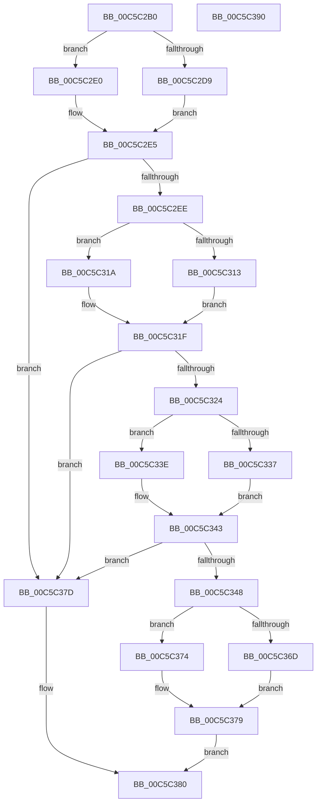

# CmpFindGroupOrderList

- RVA: `0x00C5C2B0`–`0x00C5C391` (길이 `225` bytes)
- VA: `0x0000000140C5C2B0`
- 실행 섹션: `INIT`
- PDB 이름 있음: `예`; PDB Function 태그: `아니요`
- unwind 정보 RVA: `0x000D7280`
- 디코드: `62`개 명령, `225/225` bytes 표시
- 미해석 바이트: `0` (있으면 어셈블리에 `.byte`로 보존)

> 이 문서는 커널 이미지의 기계어와 PDB 기호를 분석해 생성했습니다. 4번과 5번은 함수 원형과 자료형을 바이너리 사용 방식에서 추정한 C 해석이며 원본 소스 복구 결과는 아닙니다.

## 1. Dependencies

- 직접 호출 지점: **10**; 고유 호출 대상: **5**
- 직접 호출자로 확인된 함수: **1**
- RIP 상대 이미지 참조: **2**

### Outgoing calls
- `0x00C5C2D9` → [HvpGetCellFlat](../../page/85/HvpGetCellFlat_function_00854C60.md) (function, `0x00854C60`)
- `0x00C5C2E0` → [HvpGetCellPaged](../../page/85/HvpGetCellPaged_function_00854CB0.md) (function, `0x00854CB0`)
- `0x00C5C2FB` → [CmpFindSubKeyByName](../../page/A4/CmpFindSubKeyByName_function_00A49D58.md) (function, `0x00A49D58`)
- `0x00C5C313` → [HvpReleaseCellFlat](../../page/85/HvpReleaseCellFlat_function_0085CC20.md) (function, `0x0085CC20`)
- `0x00C5C31A` → [HvpReleaseCellPaged](../../page/85/HvpReleaseCellPaged_function_00855F40.md) (function, `0x00855F40`)
- `0x00C5C337` → [HvpGetCellFlat](../../page/85/HvpGetCellFlat_function_00854C60.md) (function, `0x00854C60`)
- `0x00C5C33E` → [HvpGetCellPaged](../../page/85/HvpGetCellPaged_function_00854CB0.md) (function, `0x00854CB0`)
- `0x00C5C355` → [CmpFindSubKeyByName](../../page/A4/CmpFindSubKeyByName_function_00A49D58.md) (function, `0x00A49D58`)
- `0x00C5C36D` → [HvpReleaseCellFlat](../../page/85/HvpReleaseCellFlat_function_0085CC20.md) (function, `0x0085CC20`)
- `0x00C5C374` → [HvpReleaseCellPaged](../../page/85/HvpReleaseCellPaged_function_00855F40.md) (function, `0x00855F40`)

### Direct callers
- [CmpFindDrivers](CmpFindDrivers_function_00C5BFBC.md) at `0x00C5C0C6`

### Static image references
- `0x00C5C2EE` → RVA `0x00C82188` (`CmpControlString`; read)
- `0x00C5C348` → RVA `0x00C82360` (`CmpGroupOrderListString`; read)

## 2. Other-region calls and transfers

- 다른 실행 섹션으로 향하는 call: **10**
  - `0x00C5C2D9` → [HvpGetCellFlat](../../page/85/HvpGetCellFlat_function_00854C60.md) (`INIT` → `PAGE`)
  - `0x00C5C2E0` → [HvpGetCellPaged](../../page/85/HvpGetCellPaged_function_00854CB0.md) (`INIT` → `PAGE`)
  - `0x00C5C2FB` → [CmpFindSubKeyByName](../../page/A4/CmpFindSubKeyByName_function_00A49D58.md) (`INIT` → `PAGE`)
  - `0x00C5C313` → [HvpReleaseCellFlat](../../page/85/HvpReleaseCellFlat_function_0085CC20.md) (`INIT` → `PAGE`)
  - `0x00C5C31A` → [HvpReleaseCellPaged](../../page/85/HvpReleaseCellPaged_function_00855F40.md) (`INIT` → `PAGE`)
  - `0x00C5C337` → [HvpGetCellFlat](../../page/85/HvpGetCellFlat_function_00854C60.md) (`INIT` → `PAGE`)
  - `0x00C5C33E` → [HvpGetCellPaged](../../page/85/HvpGetCellPaged_function_00854CB0.md) (`INIT` → `PAGE`)
  - `0x00C5C355` → [CmpFindSubKeyByName](../../page/A4/CmpFindSubKeyByName_function_00A49D58.md) (`INIT` → `PAGE`)
  - `0x00C5C36D` → [HvpReleaseCellFlat](../../page/85/HvpReleaseCellFlat_function_0085CC20.md) (`INIT` → `PAGE`)
  - `0x00C5C374` → [HvpReleaseCellPaged](../../page/85/HvpReleaseCellPaged_function_00855F40.md) (`INIT` → `PAGE`)
- 별도 외부 분기/꼬리 이동을 확인하지 못했습니다.

## 3. Assembly (complete function range)

```asm
00C5C2B0  48 8B C4                        mov rax, rsp
00C5C2B3  48 89 58 10                     mov qword ptr [rax + 0x10], rbx
00C5C2B7  48 89 68 18                     mov qword ptr [rax + 0x18], rbp
00C5C2BB  57                              push rdi
00C5C2BC  48 83 EC 20                     sub rsp, 0x20
00C5C2C0  83 48 08 FF                     or dword ptr [rax + 8], 0xffffffff
00C5C2C4  4C 8D 40 08                     lea r8, [rax + 8]
00C5C2C8  33 ED                           xor ebp, ebp
00C5C2CA  48 8B D9                        mov rbx, rcx
00C5C2CD  F6 81 8C 00 00 00 01            test byte ptr [rcx + 0x8c], 1
00C5C2D4  89 68 0C                        mov dword ptr [rax + 0xc], ebp
00C5C2D7  74 07                           je 0x140c5c2e0
00C5C2D9  E8 82 89 BF FF                  call 0x140854c60
00C5C2DE  EB 05                           jmp 0x140c5c2e5
00C5C2E0  E8 CB 89 BF FF                  call 0x140854cb0
00C5C2E5  48 85 C0                        test rax, rax
00C5C2E8  0F 84 8F 00 00 00               je 0x140c5c37d
00C5C2EE  4C 8D 05 93 5E 02 00            lea r8, [rip + 0x25e93]
00C5C2F5  48 8B D0                        mov rdx, rax
00C5C2F8  48 8B CB                        mov rcx, rbx
00C5C2FB  E8 58 DA DE FF                  call 0x140a49d58
00C5C300  F6 83 8C 00 00 00 01            test byte ptr [rbx + 0x8c], 1
00C5C307  48 8D 54 24 30                  lea rdx, [rsp + 0x30]
00C5C30C  8B F8                           mov edi, eax
00C5C30E  48 8B CB                        mov rcx, rbx
00C5C311  74 07                           je 0x140c5c31a
00C5C313  E8 08 09 C0 FF                  call 0x14085cc20
00C5C318  EB 05                           jmp 0x140c5c31f
00C5C31A  E8 21 9C BF FF                  call 0x140855f40
00C5C31F  83 FF FF                        cmp edi, -1
00C5C322  74 59                           je 0x140c5c37d
00C5C324  F6 83 8C 00 00 00 01            test byte ptr [rbx + 0x8c], 1
00C5C32B  4C 8D 44 24 30                  lea r8, [rsp + 0x30]
00C5C330  8B D7                           mov edx, edi
00C5C332  48 8B CB                        mov rcx, rbx
00C5C335  74 07                           je 0x140c5c33e
00C5C337  E8 24 89 BF FF                  call 0x140854c60
00C5C33C  EB 05                           jmp 0x140c5c343
00C5C33E  E8 6D 89 BF FF                  call 0x140854cb0
00C5C343  48 85 C0                        test rax, rax
00C5C346  74 35                           je 0x140c5c37d
00C5C348  4C 8D 05 11 60 02 00            lea r8, [rip + 0x26011]
00C5C34F  48 8B D0                        mov rdx, rax
00C5C352  48 8B CB                        mov rcx, rbx
00C5C355  E8 FE D9 DE FF                  call 0x140a49d58
00C5C35A  F6 83 8C 00 00 00 01            test byte ptr [rbx + 0x8c], 1
00C5C361  48 8D 54 24 30                  lea rdx, [rsp + 0x30]
00C5C366  8B F8                           mov edi, eax
00C5C368  48 8B CB                        mov rcx, rbx
00C5C36B  74 07                           je 0x140c5c374
00C5C36D  E8 AE 08 C0 FF                  call 0x14085cc20
00C5C372  EB 05                           jmp 0x140c5c379
00C5C374  E8 C7 9B BF FF                  call 0x140855f40
00C5C379  8B C7                           mov eax, edi
00C5C37B  EB 03                           jmp 0x140c5c380
00C5C37D  83 C8 FF                        or eax, 0xffffffff
00C5C380  48 8B 5C 24 38                  mov rbx, qword ptr [rsp + 0x38]
00C5C385  48 8B 6C 24 40                  mov rbp, qword ptr [rsp + 0x40]
00C5C38A  48 83 C4 20                     add rsp, 0x20
00C5C38E  5F                              pop rdi
00C5C38F  C3                              ret
00C5C390  CC                              int3
```

## 4. C-style interpretation (structured pseudocode)

```c
__int64 __fastcall CmpFindGroupOrderList(__int64 a1)
{
    __int64 result;
    __int64 v_rbp;
    __int64 v_rsp;
    unsigned __int64 v_stack_p10;
    unsigned __int64 v_stack_p18;
    unsigned __int64 v_stack_p8;

    *(unsigned __int64 *)(v_rsp + 16) = v_rbx;
    *(unsigned __int64 *)(v_rsp + 24) = v_rbp;
    v_rsp = (v_rsp) - (32);
    v_rbp = 0;
    *(unsigned int *)(v_rsp + 12) = 0;
    if (((*(unsigned __int8 *)(a1 + 140)) & (1)) == 0) goto loc_00C5C2E0;
    result = HvpGetCellFlat(a1, a2, v_rsp + 8, a4);
    goto loc_00C5C2E5;
loc_00C5C2E0:
    result = HvpGetCellPaged(a1, a2, v_rsp + 8, a4);
loc_00C5C2E5:
    if (result == 0) goto loc_00C5C37D;
    result = CmpFindSubKeyByName(a1, result, v_rip + 155283, a4);
    if (((*(unsigned __int8 *)(a1 + 140)) & (1)) == 0) goto loc_00C5C31A;
    result = HvpReleaseCellFlat(a1, v_stack_p8, v_rip + 155283, a4);
    goto loc_00C5C31F;
loc_00C5C31A:
    result = HvpReleaseCellPaged(a1, v_stack_p8, v_rip + 155283, a4);
loc_00C5C31F:
    if (((unsigned int)((unsigned int)((unsigned int)(result)))) == -1) goto loc_00C5C37D;
    if (((*(unsigned __int8 *)(a1 + 140)) & (1)) == 0) goto loc_00C5C33E;
    result = HvpGetCellFlat(a1, (unsigned int)((unsigned int)((unsigned int)((unsigned int)(result)))), v_stack_p8, a4);
    goto loc_00C5C343;
loc_00C5C33E:
    result = HvpGetCellPaged(a1, (unsigned int)((unsigned int)((unsigned int)((unsigned int)(result)))), v_stack_p8, a4);
loc_00C5C343:
    if (result == 0) goto loc_00C5C37D;
    result = CmpFindSubKeyByName(a1, result, v_rip + 155665, a4);
    if (((*(unsigned __int8 *)(a1 + 140)) & (1)) == 0) goto loc_00C5C374;
    result = HvpReleaseCellFlat(a1, v_stack_p8, v_rip + 155665, a4);
    goto loc_00C5C379;
loc_00C5C374:
    result = HvpReleaseCellPaged(a1, v_stack_p8, v_rip + 155665, a4);
loc_00C5C379:
    goto loc_00C5C380;
loc_00C5C37D:
    result = (unsigned int)(((unsigned int)((unsigned int)((unsigned int)((unsigned int)(result))))) | (0xFFFFFFFFULL));
loc_00C5C380:
    v_rsp = (v_rsp) + (32);
    return result;
}
```

## 5. (Beta) C Style

```c
int64_t CmpFindGroupOrderList(void *Arg1)
{
    uint8_t *arg1 = (uint8_t *)Arg1;

    int64_t result;
    int64_t local_rbp;
    int64_t local_rsp;
    uint64_t v_stack_p10;
    uint64_t v_stack_p18;
    uint64_t v_stack_p8;

    *(uint64_t *)(local_rsp + 0x10) = local_rbx;
    *(uint64_t *)(local_rsp + 0x18) = local_rbp;
    local_rsp = (local_rsp) - (32);
    local_rbp = 0;
    *(uint32_t *)(local_rsp + 0xC) = 0;
    if (((*(uint8_t *)(arg1 + 0x8C)) & (1)) == 0) goto loc_00C5C2E0;
    result = HvpGetCellFlat(Arg1, a2, local_rsp + 8, a4);
    goto loc_00C5C2E5;
loc_00C5C2E0:
    result = HvpGetCellPaged(Arg1, a2, local_rsp + 8, a4);
loc_00C5C2E5:
    if (result == 0) goto loc_00C5C37D;
    result = CmpFindSubKeyByName(Arg1, result, v_rip + 155283, a4);
    if (((*(uint8_t *)(arg1 + 0x8C)) & (1)) == 0) goto loc_00C5C31A;
    result = HvpReleaseCellFlat(Arg1, v_stack_p8, v_rip + 155283, a4);
    goto loc_00C5C31F;
loc_00C5C31A:
    result = HvpReleaseCellPaged(Arg1, v_stack_p8, v_rip + 155283, a4);
loc_00C5C31F:
    if (((uint32_t)((uint32_t)((uint32_t)(result)))) == -1) goto loc_00C5C37D;
    if (((*(uint8_t *)(arg1 + 0x8C)) & (1)) == 0) goto loc_00C5C33E;
    result = HvpGetCellFlat(Arg1, (uint32_t)((uint32_t)((uint32_t)((uint32_t)(result)))), v_stack_p8, a4);
    goto loc_00C5C343;
loc_00C5C33E:
    result = HvpGetCellPaged(Arg1, (uint32_t)((uint32_t)((uint32_t)((uint32_t)(result)))), v_stack_p8, a4);
loc_00C5C343:
    if (result == 0) goto loc_00C5C37D;
    result = CmpFindSubKeyByName(Arg1, result, v_rip + 155665, a4);
    if (((*(uint8_t *)(arg1 + 0x8C)) & (1)) == 0) goto loc_00C5C374;
    result = HvpReleaseCellFlat(Arg1, v_stack_p8, v_rip + 155665, a4);
    goto loc_00C5C379;
loc_00C5C374:
    result = HvpReleaseCellPaged(Arg1, v_stack_p8, v_rip + 155665, a4);
loc_00C5C379:
    goto loc_00C5C380;
loc_00C5C37D:
    result = (uint32_t)(((uint32_t)((uint32_t)((uint32_t)((uint32_t)(result))))) | (0xFFFFFFFFULL));
loc_00C5C380:
    local_rsp = (local_rsp) + (32);
    return result;
}
```

### 관측된 메모리 오프셋

구조체 형식이 확인되지 않은 접근은 인자 기준의 오프셋으로만 기록했습니다.

| 기준 인자 | 오프셋 표현 | 폭 (bit) | 접근 |
|---|---:|---:|---|
| `Arg1` | `+ 0x8C` | `8` | `R` |

## 6. Execution-region graph

[열기: 2D/3D 그래프와 함수 탐색 컨트롤 패널](../../../control-panel.html?section=init&rva=0x00C5C2B0&view=graph)

- 2D 그래프는 위에서 아래로 흐르고, 3D 그래프는 빈 공간을 드래그해 회전합니다. Shift+드래그는 이동, 휠은 확대·축소, 함수 노드 선택은 대상 보고서 이동입니다.

### Static fallback


