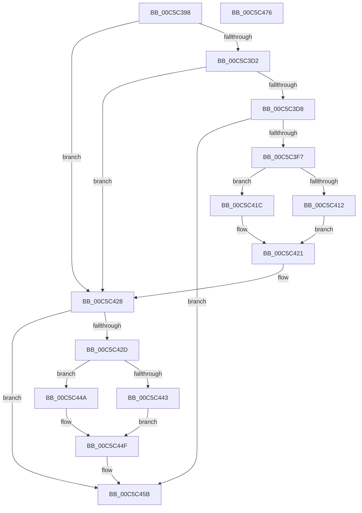

# CmpFindHiveSubKey

- RVA: `0x00C5C398`–`0x00C5C477` (길이 `223` bytes)
- VA: `0x0000000140C5C398`
- 실행 섹션: `INIT`
- PDB 이름 있음: `예`; PDB Function 태그: `아니요`
- unwind 정보 RVA: `0x000BDE04`
- 디코드: `68`개 명령, `223/223` bytes 표시
- 미해석 바이트: `0` (있으면 어셈블리에 `.byte`로 보존)

> 이 문서는 커널 이미지의 기계어와 PDB 기호를 분석해 생성했습니다. 4번과 5번은 함수 원형과 자료형을 바이너리 사용 방식에서 추정한 C 해석이며 원본 소스 복구 결과는 아닙니다.

## 1. Dependencies

- 직접 호출 지점: **5**; 고유 호출 대상: **5**
- 직접 호출자로 확인된 함수: **2**
- RIP 상대 이미지 참조: **1**

### Outgoing calls
- `0x00C5C3EE` → [CmpGetNextName](../../page/7F/CmpGetNextName_function_007F138C.md) (function, `0x007F138C`)
- `0x00C5C406` → [RtlEqualUnicodeString](../../page/93/RtlEqualUnicodeString_function_00932A20.md) (function, `0x00932A20`)
- `0x00C5C421` → [CmpWalkUnicodeStringPath](../../page/7F/CmpWalkUnicodeStringPath_function_007F3704.md) (function, `0x007F3704`)
- `0x00C5C443` → [HvpGetCellFlat](../../page/85/HvpGetCellFlat_function_00854C60.md) (function, `0x00854C60`)
- `0x00C5C44A` → [HvpGetCellPaged](../../page/85/HvpGetCellPaged_function_00854CB0.md) (function, `0x00854CB0`)

### Direct callers
- [CmpFindStateSepKeysRedirectionMapNode](CmpFindStateSepKeysRedirectionMapNode_function_00C5C554.md) at `0x00C5C598`
- [CmpGetKnownHivePathNode](CmpGetKnownHivePathNode_function_00C5C85C.md) at `0x00C5C925`

### Static image references
- `0x00C5C3FF` → RVA `0x00C82280` (`CmpCCSString`; read)

## 2. Other-region calls and transfers

- 다른 실행 섹션으로 향하는 call: **5**
  - `0x00C5C3EE` → [CmpGetNextName](../../page/7F/CmpGetNextName_function_007F138C.md) (`INIT` → `PAGE`)
  - `0x00C5C406` → [RtlEqualUnicodeString](../../page/93/RtlEqualUnicodeString_function_00932A20.md) (`INIT` → `PAGE`)
  - `0x00C5C421` → [CmpWalkUnicodeStringPath](../../page/7F/CmpWalkUnicodeStringPath_function_007F3704.md) (`INIT` → `PAGE`)
  - `0x00C5C443` → [HvpGetCellFlat](../../page/85/HvpGetCellFlat_function_00854C60.md) (`INIT` → `PAGE`)
  - `0x00C5C44A` → [HvpGetCellPaged](../../page/85/HvpGetCellPaged_function_00854CB0.md) (`INIT` → `PAGE`)
- 별도 외부 분기/꼬리 이동을 확인하지 못했습니다.

## 3. Assembly (complete function range)

```asm
00C5C398  4C 8B DC                        mov r11, rsp
00C5C39B  49 89 5B 10                     mov qword ptr [r11 + 0x10], rbx
00C5C39F  49 89 6B 18                     mov qword ptr [r11 + 0x18], rbp
00C5C3A3  49 89 73 20                     mov qword ptr [r11 + 0x20], rsi
00C5C3A7  57                              push rdi
00C5C3A8  41 56                           push r14
00C5C3AA  41 57                           push r15
00C5C3AC  48 83 EC 40                     sub rsp, 0x40
00C5C3B0  48 8B 41 40                     mov rax, qword ptr [rcx + 0x40]
00C5C3B4  33 DB                           xor ebx, ebx
00C5C3B6  0F 57 C0                        xorps xmm0, xmm0
00C5C3B9  4D 8B F9                        mov r15, r9
00C5C3BC  49 8B E8                        mov rbp, r8
00C5C3BF  44 8B F2                        mov r14d, edx
00C5C3C2  48 8B F1                        mov rsi, rcx
00C5C3C5  8B 78 24                        mov edi, dword ptr [rax + 0x24]
00C5C3C8  0F 11 44 24 20                  movups xmmword ptr [rsp + 0x20], xmm0
00C5C3CD  4D 85 C0                        test r8, r8
00C5C3D0  74 56                           je 0x140c5c428
00C5C3D2  66 41 39 18                     cmp word ptr [r8], bx
00C5C3D6  74 50                           je 0x140c5c428
00C5C3D8  41 0F 10 00                     movups xmm0, xmmword ptr [r8]
00C5C3DC  4D 8D 43 08                     lea r8, [r11 + 8]
00C5C3E0  49 8D 53 C8                     lea rdx, [r11 - 0x38]
00C5C3E4  49 8D 4B D8                     lea rcx, [r11 - 0x28]
00C5C3E8  F3 0F 7F 44 24 30               movdqu xmmword ptr [rsp + 0x30], xmm0
00C5C3EE  E8 99 4F B9 FF                  call 0x1407f138c
00C5C3F3  84 C0                           test al, al
00C5C3F5  74 64                           je 0x140c5c45b
00C5C3F7  41 B0 01                        mov r8b, 1
00C5C3FA  48 8D 54 24 20                  lea rdx, [rsp + 0x20]
00C5C3FF  48 8D 0D 7A 5E 02 00            lea rcx, [rip + 0x25e7a]
00C5C406  E8 15 66 CD FF                  call 0x140932a20
00C5C40B  48 8B CE                        mov rcx, rsi
00C5C40E  84 C0                           test al, al
00C5C410  74 0A                           je 0x140c5c41c
00C5C412  4C 8D 44 24 30                  lea r8, [rsp + 0x30]
00C5C417  41 8B D6                        mov edx, r14d
00C5C41A  EB 05                           jmp 0x140c5c421
00C5C41C  4C 8B C5                        mov r8, rbp
00C5C41F  8B D7                           mov edx, edi
00C5C421  E8 DE 72 B9 FF                  call 0x1407f3704
00C5C426  8B F8                           mov edi, eax
00C5C428  83 FF FF                        cmp edi, -1
00C5C42B  74 2E                           je 0x140c5c45b
00C5C42D  F6 86 8C 00 00 00 01            test byte ptr [rsi + 0x8c], 1
00C5C434  8B D7                           mov edx, edi
00C5C436  4C 8B 84 24 80 00 00 00         mov r8, qword ptr [rsp + 0x80]
00C5C43E  48 8B CE                        mov rcx, rsi
00C5C441  74 07                           je 0x140c5c44a
00C5C443  E8 18 88 BF FF                  call 0x140854c60
00C5C448  EB 05                           jmp 0x140c5c44f
00C5C44A  E8 61 88 BF FF                  call 0x140854cb0
00C5C44F  49 89 07                        mov qword ptr [r15], rax
00C5C452  48 F7 D8                        neg rax
00C5C455  1A C0                           sbb al, al
00C5C457  24 01                           and al, 1
00C5C459  8A D8                           mov bl, al
00C5C45B  48 8B 6C 24 70                  mov rbp, qword ptr [rsp + 0x70]
00C5C460  8A C3                           mov al, bl
00C5C462  48 8B 5C 24 68                  mov rbx, qword ptr [rsp + 0x68]
00C5C467  48 8B 74 24 78                  mov rsi, qword ptr [rsp + 0x78]
00C5C46C  48 83 C4 40                     add rsp, 0x40
00C5C470  41 5F                           pop r15
00C5C472  41 5E                           pop r14
00C5C474  5F                              pop rdi
00C5C475  C3                              ret
00C5C476  CC                              int3
```

## 4. C-style interpretation (structured pseudocode)

```c
__int64 __fastcall CmpFindHiveSubKey(__int64 a1, int a2, __int64 a3, __int64 a4, __int64 a5)
{
    __int64 result;
    __int64 v_rbx;
    __int64 v_rsp;
    unsigned __int64 v_stack_m28;
    unsigned __int64 v_stack_m38;
    unsigned __int64 v_stack_p10;
    unsigned __int64 v_stack_p18;
    unsigned __int64 v_stack_p20;

    *(unsigned __int64 *)(v_rsp + 16) = v_rbx;
    *(unsigned __int64 *)(v_rsp + 24) = v_rbp;
    *(unsigned __int64 *)(v_rsp + 32) = v_rsi;
    v_rsp = (v_rsp) - (64);
    v_rbx = 0;
    v_stack_m38 = v_xmm0;
    if (a3 == 0) goto loc_00C5C428;
    if ((*(unsigned __int16 *)(a3)) == 0) goto loc_00C5C428;
    v_stack_m28 = v_xmm0;
    result = CmpGetNextName(v_rsp - 40, v_rsp - 56, v_rsp + 8, a4);
    if ((unsigned __int8)(result) == 0) goto loc_00C5C45B;
    result = RtlEqualUnicodeString(v_rip + 155258, v_stack_m38, 1, a4);
    if ((unsigned __int8)(result) == 0) goto loc_00C5C41C;
    goto loc_00C5C421;
loc_00C5C41C:
loc_00C5C421:
    result = CmpWalkUnicodeStringPath(a1, (unsigned int)((unsigned int)((unsigned int)(*(unsigned int *)(*(unsigned __int64 *)(a1 + 64) + 36)))), a3, a4);
loc_00C5C428:
    if (((unsigned int)((unsigned int)((unsigned int)(result)))) == -1) goto loc_00C5C45B;
    if (((*(unsigned __int8 *)(a1 + 140)) & (1)) == 0) goto loc_00C5C44A;
    result = HvpGetCellFlat(a1, (unsigned int)((unsigned int)((unsigned int)((unsigned int)(result)))), a5, a4);
    goto loc_00C5C44F;
loc_00C5C44A:
    result = HvpGetCellPaged(a1, (unsigned int)((unsigned int)((unsigned int)((unsigned int)(result)))), a5, a4);
loc_00C5C44F:
    *(unsigned __int64 *)(a4) = result;
    result = -(result);
    result = (unsigned __int8)((result) & (1));
loc_00C5C45B:
    v_rsp = (v_rsp) + (64);
    return (unsigned __int8)((unsigned __int8)(result));
}
```

## 5. (Beta) C Style

```c
int64_t CmpFindHiveSubKey(void *Arg1, int32_t Arg2, int64_t Arg3, void *Arg4, int64_t Arg5)
{
    uint8_t *arg1 = (uint8_t *)Arg1;
    uint8_t *arg4 = (uint8_t *)Arg4;

    int64_t result;
    int64_t local_rbx;
    int64_t local_rsp;
    uint64_t v_stack_m28;
    uint64_t v_stack_m38;
    uint64_t v_stack_p10;
    uint64_t v_stack_p18;
    uint64_t v_stack_p20;

    *(uint64_t *)(local_rsp + 0x10) = local_rbx;
    *(uint64_t *)(local_rsp + 0x18) = local_rbp;
    *(uint64_t *)(local_rsp + 0x20) = local_rsi;
    local_rsp = (local_rsp) - (64);
    local_rbx = 0;
    v_stack_m38 = v_xmm0;
    if (Arg3 == 0) goto loc_00C5C428;
    if ((*(uint16_t *)(Arg3)) == 0) goto loc_00C5C428;
    v_stack_m28 = v_xmm0;
    result = CmpGetNextName(local_rsp - 40, local_rsp - 56, local_rsp + 8, Arg4);
    if ((uint8_t)(result) == 0) goto loc_00C5C45B;
    result = RtlEqualUnicodeString(v_rip + 155258, v_stack_m38, 1, Arg4);
    if ((uint8_t)(result) == 0) goto loc_00C5C41C;
    goto loc_00C5C421;
loc_00C5C41C:
loc_00C5C421:
    result = CmpWalkUnicodeStringPath(Arg1, (uint32_t)((uint32_t)((uint32_t)(*(uint32_t *)(*(uint64_t *)(arg1 + 0x40) + 0x24)))), Arg3, Arg4);
loc_00C5C428:
    if (((uint32_t)((uint32_t)((uint32_t)(result)))) == -1) goto loc_00C5C45B;
    if (((*(uint8_t *)(arg1 + 0x8C)) & (1)) == 0) goto loc_00C5C44A;
    result = HvpGetCellFlat(Arg1, (uint32_t)((uint32_t)((uint32_t)((uint32_t)(result)))), Arg5, Arg4);
    goto loc_00C5C44F;
loc_00C5C44A:
    result = HvpGetCellPaged(Arg1, (uint32_t)((uint32_t)((uint32_t)((uint32_t)(result)))), Arg5, Arg4);
loc_00C5C44F:
    *(uint64_t *)(arg4) = result;
    result = -(result);
    result = (uint8_t)((result) & (1));
loc_00C5C45B:
    local_rsp = (local_rsp) + (64);
    return (uint8_t)((uint8_t)(result));
}
```

### 관측된 메모리 오프셋

구조체 형식이 확인되지 않은 접근은 인자 기준의 오프셋으로만 기록했습니다.

| 기준 인자 | 오프셋 표현 | 폭 (bit) | 접근 |
|---|---:|---:|---|
| `Arg1` | `+ 0x40` | `64` | `R` |
| `Arg1` | `+ 0x8C` | `8` | `R` |
| `Arg4` | `+ 0x0` | `64` | `W` |

## 6. Execution-region graph

[열기: 2D/3D 그래프와 함수 탐색 컨트롤 패널](../../../control-panel.html?section=init&rva=0x00C5C398&view=graph)

- 2D 그래프는 위에서 아래로 흐르고, 3D 그래프는 빈 공간을 드래그해 회전합니다. Shift+드래그는 이동, 휠은 확대·축소, 함수 노드 선택은 대상 보고서 이동입니다.

### Static fallback


