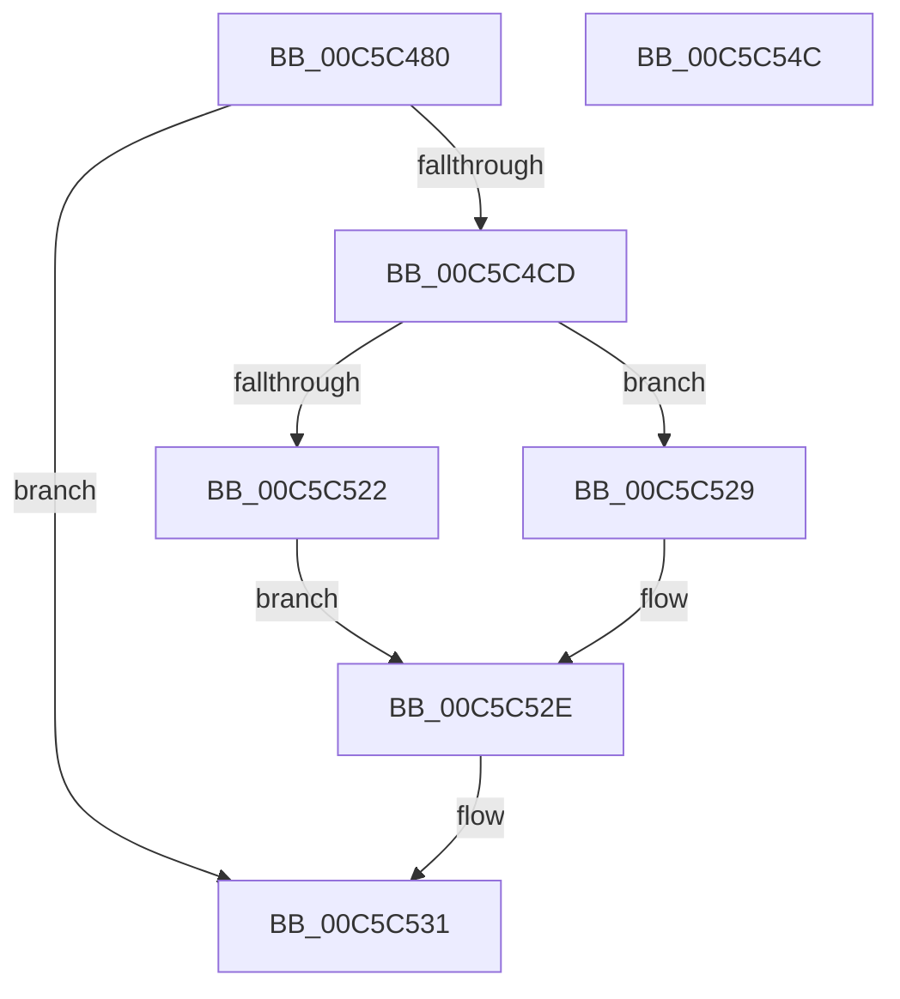

# CmpFindRedirectedDriverServiceStateNode

- RVA: `0x00C5C480`–`0x00C5C54D` (길이 `205` bytes)
- VA: `0x0000000140C5C480`
- 실행 섹션: `INIT`
- PDB 이름 있음: `예`; PDB Function 태그: `아니요`
- unwind 정보 RVA: `0x000BF908`
- 디코드: `53`개 명령, `205/205` bytes 표시
- 미해석 바이트: `0` (있으면 어셈블리에 `.byte`로 보존)

> 이 문서는 커널 이미지의 기계어와 PDB 기호를 분석해 생성했습니다. 4번과 5번은 함수 원형과 자료형을 바이너리 사용 방식에서 추정한 C 해석이며 원본 소스 복구 결과는 아닙니다.

## 1. Dependencies

- 직접 호출 지점: **4**; 고유 호출 대상: **4**
- 직접 호출자로 확인된 함수: **1**
- RIP 상대 이미지 참조: **0**

### Outgoing calls
- `0x00C5C4C4` → [CmpGetStateSepKeysRedirectionPathValue](CmpGetStateSepKeysRedirectionPathValue_function_00C5CA3C.md) (function, `0x00C5CA3C`)
- `0x00C5C509` → [CmpGetKnownHivePathNode](CmpGetKnownHivePathNode_function_00C5C85C.md) (function, `0x00C5C85C`)
- `0x00C5C522` → [HvpReleaseCellFlat](../../page/85/HvpReleaseCellFlat_function_0085CC20.md) (function, `0x0085CC20`)
- `0x00C5C529` → [HvpReleaseCellPaged](../../page/85/HvpReleaseCellPaged_function_00855F40.md) (function, `0x00855F40`)

### Direct callers
- [CmpFindDrivers](CmpFindDrivers_function_00C5BFBC.md) at `0x00C5C09E`

### Static image references
- 디코드된 RIP-relative 메모리 참조가 없습니다.

## 2. Other-region calls and transfers

- 다른 실행 섹션으로 향하는 call: **2**
  - `0x00C5C522` → [HvpReleaseCellFlat](../../page/85/HvpReleaseCellFlat_function_0085CC20.md) (`INIT` → `PAGE`)
  - `0x00C5C529` → [HvpReleaseCellPaged](../../page/85/HvpReleaseCellPaged_function_00855F40.md) (`INIT` → `PAGE`)
- 별도 외부 분기/꼬리 이동을 확인하지 못했습니다.

## 3. Assembly (complete function range)

```asm
00C5C480  48 8B C4                        mov rax, rsp
00C5C483  48 89 58 08                     mov qword ptr [rax + 8], rbx
00C5C487  48 89 68 10                     mov qword ptr [rax + 0x10], rbp
00C5C48B  48 89 70 18                     mov qword ptr [rax + 0x18], rsi
00C5C48F  48 89 78 20                     mov qword ptr [rax + 0x20], rdi
00C5C493  41 56                           push r14
00C5C495  48 83 EC 60                     sub rsp, 0x60
00C5C499  83 48 D8 FF                     or dword ptr [rax - 0x28], 0xffffffff
00C5C49D  48 8D 40 D8                     lea rax, [rax - 0x28]
00C5C4A1  0F 57 C0                        xorps xmm0, xmm0
00C5C4A4  48 89 44 24 20                  mov qword ptr [rsp + 0x20], rax
00C5C4A9  0F 11 40 08                     movups xmmword ptr [rax + 8], xmm0
00C5C4AD  41 8B F1                        mov esi, r9d
00C5C4B0  45 33 F6                        xor r14d, r14d
00C5C4B3  44 89 70 04                     mov dword ptr [rax + 4], r14d
00C5C4B7  4C 8D 4C 24 48                  lea r9, [rsp + 0x48]
00C5C4BC  49 8B E8                        mov rbp, r8
00C5C4BF  8B FA                           mov edi, edx
00C5C4C1  48 8B D9                        mov rbx, rcx
00C5C4C4  E8 73 05 00 00                  call 0x140c5ca3c
00C5C4C9  84 C0                           test al, al
00C5C4CB  74 64                           je 0x140c5c531
00C5C4CD  48 8B 84 24 A0 00 00 00         mov rax, qword ptr [rsp + 0xa0]
00C5C4D5  44 8B CE                        mov r9d, esi
00C5C4D8  48 89 44 24 38                  mov qword ptr [rsp + 0x38], rax
00C5C4DD  4C 8B C5                        mov r8, rbp
00C5C4E0  48 8B 84 24 98 00 00 00         mov rax, qword ptr [rsp + 0x98]
00C5C4E8  8B D7                           mov edx, edi
00C5C4EA  48 89 44 24 30                  mov qword ptr [rsp + 0x30], rax
00C5C4EF  48 8B CB                        mov rcx, rbx
00C5C4F2  48 8B 84 24 90 00 00 00         mov rax, qword ptr [rsp + 0x90]
00C5C4FA  48 89 44 24 28                  mov qword ptr [rsp + 0x28], rax
00C5C4FF  48 8D 44 24 48                  lea rax, [rsp + 0x48]
00C5C504  48 89 44 24 20                  mov qword ptr [rsp + 0x20], rax
00C5C509  E8 4E 03 00 00                  call 0x140c5c85c
00C5C50E  F6 83 8C 00 00 00 01            test byte ptr [rbx + 0x8c], 1
00C5C515  48 8D 54 24 40                  lea rdx, [rsp + 0x40]
00C5C51A  40 8A F8                        mov dil, al
00C5C51D  48 8B CB                        mov rcx, rbx
00C5C520  74 07                           je 0x140c5c529
00C5C522  E8 F9 06 C0 FF                  call 0x14085cc20
00C5C527  EB 05                           jmp 0x140c5c52e
00C5C529  E8 12 9A BF FF                  call 0x140855f40
00C5C52E  40 8A C7                        mov al, dil
00C5C531  4C 8D 5C 24 60                  lea r11, [rsp + 0x60]
00C5C536  49 8B 5B 10                     mov rbx, qword ptr [r11 + 0x10]
00C5C53A  49 8B 6B 18                     mov rbp, qword ptr [r11 + 0x18]
00C5C53E  49 8B 73 20                     mov rsi, qword ptr [r11 + 0x20]
00C5C542  49 8B 7B 28                     mov rdi, qword ptr [r11 + 0x28]
00C5C546  49 8B E3                        mov rsp, r11
00C5C549  41 5E                           pop r14
00C5C54B  C3                              ret
00C5C54C  CC                              int3
```

## 4. C-style interpretation (structured pseudocode)

```c
__int64 __fastcall CmpFindRedirectedDriverServiceStateNode(__int64 a1, int a2, __int64 a3, int a4, __int64 a5, __int64 a6, __int64 a7)
{
    __int64 result;
    __int64 v_r14;
    __int64 v_rsp;
    unsigned __int64 v_stack_m20;
    unsigned __int64 v_stack_m28;
    unsigned __int64 v_stack_m30;
    unsigned __int64 v_stack_m38;
    unsigned __int64 v_stack_m40;
    unsigned __int64 v_stack_m48;
    unsigned __int64 v_stack_m8;

    *(unsigned __int64 *)(v_rsp + 8) = v_rbx;
    *(unsigned __int64 *)(v_rsp + 16) = v_rbp;
    *(unsigned __int64 *)(v_rsp + 24) = v_rsi;
    *(unsigned __int64 *)(v_rsp + 32) = v_rdi;
    v_rsp = (v_rsp) - (96);
    v_stack_m48 = v_rsp - 40;
    *(unsigned __int64 *)(v_rsp - 40 + 8) = v_xmm0;
    v_r14 = 0;
    *(unsigned int *)(v_rsp - 40 + 4) = 0;
    result = CmpGetStateSepKeysRedirectionPathValue(a1, a2, a3, v_stack_m20);
    if ((unsigned __int8)(result) == 0) goto loc_00C5C531;
    v_stack_m30 = a7;
    v_stack_m38 = a6;
    v_stack_m40 = a5;
    v_stack_m48 = v_stack_m20;
    result = CmpGetKnownHivePathNode(a1, (unsigned int)((unsigned int)((unsigned int)(a2))), a3, (unsigned int)((unsigned int)((unsigned int)(a4))));
    if (((*(unsigned __int8 *)(a1 + 140)) & (1)) == 0) goto loc_00C5C529;
    result = HvpReleaseCellFlat(a1, v_stack_m28, a3, (unsigned int)((unsigned int)((unsigned int)(a4))));
    goto loc_00C5C52E;
loc_00C5C529:
    result = HvpReleaseCellPaged(a1, v_stack_m28, a3, (unsigned int)((unsigned int)((unsigned int)(a4))));
loc_00C5C52E:
loc_00C5C531:
    return (unsigned __int8)((unsigned __int8)(result));
}
```

## 5. (Beta) C Style

```c
int64_t CmpFindRedirectedDriverServiceStateNode(void *Arg1, int32_t Arg2, int64_t Arg3, int32_t Arg4, int64_t Arg5, int64_t Arg6, int64_t Arg7)
{
    uint8_t *arg1 = (uint8_t *)Arg1;

    int64_t result;
    int64_t local_r14;
    int64_t local_rsp;
    uint64_t v_stack_m20;
    uint64_t v_stack_m28;
    uint64_t v_stack_m30;
    uint64_t v_stack_m38;
    uint64_t v_stack_m40;
    uint64_t v_stack_m48;
    uint64_t v_stack_m8;

    *(uint64_t *)(local_rsp + 0x8) = local_rbx;
    *(uint64_t *)(local_rsp + 0x10) = local_rbp;
    *(uint64_t *)(local_rsp + 0x18) = local_rsi;
    *(uint64_t *)(local_rsp + 0x20) = local_rdi;
    local_rsp = (local_rsp) - (96);
    v_stack_m48 = local_rsp - 40;
    *(uint64_t *)(local_rsp - 0x28 + 0x8) = v_xmm0;
    local_r14 = 0;
    *(uint32_t *)(local_rsp - 0x28 + 0x4) = 0;
    result = CmpGetStateSepKeysRedirectionPathValue(Arg1, Arg2, Arg3, v_stack_m20);
    if ((uint8_t)(result) == 0) goto loc_00C5C531;
    v_stack_m30 = Arg7;
    v_stack_m38 = Arg6;
    v_stack_m40 = Arg5;
    v_stack_m48 = v_stack_m20;
    result = CmpGetKnownHivePathNode(Arg1, (uint32_t)((uint32_t)((uint32_t)(Arg2))), Arg3, (uint32_t)((uint32_t)((uint32_t)(Arg4))));
    if (((*(uint8_t *)(arg1 + 0x8C)) & (1)) == 0) goto loc_00C5C529;
    result = HvpReleaseCellFlat(Arg1, v_stack_m28, Arg3, (uint32_t)((uint32_t)((uint32_t)(Arg4))));
    goto loc_00C5C52E;
loc_00C5C529:
    result = HvpReleaseCellPaged(Arg1, v_stack_m28, Arg3, (uint32_t)((uint32_t)((uint32_t)(Arg4))));
loc_00C5C52E:
loc_00C5C531:
    return (uint8_t)((uint8_t)(result));
}
```

### 관측된 메모리 오프셋

구조체 형식이 확인되지 않은 접근은 인자 기준의 오프셋으로만 기록했습니다.

| 기준 인자 | 오프셋 표현 | 폭 (bit) | 접근 |
|---|---:|---:|---|
| `Arg1` | `+ 0x8C` | `8` | `R` |

## 6. Execution-region graph

[열기: 2D/3D 그래프와 함수 탐색 컨트롤 패널](../../../control-panel.html?section=init&rva=0x00C5C480&view=graph)

- 2D 그래프는 위에서 아래로 흐르고, 3D 그래프는 빈 공간을 드래그해 회전합니다. Shift+드래그는 이동, 휠은 확대·축소, 함수 노드 선택은 대상 보고서 이동입니다.

### Static fallback


