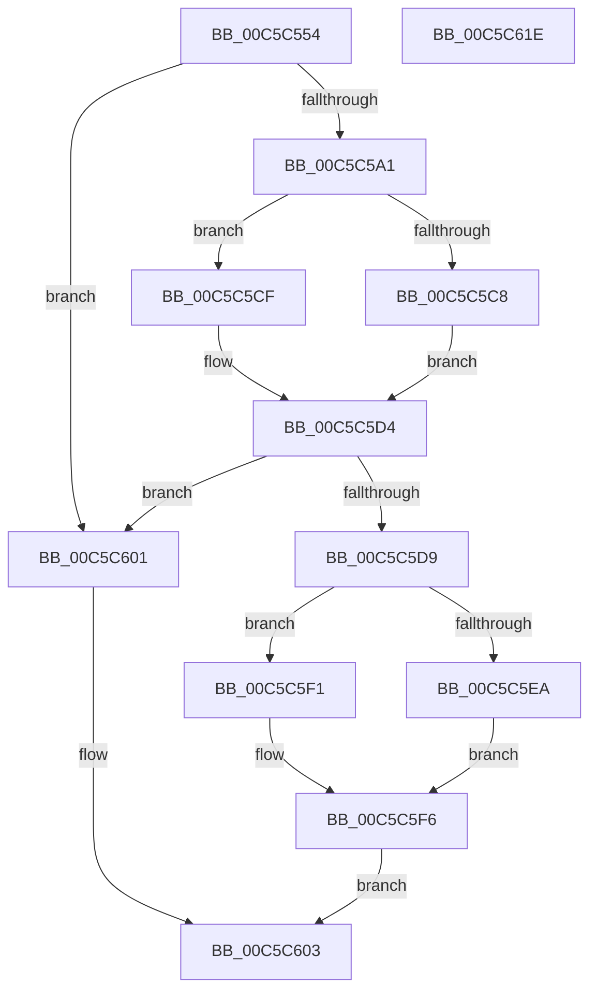

# CmpFindStateSepKeysRedirectionMapNode

- RVA: `0x00C5C554`–`0x00C5C61F` (길이 `203` bytes)
- VA: `0x0000000140C5C554`
- 실행 섹션: `INIT`
- PDB 이름 있음: `예`; PDB Function 태그: `아니요`
- unwind 정보 RVA: `0x00060130`
- 디코드: `56`개 명령, `203/203` bytes 표시
- 미해석 바이트: `0` (있으면 어셈블리에 `.byte`로 보존)

> 이 문서는 커널 이미지의 기계어와 PDB 기호를 분석해 생성했습니다. 4번과 5번은 함수 원형과 자료형을 바이너리 사용 방식에서 추정한 C 해석이며 원본 소스 복구 결과는 아닙니다.

## 1. Dependencies

- 직접 호출 지점: **6**; 고유 호출 대상: **6**
- 직접 호출자로 확인된 함수: **1**
- RIP 상대 이미지 참조: **2**

### Outgoing calls
- `0x00C5C598` → [CmpFindHiveSubKey](CmpFindHiveSubKey_function_00C5C398.md) (function, `0x00C5C398`)
- `0x00C5C5B0` → [CmpFindSubKeyByName](../../page/A4/CmpFindSubKeyByName_function_00A49D58.md) (function, `0x00A49D58`)
- `0x00C5C5C8` → [HvpReleaseCellFlat](../../page/85/HvpReleaseCellFlat_function_0085CC20.md) (function, `0x0085CC20`)
- `0x00C5C5CF` → [HvpReleaseCellPaged](../../page/85/HvpReleaseCellPaged_function_00855F40.md) (function, `0x00855F40`)
- `0x00C5C5EA` → [HvpGetCellFlat](../../page/85/HvpGetCellFlat_function_00854C60.md) (function, `0x00854C60`)
- `0x00C5C5F1` → [HvpGetCellPaged](../../page/85/HvpGetCellPaged_function_00854CB0.md) (function, `0x00854CB0`)

### Direct callers
- [CmpGetStateSepKeysRedirectionPathValue](CmpGetStateSepKeysRedirectionPathValue_function_00C5CA3C.md) at `0x00C5CA90`

### Static image references
- `0x00C5C591` → RVA `0x00C822F0` (`CmpStateSepRedirectionMapString`; read)
- `0x00C5C5A6` → RVA `0x00C82300` (`CmpKeysString`; read)

## 2. Other-region calls and transfers

- 다른 실행 섹션으로 향하는 call: **5**
  - `0x00C5C5B0` → [CmpFindSubKeyByName](../../page/A4/CmpFindSubKeyByName_function_00A49D58.md) (`INIT` → `PAGE`)
  - `0x00C5C5C8` → [HvpReleaseCellFlat](../../page/85/HvpReleaseCellFlat_function_0085CC20.md) (`INIT` → `PAGE`)
  - `0x00C5C5CF` → [HvpReleaseCellPaged](../../page/85/HvpReleaseCellPaged_function_00855F40.md) (`INIT` → `PAGE`)
  - `0x00C5C5EA` → [HvpGetCellFlat](../../page/85/HvpGetCellFlat_function_00854C60.md) (`INIT` → `PAGE`)
  - `0x00C5C5F1` → [HvpGetCellPaged](../../page/85/HvpGetCellPaged_function_00854CB0.md) (`INIT` → `PAGE`)
- 별도 외부 분기/꼬리 이동을 확인하지 못했습니다.

## 3. Assembly (complete function range)

```asm
00C5C554  48 8B C4                        mov rax, rsp
00C5C557  48 89 58 08                     mov qword ptr [rax + 8], rbx
00C5C55B  48 89 68 10                     mov qword ptr [rax + 0x10], rbp
00C5C55F  48 89 70 18                     mov qword ptr [rax + 0x18], rsi
00C5C563  48 89 78 20                     mov qword ptr [rax + 0x20], rdi
00C5C567  41 56                           push r14
00C5C569  48 83 EC 40                     sub rsp, 0x40
00C5C56D  83 48 E8 FF                     or dword ptr [rax - 0x18], 0xffffffff
00C5C571  48 8D 40 E8                     lea rax, [rax - 0x18]
00C5C575  33 ED                           xor ebp, ebp
00C5C577  48 89 44 24 20                  mov qword ptr [rsp + 0x20], rax
00C5C57C  48 89 68 08                     mov qword ptr [rax + 8], rbp
00C5C580  49 8B F1                        mov rsi, r9
00C5C583  89 68 04                        mov dword ptr [rax + 4], ebp
00C5C586  4C 8D 4C 24 38                  lea r9, [rsp + 0x38]
00C5C58B  4D 8B F0                        mov r14, r8
00C5C58E  48 8B D9                        mov rbx, rcx
00C5C591  4C 8D 05 58 5D 02 00            lea r8, [rip + 0x25d58]
00C5C598  E8 FB FD FF FF                  call 0x140c5c398
00C5C59D  84 C0                           test al, al
00C5C59F  74 60                           je 0x140c5c601
00C5C5A1  48 8B 54 24 38                  mov rdx, qword ptr [rsp + 0x38]
00C5C5A6  4C 8D 05 53 5D 02 00            lea r8, [rip + 0x25d53]
00C5C5AD  48 8B CB                        mov rcx, rbx
00C5C5B0  E8 A3 D7 DE FF                  call 0x140a49d58
00C5C5B5  F6 83 8C 00 00 00 01            test byte ptr [rbx + 0x8c], 1
00C5C5BC  48 8D 54 24 30                  lea rdx, [rsp + 0x30]
00C5C5C1  8B F8                           mov edi, eax
00C5C5C3  48 8B CB                        mov rcx, rbx
00C5C5C6  74 07                           je 0x140c5c5cf
00C5C5C8  E8 53 06 C0 FF                  call 0x14085cc20
00C5C5CD  EB 05                           jmp 0x140c5c5d4
00C5C5CF  E8 6C 99 BF FF                  call 0x140855f40
00C5C5D4  83 FF FF                        cmp edi, -1
00C5C5D7  74 28                           je 0x140c5c601
00C5C5D9  F6 83 8C 00 00 00 01            test byte ptr [rbx + 0x8c], 1
00C5C5E0  4C 8B C6                        mov r8, rsi
00C5C5E3  8B D7                           mov edx, edi
00C5C5E5  48 8B CB                        mov rcx, rbx
00C5C5E8  74 07                           je 0x140c5c5f1
00C5C5EA  E8 71 86 BF FF                  call 0x140854c60
00C5C5EF  EB 05                           jmp 0x140c5c5f6
00C5C5F1  E8 BA 86 BF FF                  call 0x140854cb0
00C5C5F6  48 85 C0                        test rax, rax
00C5C5F9  49 89 06                        mov qword ptr [r14], rax
00C5C5FC  0F 95 C0                        setne al
00C5C5FF  EB 02                           jmp 0x140c5c603
00C5C601  32 C0                           xor al, al
00C5C603  48 8B 5C 24 50                  mov rbx, qword ptr [rsp + 0x50]
00C5C608  48 8B 6C 24 58                  mov rbp, qword ptr [rsp + 0x58]
00C5C60D  48 8B 74 24 60                  mov rsi, qword ptr [rsp + 0x60]
00C5C612  48 8B 7C 24 68                  mov rdi, qword ptr [rsp + 0x68]
00C5C617  48 83 C4 40                     add rsp, 0x40
00C5C61B  41 5E                           pop r14
00C5C61D  C3                              ret
00C5C61E  CC                              int3
```

## 4. C-style interpretation (structured pseudocode)

```c
__int64 __fastcall CmpFindStateSepKeysRedirectionMapNode(__int64 a1, __int64 a2, __int64 a3, __int64 a4)
{
    __int64 result;
    __int64 v_rbp;
    __int64 v_rsp;
    unsigned __int64 v_stack_m10;
    unsigned __int64 v_stack_m18;
    unsigned __int64 v_stack_m28;
    unsigned __int64 v_stack_p10;
    unsigned __int64 v_stack_p18;
    unsigned __int64 v_stack_p20;
    unsigned __int64 v_stack_p8;

    *(unsigned __int64 *)(v_rsp + 8) = v_rbx;
    *(unsigned __int64 *)(v_rsp + 16) = v_rbp;
    *(unsigned __int64 *)(v_rsp + 24) = v_rsi;
    *(unsigned __int64 *)(v_rsp + 32) = v_rdi;
    v_rsp = (v_rsp) - (64);
    v_rbp = 0;
    v_stack_m28 = v_rsp - 24;
    *(unsigned __int64 *)(v_rsp - 24 + 8) = 0;
    *(unsigned int *)(v_rsp - 24 + 4) = 0;
    result = CmpFindHiveSubKey(a1, a2, v_rip + 154968, v_stack_m10);
    if ((unsigned __int8)(result) == 0) goto loc_00C5C601;
    result = CmpFindSubKeyByName(a1, v_stack_m10, v_rip + 154963, v_stack_m10);
    if (((*(unsigned __int8 *)(a1 + 140)) & (1)) == 0) goto loc_00C5C5CF;
    result = HvpReleaseCellFlat(a1, v_stack_m18, v_rip + 154963, v_stack_m10);
    goto loc_00C5C5D4;
loc_00C5C5CF:
    result = HvpReleaseCellPaged(a1, v_stack_m18, v_rip + 154963, v_stack_m10);
loc_00C5C5D4:
    if (((unsigned int)((unsigned int)((unsigned int)(result)))) == -1) goto loc_00C5C601;
    if (((*(unsigned __int8 *)(a1 + 140)) & (1)) == 0) goto loc_00C5C5F1;
    result = HvpGetCellFlat(a1, (unsigned int)((unsigned int)((unsigned int)((unsigned int)(result)))), a4, v_stack_m10);
    goto loc_00C5C5F6;
loc_00C5C5F1:
    result = HvpGetCellPaged(a1, (unsigned int)((unsigned int)((unsigned int)((unsigned int)(result)))), a4, v_stack_m10);
loc_00C5C5F6:
    *(unsigned __int64 *)(a3) = result;
    result = (result != 0) ? 1 : 0;
    goto loc_00C5C603;
loc_00C5C601:
    result = 0;
loc_00C5C603:
    v_rsp = (v_rsp) + (64);
    return result;
}
```

## 5. (Beta) C Style

```c
int64_t CmpFindStateSepKeysRedirectionMapNode(void *Arg1, int64_t Arg2, void *Arg3, int64_t Arg4)
{
    uint8_t *arg1 = (uint8_t *)Arg1;
    uint8_t *arg3 = (uint8_t *)Arg3;

    int64_t result;
    int64_t local_rbp;
    int64_t local_rsp;
    uint64_t v_stack_m10;
    uint64_t v_stack_m18;
    uint64_t v_stack_m28;
    uint64_t v_stack_p10;
    uint64_t v_stack_p18;
    uint64_t v_stack_p20;
    uint64_t v_stack_p8;

    *(uint64_t *)(local_rsp + 0x8) = local_rbx;
    *(uint64_t *)(local_rsp + 0x10) = local_rbp;
    *(uint64_t *)(local_rsp + 0x18) = local_rsi;
    *(uint64_t *)(local_rsp + 0x20) = local_rdi;
    local_rsp = (local_rsp) - (64);
    local_rbp = 0;
    v_stack_m28 = local_rsp - 24;
    *(uint64_t *)(local_rsp - 0x18 + 0x8) = 0;
    *(uint32_t *)(local_rsp - 0x18 + 0x4) = 0;
    result = CmpFindHiveSubKey(Arg1, Arg2, v_rip + 154968, v_stack_m10);
    if ((uint8_t)(result) == 0) goto loc_00C5C601;
    result = CmpFindSubKeyByName(Arg1, v_stack_m10, v_rip + 154963, v_stack_m10);
    if (((*(uint8_t *)(arg1 + 0x8C)) & (1)) == 0) goto loc_00C5C5CF;
    result = HvpReleaseCellFlat(Arg1, v_stack_m18, v_rip + 154963, v_stack_m10);
    goto loc_00C5C5D4;
loc_00C5C5CF:
    result = HvpReleaseCellPaged(Arg1, v_stack_m18, v_rip + 154963, v_stack_m10);
loc_00C5C5D4:
    if (((uint32_t)((uint32_t)((uint32_t)(result)))) == -1) goto loc_00C5C601;
    if (((*(uint8_t *)(arg1 + 0x8C)) & (1)) == 0) goto loc_00C5C5F1;
    result = HvpGetCellFlat(Arg1, (uint32_t)((uint32_t)((uint32_t)((uint32_t)(result)))), Arg4, v_stack_m10);
    goto loc_00C5C5F6;
loc_00C5C5F1:
    result = HvpGetCellPaged(Arg1, (uint32_t)((uint32_t)((uint32_t)((uint32_t)(result)))), Arg4, v_stack_m10);
loc_00C5C5F6:
    *(uint64_t *)(arg3) = result;
    result = (result != 0) ? 1 : 0;
    goto loc_00C5C603;
loc_00C5C601:
    result = 0;
loc_00C5C603:
    local_rsp = (local_rsp) + (64);
    return result;
}
```

### 관측된 메모리 오프셋

구조체 형식이 확인되지 않은 접근은 인자 기준의 오프셋으로만 기록했습니다.

| 기준 인자 | 오프셋 표현 | 폭 (bit) | 접근 |
|---|---:|---:|---|
| `Arg1` | `+ 0x8C` | `8` | `R` |
| `Arg3` | `+ 0x0` | `64` | `W` |

## 6. Execution-region graph

[열기: 2D/3D 그래프와 함수 탐색 컨트롤 패널](../../../control-panel.html?section=init&rva=0x00C5C554&view=graph)

- 2D 그래프는 위에서 아래로 흐르고, 3D 그래프는 빈 공간을 드래그해 회전합니다. Shift+드래그는 이동, 휠은 확대·축소, 함수 노드 선택은 대상 보고서 이동입니다.

### Static fallback


