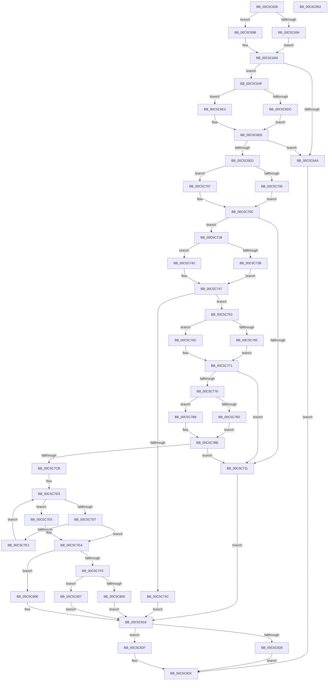

# CmpFindTagIndex

- RVA: `0x00C5C628`–`0x00C5C853` (길이 `555` bytes)
- VA: `0x0000000140C5C628`
- 실행 섹션: `INIT`
- PDB 이름 있음: `예`; PDB Function 태그: `아니요`
- unwind 정보 RVA: `0x000D71F0`
- 디코드: `158`개 명령, `555/555` bytes 표시
- 미해석 바이트: `0` (있으면 어셈블리에 `.byte`로 보존)

> 이 문서는 커널 이미지의 기계어와 PDB 기호를 분석해 생성했습니다. 4번과 5번은 함수 원형과 자료형을 바이너리 사용 방식에서 추정한 C 해석이며 원본 소스 복구 결과는 아닙니다.

## 1. Dependencies

- 직접 호출 지점: **20**; 고유 호출 대상: **8**
- 직접 호출자로 확인된 함수: **1**
- RIP 상대 이미지 참조: **0**

### Outgoing calls
- `0x00C5C694` → [HvpGetCellFlat](../../page/85/HvpGetCellFlat_function_00854C60.md) (function, `0x00854C60`)
- `0x00C5C69B` → [HvpGetCellPaged](../../page/85/HvpGetCellPaged_function_00854CB0.md) (function, `0x00854CB0`)
- `0x00C5C6C4` → [CmpValueToData](../../page/7F/CmpValueToData_function_007F3934.md) (function, `0x007F3934`)
- `0x00C5C6DC` → [HvpReleaseCellFlat](../../page/85/HvpReleaseCellFlat_function_0085CC20.md) (function, `0x0085CC20`)
- `0x00C5C6E3` → [HvpReleaseCellPaged](../../page/85/HvpReleaseCellPaged_function_00855F40.md) (function, `0x00855F40`)
- `0x00C5C700` → [HvpGetCellFlat](../../page/85/HvpGetCellFlat_function_00854C60.md) (function, `0x00854C60`)
- `0x00C5C707` → [HvpGetCellPaged](../../page/85/HvpGetCellPaged_function_00854CB0.md) (function, `0x00854CB0`)
- `0x00C5C724` → [CmpFindValueByName](../../page/84/CmpFindValueByName_function_00844E1C.md) (function, `0x00844E1C`)
- `0x00C5C73B` → [HvpReleaseCellFlat](../../page/85/HvpReleaseCellFlat_function_0085CC20.md) (function, `0x0085CC20`)
- `0x00C5C742` → [HvpReleaseCellPaged](../../page/85/HvpReleaseCellPaged_function_00855F40.md) (function, `0x00855F40`)
- `0x00C5C765` → [HvpGetCellFlat](../../page/85/HvpGetCellFlat_function_00854C60.md) (function, `0x00854C60`)
- `0x00C5C76C` → [HvpGetCellPaged](../../page/85/HvpGetCellPaged_function_00854CB0.md) (function, `0x00854CB0`)
- `0x00C5C79D` → [CmpGetValueData](../../page/85/CmpGetValueData_function_00856DB0.md) (function, `0x00856DB0`)
- `0x00C5C7B2` → [HvpReleaseCellFlat](../../page/85/HvpReleaseCellFlat_function_0085CC20.md) (function, `0x0085CC20`)
- `0x00C5C7B9` → [HvpReleaseCellPaged](../../page/85/HvpReleaseCellPaged_function_00855F40.md) (function, `0x00855F40`)
- `0x00C5C800` → [HvpReleaseCellFlat](../../page/85/HvpReleaseCellFlat_function_0085CC20.md) (function, `0x0085CC20`)
- `0x00C5C807` → [HvpReleaseCellPaged](../../page/85/HvpReleaseCellPaged_function_00855F40.md) (function, `0x00855F40`)
- `0x00C5C813` → [ExFreePoolWithTag](../../poolcode/B8/ExFreePoolWithTag_function_00B82870.md) (function, `0x00B82870`)
- `0x00C5C828` → [HvpReleaseCellFlat](../../page/85/HvpReleaseCellFlat_function_0085CC20.md) (function, `0x0085CC20`)
- `0x00C5C82F` → [HvpReleaseCellPaged](../../page/85/HvpReleaseCellPaged_function_00855F40.md) (function, `0x00855F40`)

### Direct callers
- [CmpAddDriverToList](CmpAddDriverToList_function_00C5B758.md) at `0x00C5BE26`

### Static image references
- 디코드된 RIP-relative 메모리 참조가 없습니다.

## 2. Other-region calls and transfers

- 다른 실행 섹션으로 향하는 call: **20**
  - `0x00C5C694` → [HvpGetCellFlat](../../page/85/HvpGetCellFlat_function_00854C60.md) (`INIT` → `PAGE`)
  - `0x00C5C69B` → [HvpGetCellPaged](../../page/85/HvpGetCellPaged_function_00854CB0.md) (`INIT` → `PAGE`)
  - `0x00C5C6C4` → [CmpValueToData](../../page/7F/CmpValueToData_function_007F3934.md) (`INIT` → `PAGE`)
  - `0x00C5C6DC` → [HvpReleaseCellFlat](../../page/85/HvpReleaseCellFlat_function_0085CC20.md) (`INIT` → `PAGE`)
  - `0x00C5C6E3` → [HvpReleaseCellPaged](../../page/85/HvpReleaseCellPaged_function_00855F40.md) (`INIT` → `PAGE`)
  - `0x00C5C700` → [HvpGetCellFlat](../../page/85/HvpGetCellFlat_function_00854C60.md) (`INIT` → `PAGE`)
  - `0x00C5C707` → [HvpGetCellPaged](../../page/85/HvpGetCellPaged_function_00854CB0.md) (`INIT` → `PAGE`)
  - `0x00C5C724` → [CmpFindValueByName](../../page/84/CmpFindValueByName_function_00844E1C.md) (`INIT` → `PAGE`)
  - `0x00C5C73B` → [HvpReleaseCellFlat](../../page/85/HvpReleaseCellFlat_function_0085CC20.md) (`INIT` → `PAGE`)
  - `0x00C5C742` → [HvpReleaseCellPaged](../../page/85/HvpReleaseCellPaged_function_00855F40.md) (`INIT` → `PAGE`)
  - `0x00C5C765` → [HvpGetCellFlat](../../page/85/HvpGetCellFlat_function_00854C60.md) (`INIT` → `PAGE`)
  - `0x00C5C76C` → [HvpGetCellPaged](../../page/85/HvpGetCellPaged_function_00854CB0.md) (`INIT` → `PAGE`)
  - `0x00C5C79D` → [CmpGetValueData](../../page/85/CmpGetValueData_function_00856DB0.md) (`INIT` → `PAGE`)
  - `0x00C5C7B2` → [HvpReleaseCellFlat](../../page/85/HvpReleaseCellFlat_function_0085CC20.md) (`INIT` → `PAGE`)
  - `0x00C5C7B9` → [HvpReleaseCellPaged](../../page/85/HvpReleaseCellPaged_function_00855F40.md) (`INIT` → `PAGE`)
  - `0x00C5C800` → [HvpReleaseCellFlat](../../page/85/HvpReleaseCellFlat_function_0085CC20.md) (`INIT` → `PAGE`)
  - `0x00C5C807` → [HvpReleaseCellPaged](../../page/85/HvpReleaseCellPaged_function_00855F40.md) (`INIT` → `PAGE`)
  - `0x00C5C813` → [ExFreePoolWithTag](../../poolcode/B8/ExFreePoolWithTag_function_00B82870.md) (`INIT` → `POOLCODE`)
  - `0x00C5C828` → [HvpReleaseCellFlat](../../page/85/HvpReleaseCellFlat_function_0085CC20.md) (`INIT` → `PAGE`)
  - `0x00C5C82F` → [HvpReleaseCellPaged](../../page/85/HvpReleaseCellPaged_function_00855F40.md) (`INIT` → `PAGE`)
- 별도 외부 분기/꼬리 이동을 확인하지 못했습니다.

## 3. Assembly (complete function range)

```asm
00C5C628  48 89 5C 24 10                  mov qword ptr [rsp + 0x10], rbx
00C5C62D  48 89 74 24 18                  mov qword ptr [rsp + 0x18], rsi
00C5C632  55                              push rbp
00C5C633  57                              push rdi
00C5C634  41 55                           push r13
00C5C636  41 56                           push r14
00C5C638  41 57                           push r15
00C5C63A  48 8B EC                        mov rbp, rsp
00C5C63D  48 81 EC 80 00 00 00            sub rsp, 0x80
00C5C644  45 33 ED                        xor r13d, r13d
00C5C647  48 8B F9                        mov rdi, rcx
00C5C64A  83 C9 FF                        or ecx, 0xffffffff
00C5C64D  44 89 6D EC                     mov dword ptr [rbp - 0x14], r13d
00C5C651  45 8B F0                        mov r14d, r8d
00C5C654  89 4D E8                        mov dword ptr [rbp - 0x18], ecx
00C5C657  89 4D C8                        mov dword ptr [rbp - 0x38], ecx
00C5C65A  4C 8D 45 C8                     lea r8, [rbp - 0x38]
00C5C65E  F6 87 8C 00 00 00 01            test byte ptr [rdi + 0x8c], 1
00C5C665  4D 8B F9                        mov r15, r9
00C5C668  89 4D D0                        mov dword ptr [rbp - 0x30], ecx
00C5C66B  8B DA                           mov ebx, edx
00C5C66D  89 4D E0                        mov dword ptr [rbp - 0x20], ecx
00C5C670  89 4D D8                        mov dword ptr [rbp - 0x28], ecx
00C5C673  48 8B CF                        mov rcx, rdi
00C5C676  44 89 6D CC                     mov dword ptr [rbp - 0x34], r13d
00C5C67A  44 89 6D D4                     mov dword ptr [rbp - 0x2c], r13d
00C5C67E  44 89 6D E4                     mov dword ptr [rbp - 0x1c], r13d
00C5C682  44 89 6D C0                     mov dword ptr [rbp - 0x40], r13d
00C5C686  44 89 6D DC                     mov dword ptr [rbp - 0x24], r13d
00C5C68A  44 88 6D 30                     mov byte ptr [rbp + 0x30], r13b
00C5C68E  4C 89 6D F0                     mov qword ptr [rbp - 0x10], r13
00C5C692  74 07                           je 0x140c5c69b
00C5C694  E8 C7 85 BF FF                  call 0x140854c60
00C5C699  EB 05                           jmp 0x140c5c6a0
00C5C69B  E8 10 86 BF FF                  call 0x140854cb0
00C5C6A0  48 85 C0                        test rax, rax
00C5C6A3  75 0A                           jne 0x140c5c6af
00C5C6A5  BB FE FF FF FF                  mov ebx, 0xfffffffe
00C5C6AA  E9 85 01 00 00                  jmp 0x140c5c834
00C5C6AF  48 8D 4D E8                     lea rcx, [rbp - 0x18]
00C5C6B3  4C 8B C0                        mov r8, rax
00C5C6B6  48 89 4C 24 20                  mov qword ptr [rsp + 0x20], rcx
00C5C6BB  4C 8D 4D C0                     lea r9, [rbp - 0x40]
00C5C6BF  48 8B CF                        mov rcx, rdi
00C5C6C2  8B D3                           mov edx, ebx
00C5C6C4  E8 6B 72 B9 FF                  call 0x1407f3934
00C5C6C9  F6 87 8C 00 00 00 01            test byte ptr [rdi + 0x8c], 1
00C5C6D0  48 8D 55 C8                     lea rdx, [rbp - 0x38]
00C5C6D4  48 8B F0                        mov rsi, rax
00C5C6D7  48 8B CF                        mov rcx, rdi
00C5C6DA  74 07                           je 0x140c5c6e3
00C5C6DC  E8 3F 05 C0 FF                  call 0x14085cc20
00C5C6E1  EB 05                           jmp 0x140c5c6e8
00C5C6E3  E8 58 98 BF FF                  call 0x140855f40
00C5C6E8  48 85 F6                        test rsi, rsi
00C5C6EB  74 B8                           je 0x140c5c6a5
00C5C6ED  F6 87 8C 00 00 00 01            test byte ptr [rdi + 0x8c], 1
00C5C6F4  4C 8D 45 D0                     lea r8, [rbp - 0x30]
00C5C6F8  41 8B D6                        mov edx, r14d
00C5C6FB  48 8B CF                        mov rcx, rdi
00C5C6FE  74 07                           je 0x140c5c707
00C5C700  E8 5B 85 BF FF                  call 0x140854c60
00C5C705  EB 05                           jmp 0x140c5c70c
00C5C707  E8 A4 85 BF FF                  call 0x140854cb0
00C5C70C  48 85 C0                        test rax, rax
00C5C70F  75 0A                           jne 0x140c5c71b
00C5C711  BB FE FF FF FF                  mov ebx, 0xfffffffe
00C5C716  E9 FD 00 00 00                  jmp 0x140c5c818
00C5C71B  4D 8B C7                        mov r8, r15
00C5C71E  48 8B D0                        mov rdx, rax
00C5C721  48 8B CF                        mov rcx, rdi
00C5C724  E8 F3 86 BE FF                  call 0x140844e1c
00C5C729  F6 87 8C 00 00 00 01            test byte ptr [rdi + 0x8c], 1
00C5C730  48 8D 55 D0                     lea rdx, [rbp - 0x30]
00C5C734  8B D8                           mov ebx, eax
00C5C736  48 8B CF                        mov rcx, rdi
00C5C739  74 07                           je 0x140c5c742
00C5C73B  E8 E0 04 C0 FF                  call 0x14085cc20
00C5C740  EB 05                           jmp 0x140c5c747
00C5C742  E8 F9 97 BF FF                  call 0x140855f40
00C5C747  83 FB FF                        cmp ebx, -1
00C5C74A  75 07                           jne 0x140c5c753
00C5C74C  8B 1E                           mov ebx, dword ptr [rsi]
00C5C74E  E9 C5 00 00 00                  jmp 0x140c5c818
00C5C753  F6 87 8C 00 00 00 01            test byte ptr [rdi + 0x8c], 1
00C5C75A  4C 8D 45 D8                     lea r8, [rbp - 0x28]
00C5C75E  8B D3                           mov edx, ebx
00C5C760  48 8B CF                        mov rcx, rdi
00C5C763  74 07                           je 0x140c5c76c
00C5C765  E8 F6 84 BF FF                  call 0x140854c60
00C5C76A  EB 05                           jmp 0x140c5c771
00C5C76C  E8 3F 85 BF FF                  call 0x140854cb0
00C5C771  48 85 C0                        test rax, rax
00C5C774  74 9B                           je 0x140c5c711
00C5C776  48 8D 4D E0                     lea rcx, [rbp - 0x20]
00C5C77A  4C 8B C0                        mov r8, rax
00C5C77D  48 89 4C 24 30                  mov qword ptr [rsp + 0x30], rcx
00C5C782  4C 8D 4D C0                     lea r9, [rbp - 0x40]
00C5C786  48 8D 4D 30                     lea rcx, [rbp + 0x30]
00C5C78A  8B D3                           mov edx, ebx
00C5C78C  48 89 4C 24 28                  mov qword ptr [rsp + 0x28], rcx
00C5C791  48 8D 4D F0                     lea rcx, [rbp - 0x10]
00C5C795  48 89 4C 24 20                  mov qword ptr [rsp + 0x20], rcx
00C5C79A  48 8B CF                        mov rcx, rdi
00C5C79D  E8 0E A6 BF FF                  call 0x140856db0
00C5C7A2  F6 87 8C 00 00 00 01            test byte ptr [rdi + 0x8c], 1
00C5C7A9  48 8D 55 D8                     lea rdx, [rbp - 0x28]
00C5C7AD  48 8B CF                        mov rcx, rdi
00C5C7B0  74 07                           je 0x140c5c7b9
00C5C7B2  E8 69 04 C0 FF                  call 0x14085cc20
00C5C7B7  EB 05                           jmp 0x140c5c7be
00C5C7B9  E8 82 97 BF FF                  call 0x140855f40
00C5C7BE  4C 8B 45 F0                     mov r8, qword ptr [rbp - 0x10]
00C5C7C2  4D 85 C0                        test r8, r8
00C5C7C5  0F 84 46 FF FF FF               je 0x140c5c711
00C5C7CB  41 8B 10                        mov edx, dword ptr [r8]
00C5C7CE  BB 01 00 00 00                  mov ebx, 1
00C5C7D3  3B DA                           cmp ebx, edx
00C5C7D5  77 0E                           ja 0x140c5c7e5
00C5C7D7  8B 06                           mov eax, dword ptr [rsi]
00C5C7D9  8B CB                           mov ecx, ebx
00C5C7DB  41 39 04 88                     cmp dword ptr [r8 + rcx*4], eax
00C5C7DF  74 09                           je 0x140c5c7ea
00C5C7E1  FF C3                           inc ebx
00C5C7E3  EB EE                           jmp 0x140c5c7d3
00C5C7E5  BB FE FF FF FF                  mov ebx, 0xfffffffe
00C5C7EA  44 38 6D 30                     cmp byte ptr [rbp + 0x30], r13b
00C5C7EE  75 1E                           jne 0x140c5c80e
00C5C7F0  F6 87 8C 00 00 00 01            test byte ptr [rdi + 0x8c], 1
00C5C7F7  48 8D 55 E0                     lea rdx, [rbp - 0x20]
00C5C7FB  48 8B CF                        mov rcx, rdi
00C5C7FE  74 07                           je 0x140c5c807
00C5C800  E8 1B 04 C0 FF                  call 0x14085cc20
00C5C805  EB 11                           jmp 0x140c5c818
00C5C807  E8 34 97 BF FF                  call 0x140855f40
00C5C80C  EB 0A                           jmp 0x140c5c818
00C5C80E  33 D2                           xor edx, edx
00C5C810  49 8B C8                        mov rcx, r8
00C5C813  E8 58 60 F2 FF                  call 0x140b82870
00C5C818  F6 87 8C 00 00 00 01            test byte ptr [rdi + 0x8c], 1
00C5C81F  48 8D 55 E8                     lea rdx, [rbp - 0x18]
00C5C823  48 8B CF                        mov rcx, rdi
00C5C826  74 07                           je 0x140c5c82f
00C5C828  E8 F3 03 C0 FF                  call 0x14085cc20
00C5C82D  EB 05                           jmp 0x140c5c834
00C5C82F  E8 0C 97 BF FF                  call 0x140855f40
00C5C834  4C 8D 9C 24 80 00 00 00         lea r11, [rsp + 0x80]
00C5C83C  8B C3                           mov eax, ebx
00C5C83E  49 8B 5B 38                     mov rbx, qword ptr [r11 + 0x38]
00C5C842  49 8B 73 40                     mov rsi, qword ptr [r11 + 0x40]
00C5C846  49 8B E3                        mov rsp, r11
00C5C849  41 5F                           pop r15
00C5C84B  41 5E                           pop r14
00C5C84D  41 5D                           pop r13
00C5C84F  5F                              pop rdi
00C5C850  5D                              pop rbp
00C5C851  C3                              ret
00C5C852  CC                              int3
```

## 4. C-style interpretation (structured pseudocode)

```c
__int64 __fastcall CmpFindTagIndex(__int64 a1, int a2, int a3, __int64 a4)
{
    __int64 result;
    __int64 v_r13;
    __int64 v_rbx;
    __int64 v_rsp;
    unsigned __int64 v_stack_m28;
    unsigned __int64 v_stack_m38;
    unsigned int v_stack_m3C;
    unsigned int v_stack_m40;
    unsigned int v_stack_m44;
    unsigned int v_stack_m48;
    unsigned int v_stack_m4C;
    unsigned int v_stack_m50;
    unsigned int v_stack_m54;
    unsigned int v_stack_m58;
    unsigned int v_stack_m5C;
    unsigned int v_stack_m60;
    unsigned int v_stack_m68;
    unsigned __int64 v_stack_m78;
    unsigned __int64 v_stack_m80;
    unsigned __int64 v_stack_m88;
    unsigned __int64 v_stack_p10;
    unsigned __int64 v_stack_p18;
    unsigned __int8 v_stack_p8;

    v_stack_p10 = v_rbx;
    v_stack_p18 = v_rsi;
    v_rsp = (v_rsp) - (128);
    v_r13 = 0;
    a1 = (unsigned int)((a1) | (0xFFFFFFFFULL));
    v_stack_m3C = 0;
    v_stack_m40 = (unsigned int)(a1);
    v_stack_m60 = (unsigned int)(a1);
    v_stack_m58 = (unsigned int)(a1);
    v_stack_m48 = (unsigned int)(a1);
    v_stack_m50 = (unsigned int)(a1);
    v_stack_m5C = 0;
    v_stack_m54 = 0;
    v_stack_m44 = 0;
    v_stack_m68 = 0;
    v_stack_m4C = 0;
    v_stack_p8 = 0;
    v_stack_m38 = 0;
    if (((*(unsigned __int8 *)(a1 + 140)) & (1)) == 0) goto loc_00C5C69B;
    result = HvpGetCellFlat(a1, a2, v_stack_m60, a4);
    goto loc_00C5C6A0;
loc_00C5C69B:
    result = HvpGetCellPaged(a1, a2, v_stack_m60, a4);
loc_00C5C6A0:
    if (result != 0) goto loc_00C5C6AF;
loc_00C5C6A5:
    goto loc_00C5C834;
loc_00C5C6AF:
    v_stack_m88 = v_stack_m40;
    result = CmpValueToData(a1, (unsigned int)((unsigned int)((unsigned int)(0xFFFFFFFEULL))), result, v_stack_m68);
    if (((*(unsigned __int8 *)(a1 + 140)) & (1)) == 0) goto loc_00C5C6E3;
    result = HvpReleaseCellFlat(a1, v_stack_m60, result, v_stack_m68);
    goto loc_00C5C6E8;
loc_00C5C6E3:
    result = HvpReleaseCellPaged(a1, v_stack_m60, result, v_stack_m68);
loc_00C5C6E8:
    if (result == 0) goto loc_00C5C6A5;
    if (((*(unsigned __int8 *)(a1 + 140)) & (1)) == 0) goto loc_00C5C707;
    result = HvpGetCellFlat(a1, (unsigned int)((unsigned int)((unsigned int)(a3))), v_stack_m58, v_stack_m68);
    goto loc_00C5C70C;
loc_00C5C707:
    result = HvpGetCellPaged(a1, (unsigned int)((unsigned int)((unsigned int)(a3))), v_stack_m58, v_stack_m68);
loc_00C5C70C:
    if (result != 0) goto loc_00C5C71B;
loc_00C5C711:
    goto loc_00C5C818;
loc_00C5C71B:
    result = CmpFindValueByName(a1, result, a4, v_stack_m68);
    if (((*(unsigned __int8 *)(a1 + 140)) & (1)) == 0) goto loc_00C5C742;
    result = HvpReleaseCellFlat(a1, v_stack_m58, a4, v_stack_m68);
    goto loc_00C5C747;
loc_00C5C742:
    result = HvpReleaseCellPaged(a1, v_stack_m58, a4, v_stack_m68);
loc_00C5C747:
    if (((unsigned int)((unsigned int)((unsigned int)(result)))) != -1) goto loc_00C5C753;
    goto loc_00C5C818;
loc_00C5C753:
    if (((*(unsigned __int8 *)(a1 + 140)) & (1)) == 0) goto loc_00C5C76C;
    result = HvpGetCellFlat(a1, (unsigned int)((unsigned int)((unsigned int)(*(unsigned int *)(result)))), v_stack_m50, v_stack_m68);
    goto loc_00C5C771;
loc_00C5C76C:
    result = HvpGetCellPaged(a1, (unsigned int)((unsigned int)((unsigned int)(*(unsigned int *)(result)))), v_stack_m50, v_stack_m68);
loc_00C5C771:
    if (result == 0) goto loc_00C5C711;
    v_stack_m78 = v_stack_m48;
    v_stack_m80 = v_stack_p8;
    v_stack_m88 = v_stack_m38;
    result = CmpGetValueData(a1, (unsigned int)((unsigned int)((unsigned int)(*(unsigned int *)(result)))), result, v_stack_m68);
    if (((*(unsigned __int8 *)(a1 + 140)) & (1)) == 0) goto loc_00C5C7B9;
    result = HvpReleaseCellFlat(a1, v_stack_m50, result, v_stack_m68);
    goto loc_00C5C7BE;
loc_00C5C7B9:
    result = HvpReleaseCellPaged(a1, v_stack_m50, result, v_stack_m68);
loc_00C5C7BE:
    if (v_stack_m38 == 0) goto loc_00C5C711;
loc_00C5C7D3:
    if (1 > ((unsigned int)((unsigned int)(*(unsigned int *)(v_stack_m38))))) goto loc_00C5C7E5;
    if ((*(unsigned int *)(v_stack_m38 + 1 * 4)) == ((unsigned int)((unsigned int)(*(unsigned int *)(result))))) goto loc_00C5C7EA;
    v_rbx = (unsigned int)((1) + 1);
    goto loc_00C5C7D3;
loc_00C5C7E5:
loc_00C5C7EA:
    if (v_stack_p8 != 0) goto loc_00C5C80E;
    if (((*(unsigned __int8 *)(a1 + 140)) & (1)) == 0) goto loc_00C5C807;
    result = HvpReleaseCellFlat(a1, v_stack_m48, v_stack_m38, v_stack_m68);
    goto loc_00C5C818;
loc_00C5C807:
    result = HvpReleaseCellPaged(a1, v_stack_m48, v_stack_m38, v_stack_m68);
    goto loc_00C5C818;
loc_00C5C80E:
    a2 = 0;
    result = ExFreePoolWithTag(v_stack_m38, a2, v_stack_m38, v_stack_m68);
loc_00C5C818:
    if (((*(unsigned __int8 *)(a1 + 140)) & (1)) == 0) goto loc_00C5C82F;
    result = HvpReleaseCellFlat(a1, v_stack_m40, v_stack_m38, v_stack_m68);
    goto loc_00C5C834;
loc_00C5C82F:
    result = HvpReleaseCellPaged(a1, v_stack_m40, v_stack_m38, v_stack_m68);
loc_00C5C834:
    return (unsigned int)((unsigned int)((unsigned int)(0xFFFFFFFEULL)));
}
```

## 5. (Beta) C Style

```c
int64_t CmpFindTagIndex(void *Arg1, int32_t Arg2, int32_t Arg3, int64_t Arg4)
{
    uint8_t *arg1 = (uint8_t *)Arg1;

    int64_t result;
    int64_t local_r13;
    int64_t local_rbx;
    int64_t local_rsp;
    uint64_t v_stack_m28;
    uint64_t v_stack_m38;
    uint32_t v_stack_m3C;
    uint32_t v_stack_m40;
    uint32_t v_stack_m44;
    uint32_t v_stack_m48;
    uint32_t v_stack_m4C;
    uint32_t v_stack_m50;
    uint32_t v_stack_m54;
    uint32_t v_stack_m58;
    uint32_t v_stack_m5C;
    uint32_t v_stack_m60;
    uint32_t v_stack_m68;
    uint64_t v_stack_m78;
    uint64_t v_stack_m80;
    uint64_t v_stack_m88;
    uint64_t v_stack_p10;
    uint64_t v_stack_p18;
    uint8_t v_stack_p8;

    v_stack_p10 = local_rbx;
    v_stack_p18 = local_rsi;
    local_rsp = (local_rsp) - (128);
    local_r13 = 0;
    Arg1 = (uint32_t)((Arg1) | (0xFFFFFFFFULL));
    v_stack_m3C = 0;
    v_stack_m40 = (uint32_t)(Arg1);
    v_stack_m60 = (uint32_t)(Arg1);
    v_stack_m58 = (uint32_t)(Arg1);
    v_stack_m48 = (uint32_t)(Arg1);
    v_stack_m50 = (uint32_t)(Arg1);
    v_stack_m5C = 0;
    v_stack_m54 = 0;
    v_stack_m44 = 0;
    v_stack_m68 = 0;
    v_stack_m4C = 0;
    v_stack_p8 = 0;
    v_stack_m38 = 0;
    if (((*(uint8_t *)(arg1 + 0x8C)) & (1)) == 0) goto loc_00C5C69B;
    result = HvpGetCellFlat(Arg1, Arg2, v_stack_m60, Arg4);
    goto loc_00C5C6A0;
loc_00C5C69B:
    result = HvpGetCellPaged(Arg1, Arg2, v_stack_m60, Arg4);
loc_00C5C6A0:
    if (result != 0) goto loc_00C5C6AF;
loc_00C5C6A5:
    goto loc_00C5C834;
loc_00C5C6AF:
    v_stack_m88 = v_stack_m40;
    result = CmpValueToData(Arg1, (uint32_t)((uint32_t)((uint32_t)(0xFFFFFFFEULL))), result, v_stack_m68);
    if (((*(uint8_t *)(arg1 + 0x8C)) & (1)) == 0) goto loc_00C5C6E3;
    result = HvpReleaseCellFlat(Arg1, v_stack_m60, result, v_stack_m68);
    goto loc_00C5C6E8;
loc_00C5C6E3:
    result = HvpReleaseCellPaged(Arg1, v_stack_m60, result, v_stack_m68);
loc_00C5C6E8:
    if (result == 0) goto loc_00C5C6A5;
    if (((*(uint8_t *)(arg1 + 0x8C)) & (1)) == 0) goto loc_00C5C707;
    result = HvpGetCellFlat(Arg1, (uint32_t)((uint32_t)((uint32_t)(Arg3))), v_stack_m58, v_stack_m68);
    goto loc_00C5C70C;
loc_00C5C707:
    result = HvpGetCellPaged(Arg1, (uint32_t)((uint32_t)((uint32_t)(Arg3))), v_stack_m58, v_stack_m68);
loc_00C5C70C:
    if (result != 0) goto loc_00C5C71B;
loc_00C5C711:
    goto loc_00C5C818;
loc_00C5C71B:
    result = CmpFindValueByName(Arg1, result, Arg4, v_stack_m68);
    if (((*(uint8_t *)(arg1 + 0x8C)) & (1)) == 0) goto loc_00C5C742;
    result = HvpReleaseCellFlat(Arg1, v_stack_m58, Arg4, v_stack_m68);
    goto loc_00C5C747;
loc_00C5C742:
    result = HvpReleaseCellPaged(Arg1, v_stack_m58, Arg4, v_stack_m68);
loc_00C5C747:
    if (((uint32_t)((uint32_t)((uint32_t)(result)))) != -1) goto loc_00C5C753;
    goto loc_00C5C818;
loc_00C5C753:
    if (((*(uint8_t *)(arg1 + 0x8C)) & (1)) == 0) goto loc_00C5C76C;
    result = HvpGetCellFlat(Arg1, (uint32_t)((uint32_t)((uint32_t)(*(uint32_t *)(result)))), v_stack_m50, v_stack_m68);
    goto loc_00C5C771;
loc_00C5C76C:
    result = HvpGetCellPaged(Arg1, (uint32_t)((uint32_t)((uint32_t)(*(uint32_t *)(result)))), v_stack_m50, v_stack_m68);
loc_00C5C771:
    if (result == 0) goto loc_00C5C711;
    v_stack_m78 = v_stack_m48;
    v_stack_m80 = v_stack_p8;
    v_stack_m88 = v_stack_m38;
    result = CmpGetValueData(Arg1, (uint32_t)((uint32_t)((uint32_t)(*(uint32_t *)(result)))), result, v_stack_m68);
    if (((*(uint8_t *)(arg1 + 0x8C)) & (1)) == 0) goto loc_00C5C7B9;
    result = HvpReleaseCellFlat(Arg1, v_stack_m50, result, v_stack_m68);
    goto loc_00C5C7BE;
loc_00C5C7B9:
    result = HvpReleaseCellPaged(Arg1, v_stack_m50, result, v_stack_m68);
loc_00C5C7BE:
    if (v_stack_m38 == 0) goto loc_00C5C711;
loc_00C5C7D3:
    if (1 > ((uint32_t)((uint32_t)(*(uint32_t *)(v_stack_m38))))) goto loc_00C5C7E5;
    if ((*(uint32_t *)(v_stack_m38 + 0x1 * 4)) == ((uint32_t)((uint32_t)(*(uint32_t *)(result))))) goto loc_00C5C7EA;
    local_rbx = (uint32_t)((1) + 1);
    goto loc_00C5C7D3;
loc_00C5C7E5:
loc_00C5C7EA:
    if (v_stack_p8 != 0) goto loc_00C5C80E;
    if (((*(uint8_t *)(arg1 + 0x8C)) & (1)) == 0) goto loc_00C5C807;
    result = HvpReleaseCellFlat(Arg1, v_stack_m48, v_stack_m38, v_stack_m68);
    goto loc_00C5C818;
loc_00C5C807:
    result = HvpReleaseCellPaged(Arg1, v_stack_m48, v_stack_m38, v_stack_m68);
    goto loc_00C5C818;
loc_00C5C80E:
    Arg2 = 0;
    result = ExFreePoolWithTag(v_stack_m38, Arg2, v_stack_m38, v_stack_m68);
loc_00C5C818:
    if (((*(uint8_t *)(arg1 + 0x8C)) & (1)) == 0) goto loc_00C5C82F;
    result = HvpReleaseCellFlat(Arg1, v_stack_m40, v_stack_m38, v_stack_m68);
    goto loc_00C5C834;
loc_00C5C82F:
    result = HvpReleaseCellPaged(Arg1, v_stack_m40, v_stack_m38, v_stack_m68);
loc_00C5C834:
    return (uint32_t)((uint32_t)((uint32_t)(0xFFFFFFFEULL)));
}
```

### 관측된 메모리 오프셋

구조체 형식이 확인되지 않은 접근은 인자 기준의 오프셋으로만 기록했습니다.

| 기준 인자 | 오프셋 표현 | 폭 (bit) | 접근 |
|---|---:|---:|---|
| `Arg1` | `+ 0x8C` | `8` | `R` |

## 6. Execution-region graph

[열기: 2D/3D 그래프와 함수 탐색 컨트롤 패널](../../../control-panel.html?section=init&rva=0x00C5C628&view=graph)

- 2D 그래프는 위에서 아래로 흐르고, 3D 그래프는 빈 공간을 드래그해 회전합니다. Shift+드래그는 이동, 휠은 확대·축소, 함수 노드 선택은 대상 보고서 이동입니다.

### Static fallback


