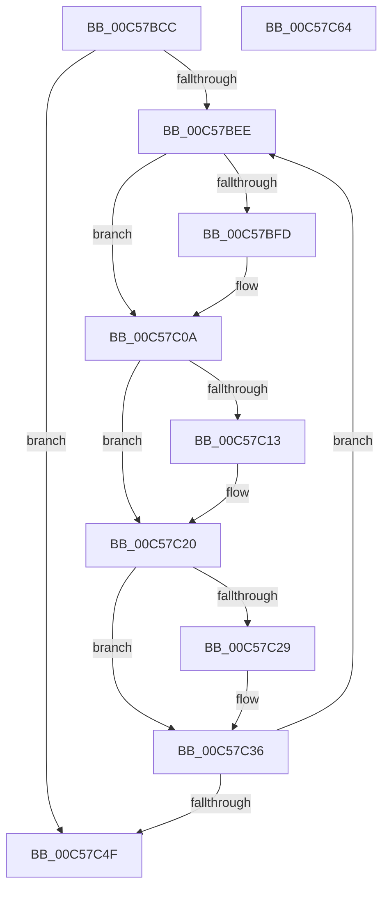

# CmpFreeDriverList

- RVA: `0x00C57BCC`–`0x00C57C65` (길이 `153` bytes)
- VA: `0x0000000140C57BCC`
- 실행 섹션: `INIT`
- PDB 이름 있음: `예`; PDB Function 태그: `아니요`
- unwind 정보 RVA: `0x0005C954`
- 디코드: `43`개 명령, `153/153` bytes 표시
- 미해석 바이트: `0` (있으면 어셈블리에 `.byte`로 보존)

> 이 문서는 커널 이미지의 기계어와 PDB 기호를 분석해 생성했습니다. 4번과 5번은 함수 원형과 자료형을 바이너리 사용 방식에서 추정한 C 해석이며 원본 소스 복구 결과는 아닙니다.

## 1. Dependencies

- 직접 호출 지점: **4**; 고유 호출 대상: **1**
- 직접 호출자로 확인된 함수: **1**
- RIP 상대 이미지 참조: **0**

### Outgoing calls
- `0x00C57C05` → [guard_dispatch_icall](../../text/6B/guard_dispatch_icall_function_006BAAD0.md) (function, `0x006BAAD0`)
- `0x00C57C1B` → [guard_dispatch_icall](../../text/6B/guard_dispatch_icall_function_006BAAD0.md) (function, `0x006BAAD0`)
- `0x00C57C31` → [guard_dispatch_icall](../../text/6B/guard_dispatch_icall_function_006BAAD0.md) (function, `0x006BAAD0`)
- `0x00C57C42` → [guard_dispatch_icall](../../text/6B/guard_dispatch_icall_function_006BAAD0.md) (function, `0x006BAAD0`)

### Direct callers
- [CmGetSystemDriverList](../C7/CmGetSystemDriverList_function_00C7380C.md) at `0x00C73C8D`

### Static image references
- 디코드된 RIP-relative 메모리 참조가 없습니다.

## 2. Other-region calls and transfers

- 다른 실행 섹션으로 향하는 call: **4**
  - `0x00C57C05` → [guard_dispatch_icall](../../text/6B/guard_dispatch_icall_function_006BAAD0.md) (`INIT` → `.text`)
  - `0x00C57C1B` → [guard_dispatch_icall](../../text/6B/guard_dispatch_icall_function_006BAAD0.md) (`INIT` → `.text`)
  - `0x00C57C31` → [guard_dispatch_icall](../../text/6B/guard_dispatch_icall_function_006BAAD0.md) (`INIT` → `.text`)
  - `0x00C57C42` → [guard_dispatch_icall](../../text/6B/guard_dispatch_icall_function_006BAAD0.md) (`INIT` → `.text`)
- 별도 외부 분기/꼬리 이동을 확인하지 못했습니다.

## 3. Assembly (complete function range)

```asm
00C57BCC  48 89 5C 24 08                  mov qword ptr [rsp + 8], rbx
00C57BD1  48 89 6C 24 10                  mov qword ptr [rsp + 0x10], rbp
00C57BD6  48 89 74 24 18                  mov qword ptr [rsp + 0x18], rsi
00C57BDB  57                              push rdi
00C57BDC  48 83 EC 20                     sub rsp, 0x20
00C57BE0  48 8B 1A                        mov rbx, qword ptr [rdx]
00C57BE3  48 8B FA                        mov rdi, rdx
00C57BE6  48 8B F1                        mov rsi, rcx
00C57BE9  48 3B DA                        cmp rbx, rdx
00C57BEC  74 61                           je 0x140c57c4f
00C57BEE  48 8B 8B 80 00 00 00            mov rcx, qword ptr [rbx + 0x80]
00C57BF5  48 8B 2B                        mov rbp, qword ptr [rbx]
00C57BF8  48 85 C9                        test rcx, rcx
00C57BFB  74 0D                           je 0x140c57c0a
00C57BFD  0F B7 53 78                     movzx edx, word ptr [rbx + 0x78]
00C57C01  48 8B 46 20                     mov rax, qword ptr [rsi + 0x20]
00C57C05  E8 C6 2E A6 FF                  call 0x1406baad0
00C57C0A  48 8B 4B 28                     mov rcx, qword ptr [rbx + 0x28]
00C57C0E  48 85 C9                        test rcx, rcx
00C57C11  74 0D                           je 0x140c57c20
00C57C13  0F B7 53 22                     movzx edx, word ptr [rbx + 0x22]
00C57C17  48 8B 46 20                     mov rax, qword ptr [rsi + 0x20]
00C57C1B  E8 B0 2E A6 FF                  call 0x1406baad0
00C57C20  48 8B 4B 18                     mov rcx, qword ptr [rbx + 0x18]
00C57C24  48 85 C9                        test rcx, rcx
00C57C27  74 0D                           je 0x140c57c36
00C57C29  0F B7 53 12                     movzx edx, word ptr [rbx + 0x12]
00C57C2D  48 8B 46 20                     mov rax, qword ptr [rsi + 0x20]
00C57C31  E8 9A 2E A6 FF                  call 0x1406baad0
00C57C36  48 8B 46 20                     mov rax, qword ptr [rsi + 0x20]
00C57C3A  BA 90 00 00 00                  mov edx, 0x90
00C57C3F  48 8B CB                        mov rcx, rbx
00C57C42  E8 89 2E A6 FF                  call 0x1406baad0
00C57C47  48 8B DD                        mov rbx, rbp
00C57C4A  48 3B EF                        cmp rbp, rdi
00C57C4D  75 9F                           jne 0x140c57bee
00C57C4F  48 8B 5C 24 30                  mov rbx, qword ptr [rsp + 0x30]
00C57C54  48 8B 6C 24 38                  mov rbp, qword ptr [rsp + 0x38]
00C57C59  48 8B 74 24 40                  mov rsi, qword ptr [rsp + 0x40]
00C57C5E  48 83 C4 20                     add rsp, 0x20
00C57C62  5F                              pop rdi
00C57C63  C3                              ret
00C57C64  CC                              int3
```

## 4. C-style interpretation (structured pseudocode)

```c
__int64 __fastcall CmpFreeDriverList(__int64 a1, __int64 a2)
{
    __int64 result;
    __int64 v_rsp;
    unsigned __int64 v_stack_p10;
    unsigned __int64 v_stack_p18;
    unsigned __int64 v_stack_p8;

    v_stack_p8 = v_rbx;
    v_stack_p10 = v_rbp;
    v_stack_p18 = v_rsi;
    v_rsp = (v_rsp) - (32);
    if ((*(unsigned __int64 *)(a2)) == a2) goto loc_00C57C4F;
loc_00C57BEE:
    if (*(unsigned __int64 *)(*(unsigned __int64 *)(a2) + 128) != 0) {
        a2 = *(unsigned __int16 *)(*(unsigned __int64 *)(a2) + 120);
        result = *(unsigned __int64 *)(a1 + 32);
        result = guard_dispatch_icall(*(unsigned __int64 *)(*(unsigned __int64 *)(a2) + 128), a2, a3, a4);
    }
    if (*(unsigned __int64 *)(*(unsigned __int64 *)(a2) + 40) != 0) {
        a2 = *(unsigned __int16 *)(*(unsigned __int64 *)(a2) + 34);
        result = *(unsigned __int64 *)(a1 + 32);
        result = guard_dispatch_icall(*(unsigned __int64 *)(*(unsigned __int64 *)(a2) + 40), a2, a3, a4);
    }
    if (*(unsigned __int64 *)(*(unsigned __int64 *)(a2) + 24) != 0) {
        a2 = *(unsigned __int16 *)(*(unsigned __int64 *)(a2) + 18);
        result = *(unsigned __int64 *)(a1 + 32);
        result = guard_dispatch_icall(*(unsigned __int64 *)(*(unsigned __int64 *)(a2) + 24), a2, a3, a4);
    }
    result = guard_dispatch_icall(*(unsigned __int64 *)(a2), 144, a3, a4);
    if ((*(unsigned __int64 *)(*(unsigned __int64 *)(a2))) != a2) goto loc_00C57BEE;
loc_00C57C4F:
    v_rsp = (v_rsp) + (32);
    return result;
}
```

## 5. (Beta) C Style

```c
int64_t CmpFreeDriverList(void *Arg1, void *Arg2)
{
    uint8_t *arg1 = (uint8_t *)Arg1;
    uint8_t *arg2 = (uint8_t *)Arg2;

    int64_t result;
    int64_t local_rsp;
    uint64_t v_stack_p10;
    uint64_t v_stack_p18;
    uint64_t v_stack_p8;

    v_stack_p8 = local_rbx;
    v_stack_p10 = local_rbp;
    v_stack_p18 = local_rsi;
    local_rsp = (local_rsp) - (32);
    if ((*(uint64_t *)(arg2)) == Arg2) goto loc_00C57C4F;
loc_00C57BEE:
    if (*(uint64_t *)(*(uint64_t *)(arg2) + 0x80) != 0) {
        Arg2 = *(uint16_t *)(*(uint64_t *)(arg2) + 0x78);
        result = *(uint64_t *)(arg1 + 0x20);
        result = guard_dispatch_icall(*(uint64_t *)(*(uint64_t *)(arg2) + 0x80), Arg2, a3, a4);
    }
    if (*(uint64_t *)(*(uint64_t *)(arg2) + 0x28) != 0) {
        Arg2 = *(uint16_t *)(*(uint64_t *)(arg2) + 0x22);
        result = *(uint64_t *)(arg1 + 0x20);
        result = guard_dispatch_icall(*(uint64_t *)(*(uint64_t *)(arg2) + 0x28), Arg2, a3, a4);
    }
    if (*(uint64_t *)(*(uint64_t *)(arg2) + 0x18) != 0) {
        Arg2 = *(uint16_t *)(*(uint64_t *)(arg2) + 0x12);
        result = *(uint64_t *)(arg1 + 0x20);
        result = guard_dispatch_icall(*(uint64_t *)(*(uint64_t *)(arg2) + 0x18), Arg2, a3, a4);
    }
    result = guard_dispatch_icall(*(uint64_t *)(arg2), 144, a3, a4);
    if ((*(uint64_t *)(*(uint64_t *)(arg2))) != Arg2) goto loc_00C57BEE;
loc_00C57C4F:
    local_rsp = (local_rsp) + (32);
    return result;
}
```

### 관측된 메모리 오프셋

구조체 형식이 확인되지 않은 접근은 인자 기준의 오프셋으로만 기록했습니다.

| 기준 인자 | 오프셋 표현 | 폭 (bit) | 접근 |
|---|---:|---:|---|
| `Arg1` | `+ 0x20` | `64` | `R` |
| `Arg2` | `+ 0x0` | `64` | `R` |

## 6. Execution-region graph

[열기: 2D/3D 그래프와 함수 탐색 컨트롤 패널](../../../control-panel.html?section=init&rva=0x00C57BCC&view=graph)

- 2D 그래프는 위에서 아래로 흐르고, 3D 그래프는 빈 공간을 드래그해 회전합니다. Shift+드래그는 이동, 휠은 확대·축소, 함수 노드 선택은 대상 보고서 이동입니다.

### Static fallback


