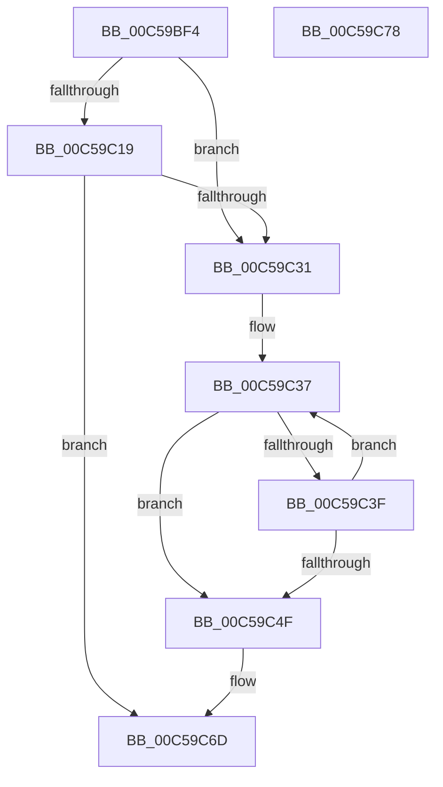

# CmpGetAcpiBiosVersion

- RVA: `0x00C59BF4`–`0x00C59C79` (길이 `133` bytes)
- VA: `0x0000000140C59BF4`
- 실행 섹션: `INIT`
- PDB 이름 있음: `예`; PDB Function 태그: `아니요`
- unwind 정보 RVA: `0x0005CAAC`
- 디코드: `42`개 명령, `133/133` bytes 표시
- 미해석 바이트: `0` (있으면 어셈블리에 `.byte`로 보존)

> 이 문서는 커널 이미지의 기계어와 PDB 기호를 분석해 생성했습니다. 4번과 5번은 함수 원형과 자료형을 바이너리 사용 방식에서 추정한 C 해석이며 원본 소스 복구 결과는 아닙니다.

## 1. Dependencies

- 직접 호출 지점: **3**; 고유 호출 대상: **2**
- 직접 호출자로 확인된 함수: **1**
- RIP 상대 이미지 참조: **1**

### Outgoing calls
- `0x00C59C0F` → [HalpAcpiGetTable](../../text/3F/HalpAcpiGetTable_function_003F6BF8.md) (function, `0x003F6BF8`)
- `0x00C59C27` → [HalpAcpiGetTable](../../text/3F/HalpAcpiGetTable_function_003F6BF8.md) (function, `0x003F6BF8`)
- `0x00C59C66` → [sprintf_s](../../text/50/sprintf_s_function_00505E40.md) (function, `0x00505E40`)

### Direct callers
- [CmpSetSystemBiosInformation](CmpSetSystemBiosInformation_function_00C5A5D0.md) at `0x00C5A843`

### Static image references
- `0x00C59C53` → RVA `0x00C7E4D0` (` ?? ::PBOPGDP::`string'`; read)

## 2. Other-region calls and transfers

- 다른 실행 섹션으로 향하는 call: **3**
  - `0x00C59C0F` → [HalpAcpiGetTable](../../text/3F/HalpAcpiGetTable_function_003F6BF8.md) (`INIT` → `.text`)
  - `0x00C59C27` → [HalpAcpiGetTable](../../text/3F/HalpAcpiGetTable_function_003F6BF8.md) (`INIT` → `.text`)
  - `0x00C59C66` → [sprintf_s](../../text/50/sprintf_s_function_00505E40.md) (`INIT` → `.text`)
- 별도 외부 분기/꼬리 이동을 확인하지 못했습니다.

## 3. Assembly (complete function range)

```asm
00C59BF4  48 89 5C 24 08                  mov qword ptr [rsp + 8], rbx
00C59BF9  57                              push rdi
00C59BFA  48 83 EC 20                     sub rsp, 0x20
00C59BFE  48 8B DA                        mov rbx, rdx
00C59C01  45 33 C9                        xor r9d, r9d
00C59C04  BA 52 53 44 54                  mov edx, 0x54445352
00C59C09  45 33 C0                        xor r8d, r8d
00C59C0C  48 8B F9                        mov rdi, rcx
00C59C0F  E8 E4 CF 79 FF                  call 0x1403f6bf8
00C59C14  48 85 C0                        test rax, rax
00C59C17  75 18                           jne 0x140c59c31
00C59C19  45 33 C9                        xor r9d, r9d
00C59C1C  45 33 C0                        xor r8d, r8d
00C59C1F  BA 58 53 44 54                  mov edx, 0x54445358
00C59C24  48 8B CF                        mov rcx, rdi
00C59C27  E8 CC CF 79 FF                  call 0x1403f6bf8
00C59C2C  48 85 C0                        test rax, rax
00C59C2F  74 3C                           je 0x140c59c6d
00C59C31  33 D2                           xor edx, edx
00C59C33  48 8D 48 0A                     lea rcx, [rax + 0xa]
00C59C37  44 8A 01                        mov r8b, byte ptr [rcx]
00C59C3A  45 84 C0                        test r8b, r8b
00C59C3D  74 10                           je 0x140c59c4f
00C59C3F  44 88 03                        mov byte ptr [rbx], r8b
00C59C42  FF C2                           inc edx
00C59C44  48 FF C3                        inc rbx
00C59C47  48 FF C1                        inc rcx
00C59C4A  83 FA 06                        cmp edx, 6
00C59C4D  72 E8                           jb 0x140c59c37
00C59C4F  44 8B 48 18                     mov r9d, dword ptr [rax + 0x18]
00C59C53  4C 8D 05 76 48 02 00            lea r8, [rip + 0x24876]
00C59C5A  B9 80 00 00 00                  mov ecx, 0x80
00C59C5F  2B CA                           sub ecx, edx
00C59C61  8B D1                           mov edx, ecx
00C59C63  48 8B CB                        mov rcx, rbx
00C59C66  E8 D5 C1 8A FF                  call 0x140505e40
00C59C6B  B0 01                           mov al, 1
00C59C6D  48 8B 5C 24 30                  mov rbx, qword ptr [rsp + 0x30]
00C59C72  48 83 C4 20                     add rsp, 0x20
00C59C76  5F                              pop rdi
00C59C77  C3                              ret
00C59C78  CC                              int3
```

## 4. C-style interpretation (structured pseudocode)

```c
__int64 __fastcall CmpGetAcpiBiosVersion(__int64 a1, __int64 a2, int a3, int a4)
{
    __int64 result;
    __int64 v_rbx;
    __int64 v_rsp;
    unsigned __int64 v_stack_p8;

    v_stack_p8 = v_rbx;
    v_rsp = (v_rsp) - (32);
    a4 = 0;
    a3 = 0;
    result = HalpAcpiGetTable(a1, (unsigned int)(0x54445352ULL), a3, a4);
    if (result != 0) goto loc_00C59C31;
    a4 = 0;
    a3 = 0;
    result = HalpAcpiGetTable(a1, (unsigned int)(0x54445358ULL), a3, a4);
    if (result == 0) goto loc_00C59C6D;
loc_00C59C31:
    a2 = 0;
loc_00C59C37:
    if ((unsigned __int8)(*(unsigned __int8 *)(result + 10)) == 0) goto loc_00C59C4F;
    *(unsigned __int8 *)(a2) = (unsigned __int8)(*(unsigned __int8 *)(result + 10));
    a2 = (unsigned int)((a2) + 1);
    v_rbx = (a2) + 1;
    a1 = (result + 10) + 1;
    if (((unsigned int)(a2)) < 6) goto loc_00C59C37;
loc_00C59C4F:
    a1 = (unsigned int)((128) - ((unsigned int)(a2)));
    result = sprintf_s(v_rbx, (unsigned int)((unsigned int)(a1)), v_rip + 149622, (unsigned int)(*(unsigned int *)(result + 24)));
loc_00C59C6D:
    v_rsp = (v_rsp) + (32);
    return 1;
}
```

## 5. (Beta) C Style

```c
int64_t CmpGetAcpiBiosVersion(int64_t Arg1, int64_t Arg2, int32_t Arg3, int32_t Arg4)
{
    int64_t result;
    int64_t local_rbx;
    int64_t local_rsp;
    uint64_t v_stack_p8;

    v_stack_p8 = local_rbx;
    local_rsp = (local_rsp) - (32);
    Arg4 = 0;
    Arg3 = 0;
    result = HalpAcpiGetTable(Arg1, (uint32_t)(0x54445352ULL), Arg3, Arg4);
    if (result != 0) goto loc_00C59C31;
    Arg4 = 0;
    Arg3 = 0;
    result = HalpAcpiGetTable(Arg1, (uint32_t)(0x54445358ULL), Arg3, Arg4);
    if (result == 0) goto loc_00C59C6D;
loc_00C59C31:
    Arg2 = 0;
loc_00C59C37:
    if ((uint8_t)(*(uint8_t *)(result + 0xA)) == 0) goto loc_00C59C4F;
    *(uint8_t *)(Arg2) = (uint8_t)(*(uint8_t *)(result + 0xA));
    Arg2 = (uint32_t)((Arg2) + 1);
    local_rbx = (Arg2) + 1;
    Arg1 = (result + 10) + 1;
    if (((uint32_t)(Arg2)) < 6) goto loc_00C59C37;
loc_00C59C4F:
    Arg1 = (uint32_t)((128) - ((uint32_t)(Arg2)));
    result = sprintf_s(local_rbx, (uint32_t)((uint32_t)(Arg1)), v_rip + 149622, (uint32_t)(*(uint32_t *)(result + 0x18)));
loc_00C59C6D:
    local_rsp = (local_rsp) + (32);
    return 1;
}
```

## 6. Execution-region graph

[열기: 2D/3D 그래프와 함수 탐색 컨트롤 패널](../../../control-panel.html?section=init&rva=0x00C59BF4&view=graph)

- 2D 그래프는 위에서 아래로 흐르고, 3D 그래프는 빈 공간을 드래그해 회전합니다. Shift+드래그는 이동, 휠은 확대·축소, 함수 노드 선택은 대상 보고서 이동입니다.

### Static fallback


