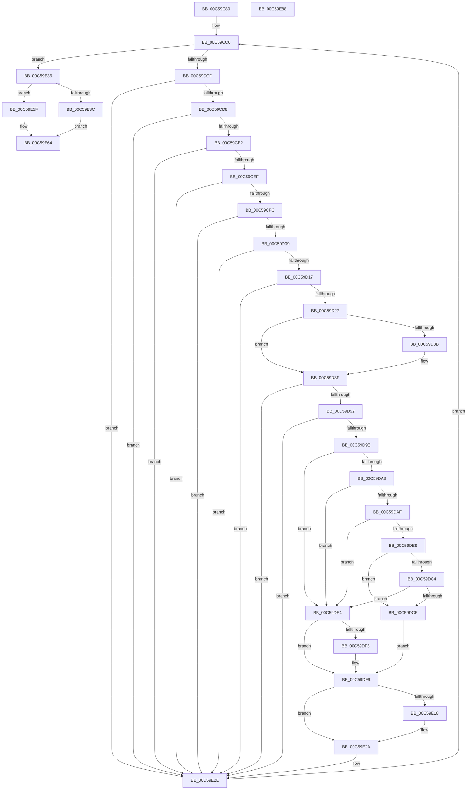

# CmpGetBiosDate

- RVA: `0x00C59C80`–`0x00C59E89` (길이 `521` bytes)
- VA: `0x0000000140C59C80`
- 실행 섹션: `INIT`
- PDB 이름 있음: `예`; PDB Function 태그: `아니요`
- unwind 정보 RVA: `0x000D1798`
- 디코드: `155`개 명령, `521/521` bytes 표시
- 미해석 바이트: `0` (있으면 어셈블리에 `.byte`로 보존)

> 이 문서는 커널 이미지의 기계어와 PDB 기호를 분석해 생성했습니다. 4번과 5번은 함수 원형과 자료형을 바이너리 사용 방식에서 추정한 C 해석이며 원본 소스 복구 결과는 아닙니다.

## 1. Dependencies

- 직접 호출 지점: **5**; 고유 호출 대상: **3**
- 직접 호출자로 확인된 함수: **2**
- RIP 상대 이미지 참조: **1**

### Outgoing calls
- `0x00C59D5C` → [strtoul](../../text/4F/strtoul_function_004FF3B8.md) (function, `0x004FF3B8`)
- `0x00C59D6E` → [strtoul](../../text/4F/strtoul_function_004FF3B8.md) (function, `0x004FF3B8`)
- `0x00C59D7F` → [strtoul](../../text/4F/strtoul_function_004FF3B8.md) (function, `0x004FF3B8`)
- `0x00C59E0F` → [memcmp](../../text/6C/memcmp_function_006C6B10.md) (function, `0x006C6B10`)
- `0x00C59E6B` → [_security_check_cookie](../../text/6A/_security_check_cookie_function_006AC640.md) (function, `0x006AC640`)

### Direct callers
- [CmpSetSystemBiosInformation](CmpSetSystemBiosInformation_function_00C5A5D0.md) at `0x00C5A6BE`
- [CmpSetSystemBiosInformation](CmpSetSystemBiosInformation_function_00C5A5D0.md) at `0x00C5A7AD`
- [CmpSetVideoBiosInformation](CmpSetVideoBiosInformation_function_00C5A970.md) at `0x00C5AACB`

### Static image references
- `0x00C59C97` → RVA `0x00E0A740` (`.data`; read)

## 2. Other-region calls and transfers

- 다른 실행 섹션으로 향하는 call: **5**
  - `0x00C59D5C` → [strtoul](../../text/4F/strtoul_function_004FF3B8.md) (`INIT` → `.text`)
  - `0x00C59D6E` → [strtoul](../../text/4F/strtoul_function_004FF3B8.md) (`INIT` → `.text`)
  - `0x00C59D7F` → [strtoul](../../text/4F/strtoul_function_004FF3B8.md) (`INIT` → `.text`)
  - `0x00C59E0F` → [memcmp](../../text/6C/memcmp_function_006C6B10.md) (`INIT` → `.text`)
  - `0x00C59E6B` → [_security_check_cookie](../../text/6A/_security_check_cookie_function_006AC640.md) (`INIT` → `.text`)
- 별도 외부 분기/꼬리 이동을 확인하지 못했습니다.

## 3. Assembly (complete function range)

```asm
00C59C80  48 89 5C 24 10                  mov qword ptr [rsp + 0x10], rbx
00C59C85  55                              push rbp
00C59C86  56                              push rsi
00C59C87  57                              push rdi
00C59C88  41 54                           push r12
00C59C8A  41 55                           push r13
00C59C8C  41 56                           push r14
00C59C8E  41 57                           push r15
00C59C90  48 8B EC                        mov rbp, rsp
00C59C93  48 83 EC 50                     sub rsp, 0x50
00C59C97  48 8B 05 A2 0A 1B 00            mov rax, qword ptr [rip + 0x1b0aa2]
00C59C9E  48 33 C4                        xor rax, rsp
00C59CA1  48 89 45 F0                     mov qword ptr [rbp - 0x10], rax
00C59CA5  33 C0                           xor eax, eax
00C59CA7  44 8B E2                        mov r12d, edx
00C59CAA  49 83 C4 FB                     add r12, -5
00C59CAE  48 89 45 E0                     mov qword ptr [rbp - 0x20], rax
00C59CB2  4C 03 E1                        add r12, rcx
00C59CB5  66 89 45 E8                     mov word ptr [rbp - 0x18], ax
00C59CB9  45 8A E9                        mov r13b, r9b
00C59CBC  88 45 EA                        mov byte ptr [rbp - 0x16], al
00C59CBF  49 8B F0                        mov rsi, r8
00C59CC2  48 8D 79 02                     lea rdi, [rcx + 2]
00C59CC6  49 3B FC                        cmp rdi, r12
00C59CC9  0F 83 67 01 00 00               jae 0x140c59e36
00C59CCF  80 3F 2F                        cmp byte ptr [rdi], 0x2f
00C59CD2  0F 85 56 01 00 00               jne 0x140c59e2e
00C59CD8  80 7F 03 2F                     cmp byte ptr [rdi + 3], 0x2f
00C59CDC  0F 85 4C 01 00 00               jne 0x140c59e2e
00C59CE2  8A 47 FF                        mov al, byte ptr [rdi - 1]
00C59CE5  2C 30                           sub al, 0x30
00C59CE7  3C 09                           cmp al, 9
00C59CE9  0F 87 3F 01 00 00               ja 0x140c59e2e
00C59CEF  8A 47 01                        mov al, byte ptr [rdi + 1]
00C59CF2  2C 30                           sub al, 0x30
00C59CF4  3C 09                           cmp al, 9
00C59CF6  0F 87 32 01 00 00               ja 0x140c59e2e
00C59CFC  8A 47 02                        mov al, byte ptr [rdi + 2]
00C59CFF  2C 30                           sub al, 0x30
00C59D01  3C 09                           cmp al, 9
00C59D03  0F 87 25 01 00 00               ja 0x140c59e2e
00C59D09  8A 57 04                        mov dl, byte ptr [rdi + 4]
00C59D0C  8D 42 D0                        lea eax, [rdx - 0x30]
00C59D0F  3C 09                           cmp al, 9
00C59D11  0F 87 17 01 00 00               ja 0x140c59e2e
00C59D17  44 8A 47 05                     mov r8b, byte ptr [rdi + 5]
00C59D1B  41 8D 40 D0                     lea eax, [r8 - 0x30]
00C59D1F  3C 09                           cmp al, 9
00C59D21  0F 87 07 01 00 00               ja 0x140c59e2e
00C59D27  8B 4F FE                        mov ecx, dword ptr [rdi - 2]
00C59D2A  8A 47 02                        mov al, byte ptr [rdi + 2]
00C59D2D  89 4D D5                        mov dword ptr [rbp - 0x2b], ecx
00C59D30  80 E9 30                        sub cl, 0x30
00C59D33  88 45 D9                        mov byte ptr [rbp - 0x27], al
00C59D36  80 F9 09                        cmp cl, 9
00C59D39  76 04                           jbe 0x140c59d3f
00C59D3B  C6 45 D5 30                     mov byte ptr [rbp - 0x2b], 0x30
00C59D3F  88 55 D2                        mov byte ptr [rbp - 0x2e], dl
00C59D42  48 8D 4D D2                     lea rcx, [rbp - 0x2e]
00C59D46  33 D2                           xor edx, edx
00C59D48  44 88 45 D3                     mov byte ptr [rbp - 0x2d], r8b
00C59D4C  C6 45 DA 00                     mov byte ptr [rbp - 0x26], 0
00C59D50  C6 45 D7 00                     mov byte ptr [rbp - 0x29], 0
00C59D54  C6 45 D4 00                     mov byte ptr [rbp - 0x2c], 0
00C59D58  44 8D 42 10                     lea r8d, [rdx + 0x10]
00C59D5C  E8 57 56 8A FF                  call 0x1404ff3b8
00C59D61  33 D2                           xor edx, edx
00C59D63  48 8D 4D D5                     lea rcx, [rbp - 0x2b]
00C59D67  44 8B F8                        mov r15d, eax
00C59D6A  44 8D 42 10                     lea r8d, [rdx + 0x10]
00C59D6E  E8 45 56 8A FF                  call 0x1404ff3b8
00C59D73  33 D2                           xor edx, edx
00C59D75  48 8D 4D D8                     lea rcx, [rbp - 0x28]
00C59D79  8B D8                           mov ebx, eax
00C59D7B  44 8D 42 10                     lea r8d, [rdx + 0x10]
00C59D7F  E8 34 56 8A FF                  call 0x1404ff3b8
00C59D84  8B C8                           mov ecx, eax
00C59D86  8D 43 FF                        lea eax, [rbx - 1]
00C59D89  83 F8 11                        cmp eax, 0x11
00C59D8C  0F 87 9C 00 00 00               ja 0x140c59e2e
00C59D92  8D 41 FF                        lea eax, [rcx - 1]
00C59D95  83 F8 30                        cmp eax, 0x30
00C59D98  0F 87 90 00 00 00               ja 0x140c59e2e
00C59D9E  45 84 ED                        test r13b, r13b
00C59DA1  74 41                           je 0x140c59de4
00C59DA3  44 8A 47 06                     mov r8b, byte ptr [rdi + 6]
00C59DA7  41 8D 40 D0                     lea eax, [r8 - 0x30]
00C59DAB  3C 09                           cmp al, 9
00C59DAD  77 35                           ja 0x140c59de4
00C59DAF  8A 57 07                        mov dl, byte ptr [rdi + 7]
00C59DB2  8D 42 D0                        lea eax, [rdx - 0x30]
00C59DB5  3C 09                           cmp al, 9
00C59DB7  77 2B                           ja 0x140c59de4
00C59DB9  B8 31 39 00 00                  mov eax, 0x3931
00C59DBE  66 39 47 04                     cmp word ptr [rdi + 4], ax
00C59DC2  74 0B                           je 0x140c59dcf
00C59DC4  B8 32 30 00 00                  mov eax, 0x3032
00C59DC9  66 39 47 04                     cmp word ptr [rdi + 4], ax
00C59DCD  75 15                           jne 0x140c59de4
00C59DCF  8A 47 04                        mov al, byte ptr [rdi + 4]
00C59DD2  88 45 D0                        mov byte ptr [rbp - 0x30], al
00C59DD5  8A 47 05                        mov al, byte ptr [rdi + 5]
00C59DD8  88 45 D1                        mov byte ptr [rbp - 0x2f], al
00C59DDB  44 88 45 D2                     mov byte ptr [rbp - 0x2e], r8b
00C59DDF  88 55 D3                        mov byte ptr [rbp - 0x2d], dl
00C59DE2  EB 15                           jmp 0x140c59df9
00C59DE4  66 C7 45 D0 32 30               mov word ptr [rbp - 0x30], 0x3032
00C59DEA  41 81 FF 80 00 00 00            cmp r15d, 0x80
00C59DF1  72 06                           jb 0x140c59df9
00C59DF3  66 C7 45 D0 31 39               mov word ptr [rbp - 0x30], 0x3931
00C59DF9  41 B8 0A 00 00 00               mov r8d, 0xa
00C59DFF  C6 45 D7 2F                     mov byte ptr [rbp - 0x29], 0x2f
00C59E03  48 8D 55 D0                     lea rdx, [rbp - 0x30]
00C59E07  C6 45 D4 2F                     mov byte ptr [rbp - 0x2c], 0x2f
00C59E0B  48 8D 4D E0                     lea rcx, [rbp - 0x20]
00C59E0F  E8 FC CC A6 FF                  call 0x1406c6b10
00C59E14  85 C0                           test eax, eax
00C59E16  79 12                           jns 0x140c59e2a
00C59E18  F2 0F 10 45 D0                  movsd xmm0, qword ptr [rbp - 0x30]
00C59E1D  0F B7 45 D8                     movzx eax, word ptr [rbp - 0x28]
00C59E21  F2 0F 11 45 E0                  movsd qword ptr [rbp - 0x20], xmm0
00C59E26  66 89 45 E8                     mov word ptr [rbp - 0x18], ax
00C59E2A  48 83 C7 02                     add rdi, 2
00C59E2E  48 FF C7                        inc rdi
00C59E31  E9 90 FE FF FF                  jmp 0x140c59cc6
00C59E36  80 7D E0 00                     cmp byte ptr [rbp - 0x20], 0
00C59E3A  74 23                           je 0x140c59e5f
00C59E3C  8B 4D E5                        mov ecx, dword ptr [rbp - 0x1b]
00C59E3F  B0 01                           mov al, 1
00C59E41  89 0E                           mov dword ptr [rsi], ecx
00C59E43  8A 4D E9                        mov cl, byte ptr [rbp - 0x17]
00C59E46  88 4E 04                        mov byte ptr [rsi + 4], cl
00C59E49  8A 4D E2                        mov cl, byte ptr [rbp - 0x1e]
00C59E4C  88 4E 06                        mov byte ptr [rsi + 6], cl
00C59E4F  8A 4D E3                        mov cl, byte ptr [rbp - 0x1d]
00C59E52  88 4E 07                        mov byte ptr [rsi + 7], cl
00C59E55  C6 46 05 2F                     mov byte ptr [rsi + 5], 0x2f
00C59E59  C6 46 08 00                     mov byte ptr [rsi + 8], 0
00C59E5D  EB 05                           jmp 0x140c59e64
00C59E5F  C6 06 00                        mov byte ptr [rsi], 0
00C59E62  32 C0                           xor al, al
00C59E64  48 8B 4D F0                     mov rcx, qword ptr [rbp - 0x10]
00C59E68  48 33 CC                        xor rcx, rsp
00C59E6B  E8 D0 27 A5 FF                  call 0x1406ac640
00C59E70  48 8B 9C 24 98 00 00 00         mov rbx, qword ptr [rsp + 0x98]
00C59E78  48 83 C4 50                     add rsp, 0x50
00C59E7C  41 5F                           pop r15
00C59E7E  41 5E                           pop r14
00C59E80  41 5D                           pop r13
00C59E82  41 5C                           pop r12
00C59E84  5F                              pop rdi
00C59E85  5E                              pop rsi
00C59E86  5D                              pop rbp
00C59E87  C3                              ret
00C59E88  CC                              int3
```

## 4. C-style interpretation (structured pseudocode)

```c
__int64 __fastcall CmpGetBiosDate(__int64 a1, int a2, __int64 a3, unsigned __int8 a4)
{
    __int64 result;
    __int64 v_r12;
    __int64 v_rdi;
    __int64 v_rsp;
    unsigned __int64 v_stack_m48;
    unsigned __int8 v_stack_m4E;
    unsigned __int8 v_stack_m4F;
    unsigned __int16 v_stack_m50;
    unsigned int v_stack_m53;
    unsigned __int8 v_stack_m55;
    unsigned __int8 v_stack_m56;
    unsigned __int64 v_stack_m58;
    unsigned __int8 v_stack_m5E;
    unsigned __int8 v_stack_m5F;
    unsigned __int64 v_stack_m60;
    unsigned __int8 v_stack_m61;
    unsigned int v_stack_m63;
    unsigned __int8 v_stack_m64;
    unsigned __int8 v_stack_m65;
    unsigned __int8 v_stack_m66;
    unsigned __int8 v_stack_m67;
    unsigned __int8 v_stack_m68;
    unsigned __int64 v_stack_p10;

    v_stack_p10 = v_rbx;
    v_rsp = (v_rsp) - (80);
    result = (*(unsigned __int64 *)(v_rip + 1772194)) ^ (v_rsp);
    v_stack_m48 = result;
    result = 0;
    v_r12 = ((unsigned int)(a2)) + (-5);
    v_stack_m58 = 0;
    v_r12 = (v_r12) + (a1);
    v_stack_m50 = 0;
    v_stack_m4E = 0;
loc_00C59CC6:
    if ((a1 + 2) >= v_r12) goto loc_00C59E36;
    if ((*(unsigned __int8 *)(a1 + 2)) != 47) goto loc_00C59E2E;
    if ((*(unsigned __int8 *)(a1 + 2 + 3)) != 47) goto loc_00C59E2E;
    result = (unsigned __int8)((*(unsigned __int8 *)(a1 + 2 - 1)) - (48));
    if (((unsigned __int8)(result)) > 9) goto loc_00C59E2E;
    result = (unsigned __int8)((*(unsigned __int8 *)(a1 + 2 + 1)) - (48));
    if (((unsigned __int8)(result)) > 9) goto loc_00C59E2E;
    result = (unsigned __int8)((*(unsigned __int8 *)(a1 + 2 + 2)) - (48));
    if (((unsigned __int8)(result)) > 9) goto loc_00C59E2E;
    if (((unsigned __int8)(*(unsigned __int8 *)(a1 + 2 + 4) - 48)) > 9) goto loc_00C59E2E;
    if (((unsigned __int8)(*(unsigned __int8 *)(a1 + 2 + 5) - 48)) > 9) goto loc_00C59E2E;
    v_stack_m63 = (unsigned int)((unsigned int)(*(unsigned int *)(a1 + 2 - 2)));
    a1 = (unsigned __int8)(((unsigned int)(*(unsigned int *)(a1 + 2 - 2))) - (48));
    v_stack_m5F = (unsigned __int8)(*(unsigned __int8 *)(a1 + 2 + 2));
    if (((unsigned __int8)(a1)) >= = 9) {
        v_stack_m63 = 48;
    }
    v_stack_m66 = (unsigned __int8)(*(unsigned __int8 *)(a1 + 2 + 4));
    a2 = 0;
    v_stack_m65 = (unsigned __int8)(*(unsigned __int8 *)(a1 + 2 + 5));
    v_stack_m5E = 0;
    v_stack_m61 = 0;
    v_stack_m64 = 0;
    result = strtoul(v_stack_m66, a2, a2 + 16, a4);
    a2 = 0;
    result = strtoul(v_stack_m63, a2, a2 + 16, a4);
    a2 = 0;
    result = strtoul(v_stack_m60, a2, a2 + 16, a4);
    if (((unsigned int)((unsigned int)((unsigned int)(result)) - 1)) > 17) goto loc_00C59E2E;
    if (((unsigned int)((unsigned int)((unsigned int)(result)) - 1)) > 48) goto loc_00C59E2E;
    if (a4 == 0) goto loc_00C59DE4;
    if (((unsigned __int8)(*(unsigned __int8 *)(a1 + 2 + 6) - 48)) > 9) goto loc_00C59DE4;
    if (((unsigned __int8)(*(unsigned __int8 *)(a1 + 2 + 7) - 48)) > 9) goto loc_00C59DE4;
    if ((*(unsigned __int16 *)(a1 + 2 + 4)) == ((unsigned __int16)((unsigned int)(0x3931ULL)))) goto loc_00C59DCF;
    if ((*(unsigned __int16 *)(a1 + 2 + 4)) != ((unsigned __int16)((unsigned int)(0x3032ULL)))) goto loc_00C59DE4;
loc_00C59DCF:
    v_stack_m68 = (unsigned __int8)(*(unsigned __int8 *)(a1 + 2 + 4));
    v_stack_m67 = (unsigned __int8)(*(unsigned __int8 *)(a1 + 2 + 5));
    v_stack_m66 = (unsigned __int8)(*(unsigned __int8 *)(a1 + 2 + 6));
    v_stack_m65 = (unsigned __int8)(*(unsigned __int8 *)(a1 + 2 + 7));
    goto loc_00C59DF9;
loc_00C59DE4:
    v_stack_m68 = 0x3032ULL;
    if (((unsigned int)((unsigned int)((unsigned int)(result)))) >= 128) {
        v_stack_m68 = 0x3931ULL;
    }
    v_stack_m61 = 47;
    v_stack_m64 = 47;
    result = memcmp(v_stack_m58, v_stack_m68, 10, a4);
    if (sign_flag) {
        result = v_stack_m60;
        v_stack_m58 = v_xmm0;
        v_stack_m50 = (unsigned __int16)(result);
    }
    v_rdi = (a1 + 2) + (2);
loc_00C59E2E:
    v_rdi = (v_rdi) + 1;
    goto loc_00C59CC6;
loc_00C59E36:
    if (v_stack_m58 == 0) goto loc_00C59E5F;
    *(unsigned int *)(a3) = (unsigned int)((unsigned int)(v_stack_m53));
    *(unsigned __int8 *)(a3 + 4) = (unsigned __int8)(v_stack_m4F);
    *(unsigned __int8 *)(a3 + 6) = (unsigned __int8)(v_stack_m56);
    *(unsigned __int8 *)(a3 + 7) = (unsigned __int8)(v_stack_m55);
    *(unsigned __int8 *)(a3 + 5) = 47;
    *(unsigned __int8 *)(a3 + 8) = 0;
    goto loc_00C59E64;
loc_00C59E5F:
    *(unsigned __int8 *)(a3) = 0;
    result = 0;
loc_00C59E64:
    a1 = (v_stack_m48) ^ (v_rsp);
    result = _security_check_cookie(a1, v_stack_m68, 10, a4);
    v_rsp = (v_rsp) + (80);
    return result;
}
```

## 5. (Beta) C Style

```c
int64_t CmpGetBiosDate(void *Arg1, int32_t Arg2, void *Arg3, uint8_t Arg4)
{
    uint8_t *arg1 = (uint8_t *)Arg1;
    uint8_t *arg3 = (uint8_t *)Arg3;

    int64_t result;
    int64_t local_r12;
    int64_t local_rdi;
    int64_t local_rsp;
    uint64_t v_stack_m48;
    uint8_t v_stack_m4E;
    uint8_t v_stack_m4F;
    uint16_t v_stack_m50;
    uint32_t v_stack_m53;
    uint8_t v_stack_m55;
    uint8_t v_stack_m56;
    uint64_t v_stack_m58;
    uint8_t v_stack_m5E;
    uint8_t v_stack_m5F;
    uint64_t v_stack_m60;
    uint8_t v_stack_m61;
    uint32_t v_stack_m63;
    uint8_t v_stack_m64;
    uint8_t v_stack_m65;
    uint8_t v_stack_m66;
    uint8_t v_stack_m67;
    uint8_t v_stack_m68;
    uint64_t v_stack_p10;

    v_stack_p10 = local_rbx;
    local_rsp = (local_rsp) - (80);
    result = (*(uint64_t *)(v_rip + 0x1B0AA2)) ^ (local_rsp);
    v_stack_m48 = result;
    result = 0;
    local_r12 = ((uint32_t)(Arg2)) + (-5);
    v_stack_m58 = 0;
    local_r12 = (local_r12) + (Arg1);
    v_stack_m50 = 0;
    v_stack_m4E = 0;
loc_00C59CC6:
    if ((Arg1 + 2) >= local_r12) goto loc_00C59E36;
    if ((*(uint8_t *)(arg1 + 0x2)) != 47) goto loc_00C59E2E;
    if ((*(uint8_t *)(arg1 + 0x2 + 0x3)) != 47) goto loc_00C59E2E;
    result = (uint8_t)((*(uint8_t *)(arg1 + 0x2 - 0x1)) - (48));
    if (((uint8_t)(result)) > 9) goto loc_00C59E2E;
    result = (uint8_t)((*(uint8_t *)(arg1 + 0x2 + 0x1)) - (48));
    if (((uint8_t)(result)) > 9) goto loc_00C59E2E;
    result = (uint8_t)((*(uint8_t *)(arg1 + 0x2 + 0x2)) - (48));
    if (((uint8_t)(result)) > 9) goto loc_00C59E2E;
    if (((uint8_t)(*(uint8_t *)(arg1 + 0x2 + 0x4) - 48)) > 9) goto loc_00C59E2E;
    if (((uint8_t)(*(uint8_t *)(arg1 + 0x2 + 0x5) - 48)) > 9) goto loc_00C59E2E;
    v_stack_m63 = (uint32_t)((uint32_t)(*(uint32_t *)(arg1 + 0x2 - 0x2)));
    Arg1 = (uint8_t)(((uint32_t)(*(uint32_t *)(arg1 + 0x2 - 0x2))) - (48));
    v_stack_m5F = (uint8_t)(*(uint8_t *)(arg1 + 0x2 + 0x2));
    if (((uint8_t)(Arg1)) >= = 9) {
        v_stack_m63 = 48;
    }
    v_stack_m66 = (uint8_t)(*(uint8_t *)(arg1 + 0x2 + 0x4));
    Arg2 = 0;
    v_stack_m65 = (uint8_t)(*(uint8_t *)(arg1 + 0x2 + 0x5));
    v_stack_m5E = 0;
    v_stack_m61 = 0;
    v_stack_m64 = 0;
    result = strtoul(v_stack_m66, Arg2, Arg2 + 16, Arg4);
    Arg2 = 0;
    result = strtoul(v_stack_m63, Arg2, Arg2 + 16, Arg4);
    Arg2 = 0;
    result = strtoul(v_stack_m60, Arg2, Arg2 + 16, Arg4);
    if (((uint32_t)((uint32_t)((uint32_t)(result)) - 1)) > 17) goto loc_00C59E2E;
    if (((uint32_t)((uint32_t)((uint32_t)(result)) - 1)) > 48) goto loc_00C59E2E;
    if (Arg4 == 0) goto loc_00C59DE4;
    if (((uint8_t)(*(uint8_t *)(arg1 + 0x2 + 0x6) - 48)) > 9) goto loc_00C59DE4;
    if (((uint8_t)(*(uint8_t *)(arg1 + 0x2 + 0x7) - 48)) > 9) goto loc_00C59DE4;
    if ((*(uint16_t *)(arg1 + 0x2 + 0x4)) == ((uint16_t)((uint32_t)(0x3931ULL)))) goto loc_00C59DCF;
    if ((*(uint16_t *)(arg1 + 0x2 + 0x4)) != ((uint16_t)((uint32_t)(0x3032ULL)))) goto loc_00C59DE4;
loc_00C59DCF:
    v_stack_m68 = (uint8_t)(*(uint8_t *)(arg1 + 0x2 + 0x4));
    v_stack_m67 = (uint8_t)(*(uint8_t *)(arg1 + 0x2 + 0x5));
    v_stack_m66 = (uint8_t)(*(uint8_t *)(arg1 + 0x2 + 0x6));
    v_stack_m65 = (uint8_t)(*(uint8_t *)(arg1 + 0x2 + 0x7));
    goto loc_00C59DF9;
loc_00C59DE4:
    v_stack_m68 = 0x3032ULL;
    if (((uint32_t)((uint32_t)((uint32_t)(result)))) >= 128) {
        v_stack_m68 = 0x3931ULL;
    }
    v_stack_m61 = 47;
    v_stack_m64 = 47;
    result = memcmp(v_stack_m58, v_stack_m68, 10, Arg4);
    if (sign_flag) {
        result = v_stack_m60;
        v_stack_m58 = v_xmm0;
        v_stack_m50 = (uint16_t)(result);
    }
    local_rdi = (Arg1 + 2) + (2);
loc_00C59E2E:
    local_rdi = (local_rdi) + 1;
    goto loc_00C59CC6;
loc_00C59E36:
    if (v_stack_m58 == 0) goto loc_00C59E5F;
    *(uint32_t *)(arg3) = (uint32_t)((uint32_t)(v_stack_m53));
    *(uint8_t *)(arg3 + 0x4) = (uint8_t)(v_stack_m4F);
    *(uint8_t *)(arg3 + 0x6) = (uint8_t)(v_stack_m56);
    *(uint8_t *)(arg3 + 0x7) = (uint8_t)(v_stack_m55);
    *(uint8_t *)(arg3 + 0x5) = 47;
    *(uint8_t *)(arg3 + 0x8) = 0;
    goto loc_00C59E64;
loc_00C59E5F:
    *(uint8_t *)(arg3) = 0;
    result = 0;
loc_00C59E64:
    Arg1 = (v_stack_m48) ^ (local_rsp);
    result = _security_check_cookie(Arg1, v_stack_m68, 10, Arg4);
    local_rsp = (local_rsp) + (80);
    return result;
}
```

### 관측된 메모리 오프셋

구조체 형식이 확인되지 않은 접근은 인자 기준의 오프셋으로만 기록했습니다.

| 기준 인자 | 오프셋 표현 | 폭 (bit) | 접근 |
|---|---:|---:|---|
| `Arg1` | `+ 0x2` | `64` | `R` |
| `Arg3` | `+ 0x0` | `8` | `W` |
| `Arg3` | `+ 0x0` | `32` | `W` |
| `Arg3` | `+ 0x4` | `8` | `W` |
| `Arg3` | `+ 0x5` | `8` | `W` |
| `Arg3` | `+ 0x6` | `8` | `W` |
| `Arg3` | `+ 0x7` | `8` | `W` |
| `Arg3` | `+ 0x8` | `8` | `W` |

## 6. Execution-region graph

[열기: 2D/3D 그래프와 함수 탐색 컨트롤 패널](../../../control-panel.html?section=init&rva=0x00C59C80&view=graph)

- 2D 그래프는 위에서 아래로 흐르고, 3D 그래프는 빈 공간을 드래그해 회전합니다. Shift+드래그는 이동, 휠은 확대·축소, 함수 노드 선택은 대상 보고서 이동입니다.

### Static fallback


