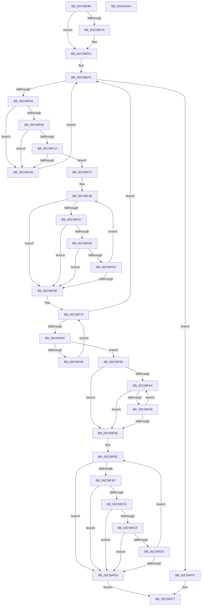

# CmpGetBiosVersion

- RVA: `0x00C59E90`–`0x00C5A025` (길이 `405` bytes)
- VA: `0x0000000140C59E90`
- 실행 섹션: `INIT`
- PDB 이름 있음: `예`; PDB Function 태그: `아니요`
- unwind 정보 RVA: `0x000D6ACC`
- 디코드: `112`개 명령, `405/405` bytes 표시
- 미해석 바이트: `0` (있으면 어셈블리에 `.byte`로 보존)

> 이 문서는 커널 이미지의 기계어와 PDB 기호를 분석해 생성했습니다. 4번과 5번은 함수 원형과 자료형을 바이너리 사용 방식에서 추정한 C 해석이며 원본 소스 복구 결과는 아닙니다.

## 1. Dependencies

- 직접 호출 지점: **2**; 고유 호출 대상: **2**
- 직접 호출자로 확인된 함수: **2**
- RIP 상대 이미지 참조: **8**

### Outgoing calls
- `0x00C59F8F` → [strstr](../../text/4F/strstr_function_004FF680.md) (function, `0x004FF680`)
- `0x00C5A002` → [_security_check_cookie](../../text/6A/_security_check_cookie_function_006AC640.md) (function, `0x006AC640`)

### Direct callers
- [CmpSetSystemBiosInformation](CmpSetSystemBiosInformation_function_00C5A5D0.md) at `0x00C5A86B`
- [CmpSetVideoBiosInformation](CmpSetVideoBiosInformation_function_00C5A970.md) at `0x00C5AB51`
- [CmpSetVideoBiosInformation](CmpSetVideoBiosInformation_function_00C5A970.md) at `0x00C5ABC9`

### Static image references
- `0x00C59EAB` → RVA `0x00E0A740` (`.data`; read)
- `0x00C59ECC` → RVA `0x01008720` (`INITDATA`; write)
- `0x00C59ED3` → RVA `0x01008688` (`INITDATA`; write)
- `0x00C59EE3` → RVA `0x010086F8` (`INITDATA`; write)
- `0x00C59EF0` → RVA `0x01008688` (`INITDATA`; read)
- `0x00C59EF7` → RVA `0x010086F8` (`INITDATA`; read)
- `0x00C59F49` → RVA `0x01008720` (`INITDATA`; read)
- `0x00C59F78` → RVA `0x00C82910` (`SearchStrings`; read)

## 2. Other-region calls and transfers

- 다른 실행 섹션으로 향하는 call: **2**
  - `0x00C59F8F` → [strstr](../../text/4F/strstr_function_004FF680.md) (`INIT` → `.text`)
  - `0x00C5A002` → [_security_check_cookie](../../text/6A/_security_check_cookie_function_006AC640.md) (`INIT` → `.text`)
- 별도 외부 분기/꼬리 이동을 확인하지 못했습니다.

## 3. Assembly (complete function range)

```asm
00C59E90  48 89 5C 24 08                  mov qword ptr [rsp + 8], rbx
00C59E95  48 89 6C 24 10                  mov qword ptr [rsp + 0x10], rbp
00C59E9A  48 89 74 24 20                  mov qword ptr [rsp + 0x20], rsi
00C59E9F  57                              push rdi
00C59EA0  41 56                           push r14
00C59EA2  41 57                           push r15
00C59EA4  48 81 EC B0 00 00 00            sub rsp, 0xb0
00C59EAB  48 8B 05 8E 08 1B 00            mov rax, qword ptr [rip + 0x1b088e]
00C59EB2  48 33 C4                        xor rax, rsp
00C59EB5  48 89 84 24 A0 00 00 00         mov qword ptr [rsp + 0xa0], rax
00C59EBD  45 33 FF                        xor r15d, r15d
00C59EC0  49 8B E8                        mov rbp, r8
00C59EC3  48 85 C9                        test rcx, rcx
00C59EC6  74 22                           je 0x140c59eea
00C59EC8  48 8D 41 01                     lea rax, [rcx + 1]
00C59ECC  48 89 0D 4D E8 3A 00            mov qword ptr [rip + 0x3ae84d], rcx
00C59ED3  48 89 05 AE E7 3A 00            mov qword ptr [rip + 0x3ae7ae], rax
00C59EDA  48 83 C1 FE                     add rcx, -2
00C59EDE  8B C2                           mov eax, edx
00C59EE0  48 03 C8                        add rcx, rax
00C59EE3  48 89 0D 0E E8 3A 00            mov qword ptr [rip + 0x3ae80e], rcx
00C59EEA  41 BE 01 00 00 00               mov r14d, 1
00C59EF0  48 8B 1D 91 E7 3A 00            mov rbx, qword ptr [rip + 0x3ae791]
00C59EF7  48 3B 1D FA E7 3A 00            cmp rbx, qword ptr [rip + 0x3ae7fa]
00C59EFE  0F 87 F1 00 00 00               ja 0x140c59ff5
00C59F04  80 3B 2E                        cmp byte ptr [rbx], 0x2e
00C59F07  75 12                           jne 0x140c59f1b
00C59F09  8A 43 01                        mov al, byte ptr [rbx + 1]
00C59F0C  2C 30                           sub al, 0x30
00C59F0E  3C 09                           cmp al, 9
00C59F10  77 09                           ja 0x140c59f1b
00C59F12  8A 43 FF                        mov al, byte ptr [rbx - 1]
00C59F15  2C 30                           sub al, 0x30
00C59F17  3C 09                           cmp al, 9
00C59F19  76 0C                           jbe 0x140c59f27
00C59F1B  49 03 DE                        add rbx, r14
00C59F1E  48 89 1D 63 E7 3A 00            mov qword ptr [rip + 0x3ae763], rbx
00C59F25  EB C9                           jmp 0x140c59ef0
00C59F27  48 8D 43 02                     lea rax, [rbx + 2]
00C59F2B  44 88 BC 24 9F 00 00 00         mov byte ptr [rsp + 0x9f], r15b
00C59F33  48 89 05 4E E7 3A 00            mov qword ptr [rip + 0x3ae74e], rax
00C59F3A  48 8D B4 24 9F 00 00 00         lea rsi, [rsp + 0x9f]
00C59F42  41 0F B7 CF                     movzx ecx, r15w
00C59F46  49 2B DE                        sub rbx, r14
00C59F49  48 3B 1D D0 E7 3A 00            cmp rbx, qword ptr [rip + 0x3ae7d0]
00C59F50  72 1C                           jb 0x140c59f6e
00C59F52  8A 03                           mov al, byte ptr [rbx]
00C59F54  3C 20                           cmp al, 0x20
00C59F56  7C 16                           jl 0x140c59f6e
00C59F58  3C 24                           cmp al, 0x24
00C59F5A  74 12                           je 0x140c59f6e
00C59F5C  49 2B F6                        sub rsi, r14
00C59F5F  49 2B DE                        sub rbx, r14
00C59F62  66 41 03 CE                     add cx, r14w
00C59F66  88 06                           mov byte ptr [rsi], al
00C59F68  66 83 F9 78                     cmp cx, 0x78
00C59F6C  72 DB                           jb 0x140c59f49
00C59F6E  49 03 DE                        add rbx, r14
00C59F71  41 0F B7 FF                     movzx edi, r15w
00C59F75  0F B7 C7                        movzx eax, di
00C59F78  48 8D 15 91 89 02 00            lea rdx, [rip + 0x28991]
00C59F7F  48 8B 14 C2                     mov rdx, qword ptr [rdx + rax*8]
00C59F83  48 85 D2                        test rdx, rdx
00C59F86  0F 84 64 FF FF FF               je 0x140c59ef0
00C59F8C  48 8B CE                        mov rcx, rsi
00C59F8F  E8 EC 56 8A FF                  call 0x1404ff680
00C59F94  48 85 C0                        test rax, rax
00C59F97  75 06                           jne 0x140c59f9f
00C59F99  66 41 03 FE                     add di, r14w
00C59F9D  EB D6                           jmp 0x140c59f75
00C59F9F  48 85 DB                        test rbx, rbx
00C59FA2  74 0A                           je 0x140c59fae
00C59FA4  80 3B 20                        cmp byte ptr [rbx], 0x20
00C59FA7  75 05                           jne 0x140c59fae
00C59FA9  49 03 DE                        add rbx, r14
00C59FAC  75 F6                           jne 0x140c59fa4
00C59FAE  41 0F B7 D7                     movzx edx, r15w
00C59FB2  48 85 DB                        test rbx, rbx
00C59FB5  74 32                           je 0x140c59fe9
00C59FB7  48 8B 05 3A E7 3A 00            mov rax, qword ptr [rip + 0x3ae73a]
00C59FBE  48 FF C0                        inc rax
00C59FC1  48 3B D8                        cmp rbx, rax
00C59FC4  77 23                           ja 0x140c59fe9
00C59FC6  44 8A 03                        mov r8b, byte ptr [rbx]
00C59FC9  41 80 F8 20                     cmp r8b, 0x20
00C59FCD  7C 1A                           jl 0x140c59fe9
00C59FCF  41 80 F8 24                     cmp r8b, 0x24
00C59FD3  74 14                           je 0x140c59fe9
00C59FD5  0F B7 CA                        movzx ecx, dx
00C59FD8  49 03 DE                        add rbx, r14
00C59FDB  66 41 03 D6                     add dx, r14w
00C59FDF  44 88 04 29                     mov byte ptr [rcx + rbp], r8b
00C59FE3  66 83 FA 7F                     cmp dx, 0x7f
00C59FE7  72 C9                           jb 0x140c59fb2
00C59FE9  0F B7 CA                        movzx ecx, dx
00C59FEC  41 8A C6                        mov al, r14b
00C59FEF  44 88 3C 29                     mov byte ptr [rcx + rbp], r15b
00C59FF3  EB 02                           jmp 0x140c59ff7
00C59FF5  32 C0                           xor al, al
00C59FF7  48 8B 8C 24 A0 00 00 00         mov rcx, qword ptr [rsp + 0xa0]
00C59FFF  48 33 CC                        xor rcx, rsp
00C5A002  E8 39 26 A5 FF                  call 0x1406ac640
00C5A007  4C 8D 9C 24 B0 00 00 00         lea r11, [rsp + 0xb0]
00C5A00F  49 8B 5B 20                     mov rbx, qword ptr [r11 + 0x20]
00C5A013  49 8B 6B 28                     mov rbp, qword ptr [r11 + 0x28]
00C5A017  49 8B 73 38                     mov rsi, qword ptr [r11 + 0x38]
00C5A01B  49 8B E3                        mov rsp, r11
00C5A01E  41 5F                           pop r15
00C5A020  41 5E                           pop r14
00C5A022  5F                              pop rdi
00C5A023  C3                              ret
00C5A024  CC                              int3
```

## 4. C-style interpretation (structured pseudocode)

```c
__int64 __fastcall CmpGetBiosVersion(__int64 a1, int a2, __int64 a3)
{
    __int64 result;
    __int64 v_r15;
    __int64 v_rbx;
    __int64 v_rdi;
    __int64 v_rsi;
    __int64 v_rsp;
    unsigned __int64 v_stack_m18;
    unsigned __int64 v_stack_m28;
    unsigned __int8 v_stack_m29;
    unsigned __int64 v_stack_p10;
    unsigned __int64 v_stack_p20;
    unsigned __int64 v_stack_p8;

    v_stack_p8 = v_rbx;
    v_stack_p10 = v_rbp;
    v_stack_p20 = v_rsi;
    v_rsp = (v_rsp) - (176);
    result = (*(unsigned __int64 *)(v_rip + 1771662)) ^ (v_rsp);
    v_stack_m28 = result;
    v_r15 = 0;
    if (a1 != 0) {
        result = a1 + 1;
        *(unsigned __int64 *)(v_rip + 3860557) = a1;
        *(unsigned __int64 *)(v_rip + 3860398) = result;
        a1 = (a1) + (-2);
        result = a2;
        a1 = (a1) + (result);
        *(unsigned __int64 *)(v_rip + 3860494) = a1;
    }
loc_00C59EF0:
    if ((*(unsigned __int64 *)(v_rip + 3860369)) > (*(unsigned __int64 *)(v_rip + 3860474))) goto loc_00C59FF5;
    if ((*(unsigned __int8 *)(*(unsigned __int64 *)(v_rip + 3860369))) != 46) goto loc_00C59F1B;
    result = (unsigned __int8)((*(unsigned __int8 *)(*(unsigned __int64 *)(v_rip + 3860369) + 1)) - (48));
    if (((unsigned __int8)(result)) > 9) goto loc_00C59F1B;
    result = (unsigned __int8)((*(unsigned __int8 *)(*(unsigned __int64 *)(v_rip + 3860369) - 1)) - (48));
    if (((unsigned __int8)(result)) <= 9) goto loc_00C59F27;
loc_00C59F1B:
    v_rbx = (*(unsigned __int64 *)(v_rip + 3860369)) + (1);
    *(unsigned __int64 *)(v_rip + 3860323) = v_rbx;
    goto loc_00C59EF0;
loc_00C59F27:
    v_stack_m29 = 0;
    *(unsigned __int64 *)(v_rip + 3860302) = v_rbx + 2;
    v_rbx = (v_rbx) - (1);
loc_00C59F49:
    if (v_rbx < (*(unsigned __int64 *)(v_rip + 3860432))) goto loc_00C59F6E;
    if (((unsigned __int8)(*(unsigned __int8 *)(v_rbx))) < 32) goto loc_00C59F6E;
    if (((unsigned __int8)(*(unsigned __int8 *)(v_rbx))) == 36) goto loc_00C59F6E;
    v_rsi = (v_stack_m29) - (1);
    v_rbx = (v_rbx) - (1);
    a1 = (unsigned __int16)((0) + (1));
    *(unsigned __int8 *)(v_rsi) = (unsigned __int8)(*(unsigned __int8 *)(v_rbx));
    if (((unsigned __int16)(a1)) < 120) goto loc_00C59F49;
loc_00C59F6E:
    v_rbx = (v_rbx) + (1);
loc_00C59F75:
    if (*(unsigned __int64 *)(v_rip + 166289 + 0 * 8) == 0) goto loc_00C59EF0;
    result = strstr(v_rsi, *(unsigned __int64 *)(v_rip + 166289 + 0 * 8), a3, a4);
    if (result != 0) goto loc_00C59F9F;
    v_rdi = (unsigned __int16)((0) + (1));
    goto loc_00C59F75;
loc_00C59F9F:
    if (v_rbx == 0) goto loc_00C59FAE;
loc_00C59FA4:
    if ((*(unsigned __int8 *)(v_rbx)) != 32) goto loc_00C59FAE;
    v_rbx = (v_rbx) + (1);
    if (condition_is_not_equal) goto loc_00C59FA4;
loc_00C59FAE:
loc_00C59FB2:
    if (v_rbx == 0) goto loc_00C59FE9;
    result = (*(unsigned __int64 *)(v_rip + 3860282)) + 1;
    if (v_rbx > result) goto loc_00C59FE9;
    if (((unsigned __int8)(*(unsigned __int8 *)(v_rbx))) < 32) goto loc_00C59FE9;
    if (((unsigned __int8)(*(unsigned __int8 *)(v_rbx))) == 36) goto loc_00C59FE9;
    v_rbx = (v_rbx) + (1);
    a2 = (unsigned __int16)((0) + (1));
    *(unsigned __int8 *)(0 + a3 * 1) = (unsigned __int8)(*(unsigned __int8 *)(v_rbx));
    if (((unsigned __int16)(a2)) < 127) goto loc_00C59FB2;
loc_00C59FE9:
    *(unsigned __int8 *)((unsigned __int16)(a2) + a3 * 1) = 0;
    goto loc_00C59FF7;
loc_00C59FF5:
    result = 0;
loc_00C59FF7:
    a1 = (v_stack_m28) ^ (v_rsp);
    result = _security_check_cookie(a1, a2, *(unsigned __int8 *)(v_rbx), a4);
    return result;
}
```

## 5. (Beta) C Style

```c
int64_t CmpGetBiosVersion(int64_t Arg1, int32_t Arg2, int64_t Arg3)
{
    int64_t result;
    int64_t local_r15;
    int64_t local_rbx;
    int64_t local_rdi;
    int64_t local_rsi;
    int64_t local_rsp;
    uint64_t v_stack_m18;
    uint64_t v_stack_m28;
    uint8_t v_stack_m29;
    uint64_t v_stack_p10;
    uint64_t v_stack_p20;
    uint64_t v_stack_p8;

    v_stack_p8 = local_rbx;
    v_stack_p10 = local_rbp;
    v_stack_p20 = local_rsi;
    local_rsp = (local_rsp) - (176);
    result = (*(uint64_t *)(v_rip + 0x1B088E)) ^ (local_rsp);
    v_stack_m28 = result;
    local_r15 = 0;
    if (Arg1 != 0) {
        result = Arg1 + 1;
        *(uint64_t *)(v_rip + 0x3AE84D) = Arg1;
        *(uint64_t *)(v_rip + 0x3AE7AE) = result;
        Arg1 = (Arg1) + (-2);
        result = Arg2;
        Arg1 = (Arg1) + (result);
        *(uint64_t *)(v_rip + 0x3AE80E) = Arg1;
    }
loc_00C59EF0:
    if ((*(uint64_t *)(v_rip + 0x3AE791)) > (*(uint64_t *)(v_rip + 0x3AE7FA))) goto loc_00C59FF5;
    if ((*(uint8_t *)(*(uint64_t *)(v_rip + 0x3AE791))) != 46) goto loc_00C59F1B;
    result = (uint8_t)((*(uint8_t *)(*(uint64_t *)(v_rip + 0x3AE791) + 0x1)) - (48));
    if (((uint8_t)(result)) > 9) goto loc_00C59F1B;
    result = (uint8_t)((*(uint8_t *)(*(uint64_t *)(v_rip + 0x3AE791) - 0x1)) - (48));
    if (((uint8_t)(result)) <= 9) goto loc_00C59F27;
loc_00C59F1B:
    local_rbx = (*(uint64_t *)(v_rip + 0x3AE791)) + (1);
    *(uint64_t *)(v_rip + 0x3AE763) = local_rbx;
    goto loc_00C59EF0;
loc_00C59F27:
    v_stack_m29 = 0;
    *(uint64_t *)(v_rip + 0x3AE74E) = local_rbx + 2;
    local_rbx = (local_rbx) - (1);
loc_00C59F49:
    if (local_rbx < (*(uint64_t *)(v_rip + 0x3AE7D0))) goto loc_00C59F6E;
    if (((uint8_t)(*(uint8_t *)(local_rbx))) < 32) goto loc_00C59F6E;
    if (((uint8_t)(*(uint8_t *)(local_rbx))) == 36) goto loc_00C59F6E;
    local_rsi = (v_stack_m29) - (1);
    local_rbx = (local_rbx) - (1);
    Arg1 = (uint16_t)((0) + (1));
    *(uint8_t *)(local_rsi) = (uint8_t)(*(uint8_t *)(local_rbx));
    if (((uint16_t)(Arg1)) < 120) goto loc_00C59F49;
loc_00C59F6E:
    local_rbx = (local_rbx) + (1);
loc_00C59F75:
    if (*(uint64_t *)(v_rip + 0x28991 + 0x0 * 8) == 0) goto loc_00C59EF0;
    result = strstr(local_rsi, *(uint64_t *)(v_rip + 0x28991 + 0x0 * 8), Arg3, a4);
    if (result != 0) goto loc_00C59F9F;
    local_rdi = (uint16_t)((0) + (1));
    goto loc_00C59F75;
loc_00C59F9F:
    if (local_rbx == 0) goto loc_00C59FAE;
loc_00C59FA4:
    if ((*(uint8_t *)(local_rbx)) != 32) goto loc_00C59FAE;
    local_rbx = (local_rbx) + (1);
    if (condition_is_not_equal) goto loc_00C59FA4;
loc_00C59FAE:
loc_00C59FB2:
    if (local_rbx == 0) goto loc_00C59FE9;
    result = (*(uint64_t *)(v_rip + 0x3AE73A)) + 1;
    if (local_rbx > result) goto loc_00C59FE9;
    if (((uint8_t)(*(uint8_t *)(local_rbx))) < 32) goto loc_00C59FE9;
    if (((uint8_t)(*(uint8_t *)(local_rbx))) == 36) goto loc_00C59FE9;
    local_rbx = (local_rbx) + (1);
    Arg2 = (uint16_t)((0) + (1));
    *(uint8_t *)(0 + Arg3 * 1) = (uint8_t)(*(uint8_t *)(local_rbx));
    if (((uint16_t)(Arg2)) < 127) goto loc_00C59FB2;
loc_00C59FE9:
    *(uint8_t *)((uint16_t)(Arg2) + Arg3 * 1) = 0;
    goto loc_00C59FF7;
loc_00C59FF5:
    result = 0;
loc_00C59FF7:
    Arg1 = (v_stack_m28) ^ (local_rsp);
    result = _security_check_cookie(Arg1, Arg2, *(uint8_t *)(local_rbx), a4);
    return result;
}
```

## 6. Execution-region graph

[열기: 2D/3D 그래프와 함수 탐색 컨트롤 패널](../../../control-panel.html?section=init&rva=0x00C59E90&view=graph)

- 2D 그래프는 위에서 아래로 흐르고, 3D 그래프는 빈 공간을 드래그해 회전합니다. Shift+드래그는 이동, 휠은 확대·축소, 함수 노드 선택은 대상 보고서 이동입니다.

### Static fallback


