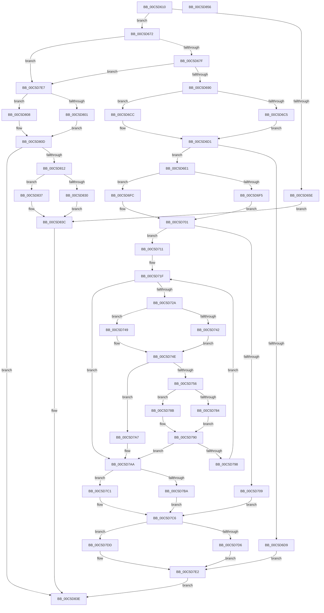

# CmpGetBootValueData

- RVA: `0x00C5D610`–`0x00C5D857` (길이 `583` bytes)
- VA: `0x0000000140C5D610`
- 실행 섹션: `INIT`
- PDB 이름 있음: `예`; PDB Function 태그: `아니요`
- unwind 정보 RVA: `0x000D7380`
- 디코드: `157`개 명령, `583/583` bytes 표시
- 미해석 바이트: `0` (있으면 어셈블리에 `.byte`로 보존)

> 이 문서는 커널 이미지의 기계어와 PDB 기호를 분석해 생성했습니다. 4번과 5번은 함수 원형과 자료형을 바이너리 사용 방식에서 추정한 C 해석이며 원본 소스 복구 결과는 아닙니다.

## 1. Dependencies

- 직접 호출 지점: **19**; 고유 호출 대상: **5**
- 직접 호출자로 확인된 함수: **1**
- RIP 상대 이미지 참조: **4**

### Outgoing calls
- `0x00C5D668` → [memcpy](../../text/6C/memcpy_function_006C6840.md) (function, `0x006C6840`)
- `0x00C5D6C5` → [HvpGetCellFlat](../../page/85/HvpGetCellFlat_function_00854C60.md) (function, `0x00854C60`)
- `0x00C5D6CC` → [HvpGetCellPaged](../../page/85/HvpGetCellPaged_function_00854CB0.md) (function, `0x00854CB0`)
- `0x00C5D6F5` → [HvpGetCellFlat](../../page/85/HvpGetCellFlat_function_00854C60.md) (function, `0x00854C60`)
- `0x00C5D6FC` → [HvpGetCellPaged](../../page/85/HvpGetCellPaged_function_00854CB0.md) (function, `0x00854CB0`)
- `0x00C5D742` → [HvpGetCellFlat](../../page/85/HvpGetCellFlat_function_00854C60.md) (function, `0x00854C60`)
- `0x00C5D749` → [HvpGetCellPaged](../../page/85/HvpGetCellPaged_function_00854CB0.md) (function, `0x00854CB0`)
- `0x00C5D76F` → [memcpy](../../text/6C/memcpy_function_006C6840.md) (function, `0x006C6840`)
- `0x00C5D784` → [HvpReleaseCellFlat](../../page/85/HvpReleaseCellFlat_function_0085CC20.md) (function, `0x0085CC20`)
- `0x00C5D78B` → [HvpReleaseCellPaged](../../page/85/HvpReleaseCellPaged_function_00855F40.md) (function, `0x00855F40`)
- `0x00C5D7BA` → [HvpReleaseCellFlat](../../page/85/HvpReleaseCellFlat_function_0085CC20.md) (function, `0x0085CC20`)
- `0x00C5D7C1` → [HvpReleaseCellPaged](../../page/85/HvpReleaseCellPaged_function_00855F40.md) (function, `0x00855F40`)
- `0x00C5D7D6` → [HvpReleaseCellFlat](../../page/85/HvpReleaseCellFlat_function_0085CC20.md) (function, `0x0085CC20`)
- `0x00C5D7DD` → [HvpReleaseCellPaged](../../page/85/HvpReleaseCellPaged_function_00855F40.md) (function, `0x00855F40`)
- `0x00C5D801` → [HvpGetCellFlat](../../page/85/HvpGetCellFlat_function_00854C60.md) (function, `0x00854C60`)
- `0x00C5D808` → [HvpGetCellPaged](../../page/85/HvpGetCellPaged_function_00854CB0.md) (function, `0x00854CB0`)
- `0x00C5D81B` → [memcpy](../../text/6C/memcpy_function_006C6840.md) (function, `0x006C6840`)
- `0x00C5D830` → [HvpReleaseCellFlat](../../page/85/HvpReleaseCellFlat_function_0085CC20.md) (function, `0x0085CC20`)
- `0x00C5D837` → [HvpReleaseCellPaged](../../page/85/HvpReleaseCellPaged_function_00855F40.md) (function, `0x00855F40`)

### Direct callers
- [CmpGetSystemControlValues](CmpGetSystemControlValues_function_00C5959C.md) at `0x00C59921`

### Static image references
- `0x00C5D672` → RVA `0x0100D6AC` (`INITDATA`; read)
- `0x00C5D693` → RVA `0x0100D5D0` (`INITDATA`; read)
- `0x00C5D6A1` → RVA `0x0100D65C` (`INITDATA`; reference)
- `0x00C5D7AA` → RVA `0x0100D65C` (`INITDATA`; read)

## 2. Other-region calls and transfers

- 다른 실행 섹션으로 향하는 call: **19**
  - `0x00C5D668` → [memcpy](../../text/6C/memcpy_function_006C6840.md) (`INIT` → `.text`)
  - `0x00C5D6C5` → [HvpGetCellFlat](../../page/85/HvpGetCellFlat_function_00854C60.md) (`INIT` → `PAGE`)
  - `0x00C5D6CC` → [HvpGetCellPaged](../../page/85/HvpGetCellPaged_function_00854CB0.md) (`INIT` → `PAGE`)
  - `0x00C5D6F5` → [HvpGetCellFlat](../../page/85/HvpGetCellFlat_function_00854C60.md) (`INIT` → `PAGE`)
  - `0x00C5D6FC` → [HvpGetCellPaged](../../page/85/HvpGetCellPaged_function_00854CB0.md) (`INIT` → `PAGE`)
  - `0x00C5D742` → [HvpGetCellFlat](../../page/85/HvpGetCellFlat_function_00854C60.md) (`INIT` → `PAGE`)
  - `0x00C5D749` → [HvpGetCellPaged](../../page/85/HvpGetCellPaged_function_00854CB0.md) (`INIT` → `PAGE`)
  - `0x00C5D76F` → [memcpy](../../text/6C/memcpy_function_006C6840.md) (`INIT` → `.text`)
  - `0x00C5D784` → [HvpReleaseCellFlat](../../page/85/HvpReleaseCellFlat_function_0085CC20.md) (`INIT` → `PAGE`)
  - `0x00C5D78B` → [HvpReleaseCellPaged](../../page/85/HvpReleaseCellPaged_function_00855F40.md) (`INIT` → `PAGE`)
  - `0x00C5D7BA` → [HvpReleaseCellFlat](../../page/85/HvpReleaseCellFlat_function_0085CC20.md) (`INIT` → `PAGE`)
  - `0x00C5D7C1` → [HvpReleaseCellPaged](../../page/85/HvpReleaseCellPaged_function_00855F40.md) (`INIT` → `PAGE`)
  - `0x00C5D7D6` → [HvpReleaseCellFlat](../../page/85/HvpReleaseCellFlat_function_0085CC20.md) (`INIT` → `PAGE`)
  - `0x00C5D7DD` → [HvpReleaseCellPaged](../../page/85/HvpReleaseCellPaged_function_00855F40.md) (`INIT` → `PAGE`)
  - `0x00C5D801` → [HvpGetCellFlat](../../page/85/HvpGetCellFlat_function_00854C60.md) (`INIT` → `PAGE`)
  - `0x00C5D808` → [HvpGetCellPaged](../../page/85/HvpGetCellPaged_function_00854CB0.md) (`INIT` → `PAGE`)
  - `0x00C5D81B` → [memcpy](../../text/6C/memcpy_function_006C6840.md) (`INIT` → `.text`)
  - `0x00C5D830` → [HvpReleaseCellFlat](../../page/85/HvpReleaseCellFlat_function_0085CC20.md) (`INIT` → `PAGE`)
  - `0x00C5D837` → [HvpReleaseCellPaged](../../page/85/HvpReleaseCellPaged_function_00855F40.md) (`INIT` → `PAGE`)
- 별도 외부 분기/꼬리 이동을 확인하지 못했습니다.

## 3. Assembly (complete function range)

```asm
00C5D610  48 89 5C 24 20                  mov qword ptr [rsp + 0x20], rbx
00C5D615  4C 89 44 24 18                  mov qword ptr [rsp + 0x18], r8
00C5D61A  48 89 4C 24 08                  mov qword ptr [rsp + 8], rcx
00C5D61F  55                              push rbp
00C5D620  56                              push rsi
00C5D621  57                              push rdi
00C5D622  41 54                           push r12
00C5D624  41 55                           push r13
00C5D626  41 56                           push r14
00C5D628  41 57                           push r15
00C5D62A  48 8B EC                        mov rbp, rsp
00C5D62D  48 83 EC 30                     sub rsp, 0x30
00C5D631  8B 42 04                        mov eax, dword ptr [rdx + 4]
00C5D634  45 33 ED                        xor r13d, r13d
00C5D637  49 8B F0                        mov rsi, r8
00C5D63A  45 8B F1                        mov r14d, r9d
00C5D63D  41 83 C8 FF                     or r8d, 0xffffffff
00C5D641  44 89 6D 44                     mov dword ptr [rbp + 0x44], r13d
00C5D645  48 8B FA                        mov rdi, rdx
00C5D648  44 89 45 40                     mov dword ptr [rbp + 0x40], r8d
00C5D64C  BA 00 00 00 80                  mov edx, 0x80000000
00C5D651  8D 88 00 00 00 80               lea ecx, [rax - 0x80000000]
00C5D657  3B C2                           cmp eax, edx
00C5D659  0F 42 C8                        cmovb ecx, eax
00C5D65C  72 14                           jb 0x140c5d672
00C5D65E  45 8B C6                        mov r8d, r14d
00C5D661  48 8D 57 08                     lea rdx, [rdi + 8]
00C5D665  48 8B CE                        mov rcx, rsi
00C5D668  E8 D3 91 A6 FF                  call 0x1406c6840
00C5D66D  E9 CA 01 00 00                  jmp 0x140c5d83c
00C5D672  83 3D 33 00 3B 00 04            cmp dword ptr [rip + 0x3b0033], 4
00C5D679  0F 82 68 01 00 00               jb 0x140c5d7e7
00C5D67F  8D 81 27 C0 FF FF               lea eax, [rcx - 0x3fd9]
00C5D685  3D 26 C0 FF 7F                  cmp eax, 0x7fffc026
00C5D68A  0F 87 57 01 00 00               ja 0x140c5d7e7
00C5D690  8B 57 08                        mov edx, dword ptr [rdi + 8]
00C5D693  48 8D 1D 36 FF 3A 00            lea rbx, [rip + 0x3aff36]
00C5D69A  40 B6 01                        mov sil, 1
00C5D69D  44 89 45 F0                     mov dword ptr [rbp - 0x10], r8d
00C5D6A1  40 84 35 B4 FF 3A 00            test byte ptr [rip + 0x3affb4], sil
00C5D6A8  48 8B CB                        mov rcx, rbx
00C5D6AB  44 89 45 40                     mov dword ptr [rbp + 0x40], r8d
00C5D6AF  44 89 45 48                     mov dword ptr [rbp + 0x48], r8d
00C5D6B3  4C 8D 45 F0                     lea r8, [rbp - 0x10]
00C5D6B7  44 89 6D F4                     mov dword ptr [rbp - 0xc], r13d
00C5D6BB  44 89 6D 44                     mov dword ptr [rbp + 0x44], r13d
00C5D6BF  44 89 6D 4C                     mov dword ptr [rbp + 0x4c], r13d
00C5D6C3  74 07                           je 0x140c5d6cc
00C5D6C5  E8 96 75 BF FF                  call 0x140854c60
00C5D6CA  EB 05                           jmp 0x140c5d6d1
00C5D6CC  E8 DF 75 BF FF                  call 0x140854cb0
00C5D6D1  4C 8B F8                        mov r15, rax
00C5D6D4  48 85 C0                        test rax, rax
00C5D6D7  75 08                           jne 0x140c5d6e1
00C5D6D9  41 8A F5                        mov sil, r13b
00C5D6DC  E9 01 01 00 00                  jmp 0x140c5d7e2
00C5D6E1  40 84 35 74 FF 3A 00            test byte ptr [rip + 0x3aff74], sil
00C5D6E8  4C 8D 45 48                     lea r8, [rbp + 0x48]
00C5D6EC  41 8B 57 04                     mov edx, dword ptr [r15 + 4]
00C5D6F0  48 8B CB                        mov rcx, rbx
00C5D6F3  74 07                           je 0x140c5d6fc
00C5D6F5  E8 66 75 BF FF                  call 0x140854c60
00C5D6FA  EB 05                           jmp 0x140c5d701
00C5D6FC  E8 AF 75 BF FF                  call 0x140854cb0
00C5D701  4C 8B E0                        mov r12, rax
00C5D704  48 85 C0                        test rax, rax
00C5D707  75 08                           jne 0x140c5d711
00C5D709  41 8A F5                        mov sil, r13b
00C5D70C  E9 B5 00 00 00                  jmp 0x140c5d7c6
00C5D711  8B 7F 04                        mov edi, dword ptr [rdi + 4]
00C5D714  41 3B FE                        cmp edi, r14d
00C5D717  41 0F 47 FE                     cmova edi, r14d
00C5D71B  45 0F B7 F5                     movzx r14d, r13w
00C5D71F  66 45 3B 77 02                  cmp r14w, word ptr [r15 + 2]
00C5D724  0F 83 80 00 00 00               jae 0x140c5d7aa
00C5D72A  40 84 35 2B FF 3A 00            test byte ptr [rip + 0x3aff2b], sil
00C5D731  4C 8D 45 40                     lea r8, [rbp + 0x40]
00C5D735  45 0F B7 EE                     movzx r13d, r14w
00C5D739  48 8B CB                        mov rcx, rbx
00C5D73C  43 8B 14 AC                     mov edx, dword ptr [r12 + r13*4]
00C5D740  74 07                           je 0x140c5d749
00C5D742  E8 19 75 BF FF                  call 0x140854c60
00C5D747  EB 05                           jmp 0x140c5d74e
00C5D749  E8 62 75 BF FF                  call 0x140854cb0
00C5D74E  48 8B D0                        mov rdx, rax
00C5D751  48 85 C0                        test rax, rax
00C5D754  74 51                           je 0x140c5d7a7
00C5D756  B9 D8 3F 00 00                  mov ecx, 0x3fd8
00C5D75B  44 8B C7                        mov r8d, edi
00C5D75E  3B F9                           cmp edi, ecx
00C5D760  44 0F 47 C1                     cmova r8d, ecx
00C5D764  49 69 CD D8 3F 00 00            imul rcx, r13, 0x3fd8
00C5D76B  48 03 4D 50                     add rcx, qword ptr [rbp + 0x50]
00C5D76F  E8 CC 90 A6 FF                  call 0x1406c6840
00C5D774  40 84 35 E1 FE 3A 00            test byte ptr [rip + 0x3afee1], sil
00C5D77B  48 8D 55 40                     lea rdx, [rbp + 0x40]
00C5D77F  48 8B CB                        mov rcx, rbx
00C5D782  74 07                           je 0x140c5d78b
00C5D784  E8 97 F4 BF FF                  call 0x14085cc20
00C5D789  EB 05                           jmp 0x140c5d790
00C5D78B  E8 B0 87 BF FF                  call 0x140855f40
00C5D790  81 FF D8 3F 00 00               cmp edi, 0x3fd8
00C5D796  76 12                           jbe 0x140c5d7aa
00C5D798  81 C7 28 C0 FF FF               add edi, 0xffffc028
00C5D79E  66 41 FF C6                     inc r14w
00C5D7A2  E9 78 FF FF FF                  jmp 0x140c5d71f
00C5D7A7  40 32 F6                        xor sil, sil
00C5D7AA  F6 05 AB FE 3A 00 01            test byte ptr [rip + 0x3afeab], 1
00C5D7B1  48 8D 55 48                     lea rdx, [rbp + 0x48]
00C5D7B5  48 8B CB                        mov rcx, rbx
00C5D7B8  74 07                           je 0x140c5d7c1
00C5D7BA  E8 61 F4 BF FF                  call 0x14085cc20
00C5D7BF  EB 05                           jmp 0x140c5d7c6
00C5D7C1  E8 7A 87 BF FF                  call 0x140855f40
00C5D7C6  F6 05 8F FE 3A 00 01            test byte ptr [rip + 0x3afe8f], 1
00C5D7CD  48 8D 55 F0                     lea rdx, [rbp - 0x10]
00C5D7D1  48 8B CB                        mov rcx, rbx
00C5D7D4  74 07                           je 0x140c5d7dd
00C5D7D6  E8 45 F4 BF FF                  call 0x14085cc20
00C5D7DB  EB 05                           jmp 0x140c5d7e2
00C5D7DD  E8 5E 87 BF FF                  call 0x140855f40
00C5D7E2  40 8A C6                        mov al, sil
00C5D7E5  EB 57                           jmp 0x140c5d83e
00C5D7E7  F6 05 6E FE 3A 00 01            test byte ptr [rip + 0x3afe6e], 1
00C5D7EE  48 8D 1D DB FD 3A 00            lea rbx, [rip + 0x3afddb]
00C5D7F5  8B 57 08                        mov edx, dword ptr [rdi + 8]
00C5D7F8  4C 8D 45 40                     lea r8, [rbp + 0x40]
00C5D7FC  48 8B CB                        mov rcx, rbx
00C5D7FF  74 07                           je 0x140c5d808
00C5D801  E8 5A 74 BF FF                  call 0x140854c60
00C5D806  EB 05                           jmp 0x140c5d80d
00C5D808  E8 A3 74 BF FF                  call 0x140854cb0
00C5D80D  48 85 C0                        test rax, rax
00C5D810  74 2C                           je 0x140c5d83e
00C5D812  4D 8B C6                        mov r8, r14
00C5D815  48 8B D0                        mov rdx, rax
00C5D818  48 8B CE                        mov rcx, rsi
00C5D81B  E8 20 90 A6 FF                  call 0x1406c6840
00C5D820  F6 05 35 FE 3A 00 01            test byte ptr [rip + 0x3afe35], 1
00C5D827  48 8D 55 40                     lea rdx, [rbp + 0x40]
00C5D82B  48 8B CB                        mov rcx, rbx
00C5D82E  74 07                           je 0x140c5d837
00C5D830  E8 EB F3 BF FF                  call 0x14085cc20
00C5D835  EB 05                           jmp 0x140c5d83c
00C5D837  E8 04 87 BF FF                  call 0x140855f40
00C5D83C  B0 01                           mov al, 1
00C5D83E  48 8B 9C 24 88 00 00 00         mov rbx, qword ptr [rsp + 0x88]
00C5D846  48 83 C4 30                     add rsp, 0x30
00C5D84A  41 5F                           pop r15
00C5D84C  41 5E                           pop r14
00C5D84E  41 5D                           pop r13
00C5D850  41 5C                           pop r12
00C5D852  5F                              pop rdi
00C5D853  5E                              pop rsi
00C5D854  5D                              pop rbp
00C5D855  C3                              ret
00C5D856  CC                              int3
```

## 4. C-style interpretation (structured pseudocode)

```c
__int64 __fastcall CmpGetBootValueData(__int64 a1, __int64 a2, __int64 a3, int a4)
{
    __int64 result;
    __int64 v_r13;
    __int64 v_r14;
    __int64 v_rdi;
    __int64 v_rsi;
    __int64 v_rsp;
    unsigned int v_stack_m44;
    unsigned int v_stack_m48;
    unsigned int v_stack_p10;
    unsigned int v_stack_p14;
    unsigned __int64 v_stack_p18;
    unsigned __int64 v_stack_p20;
    unsigned __int64 v_stack_p8;
    unsigned int v_stack_pC;

    v_stack_p20 = v_rbx;
    v_stack_p18 = a3;
    v_stack_p8 = a1;
    v_rsp = (v_rsp) - (48);
    v_r13 = 0;
    a3 = (unsigned int)((a3) | (0xFFFFFFFFULL));
    v_stack_pC = 0;
    v_stack_p8 = (unsigned int)(a3);
    a1 = (unsigned int)(*(unsigned int *)(a2 + 4)) - 2147483648;
    if (((unsigned int)((unsigned int)(*(unsigned int *)(a2 + 4)))) < ((unsigned int)((unsigned int)(0x80000000ULL)))) { a1 = (unsigned int)((unsigned int)(*(unsigned int *)(a2 + 4))); }
    if (((unsigned int)((unsigned int)(*(unsigned int *)(a2 + 4)))) < ((unsigned int)((unsigned int)(0x80000000ULL)))) goto loc_00C5D672;
    result = memcpy(a3, a2 + 8, (unsigned int)((unsigned int)((unsigned int)(a4))), a4);
    goto loc_00C5D83C;
loc_00C5D672:
    if ((*(unsigned int *)(v_rip + 3866675)) < 4) goto loc_00C5D7E7;
    if (((unsigned int)(a3 - 16345)) > 0x7FFFC026ULL) goto loc_00C5D7E7;
    v_stack_m48 = (unsigned int)((unsigned int)((unsigned int)((unsigned int)(a4))));
    v_stack_p8 = (unsigned int)((unsigned int)((unsigned int)((unsigned int)(a4))));
    v_stack_p10 = (unsigned int)((unsigned int)((unsigned int)((unsigned int)(a4))));
    v_stack_m44 = 0;
    v_stack_pC = 0;
    v_stack_p14 = 0;
    if (((*(unsigned __int8 *)(v_rip + 3866548)) & (1)) == 0) goto loc_00C5D6CC;
    result = HvpGetCellFlat(v_rip + 3866422, (unsigned int)(*(unsigned int *)(a2 + 8)), v_stack_m48, a4);
    goto loc_00C5D6D1;
loc_00C5D6CC:
    result = HvpGetCellPaged(v_rip + 3866422, (unsigned int)(*(unsigned int *)(a2 + 8)), v_stack_m48, a4);
loc_00C5D6D1:
    if (result != 0) goto loc_00C5D6E1;
    goto loc_00C5D7E2;
loc_00C5D6E1:
    if (((*(unsigned __int8 *)(v_rip + 3866484)) & (0)) == 0) goto loc_00C5D6FC;
    result = HvpGetCellFlat(v_rip + 3866422, (unsigned int)(*(unsigned int *)(result + 4)), v_stack_p10, a4);
    goto loc_00C5D701;
loc_00C5D6FC:
    result = HvpGetCellPaged(v_rip + 3866422, (unsigned int)(*(unsigned int *)(result + 4)), v_stack_p10, a4);
loc_00C5D701:
    if (result != 0) goto loc_00C5D711;
    goto loc_00C5D7C6;
loc_00C5D711:
    v_rdi = (unsigned int)(*(unsigned int *)(a2 + 4));
    if (((unsigned int)((unsigned int)(*(unsigned int *)(a2 + 4)))) > ((unsigned int)((unsigned int)(a4)))) { v_rdi = (unsigned int)((unsigned int)(a4)); }
loc_00C5D71F:
    if (0 >= (*(unsigned __int16 *)(result + 2))) goto loc_00C5D7AA;
    if (((*(unsigned __int8 *)(v_rip + 3866411)) & (0)) == 0) goto loc_00C5D749;
    result = HvpGetCellFlat(v_rip + 3866422, (unsigned int)(*(unsigned int *)(result + 0 * 4)), v_stack_p8, a4);
    goto loc_00C5D74E;
loc_00C5D749:
    result = HvpGetCellPaged(v_rip + 3866422, (unsigned int)(*(unsigned int *)(result + 0 * 4)), v_stack_p8, a4);
loc_00C5D74E:
    if (result == 0) goto loc_00C5D7A7;
    a3 = (unsigned int)((unsigned int)(v_rdi));
    if (((unsigned int)(v_rdi)) > ((unsigned int)((unsigned int)(0x3FD8ULL)))) { a3 = (unsigned int)((unsigned int)(0x3FD8ULL)); }
    a1 = ((unsigned int)(0x3FD8ULL)) * (0);
    a1 = (a1) + (v_stack_p18);
    result = memcpy(a1, result, a3, a4);
    if (((*(unsigned __int8 *)(v_rip + 3866337)) & (0)) == 0) goto loc_00C5D78B;
    result = HvpReleaseCellFlat(v_rip + 3866422, v_stack_p8, a3, a4);
    goto loc_00C5D790;
loc_00C5D78B:
    result = HvpReleaseCellPaged(v_rip + 3866422, v_stack_p8, a3, a4);
loc_00C5D790:
    if (((unsigned int)(v_rdi)) <= 0x3FD8ULL) goto loc_00C5D7AA;
    v_rdi = (unsigned int)((v_rdi) + (0xFFFFC028ULL));
    v_r14 = (unsigned __int16)((0) + 1);
    goto loc_00C5D71F;
loc_00C5D7A7:
    v_rsi = 0;
loc_00C5D7AA:
    if (((*(unsigned __int8 *)(v_rip + 3866283)) & (1)) == 0) goto loc_00C5D7C1;
    result = HvpReleaseCellFlat(v_rip + 3866422, v_stack_p10, a3, a4);
    goto loc_00C5D7C6;
loc_00C5D7C1:
    result = HvpReleaseCellPaged(v_rip + 3866422, v_stack_p10, a3, a4);
loc_00C5D7C6:
    if (((*(unsigned __int8 *)(v_rip + 3866255)) & (1)) == 0) goto loc_00C5D7DD;
    result = HvpReleaseCellFlat(v_rip + 3866422, v_stack_m48, a3, a4);
    goto loc_00C5D7E2;
loc_00C5D7DD:
    result = HvpReleaseCellPaged(v_rip + 3866422, v_stack_m48, a3, a4);
loc_00C5D7E2:
    goto loc_00C5D83E;
loc_00C5D7E7:
    if (((*(unsigned __int8 *)(v_rip + 3866222)) & (1)) == 0) goto loc_00C5D808;
    result = HvpGetCellFlat(v_rip + 3866075, (unsigned int)(*(unsigned int *)(v_rdi + 8)), v_stack_p8, a4);
    goto loc_00C5D80D;
loc_00C5D808:
    result = HvpGetCellPaged(v_rip + 3866075, (unsigned int)(*(unsigned int *)(v_rdi + 8)), v_stack_p8, a4);
loc_00C5D80D:
    if (result == 0) goto loc_00C5D83E;
    result = memcpy(0, result, v_r14, a4);
    if (((*(unsigned __int8 *)(v_rip + 3866165)) & (1)) == 0) goto loc_00C5D837;
    result = HvpReleaseCellFlat(v_rip + 3866075, v_stack_p8, v_r14, a4);
    goto loc_00C5D83C;
loc_00C5D837:
    result = HvpReleaseCellPaged(v_rip + 3866075, v_stack_p8, v_r14, a4);
loc_00C5D83C:
loc_00C5D83E:
    v_rsp = (v_rsp) + (48);
    return 1;
}
```

## 5. (Beta) C Style

```c
int64_t CmpGetBootValueData(int64_t Arg1, void *Arg2, int64_t Arg3, int32_t Arg4)
{
    uint8_t *arg2 = (uint8_t *)Arg2;

    int64_t result;
    int64_t local_r13;
    int64_t local_r14;
    int64_t local_rdi;
    int64_t local_rsi;
    int64_t local_rsp;
    uint32_t v_stack_m44;
    uint32_t v_stack_m48;
    uint32_t v_stack_p10;
    uint32_t v_stack_p14;
    uint64_t v_stack_p18;
    uint64_t v_stack_p20;
    uint64_t v_stack_p8;
    uint32_t v_stack_pC;

    v_stack_p20 = local_rbx;
    v_stack_p18 = Arg3;
    v_stack_p8 = Arg1;
    local_rsp = (local_rsp) - (48);
    local_r13 = 0;
    Arg3 = (uint32_t)((Arg3) | (0xFFFFFFFFULL));
    v_stack_pC = 0;
    v_stack_p8 = (uint32_t)(Arg3);
    Arg1 = (uint32_t)(*(uint32_t *)(arg2 + 0x4)) - 2147483648;
    if (((uint32_t)((uint32_t)(*(uint32_t *)(arg2 + 0x4)))) < ((uint32_t)((uint32_t)(0x80000000ULL)))) { Arg1 = (uint32_t)((uint32_t)(*(uint32_t *)(arg2 + 0x4))); }
    if (((uint32_t)((uint32_t)(*(uint32_t *)(arg2 + 0x4)))) < ((uint32_t)((uint32_t)(0x80000000ULL)))) goto loc_00C5D672;
    result = memcpy(Arg3, Arg2 + 8, (uint32_t)((uint32_t)((uint32_t)(Arg4))), Arg4);
    goto loc_00C5D83C;
loc_00C5D672:
    if ((*(uint32_t *)(v_rip + 0x3B0033)) < 4) goto loc_00C5D7E7;
    if (((uint32_t)(Arg3 - 16345)) > 0x7FFFC026ULL) goto loc_00C5D7E7;
    v_stack_m48 = (uint32_t)((uint32_t)((uint32_t)((uint32_t)(Arg4))));
    v_stack_p8 = (uint32_t)((uint32_t)((uint32_t)((uint32_t)(Arg4))));
    v_stack_p10 = (uint32_t)((uint32_t)((uint32_t)((uint32_t)(Arg4))));
    v_stack_m44 = 0;
    v_stack_pC = 0;
    v_stack_p14 = 0;
    if (((*(uint8_t *)(v_rip + 0x3AFFB4)) & (1)) == 0) goto loc_00C5D6CC;
    result = HvpGetCellFlat(v_rip + 3866422, (uint32_t)(*(uint32_t *)(arg2 + 0x8)), v_stack_m48, Arg4);
    goto loc_00C5D6D1;
loc_00C5D6CC:
    result = HvpGetCellPaged(v_rip + 3866422, (uint32_t)(*(uint32_t *)(arg2 + 0x8)), v_stack_m48, Arg4);
loc_00C5D6D1:
    if (result != 0) goto loc_00C5D6E1;
    goto loc_00C5D7E2;
loc_00C5D6E1:
    if (((*(uint8_t *)(v_rip + 0x3AFF74)) & (0)) == 0) goto loc_00C5D6FC;
    result = HvpGetCellFlat(v_rip + 3866422, (uint32_t)(*(uint32_t *)(result + 0x4)), v_stack_p10, Arg4);
    goto loc_00C5D701;
loc_00C5D6FC:
    result = HvpGetCellPaged(v_rip + 3866422, (uint32_t)(*(uint32_t *)(result + 0x4)), v_stack_p10, Arg4);
loc_00C5D701:
    if (result != 0) goto loc_00C5D711;
    goto loc_00C5D7C6;
loc_00C5D711:
    local_rdi = (uint32_t)(*(uint32_t *)(arg2 + 0x4));
    if (((uint32_t)((uint32_t)(*(uint32_t *)(arg2 + 0x4)))) > ((uint32_t)((uint32_t)(Arg4)))) { local_rdi = (uint32_t)((uint32_t)(Arg4)); }
loc_00C5D71F:
    if (0 >= (*(uint16_t *)(result + 0x2))) goto loc_00C5D7AA;
    if (((*(uint8_t *)(v_rip + 0x3AFF2B)) & (0)) == 0) goto loc_00C5D749;
    result = HvpGetCellFlat(v_rip + 3866422, (uint32_t)(*(uint32_t *)(result + 0x0 * 4)), v_stack_p8, Arg4);
    goto loc_00C5D74E;
loc_00C5D749:
    result = HvpGetCellPaged(v_rip + 3866422, (uint32_t)(*(uint32_t *)(result + 0x0 * 4)), v_stack_p8, Arg4);
loc_00C5D74E:
    if (result == 0) goto loc_00C5D7A7;
    Arg3 = (uint32_t)((uint32_t)(local_rdi));
    if (((uint32_t)(local_rdi)) > ((uint32_t)((uint32_t)(0x3FD8ULL)))) { Arg3 = (uint32_t)((uint32_t)(0x3FD8ULL)); }
    Arg1 = ((uint32_t)(0x3FD8ULL)) * (0);
    Arg1 = (Arg1) + (v_stack_p18);
    result = memcpy(Arg1, result, Arg3, Arg4);
    if (((*(uint8_t *)(v_rip + 0x3AFEE1)) & (0)) == 0) goto loc_00C5D78B;
    result = HvpReleaseCellFlat(v_rip + 3866422, v_stack_p8, Arg3, Arg4);
    goto loc_00C5D790;
loc_00C5D78B:
    result = HvpReleaseCellPaged(v_rip + 3866422, v_stack_p8, Arg3, Arg4);
loc_00C5D790:
    if (((uint32_t)(local_rdi)) <= 0x3FD8ULL) goto loc_00C5D7AA;
    local_rdi = (uint32_t)((local_rdi) + (0xFFFFC028ULL));
    local_r14 = (uint16_t)((0) + 1);
    goto loc_00C5D71F;
loc_00C5D7A7:
    local_rsi = 0;
loc_00C5D7AA:
    if (((*(uint8_t *)(v_rip + 0x3AFEAB)) & (1)) == 0) goto loc_00C5D7C1;
    result = HvpReleaseCellFlat(v_rip + 3866422, v_stack_p10, Arg3, Arg4);
    goto loc_00C5D7C6;
loc_00C5D7C1:
    result = HvpReleaseCellPaged(v_rip + 3866422, v_stack_p10, Arg3, Arg4);
loc_00C5D7C6:
    if (((*(uint8_t *)(v_rip + 0x3AFE8F)) & (1)) == 0) goto loc_00C5D7DD;
    result = HvpReleaseCellFlat(v_rip + 3866422, v_stack_m48, Arg3, Arg4);
    goto loc_00C5D7E2;
loc_00C5D7DD:
    result = HvpReleaseCellPaged(v_rip + 3866422, v_stack_m48, Arg3, Arg4);
loc_00C5D7E2:
    goto loc_00C5D83E;
loc_00C5D7E7:
    if (((*(uint8_t *)(v_rip + 0x3AFE6E)) & (1)) == 0) goto loc_00C5D808;
    result = HvpGetCellFlat(v_rip + 3866075, (uint32_t)(*(uint32_t *)(local_rdi + 0x8)), v_stack_p8, Arg4);
    goto loc_00C5D80D;
loc_00C5D808:
    result = HvpGetCellPaged(v_rip + 3866075, (uint32_t)(*(uint32_t *)(local_rdi + 0x8)), v_stack_p8, Arg4);
loc_00C5D80D:
    if (result == 0) goto loc_00C5D83E;
    result = memcpy(0, result, local_r14, Arg4);
    if (((*(uint8_t *)(v_rip + 0x3AFE35)) & (1)) == 0) goto loc_00C5D837;
    result = HvpReleaseCellFlat(v_rip + 3866075, v_stack_p8, local_r14, Arg4);
    goto loc_00C5D83C;
loc_00C5D837:
    result = HvpReleaseCellPaged(v_rip + 3866075, v_stack_p8, local_r14, Arg4);
loc_00C5D83C:
loc_00C5D83E:
    local_rsp = (local_rsp) + (48);
    return 1;
}
```

### 관측된 메모리 오프셋

구조체 형식이 확인되지 않은 접근은 인자 기준의 오프셋으로만 기록했습니다.

| 기준 인자 | 오프셋 표현 | 폭 (bit) | 접근 |
|---|---:|---:|---|
| `Arg2` | `+ 0x4` | `32` | `R` |
| `Arg2` | `+ 0x8` | `32` | `R` |
| `Arg2` | `+ 0x8` | `64` | `R` |

## 6. Execution-region graph

[열기: 2D/3D 그래프와 함수 탐색 컨트롤 패널](../../../control-panel.html?section=init&rva=0x00C5D610&view=graph)

- 2D 그래프는 위에서 아래로 흐르고, 3D 그래프는 빈 공간을 드래그해 회전합니다. Shift+드래그는 이동, 휠은 확대·축소, 함수 노드 선택은 대상 보고서 이동입니다.

### Static fallback


