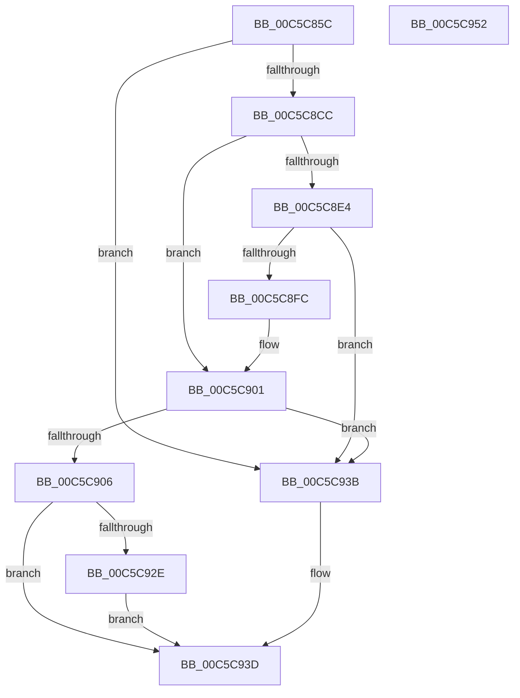

# CmpGetKnownHivePathNode

- RVA: `0x00C5C85C`–`0x00C5C953` (길이 `247` bytes)
- VA: `0x0000000140C5C85C`
- 실행 섹션: `INIT`
- PDB 이름 있음: `예`; PDB Function 태그: `아니요`
- unwind 정보 RVA: `0x0006F874`
- 디코드: `66`개 명령, `247/247` bytes 표시
- 미해석 바이트: `0` (있으면 어셈블리에 `.byte`로 보존)

> 이 문서는 커널 이미지의 기계어와 PDB 기호를 분석해 생성했습니다. 4번과 5번은 함수 원형과 자료형을 바이너리 사용 방식에서 추정한 C 해석이며 원본 소스 복구 결과는 아닙니다.

## 1. Dependencies

- 직접 호출 지점: **4**; 고유 호출 대상: **3**
- 직접 호출자로 확인된 함수: **1**
- RIP 상대 이미지 참조: **2**

### Outgoing calls
- `0x00C5C8C3` → [CmpGetNextName](../../page/7F/CmpGetNextName_function_007F138C.md) (function, `0x007F138C`)
- `0x00C5C8DB` → [RtlEqualUnicodeString](../../page/93/RtlEqualUnicodeString_function_00932A20.md) (function, `0x00932A20`)
- `0x00C5C8F3` → [RtlEqualUnicodeString](../../page/93/RtlEqualUnicodeString_function_00932A20.md) (function, `0x00932A20`)
- `0x00C5C925` → [CmpFindHiveSubKey](CmpFindHiveSubKey_function_00C5C398.md) (function, `0x00C5C398`)

### Direct callers
- [CmpFindRedirectedDriverServiceStateNode](CmpFindRedirectedDriverServiceStateNode_function_00C5C480.md) at `0x00C5C509`

### Static image references
- `0x00C5C8CF` → RVA `0x00C82198` (`CmpSystemHiveName`; read)
- `0x00C5C8E7` → RVA `0x00C82270` (`CmpDevicesHiveName`; read)

## 2. Other-region calls and transfers

- 다른 실행 섹션으로 향하는 call: **3**
  - `0x00C5C8C3` → [CmpGetNextName](../../page/7F/CmpGetNextName_function_007F138C.md) (`INIT` → `PAGE`)
  - `0x00C5C8DB` → [RtlEqualUnicodeString](../../page/93/RtlEqualUnicodeString_function_00932A20.md) (`INIT` → `PAGE`)
  - `0x00C5C8F3` → [RtlEqualUnicodeString](../../page/93/RtlEqualUnicodeString_function_00932A20.md) (`INIT` → `PAGE`)
- 별도 외부 분기/꼬리 이동을 확인하지 못했습니다.

## 3. Assembly (complete function range)

```asm
00C5C85C  4C 8B DC                        mov r11, rsp
00C5C85F  49 89 5B 08                     mov qword ptr [r11 + 8], rbx
00C5C863  49 89 6B 10                     mov qword ptr [r11 + 0x10], rbp
00C5C867  49 89 73 18                     mov qword ptr [r11 + 0x18], rsi
00C5C86B  57                              push rdi
00C5C86C  48 83 EC 50                     sub rsp, 0x50
00C5C870  83 64 24 34 00                  and dword ptr [rsp + 0x34], 0
00C5C875  8B FA                           mov edi, edx
00C5C877  48 8B 94 24 80 00 00 00         mov rdx, qword ptr [rsp + 0x80]
00C5C87F  48 8B D9                        mov rbx, rcx
00C5C882  B9 24 00 00 00                  mov ecx, 0x24
00C5C887  49 8B E8                        mov rbp, r8
00C5C88A  0F 57 C0                        xorps xmm0, xmm0
00C5C88D  4D 8D 43 28                     lea r8, [r11 + 0x28]
00C5C891  41 8B F1                        mov esi, r9d
00C5C894  48 8B 42 08                     mov rax, qword ptr [rdx + 8]
00C5C898  48 03 C1                        add rax, rcx
00C5C89B  49 89 43 E0                     mov qword ptr [r11 - 0x20], rax
00C5C89F  0F B7 42 02                     movzx eax, word ptr [rdx + 2]
00C5C8A3  66 2B C1                        sub ax, cx
00C5C8A6  66 89 44 24 32                  mov word ptr [rsp + 0x32], ax
00C5C8AB  0F B7 02                        movzx eax, word ptr [rdx]
00C5C8AE  49 8D 53 E8                     lea rdx, [r11 - 0x18]
00C5C8B2  66 2B C1                        sub ax, cx
00C5C8B5  49 8D 4B D8                     lea rcx, [r11 - 0x28]
00C5C8B9  66 89 44 24 30                  mov word ptr [rsp + 0x30], ax
00C5C8BE  0F 11 44 24 40                  movups xmmword ptr [rsp + 0x40], xmm0
00C5C8C3  E8 C4 4A B9 FF                  call 0x1407f138c
00C5C8C8  84 C0                           test al, al
00C5C8CA  74 6F                           je 0x140c5c93b
00C5C8CC  41 B0 01                        mov r8b, 1
00C5C8CF  48 8D 15 C2 58 02 00            lea rdx, [rip + 0x258c2]
00C5C8D6  48 8D 4C 24 40                  lea rcx, [rsp + 0x40]
00C5C8DB  E8 40 61 CD FF                  call 0x140932a20
00C5C8E0  84 C0                           test al, al
00C5C8E2  75 1D                           jne 0x140c5c901
00C5C8E4  41 B0 01                        mov r8b, 1
00C5C8E7  48 8D 15 82 59 02 00            lea rdx, [rip + 0x25982]
00C5C8EE  48 8D 4C 24 40                  lea rcx, [rsp + 0x40]
00C5C8F3  E8 28 61 CD FF                  call 0x140932a20
00C5C8F8  84 C0                           test al, al
00C5C8FA  74 3F                           je 0x140c5c93b
00C5C8FC  48 8B DD                        mov rbx, rbp
00C5C8FF  8B FE                           mov edi, esi
00C5C901  48 85 DB                        test rbx, rbx
00C5C904  74 35                           je 0x140c5c93b
00C5C906  48 8B 84 24 98 00 00 00         mov rax, qword ptr [rsp + 0x98]
00C5C90E  4C 8D 44 24 30                  lea r8, [rsp + 0x30]
00C5C913  4C 8B 8C 24 90 00 00 00         mov r9, qword ptr [rsp + 0x90]
00C5C91B  8B D7                           mov edx, edi
00C5C91D  48 8B CB                        mov rcx, rbx
00C5C920  48 89 44 24 20                  mov qword ptr [rsp + 0x20], rax
00C5C925  E8 6E FA FF FF                  call 0x140c5c398
00C5C92A  84 C0                           test al, al
00C5C92C  74 0F                           je 0x140c5c93d
00C5C92E  48 8B 8C 24 88 00 00 00         mov rcx, qword ptr [rsp + 0x88]
00C5C936  48 89 19                        mov qword ptr [rcx], rbx
00C5C939  EB 02                           jmp 0x140c5c93d
00C5C93B  32 C0                           xor al, al
00C5C93D  48 8B 5C 24 60                  mov rbx, qword ptr [rsp + 0x60]
00C5C942  48 8B 6C 24 68                  mov rbp, qword ptr [rsp + 0x68]
00C5C947  48 8B 74 24 70                  mov rsi, qword ptr [rsp + 0x70]
00C5C94C  48 83 C4 50                     add rsp, 0x50
00C5C950  5F                              pop rdi
00C5C951  C3                              ret
00C5C952  CC                              int3
```

## 4. C-style interpretation (structured pseudocode)

```c
__int64 __fastcall CmpGetKnownHivePathNode(__int64 a1, int a2, __int64 a3, int a4, __int64 a5, __int64 a6, __int64 a7, __int64 a8)
{
    __int64 result;
    __int64 v_rsp;
    unsigned __int64 v_stack_m18;
    unsigned int v_stack_m24;
    unsigned __int16 v_stack_m26;
    unsigned __int16 v_stack_m28;
    unsigned __int64 v_stack_m38;
    unsigned __int64 v_stack_p10;
    unsigned __int64 v_stack_p18;
    unsigned __int64 v_stack_p8;

    *(unsigned __int64 *)(v_rsp + 8) = v_rbx;
    *(unsigned __int64 *)(v_rsp + 16) = v_rbp;
    *(unsigned __int64 *)(v_rsp + 24) = v_rsi;
    v_rsp = (v_rsp) - (80);
    result = (*(unsigned __int64 *)(a5 + 8)) + (36);
    *(unsigned __int64 *)(v_rsp - 32) = result;
    result = (unsigned __int16)((*(unsigned __int16 *)(a5 + 2)) - (36));
    v_stack_m26 = (unsigned __int16)(result);
    result = (unsigned __int16)((*(unsigned __int16 *)(a5)) - (36));
    v_stack_m28 = (unsigned __int16)(result);
    v_stack_m18 = v_xmm0;
    result = CmpGetNextName(v_rsp - 40, v_rsp - 24, v_rsp + 40, a4);
    if ((unsigned __int8)(result) == 0) goto loc_00C5C93B;
    result = RtlEqualUnicodeString(v_stack_m18, v_rip + 153794, 1, a4);
    if ((unsigned __int8)(result) != 0) goto loc_00C5C901;
    result = RtlEqualUnicodeString(v_stack_m18, v_rip + 153986, 1, a4);
    if ((unsigned __int8)(result) == 0) goto loc_00C5C93B;
loc_00C5C901:
    if (a3 == 0) goto loc_00C5C93B;
    v_stack_m38 = a8;
    result = CmpFindHiveSubKey(a3, (unsigned int)((unsigned int)((unsigned int)((unsigned int)((unsigned int)(a4))))), v_stack_m28, a7);
    if ((unsigned __int8)(result) == 0) goto loc_00C5C93D;
    *(unsigned __int64 *)(a6) = a3;
    goto loc_00C5C93D;
loc_00C5C93B:
    result = 0;
loc_00C5C93D:
    v_rsp = (v_rsp) + (80);
    return result;
}
```

## 5. (Beta) C Style

```c
int64_t CmpGetKnownHivePathNode(int64_t Arg1, int32_t Arg2, int64_t Arg3, int32_t Arg4, void *Arg5, void *Arg6, int64_t Arg7, int64_t Arg8)
{
    uint8_t *arg5 = (uint8_t *)Arg5;
    uint8_t *arg6 = (uint8_t *)Arg6;

    int64_t result;
    int64_t local_rsp;
    uint64_t v_stack_m18;
    uint32_t v_stack_m24;
    uint16_t v_stack_m26;
    uint16_t v_stack_m28;
    uint64_t v_stack_m38;
    uint64_t v_stack_p10;
    uint64_t v_stack_p18;
    uint64_t v_stack_p8;

    *(uint64_t *)(local_rsp + 0x8) = local_rbx;
    *(uint64_t *)(local_rsp + 0x10) = local_rbp;
    *(uint64_t *)(local_rsp + 0x18) = local_rsi;
    local_rsp = (local_rsp) - (80);
    result = (*(uint64_t *)(arg5 + 0x8)) + (36);
    *(uint64_t *)(local_rsp - 0x20) = result;
    result = (uint16_t)((*(uint16_t *)(arg5 + 0x2)) - (36));
    v_stack_m26 = (uint16_t)(result);
    result = (uint16_t)((*(uint16_t *)(arg5)) - (36));
    v_stack_m28 = (uint16_t)(result);
    v_stack_m18 = v_xmm0;
    result = CmpGetNextName(local_rsp - 40, local_rsp - 24, local_rsp + 40, Arg4);
    if ((uint8_t)(result) == 0) goto loc_00C5C93B;
    result = RtlEqualUnicodeString(v_stack_m18, v_rip + 153794, 1, Arg4);
    if ((uint8_t)(result) != 0) goto loc_00C5C901;
    result = RtlEqualUnicodeString(v_stack_m18, v_rip + 153986, 1, Arg4);
    if ((uint8_t)(result) == 0) goto loc_00C5C93B;
loc_00C5C901:
    if (Arg3 == 0) goto loc_00C5C93B;
    v_stack_m38 = Arg8;
    result = CmpFindHiveSubKey(Arg3, (uint32_t)((uint32_t)((uint32_t)((uint32_t)((uint32_t)(Arg4))))), v_stack_m28, Arg7);
    if ((uint8_t)(result) == 0) goto loc_00C5C93D;
    *(uint64_t *)(arg6) = Arg3;
    goto loc_00C5C93D;
loc_00C5C93B:
    result = 0;
loc_00C5C93D:
    local_rsp = (local_rsp) + (80);
    return result;
}
```

### 관측된 메모리 오프셋

구조체 형식이 확인되지 않은 접근은 인자 기준의 오프셋으로만 기록했습니다.

| 기준 인자 | 오프셋 표현 | 폭 (bit) | 접근 |
|---|---:|---:|---|
| `Arg5` | `+ 0x0` | `16` | `R` |
| `Arg5` | `+ 0x2` | `16` | `R` |
| `Arg5` | `+ 0x8` | `64` | `R` |
| `Arg6` | `+ 0x0` | `64` | `W` |

## 6. Execution-region graph

[열기: 2D/3D 그래프와 함수 탐색 컨트롤 패널](../../../control-panel.html?section=init&rva=0x00C5C85C&view=graph)

- 2D 그래프는 위에서 아래로 흐르고, 3D 그래프는 빈 공간을 드래그해 회전합니다. Shift+드래그는 이동, 휠은 확대·축소, 함수 노드 선택은 대상 보고서 이동입니다.

### Static fallback


