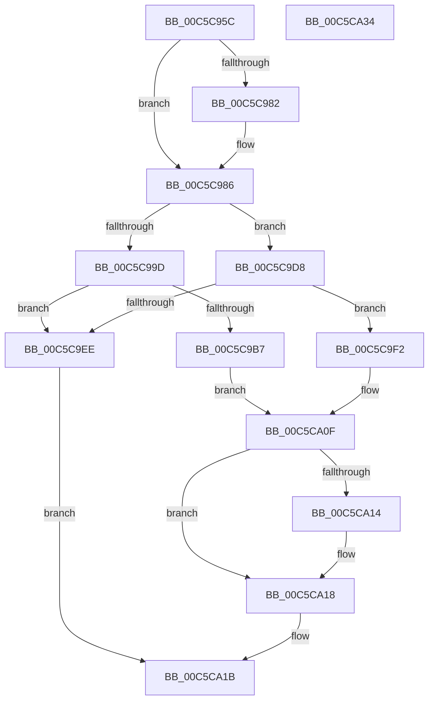

# CmpGetNodeName

- RVA: `0x00C5C95C`–`0x00C5CA35` (길이 `217` bytes)
- VA: `0x0000000140C5C95C`
- 실행 섹션: `INIT`
- PDB 이름 있음: `예`; PDB Function 태그: `아니요`
- unwind 정보 RVA: `0x00060300`
- 디코드: `66`개 명령, `217/217` bytes 표시
- 미해석 바이트: `0` (있으면 어셈블리에 `.byte`로 보존)

> 이 문서는 커널 이미지의 기계어와 PDB 기호를 분석해 생성했습니다. 4번과 5번은 함수 원형과 자료형을 바이너리 사용 방식에서 추정한 C 해석이며 원본 소스 복구 결과는 아닙니다.

## 1. Dependencies

- 직접 호출 지점: **4**; 고유 호출 대상: **3**
- 직접 호출자로 확인된 함수: **2**
- RIP 상대 이미지 참조: **0**

### Outgoing calls
- `0x00C5C9AA` → [guard_dispatch_icall](../../text/6B/guard_dispatch_icall_function_006BAAD0.md) (function, `0x006BAAD0`)
- `0x00C5C9C5` → [CmpCopyCompressedName](../../page/84/CmpCopyCompressedName_function_0084E0D0.md) (function, `0x0084E0D0`)
- `0x00C5C9E1` → [guard_dispatch_icall](../../text/6B/guard_dispatch_icall_function_006BAAD0.md) (function, `0x006BAAD0`)
- `0x00C5C9FE` → [memcpy](../../text/6C/memcpy_function_006C6840.md) (function, `0x006C6840`)

### Direct callers
- [CmpAddDriverToList](CmpAddDriverToList_function_00C5B758.md) at `0x00C5B806`
- [CmpIsLoadType](CmpIsLoadType_function_00C5CBF8.md) at `0x00C5CCB5`

### Static image references
- 디코드된 RIP-relative 메모리 참조가 없습니다.

## 2. Other-region calls and transfers

- 다른 실행 섹션으로 향하는 call: **4**
  - `0x00C5C9AA` → [guard_dispatch_icall](../../text/6B/guard_dispatch_icall_function_006BAAD0.md) (`INIT` → `.text`)
  - `0x00C5C9C5` → [CmpCopyCompressedName](../../page/84/CmpCopyCompressedName_function_0084E0D0.md) (`INIT` → `PAGE`)
  - `0x00C5C9E1` → [guard_dispatch_icall](../../text/6B/guard_dispatch_icall_function_006BAAD0.md) (`INIT` → `.text`)
  - `0x00C5C9FE` → [memcpy](../../text/6C/memcpy_function_006C6840.md) (`INIT` → `.text`)
- 별도 외부 분기/꼬리 이동을 확인하지 못했습니다.

## 3. Assembly (complete function range)

```asm
00C5C95C  48 89 5C 24 08                  mov qword ptr [rsp + 8], rbx
00C5C961  48 89 6C 24 10                  mov qword ptr [rsp + 0x10], rbp
00C5C966  48 89 74 24 18                  mov qword ptr [rsp + 0x18], rsi
00C5C96B  57                              push rdi
00C5C96C  41 56                           push r14
00C5C96E  41 57                           push r15
00C5C970  48 83 EC 20                     sub rsp, 0x20
00C5C974  45 33 FF                        xor r15d, r15d
00C5C977  4D 8B F0                        mov r14, r8
00C5C97A  48 8B F2                        mov rsi, rdx
00C5C97D  4D 85 C0                        test r8, r8
00C5C980  74 04                           je 0x140c5c986
00C5C982  66 45 89 38                     mov word ptr [r8], r15w
00C5C986  F6 42 02 20                     test byte ptr [rdx + 2], 0x20
00C5C98A  41 B8 43 4D 32 20               mov r8d, 0x20324d43
00C5C990  4C 8B 49 18                     mov r9, qword ptr [rcx + 0x18]
00C5C994  0F B7 5A 48                     movzx ebx, word ptr [rdx + 0x48]
00C5C998  49 8B C1                        mov rax, r9
00C5C99B  74 3B                           je 0x140c5c9d8
00C5C99D  66 FF C3                        inc bx
00C5C9A0  33 D2                           xor edx, edx
00C5C9A2  66 03 DB                        add bx, bx
00C5C9A5  0F B7 EB                        movzx ebp, bx
00C5C9A8  8B CD                           mov ecx, ebp
00C5C9AA  E8 21 E1 A5 FF                  call 0x1406baad0
00C5C9AF  48 8B F8                        mov rdi, rax
00C5C9B2  48 85 C0                        test rax, rax
00C5C9B5  74 37                           je 0x140c5c9ee
00C5C9B7  44 0F B7 4E 48                  movzx r9d, word ptr [rsi + 0x48]
00C5C9BC  4C 8D 46 4C                     lea r8, [rsi + 0x4c]
00C5C9C0  8B D5                           mov edx, ebp
00C5C9C2  48 8B C8                        mov rcx, rax
00C5C9C5  E8 06 17 BF FF                  call 0x14084e0d0
00C5C9CA  0F B7 CB                        movzx ecx, bx
00C5C9CD  48 D1 E9                        shr rcx, 1
00C5C9D0  66 44 89 7C 4F FE               mov word ptr [rdi + rcx*2 - 2], r15w
00C5C9D6  EB 37                           jmp 0x140c5ca0f
00C5C9D8  66 83 C3 02                     add bx, 2
00C5C9DC  33 D2                           xor edx, edx
00C5C9DE  0F B7 CB                        movzx ecx, bx
00C5C9E1  E8 EA E0 A5 FF                  call 0x1406baad0
00C5C9E6  48 8B F8                        mov rdi, rax
00C5C9E9  48 85 C0                        test rax, rax
00C5C9EC  75 04                           jne 0x140c5c9f2
00C5C9EE  33 C0                           xor eax, eax
00C5C9F0  EB 29                           jmp 0x140c5ca1b
00C5C9F2  44 0F B7 46 48                  movzx r8d, word ptr [rsi + 0x48]
00C5C9F7  48 8D 56 4C                     lea rdx, [rsi + 0x4c]
00C5C9FB  48 8B CF                        mov rcx, rdi
00C5C9FE  E8 3D 9E A6 FF                  call 0x1406c6840
00C5CA03  0F B7 C3                        movzx eax, bx
00C5CA06  48 D1 E8                        shr rax, 1
00C5CA09  66 44 89 7C 47 FE               mov word ptr [rdi + rax*2 - 2], r15w
00C5CA0F  4D 85 F6                        test r14, r14
00C5CA12  74 04                           je 0x140c5ca18
00C5CA14  66 41 89 1E                     mov word ptr [r14], bx
00C5CA18  48 8B C7                        mov rax, rdi
00C5CA1B  48 8B 5C 24 40                  mov rbx, qword ptr [rsp + 0x40]
00C5CA20  48 8B 6C 24 48                  mov rbp, qword ptr [rsp + 0x48]
00C5CA25  48 8B 74 24 50                  mov rsi, qword ptr [rsp + 0x50]
00C5CA2A  48 83 C4 20                     add rsp, 0x20
00C5CA2E  41 5F                           pop r15
00C5CA30  41 5E                           pop r14
00C5CA32  5F                              pop rdi
00C5CA33  C3                              ret
00C5CA34  CC                              int3
```

## 4. C-style interpretation (structured pseudocode)

```c
__int64 __fastcall CmpGetNodeName(__int64 a1, __int64 a2, __int64 a3)
{
    __int64 result;
    __int64 v_r15;
    __int64 v_rbx;
    __int64 v_rsp;
    unsigned __int64 v_stack_p10;
    unsigned __int64 v_stack_p18;
    unsigned __int64 v_stack_p8;

    v_stack_p8 = v_rbx;
    v_stack_p10 = v_rbp;
    v_stack_p18 = v_rsi;
    v_rsp = (v_rsp) - (32);
    v_r15 = 0;
    if (a3 != 0) {
        *(unsigned __int16 *)(a3) = 0;
    }
    if (((*(unsigned __int8 *)(a2 + 2)) & (32)) == 0) goto loc_00C5C9D8;
    v_rbx = (unsigned __int16)((*(unsigned __int16 *)(a2 + 72)) + 1);
    a2 = 0;
    v_rbx = (unsigned __int16)((v_rbx) + ((unsigned __int16)(v_rbx)));
    result = guard_dispatch_icall((unsigned int)((unsigned int)((unsigned __int16)(v_rbx))), a2, (unsigned int)(0x20324D43ULL), *(unsigned __int64 *)(a1 + 24));
    if (result == 0) goto loc_00C5C9EE;
    result = CmpCopyCompressedName(result, (unsigned int)((unsigned int)((unsigned __int16)(v_rbx))), a2 + 76, *(unsigned __int16 *)(a2 + 72));
    a1 = ((unsigned __int16)(v_rbx)) >> (1);
    *(unsigned __int16 *)(result + a1 * 2 - 2) = 0;
    goto loc_00C5CA0F;
loc_00C5C9D8:
    v_rbx = (unsigned __int16)((v_rbx) + (2));
    a2 = 0;
    result = guard_dispatch_icall((unsigned __int16)(v_rbx), a2, a2 + 76, *(unsigned __int16 *)(a2 + 72));
    if (result != 0) goto loc_00C5C9F2;
loc_00C5C9EE:
    result = 0;
    goto loc_00C5CA1B;
loc_00C5C9F2:
    result = memcpy(0, a2 + 76, *(unsigned __int16 *)(a2 + 72), *(unsigned __int16 *)(a2 + 72));
    result = ((unsigned __int16)(v_rbx)) >> (1);
    *(unsigned __int16 *)(result + result * 2 - 2) = 0;
loc_00C5CA0F:
    if (a3 != 0) {
        *(unsigned __int16 *)(a3) = (unsigned __int16)(v_rbx);
    }
loc_00C5CA1B:
    v_rsp = (v_rsp) + (32);
    return result;
}
```

## 5. (Beta) C Style

```c
int64_t CmpGetNodeName(void *Arg1, void *Arg2, int64_t Arg3)
{
    uint8_t *arg1 = (uint8_t *)Arg1;
    uint8_t *arg2 = (uint8_t *)Arg2;

    int64_t result;
    int64_t local_r15;
    int64_t local_rbx;
    int64_t local_rsp;
    uint64_t v_stack_p10;
    uint64_t v_stack_p18;
    uint64_t v_stack_p8;

    v_stack_p8 = local_rbx;
    v_stack_p10 = local_rbp;
    v_stack_p18 = local_rsi;
    local_rsp = (local_rsp) - (32);
    local_r15 = 0;
    if (Arg3 != 0) {
        *(uint16_t *)(Arg3) = 0;
    }
    if (((*(uint8_t *)(arg2 + 0x2)) & (32)) == 0) goto loc_00C5C9D8;
    local_rbx = (uint16_t)((*(uint16_t *)(arg2 + 0x48)) + 1);
    Arg2 = 0;
    local_rbx = (uint16_t)((local_rbx) + ((uint16_t)(local_rbx)));
    result = guard_dispatch_icall((uint32_t)((uint32_t)((uint16_t)(local_rbx))), Arg2, (uint32_t)(0x20324D43ULL), *(uint64_t *)(arg1 + 0x18));
    if (result == 0) goto loc_00C5C9EE;
    result = CmpCopyCompressedName(result, (uint32_t)((uint32_t)((uint16_t)(local_rbx))), Arg2 + 76, *(uint16_t *)(arg2 + 0x48));
    Arg1 = ((uint16_t)(local_rbx)) >> (1);
    *(uint16_t *)(result + arg1 * 2 - 0x2) = 0;
    goto loc_00C5CA0F;
loc_00C5C9D8:
    local_rbx = (uint16_t)((local_rbx) + (2));
    Arg2 = 0;
    result = guard_dispatch_icall((uint16_t)(local_rbx), Arg2, Arg2 + 76, *(uint16_t *)(arg2 + 0x48));
    if (result != 0) goto loc_00C5C9F2;
loc_00C5C9EE:
    result = 0;
    goto loc_00C5CA1B;
loc_00C5C9F2:
    result = memcpy(0, Arg2 + 76, *(uint16_t *)(arg2 + 0x48), *(uint16_t *)(arg2 + 0x48));
    result = ((uint16_t)(local_rbx)) >> (1);
    *(uint16_t *)(result + result * 2 - 0x2) = 0;
loc_00C5CA0F:
    if (Arg3 != 0) {
        *(uint16_t *)(Arg3) = (uint16_t)(local_rbx);
    }
loc_00C5CA1B:
    local_rsp = (local_rsp) + (32);
    return result;
}
```

### 관측된 메모리 오프셋

구조체 형식이 확인되지 않은 접근은 인자 기준의 오프셋으로만 기록했습니다.

| 기준 인자 | 오프셋 표현 | 폭 (bit) | 접근 |
|---|---:|---:|---|
| `Arg1` | `+ 0x18` | `64` | `R` |
| `Arg2` | `+ 0x2` | `8` | `R` |
| `Arg2` | `+ 0x48` | `16` | `R` |
| `Arg2` | `+ 0x4C` | `64` | `R` |

## 6. Execution-region graph

[열기: 2D/3D 그래프와 함수 탐색 컨트롤 패널](../../../control-panel.html?section=init&rva=0x00C5C95C&view=graph)

- 2D 그래프는 위에서 아래로 흐르고, 3D 그래프는 빈 공간을 드래그해 회전합니다. Shift+드래그는 이동, 휠은 확대·축소, 함수 노드 선택은 대상 보고서 이동입니다.

### Static fallback


