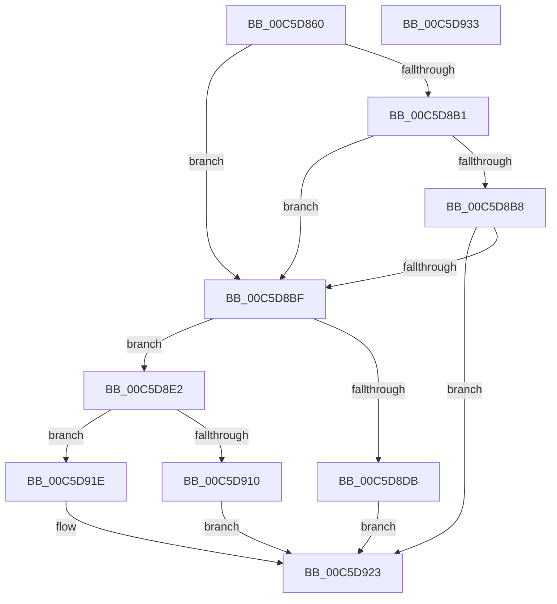

# CmpGetRegistryValue

- RVA: `0x00C5D860`–`0x00C5D934` (길이 `212` bytes)
- VA: `0x0000000140C5D860`
- 실행 섹션: `INIT`
- PDB 이름 있음: `예`; PDB Function 태그: `아니요`
- unwind 정보 RVA: `0x000718AC`
- 디코드: `60`개 명령, `212/212` bytes 표시
- 미해석 바이트: `0` (있으면 어셈블리에 `.byte`로 보존)

> 이 문서는 커널 이미지의 기계어와 PDB 기호를 분석해 생성했습니다. 4번과 5번은 함수 원형과 자료형을 바이너리 사용 방식에서 추정한 C 해석이며 원본 소스 복구 결과는 아닙니다.

## 1. Dependencies

- 직접 호출 지점: **5**; 고유 호출 대상: **4**
- 직접 호출자로 확인된 함수: **1**
- RIP 상대 이미지 참조: **0**

### Outgoing calls
- `0x00C5D885` → [RtlInitUnicodeString](../../text/42/RtlInitUnicodeString_function_0042A780.md) (function, `0x0042A780`)
- `0x00C5D8A8` → [ZwQueryValueKey](../../text/6A/ZwQueryValueKey_function_006AD3B0.md) (function, `0x006AD3B0`)
- `0x00C5D8CE` → [ExAllocatePool2](../../poolcode/B8/ExAllocatePool2_function_00B820F0.md) (function, `0x00B820F0`)
- `0x00C5D905` → [ZwQueryValueKey](../../text/6A/ZwQueryValueKey_function_006AD3B0.md) (function, `0x006AD3B0`)
- `0x00C5D915` → [ExFreePoolWithTag](../../poolcode/B8/ExFreePoolWithTag_function_00B82870.md) (function, `0x00B82870`)

### Direct callers
- [CmpSetSystemBiosInformation](CmpSetSystemBiosInformation_function_00C5A5D0.md) at `0x00C5A710`

### Static image references
- 디코드된 RIP-relative 메모리 참조가 없습니다.

## 2. Other-region calls and transfers

- 다른 실행 섹션으로 향하는 call: **5**
  - `0x00C5D885` → [RtlInitUnicodeString](../../text/42/RtlInitUnicodeString_function_0042A780.md) (`INIT` → `.text`)
  - `0x00C5D8A8` → [ZwQueryValueKey](../../text/6A/ZwQueryValueKey_function_006AD3B0.md) (`INIT` → `.text`)
  - `0x00C5D8CE` → [ExAllocatePool2](../../poolcode/B8/ExAllocatePool2_function_00B820F0.md) (`INIT` → `POOLCODE`)
  - `0x00C5D905` → [ZwQueryValueKey](../../text/6A/ZwQueryValueKey_function_006AD3B0.md) (`INIT` → `.text`)
  - `0x00C5D915` → [ExFreePoolWithTag](../../poolcode/B8/ExFreePoolWithTag_function_00B82870.md) (`INIT` → `POOLCODE`)
- 별도 외부 분기/꼬리 이동을 확인하지 못했습니다.

## 3. Assembly (complete function range)

```asm
00C5D860  48 8B C4                        mov rax, rsp
00C5D863  48 89 58 08                     mov qword ptr [rax + 8], rbx
00C5D867  48 89 70 10                     mov qword ptr [rax + 0x10], rsi
00C5D86B  57                              push rdi
00C5D86C  48 83 EC 40                     sub rsp, 0x40
00C5D870  83 60 20 00                     and dword ptr [rax + 0x20], 0
00C5D874  48 8B F9                        mov rdi, rcx
00C5D877  0F 57 C0                        xorps xmm0, xmm0
00C5D87A  48 8D 48 E8                     lea rcx, [rax - 0x18]
00C5D87E  0F 11 40 E8                     movups xmmword ptr [rax - 0x18], xmm0
00C5D882  49 8B F0                        mov rsi, r8
00C5D885  E8 F6 CE 7C FF                  call 0x14042a780
00C5D88A  45 33 C9                        xor r9d, r9d
00C5D88D  48 8D 44 24 68                  lea rax, [rsp + 0x68]
00C5D892  48 89 44 24 28                  mov qword ptr [rsp + 0x28], rax
00C5D897  48 8D 54 24 30                  lea rdx, [rsp + 0x30]
00C5D89C  83 64 24 20 00                  and dword ptr [rsp + 0x20], 0
00C5D8A1  48 8B CF                        mov rcx, rdi
00C5D8A4  45 8D 41 02                     lea r8d, [r9 + 2]
00C5D8A8  E8 03 FB A4 FF                  call 0x1406ad3b0
00C5D8AD  85 C0                           test eax, eax
00C5D8AF  79 0E                           jns 0x140c5d8bf
00C5D8B1  3D 05 00 00 80                  cmp eax, 0x80000005
00C5D8B6  74 07                           je 0x140c5d8bf
00C5D8B8  3D 23 00 00 C0                  cmp eax, 0xc0000023
00C5D8BD  75 64                           jne 0x140c5d923
00C5D8BF  8B 54 24 68                     mov edx, dword ptr [rsp + 0x68]
00C5D8C3  B9 40 00 00 00                  mov ecx, 0x40
00C5D8C8  41 B8 41 43 50 49               mov r8d, 0x49504341
00C5D8CE  E8 1D 48 F2 FF                  call 0x140b820f0
00C5D8D3  48 8B D8                        mov rbx, rax
00C5D8D6  48 85 C0                        test rax, rax
00C5D8D9  75 07                           jne 0x140c5d8e2
00C5D8DB  B8 9A 00 00 C0                  mov eax, 0xc000009a
00C5D8E0  EB 41                           jmp 0x140c5d923
00C5D8E2  48 8D 44 24 68                  lea rax, [rsp + 0x68]
00C5D8E7  4C 8B CB                        mov r9, rbx
00C5D8EA  48 89 44 24 28                  mov qword ptr [rsp + 0x28], rax
00C5D8EF  48 8D 54 24 30                  lea rdx, [rsp + 0x30]
00C5D8F4  8B 44 24 68                     mov eax, dword ptr [rsp + 0x68]
00C5D8F8  41 B8 02 00 00 00               mov r8d, 2
00C5D8FE  48 8B CF                        mov rcx, rdi
00C5D901  89 44 24 20                     mov dword ptr [rsp + 0x20], eax
00C5D905  E8 A6 FA A4 FF                  call 0x1406ad3b0
00C5D90A  8B F8                           mov edi, eax
00C5D90C  85 C0                           test eax, eax
00C5D90E  79 0E                           jns 0x140c5d91e
00C5D910  33 D2                           xor edx, edx
00C5D912  48 8B CB                        mov rcx, rbx
00C5D915  E8 56 4F F2 FF                  call 0x140b82870
00C5D91A  8B C7                           mov eax, edi
00C5D91C  EB 05                           jmp 0x140c5d923
00C5D91E  48 89 1E                        mov qword ptr [rsi], rbx
00C5D921  33 C0                           xor eax, eax
00C5D923  48 8B 5C 24 50                  mov rbx, qword ptr [rsp + 0x50]
00C5D928  48 8B 74 24 58                  mov rsi, qword ptr [rsp + 0x58]
00C5D92D  48 83 C4 40                     add rsp, 0x40
00C5D931  5F                              pop rdi
00C5D932  C3                              ret
00C5D933  CC                              int3
```

## 4. C-style interpretation (structured pseudocode)

```c
__int64 __fastcall CmpGetRegistryValue(__int64 a1, __int64 a2, __int64 a3, int a4)
{
    __int64 result;
    __int64 v_rsp;
    unsigned __int64 v_stack_m18;
    unsigned __int64 v_stack_m20;
    unsigned int v_stack_m28;
    unsigned __int64 v_stack_p10;
    unsigned __int64 v_stack_p20;
    unsigned __int64 v_stack_p8;

    *(unsigned __int64 *)(v_rsp + 8) = v_rbx;
    *(unsigned __int64 *)(v_rsp + 16) = v_rsi;
    v_rsp = (v_rsp) - (64);
    *(unsigned __int64 *)(v_rsp - 24) = v_xmm0;
    result = RtlInitUnicodeString(v_rsp - 24, a2, a3, a4);
    a4 = 0;
    v_stack_m20 = v_stack_p20;
    result = ZwQueryValueKey(a1, v_stack_m18, a4 + 2, a4);
    if (!sign_flag) goto loc_00C5D8BF;
    if (((unsigned int)(result)) == 0x80000005ULL) goto loc_00C5D8BF;
    if (((unsigned int)(result)) != 0xC0000023ULL) goto loc_00C5D923;
loc_00C5D8BF:
    result = ExAllocatePool2(64, (unsigned int)(v_stack_p20), (unsigned int)(0x49504341ULL), a4);
    if (result != 0) goto loc_00C5D8E2;
    goto loc_00C5D923;
loc_00C5D8E2:
    v_stack_m20 = v_stack_p20;
    v_stack_m28 = (unsigned int)((unsigned int)(v_stack_p20));
    result = ZwQueryValueKey(a1, v_stack_m18, 2, result);
    if (!sign_flag) goto loc_00C5D91E;
    a2 = 0;
    result = ExFreePoolWithTag(result, a2, 2, result);
    goto loc_00C5D923;
loc_00C5D91E:
    *(unsigned __int64 *)(a3) = result;
    result = 0;
loc_00C5D923:
    v_rsp = (v_rsp) + (64);
    return result;
}
```

## 5. (Beta) C Style

```c
int64_t CmpGetRegistryValue(int64_t Arg1, int64_t Arg2, void *Arg3, int32_t Arg4)
{
    uint8_t *arg3 = (uint8_t *)Arg3;

    int64_t result;
    int64_t local_rsp;
    uint64_t v_stack_m18;
    uint64_t v_stack_m20;
    uint32_t v_stack_m28;
    uint64_t v_stack_p10;
    uint64_t v_stack_p20;
    uint64_t v_stack_p8;

    *(uint64_t *)(local_rsp + 0x8) = local_rbx;
    *(uint64_t *)(local_rsp + 0x10) = local_rsi;
    local_rsp = (local_rsp) - (64);
    *(uint64_t *)(local_rsp - 0x18) = v_xmm0;
    result = RtlInitUnicodeString(local_rsp - 24, Arg2, Arg3, Arg4);
    Arg4 = 0;
    v_stack_m20 = v_stack_p20;
    result = ZwQueryValueKey(Arg1, v_stack_m18, Arg4 + 2, Arg4);
    if (!sign_flag) goto loc_00C5D8BF;
    if (((uint32_t)(result)) == 0x80000005ULL) goto loc_00C5D8BF;
    if (((uint32_t)(result)) != 0xC0000023ULL) goto loc_00C5D923;
loc_00C5D8BF:
    result = ExAllocatePool2(64, (uint32_t)(v_stack_p20), (uint32_t)(0x49504341ULL), Arg4);
    if (result != 0) goto loc_00C5D8E2;
    goto loc_00C5D923;
loc_00C5D8E2:
    v_stack_m20 = v_stack_p20;
    v_stack_m28 = (uint32_t)((uint32_t)(v_stack_p20));
    result = ZwQueryValueKey(Arg1, v_stack_m18, 2, result);
    if (!sign_flag) goto loc_00C5D91E;
    Arg2 = 0;
    result = ExFreePoolWithTag(result, Arg2, 2, result);
    goto loc_00C5D923;
loc_00C5D91E:
    *(uint64_t *)(arg3) = result;
    result = 0;
loc_00C5D923:
    local_rsp = (local_rsp) + (64);
    return result;
}
```

### 관측된 메모리 오프셋

구조체 형식이 확인되지 않은 접근은 인자 기준의 오프셋으로만 기록했습니다.

| 기준 인자 | 오프셋 표현 | 폭 (bit) | 접근 |
|---|---:|---:|---|
| `Arg3` | `+ 0x0` | `64` | `W` |

## 6. Execution-region graph

[열기: 2D/3D 그래프와 함수 탐색 컨트롤 패널](../../../control-panel.html?section=init&rva=0x00C5D860&view=graph)

- 2D 그래프는 위에서 아래로 흐르고, 3D 그래프는 빈 공간을 드래그해 회전합니다. Shift+드래그는 이동, 휠은 확대·축소, 함수 노드 선택은 대상 보고서 이동입니다.

### Static fallback


